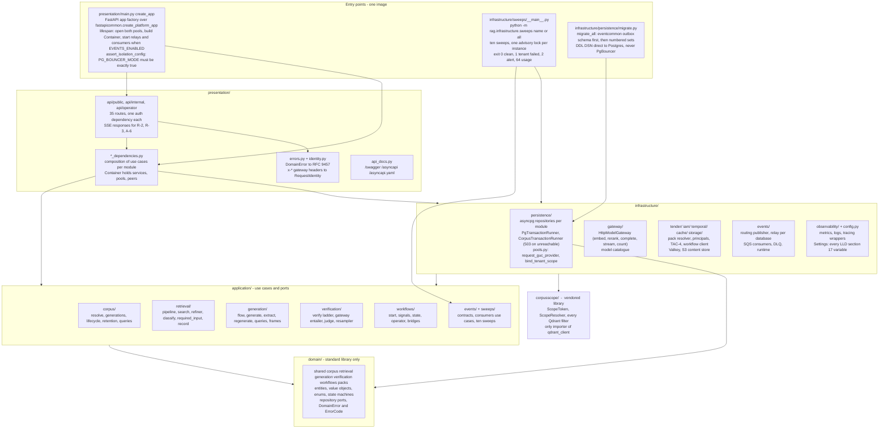
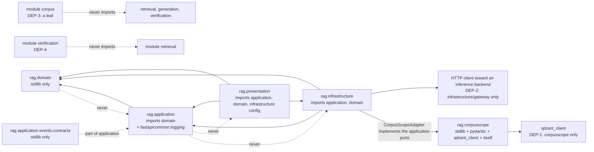
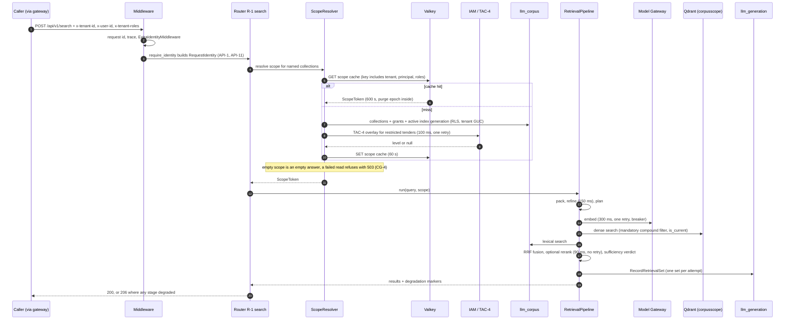
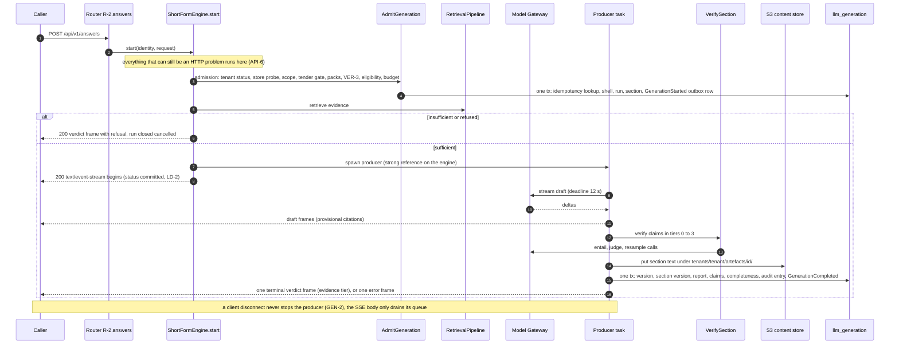
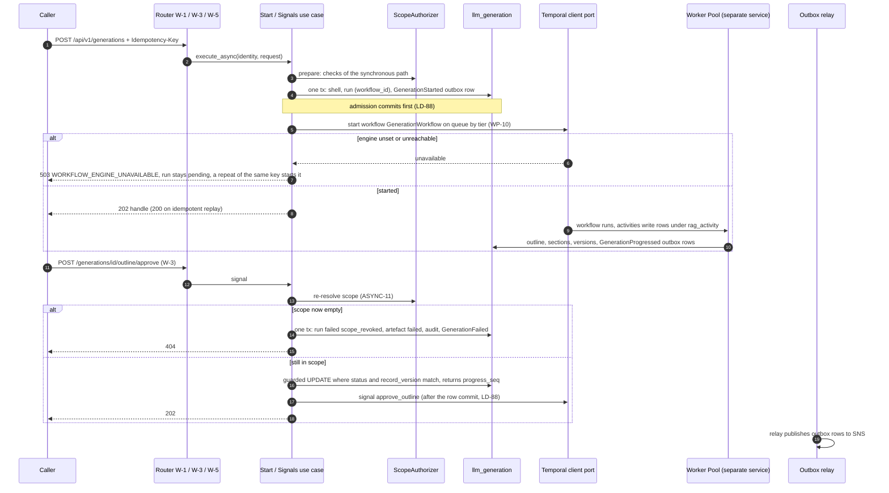
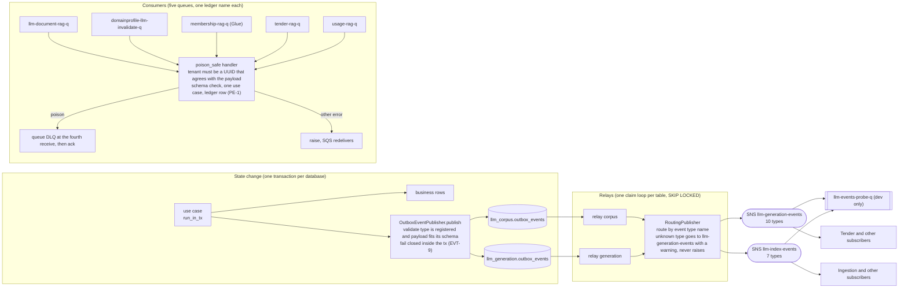
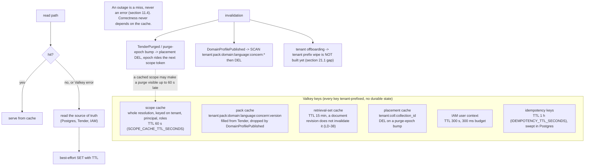
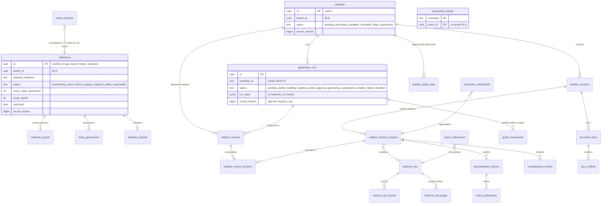
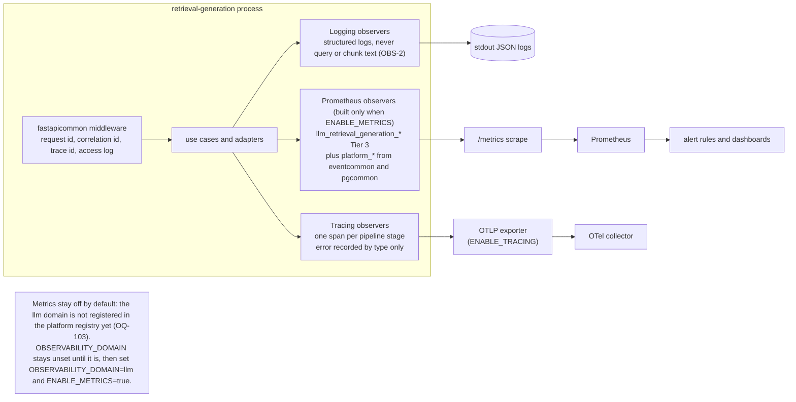
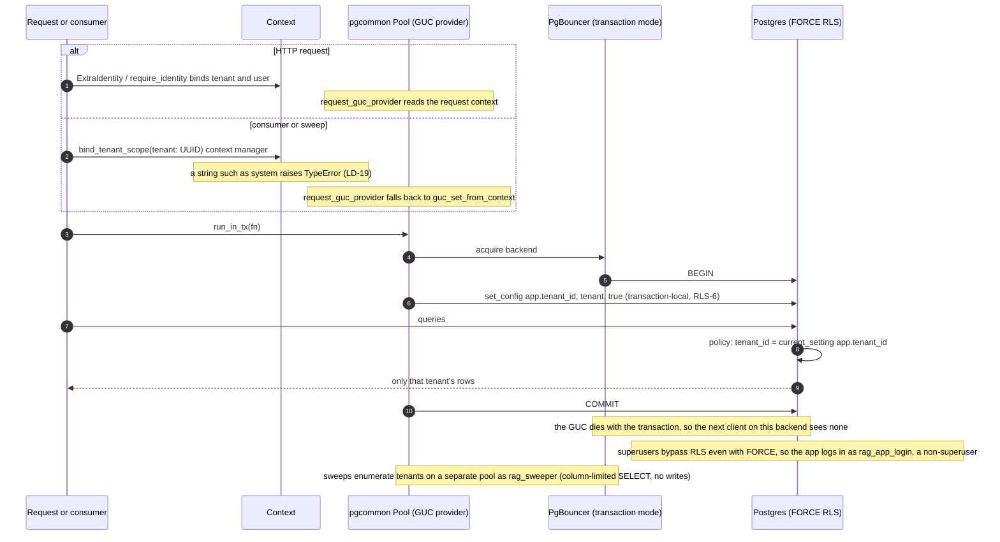

# Architecture

This document describes the internal structure, dependency rules, and runtime data flows of `llm-retrieval-generation`.

`llm-retrieval-generation` is a **private Python service** (`github.com/BCBP-SOLUTIONS-FZC-LLC/llm-retrieval-generation`, Python 3.15+, FastAPI) deployed as a containerised microservice plus CronJob sweeps from one image (image pipeline planned — see [VERSIONING.md](VERSIONING.md)). It implements the LLD `docs/lld/llm-lld-retrieval-generation-service.md`, which refines the LLM HLD (where they disagree, the HLD is authoritative). Build status and per-slice deviations are in [`docs/implementation-plan.md`](docs/implementation-plan.md).

It is one of four planned deployables of the LLM subsystem (HLD §5, MD-03): **Ingestion**, **Retrieval & Generation** (this repo), **Worker Pool** and **Model Gateway**. The Worker Pool and the Gateway's route configuration are not in this repo.

**Does not own:** documents, chunks, vectors and the lexical index (Ingestion); workflow and activity logic including every LangGraph graph (Worker Pool); model routing, provider credentials, residency and quota enforcement (Model Gateway); users, tenants, roles and memberships (IAM); Domain Profiles and Language Packs (Tender); the Tender section and review state machine.

---

## Layer model

The service is organised in concentric Clean Architecture layers crossed with six LLD modules (`corpus`, `retrieval`, `generation`, `verification`, `workflows`, `packs`) plus the vendored `corpusscope` library. Inner layers have **zero knowledge** of outer layers; dependencies always point inward.

> Source: [`docs/architecture/mermaid/layer-model.mmd`](docs/architecture/mermaid/layer-model.mmd)

| Layer | Responsibility | May import |
|---|---|---|
| `domain/` | Entities, value objects, enums, state machines (artefact, run, section, collection, index generation), pure domain services, repository ports, `DomainError` / `ErrorCode` | Standard library only |
| `application/` | Commands, queries, DTOs, use cases, outbound ports (`ModelGateway`, `ScopeAuthorizer`, `TransactionRunner`, `EventPublisher`, `WorkflowClient`, `ArtefactContentStore`, …), event **contracts** | `domain`, and from the platform only `fastapicommon.logging` (the logger); `events/contracts.py` is standard library only |
| `infrastructure/` | asyncpg repositories, gateway/Tender/IAM/Temporal/Valkey/S3 adapters, outbox relay and SQS consumers, sweeps, observability, `Settings` | `application`, `domain`, third-party SDKs |
| `presentation/` | FastAPI routers, request/response models, dependencies, error mapping, identity, SSE, docs routes, the app factory | `application`, `domain`, infrastructure config |
| `corpusscope/` | Scope tokens and resolver, every Qdrant filter, scoped reader | Standard library, pydantic, `qdrant_client`, itself |

---

## Package dependency graph

> Source: [`docs/architecture/mermaid/package-dependencies.mmd`](docs/architecture/mermaid/package-dependencies.mmd)

Enforced by `tests/architecture/test_dependency_rules.py` (an `ast` walk, not a convention):

- **Layering** as in the table above.
- **DEP-1** only `corpusscope` imports `qdrant_client`, and it may import nothing beyond the standard library, pydantic, `qdrant_client` and itself (so it can be vendored into the Worker Pool and Ingestion unchanged).
- **DEP-2** no module outside `infrastructure/gateway` builds an HTTP client toward an inference backend, and `gateway_base_url` is read only in the gateway adapter, the settings and the dependency wiring.
- **DEP-3** the `corpus` module imports none of `retrieval`, `generation`, `verification`: it is a leaf and must stay independently extractable (D-3).
- **DEP-4** `verification` never imports `retrieval`; it receives the retrieval set as data, so no verification path can trigger a fresh search.
- **DEP-5** (no write to Ingestion's document, chunk, vector or lexical tables; this service holds no Qdrant write grant) is held by **database role grants and the vector store's credentials**, not statically.
- **Database access** goes through `pgcommon` only: no module imports a driver or ORM (`asyncpg` sits under the library), `pgcommon` is imported by `infrastructure` and `presentation` only, and `persistence/pools.py`'s `pool_config` is the one place a pool's `Config` is built — tuning from `pgcommon`'s own `PG_*` parsing, DSN, pool size, PgBouncer mode and the tenant GUC provider from `Settings`. Statements run inside `run_in_tx`; errors are classified with the library's helpers. A conflict the repository itself must raise (COL-9) is `CollectionSlotConflict`, which carries SQLSTATE 23505 and the constraint name, so `pgcommon.is_unique_violation` treats it like the database's own error (`tests/architecture/test_database_access_only_through_pgcommon.py`).
- **CI-1** every mounted route declares an authentication dependency; C-M1 is the one named exemption (`tests/api/test_app.py`, walking `include_router` routes too).

---

## Request flow

The read hot path, R-1 search. Everything tenant-scoped happens after scope resolution, and scope resolution fails closed.

> Source: [`docs/architecture/mermaid/request-flow.mmd`](docs/architecture/mermaid/request-flow.mmd)

**Scope resolution** (`corpusscope.ScopeResolver`, behind the `ScopeAuthorizer` / `ScopeProvider` / `ScopeResolver` ports) has four branches — ordinary, restricted-tender, tenant-wide and reference collections — and produces a `ScopeToken` (canonical hash, 600 s) that carries the collection list, the purge epoch and the resolved level. Rules worth knowing:

- An **empty scope is an answer** (an empty list or an `INSUFFICIENT` verdict); a **failed read** of the scope store is `503 SCOPE_STORE_UNAVAILABLE` and never a default (CG-4).
- **Absent and ungranted resources are both `404`** (CG-8), so a caller cannot probe for existence.
- A tender's authorization switches at the **restriction event**, placement only at cutover (COL-8); an announced restriction takes effect immediately even while points are still being copied.
- An `active` collection with no activated index generation is an **empty corpus**, not an error (LD-61).
- The purge epoch rides the cached token, so a purge can be visible up to **60 s late** on a cache hit (deviation recorded in the implementation plan).

**Degradation.** Retrieval degrades stage by stage and says so: a failed embed, rerank or refine leaves a **degradation marker** on the response (`206`), lexical-only retrieval continues without the Gateway, and the sufficiency judge counts chunks only when there is no reranker.

---

## Generation flow (R-2 / R-3 / A-6)

The synchronous, streamed path. The status commits when the first byte of the body is written, so **every check that can still be an HTTP problem runs before the stream opens** (API-6, LD-2).

> Source: [`docs/architecture/mermaid/generation-flow.mmd`](docs/architecture/mermaid/generation-flow.mmd)

- **Two-phase stream (LD-22):** `draft` frames with provisional citations, then exactly one terminal `verdict` frame carrying the evidence tier — or one terminal `error` frame on the `200`. A blocking compliance scope suppresses the draft phase, because a delivered stream cannot be retracted.
- **Producer task:** the artefact write must outlive the client (GEN-2). The producer binds the tenant itself, holds a strong reference on the engine, and `Container.aclose` drains producers before closing the Gateway client and the pools.
- **Verification ladder:** tier 0 self-consistency, tier 1 span overlap, tier 2 entailment, tier 3 judge. The judge profile must differ from the draft profile (VER-3). The `RETRY` disposition is returned, **not acted on** here; the one regeneration is the workflow's loop.
- **Completion** is one transaction: version, section version, groundedness report, claims, completeness, audit-chain entry with the content digest, and the `GenerationCompleted` outbox row. The S3 put happens inside it, so an S3 failure rolls the transaction back.
- **Idempotency:** the same `Idempotency-Key` replays rather than re-runs; a failed or cancelled run releases its key.

---

## Workflow flow (W-1..W-8)

Long-form generation is a **Temporal workflow that this service starts and signals but does not run** (the Worker Pool does). This service owns the run row, the admission rules and the state reads.

> Source: [`docs/architecture/mermaid/workflow-flow.mmd`](docs/architecture/mermaid/workflow-flow.mmd)

- **Admission commits first, the engine call second, signals after the row commit (LD-88).** A failed start never closes the run: it stays `pending`, and a repeat of the same key starts it again.
- **Gate transitions are one guarded `UPDATE … WHERE status AND record_version`**; the returned `record_version` is the run's `progress_seq`.
- **Scope is re-resolved on every signal** (W-3, W-4, W-5, W-7). An empty scope ends the run `failed/scope_revoked` in one transaction (run, artefact, sections, audit entry, `GenerationFailed`) and answers `404`.
- **W-2 never reads Temporal**; state comes from the run, section and fact rows.
- **No engine configured** (`TEMPORAL_ADDRESS` empty) is a first-class state: async routes answer `503 WORKFLOW_ENGINE_UNAVAILABLE`, the orphan sweep skips, and the quota consumer refuses rather than report.
- **Run input carries no authority and no content** (`GenerationWorkflowInput` refuses authority and content keys); the activity re-reads scope itself. Contract: [`docs/worker-pool-contract.md`](docs/worker-pool-contract.md).

---

## Write flow and transactional outbox

Every state change and its event share one transaction (EVT-8): `TransactionRunner.run_in_tx(fn)`, and inside it `EventPublisher.publish(tx, event)`. Nothing is sent from the request path; delivery is the relay's job.

Two properties follow from the two-database design:

- **Each database has its own outbox.** Corpus events (C-I1, C-I4, C-I8, the lifecycle consumers) must commit with the `llm_corpus` change and a transaction cannot span the two databases, so `llm_corpus` carries `outbox_events` too. OBX-3's "one relay" is met as **one claim loop per table, all publishing through one routing publisher**.
- **Publishing fails closed.** `OutboxEventPublisher` raises inside the state change's transaction for an unregistered event type or a payload that does not fit its schema (EVT-9).

---

## Event and outbox flow

> Source: [`docs/architecture/mermaid/event-outbox-flow.mmd`](docs/architecture/mermaid/event-outbox-flow.mmd)

- **Routing.** `RoutingPublisher` picks the topic from the event type **by name** (PascalCase types match no prefix): 10 types to `llm-generation-events`, 7 to `llm-index-events`. It never raises on an unknown type — the relay would treat any undeclared error as non-retryable and dead-letter (delete) the row — so an unknown type goes to the default topic with a warning and a counter.
- **Relays** run in process when `EVENTS_ENABLED=true`; replicas run the same config and `SKIP LOCKED` splits the rows, so there is no leader election.
- **Consumers** run only for queues whose URL is set. Each handler binds the tenant (a UUID that must agree with the payload), validates the contract, runs one use case, and writes the inbox ledger row. Poison (a non-UUID tenant such as `system`, a schema violation, a forged event) is forwarded to the queue's DLQ and acknowledged; an unknown type is acknowledged and logged; anything else raises so SQS redelivers. `max_receive_count=3` makes the **fourth** receive the one that dead-letters (LD-86).
- **Ledger.** `processed_events` lives on `llm_generation`. The exactly-once effect (PE-1) holds for `llm_generation` effects; corpus-side consumers run an idempotent use case and then write the ledger row.
- **Glue.** The two IAM queues decode the Glue registry header. **Not built:** the Glue *encoder* for published events (LD-82).

Local inspection: `make events-peek` ([README](README.md#testing-domain-events-locally)).

---

## Cache strategy

> Source: [`docs/architecture/mermaid/cache-strategy.mmd`](docs/architecture/mermaid/cache-strategy.mmd)

Valkey holds no durable state and every key is tenant-prefixed. **A Valkey outage is a miss, never an error**: `ValkeyCache.get` returns `None` on any failure and `set` and `aclose` swallow errors. Invalidation is deliberately thin — the purge epoch is the only invalidation the service has — and the unbuilt parts (scope-cache `DEL` on collection writes, tenant-prefix wipe on offboarding) are recorded in the known gaps.

---

## Data model

Two databases, two ledgers, **no foreign key across them** (LLD §4.11). The diagram shows the shape; the full column catalogue is the migrations in `migrations/`.

> Source: [`docs/architecture/mermaid/data-model.mmd`](docs/architecture/mermaid/data-model.mmd)

- `llm_corpus` (5 tables): `collections`, `collection_grants`, `index_generations`, `retention_policies`, `tenant_lifecycle`.
- `llm_generation` (18 tables plus the library's outbox and inbox): artefacts and versions, sections and section versions, `generation_runs`, retrieval record, verification (`groundedness_reports`, `claim_verifications`, `completeness_checks`), facts and conflicts, refinements, `graph_checkpoints`, `artefact_audit_chain`; the library's `processed_events` ledger is granted to `rag_app`, not owned here.
- **Write authority** is per table and is enforced by roles: request handlers write as `rag_app`; the Worker Pool's activities write the activity tables as `rag_activity`; Ingestion holds no grant on our tables. **This service is the schema authority for all of them**, whichever deployable writes the rows.
- **Conventions (LD-103):** mutable tables carry `record_version`, `created_at`, `updated_at`, maintained by trigger, and an `UPDATE` that changes nothing is skipped; append-only tables carry none and reject updates (`reject_always`). Primary keys default to `uuidv7()` (PostgreSQL 18).
- **State machines in the database:** triggers enforce the artefact, run and section transition tables, index-generation status (a generation is activatable only when `verified`), and purged-row immutability. The audit chain is gapless and hash-linked (`audit_chain_append()`), verified by a sweep.

---

## Observability stack

> Source: [`docs/architecture/mermaid/observability-stack.mmd`](docs/architecture/mermaid/observability-stack.mmd)

Logs, spans and metrics go through `fastapicommon` and nothing else: every module logs with `get_logger` (the application layer is allowed that one platform import; `domain` imports nothing from the platform), and no module imports a logging, metrics or tracing SDK directly (`tests/architecture/test_shared_libs_only.py`). The adapters (`infrastructure/observability/`) wrap a Null observer with logging and tracing and add Prometheus collectors only when metrics are enabled and the registry is initialised. **Never logged or labelled:** query text, chunk text, refinement content, ids as message text, tenant or user as a label (OBS-2). Metric names are `llm_retrieval_generation_<metric>` (OBS-3); counters per band replace ratios and gauges stand in for running rates. Metrics are **off by default** until the `llm` domain is registered (OQ-103). See [`docs/observability/README.md`](docs/observability/README.md).

---

## Row-Level Security (RLS) and GUC injection

> Source: [`docs/architecture/mermaid/rls-guc-flow.mmd`](docs/architecture/mermaid/rls-guc-flow.mmd)

- Every table except `processed_events` and the outbox has `ENABLE` **and** `FORCE ROW LEVEL SECURITY` with a uniform `tenant_isolation` policy (`collections` and `collection_grants` use a read/write pair). Objects are owned by `rag_owner`, which `FORCE` then binds; nothing logs in as it.
- The tenant GUC is set **transaction-locally** by the pool's GUC provider. Behind PgBouncer in transaction mode a session-scoped `SET` would survive into the next client on that backend. CI greps `src/` and `migrations/` for a non-`LOCAL` `SET app.tenant_id` and fails (RLS-6).
- **`PG_BOUNCER_MODE` is a string that must be exactly `true`.** pgcommon parses booleans leniently, and a typo would silently turn transaction-local GUCs into session-scoped ones — a cross-tenant leak. `assert_isolation_config` runs in the app factory, before any pool exists.
- **Superusers bypass RLS even with `FORCE`.** The application and the tests log in as a non-superuser (`rag_app_login`, a member of `rag_app`); migrations use a separate DDL DSN directly against Postgres.
- **Cross-tenant sweeps** enumerate tenants as `rag_sweeper`: column-limited `SELECT`, a `FOR SELECT … USING (true)` policy per table, no writes, no `BYPASSRLS`. The runner refuses to start without the enumeration DSNs, because an empty tenant list looks like a healthy sweep. The enumeration DSNs go through PgBouncer like every other application connection (decision, 2026-10-29): the pool binds no tenant GUC and each listing is one statement in its own transaction, so transaction pooling is safe. Only migrations connect direct.

---

## Concurrency and optimistic locking

- **Optimistic locking** on every versioned row: `UPDATE … WHERE id = $1 AND record_version = $2`; the trigger owns the column and application code never sets it. A stale write is `409 OPTIMISTIC_LOCK_CONFLICT`; P-6 uses `record_version` to distinguish create (none) from update.
- **Guarded gate transitions** (W-3/W-4/W-5/W-7) are one conditional `UPDATE`, so concurrent approvals produce one winner.
- **Concurrent first documents** compute one deterministic primary key (UUIDv5 over exactly `uq_coll_tender`'s key), so the race resolves on insert (`ON CONFLICT DO NOTHING` plus an existence check); a real slot conflict under a different id still raises (COL-9).
- **Two regenerations of one section** are refused while the first holds the section `generating`, because the section machine has no `generating → generating` edge; sections of one artefact regenerate concurrently, and A-6 never writes the artefact row.
- **Sweeps** take `pg_try_advisory_xact_lock` per instance and skip when it is held; session locks do not survive PgBouncer transaction mode.
- **Fan-out** is bounded: 5 per document, 10 per tenant, 100 global (`FANOUT_MAX_*`).

---

## Failure domains

Every dependency failure has one defined behaviour; none is answered with a default.

| Failure | Behaviour |
|---|---|
| `llm_corpus` unreachable | `503 SCOPE_STORE_UNAVAILABLE` (the corpus runner maps connection-class errors); no default scope |
| `llm_generation` unreachable | Writes and reads of the generation record fail; request-scoped errors surface as `503`/`500` per the taxonomy |
| Model Gateway unavailable | Retrieval serves lexical-only with a degradation marker; generation `503`; quota or residency refusal is surfaced as such, never retried |
| Gateway tokenizer unavailable | Token counts fall back to a 3-characters-per-token over-estimate; the call never fails |
| Qdrant unavailable | Scope and dense search refuse (`503`); lexical-only retrieval is not offered for an unresolved scope |
| Valkey unavailable | Cache miss; the source of truth is read |
| IAM TAC-4 unavailable or non-200 | The request is refused (CG-4); a successful `null` level is "no access" (CG-5) |
| IAM LLM context unavailable | Layer 3 is omitted from the prompt |
| Tender pack resolution unavailable | Cached pack serves; uncached fails closed |
| Temporal unset or unreachable | Async routes `503 WORKFLOW_ENGINE_UNAVAILABLE`; the run stays `pending` and a repeat restarts it |
| S3 unavailable | Content reads `503 ARTEFACT_CONTENT_UNAVAILABLE`; completion rolls back |
| SNS unavailable | The outbox row stays and is retried (`OUTBOX_MAX_ATTEMPTS`); the state change is not blocked |
| Poison event | DLQ at the fourth receive, acknowledged |
| Client disconnect mid-stream | The artefact write completes (GEN-2); delivery is recorded as `disconnected` |
| `DR_MODE=true` | The four destructive sweeps and tenant purge are disabled in the use case itself |

---

## Key invariants

| Invariant | Meaning | Enforced by |
|---|---|---|
| ISO-1.. / RLS-1 | A tenant sees only its rows | `FORCE` RLS + tenant GUC; mandatory Qdrant compound filter |
| RLS-6 | The GUC is transaction-local | Pool GUC provider; CI grep; `PG_BOUNCER_MODE` assertion |
| CG-4 / CG-8 | Fail closed; absent and ungranted are indistinguishable | `ScopeResolver`; routes answer `404` |
| COL-8 | Authorization switches at the restriction event, placement at cutover | Two-row promotion, atomic cutover |
| EVT-8 / EVT-9 | State change and event in one transaction; unregistered or off-schema events never leave | `OutboxEventPublisher` |
| GEN-2 | A disconnect cannot stop the artefact write | Producer task on the engine |
| VER-3 | Judge profile differs from draft profile | Admission |
| ART-9 | Purge deletes every object and row of a tender or tenant | Tenant-prefixed S3 keys, purge use cases |
| AC-* | The audit chain is append-only, gapless and hash-linked | Trigger functions + the verifier sweep (exit 2 on a break, never self-healed) |
| LD-103 | Version, created and updated columns by trigger | Migrations |
| API-1 | Identity comes only from gateway headers | `require_identity` / `require_tenant` |

---

## Deployment

**Partly planned.** A `Dockerfile` exists (`make docker-build`); the Helm chart is in `deploy/helm/` (never applied to a cluster) and `release.yml` builds, scans, boot-tests, pushes and signs the image on a version tag (never run) — see the *Planned* table in [VERSIONING.md](VERSIONING.md#planned-not-yet-in-place). **Merge gate:** `main` is the default branch under the organisation ruleset `protect-main-branch` (PR, code-owner approval, six checks: `Build image (cache)`, `Trivy CVE scan`, `Smoke tests`, `Validate / Quality / quality`, `Validate / Test / test`, `PR summary`, all produced by `ci.yml`). The checks have not completed on GitHub yet: Actions jobs did not start because of an account billing limit. `make trivy` and the pre-push hook are the local equivalent of the CVE scan. The shape:

- **One image, three entrypoints:** the API (`uvicorn --factory rag.presentation.main:create_app`), the migration job (`python -m rag.infrastructure.persistence.migrate`) and the sweep runner (`python -m rag.infrastructure.sweeps <name>|all`) as CronJobs.
- **Migration safety:** migrations run from a one-shot job directly against Postgres (never PgBouncer: the advisory lock is session-scoped), before the new image takes traffic, and must be safe while the previous image still serves (additive first, destructive in a later release).
- **PgBouncer** in transaction mode with `PG_MAX_CONNS` equal to its pool size for the database/user pair.
- The `api/` and `docs/swagger/` files ship with the package; `/asyncapi` and `/swagger` read them from the repo root.

---

## Testing strategy

| Layer | Location | Needs | What it proves |
|---|---|---|---|
| Unit | `tests/unit/` | Nothing | Domain rules, settings, codecs, adapters' failure paths, generated-spec drift |
| Use case | `tests/usecase/` | Nothing | Use cases over in-memory fakes that emulate the unique indexes and the version trigger |
| API | `tests/api/` | Nothing | Routes, status mapping, the SSE contract, the HTTP-versus-frame boundary |
| Events, isolation, architecture | `tests/events/`, `tests/isolation/`, `tests/architecture/` | Nothing | Consumers and relay, scope isolation, layering and DEP rules |
| Repository, integration | `tests/repository/`, `tests/integration/` | Docker (`postgres:18`) | RLS under `FORCE`, triggers, grants, concurrency, migrations |
| End to end | `tests/e2e/` | Docker | The real app over a real RLS Postgres: flows, security, error shape, infra |

Coverage is about 97.8% for unit + integration, gated at 95% in CI. Coverage is a floor, not the argument: the isolation tests (`tests/repository`, `tests/e2e/test_security.py`) are the ones that must never be weakened. Fakes cannot catch what Postgres catches — the integration run found a real bug (`asyncpg` refusing a `UUID` for a `$1::text` lock key) and a real race (`uq_coll_tender`) that the fakes missed.

---

## Consumer conformance checklist

For a service that **consumes this service's events** (Tender, Ingestion, Worker Pool, Usage):

- Read `type` and `data` from the envelope; **`tenant_id` is only in the envelope**, never in `data`.
- Treat unknown `data` fields as additive — every schema allows additional properties (LD-65). A renamed or removed field is a breaking change ([VERSIONING.md](VERSIONING.md)).
- Subscribe with an `EventType` filter per queue; do not assume ordering across types.
- Be idempotent on the envelope `id`: delivery is at least once.
- `GenerationStarted` is emitted at every admission; **no event is emitted for a failed or cancelled run** (audit entries only).
- The evidence tier values, in order, are `NOT_COMPUTED`, `INSUFFICIENT`, `PARTIAL`, `SUPPORTED`; map them to display on your side.
- Events are **not yet framed with the Glue header** (LD-82); do not require `dataschema` until that lands.

---

## Schema lifecycle

Event JSON Schemas are **derived, not authored**: the dataclasses in `application/events/contracts.py` are the source, pydantic `TypeAdapter`s in `infrastructure/events/schemas.py` produce both the runtime validation and the files in `schemas/events/`, and `make swag` regenerates them together with `api/asyncapi.yaml`. A test fails when a committed file drifts. `make schema-validate` runs `platform-schemagov` (Docker, `linux/amd64`) over the directory; `make schema-diff CURRENT=… PROPOSED=…` compares two versions. Registering schemas with the Glue registry is **not wired**.

---

## Threat model

| Threat | Mitigation |
|---|---|
| Cross-tenant read through SQL | `FORCE` RLS, non-superuser login, transaction-local GUC, grants per role; isolation tests |
| Cross-tenant read through the vector store | One mandatory compound filter in `corpusscope` (`is_current` unrelaxable); only importer of `qdrant_client` |
| Forged identity headers | Identity trusted only from the gateway; internal routes need mesh mTLS and NetworkPolicy; ISO tests per route |
| Probing for existence | Absent and ungranted are the same `404`; empty scope is an empty answer |
| Prompt injection from retrieved content | Six-layer prompt with authority and cacheability per layer, nonce boundary, pack-regex input screening; retrieved text never in the cached prefix |
| Ungrounded output presented as fact | Tiered verification, evidence tiers on every response, unsupported claims surfaced and blocking for compliance sections |
| Forged or poison events | Tenant must be a UUID agreeing with the payload; schema validation; DLQ at the fourth receive |
| Tamper with the audit record | Append-only hash chain, immutability triggers, verifier sweep that pages on a break |
| Data left behind after erasure | Tenant-prefixed S3 keys, purge by prefix, purge-epoch markers on retrieval sets; **gap:** Valkey keys and evaluation samples are not yet reached |
| Content in logs and metrics | Bounded label vocabularies, no query or chunk text, no ids as message text |
| Secret handling | No provider credential in this service; `.env` never committed; KMS encryption context carries the tenant |
| Output content safety | **Not this service's** — Tender's (§15.3) |

### Connection budget

Every pool opens through PgBouncer except the migration job's, which connects directly (the migration lock is session-scoped, and `migration_dsn` refuses an empty migration DSN outside `local` / `dev` / `test`).

| Client | Connections to PgBouncer (at most) |
|---|---|
| API pod (relays and consumers share its pools) | `2 x PG_MAX_CONNS` (corpus and generation; 20 at the default 10) |
| Sweep pod, one per running CronJob | `2 x PG_MAX_CONNS` (tenant pools) `+ 2 x SWEEP_POOL_MAX_CONNS` (enumeration pools; 24 at the defaults) |

Size from the peak: API pods at `maxReplicas` (8 in the base values, so 160) plus the sweep pods that can overlap (ten CronJobs, each `Forbid` against itself only). `MAX_CLIENT_CONN` must exceed that sum. `DEFAULT_POOL_SIZE` is per database and user pair and is shared by every client, so with several replicas it must cover the concurrent transactions of all of them, not one pod's `PG_MAX_CONNS`; the runbook's "`PG_MAX_CONNS` equals `pool_size`" holds for a single pod only. Postgres `max_connections` must cover `pool_size` for each pair, the direct migration and admin sessions, and headroom. These numbers are derived from the settings, not measured: confirm them under load.

### Trust boundary

Identity (`x-tenant-id`, `x-user-id`, `x-tenant-roles` and the four service-owned headers) is **trusted as received**: this service validates no token. That is correct only while nothing but the gateway and named in-cluster callers can reach the pod, so the boundary is the network, not the code.

| Control | Where | State |
|---|---|---|
| The gateway strips client-supplied identity headers and sets its own from the verified token | Platform gateway (not this repo) | Assumed; confirm with the platform team |
| Only the gateway namespace, the listed `callers` and (when enabled) Prometheus may reach port 8080 | `deploy/helm/templates/networkpolicy.yaml`, `values.yaml` (`networkPolicy`, `callers`) | In the chart, never applied to a cluster |
| `/api/v1/internal/*` is not routed through the ingress | `deploy/helm/templates/httproute.yaml` / `ingress.yaml` (explicit path list) | In the chart |
| Service-to-service mTLS (mesh AuthorizationPolicy) so a pod in an allowed namespace still needs an identity | Platform mesh | **Not present**: the chart has no mesh policy, so an allowed namespace is trusted as a whole until pod-level `podSelector`s are set in `callers` |
| Per-route ISO tests prove a request without the headers or with a mismatched tenant is refused | `tests/isolation/`, `tests/e2e/test_security.py` | Enforced in CI |

Consequences: do not expose the pod on a `NodePort`/`LoadBalancer`; do not add a `callers` entry with an empty `podSelector` for a namespace you do not fully trust; and treat `networkPolicy.enabled=false` as a tenant-impersonation hole, not a convenience (the chart prints a warning).

---

## Developer tools

| Tool | Where |
|---|---|
| `make` targets | [README](README.md#common-commands) |
| Swagger UI and the event catalogue | `/swagger`, `/asyncapi` on a running instance |
| floci-ui | http://localhost:4501 (queue and topic counts, not message bodies) |
| `make events-peek` | Prints events waiting in the dev probe queue without consuming them |
| `.githooks/pre-commit` | Runs `fmt-check`, `lint`, `typecheck`, `swag-check` (and `lock-check` when the lockfile inputs are staged) before every commit; `make install-hooks` |
| `.githooks/pre-push` | Runs `make trivy` (build the image, CVE-scan it as `release.yml` does) before every push; needs Docker; `--no-verify` bypasses |
| `make trivy` | The release CVE gate locally: CRITICAL/HIGH findings with a fix fail; local `trivy` or the `TRIVY_IMAGE` container |
| `.claude/` | AI-assisted development: [`.claude/CLAUDE.md`](.claude/CLAUDE.md) and the reference notes; `settings.json` hooks (format Python on edit, block edits to generated files); skills `pr-check` and `peer-contract-check`; read-only agents `security-reviewer` and `rls-reviewer` |

---

## Session-specific decisions

Decisions that deviate from, or fill a gap in, the LLD, with their reasons, are kept in [`docs/implementation-plan.md`](docs/implementation-plan.md) (per slice, "Deviations / decisions to confirm" and "Assumed contracts"). The ones that need another team's sign-off are listed in the CHANGELOG under *Known gaps*.

---

## Documentation assets

| File | Purpose |
|---|---|
| [`docs/architecture/mermaid/*.mmd`](docs/architecture/mermaid/) | Standalone sources of every diagram above; this file embeds them verbatim |
| [`docs/architecture/README.md`](docs/architecture/README.md) | Index of the diagram sources |
| [`docs/lld/llm-lld-retrieval-generation-service.md`](docs/lld/llm-lld-retrieval-generation-service.md) | The design |
| [`docs/implementation-plan.md`](docs/implementation-plan.md) | Build status, traceability matrix, assumptions |
| [`docs/worker-pool-contract.md`](docs/worker-pool-contract.md) | What the Worker Pool must honour |
| [`docs/observability/`](docs/observability/README.md) | Metrics, alerts, tracing; operational runbooks |
| [`docs/swagger/`](docs/swagger/) · [`api/`](api/) | Generated REST and event contracts |
