# Retrieval & Generation Service — Low-Level Design

## Tender Management SaaS Platform — LLM Subsystem

| Field | Value |
|---|---|
| Document type | Low-Level Design (LLD) |
| Service | `retrieval-generation` (Retrieval & Generation Service) |
| Base HLD | `LLM Service High-Level Design` v0.29 (§7 Retrieval, §8 Generation) |
| Template reference | `iam-lld-org-membership-service 5 (1).md` rev 2.26 |
| Sibling LLDs | `llm-lld-ingestion-service.md` (in progress, separate author), no `llm-lld-model-gateway.md` is written: the Model Gateway is Envoy AI Gateway, self-run (LD-68), its route configuration files in this repository are the specification and §22.1 carries the contract (LD-69, §20 OQ-92), `llm-lld-worker-pool.md` (this subsystem's own deployable, not yet written, and the home of the workflow and activity logic that §9 only bounds by contract) |
| Upstream designs | Tender HLD v0.6 (21-Sep-2026), IAM HLD v1.56, IAM User Profile LLD, IAM Org & Membership LLD rev 2.26 |
| Deployment stage | Design only — no code, no environment |
| Status | **Draft for TL review.** Not signed off. Every decision marked *LLD decision* is new here and is not carried by the HLD |

> **Scope note.** This document refines HLD §7 and §8 into an implementable specification for one deployable. It does not restate the HLD. Where this document and the HLD disagree, the disagreement is **explicit and recorded in §20** rather than silently resolved. The HLD remains authoritative until a flagged item is signed off. Where this document decides something the HLD leaves to LLD, the decision is marked *LLD decision* inline.

---

## Table of Contents

1. [Document Overview](#1-document-overview)
2. [Service Responsibilities and Boundaries](#2-service-responsibilities-and-boundaries)
3. [Architecture and Module Layout](#3-architecture-and-module-layout)
4. [Data Model](#4-data-model)
5. [API Contract](#5-api-contract)
6. [Retrieval Pipeline](#6-retrieval-pipeline)
7. [Generation and Prompt Composition](#7-generation-and-prompt-composition)
8. [Quality, Verification, and Evidence](#8-quality-verification-and-evidence)
9. [Asynchronous Workflows and Worker Pool Contracts](#9-asynchronous-workflows-and-worker-pool-contracts)
10. [Regeneration and the Refiners](#10-regeneration-and-the-refiners)
11. [Caching Design](#11-caching-design)
12. [Event Architecture](#12-event-architecture)
13. [Key Request Flows](#13-key-request-flows)
14. [Concurrency, Consistency, and Failure Handling](#14-concurrency-consistency-and-failure-handling)
15. [Security](#15-security)
16. [Observability](#16-observability)
17. [Configuration](#17-configuration)
18. [Deployment and Scaling](#18-deployment-and-scaling)
19. [Testing Strategy](#19-testing-strategy)
20. [Open Questions and Sign-off Register](#20-open-questions-and-sign-off-register)
21. [Data Lifecycle and Compliance](#21-data-lifecycle-and-compliance)
22. [Integration Details](#22-integration-details)
23. [Index Generation and Pack Compatibility](#23-index-generation-and-pack-compatibility)
24. [Appendix — Error Taxonomy](#24-appendix--error-taxonomy)
25. [Appendix — Design Decisions](#25-appendix--design-decisions)
26. [Appendix — Invariant Index](#26-appendix--invariant-index)
27. [Revision history](#27-revision-history)

---

## 1. Document Overview

This is the low-level design for the **Retrieval & Generation Service**. The HLD plans four deployables for the LLM subsystem (HLD §5, MD-03: Ingestion, Retrieval & Generation, Worker Pool, Model Gateway). This document specifies one of them. The Model Gateway is Envoy AI Gateway, renamed Agent Router in September 2026. The LLM subsystem owns, runs and configures it (LD-68, §20 OQ-92). The Worker Pool runs each long-form run as a Temporal workflow of this subsystem (Temporal is a durable job runner that survives restarts). The company's Workflow Engine is reached only through Tender (§9.1, LD-88). The Retrieval & Generation Service is the subsystem's synchronous query, answer, drafting, and generation API. It owns the corpus's logical structure, meaning collections, grants and retention policies, although the Ingestion Service owns the corpus's contents.

**Retrieval and generation are one service, not two.** They share traffic shape, they share the HLD §3.5 latency chain, and they share a failure blast radius: a retrieval failure and a generation failure present to the caller identically and are handled by the same degradation ladder. Splitting them would add a network hop to a 400 ms budget. It would give no scaling benefit, because both scale on the same RPS (requests per second) signal (§5.3). The seam that does matter is corpus administration. It stays a module boundary, enforced by HTTP and by the absence of a database grant (D-3), and is not a second deployable.

The service sits downstream of the Tender Service. Tender supplies Domain Profiles, Language Packs (Tender's per-domain and per-language configuration; §1.5) and documents. The service sits upstream of the Model Gateway, which is the only route to inference (MD-06). It works alongside the Worker Pool, which runs the long-form runs this service starts as Temporal workflows (§9.1, LD-88). The Workflow Engine is reached only through Tender, which starts and completes its tickets (§22.7).

### 1.1 Relationship to the HLD

| HLD section | What it specifies | Where this LLD refines it |
|---|---|---|
| §4.1 | Architectural principles, write-authority split | §2.3, §4.1, §14 |
| §4.2 | Tenant isolation per asset | §4.8, §6.1, §15.1 |
| §4.4 | Retrieval and generation read path | §6, §13 |
| §4.5 | Two execution paths | §5.1, §9.1 |
| §4.6 | Client delivery | §7.4, §9.5 |
| §4.8 | Degradation ladder | §14.3 |
| §5.3 | Service responsibilities | §2, §3 |
| §7.1–§7.10 | Retrieval architecture | §6 |
| §7.8 | Caching | §11 |
| §8.1–§8.3 | Generation contract, prompt composition, extraction | §7 |
| §8.4 | Long-form generation | §9 |
| §8.5–§8.6 | Verification and completeness | §8 |
| §8.7 | Regeneration and the Instruction Refiner | §10 |
| §8.8 | Artefact ownership boundary and evidence tier | §8.4–§8.5 |
| §8.9 | Generation eligibility | §7.6 |
| §12.2–§12.4 | Events published and consumed | §12 |
| §13.2–§13.3 | IAM and Tender integration | §22 |
| §15 | Observability and evaluation | §16, §19.5 |
| §16.3 | Compliance and erasure | §21 |

### 1.2 What this document decides, and what it defers

Three categories, kept separate throughout:

- **Refinements.** The HLD states a property; this document makes it mechanical. Example: MD-26 declares a section context budget; §6.8 gives its allocation, tokenizer, and trim order.
- **LLD decisions.** The HLD is silent and the decision is ours. Example: the two-phase streaming response (§7.4). Every one is marked *LLD decision* and appears in §25.
- **Flagged disagreements.** The HLD is internally inconsistent, or this document takes a different position. Example: HLD §4.2's universal compound filter against HLD §7.3's cross-tenant reference collections. Recorded in §20 with a proposed resolution and an owner; **not** resolved unilaterally.

§20 carries 112 items (rev 2.124, OQ-111) across the second and third categories. None is cosmetic, and the third category is the review's priority.

### 1.3 How a request moves through the service

Read this first. It is a plain walk-through, and every step names the section that specifies it.

A caller's request arrives through the gateway, which adds identity headers (tenant, user, departments, roles). From there:

1. **Scope.** The service works out which collections this caller may search and records the answer in a short-lived *scope token* (§6.2, §6.3). A restricted tender is checked live with IAM (§4.7.2).
2. **Configuration.** It loads the tenant's *Domain Profile* from Tender, from cache or by a call on a miss (§6.1).
3. **Query.** It refines a vague query, plans the search and embeds the query (§6.5, §6.7).
4. **Search.** A dense (vector) search in Qdrant and a lexical (full-text) search in Postgres run in parallel, are merged by *RRF fusion* and are reranked (§6.7).
5. **Evidence.** The best chunks are assembled to a budget, and the service judges whether they are *sufficient*: enough, not enough, or failed (§6.8, §6.9).
6. **Answer or draft.** For an answer or a draft, the prompt is assembled in six layers, screened and sent to the Model Gateway. The draft streams first and a *verdict* follows once every claim has been checked. Verification has four tiers. First, every section has each claim matched to its cited text. Second, a small entailment check (does the evidence imply the claim) runs where the first tier flags a problem. Third, a model judge decides claims that stay uncertain. Fourth, compliance sections get a second generation compared claim by claim (§7, and the tier table in §8).
7. **Record.** The result, called an *artefact*, is written with its provenance in one transaction together with the event to publish, and the event is sent afterwards (§4.3, §12).

This service starts a Temporal workflow for the run. The Worker Pool runs each phase (outline, stage 1, stage 2, coherence check) as a step of that workflow. A human reviews the outline between phases. The workflow waits for the approval as a signal and for its deadline as a timer. Tender approves the outline through this service's route and completes the Workflow Engine tickets itself. This service makes no call to the Workflow Engine. Progress is read from this service's own tables (§9, LD-60, LD-88).

**Regeneration** produces a new version of a section or document and keeps the earlier one (§10). **Ingestion** is a separate service that owns the documents. It calls this service for the collection each document belongs to, activates a new index version, and reports the result of a restricted-tender move (§5.7.16).

### 1.4 How to read this document

- **Section references.** `§N.M` is a section of this document. `HLD §N.M` is the subsystem HLD. Other teams' documents are named in full.
- **What you can skip to build.** §20 (open questions), §25 (decisions) and §27 (revision history) record why the design is what it is. You do not need them to implement it.
- **Struck-through text** appears only in §20 and §27 (the register and the revision history). Every other section states the current design.
- **`rev N.N`** names the revision that made a change. §27 lists them.
- ***LLD decision*** marks something the HLD left open and this document decided. Every one is listed in §25.
- **Rule identifiers.** A short code such as `SCOPE-5` or `COL-8` names one rule. The rule is stated where it is defined, and §26 maps each family of codes to its section. The families are:

| Prefix | What the rules are about | Where |
|---|---|---|
| `OQ-n` | An open question: something still unanswered, with an owner | §20 |
| `LD-n` | A design decision this document took, with its reason | §25 |
| `MD-n`, `D-n`, `FE-n` | HLD decisions (locked, open, and future enhancements) | HLD §21 |
| `WP-n` | Something this design expects of the Worker Pool deployable | §9.3 |
| `SCOPE-`, `RET-`, `CACHE-` | Scope resolution, the retrieval pipeline, cache invalidation | §6, §11 |
| `GEN-`, `VER-`, `AOB-`, `REGEN-` | Generation, verification, artefact ownership, regeneration | §7, §8, §10 |
| `ASYNC-`, `RUN-`, `ART-`, `AS-` | Long-form runs, run state, artefact state, section state | §4.3, §9 |
| `COL-`, `CG-`, `IG-`, `TL-` | Collections, access to them, index versions, tenant lifecycle | §4.7 |
| `EVT-`, `OBX-`, `PE-` | Events, the outbox, processed-event records | §4.6, §12 |
| `API-`, `AUTH-` | Request contract and authorization | §5 |
| `ISO-`, `ADV-`, `CI-` | Tests: tenant isolation, adversarial cases, CI checks | §19 |

### 1.5 Terms used throughout

| Term | Plain meaning |
|---|---|
| **Tender** (capital T) / **tender** | The Tender Service and its team, owner of tenders and Domain Profiles / one bid project. |
| **Collection** | A named, tenant-scoped set of documents that search can target. The unit of access, retention and re-indexing. Levels: `L2` per tender, `L1` per tenant, `L0` shared reference in the HLD, and `TENDER`, `TENANT_WIDE`, `REFERENCE` as the values on the wire (LD-93). |
| **Scope token** | A short-lived record of exactly which collections one request may search, and which index version. |
| **Domain Profile** | Tender's per-domain configuration: the document skeleton, section types, mandatory clauses and policies. |
| **Language Pack** | Tender's language-specific configuration, such as text normalisation. |
| **Pack** | Either of the two above. |
| **Index generation** | A versioned copy of a collection's search index. Search reads exactly one per collection. |
| **Artefact** | A stored output: an answer, a draft, an extraction or a document, with its versions. |
| **Provenance** | The record of which retrieved evidence supports each claim. |
| **Evidence tier** | A four-value rating of how well an answer is supported: `NOT_COMPUTED`, `INSUFFICIENT`, `PARTIAL`, `SUPPORTED`. |
| **Verdict** | The result of checking every claim in a generated answer. |
| **Phase** | One of outline, stage 1, stage 2 and the coherence check, run as steps of the run's workflow for a long-form generation (§9.1, LD-88). |
| **Promotion** | Moving a restricted tender's documents into a collection of its own. |
| **Purge epoch** | A counter per collection. Bumping it makes every cached result for that collection a miss. |
| **Outbox** | A table of events written in the same transaction as the data they describe and published afterwards. |
| **RLS** | Row-level security: the database hides other tenants' rows. |
| **GUC** | A Postgres session setting. Here they carry the user, tenant and roles into the database so RLS can apply. |
| **RRF** | Reciprocal rank fusion: merges two ranked result lists into one without tuning weights. |
| **Qdrant / Valkey** | The vector database that stores chunk embeddings / the Redis-compatible cache. |
| **BPMN / Temporal** | A diagram format for business processes / the durable-execution system that runs this subsystem's long-form workflows and underneath the Workflow Engine. |
| **TAC-4** | IAM's check of whether one person may see one restricted tender. |
| **DLQ** | Dead-letter queue: where messages that could not be processed wait. |
| **SLO / p95** | A service target / the figure that 95% of requests beat. |

---

## 2. Service Responsibilities and Boundaries

### 2.1 In scope

The service owns the schema of the following. Only its request handlers and the activities of the run's workflow (§9) write to it (rev 2.83, LD-66: Ingestion reports the generation build states and this service writes them, §4.7.3). The activities run in the Worker Pool deployable under the activity-scoped role (§9.1):

- **Collection records and retention policies** (`llm_corpus`: `collections`, `index_generations`, `retention_policies`, and `collection_grants`, the record of the identity subsystem's last answer). The logical structure of the corpus: which collections exist, what type each is, where its points physically live in Qdrant, whether each is searchable, and which index generation is active. Tender and IAM decide who may read a collection, and this service enforces it (LD-21). Ingestion holds no grant on any table here. It reports build states through reserved routes, and this service writes them (rev 2.83, LD-66, §4.1, `IG-3`).
- **Artefacts, and their document and section version chains** (`llm_generation`). Generated content and its generation-specific state, versioned at section level (§4.3). An artefact section **references** a Tender section and is never a second identity for it (MD-29).
- **The retrieval record** (`llm_generation`). Retrieval sets, their ordered chunks and their purge markers (§4.4). This is the replay and provenance surface (provenance meaning which retrieved evidence supports each claim).
- **The artefact audit chain** (`llm_generation`). The per-tenant hash-chained lifecycle log HLD §10.4 mandates, plus the consumer idempotency ledger (§4.6.3, §4.6.5).
- **Groundedness reports, completeness verdicts, and evidence tiers** (`llm_generation`). Computed here; their business meaning is Tender's (MD-24, HLD §8.8).
- **Query and instruction refinements** (`llm_generation`). Two tables, one per refiner (§4.6.1, §4.6.2), and the intended source of the golden sets D-23 and D-26 are blocked on.
- **Graph checkpoints** (`llm_generation`). Written by the run's activities under an activity-scoped role; schema owned here.

The service is additionally responsible for:

- **Scope resolution**, the first authorization boundary inside the subsystem (HLD §7.2), and the construction site for every Qdrant filter in the subsystem (MD-08).
- **The full retrieval pipeline** — query planning, refinement, hybrid search, RRF fusion (merging the dense and lexical result lists into one ranking), reranking, context assembly against the section context budget, and the three-valued sufficiency verdict (MD-14).
- **Short-form generation** — grounded answers, interactive section drafts, structured extraction, and the classification proposal, delivered synchronously.
- **Verification and completeness** — the tiered ladder (MD-16) and the mandatory-clause checklist, with evidence-tier computation and deterministic document roll-up (MD-30).
- **Asynchronous entry points** — starting long-form generation and extraction workflows, returning handles, approving or revising the human gate, and serving outline and section state while a workflow runs.
- **Regeneration** — at section and document scope, including the Instruction Refiner.
- **Event publication** — `llm.generation.events` and `llm.index.events` through the transactional outbox (events written in the same transaction as the data and published afterwards).
- **Event consumption** — `DocumentPurged` on `llm-document-rag-q`, and `DomainProfilePublished` on `domainprofile-llm-invalidate-q`.

### 2.2 Out of scope (owned elsewhere)

| Concern | Owner | Why not here |
|---|---|---|
| Document intake, parsing, chunking, embedding, indexing | Ingestion Service | Separate deployable, separate write authority (§4.1) |
| Document version state machine, quarantine, DLQ (dead-letter queue) reconciliation | Ingestion Service | Owns the corpus contents (HLD §5.1) |
| Re-index campaign execution | Ingestion Service | We register and activate index generations; we do not run the campaign |
| Document-role correction event and its re-index | Ingestion Service | Mutates chunk metadata, which is corpus write authority we do not hold. We hold no stored role at all (MD-21), so we have nothing to correct. Assumption, not a decision of ours: D-30 leaves the owner ambiguous and Ingestion is the only candidate (§20 OQ-57) |
| Inference routing, residency, quota, prompt cache, credentials | Model Gateway | Sole inference egress (MD-06) |
| Long-form run execution, its timers and signals | LLM Worker Pool (this subsystem) | The run is a Temporal workflow that this service starts and signals (§9.1, LD-88) |
| Model serving | Model Serving Fleet | Not a domain service |
| Tender identity, sections, review state, review codes, approval, signing | Tender Service | MD-29, HLD §8.8 |
| Whether an evidence tier is sufficient for a business action | Tender Service | MD-24 — we measure, they judge |
| Stored document role | Tender Service | MD-21 |
| Domain Profile and Language Pack authorship and publication | Domain Profile Service (Tender subsystem) | MD-22 — packs are inputs, not code |
| Workflow ticket, stage, assignee | Workflow Engine, driven by Tender | Tender starts the instance and completes its tickets under the tenant's automation principal. This service holds none of it and calls no route (§22.7, LD-88) |
| Token metering, usage aggregation, cost | The Gateway counts tokens against the limit rendered for each tenant, and Usage & Metering in the Commercial domain ingests the Gateway's per-call records and owns period totals. Billing never prices tokens (Commercial HLD §10.9 and Commercial HLD §17.6) | Usage & Metering owns totals, and no billing schema is held here |
| Browser connection custody and push delivery | Stream Gateway / Tender subsystem | MD-25 — no LLM event carries a connection id |

The service **never** connects to another service's database, **never** opens a connection to an inference backend, and **never** writes to the document, chunk, vector, or lexical tables.

### 2.3 Ownership splits that need stating

Three boundaries are easy to get wrong because they run *through* a shared store, with both sides using the same database.

**Against Ingestion, the collection seam (D-3).** Ingestion owns document, chunk, vector, and lexical rows in `llm_corpus`. We own collection, grant, and retention rows in the same database. The seam is enforced by distinct database roles, and Ingestion holds no grant on any of our tables (rev 2.83, LD-66). Ingestion records the build states of an index generation by calling routes on this service. It reaches the rest over HTTP (§5.4, C-I routes). This design keeps collection administration in this service. A separate Corpus Service is a future option, recorded in HLD §21.2 as D-3. D-3's reversal trigger is a second domain subsystem appearing, or collection administration developing its own scaling profile. Neither has happened.

**Against the Worker Pool, the activity seam.** The run's activities run in the Worker Pool deployable and write `llm_generation` under an activity-scoped role (§4.1). **This LLD is the schema authority for those tables regardless of which deployable writes them**, because a schema owned by whoever writes a row has no real owner. Every table in §4.2 carries a write-authority column naming which process may write it. The Worker Pool's own LLD owns workflow and activity *logic*. This document owns the *contracts*. These are the run input shape, the Temporal start and signal calls this service makes, and the durability properties §9 depends on.

**Against Tender, the artefact/section boundary (MD-29, HLD §8.8).** The Tender section is the identity of record. An artefact section holds generation-specific state only: its retrieval set, its verification verdicts, its evidence tier, its regeneration history. It carries no review state, no comments, no approval history. The HLD states a consequence that this design depends on: **a section-level generation failure is artefact state, not work state.** It is not a workflow event and it moves nothing in any Tender state machine. This service reports it and stops.

*LLD decision, LD-89: the artefact is archived when the tender closes and deleted on `TenderPurged`.* This service keeps the generation record (retrieval set, verification, model, prompt hash) and the generated text behind it, because reproducibility, the audit chain, a disconnected client and an asynchronous run each need a durable record that does not depend on a consumer having fetched it. A-9 is how a consumer fetches the text. Dependency: Tender. Contract required: Tender stores the versions a user sees as its own and fetches the text through A-9. Current assumption: Tender does so and keeps the `section_version_id` as a pointer to provenance (§20 OQ-56). Impact if different: A-9 has no consumer and this service is the only store.

### 2.4 Ownership boundary at a glance

| Concern | Owner | This service's part |
|---|---|---|
| Collection records, retention, scope resolution, access enforcement | This service | Owns and writes |
| Who may see a tender | Tender and IAM | Reads it live (TAC-4, IAM's check of whether one person may see one restricted tender) and holds a copy of `restricted` and `owning_departments` |
| Index generations built, verified or failed; Qdrant collections and points | Ingestion | States what retrieval requires (§4.10); activates one `verified` generation (C-I4) |
| Long-form workflow execution, runtime and task queues | Worker Pool (this subsystem) | Runs each long-form run as a Temporal workflow in the `llm-generation` namespace. This service starts and signals it and owns the tables its activities write (§9.1, LD-88) |
| Workflow tickets for a deliverable | Workflow Engine, driven by Tender | Nothing. This service neither calls the engine nor holds a ticket (§22.7, LD-88) |
| Inference, model backends, prompt-cache placement, quota | Model Gateway | Calls task classes and labels layer cacheability |
| Domain Profile and Language Pack authorship and resolution | Tender | Consumes |
| The versions a user sees, and approval | Tender | Keeps the generation record and serves the text (A-9) |
| Event bus, libraries, schema registry, CI/CD, residency topology | The four shared libraries are Vijayaragavan's; the event bus and the edge are design-stage and unowned (§20 OQ-66) | Consumes, on assumptions verified against source |

---

## 3. Architecture and Module Layout

### 3.1 Module boundaries

The service is one deployable with six internal modules and one vendored library. Module boundaries are enforced in CI by an import-graph rule, following the IAM LLD's arch-lint pattern.

| Module | Owns | May call |
|---|---|---|
| `corpus` | Collection, grant, retention tables; provisioning and cutover endpoints | `corpusscope` |
| `retrieval` | Query planning, refinement, hybrid search, fusion, rerank, assembly, sufficiency | `corpusscope`, `packs`, `gateway` |
| `generation` | Prompt composition, dispatch, streaming, eligibility, artefact write | `retrieval`, `packs`, `gateway`, `verification` |
| `verification` | Tiered ladder, completeness, evidence tier and roll-up | `gateway` |
| `workflows` | Async entry points, the Temporal client for start and signal, the gate routes, handle and state reads | `corpusscope`, `packs` |
| `packs` | Domain Profile and Language Pack resolution and version cache | — |
| `corpusscope` *(vendored library)* | Scope resolution and **all** Qdrant filter construction | — |

**`corpusscope` is a library, not a service.** Both this service and the Worker Pool hold read grants on the collection tables (§4.1). An HTTP hop would add a network failure mode to the one component that must never fail ambiguously. The library is vendored (copied in) into all three deployables, Ingestion included. Ingestion uses it to build filters on the delete path and still reaches the collection *tables* over HTTP. The two protect different things. The missing database grant protects the tables, and the library protects the filter.

### 3.2 Dependency rules (enforced in CI)

| # | Rule |
|---|---|
| DEP-1 | The Qdrant client is importable only from inside `corpusscope`. Any other import fails the build |
| DEP-2 | No module outside `gateway` constructs an HTTP client pointed at an inference backend |
| DEP-3 | `corpus` does not import `retrieval`, `generation`, or `verification`. The corpus module is a leaf and must remain independently extractable (D-3) |
| DEP-4 | `verification` does not import `retrieval`. It receives the retrieval set as data, so that no verification path can trigger a fresh search |
| DEP-5 | No module writes to `llm_corpus` document, chunk, vector, or lexical tables. Enforced by the database role, and by a repository-layer import ban as defence in depth |

### 3.3 Shared libraries

`fastapicommon` (middleware stack, error envelope, request context), `pgcommon` (pool construction, GUC provider, error classification; a GUC is a Postgres session setting, used here to carry the user, tenant and roles into the database), `eventcommon` (envelope, outbox relay, the `Codec` protocol and a no-op implementation of it). This is the same stack as the Ingestion Service (HLD §5.1, HLD §5.2). Python 3.12 / FastAPI departs from the platform's Go baseline. **D-4 is resolved (rev 2.43): Python**, ruled by the architect of record on 13 Oct 2026. The standalone ADR is not in this repository.

---

## 4. Data Model

**The machine-readable form of this section is `LLM/retrieval_generation_schema.dbml`**. It is a DBML view (a text format for database diagrams) of the 24 tables, 27 enumerated types, 35 indexes and 32 foreign keys below, with a table group per database instance. It is **generated from this section's DDL and never hand-edited**, on the same rule §5 states for the OpenAPI files. Where the two disagree the DDL wins, and the fix is a change to both in one commit. Its purpose is a diagram a reader can open, so it carries no information this section does not. One property is visible there in a single view: **no foreign key crosses the two instances**. §4.1's split requires this and the generator checks it.

### 4.1 Store topology and write authority

| Store | Our access | Notes |
|---|---|---|
| `llm_corpus`: collections, grants, generations, retention | **write** | Dedicated RDS instance; PgBouncer transaction pooling |
| `llm_corpus`: documents, chunks, vectors, lexical | read | Read replica by default; see §4.9 for the routing exceptions |
| `llm_generation` | **write** | Shared platform instance; PgBouncer transaction pooling |
| `llm_gateway` | none | Model Gateway only |
| Qdrant | read (search), no write | The vector store is Qdrant rather than pgvector (MD-01). Collection creation, configuration, writes and deletes are Ingestion's (§4.10) |
| S3 | read + write on rendered artefacts | Tenant-prefixed, KMS encryption context carries `tenant_id` |
| Valkey | read + write | All keys tenant-prefixed |

Write authority within `llm_generation` is split between this service's request handlers and the Worker Pool's generation activities (§4.1 of the HLD). The split is enforced by two database roles, not by convention:

| Role | Holder | Writes |
|---|---|---|
| `rag_app` | R&G request handlers | Every table except `graph_checkpoints`. **The grant is deliberately wider than the per-table Writer lines**: those name which process writes a table in this design, and the grant is what the database enforces. A handler writing `groundedness_reports` would be a defect the grant does not catch, which is why the Writer line is the contract and the grant is the backstop |
| `rag_activity` | Generation activities in the Worker Pool | `artefacts`, `artefact_versions`, `artefact_version_sections`, `artefact_sections`, `artefact_section_versions`, `generation_runs`, `retrieval_sets`, `retrieval_set_chunks`, `groundedness_reports`, `claim_verifications`, `completeness_checks`, `document_facts`, `fact_conflicts`, `graph_checkpoints`, `query_refinements`, `instruction_refinements`, `artefact_audit_chain`, `outbox_events` |

The activity role writes the artefact and retrieval tables because a long-form section runs retrieve, generate and verify inside one activity and records all three (`ASYNC-1`). It writes the refinement tables for the same reason. The Query Refiner is stage 2 of the pipeline that step runs, and §10.5 requires a record on every call. The role holds nothing in `llm_corpus` and nothing on `processed_events`, which belong to the request path and the consumer.

Ingestion holds no grant on this document's tables (rev 2.83, LD-66) and reaches the build states of an index generation over HTTP (§5.4). No role is `BYPASSRLS`. Each table below names its writer.

**The roles as DDL.** The split above is enforced by the database, so the roles and their grants are a migration and not a runbook step. `0000_roles` runs before `0001` on each instance.

```sql
-- NOLOGIN group roles. The login roles the service and the activities connect as are
-- granted membership; who creates those and where their credentials come from is the
-- platform's (§20 OQ-67).
CREATE ROLE rag_app       NOLOGIN;
CREATE ROLE rag_activity  NOLOGIN;
CREATE ROLE rag_owner     NOLOGIN;   -- owns every table; see below

-- llm_generation
GRANT USAGE ON SCHEMA public TO rag_app, rag_activity;
GRANT SELECT, INSERT, UPDATE ON ALL TABLES IN SCHEMA public TO rag_app;
REVOKE INSERT, UPDATE ON graph_checkpoints FROM rag_app;
GRANT SELECT, INSERT, UPDATE, DELETE ON graph_checkpoints TO rag_activity;
-- DELETE below is used only by the TenderPurged and tenant-offboarding deletes (ART-9, EVT-15, §21.1)
GRANT DELETE ON
  artefacts, artefact_versions, artefact_version_sections, artefact_sections,
  artefact_section_versions, generation_runs, retrieval_sets, retrieval_set_chunks,
  retrieval_set_purges, groundedness_reports, claim_verifications, completeness_checks,
  document_facts, fact_conflicts, query_refinements, instruction_refinements,
  graph_checkpoints
TO rag_app;
-- artefact_audit_chain is granted no DELETE to anyone (AC-1)
GRANT SELECT, INSERT, UPDATE ON
  artefacts, artefact_versions, artefact_version_sections, artefact_sections,
  artefact_section_versions, generation_runs, retrieval_sets, retrieval_set_chunks,
  groundedness_reports, claim_verifications, completeness_checks, document_facts,
  fact_conflicts, query_refinements, instruction_refinements, artefact_audit_chain,
  outbox_events
TO rag_activity;

-- llm_corpus
GRANT SELECT, INSERT, UPDATE ON collections, collection_grants, index_generations,
  retention_policies TO rag_app;
GRANT SELECT, INSERT, UPDATE, DELETE ON tenant_lifecycle TO rag_app;
-- DELETE below is used only by the second phase of a tenant purge (EVT-15, §21.1)
GRANT DELETE ON collections, collection_grants, index_generations, retention_policies TO rag_app;
GRANT SELECT ON collections, index_generations TO rag_activity;
-- No grant to Ingestion (rev 2.83, LD-66): this service writes every index_generations row.
```

**Ownership is load-bearing.** Every table is `FORCE ROW LEVEL SECURITY` (§4.8.1). A table's owner bypasses RLS (row-level security, a database rule that hides other tenants' rows) unless `FORCE` is set, so `FORCE` is set on every table. Tables are owned by `rag_owner`, which **nothing logs in as**. The migration runner's role is granted `rag_owner` only for the duration of a migration. If the service connected as the table owner, `FORCE` would be the only thing between a misconfigured connection and every tenant's rows.

No role is `BYPASSRLS`. Ingestion holds no grant on any table here (rev 2.83, LD-66). It records the build states of an index generation by calling routes on this service, so `rag_app` writes every row of `index_generations` and `reject_generation_transition` admits this service's two roles alone.

### 4.2 Enumerated types

```sql
CREATE EXTENSION IF NOT EXISTS pgcrypto;   -- digest(), for the audit chain's entry_hash (AC-2)

-- Primary keys default to uuidv7(), which is PostgreSQL 18 native and needs no extension
-- (LD-54). On an instance below 18 every CREATE TABLE in 0002 fails on an unknown function,
-- which is the right failure: it is loud, it happens in the migration, and the alternative
-- is a silent fall back to random keys. §20 OQ-86 carries the version floor.

CREATE TYPE artefact_kind        AS ENUM ('answer','section_draft','document','extraction');
CREATE TYPE artefact_status      AS ENUM ('pending','generating','complete','cancelled','failed','superseded');
CREATE TYPE artefact_archive_state AS ENUM ('live','archived');   -- ART-7
CREATE TYPE audit_actor_type     AS ENUM ('user','service_account','iam_system','anonymous');   -- the Audit Log's own enum, mirrored (§4.6.3)
CREATE TYPE artefact_origin      AS ENUM ('original','regeneration','coherence_repair');
CREATE TYPE delivery_state       AS ENUM ('delivered','disconnected','not_applicable');
CREATE TYPE eligibility_state    AS ENUM ('GENERATABLE','PARTIALLY_GENERATABLE','NOT_GENERATABLE');
CREATE TYPE generation_mode      AS ENUM ('assistance','automation');
CREATE TYPE retrieval_verdict    AS ENUM ('sufficient','insufficient','failed');
CREATE TYPE completeness_verdict AS ENUM ('complete','partial','insufficient','not_computed');
CREATE TYPE claim_outcome        AS ENUM ('supported','unsupported','miscited','gap');
CREATE TYPE section_state        AS ENUM ('pending','generating','complete','gap','failed');
CREATE TYPE refiner_outcome      AS ENUM ('success','degraded','disabled');
CREATE TYPE user_action          AS ENUM ('accepted','edited','discarded','unknown');
CREATE TYPE instruction_type     AS ENUM ('style','add','remove','correct','expand');
CREATE TYPE conflict_resolution  AS ENUM ('keep_established','update_fact','dismiss');
CREATE TYPE run_status           AS ENUM ('pending','outline_building','awaiting_outline_approval',
                                          'generating','suspended','complete','failed','cancelled');
CREATE TYPE run_failure_reason   AS ENUM ('scope_revoked','quota_exhausted','inference_unavailable',
                                          'residency_capacity','artefact_store_unwritable',
                                          'gate_expired','internal');
CREATE TYPE outline_state        AS ENUM ('none','building','ready','approved','revising');
CREATE TYPE run_stage            AS ENUM ('outline','stage1','stage2','coherence','extract');   -- LD-77, the run workflow's phase names
CREATE TYPE coherence_verdict    AS ENUM ('not_computed','consistent','conflicted');
```

Two enums are defined by this document because the HLD requires the concept and does not enumerate the values. Both are placeholders and are flagged as such at every use.

```sql
-- This subsystem's value set and order (MD-24, LD-56).
-- HLD §8.8 requires an evidence tier and MD-30 requires a lowest-wins roll-up; neither
-- enumerates values. Declaration order is load-bearing: NOT_COMPUTED sorts lowest so
-- the roll-up is MIN() over the enum and is never special-cased. The ordering is ours.
-- The value set is not, and is not settled by this document.
CREATE TYPE evidence_tier AS ENUM ('NOT_COMPUTED','INSUFFICIENT','PARTIAL','SUPPORTED');

-- Declared in BOTH instances. `grant_level` types a column in llm_corpus
-- (collection_grants.level) and another in llm_generation
-- (retrieval_sets.grant_level_applied). Two instances cannot share a type, so the
-- CREATE TYPE is repeated per instance and §4.11's migration set is per instance.
-- PLACEHOLDER vocabulary, mapping per LD-21 (§20 OQ-3, resolved rev 2.84). Ordered; SCOPE-8 clamps down this ordering.
-- Tender HLD §6.7 settles the ranked view/edit/approve vocabulary; the type name
-- tender_acl_level is iam-lld-tender-acl-service.md §7.1's and that "the grant level decides what a
-- holder may ask". What it does not state is the mapping: which of the three permits
-- retrieving verbatim source text, and which permits generating from it. That mapping is
-- this subsystem's to propose (Tender HLD Appendix B, owner LLM/AI). These three values
-- name the distinctions retrieval actually makes and are carried until the mapping is
-- agreed; they are not a competing vocabulary.
CREATE TYPE grant_level AS ENUM ('search','answer','generate');
```

`section_state` carries five values. Progress is served per section from `llm_generation` and never by querying Temporal (`ASYNC-5`). §4.6 delivers at section granularity. A `retrieving`/`verifying` substate would be recorded and never read.

### 4.3 `llm_generation`: artefact identity and versioning

Every table carries `tenant_id uuid NOT NULL` and an RLS policy (§4.8). Every table below names its writer. Per-table invariants use a table-local prefix and are cited bare inline elsewhere in this document, following the template convention. The cross-cutting `SCOPE`/`RET`/`GEN`/`ASYNC`/`REF`/`REGEN`/`EVT` families are indexed in §26.

**Two migration sets, one per instance.** `llm_generation` and `llm_corpus` are separate Postgres instances. Each has its own numbered set under its own `pgcommon_migrations` ledger, and a type used in both is created in both. §4.11 describes the phases, and they apply to each set independently.

**Creation order.** The DDL below is written one table at a time, so it is not in executable order. Five references point forward: `artefacts` → `artefact_versions`, `artefact_sections` → `artefact_section_versions`, `artefact_version_sections` → both version tables, `artefact_section_versions` → `retrieval_sets`, and `artefact_versions` → `generation_runs` → `artefacts`. The migration creates every table first and adds cross-table foreign keys afterwards by `ALTER TABLE`. This is required, because two of those pairs point at each other (`ART-2`, `AS-3`) and no single ordering can satisfy them. A third cycle runs between `artefact_versions.generation_run_id` and `generation_runs.base_version_id`. Both constraints are `DEFERRABLE INITIALLY IMMEDIATE` so that the `ART-9` delete can pass in one transaction.

#### 4.3.1 `artefacts`

Writer: `rag_app`, `rag_activity`. Stable identity, one row per generated thing.

```sql
CREATE TABLE artefacts (
  id                 uuid PRIMARY KEY DEFAULT uuidv7(),
  tenant_id          uuid NOT NULL,
  tender_id          uuid,                      -- NULL only for a free-standing answer
  kind               artefact_kind NOT NULL,
  capability         text NOT NULL,             -- Domain-Profile-declared capability id
  tender_section_ref text,                      -- opaque; Tender owns identity (MD-29)
  target_ref         text,
  status             artefact_status NOT NULL DEFAULT 'pending',
  current_version_id uuid,                      -- nullable + deferred, see ART-2
  created_by         uuid NOT NULL,
  archive_state      artefact_archive_state NOT NULL DEFAULT 'live',
  archived_at        timestamptz,               -- set with archive_state = 'archived' (ART-7)
  record_version     bigint NOT NULL DEFAULT 1 CHECK (record_version > 0),
  created_at         timestamptz NOT NULL DEFAULT now(),
  updated_at         timestamptz NOT NULL DEFAULT now(),
  CONSTRAINT ck_artefact_tender CHECK (tender_id IS NOT NULL OR kind = 'answer'),
  CONSTRAINT ck_artefact_archive CHECK (archive_state = 'live' OR (archived_at IS NOT NULL AND tender_id IS NOT NULL)),
  CONSTRAINT fk_artefact_current_version
    FOREIGN KEY (current_version_id) REFERENCES artefact_versions(id)
    DEFERRABLE INITIALLY DEFERRED
);

CREATE INDEX idx_artefacts_tenant_tender ON artefacts (tenant_id, tender_id, created_at DESC);
CREATE INDEX idx_artefacts_section ON artefacts (tenant_id, tender_section_ref)
  WHERE tender_section_ref IS NOT NULL;
CREATE INDEX idx_artefacts_pending ON artefacts (tenant_id, created_at) WHERE status = 'pending';
CREATE INDEX idx_artefacts_generating ON artefacts (tenant_id, updated_at) WHERE status = 'generating';
```

**Every index here leads on `tenant_id`** (HLD §10.6), including the two partial ones that serve §21.2's sweeps. The sweeps are tenant-scoped (§18.8). A tenant-leading composite index serves them as well as a timestamp-leading one and keeps the platform rule intact. `processed_events` is the one exception, being RLS-exempt (`PE-3`).

**Status transitions.** Six values, each with one named writer.

| From | To | Written by |
|---|---|---|
| — | `pending` | The admission transaction, with the run row (`ASYNC-2`, `RUN-1`) |
| `pending` | `generating` | The run's first activity, when it starts the first phase, or the handler on a synchronous path |
| `pending` | `failed` | The orphan sweep, where the workflow never started (§21.2) |
| `generating` | `complete` | The completion transaction that mints a version (§7.5) |
| `generating` | `failed` | A terminal run failure (`RUN-5`), or the stalled-generation sweep |
| `complete` | `generating` | A regeneration opening a new run against the same artefact |
| `pending`, `generating` | `cancelled` | W-5, in the same transaction that cancels the run (`ART-6`) |
| `cancelled` | `generating` | A regeneration against a cancelled artefact's completed sections |
| `failed` | `generating` | A regeneration against a failed artefact's completed sections. The failed run stays failed and the regeneration opens a new run (`RUN-5`) |
| any | `superseded` | **Nothing. Reserved, see `ART-5`** |

The same table as a machine. Every edge carries its writer, and `superseded` is drawn unreachable because nothing writes it.

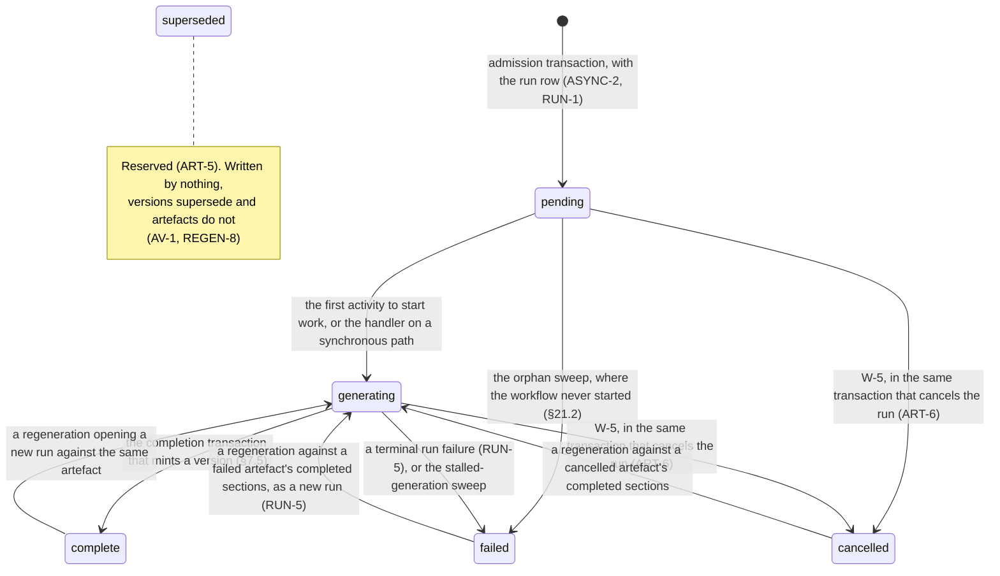

`complete`, `cancelled` and `failed` are re-entrant through regeneration, so none is terminal. `superseded` is the only state with no outgoing edge.

**Notes.**
- `idx_artefacts_pending` serves the orphan sweep in §21.2: an artefact shell commits before its workflow starts (`ASYNC-2`). A failed start therefore leaves a recoverable `pending` row, and never a workflow with no artefact.
- There is no `approval_state` column. Approval is Tender's state (HLD §8.8, `REGEN-1`); Tender keys it on `artefact_versions.id` in their own store. A column here would be a second copy of another service's decision.
- There is no `evidence_tier` column. The document-level tier lives on the version that materialised it (§4.3.2) because the roll-up is over an exact section-version set.
- `archive_state` is a separate column from `status`. An artefact can be `complete` and `archived` at once, so the status machine above and its diagram stay as they are. The tender's closure time is on its collection row (`COL-14`). The artefact carries only when it was archived.

| # | Invariant |
|---|---|
| ART-1 | `tender_id` is NULL only where `kind = 'answer'`. Only a free-standing grounded answer is untethered from a tender |
| ART-2 | `current_version_id` and `artefact_versions.artefact_id` are mutually referential. The constraint is `DEFERRABLE INITIALLY DEFERRED`; version insert and pointer update commit in one transaction |
| ART-3 | This table holds no workflow identifier. One artefact has many runs over its life, an original and a regeneration per edit, and a single column cannot hold them all. `generation_runs.workflow_id` carries it per run (`RUN-2`, `RUN-8`, §4.3.6) |
| ART-4 | `tender_section_ref` is stored and returned, never parsed. The Tender section is the identity of record (MD-29) |
| ART-5 | `status` transitions only as the table above. `superseded` is written by nothing and is **reserved**: versions supersede, artefacts do not (`AV-1`, `REGEN-8`). It is retained for a future artefact-level replacement and no code may write it today. **No database trigger guards `artefacts.status`** (rev 2.79): the transition table is held in application code alone, which is sound while `superseded` has no writer anywhere, and a trigger is added with the first writer rather than before it |
| ART-6 | **A cancelled run leaves its artefact `cancelled`, in the same transaction** (W-5, §5.7.14). Completed sections stay durable and readable (`AOB-5`), so the row is not deleted and not failed. Without the value the artefact would stay `generating` for ever, the stalled-generation sweep would move it to `failed` and publish `GenerationFailed` for a run the caller deliberately cancelled, which §12.3 states cancellation is not (LD-47) |
| ART-7 | **A closed tender archives its artefacts** (LD-89, `COL-14`). The `tender_lifecycle` consumer sets `archive_state = 'archived'` and `archived_at` on every artefact of that tender in one `llm_generation` transaction. An archived artefact refuses new work. A-5, A-6, A-7 and every route in `COL-14` return `409 TENDER_CLOSED` (§24), and reads and A-9 still work. A run in flight when the tender closes is not interrupted. It completes and writes into its archived artefact. No trigger guards this. Like `ART-5` it is held in application code. The same transaction appends one `llm.artefact.archived` chain entry per artefact (`AC-1`). The artefact stays until `TenderPurged` (`ART-9`). Retention is Tender's, and this service sets no clock of its own |
| ART-8 | An artefact with no tender (`ART-1`) is never archived by a tender event. It stays until a tenant purge deletes it, and its retention waits on the retention sweep, which comes after the first release (§21.1) |
| ART-9 | `TenderPurged` deletes the tender's artefacts, every row that hangs from them and the S3 objects under their prefix, in one transaction per tender that runs `SET CONSTRAINTS ALL DEFERRED`. `artefact_versions.generation_run_id` and `generation_runs.base_version_id` reference each other, so both are declared `DEFERRABLE INITIALLY IMMEDIATE`. **The scope:** the artefacts with the tender's `tender_id`. Their versions, the links between versions and section versions, sections, section versions, runs, facts, fact conflicts, groundedness, claim and completeness rows and checkpoints. The retrieval sets that carry the tender's `tender_id` or belong to those artefacts, with their chunks and purge rows. The `query_refinements` whose retrieval set is in scope. The `instruction_refinements` whose version, section or fact conflict is in scope. A refinement row that reaches none of these stays (§20 OQ-20). `rag_app` holds the DELETE grants (§4.1). The same transaction appends one `llm.artefact.purged` chain entry per artefact, and the chain deletes nothing (`AC-6`). The S3 objects are deleted after the database commit, and the orphan sweep (§21.2) removes any that a failure between the two leaves. A tenant purge (`EVT-15`) runs the same delete over every artefact of the tenant, free-standing answers included (`ART-8`) |

#### 4.3.2 `artefact_versions`

Writer: `rag_app`, `rag_activity`. Document-level version, minted at completion, coherence pass, export, or explicit request, never per section edit (`REGEN-8`).

```sql
CREATE TABLE artefact_versions (
  id                        uuid PRIMARY KEY DEFAULT uuidv7(),
  artefact_id               uuid NOT NULL REFERENCES artefacts(id),
  tenant_id                 uuid NOT NULL,
  version_no                int NOT NULL CHECK (version_no > 0),
  minted_reason             text NOT NULL,     -- completion|coherence|export|explicit
  origin                    artefact_origin NOT NULL DEFAULT 'original',
  evidence_tier             evidence_tier NOT NULL,
  completeness              completeness_verdict NOT NULL,
  superseded_by_section_edit boolean NOT NULL DEFAULT false,
  eligibility_state         eligibility_state NOT NULL,
  requested_mode            generation_mode NOT NULL,
  effective_mode            generation_mode NOT NULL,
  clamped                   boolean NOT NULL DEFAULT false,
  clamp_reason              text,
  domain_profile_version    text NOT NULL,
  language_pack_version     text NOT NULL,
  model_profile_id          text NOT NULL,
  prompt_hash               text NOT NULL,
  parser_version            text NOT NULL,
  chunker_version           text NOT NULL,
  generation_run_id         uuid NOT NULL REFERENCES generation_runs(id) DEFERRABLE INITIALLY IMMEDIATE,   -- ART-9
  output_schema_version     text,              -- resolved extraction schema, R-4 only
  delivery                  delivery_state NOT NULL,
  degradation_markers       jsonb NOT NULL DEFAULT '[]',
  instruction               text,
  instruction_refinement_id uuid,
  review_context_read       boolean NOT NULL DEFAULT false,
  review_context_ref        text,
  disclaimer_ref            text,              -- pack-declared, compliance-typed capabilities only
  created_at                timestamptz NOT NULL DEFAULT now(),
  CONSTRAINT ck_av_clamp CHECK (clamped = false OR clamp_reason IS NOT NULL)
);

CREATE UNIQUE INDEX uq_artefact_version ON artefact_versions (artefact_id, version_no);
CREATE INDEX idx_av_tenant ON artefact_versions (tenant_id, artefact_id, version_no DESC);
```

**Notes.**
- `review_context_ref` records that review context was received and where it came from, as the content version Tender named. It never records what it said (`REGEN-3`).
- The evidence tier recorded here is advisory and blocks nothing (MD-24). It is shown before the content and never withholds it. No read path may treat a low tier as a reason to suppress a version.

| # | Invariant |
|---|---|
| AV-1 | Immutable after insert except `superseded_by_section_edit`, enforced by `trg_version_immutable` (§4.8), not by discipline. A row leaves only through the `ART-9` delete |
| AV-2 | A clamp is always recorded with its reason. `GEN-6` forbids a silent clamp |
| AV-3 | `evidence_tier` materialises `MIN()` over the exact section-version set recorded in `artefact_version_sections`, so the roll-up is reproducible (MD-30) |
| AV-4 | The tier is advisory. No path withholds content on the basis of it (MD-24) |
| AV-5 | `instruction` is recorded on the version it produced and nowhere else. There is no table of unresolved feedback (`REGEN-1`) |
| AV-6 | `superseded_by_section_edit` is set by the section-regeneration transaction on every document version whose section set it changes, and it is the one column `trg_version_immutable` exempts. `SectionCompleted` carries the affected version ids as `superseded_version_ids` (§12.3, LD-31) |

#### 4.3.3 `artefact_version_sections`

Writer: `rag_app`, `rag_activity`. Records which section versions a document version comprised.

```sql
CREATE TABLE artefact_version_sections (
  artefact_version_id uuid NOT NULL REFERENCES artefact_versions(id),
  section_version_id  uuid NOT NULL REFERENCES artefact_section_versions(id),
  tenant_id           uuid NOT NULL,
  PRIMARY KEY (artefact_version_id, section_version_id)
);
```

| # | Invariant |
|---|---|
| AVS-1 | Immutable. Rows are inserted with their document version and never updated. They leave only through the `ART-9` delete |
| AVS-2 | This table is what makes MD-30's roll-up recomputable from history rather than trusted as a stored number |

#### 4.3.4 `artefact_sections`

Writer: `rag_activity`, and `rag_app` for the `flagged_for_review` marker A-7 sets (§5.7.10). Stable per-section identity.

```sql
CREATE TABLE artefact_sections (
  id                 uuid PRIMARY KEY DEFAULT uuidv7(),
  artefact_id        uuid NOT NULL REFERENCES artefacts(id),
  tenant_id          uuid NOT NULL,
  tender_section_ref text,                      -- NULL only under an answer artefact, AS-4
  section_type       text NOT NULL,
  ordinal            int NOT NULL,
  is_foundation      boolean NOT NULL DEFAULT false,
  state              section_state NOT NULL DEFAULT 'pending',
  gap_reason         text,                      -- required_input_missing | insufficient_twice | verification_exhausted, AS-2
  failure_reason     run_failure_reason,         -- set exactly while state = 'failed', AS-5
  current_version_id uuid,
  flagged_for_review boolean NOT NULL DEFAULT false,
  flagged_reason     text,
  record_version     bigint NOT NULL DEFAULT 1 CHECK (record_version > 0),
  created_at         timestamptz NOT NULL DEFAULT now(),
  updated_at         timestamptz NOT NULL DEFAULT now(),
  CONSTRAINT ck_as_gap CHECK (state <> 'gap' OR gap_reason IS NOT NULL),
  CONSTRAINT ck_as_failed CHECK (state <> 'failed' OR failure_reason IS NOT NULL),
  CONSTRAINT fk_as_current_version
    FOREIGN KEY (current_version_id) REFERENCES artefact_section_versions(id)
    DEFERRABLE INITIALLY DEFERRED
);

CREATE UNIQUE INDEX uq_section_ordinal ON artefact_sections (artefact_id, ordinal);
CREATE INDEX idx_a4_read ON artefact_sections (tenant_id, artefact_id, ordinal)
  INCLUDE (state, current_version_id, flagged_for_review);
```

**Notes.**
- `idx_a4_read` is a covering index (it holds the columns the read needs, so the database skips the table). It serves A-4, the section-state read. A-8 is the render route. HLD §3.4's envelope is 50 long-form documents a day and 20 concurrent workflows, so the join is small. A materialised view (a stored copy of a query result) would need refreshing on every section write, which costs more.
- `flagged_for_review` is the marker `REGEN-6`'s `update_fact` sets on affected sections. It is a derived marker on the section, not a feedback record, so `REGEN-1` holds.

**State transitions (`AS-5`).** A section is in exactly one state, and only the writer named here makes each move. A `gap` is a **content outcome**: the corpus had nothing usable. The fix is for the customer to supply a document, or for engineering to improve retrieval (§6.9). A `failed` section is a **processing outcome**: the work could not be done, and a retry may fix it. Reporting never mixes the two (§6.9), so they are separate states with separate reasons.

| From | To | When | Written by |
|---|---|---|---|
| — | `pending` | The outline stage inserts the section rows, so an outline and its sections cannot disagree (`RUN-4`). A synchronous answer inserts its one synthetic section (`AS-4`) | The outline stage, or the handler on a synchronous path |
| `pending` | `generating` | The activity starts the section, after the required-input check passes | The activity |
| `pending` | `gap` | The required-input check blocks (§6.9). `gap_reason = required_input_missing`, and `GenerationGapReported` is published | The activity |
| `generating` | `complete` | A section version is written and verification and the completeness check have run. A tier of `NOT_COMPUTED` is still `complete` (§7.5) | The activity |
| `generating` | `gap` | A second `insufficient` (`insufficient_twice`), or the retry ceiling is exhausted on verification (`verification_exhausted`), so generation is not attempted or its output is withheld (§6.9, and the retry ceiling in this document's §8.1). **Only where the section has no current version** | The activity |
| `generating` | `failed` | A processing failure that is not a content outcome: retries exhausted or a non-retryable error. `failure_reason` takes the run's vocabulary (`run_failure_reason`, `RUN-5`). **Only where the section has no current version** | The activity |
| `gap` | `generating` | A regeneration, after a document is added or with a reviewer instruction (A-5, A-6) | The activity |
| `failed` | `generating` | A retry or a regeneration (A-5, A-6) | The activity |
| `complete` | `generating` | A regeneration starts. The previous version stays current until a new one is written | The activity |
| `generating` | `complete`, without a new version | A regeneration of a section that already has a current version ends in a gap or a failure. The previous version stays current and the outcome is recorded on the run (`AS-7`) | The activity |
| `generating` | `failed`, or `complete` where a current version exists | The transaction that ends a run, whether `failed` or `cancelled`, moves every section still `generating`. `pending` sections stay `pending` (`AS-8`) | The run-ending transaction |
| any other pair | | | **Refused by `trg_section_transition`** (§4.8.2) |

There is no terminal section state. A `gap` or a `failed` section can be regenerated.

Five states and no terminal one. The writer on each edge is the activity except where the run-ending transaction is named, and every pair the diagram omits is refused by `trg_section_transition` (§4.8.2).

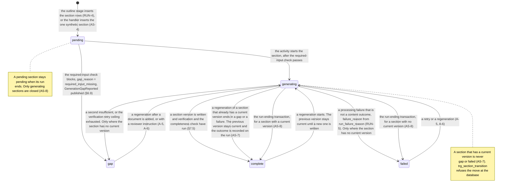

A `gap` is a content outcome and a `failed` section a processing outcome, and neither is derived from the other (AS-6). Leaving either state clears the reason column that required it, so a `complete` section never shows a stale reason (AS-5).

| # | Invariant |
|---|---|
| AS-1 | `is_foundation` is pack data, never inferred here (HLD §8.4, MD-15) |
| AS-2 | A section in state `gap` always carries a reason |
| AS-3 | `current_version_id` uses the same deferred-constraint pattern as ART-2 |
| AS-4 | `tender_section_ref` is NULL only where the parent artefact has `kind = 'answer'`. A grounded answer holds one synthetic section at ordinal 1 so that its groundedness report, completeness check and retrieval set have the section version every one of them is keyed on. Without it a free-standing answer, which `ART-1` explicitly permits, could carry no verification record at all |
| AS-5 | `state` moves only as the transition table above, enforced by `trg_section_transition` for every writer (§4.8.2). A section in `failed` always carries a `failure_reason`, and `gap_reason` and `failure_reason` are cleared when the section leaves the state that required them, so a `complete` section never shows a stale reason |
| AS-6 | A `gap` is a content outcome and a `failed` section a processing outcome. Neither is derived from the other, and neither is terminal (§6.9) |
| AS-7 | **A section that has a current version is never `gap` or `failed`.** A regeneration that ends without a new version returns it to `complete` with the previous version current, and the outcome is recorded on the run. The section describes the latest good output and the run describes the latest attempt, which is what `RUN-5` and `AOB-5` already say of a failure: completed work stays readable |
| AS-8 | Ending a run closes its in-flight sections in the same transaction: a section still `generating` becomes `failed`, or `complete` where a current version exists, and `pending` sections stay `pending`. A cancelled run is not a failure of its sections, and the run row carries the cause |

#### 4.3.5 `artefact_section_versions`

Writer: `rag_activity`. The real unit of change.

```sql
CREATE TABLE artefact_section_versions (
  id                  uuid PRIMARY KEY DEFAULT uuidv7(),
  section_id          uuid NOT NULL REFERENCES artefact_sections(id),
  tenant_id           uuid NOT NULL,
  version_no          int NOT NULL CHECK (version_no > 0),
  origin              artefact_origin NOT NULL DEFAULT 'original',
  content_ref         text NOT NULL,            -- S3 key, never inline prose
  content_sha256      bytea NOT NULL,           -- SHA-256 of the exact bytes at content_ref (ASV-4)
  retrieval_set_id    uuid NOT NULL REFERENCES retrieval_sets(id),
  evidence_tier       evidence_tier NOT NULL,
  completeness        completeness_verdict NOT NULL,
  scope_narrowed      boolean NOT NULL DEFAULT false,
  model_profile_id    text NOT NULL,
  prompt_hash         text NOT NULL,
  serving_tier        text NOT NULL,
  auto_retry_count    int NOT NULL DEFAULT 0 CHECK (auto_retry_count <= 2),
  manual_regen_count  int NOT NULL DEFAULT 0,
  degradation_markers jsonb NOT NULL DEFAULT '[]',
  created_at          timestamptz NOT NULL DEFAULT now()
);

CREATE UNIQUE INDEX uq_section_version ON artefact_section_versions (section_id, version_no);
CREATE INDEX idx_asv_retrieval ON artefact_section_versions (tenant_id, retrieval_set_id);
CREATE INDEX idx_asv_narrowed ON artefact_section_versions (tenant_id, created_at)
  WHERE scope_narrowed;
```

**Notes.**
- Content lives in S3 via `content_ref`. Document-scale prose in a row of the shared database instance would make every version read slow and every backup heavier.
- `scope_narrowed` is a column, and not a `degradation_markers` entry, because "which sections ran on narrowed scope" is an audit question that must be queryable, and this design's central pattern is authority outliving the conditions that granted it.
- `idx_asv_narrowed` has no consumer in this revision. It exists for the audit query above, which §21.2 describes and §16 does not emit. Kept deliberately.

| # | Invariant |
|---|---|
| ASV-1 | A regeneration mints a new row. No row is updated in place (`REGEN-8`) |
| ASV-2 | `auto_retry_count` is capped at the HLD §8.5 ceiling of two. Manual and automatic counts are separate columns so a section cannot retry indefinitely by alternating paths |
| ASV-3 | Every row references the retrieval set its generation was scored against. Verification admits no other evidence (`GEN-5`) |
| ASV-4 | `content_sha256` is computed by the activity over the bytes it wrote to `content_ref`, before the row is inserted, and reaches the audit entry through `AC-8`. Anyone holding the text can prove it was not altered, whoever stores it |

#### 4.3.6 `generation_runs`

Writer: `rag_app`, `rag_activity`. One row per generation attempt, synchronous or asynchronous, written at admission before anything is dispatched.

*LLD decision, LD-4.* This table holds the workflow status, outline state, coherence verdict, idempotency key and eligibility clamp recorded at start, which §5 and §12 specify. `ASYNC-5` forbids querying Temporal for them, so W-2 reads them here. `GEN-6` requires a clamp (a downgrade of the requested mode) to be recorded and never applied silently. At admission the only artefact row is the `pending` shell. The columns that hold a clamp live on a version, and no version is minted until completion. So the clamp needs a run-level column.

```sql
CREATE TABLE generation_runs (
  id                     uuid PRIMARY KEY DEFAULT uuidv7(),
  artefact_id            uuid NOT NULL REFERENCES artefacts(id),
  tenant_id              uuid NOT NULL,
  tender_id              uuid,
  principal_id           uuid NOT NULL,             -- the initiating identity (MD-25)
  origin                 artefact_origin NOT NULL DEFAULT 'original',
  base_version_id        uuid REFERENCES artefact_versions(id) DEFERRABLE INITIALLY IMMEDIATE,   -- regeneration only. ART-9
  workflow_id            text,                      -- the Temporal workflow id. NULL on a synchronous run, RUN-2
  run_input              jsonb,                     -- GenerationWorkflowInput, identifiers and a scope seed, never content. NULL on a synchronous run. A lost workflow restarts from it, RUN-8
  current_stage          run_stage,                 -- the phase last begun, written by its activity. NULL on a synchronous run. A restarted workflow continues from it, RUN-8
  idempotency_key        text,
  request_hash           text,                      -- guards key reuse with a different body
  status                 run_status NOT NULL DEFAULT 'pending',
  failure_reason         run_failure_reason,
  failed_at_stage        run_stage,                 -- NULL on a synchronous run and on a run that failed before its first stage, LD-77
  requested_mode         generation_mode NOT NULL,
  effective_mode         generation_mode NOT NULL,
  eligibility_state      eligibility_state NOT NULL,
  clamped                boolean NOT NULL DEFAULT false,
  clamp_reason           text,
  domain_profile_version text NOT NULL,             -- pinned for the run, ASYNC-3
  language_pack_version  text NOT NULL,
  outline_state          outline_state NOT NULL DEFAULT 'none',
  outline_version        int,
  outline_ready_at       timestamptz,
  gate_expires_at        timestamptz,
  coherence              coherence_verdict NOT NULL DEFAULT 'not_computed',
  coherence_computed_at  timestamptz,
  record_version         bigint NOT NULL DEFAULT 1 CHECK (record_version > 0),
  created_at             timestamptz NOT NULL DEFAULT now(),
  updated_at             timestamptz NOT NULL DEFAULT now(),
  CONSTRAINT ck_run_clamp   CHECK (clamped = false OR clamp_reason IS NOT NULL),
  CONSTRAINT ck_run_failure CHECK (status <> 'failed' OR failure_reason IS NOT NULL),
  CONSTRAINT ck_run_base    CHECK (origin = 'original' OR base_version_id IS NOT NULL),
  CONSTRAINT ck_run_idem    CHECK (idempotency_key IS NULL OR request_hash IS NOT NULL),
  CONSTRAINT ck_run_outline CHECK (outline_state = 'none' OR outline_version IS NOT NULL)
);

CREATE UNIQUE INDEX uq_run_idempotency ON generation_runs (tenant_id, principal_id, idempotency_key)
  WHERE idempotency_key IS NOT NULL;
CREATE INDEX idx_run_artefact ON generation_runs (tenant_id, artefact_id, created_at DESC);
CREATE INDEX idx_run_gate ON generation_runs (tenant_id, gate_expires_at)
  WHERE status = 'awaiting_outline_approval';
```

**Status transitions.** Both enums, with their writers. Each phase's activity writes `current_stage` as it begins. W-3 sets `current_stage` to `stage1` and W-4 sets it to `outline`, in the transaction that changes the status, and each raises its signal after that transaction commits (LD-88).

| From | To | Written by | Trigger |
|---|---|---|---|
| — | `pending` | this service | Admission (`RUN-1`) |
| `pending` | `outline_building` | activity | The outline activity starts |
| `pending` | `generating` | this service, or activity | A synchronous run, or a long-form run whose pack declares no gate |
| `outline_building` | `awaiting_outline_approval` | activity | Outline written; `outline_state` to `ready`, `outline_version` set |
| `awaiting_outline_approval` | `generating` | this service | W-3; `outline_state` to `approved` |
| `awaiting_outline_approval` | `outline_building` | this service | W-4; `outline_state` to `revising`, `outline_version` incremented |
| `awaiting_outline_approval` | `failed` | activity | D-12 expiry, reason `gate_expired`. The workflow's gate timer runs the activity (`WP-15`) |
| `generating` | `suspended` | activity | Quota exhausted mid-run (§14.3) |
| `suspended` | `generating` | this service | W-7 raised by a person, or by the quota-restored consumer (LD-70), on quota reset or plan upgrade |
| `generating` | `complete` | activity | Final version minted |
| `generating` | `failed` | activity | Terminal failure (`RUN-5`) |
| any non-terminal | `cancelled` | this service | W-5 |

This is the run's own state machine. It is separate from `artefact_status` because a gate state belongs to the run, and no artefact lifecycle carries one. Each edge names the writer the From/To table gives it (RUN-7).

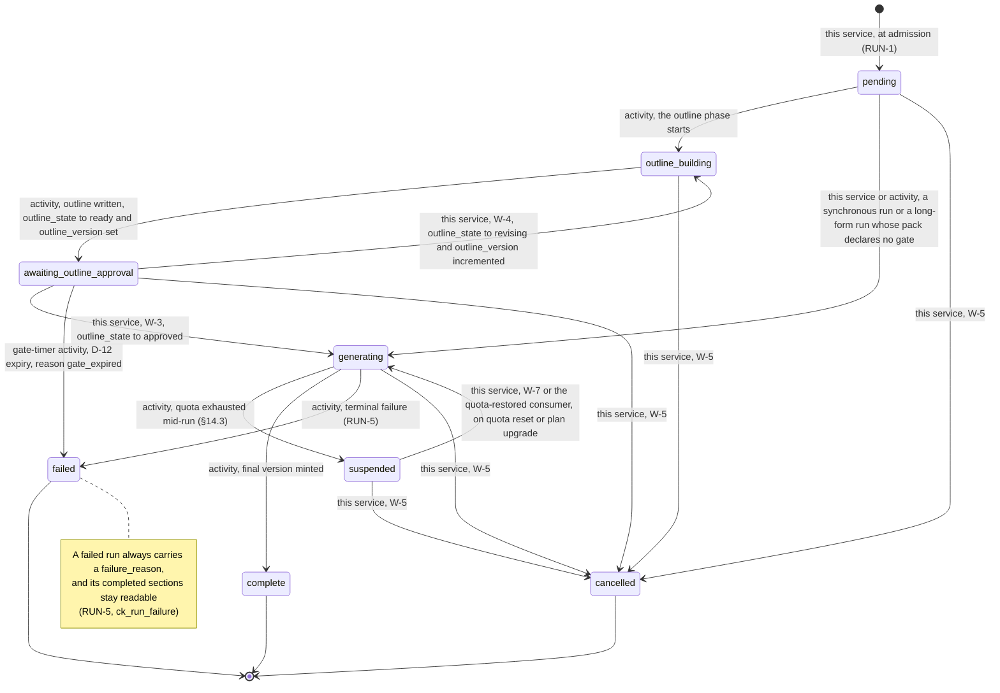

`complete`, `failed` and `cancelled` are terminal: the table gives `cancelled` an edge only from a non-terminal state, and gives no edge out of any of the three. A new attempt against the same artefact is a new run row (RUN-1).

`outline_state` moves `none` to `building` to `ready` to `approved`, with `ready` to `revising` to `building` on each W-4 loop. **`revising` to `building` is written by the outline activity** when it runs again for the revised outline, and by nothing else; `revising` is the state the row holds between the W-4 call and that run (rev 2.79, rev 2.107). A run whose pack declares no gate stays at `none` throughout.

The gate loop, which is the only cycle in a run's state. A run whose pack declares no gate never leaves `none`.

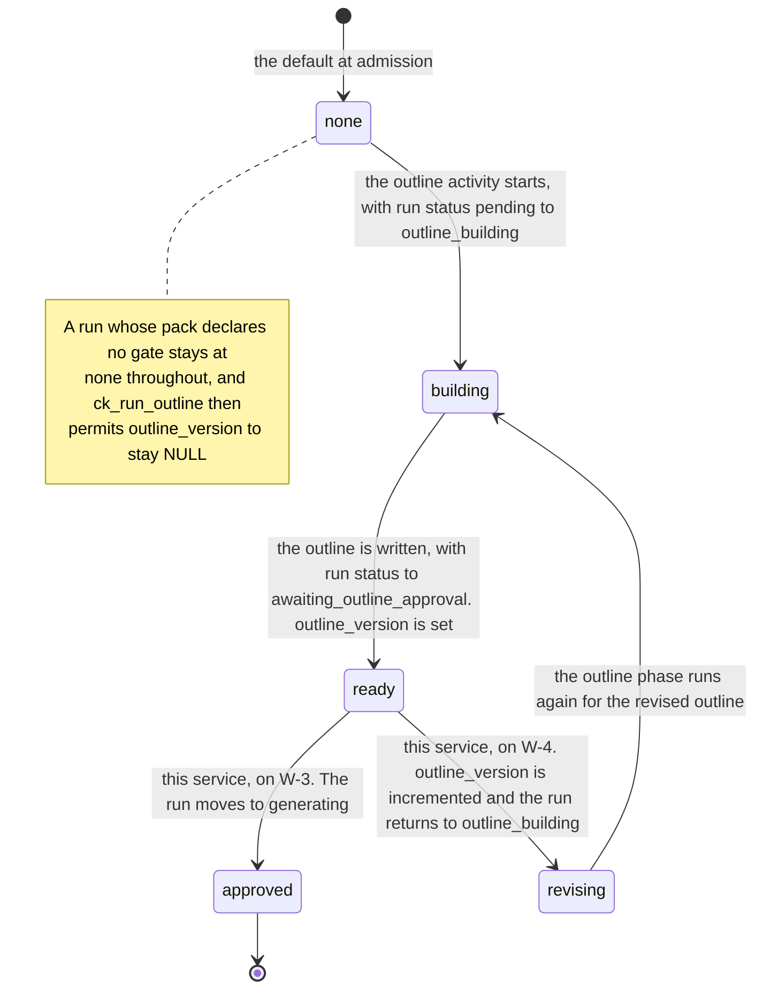

`outline_version` is incremented by this service when it raises the W-4 revision and never by a stage, so two writers cannot race `ck_run_outline` (RUN-7).

**Notes.**
- **The outline is the `artefact_sections` rows**, which already carry ordinal, section type and `is_foundation`. This table holds the outline's *state* and version, never a second copy of the section list.
- `idx_run_gate` serves the lookup of runs awaiting approval, which an operator's list and the lost-run restart use (`RUN-8`). The deadline is enforced by the workflow's timer and not by a sweep (`WP-15`, LD-88).
- `idempotency_key` is cleared by the sweep in §21.2 once `IDEMPOTENCY_TTL_SECONDS` has passed. This keeps the unique index from growing for the life of the tenant.
- `run_status` is kept separate from `artefact_status`. An artefact stays `generating` throughout, while its run passes through `awaiting_outline_approval`. No artefact lifecycle should have to carry that gate state.

| # | Invariant |
|---|---|
| RUN-1 | One row per generation attempt, synchronous included. The eligibility clamp and the pinned pack versions are recorded here at admission, before any version exists (`GEN-6`, `ASYNC-3`) |
| RUN-2 | `workflow_id` is NULL on a synchronous run. An async original sets it to `artefact_id`, and a regeneration to `regen:{base_version_id}`, so the two never collide and a repeat of either is one run. A base version belongs to exactly one artefact, so the id stays unique and deterministic (LD-55). It is the Temporal workflow id, and Temporal refuses a second start under it, which makes a repeated start idempotent (`ASYNC-2`, §5.7.9, §9.2) |
| RUN-3 | An idempotency key is unique per `(tenant_id, principal_id)` while set. The same key with a different `request_hash` is a conflict, never a second run |
| RUN-4 | Outline state belongs to the run. The outline itself is the section rows, so an approved outline and the sections generated from it cannot disagree |
| RUN-5 | A failed run always carries a reason, and its completed sections stay readable. A failure is artefact state and moves nothing in any Tender state machine (`AOB-5`) |
| RUN-6 | `coherence` is `not_computed` until the pass runs and never reads as passing while uncomputed, the same rule `AOB-2` applies to the evidence tier |
| RUN-7 | **Every `run_status` and `outline_state` transition has exactly one writer**, per the status-transition table above. `outline_version` is incremented by this service when it raises the W-4 revision, never by a stage, so `ck_run_outline` cannot be violated by two writers racing |
| RUN-8 | `workflow_id` is written in the admission transaction, before the start call, and is immutable thereafter. Every later signal addresses that id. A run whose workflow never started or was lost is restarted from its `run_input` under the same id, by the orphan sweep (§21.2) and by W-8 (§18.9), and the restarted workflow continues from `current_stage`. The activities are idempotent per phase (`ASYNC-14`), so a restart repeats no finished work |

### 4.4 `llm_generation`: the retrieval record

#### 4.4.1 `retrieval_sets`

Writer: `rag_app`, `rag_activity`. Written when retrieval reduces to its verdict (§6.1, §6.9). On a generation route that happens before generation begins. R-1 writes one on every request that does not end `failed`, with `artefact_id` null (§5.7.1). A `failed` verdict (`503 RETRIEVAL_FAILED`) returns no id and writes nothing. This table is the replay contract: it holds what a replay needs to rerun the same retrieval.

```sql
CREATE TABLE retrieval_sets (
  id                     uuid PRIMARY KEY DEFAULT uuidv7(),
  tenant_id              uuid NOT NULL,
  tender_id              uuid,
  artefact_id            uuid REFERENCES artefacts(id),   -- nullable, see RS-4
  verdict                retrieval_verdict NOT NULL,
  verdict_reason         text,
  scope_resolution_hash  text NOT NULL,
  grant_level_applied    grant_level NOT NULL,            -- placeholder enum, mapping per LD-21 (§20 OQ-3)
  grant_level_clamped    boolean NOT NULL DEFAULT false,
  filter_set             jsonb NOT NULL,
  index_generations      jsonb NOT NULL,
  profile_source         text NOT NULL,
  applied_profile        jsonb NOT NULL,
  values_provisional     boolean NOT NULL DEFAULT false,
  reranker_ran           boolean NOT NULL,
  budget_allocation      jsonb NOT NULL,
  query_refinement_id    uuid,
  widened_retry_of       uuid REFERENCES retrieval_sets(id),
  domain_profile_version text NOT NULL,
  language_pack_version  text NOT NULL,
  degradation_markers    jsonb NOT NULL DEFAULT '[]',
  created_at             timestamptz NOT NULL DEFAULT now(),
  CONSTRAINT ck_rs_verdict CHECK (verdict = 'sufficient' OR verdict_reason IS NOT NULL)
);

CREATE INDEX idx_rs_artefact ON retrieval_sets (tenant_id, artefact_id)
  WHERE artefact_id IS NOT NULL;
```

**Notes.**
- Retention is the life of the artefact version that cites the set (HLD §10.5). A set with `artefact_id IS NULL` that no section version references is swept daily once it is older than `RETRIEVAL_SET_ORPHAN_MIN_AGE_DAYS` (default 30, §17, §21.2). Until then R-5 resolves it, so an R-1 result stays explainable during a review window. `TenderPurged` and a tenant purge delete such a set at once, by its `tender_id` or `tenant_id`, whatever its age (`ART-9`, §21.1).
- `collection_weight` is recorded per chunk as applied (§4.4.2, `RSC-3`). `ck_coll_weight` on `collections` (§4.7.1) admits `0.00-1.00`, while HLD §7.3's weights sit in `0.70-1.00`. The constraint uses the wider range on purpose. The narrow band is a Domain Profile's current choice, and a CHECK that encoded it would turn a pack change into a migration.
- `values_provisional` marks a set retrieved under an unvalidated section-type profile. The HLD gives two independent reasons for provisionality: D-26's open recall threshold, and HLD §7.5's statement that the depths predate flat chunking and must be re-tuned (D-26).

| # | Invariant |
|---|---|
| RS-1 | Immutable after insert, including on purge (`EVT-2`). A purge adds a row to §4.4.3, it never edits this table |
| RS-2 | `grant_level_applied` and `grant_level_clamped` record the authorization the set was built under. The eligibility clamp is **not** here; it is on `generation_runs` at admission (`SCOPE-8`, `GEN-6`, `RUN-1`) |
| RS-3 | A replay against the same index generation using the recorded refinement and recorded profile reproduces the same ordered chunk set (`RET-7`) |
| RS-4 | `artefact_id` is nullable because a set is written before generation begins and survives a generation that never completed. A set for a failed generation is queryable rather than orphaned. It is also null for every set R-1 writes, which no generation ever follows. Both kinds stay queryable for `RETRIEVAL_SET_ORPHAN_MIN_AGE_DAYS` and are then reclaimed (§21.2) |
| RS-5 | A non-`sufficient` verdict always carries a reason |
| RS-6 | `widened_retry_of` records the single permitted widened retry (HLD §7.10). The widened retry re-resolves scope and never widens it (`SCOPE-6`) |
| RS-7 | `scope_resolution_hash` is `sha256` over the canonical JSON of the resolved token's `(tenant_id, principal_id, sorted collection ids with their levels and index generations, sorted tender ids)`. Canonical means sorted keys, no whitespace, UTF-8. It exists so a replay can prove it ran under the same authorization, which it cannot do if two implementations hash different things |

#### 4.4.2 `retrieval_set_chunks`

Writer: `rag_app`, `rag_activity`. The ordered set, each chunk carrying its recorded reason for being there.

```sql
CREATE TABLE retrieval_set_chunks (
  retrieval_set_id     uuid NOT NULL REFERENCES retrieval_sets(id),
  tenant_id            uuid NOT NULL,
  rank                 int NOT NULL,
  chunk_id             text NOT NULL,
  document_id          uuid NOT NULL,
  document_version     int NOT NULL,
  collection_id        uuid NOT NULL,
  collection_weight    numeric(3,2) NOT NULL,   -- HLD §7.3 weights are 0.70–1.00
  fused_score          numeric NOT NULL,
  rerank_score         numeric,
  source_half          text NOT NULL,           -- dense | lexical | both
  parent_chunk_id      text,                    -- set where a sub-span resolved, MD-31
  document_title       text NOT NULL,
  heading_path         text,
  clause_ref           text,
  document_role        text NOT NULL,
  language             text NOT NULL,
  excerpt              text NOT NULL,
  excerpt_is_translation boolean NOT NULL DEFAULT false,
  source_span          jsonb,                   -- nullable until D-33 closes
  PRIMARY KEY (retrieval_set_id, rank)
);

CREATE INDEX idx_rsc_chunk ON retrieval_set_chunks (tenant_id, chunk_id);
CREATE INDEX idx_rsc_doc   ON retrieval_set_chunks (tenant_id, collection_id, document_id, document_version);
```

**Notes.**
- `idx_rsc_doc` is what makes `EVT-1` work. Purge impact is found by matching `(tenant_id, collection_id, document_id, document_version)` against provenance this table already recorded. It needs no corpus read and does not depend on the order of Ingestion's delete. `collection_id` comes before the document columns because it separates two tenders that share a `document_id`. Ingestion's `document_version` is an ordinal per `(document_id, tender)`.
- `chunk_id` and `parent_chunk_id` are `text`, not `uuid`. Ingestion mints `{document_version_id}:{chunk_ordinal}`, which is deterministic, derivable and globally unique because `document_version_id` is. A `uuid` column would reject it.
- `parent_chunk_id` records that a sub-span matched and resolved to its containing chunk before this stage (§7.7, MD-31). The resolved chunk is what is stored; the sub-span that matched is what is recorded.
- `source_span` and `excerpt_is_translation` ship now and stay nullable until D-33 closes. The field set does not change when it does.
- `excerpt` is `NOT NULL`. It survives the deletion of the chunk it came from, whether by purge or by a later revision. A row without one would record a citation nobody can read back.
- `document_title` is `NOT NULL`. Ingestion guarantees a value: the title on the document record, or the file name if there is none. `clause_ref` stays nullable, because the parser fills it only where a heading carries one. With a null `clause_ref`, the citation locates the evidence by `heading_path` and not by clause. That citation is weaker but still valid.
- Excerpts follow the document. An excerpt is kept while its document is kept, so a reviewer can see what a historical claim rested on. It is cleared when Ingestion erases the document for good and announces `DocumentPurged` (rev 2.73, §20 OQ-23). Ingestion marks a deleted document with a `deleted_at` date and keeps it, so a document that is only marked deleted keeps its excerpts.

| # | Invariant |
|---|---|
| RSC-1 | A chunk belongs to exactly one tender (MD-32). A row here is never shared across tenders, and `document_id` plus `document_version` is the purge join key |
| RSC-2 | `rank` is dense and ordered from 1. The stored order is the order the generation saw |
| RSC-3 | `collection_weight` is recorded as applied, so a later weight change does not alter a historical set |

#### 4.4.3 `retrieval_set_purges`

Writer: `rag_app`, from the `DocumentPurged` consumer. A side table, never a mutation.

```sql
CREATE TABLE retrieval_set_purges (
  id                 uuid PRIMARY KEY DEFAULT uuidv7(),
  retrieval_set_id   uuid NOT NULL REFERENCES retrieval_sets(id),
  tenant_id          uuid NOT NULL,
  purged_document_id uuid NOT NULL,
  purged_version     int NOT NULL,
  chunk_ids          text[] NOT NULL,      -- chunk ids are text, not uuid (RSP-3)
  event_id           uuid NOT NULL,
  purged_at          timestamptz NOT NULL DEFAULT now()
);

CREATE UNIQUE INDEX uq_purge_event ON retrieval_set_purges (retrieval_set_id, event_id);
CREATE INDEX idx_purge_set ON retrieval_set_purges (tenant_id, retrieval_set_id);
```

**Notes.** This is a side table and not a flag on the set, for three reasons. Set immutability holds without exception. A set can be hit by several purges over time, and one flag would lose everything after the first. The join is by `chunk_id`, so a set that cites forty chunks and loses one has lost the provenance of one chunk, not forty.

| # | Invariant |
|---|---|
| RSP-1 | `uq_purge_event` makes the consumer idempotent on `event_id` (`EVT-6`) |
| RSP-2 | A purge marker is surfaced alongside the evidence tier, never folded into it. The tier was computed against evidence that existed at generation time and does not drift afterwards (`EVT-2`) |
| RSP-3 | `chunk_ids` is `text[]`, not `uuid[]`. Ingestion mints `{document_version_id}:{chunk_ordinal}` (§22.10), so a `uuid[]` column rejects every purge the consumer writes. The two chunk-id columns on `claim_verifications` are `text[]` for the same reason (`CV-2`) |

### 4.5 `llm_generation`: verification, completeness, and facts

#### 4.5.1 `groundedness_reports`

Writer: `rag_activity`. One per section version.

```sql
CREATE TABLE groundedness_reports (
  id                     uuid PRIMARY KEY DEFAULT uuidv7(),
  section_version_id     uuid NOT NULL REFERENCES artefact_section_versions(id),
  tenant_id              uuid NOT NULL,
  tiers_run              int[] NOT NULL,
  claims_total           int NOT NULL,
  supported              int NOT NULL,
  unsupported            int NOT NULL,
  miscited               int NOT NULL,
  gaps                   int NOT NULL,
  score                  numeric(4,3),
  evidence_tier          evidence_tier NOT NULL,
  judge_model_profile_id text,
  created_at             timestamptz NOT NULL DEFAULT now(),
  CONSTRAINT ck_gr_totals
    CHECK (claims_total = supported + unsupported + miscited + gaps)
);

CREATE UNIQUE INDEX uq_gr_section_version ON groundedness_reports (section_version_id);
```

| # | Invariant |
|---|---|
| GR-1 | Claims are scored against the retrieval set exclusively. No prompt layer is admissible evidence (`GEN-5`) |
| GR-2 | `judge_model_profile_id` differs from the generating `model_profile_id` on the same section version. Generation and verification use different Model Profiles (HLD §8.5) |
| GR-3 | Tier 0 runs on every compliance section (MD-16, `GEN-7`), on the synchronous path as much as the async one. Where an SLO (service level objective) cannot accommodate a mandated tier, the request fails rather than the tier being dropped. There is no substitution column, because there is no substitution |
| GR-4 | Until thresholds are calibrated, any unsupported claim blocks a compliance section (HLD §8.5's interim absolute gate). The counts above are what that gate reads |

#### 4.5.2 `claim_verifications`

Writer: `rag_activity`. One row per verified claim.

```sql
CREATE TABLE claim_verifications (
  report_id           uuid NOT NULL REFERENCES groundedness_reports(id),
  claim_ordinal       int NOT NULL,
  tenant_id           uuid NOT NULL,
  outcome             claim_outcome NOT NULL,
  cited_chunk_ids     text[] NOT NULL,     -- chunk ids are text, not uuid (CV-2)
  corrected_chunk_ids text[],
  tier_decided        int NOT NULL,
  PRIMARY KEY (report_id, claim_ordinal)
);
```

| # | Invariant |
|---|---|
| CV-1 | `claim_ordinal` is stable within one report only. A regeneration renumbers claims, so comparison across versions is at section level, never claim by claim |
| CV-2 | `cited_chunk_ids` and `corrected_chunk_ids` are `text[]`, for the same reason as `RSP-3`. Both hold the chunk ids `retrieval_set_chunks.chunk_id` holds, and that column is `text` |
| CV-3 | `corrected_chunk_ids` is populated only where `outcome = 'miscited'`, and is what the HLD §8.5 citation correction emits in the verdict frame |

#### 4.5.3 `completeness_checks`

Writer: `rag_activity`. One row per section version.

```sql
CREATE TABLE completeness_checks (
  id                 uuid PRIMARY KEY DEFAULT uuidv7(),
  section_version_id uuid NOT NULL REFERENCES artefact_section_versions(id),
  tenant_id          uuid NOT NULL,
  verdict            completeness_verdict NOT NULL,
  items_total        int NOT NULL,
  items_addressed    int NOT NULL,
  missed_items       text[] NOT NULL DEFAULT '{}',
  created_at         timestamptz NOT NULL DEFAULT now(),
  CONSTRAINT ck_cc_addressed CHECK (items_addressed <= items_total)
);

CREATE UNIQUE INDEX uq_cc_section_version ON completeness_checks (section_version_id);
```

`uq_cc_section_version` enforces the one-row-per-section-version rule that A-3 reads on. Without the unique index the rule would only be a convention.

Per-item miss frequency feeds §16 so the pack can be revised against what generation keeps missing.

| # | Invariant |
|---|---|
| CC-1 | Completeness is checked against the pack's mandatory-clause list, never against the model's own judgement of its output |
| CC-2 | Every regenerated section version gets a fresh row. No path skips completeness (`REGEN-7`) |

#### 4.5.4 `document_facts`

Writer: `rag_activity`, and `rag_app` for A-7's `update_fact` resolution (§5.7.10). Append-only.

```sql
CREATE TABLE document_facts (
  id                        uuid PRIMARY KEY DEFAULT uuidv7(),
  artefact_id               uuid NOT NULL REFERENCES artefacts(id),
  tenant_id                 uuid NOT NULL,
  fact_key                  text NOT NULL,
  value                     text NOT NULL,
  established_by_section_id uuid NOT NULL REFERENCES artefact_sections(id),
  superseded_at             timestamptz,
  created_at                timestamptz NOT NULL DEFAULT now()
);

CREATE UNIQUE INDEX uq_fact_current ON document_facts (artefact_id, fact_key)
  WHERE superseded_at IS NULL;
```

**Notes.** `REGEN-6`'s `update_fact` inserts a new row and marks the old one superseded. It does not update in place. A reviewer can then see what a section asserted when it was written and when that changed. The table mirrors Temporal workflow state on purpose. The Instruction Refiner needs fact state at regeneration time, possibly long after the workflow ended.

| # | Invariant |
|---|---|
| DF-1 | Append-only. A superseded fact is marked and never overwritten. Facts leave only through the `ART-9` delete |
| DF-2 | At most one current row per `(artefact_id, fact_key)`, enforced by `uq_fact_current` |
| DF-3 | Fact-conflict detection requires document-wide fact keys and is structurally unavailable outside a long-form workflow (`REGEN-4`) |

#### 4.5.5 `fact_conflicts`

Writer: `rag_activity`, and `rag_app` for the A-7 resolution (§5.7.10).

```sql
CREATE TABLE fact_conflicts (
  id                        uuid PRIMARY KEY DEFAULT uuidv7(),
  tenant_id                 uuid NOT NULL,
  artefact_id               uuid NOT NULL REFERENCES artefacts(id),
  section_id                uuid NOT NULL REFERENCES artefact_sections(id),
  fact_key                  text NOT NULL,
  established_value         text NOT NULL,
  instruction_value         text NOT NULL,
  established_by_section_id uuid NOT NULL REFERENCES artefact_sections(id),
  resolution                conflict_resolution,
  resolved_at               timestamptz,
  record_version bigint NOT NULL DEFAULT 1 CHECK (record_version > 0),
  created_at                timestamptz NOT NULL DEFAULT now(),
  updated_at                timestamptz NOT NULL DEFAULT now(),
  CONSTRAINT ck_fc_resolved
    CHECK ((resolution IS NULL) = (resolved_at IS NULL))
);
```

| # | Invariant |
|---|---|
| FC-1 | A conflict is returned to the caller as a choice, never resolved automatically (`REGEN-6`) |
| FC-2 | `update_fact` flags affected sections through `artefact_sections.flagged_for_review`. It does not regenerate them |
| FC-3 | A second conflict on the same key surfaces rather than retries (HLD §8.4) |

#### 4.5.6 `graph_checkpoints`

Writer: `rag_activity` only. Schema owned here, semantics owned by the run's activities (LD-88).

```sql
CREATE TABLE graph_checkpoints (
  id             uuid PRIMARY KEY DEFAULT uuidv7(),
  tenant_id      uuid NOT NULL,
  section_id     uuid NOT NULL REFERENCES artefact_sections(id),
  activity_run_id text NOT NULL,
  state          jsonb NOT NULL,
  created_at     timestamptz NOT NULL DEFAULT now()
);

CREATE INDEX idx_gc_sweep ON graph_checkpoints (tenant_id, created_at);
```

**Notes.** Checkpoints are swept on section completion, and on the age-based schedule in §21.2 for checkpoints left by failed phases. This section states the retention because the HLD states it for retrieval sets and reports (HLD §10.5) and leaves this table out.

| # | Invariant |
|---|---|
| GC-1 | References and control state only. Never chunk text, prompt text, or generated prose (`GEN-11`) |
| GC-2 | This extends HLD §4.2's Temporal-history rule to the checkpoint store, which would otherwise be an unaccounted content store outside purge and erasure |
| GC-3 | **The table is write-only in this design and that is deliberate.** `ASYNC-10` makes a graph re-run from the start on a worker death, so nothing reads a checkpoint back; it exists as a diagnostic record of where a failed activity reached. HLD §5.4 expects it to be a resume point, which `GEN-11` forbids, and §20 OQ-42 carries the disagreement. If OQ-42 resolves the HLD's way this table gains a reader and a very different content rule |

### 4.6 `llm_generation`: refinement, audit, and outbox

#### 4.6.1 `query_refinements`

Writer: `rag_app`, `rag_activity`. One row per refiner call, whatever the outcome (§10.5).

```sql
CREATE TABLE query_refinements (
  id               uuid PRIMARY KEY DEFAULT uuidv7(),
  tenant_id        uuid NOT NULL,
  retrieval_set_id uuid REFERENCES retrieval_sets(id),
  principal_hash   text NOT NULL,
  original_query   text NOT NULL,
  refined_query    text,
  intent           text,
  exact_terms      text[],
  preferred_roles  text[],
  section_type     text,
  pack_version     text NOT NULL,
  refiner_version  text NOT NULL,
  latency_ms       int NOT NULL,
  outcome          refiner_outcome NOT NULL,
  user_action      user_action NOT NULL DEFAULT 'unknown',
  downstream       jsonb,
  created_at       timestamptz NOT NULL DEFAULT now()
);

CREATE INDEX idx_qr_version ON query_refinements (tenant_id, refiner_version, created_at);
```

**Notes.**
- `user_action` is permanently `unknown`. The Tender UI reports nothing, so the column has no source (§20 OQ-22). The column stays, so that a later UI decision needs no migration.
- There is no `user_edited_query` column. There is no source for one, recorded here so it is not added back on the assumption that data exists.
- `principal_hash` is a per-tenant salted hash of the user (a one-way scramble, so the user id is not stored). Cohort analysis works and re-identification does not.

| # | Invariant |
|---|---|
| QR-1 | `refiner_version` is `hash(prompt_template, model_profile_id, pack_version)`. A template change mints a new version, so edit rates are never compared across two different capabilities (`REF-7`) |
| QR-2 | `user_action` defaults to `unknown`. Reversal metrics use known actions only and publish the unknown share (`REF-5`) |
| QR-3 | Inputs and outputs exist in this table only. Never in logs, traces, or metric labels (`REF-6`) |
| QR-4 | `outcome = 'disabled'` and `outcome = 'degraded'` are distinct. Flag-off is the intended configuration and is not reduced quality (`REF-2`) |

#### 4.6.2 `instruction_refinements`

Writer: `rag_app`, `rag_activity`. One row per refiner call, whatever the outcome (§10.5).

```sql
CREATE TABLE instruction_refinements (
  id                  uuid PRIMARY KEY DEFAULT uuidv7(),
  tenant_id           uuid NOT NULL,
  artefact_version_id uuid REFERENCES artefact_versions(id),
  section_id          uuid REFERENCES artefact_sections(id),
  principal_hash      text NOT NULL,
  original_instruction text NOT NULL,
  refined_instruction text,
  instruction_type    instruction_type,
  needs_retrieval     boolean NOT NULL DEFAULT true,
  fact_conflict_id    uuid REFERENCES fact_conflicts(id),
  conflict_resolution conflict_resolution,
  pack_version        text NOT NULL,
  refiner_version     text NOT NULL,
  latency_ms          int NOT NULL,
  outcome             refiner_outcome NOT NULL,
  user_action         user_action NOT NULL DEFAULT 'unknown',
  created_at          timestamptz NOT NULL DEFAULT now()
);

CREATE INDEX idx_ir_version ON instruction_refinements (tenant_id, refiner_version, created_at);
```

**Notes.** There are two tables, one per refiner. MD-33 says the refiners take different inputs and have different failure modes, and separate flags control them (`llm.refiner.query`, `llm.refiner.instruction`, §10.5). `conflict_resolution` survives the UI decision because it arrives through the API and not the UI. That makes it the one usable measurement D-35 has.

| # | Invariant |
|---|---|
| IR-1 | `needs_retrieval` defaults true. A degraded refiner returns true, because reuse on an instruction that needed new evidence produces a confidently wrong rewrite |
| IR-2 | Replay never invokes a refiner. The recorded `refined_instruction` is replay's input (`REF-4`) |
| IR-3 | The same version, logging, and default-`unknown` rules as QR-1 through QR-4 apply |

#### 4.6.3 `artefact_audit_chain`

Writer: `rag_app`, `rag_activity`. Required by HLD §10.4, surfaced in §12.5 and verified by the §21.2 sweep.

The entry mirrors the Audit Log's own record (`audit-log-lld.md` §4.2 `audit_events` and the AL-5 request body). An entry can therefore be sent to the Audit Log by direct write without translation. The events in §12.3 carry the same facts for the entry types that have one. This table adds two things the Audit Log lacks: a gapless sequence and a hash chain (each entry's hash covers the one before, so any edit shows). The Audit Log ships without a chain (their §10.6, AL-D7), so this table is the tamper-evidence for generation history.

```sql
CREATE TABLE artefact_audit_chain (
  tenant_id         uuid NOT NULL,
  seq               bigint NOT NULL,
  occurred_at       timestamptz NOT NULL,         -- business time of the change, as in audit_events
  entry_type        text NOT NULL,                -- <domain>.<object>.<action>, the table below
  action            text NOT NULL,                -- coarse verb: create|update|delete|approve|...
  actor_type        audit_actor_type NOT NULL,
  actor_id          uuid,                         -- NULL iff actor_type = 'anonymous'
  artefact_id       uuid NOT NULL,                -- a plain id, no foreign key (AC-6)
  target_type       text,                         -- artefact | artefact_version | section | section_version | fact_conflict
  target_id         text,
  source_service    text NOT NULL DEFAULT 'llm-rag-service',
  source_event_type text NOT NULL,                -- this service's own entry name
  source_event_id   text NOT NULL,                -- the outbox event id, else a UUIDv7 minted in the transaction
  trace_id          text,
  metadata          jsonb NOT NULL DEFAULT '{}',  -- ids, hashes and versions only, at most 8 KiB (AC-7)
  payload_hash      bytea NOT NULL,               -- sha256 over canonical JSON of every column above, sorted keys, no whitespace, UTF-8
  prev_hash         bytea,                        -- NULL only at seq = 1
  entry_hash        bytea NOT NULL,               -- sha256(coalesce(prev_hash,'') || payload_hash)
  created_at        timestamptz NOT NULL DEFAULT now(),
  PRIMARY KEY (tenant_id, seq),
  CONSTRAINT chk_audit_actor CHECK ((actor_type = 'anonymous' AND actor_id IS NULL) OR (actor_type <> 'anonymous' AND actor_id IS NOT NULL)),
  CONSTRAINT chk_audit_metadata CHECK (jsonb_typeof(metadata) = 'object' AND octet_length(metadata::text) <= 8192)
);

CREATE UNIQUE INDEX uq_audit_source_event ON artefact_audit_chain (tenant_id, source_event_id);
CREATE INDEX idx_audit_artefact ON artefact_audit_chain (tenant_id, artefact_id, seq);
CREATE INDEX idx_audit_created  ON artefact_audit_chain (tenant_id, created_at);
```

**Entry types.** Proposed to the Audit Log (§20 OQ-108). The Audit Log assigns the retention tier from the entry type, so no tier is stored here (`AC-7`). Three rows match a §12.3 event: `llm.generation.completed` is `GenerationCompleted`, `llm.section.regenerated` is `SectionCompleted` and `llm.generation.failed` is `GenerationFailed`. The other five have no event and stay in the chain only until OQ-108 settles a route for them. A system-initiated entry (from a consumer, a sweep or the workflow) carries `actor_type = 'service_account'` and this service's own service-account id. The Audit Log is asked to confirm this (OQ-108). A tenant purge writes one `llm.artefact.purged` entry per artefact.

| `entry_type` | `action` | Written when | `target_type` | `metadata` carries |
|---|---|---|---|---|
| `llm.generation.completed` | `create` | A version is minted (§7.5) | `artefact_version` | `version_id`, `generation_run_id`, `prompt_hash`, `model_profile_id`, `domain_profile_version`, `language_pack_version`, `evidence_tier`, `completeness`, `retrieval_set_id`, `content_digest`, `section_count` |
| `llm.section.regenerated` | `create` | A section version is minted (§10) | `section_version` | `section_version_id`, `content_sha256`, `prompt_hash`, `retrieval_set_id`, `origin` |
| `llm.generation.failed` | `update` | A terminal run failure (`RUN-5`) | `artefact` | `generation_run_id`, `failure_reason`, `failed_at_stage` |
| `llm.generation.cancelled` | `update` | W-5 (`ART-6`) | `artefact` | `generation_run_id` |
| `llm.fact_conflict.resolved` | `update` | A-7 resolves a fact conflict | `fact_conflict` | `conflict_id`, `fact_key`, `resolution` |
| `llm.section.flagged` | `update` | A-7 flags a section for review | `section` | `section_id`, `flagged_reason` |
| `llm.artefact.archived` | `update` | The tender closes (`ART-7`) | `artefact` | `archived_at` |
| `llm.artefact.purged` | `delete` | `TenderPurged` or a tenant purge deletes the artefact (`ART-9`) | `artefact` | `reason` |

A version entry carries `content_digest`, the SHA-256 of its section versions' `section_version_id:content_sha256` pairs sorted by id, and `section_count`, so `metadata` stays inside 8 KiB at any document size (`AC-8`). A section entry carries its own `content_sha256`.

**Notes.**
- `seq` is allocated under a per-tenant advisory lock (a database lock keyed on a number the code picks) taken in the writing transaction, and not from a database sequence. A sequence leaves gaps on rollback. A gap looks the same as a deleted entry, and spotting deleted entries is what the chain exists for. At HLD §3.4's envelope the cost of taking turns is negligible. If per-tenant artefact write throughput nears the lock's ceiling, the alternative is a per-tenant counter row with the same semantics.
- `metadata` carries ids, hashes and version labels. It carries no generated prose and no chunk text, for the same reason `GEN-11` constrains checkpoints.
- `actor_display`, `ip_address` and `user_agent` from the Audit Log's record are not kept. This service does not hold them reliably, and a display name is personal data.
- The scheduled verifier walks each tenant's chain in `seq` order, recomputes `payload_hash` and `entry_hash`, and alerts on the first break (§21.2).
- **A tenant purge keeps the chain** (rev 2.75, §20 OQ-24), and so does `TenderPurged`. Purging the chain would destroy the evidence that an erasure was lawful. It holds a tenant identifier, artefact ids, event types, an actor id, references, hashes and dates. It holds no names, prose or chunk text. The link from a tenant identifier to a company lives in IAM and never in this table, so a retained entry carries nothing that names a company. The append-only trigger (`AC-1`) forbids deleting it. This matches how the platform's central audit log treats its `compliance_7y` tier, which erasure never touches (their §15.5, AL-INV-7). Legal still confirms.

| # | Invariant |
|---|---|
| AC-1 | Append-only. `UPDATE` and `DELETE` are rejected by trigger for both roles |
| AC-2 | `entry_hash` is `sha256(coalesce(prev_hash,'') \|\| payload_hash)`, computed by the database so a client cannot supply it. `payload_hash` is computed from the row's own columns in the same insert |
| AC-3 | `seq` is gapless and monotonic per tenant. A gap is a detected break, not an accepted artefact of allocation |
| AC-4 | `prev_hash` equals the previous entry's `entry_hash`, and is NULL only at `seq = 1` |
| AC-5 | The chain records artefact lifecycle events. It is not the event bus and is not consumed by any other service. All eight entry types depend on the Audit Log adding them (§20 OQ-108, assumed at rev 2.115). Three match a §12.3 event, which the Audit Log would read from a queue it does not have yet. The other five have no event and could only be sent by direct write through AL-5. AL-5 returns `422 unknown_entry_type`, the Audit Log's own code and not one of this taxonomy, for every `llm.*` type until the Audit Log adds them |
| AC-6 | `artefact_id` has no foreign key. Artefacts are deleted on `TenderPurged` or a tenant purge (`ART-9`) and the chain is kept (`AC-1`, §21.1), so a foreign key would block the deletion or the chain |
| AC-7 | Every column except `seq`, `artefact_id`, the three hashes and `created_at` has the name and meaning of the matching field in the Audit Log's AL-5 body, which nests `actor` and `target`. `source_event_id` is AL-5's `Idempotency-Key` header, which the Audit Log stores under that name. `retention_tier`, `recorded_at`, `ingest_mode` and `source_topic` are the Audit Log's own assignments and are not stored here |
| AC-8 | An entry for a minted document version carries `content_digest` and `section_count`, and an entry for a section version carries its `content_sha256`, so the text's integrity is provable after the text is archived or held elsewhere (`ASV-4`). The pairs behind a digest are recoverable from `artefact_version_sections` and `content_sha256` |
| AC-9 | `source_event_id` is unique per tenant. A retry of the writing transaction cannot add a second entry, and the Audit Log deduplicates on the same value (its AL-INV-4 and the AL-5 idempotency rule) |

#### 4.6.4 `outbox_events` and `outbox_dead_letters`

Writer: `rag_app`, `rag_activity`, through `eventcommon.enqueue()`. **Neither table is designed here.** `platform-eventcommon` owns both. It ships them as eight embedded migrations applied by `apply_schema(pool)` and tracks them in its own `outbox_migrations` table. `enqueue()` and the relay hardcode the column list in raw SQL, so the shape is a hard contract. Dependency: `eventcommon`. Contract required: the outbox schema in its migrations. Current assumption: unchanged since it was verified against source (rev 0.9). This document does not reproduce it.

**What this costs us.** `correlation_id`, `subject` and the topic are **not columns**. They live inside the serialised envelope in `payload` (§12.2), which is where the publisher reads them. To query the outbox by correlation id or by topic, use a JSONB predicate. No index serves it.

**One topic per publisher.** `SNSConfig.topic_arn` is a single validated ARN, and a relay takes one publisher. Our two topics therefore need one of two things. Either two publisher-and-relay pairs run over the one table, or we write our own `Publisher` that routes on `event_type`. §12.1 states which.

| # | Invariant |
|---|---|
| OBX-1 | State change and outbox row commit in one transaction on every publishing path (`EVT-8`, `GEN-10`). `enqueue()` takes the same connection as the write |
| OBX-2 | No payload carries document content, generated prose, or a browser connection identifier (`EVT-7`, MD-25). A serialised envelope over 240 KB is rejected by `enqueue()` outright |
| OBX-3 | **Exactly one relay process publishes from this table, and it is ours.** The run's activities `enqueue()` onto it and run no relay of their own. A second relay would be the failure §18.3 rejects, one boundary further out: the claim query has no `event_type` predicate, so two relays each claim whatever is pending and publish it to their own ARN, scattering both topics at random with no consumer-side signal. HLD §4.1's W-15 gives the Worker Pool a relay for tables it owns; this is not one of them |
| OBX-4 | This schema is the library's. A migration of ours that alters either table is a defect, and `apply_schema` runs on startup independently of §4.11's own migration runner |
| OBX-5 | A record exhausting `max_attempts` moves to `outbox_dead_letters` and is **not** an SQS dead letter. The two are different mechanisms at different ends of the hop and §16.4 alerts on both separately |
| OBX-6 | Published rows are never removed automatically. `prune_published` is scheduled in §21.2 |

#### 4.6.5 `processed_events`

Writer: `rag_app`. Inbound consumer idempotency ledger. `EVT-6` requires every consumer to be idempotent on `event_id`. The purge consumer additionally carries `uq_purge_event` (§4.4.3).

```sql
CREATE TABLE processed_events (
  event_id     uuid NOT NULL,
  consumer     text NOT NULL,
  processed_at timestamptz NOT NULL DEFAULT now(),
  PRIMARY KEY (event_id, consumer)
);

CREATE INDEX idx_processed_events_prune ON processed_events (processed_at);
```

**Notes.** This table is not tenant-scoped, so it has no RLS policy. This matches the sibling IAM services' convention for it. Only consumers running under the service role access it, and never on a request path. The composite key lets several consumers dedupe the same `event_id` independently without colliding. The sweep in §21.2 prunes it on an eight-day window, as the platform convention does.

| # | Invariant |
|---|---|
| PE-1 | Every inbound consumer records `(event_id, consumer)` in the same transaction as the effect it applies. A consumer that applies an effect without recording it is not idempotent (`EVT-6`) |
| PE-2 | The purge consumer writes a ledger row **and** additionally carries `uq_purge_event` (§4.4.3). The ledger is what makes the epoch bump idempotent once the purge has completed; the unique index only deduplicates the side-table insert and cannot stop a second bump. The ledger row is written in the second transaction only (§13.4), so a redelivery after a failure in either transaction runs again, and a repeated bump is harmless because it only invalidates cache |
| PE-3 | This table is exempt from RLS and is the only such table in either schema. `RLS-1`'s CI check carries this single named exception |

### 4.7 `llm_corpus` tables owned here

These are five tables on the dedicated `llm_corpus` instance. Ingestion owns documents, chunks, vectors, and the lexical index in the same database, and this section does not describe them.

```sql
CREATE TYPE collection_type         AS ENUM ('tender','tenant','reference');
CREATE TYPE index_generation_status AS ENUM ('registered','building','verified','active','failed','retired');
-- grant_level is repeated here; see §4.2
CREATE TYPE collection_status       AS ENUM ('provisioning','active','frozen','purging',
                                             'migration_failed','superseded');
CREATE TYPE grant_subject_type      AS ENUM ('user');   -- LD-79: the only subject IAM's overlay grants to; a later kind is ALTER TYPE ADD VALUE
```

`collection_status` has no `reindexing` value. Re-indexing is a second index generation with an atomic cutover (§4.7.3). Promotion to a restricted corpus is a second collection row, with the old row ending at `superseded` (§4.7.1). Neither is a status value.

#### 4.7.1 `collections`

Writer: `rag_app`, and no other service writes a row (LD-41, `COL-3`). A row is created by C-I1 on Ingestion's first document for the tender, or by the `TenderRestricted` consumer where restriction arrives first (§12.4).

```sql
CREATE TABLE collections (
  id                      uuid PRIMARY KEY,     -- UUIDv5, derived, never random (COL-11)
  tenant_id               uuid NOT NULL,
  type                    collection_type NOT NULL,
  tender_id               uuid NOT NULL,        -- real for 'tender', sentinel otherwise
  restricted              boolean NOT NULL,     -- immutable after insert, COL-2
  physical_collection     text NOT NULL,
  shard_key               text NOT NULL,
  active_index_generation int NOT NULL DEFAULT 1,
  purge_epoch             bigint NOT NULL DEFAULT 0,
  status                  collection_status NOT NULL DEFAULT 'provisioning',
  status_before_freeze    collection_status,    -- the status a freeze interrupted, COL-12
  weight_override         numeric(3,2),
  owning_departments      uuid[] NOT NULL DEFAULT '{}',  -- ordinary tenders only, supplied by Tender (COL-6)
  promoted_from           uuid,                          -- set on a promotion target, COL-7
  restricted_announced_at timestamptz,                   -- set by the TenderRestricted consumer, COL-8
  tender_closed_at        timestamptz,                   -- set once by the tender_lifecycle consumer on a terminal outcome, COL-14
  record_version          bigint NOT NULL DEFAULT 1 CHECK (record_version > 0),
  created_at              timestamptz NOT NULL DEFAULT now(),
  updated_at              timestamptz NOT NULL DEFAULT now(),
  CONSTRAINT ck_coll_weight
    CHECK (weight_override IS NULL OR weight_override BETWEEN 0.00 AND 1.00),
  CONSTRAINT ck_coll_promotion CHECK (promoted_from IS NULL OR restricted),
  CONSTRAINT ck_coll_freeze CHECK (
    (status = 'frozen') = (status_before_freeze IS NOT NULL)),
  CONSTRAINT fk_coll_promoted_from FOREIGN KEY (promoted_from) REFERENCES collections(id)
);

-- A promotion holds two rows for one tender until cutover: the original (restricted = false)
-- and the target (restricted = true). Keying on restricted lets both exist, and makes a second
-- target for the same source fail here, which is what makes promotion idempotent (LD-33).
CREATE UNIQUE INDEX uq_coll_tender ON collections (tenant_id, tender_id, type, restricted)
  WHERE status <> 'superseded';
-- Exactly one row serves at any instant. A cutover supersedes the old row before it activates the new one.
CREATE UNIQUE INDEX uq_coll_active ON collections (tenant_id, tender_id, type)
  WHERE status = 'active';
CREATE INDEX idx_coll_active ON collections (tenant_id, status) WHERE status = 'active';
```

**Status lifecycle.** Six values, and scope resolution filters on all of them (`COL-10`, `SCOPE-11`).

| Status | Entered when | Retrievable | Writable | Leaves to |
|---|---|---|---|---|
| `provisioning` | C-I1 creates the row, or the `TenderRestricted` consumer creates one or a promotion target | **no** | yes | `active`, once the first index generation is activated through C-I4 (`IG-4`) or the promotion copy completes; `frozen` on a tenant-suspension event (`COL-12`); `migration_failed` where C-I8 reports a failed promotion copy |
| `active` | Normal operating state, and the state a tenant or reference collection is created in with generation 1 already activated (§5.7.17) | yes | yes | `frozen`, `purging`, `superseded` |
| `frozen` | A tenant-suspension event is consumed (§12.4) | **no** | **no** | `status_before_freeze` on a reactivation event, or `purging`. **Both directions are the same consumer**; without the reinstatement half a suspended-then-restored tenant's corpus stays unretrievable for good. The restore is to the recorded status and never to `active`, because a corpus that was `provisioning` when the freeze landed is half-built and would otherwise be published by the reinstatement (LD-44) |
| `purging` | Tender purge, tenant offboarding, or collection deletion (§21.1) | **no** | **no** | the row is deleted on **tenant offboarding only**. A tender purge leaves it in place permanently, which is what refuses a late document for a purged tender and keeps the placement readable for Ingestion's own cleanup (LD-42). Terminal either way |
| `migration_failed` | C-I8 reported a failed promotion copy (§13.5) | **no** | yes | `provisioning` on an operator retry, `purging` if the promotion is abandoned, or `frozen` on a tenant-suspension event (`COL-12`) |
| `superseded` | A promotion cutover retired this row (`COL-7`) | **no** | **no** | nothing. Terminal, retained for audit |

A `provisioning` collection is writable and not retrievable. This lets Ingestion fill a new corpus, and lets a promotion copy points into its target, without either being searchable while half-filled. It also makes `COL-8`'s split work. During a promotion the original is `active` and serving while the target is `provisioning` and filling. The cutover swaps them in one transaction.

The six statuses as a machine, derived from the Entered-when and Leaves-to columns. Retrieval admits `active` alone and writes admit `provisioning`, `active` and `migration_failed`, both applied in `corpusscope` at scope resolution (COL-10, SCOPE-11).

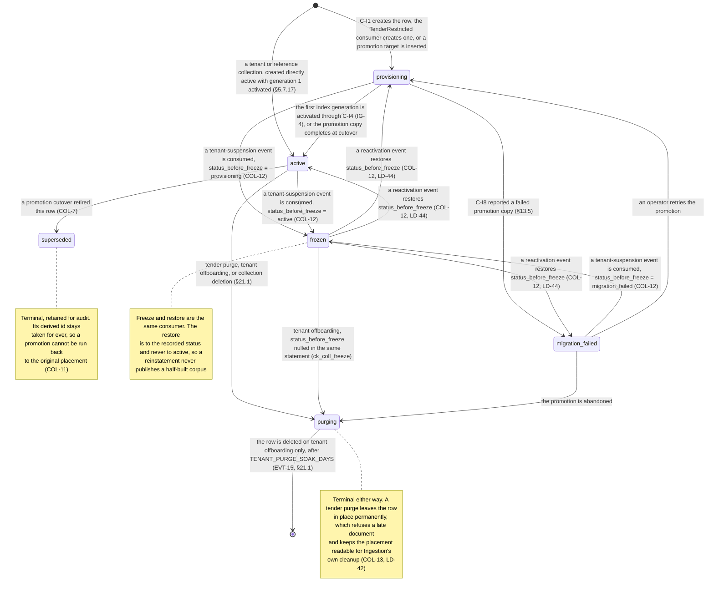

Retrievable in `active` only. Writable in `provisioning`, `active` and `migration_failed`. `frozen`, `purging` and `superseded` are neither.

**Notes.**
- `tender_id` is `NOT NULL` on every row. Collections with no natural tender carry a sentinel rather than a NULL, which keeps the mandatory compound filter literally invariant (§4.10).
- **`id` is derived, not minted.** `UUIDv5(COLLECTION_NAMESPACE, "{type}:{tenant_id}:{tender_id}:{restricted}")`, the namespace being `8d9d8e69-7546-4011-bf89-15ef4c822386` (§17), over the same four values `uq_coll_tender` is keyed on, so the identifier and the uniqueness rule cannot drift apart (`COL-11`, LD-40).
- `purge_epoch` gives O(1) retrieval-cache invalidation. Collection-level granularity is a known cost, to be measured before optimising to chunk level.
- `weight_override` is NULL by default, meaning the Domain Profile's default weight for the type applies (HLD §7.3).
- `restricted` decides `physical_collection`, per MD-19. An ordinary tender's row points at the tenant's own physical collection and is separated inside it by `shard_key`. A restricted tender's row points at a physical collection of its own. Promotion therefore physically moves points, so it needs a second row and cannot be an `UPDATE` (`COL-7`).
- `uq_coll_tender` permits exactly one `reference` collection platform-wide, because every reference row carries the same two sentinels. Whether the platform needs several reference corpora is D-8 (reference-collection governance), which is open. If D-8 closes in favour of several, a discriminator column goes into the key. The migration is a one-line index change.

| # | Invariant |
|---|---|
| COL-1 | Placement derives from `restricted`, never from a request |
| COL-2 | A row's `restricted` is fixed at insert and never changes, enforced by `trg_collection_restricted_immutable` (§4.8). Placement is therefore stable for the life of a row, which is what lets `SCOPE-5` bind an index generation at token construction |
| COL-3 | **This service writes every collection row and no other service writes one** (LD-41). C-I1 resolves or creates on Ingestion's first document for a tender, and the `TenderRestricted` consumer creates the row where restriction arrives before any document. A `reference` collection is still provisioned deliberately and C-I1 refuses to create one, returning `409 COLLECTION_NOT_PROVISIONED`: a cross-tenant corpus is a platform decision and not a consequence of an upload (`COL-5`) |
| COL-4 | Retrieval reads exactly one index generation per collection, bound at `ScopeToken` construction (`SCOPE-5`; the scope token is the record of which collections one request may search, §6.3) |
| COL-5 | Reference collections carry the `PLATFORM` tenant sentinel. They are cross-tenant readable, tenant-unwritable, and excluded from the tenant purge sweep (`SCOPE-9`). **Cross-tenant readable makes the write path a platform-wide injection target**: a single crafted clause reaches every tenant's fused candidate set at `search` level with no grant required, and is cited and verified like any other evidence. Who may write it and under what review is D-8, which is open (§20 OQ-49) |
| COL-6 | `owning_departments` carries the departments the work belongs to, and is read only on the ordinary-tender path (`CG-1`). It is empty on a restricted or reference collection, where it has no meaning. How the set reaches us, and how it stays current when Tender reassigns work, is Tender's to define, and this service takes whatever Tender supplies |
| COL-7 | **A tender is promoted, not flipped** (LD-5). Tender HLD A87 promotes a Tender to its own corpus when it is marked restricted, and §13 lists `restricted` as a lifecycle event beside `won` and `withdrawn`, so restriction happens during a tender's life. Promotion inserts a second row with `restricted = true`, `promoted_from` naming the first, and its own `physical_collection`. Points are copied, the cutover is atomic, and the original row ends at `superseded`. Neither row ever changes character |
| COL-8 | **Authorization switches at the restriction event; placement switches at cutover** (LD-6). The `TenderRestricted` consumer's own transaction sets `restricted_announced_at` on the source row, which is what §6.2 branches on, and starts the promotion in the same transaction. There is no separate announcement, so the branch and the promotion cannot disagree. Assumption on Tender (§22.8): the event is published at the moment of restriction (§20 OQ-73). From the moment it is consumed, standing resolves from the grant (`CG-1`), even though content still sits in the shared physical collection. Access is never wrong during a promotion; only the physical boundary is pending |
| COL-9 | Resolution never returns a `superseded` row. `uq_coll_active` admits one `active` row per `(tenant, tender, type)`, and `uq_coll_tender` admits one non-superseded row per `(tenant, tender, type, restricted)`, so a promotion holds exactly two rows, the active original and the provisioning target, and exactly one of them serves at every instant |
| COL-10 | **Retrieval admits `active` only** (LD-7). Writes admit `provisioning`, `active` and `migration_failed`. Every other status is excluded from both, and the exclusion is applied in `corpusscope` at scope resolution rather than at each call site (`SCOPE-11`, §6.2) |
| COL-11 | **`id` is `UUIDv5(COLLECTION_NAMESPACE, "{type}:{tenant_id}:{tender_id}:{restricted}")` and never random** (LD-40), with `COLLECTION_NAMESPACE` fixed at `8d9d8e69-7546-4011-bf89-15ef4c822386` (§17). The string is built from the four values in that order, lower case, `restricted` rendered `true` or `false`, and no separator but the colon; two services computing it differently produce two rows for one tender, so the recipe is as load-bearing as the namespace. Two concurrent C-I1 calls for one tender compute the same id, so the race resolves on the primary key rather than producing two rows that both believe they own the tender; and a row rebuilt after a restore carries the id already stamped on every point of that collection in Qdrant. The derivation inputs are `uq_coll_tender`'s key, and the primary key is the **stricter** of the two: the index is partial on `status <> 'superseded'` and the key is not, so a `superseded` row holds its derived id for ever. A promotion therefore cannot be run twice for one tender and then a third time back to the original placement, the original's id being taken by its own `superseded` row. Nothing in the design asks for that, and the refusal is an insert failure rather than silent reuse. **The id is derivable by anyone holding the tenant and tender ids, and nothing authorizes on it**: scope resolution reads `tenant_id`, status and the grant, never the identifier's provenance (`SCOPE-2`, `CG-1`) |
| COL-12 | **A freeze records the status it interrupted in `status_before_freeze`, and a reactivation restores that value** (LD-44). Restoring `active` unconditionally would move a `provisioning` or `migration_failed` row to `active` and publish a half-built corpus, which `SCOPE-11` exists to prevent. `ck_coll_freeze` makes the column present exactly while the row is `frozen`, so the transition out to `purging` nulls it in the same statement that sets the status |
| COL-13 | **A tender purge moves the row to `purging` and never deletes it** (LD-42). Deletion would let the next document for that tender create the collection again through C-I1, and would remove the `physical_collection` and `shard_key` Ingestion reads to delete its own vectors. Only tenant offboarding deletes a row (§21.1) |
| COL-14 | **A closed tender is recorded on its collection rows** (LD-89). The `tender_lifecycle` consumer sets `tender_closed_at` once, `WHERE tender_closed_at IS NULL`, on every `type = 'tender'` row of the tender whatever its status, so a promotion's two rows both carry it. It does this in its `llm_corpus` transaction, then archives the tender's artefacts in a second transaction in `llm_generation`. That second transaction also writes the `processed_events` ledger row (`PE-1`), so a failure between the two repeats both steps harmlessly. **Admission reads the closure itself.** Every route that creates or changes an artefact for a tender (R-2 with a tender, R-3, R-4, W-1, W-6, A-5, A-6 and A-7) runs a one-row read of `collections` by `(tenant_id, tender_id)` `FOR SHARE` in its admission transaction, uncached, and returns `409 TENDER_CLOSED` where `tender_closed_at` is set. The `ScopeToken` and its caches are not used for this, so a closure is seen at once. `FOR SHARE` makes the closure `UPDATE` wait for an admission already in flight, so an artefact created at that moment exists before the archive transaction runs and is archived by it. A tender with no collection row has nothing to retrieve from, and a generation for it fails at scope resolution (§6.3), so no closure is recorded for it. A run in flight is not interrupted. W-3, W-4, W-5, W-7 and W-8 still work, and the run completes. Search and every read continue |

#### 4.7.2 `collection_grants`

Writer: `rag_app`.

```sql
CREATE TABLE collection_grants (
  id            uuid PRIMARY KEY DEFAULT uuidv7(),
  collection_id uuid NOT NULL REFERENCES collections(id),
  tenant_id     uuid NOT NULL,
  subject_type  grant_subject_type NOT NULL,
  subject_id    uuid NOT NULL,
  level         grant_level NOT NULL,        -- placeholder enum, mapping per LD-21 (§20 OQ-3)
  granted_by    uuid NOT NULL,
  granted_at    timestamptz NOT NULL DEFAULT now(),
  projected_at  timestamptz NOT NULL DEFAULT now(),   -- when this projection was refreshed
  source        text NOT NULL DEFAULT 'iam_overlay',  -- never this service, CG-2
  expires_at    timestamptz,
  deleted_at    timestamptz,
  record_version bigint NOT NULL DEFAULT 1 CHECK (record_version > 0),
  created_at    timestamptz NOT NULL DEFAULT now(),
  updated_at    timestamptz NOT NULL DEFAULT now()
);

CREATE UNIQUE INDEX uq_grant_active ON collection_grants (collection_id, subject_type, subject_id)
  WHERE deleted_at IS NULL;
CREATE INDEX idx_grant_subject ON collection_grants (tenant_id, subject_type, subject_id)
  WHERE deleted_at IS NULL;
```

**This table is a projection, not an authority.** The authority is the identity subsystem's access overlay, `tender_acl_entries`, served by TAC-4 (`iam-lld-tender-acl-service.md` §8.4). Tender HLD §6.7 states that the grant store is owned there. It also states that the Tender Service "requests a grant and never writes one," and that Tender is "a peer consumer of the grant check alongside the platform's authorisation enrichment." This service is a third peer consumer on the same terms. Rows here are the last answer received from the overlay, kept for diagnosis. Authorization reads the overlay itself and never these rows (`CG-11`).

**Scope resolution branches on `restricted`**, following Tender HLD §6.7 and A87:

| Collection | Standing resolves from |
|---|---|
| Ordinary tender | The caller's injected departments and role levels, matched against `collections.owning_departments` (`COL-6`) |
| Restricted tender | The overlay grant for `(tenant, tender, user)`, read live from TAC-4 (`CG-11`, LD-21) |
| Tenant-wide | Tenant membership, which the injected context establishes |
| Reference | Platform-readable to every tenant (`SCOPE-9`) |

**No synthetic grant is minted.** We rejected a design where no path branches on `restricted` and every ordinary tender gets a tenant-wide grant row, so that this table is the sole authority everywhere. Tender HLD §6.7 settles it the other way: "Most Tenders are visible to the departments working on them," and a Tender "may instead be marked restricted, at which point visibility is limited to individually named people through an additive access grant." Minting a grant row for an ordinary tender would fabricate an authorization record that the owning subsystem would never create. It would also sit in a store that is not the authority for it.

*LLD decision, LD-21.* **Mechanism.** Standing on a restricted tender is the identity subsystem's live answer to TAC-4 (`iam-lld-tender-acl-service.md` §8.4) for `(tenant, tender, principal)`. `corpusscope` reads it on a scope-cache miss and holds it inside the whole resolution for `SCOPE_CACHE_TTL_SECONDS`, 60 s. Tender HLD A69 requires this bound. No answer is served past it and there is no local default (`CG-4`). The asynchronous path makes the same read on every per-section re-resolution (`SCOPE-3`, `ASYNC-11`). This service makes the call on a scope-cache miss only. It does not use an event mirror, because the identity subsystem publishes no grant-change event. A mirror would also still leave a revocation delay equal to the delivery lag. Dependency: IAM's TAC-4. Contract required: permission for this service to call it, and IAM's own bound on how soon a revocation is visible to a caller. Current assumption: both are given (§20 OQ-3). The bound this service guarantees is its 60 s scope cache plus IAM's own.

**A restricted tender enters a token only when the request names it**, through `tender_id` or `collection_ids`. A request that names neither resolves ordinary, tenant and reference collections and no restricted one. This keeps every restricted resolution to one `(tender, principal)` pair, the only shape TAC-4 answers. A search across every restricted tender a caller holds would need TAC-5. TAC-5 is proposed and not built (§20 OQ-3a), so this search is not offered.

**Level mapping.** *LLD decision, LD-21.* TAC-4's levels are a ranked scale, `view < edit < approve` (`iam-lld-tender-acl-service.md` §7.1), and map to this service's levels as follows.

| TAC-4 level | Level here | Why |
|---|---|---|
| `view` | `answer` | A viewer can read the sources, so a grounded question about them adds nothing they could not already read. `answer` includes `search` |
| `edit` | `generate` | Drafting writes new content for the tender, which is an edit |
| `approve` | `generate` | Approval outranks edit and adds nothing generation needs: a grant confers reach, not rank (Tender HLD A60) |

A restricted tender never yields `search`. That level is kept for reference collections and for a tenant member with no role (§6.2). A request spanning a restricted tender and other collections clamps to the lowest level across them (`SCOPE-8`).

| # | Invariant |
|---|---|
| CG-1 | Standing on an ordinary tender resolves from the caller's departments and role levels, never from a row in this table. No synthetic grant is minted for an ordinary tender (Tender HLD §6.7) |
| CG-2 | A row here exists only for a restricted tender's collection, and only as a projection of the identity subsystem's overlay. This service never mints a grant |
| CG-3 | An empty resolved scope fails the request. There is no fallback to tenant-wide, department, or collection-default scope on any path, including the HLD §7.10 widened retry and regeneration (`SCOPE-6`) |
| CG-4 | Where grant state cannot be read, the request is refused. No cached answer past its bound, no assumption that absence means permitted, no local default (Tender HLD A69) |
| CG-5 | Absence of a grant is a negative answer, not an error. The overlay returns a successful read reporting no access, and the live read preserves that distinction |
| CG-6 | Levels are ranked and the consumer applies the ranking. The overlay returns the single held level; clamping is downward only and is recorded on the retrieval set (`SCOPE-8`) |
| CG-7 | A grant confers reach, not rank (Tender HLD A60). It decides which corpora a holder may address. What they may do with what they reach is the role level, resolved separately |
| CG-8 | A missing grant returns `404`, never `403`. A `403` confirms the collection exists |
| CG-9 | `tender_id` routes and filters. It never authorizes (MD-19, `SCOPE-7`) |
| CG-10 | Projection reads are served from the primary. Replica lag on a revocation is an authorization window (`SCOPE-10`), and the availability posture this implies is accepted (§20 OQ-5, closed rev 2.56) |
| CG-11 | Authorization never reads this table. Standing on a restricted tender is the live TAC-4 answer within `SCOPE_CACHE_TTL_SECONDS`. Rows here are the last answer received, written best effort by `rag_app` after a successful read and used by P-3 only, and a failed write changes nothing about a resolution (LD-21) |

#### 4.7.3 `index_generations`

**Writer: `rag_app` for every transition (rev 2.83, LD-66).** On Ingestion's request it writes `registered`, `building`, `verified` and `failed` through the reserved routes C-I3 and C-I9, and it writes `active` and `retired` (C-I4) and generation 1 of a new collection (C-I1, §5.7.17).

```sql
CREATE TABLE index_generations (
  collection_id  uuid NOT NULL REFERENCES collections(id),
  generation     int NOT NULL,
  tenant_id      uuid NOT NULL,
  embedding_profile text NOT NULL,
  chunker_version   text NOT NULL,
  status         index_generation_status NOT NULL,
  registered_at  timestamptz NOT NULL DEFAULT now(),
  verified_at    timestamptz,
  failed_checks  jsonb,
  activated_at   timestamptz,
  retired_at     timestamptz,
  record_version bigint NOT NULL DEFAULT 1 CHECK (record_version > 0),
  created_at     timestamptz NOT NULL DEFAULT now(),
  updated_at     timestamptz NOT NULL DEFAULT now(),
  PRIMARY KEY (collection_id, generation),
  CONSTRAINT ck_gen_verified CHECK (status NOT IN ('verified','active','retired') OR verified_at IS NOT NULL),
  CONSTRAINT ck_gen_failed   CHECK (status <> 'failed' OR failed_checks IS NOT NULL)
);

CREATE UNIQUE INDEX uq_gen_active ON index_generations (collection_id) WHERE status = 'active';
```

*LLD decision, LD-35.* Ingestion builds and verifies a generation and reports each state to this service, which records it on the row (rev 2.83, LD-66). The campaign and its verification are Ingestion's, as HLD §6.8 and HLD §6.10 have them. Activation is ours. It changes what every search serves, so it is one call that accepts only a `verified` generation. HLD §5.1 has Ingestion performing the cutover itself. Here the build is Ingestion's and only the flip is ours (§20 OQ-25).

| # | Invariant |
|---|---|
| IG-1 | Activation is atomic per collection and emits `IndexGenerationActivated` (C-I4) |
| IG-2 | The embedding model is fixed per generation. Changing it requires a new generation (§6.8) |
| IG-3 | Status transitions and who writes them. **Ingestion** reports `registered`, `building`, `verified` and `failed`, and **this service** writes each with `verified_at` or `failed_checks`, through the reserved routes C-I3 and C-I9, callable only by Ingestion's service principal (rev 2.83, LD-66). **This service** also writes `active` with `activated_at` and, in the same transaction, moves the previous generation to `retired` with `retired_at` (C-I4). It also inserts generation 1 of a new collection in C-I1, as `verified` for a tender collection and as `active` for a `tenant` or `reference` collection that is created directly `active`, there being no earlier generation to verify against. `trg_generation_transition` rejects any transition by the wrong role or out of order (§4.8.2) |
| IG-4 | **A generation is collection-wide, never per-document** (LD-34). Activation applies to the whole collection, and the collection's `active_index_generation` is what every search binds. C-I1 returns it with the collection's `status`, so a collection that is writable before it is retrievable can be told apart. A collection created `provisioning` is not retrievable until its first activation through C-I4, and its generation 1 is already `verified`. Points of generation N never overwrite points of generation N-1, so both coexist until cutover (HLD §6.8, MD-09); how that is guaranteed is Ingestion's |
| IG-5 | **Only a verified generation can be activated** (LD-35). C-I4 returns `409 GENERATION_NOT_VERIFIED` for any other status, and `trg_generation_transition` rejects the transition at the database for any caller, so a skipped or reversed step is refused for any caller. Ingestion holds no grant and cannot write the table (LD-66), and the route recording `verified` is callable only by Ingestion's service principal. Scope resolution binds only the `active` generation (`SCOPE-5`). Dependency: Ingestion. `verified` means the verification HLD §6.10 requires of a generation has passed, and this service does not evaluate it. Contract required: Ingestion sets `verified` only then. Current assumption: it does. Impact if different: `IG-5` guards the order of transitions and cannot guard what Ingestion's verification meant |
| IG-6 | **`failed` and `retired` are terminal** (rev 2.79). Neither has an exit, and a rebuild after a failed build takes the **next generation number** rather than re-entering the failed row, the primary key `(collection_id, generation)` making reuse impossible. In v1 nothing writes `failed`: generation 1 is created `verified` by C-I1 and the Phase 2 build states are deferred (§20 OQ-61) |

#### 4.7.4 `retention_policies`

Writer: `rag_app` only. Set through P-6; read by Ingestion's retention sweep through C-I5. **The sweep comes after the first release** (rev 2.67, HLD v0.18). In v1 nothing calls C-I5, so nothing applies a stored policy. The table and its legal hold stay, so the sweep needs no data change when it arrives.

```sql
CREATE TABLE retention_policies (
  collection_id  uuid PRIMARY KEY REFERENCES collections(id),
  tenant_id      uuid NOT NULL,
  retain_days    int NOT NULL CHECK (retain_days > 0),
  legal_hold     boolean NOT NULL DEFAULT false,
  record_version bigint NOT NULL DEFAULT 1 CHECK (record_version > 0),
  updated_by     uuid NOT NULL,
  created_at     timestamptz NOT NULL DEFAULT now(),
  updated_at     timestamptz NOT NULL DEFAULT now()
);
```

| # | Invariant |
|---|---|
| RP-1 | A collection under `legal_hold` is excluded from the retention sweep regardless of `retain_days` |

#### 4.7.5 `tenant_lifecycle`

Writer: `rag_app` only (LD-57). One row for each tenant that is **frozen or purged**, and no row for a tenant being served. It exists so C-I1 can refuse a tenant that has no collection row, because no collection status can describe that case. Two kinds of tenant fit it: a purged tenant whose rows are deleted, and a `trial_expired` tenant that never had one.

```sql
CREATE TABLE tenant_lifecycle (
  tenant_id   uuid PRIMARY KEY,
  state       text NOT NULL CHECK (state IN ('frozen','purged')),
  cause       text,                         -- IAM's `cause` on the event that wrote it
  changed_at  timestamptz NOT NULL DEFAULT now(),
  record_version bigint NOT NULL DEFAULT 1 CHECK (record_version > 0),
  created_at  timestamptz NOT NULL DEFAULT now(),
  updated_at  timestamptz NOT NULL DEFAULT now()
);

CREATE FUNCTION reject_purged_change() RETURNS trigger LANGUAGE plpgsql AS $$
BEGIN
  IF OLD.state = 'purged' THEN
    RAISE EXCEPTION 'tenant_lifecycle % is purged and terminal', OLD.tenant_id USING ERRCODE = '23514';
  END IF;
  IF TG_OP = 'DELETE' THEN RETURN OLD; END IF;
  RETURN NEW;
END $$;

CREATE TRIGGER trg_tl_purged_terminal BEFORE UPDATE OR DELETE ON tenant_lifecycle
  FOR EACH ROW EXECUTE FUNCTION reject_purged_change();
CREATE TRIGGER trg_touch_updated_at BEFORE UPDATE ON tenant_lifecycle
  FOR EACH ROW EXECUTE FUNCTION touch_updated_at();
CREATE TRIGGER trg_bump_record_version BEFORE UPDATE ON tenant_lifecycle
  FOR EACH ROW EXECUTE FUNCTION bump_record_version();
```

| # | Invariant |
|---|---|
| TL-1 | `purged` is terminal, enforced by `trg_tl_purged_terminal`. A tenant identifier is never reissued, so the record is permanent. It holds an identifier and a date and no tenant content |
| TL-2 | Two consumers write it and nothing else does. `tenant_state` writes `frozen` on a status that stops service and **deletes** the row on a reactivation. `tenant_offboarding` writes `purged` in the same transaction that moves the collections to `purging`. `frozen` to `purged` is allowed and the reverse is not |
| TL-3 | C-I1 reads it before it looks up or creates a row: `purged` returns `410 COLLECTION_PURGING`, `frozen` returns `409 COLLECTION_FROZEN`, and no row means the tenant is served (§5.7.16) |
| TL-4 | The second phase of a tenant purge deletes the collection rows and their dependants and **leaves this row**, which is the record that the purge happened. Whether a tenant identifier and a date fall inside D-28's erasure boundary is a legal reading and is open |

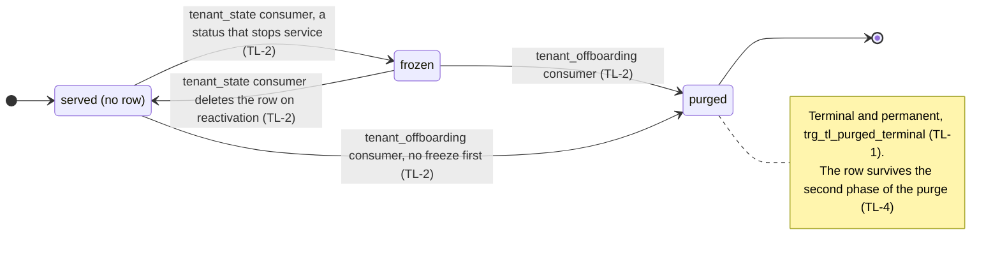

### 4.8 Row-Level Security, triggers, and immutability

#### 4.8.1 RLS

Uniform on every table in both databases:

```sql
ALTER TABLE <t> ENABLE ROW LEVEL SECURITY;
ALTER TABLE <t> FORCE ROW LEVEL SECURITY;
REVOKE ALL ON <t> FROM PUBLIC;

CREATE POLICY tenant_isolation ON <t>
  USING      (tenant_id = NULLIF(current_setting('app.tenant_id', true), '')::uuid)
  WITH CHECK (tenant_id = NULLIF(current_setting('app.tenant_id', true), '')::uuid);
```

*Assumption on a platform library, verified against its source at rev 0.9 (§22.6):* The GUC is bound per transaction by `pgcommon`'s provider, from the validated header on the synchronous path and from the run row's `tenant_id` and `principal_id` on the async path. Both `rag_app` and `rag_activity` are non-`BYPASSRLS`.

**The mechanism is `set_config(..., is_local => true)`, not `SET LOCAL`.** It runs inside an already-open transaction, so the setting clears on `COMMIT` or `ROLLBACK`. That makes it safe under PgBouncer transaction pooling (PgBouncer is a connection pooler that shares database connections between clients).

*Assumption on a platform library, verified against its source at rev 0.9 (§22.6):* **`pgcommon` binds three GUCs in one statement, not one**: `app.user_id`, `app.tenant_id` and `app.tenant_roles`. The policies above use only `app.tenant_id`. The other two are available and unused. A policy that read `app.tenant_roles` would put role logic in the database. This design keeps authorization in `corpusscope` (§6.2) and uses RLS (row-level security, a database rule that hides other tenants' rows) as the backstop that cannot be bypassed.

*Assumption on a platform library, verified against its source at rev 0.9 (§22.6):* **`pgbouncer_mode` false with a provider configured is a cross-tenant leak, not a closed failure.** With `pgbouncer_mode` false the pool still sets the GUC (a Postgres configuration setting), using asyncpg's per-acquire setup hook and `is_local = false`. That makes the GUC **session-scoped**. PgBouncer in transaction mode then hands that connection to the next client with `app.tenant_id` still set. The library's own documentation names it: *"Session GUCs may leak to the next client in PgBouncer transaction pooling."*

`PG_BOUNCER_MODE` is parsed as a Go-style boolean (`1`, `t`, `true` in any case), so `"True"` works. A value it cannot parse logs a warning and falls back to the default, false. So a typo such as `"yes"` still leaves every GUC session-scoped. The fallback silently turns every GUC from transaction-local into session-scoped, and the pooler shares connections between clients. **The startup assertion in §18.1 is a tenant-isolation control, not a configuration nicety**, and `ISO-11` makes it merge-blocking.

*Assumption on a platform library, verified against its source at rev 0.9 (§22.6):* **The `NULLIF(..., '')` wrapper defends against `pgcommon` itself.** `GUCSet.validate()` rejects a role set with no tenant (`TenantRolesWithoutTenantError`) on every acquire. The skip guard needs all three values empty. An empty tenant that reaches the policy makes `''::uuid` raise a cast error instead of matching nothing. A clean empty result then becomes a `500`. The wrapper stays because a `psql` session, the migration runner's own connection, or another service on the same backend can still send an empty tenant. The sibling IAM services harden identically (`iam-lld-tender-acl-service.md` §7.3).

**One exception, for reference collections.** On `collections` and `collection_grants` the uniform policy is replaced by a pair. The read side admits the platform sentinel (a fixed shared tenant id for platform-wide data) and the write side must not. Two policies are used instead of one, so that editing one half cannot widen the other:

```sql
CREATE POLICY tenant_read ON collections FOR SELECT
  USING (
    tenant_id = NULLIF(current_setting('app.tenant_id', true), '')::uuid
    OR tenant_id = '00000000-0000-7000-8000-4c4c4d000003'::uuid   -- PLATFORM sentinel, §4.7.1
  );

CREATE POLICY tenant_write ON collections FOR ALL
  USING      (tenant_id = NULLIF(current_setting('app.tenant_id', true), '')::uuid)
  WITH CHECK (tenant_id = NULLIF(current_setting('app.tenant_id', true), '')::uuid);
```

The same pair goes on `collection_grants`. The write policy stays tenant-only and the tenant purge sweep excludes the sentinel. This keeps `tenant_id` non-nullable on every table while letting the shared authority corpus exist. The sentinel values need platform confirmation that they are reserved (§20 OQ-7).

| # | Invariant |
|---|---|
| RLS-1 | Every table in both databases has a policy **except three**: `processed_events` (`PE-3`), and `outbox_events` and `outbox_dead_letters`, which `eventcommon` owns and whose `tenant_id` is `TEXT` holding values like `'system'` that a `::uuid` policy cannot evaluate (`OBX-4`). The CI schema check carries exactly this exemption list and fails on any other table without a policy. What guards the outbox instead is that nothing reads it but the relay. |
| RLS-2 | A `tenant_id` appearing in a request path or body is never the authority. The effective tenant is always the header- or run-row-derived value bound to the GUC |
| RLS-3 | The canonical cross-tenant test, a query under tenant A returning zero rows and zero Qdrant points of tenant B, is merge-blocking and covers delete paths as well as read paths (§19.5) |

#### 4.8.2 Triggers

`record_version`, `created_at` and `updated_at` are managed by the database on every mutable table, so a client cannot set them. An UPDATE that changes no column is skipped without a bump. A table is mutable when a statement updates a row after insert. The one-way supersession marker on `artefact_versions` and `document_facts` does not count. The append-only tables (`artefact_versions` apart from its supersession marker, `artefact_section_versions`, `artefact_version_sections`, `retrieval_sets`, `retrieval_set_chunks`, `retrieval_set_purges`, `groundedness_reports`, `claim_verifications`, `completeness_checks`, `document_facts` apart from `superseded_at`, `query_refinements`, `instruction_refinements`, `artefact_audit_chain`, `graph_checkpoints`, `processed_events`) carry no `record_version` and no `updated_at`, and carry `created_at` where it has a use (LD-103). A refresh of `collection_grants.projected_at` is a real update and bumps the version. Five further triggers enforce rules that would otherwise rely on developer discipline. **Every function is given below.** A trigger whose body is left to the implementer states a rule without enforcing it. `IG-5` exists to prevent that failure.

**Three generic guards.** The first two read `TG_ARGV`, so one function serves every column list.

```sql
-- Refuses an UPDATE that changes any column except those named in TG_ARGV.
CREATE FUNCTION reject_update_except() RETURNS trigger LANGUAGE plpgsql AS $$
DECLARE o jsonb := to_jsonb(OLD); n jsonb := to_jsonb(NEW); k text;
BEGIN
  FOR k IN SELECT jsonb_object_keys(o) LOOP
    IF NOT (k = ANY (TG_ARGV)) AND (o -> k) IS DISTINCT FROM (n -> k) THEN
      RAISE EXCEPTION '%.% is immutable', TG_TABLE_NAME, k USING ERRCODE = '23514';
    END IF;
  END LOOP;
  RETURN NEW;
END $$;

-- Refuses an UPDATE that changes any column named in TG_ARGV. The inverse of the above.
CREATE FUNCTION reject_column_change() RETURNS trigger LANGUAGE plpgsql AS $$
DECLARE o jsonb := to_jsonb(OLD); n jsonb := to_jsonb(NEW); k text;
BEGIN
  FOREACH k IN ARRAY TG_ARGV LOOP
    IF (o -> k) IS DISTINCT FROM (n -> k) THEN
      RAISE EXCEPTION '%.% is fixed at insert', TG_TABLE_NAME, k USING ERRCODE = '23514';
    END IF;
  END LOOP;
  RETURN NEW;
END $$;

-- Refuses the statement outright.
CREATE FUNCTION reject_always() RETURNS trigger LANGUAGE plpgsql AS $$
BEGIN
  RAISE EXCEPTION '% is append-only; % refused', TG_TABLE_NAME, TG_OP USING ERRCODE = '23514';
END $$;
```

**The database-managed columns.** Two functions rather than one, because each does one job and a table may take either.

```sql
CREATE FUNCTION touch_updated_at() RETURNS trigger LANGUAGE plpgsql AS $$
BEGIN
  IF NEW IS NOT DISTINCT FROM OLD THEN RETURN OLD; END IF;
  NEW.updated_at := now(); RETURN NEW;
END $$;

-- The increment is the server side of optimistic concurrency: the caller's expected
-- value is a WHERE predicate, and the new value is never the caller's to supply (§14.1).
CREATE FUNCTION bump_record_version() RETURNS trigger LANGUAGE plpgsql AS $$
BEGIN
  IF NEW IS NOT DISTINCT FROM OLD THEN RETURN OLD; END IF;
  NEW.record_version := OLD.record_version + 1; RETURN NEW;
END $$;
```

`trg_touch_updated_at` goes on every table with an `updated_at` column. `trg_bump_record_version` goes on every table carrying `record_version`: `artefacts`, `artefact_sections`, `generation_runs`, `collections`, `retention_policies`, `index_generations`, `collection_grants`, `tenant_lifecycle` and `fact_conflicts`. A write that must not overwrite a concurrent change uses `WHERE id = $1 AND record_version = $2`. If the version has moved on, the update matches no row. P-6 and C-I4 expose that check to callers (§14.1). A single internal writer that updates a row no other writer touches does not need it. Both triggers are `BEFORE UPDATE ... FOR EACH ROW`.

**The generation-transition guard.** `IG-3` gives the matrix in prose and `IG-5` requires the database to enforce it. The function is the matrix.

```sql
-- IG-3: this service writes every transition, the build states on Ingestion's request (LD-66).
-- IG-5: a generation reaches 'active' only from 'verified', for any caller.
CREATE FUNCTION reject_generation_transition() RETURNS trigger LANGUAGE plpgsql AS $$
DECLARE
  ours       CONSTANT text[] := ARRAY['rag_app', 'rag_activity'];
  by_us      boolean := current_user = ANY (ours);
BEGIN
  IF TG_OP = 'INSERT' THEN
    -- Generation 1 is created by C-I1 with the collection, already verified or active
    -- (§5.7.17). Every later generation is registered on Ingestion's request (reserved route C-I3).
    IF NEW.status IN ('registered', 'verified', 'active') AND by_us THEN RETURN NEW; END IF;
    RAISE EXCEPTION 'generation cannot be created as % by %', NEW.status, current_user
      USING ERRCODE = '23514';
  END IF;

  IF OLD.status = NEW.status THEN RETURN NEW; END IF;   -- a non-status update

  CASE
    WHEN OLD.status = 'registered' AND NEW.status = 'building'  AND by_us     THEN NULL;
    WHEN OLD.status = 'building'   AND NEW.status = 'verified'  AND by_us     THEN NULL;
    WHEN OLD.status = 'building'   AND NEW.status = 'failed'    AND by_us     THEN NULL;
    WHEN OLD.status = 'verified'   AND NEW.status = 'active'    AND by_us     THEN NULL;
    WHEN OLD.status = 'active'     AND NEW.status = 'retired'   AND by_us     THEN NULL;
    ELSE
      RAISE EXCEPTION 'generation transition % -> % refused for %',
        OLD.status, NEW.status, current_user USING ERRCODE = '23514';
  END CASE;
  RETURN NEW;
END $$;
```

Every other edge is refused. Ingestion holds no grant and cannot write the table at all. **The database does not separate the build edges from the activation edge by role** (rev 2.83, LD-66). This service's role writes every transition, so a bug here could walk a generation through the permitted steps in order. Two things keep `verified` honest. The route that records it is callable only by Ingestion's service principal. The trigger also refuses any skipped or reversed step for every caller (`IG-5`).

`reject_generation_transition` is the authority, so every edge below names the writer the function admits and every pair not drawn raises `23514`.

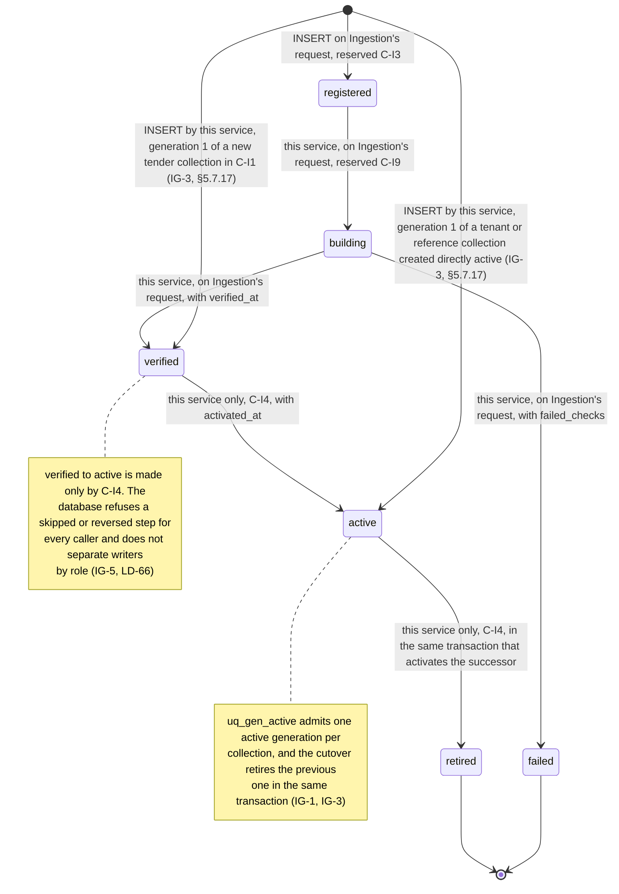

Every pair the function does not list is refused with `23514` by `trg_generation_transition`, `registered` to `verified` and `failed` to anything included.

---

**The section state machine is one more function** (`AS-5`, §4.3.4). It refuses any move the table does not list, refuses a section that has a current version leaving `complete` for `gap` or `failed`, and clears the reason columns on the way out of the state that required them.

```sql
CREATE FUNCTION reject_section_transition() RETURNS trigger LANGUAGE plpgsql AS $$
BEGIN
  IF NEW.state IS NOT DISTINCT FROM OLD.state THEN RETURN NEW; END IF;   -- a non-state update

  IF NOT (
       (OLD.state = 'pending'    AND NEW.state IN ('generating', 'gap'))
    OR (OLD.state = 'generating' AND NEW.state IN ('complete', 'gap', 'failed'))
    OR (OLD.state = 'complete'   AND NEW.state = 'generating')
    OR (OLD.state IN ('gap', 'failed') AND NEW.state = 'generating')
  ) THEN
    RAISE EXCEPTION 'artefact_sections: % to % is not a section transition', OLD.state, NEW.state
      USING ERRCODE = '23514';
  END IF;

  IF OLD.state = 'generating' AND NEW.state IN ('gap', 'failed') AND NEW.current_version_id IS NOT NULL THEN
    RAISE EXCEPTION 'artefact_sections: a section with a current version returns to complete, not %', NEW.state
      USING ERRCODE = '23514';
  END IF;

  IF OLD.state = 'gap'    THEN NEW.gap_reason := NULL; END IF;
  IF OLD.state = 'failed' THEN NEW.failure_reason := NULL; END IF;
  RETURN NEW;
END $$;
```

**The five triggers.**

```sql
-- Document versions are immutable except for the supersession marker.
CREATE TRIGGER trg_version_immutable BEFORE UPDATE ON artefact_versions
  FOR EACH ROW EXECUTE FUNCTION reject_update_except('superseded_by_section_edit');

-- Placement is fixed at provisioning (COL-2).
CREATE TRIGGER trg_collection_restricted_immutable BEFORE UPDATE ON collections
  FOR EACH ROW EXECUTE FUNCTION reject_column_change('restricted');

-- The audit chain is append-only (AC-1).
CREATE TRIGGER trg_audit_append_only BEFORE UPDATE OR DELETE ON artefact_audit_chain
  FOR EACH ROW EXECUTE FUNCTION reject_always();

-- A section's state moves only as the transition table allows (AS-5).
CREATE TRIGGER trg_section_transition BEFORE UPDATE ON artefact_sections
  FOR EACH ROW EXECUTE FUNCTION reject_section_transition();

-- Generation states move one way, and this service writes every transition (IG-3, IG-5, LD-66).
CREATE TRIGGER trg_generation_transition BEFORE INSERT OR UPDATE ON index_generations
  FOR EACH ROW EXECUTE FUNCTION reject_generation_transition();
```

`reject_update_except` is declared once and reused. The supersession marker is the only mutable column on `artefact_versions`. `collections.restricted` is the only fixed column on a table that is otherwise mutable. The two guards are inverses of each other.

`retrieval_sets`, `retrieval_set_chunks`, `artefact_section_versions`, `artefact_version_sections`, and `document_facts` rows are likewise never updated after insert. `document_facts` is the one case where a column changes: `superseded_at` is set once, and the partial unique index is what enforces single-current.

#### 4.8.3 Read support

The A-4 section-state read is served by `idx_a4_read` (§4.3.4). The document-level roll-up is computed as `MIN(evidence_tier)` over the section-version set recorded in `artefact_version_sections`. So MD-30 is arithmetic over recorded verdicts. No stored number exists that could drift.

### 4.9 Read routing

Retrieval reads from replicas (read-only database copies) by default (HLD §5.2). Two exceptions:

- **Replica lag window.** A query scoped to a collection with a document indexed inside the lag window routes to the primary. Implemented by comparing the collection's `last_indexed_at` against the pool's observed replica lag; within the window, route primary.
- **Grant reads always go to the primary.** Replica lag on a revocation is an unbounded authorization hole. This narrows HLD §4.8's blanket "retrieval continues against read replicas" during primary failover. See §14.3, and §20 OQ-5 for its SLO consequence.

### 4.10 Non-relational contracts

**Qdrant payload schema.** Qdrant is the vector database that stores the chunks. Each stored point carries a payload of nineteen fields, in two groups. Retrieval **filters on** fewer fields than it **reads back**.

**Filtered, and therefore indexed as payload predicates:** `tenant_id`, `tender_id`, `collection_id`, `index_generation` (the mandatory compound filter, `SCOPE-2`); `is_current` (every search, `RET-8`); `document_role` and `language` (per request); `entity_types` (the required-input check's entity count, §6.9, LD-100); `chunk_id` (by-id resolution of a sub-span to its containing chunk). **Eight carry an index in v1**: `chunk_id`'s only use is sub-span resolution and v1 emits no sub-spans (§20 OQ-64), so its index lands when they do.

**Carried and read back, never filtered on, and needing no payload index:** `knowledge_level`, `document_id`, `document_version`, `clause_ref`, `is_sub_span`, `parent_chunk_id`, `document_title`, `heading_path`, `text`, `page_number`. `document_title` and `heading_path` are returned on every chunk (§5.5) and recorded in `retrieval_set_chunks` (§4.4.2). `text` is the chunk's own text and is **the source of the 240-character excerpt** (§7.7); this service snaps the excerpt and stores only that, never the full chunk text. `page_number` is what field-level provenance requires where the source is paginated (HLD §8.8). It is carried in the payload because `source_span` stays nullable until D-33 closes. All of these fields ride the payload and avoid a second read on Ingestion's chunk rows. The search already returns the payload, and a second read would land on a latency budget that §6.6 states is oversubscribed.

**`document_title` and `clause_ref` have no stated source** (§20 OQ-62). Contract required from Ingestion: a document title on every point, and a clause reference where the parser found one, HLD §3.1 requiring clause numbering to be preserved through parsing. Current assumption: both are available at chunk time. Impact if different: a citation names a document by id and a clause by nothing.

The filtered group is pre-filtered, never post-filtered (§7.4).

**The supersede window leaves a document with no current version, and that is the safer of the two orderings.** Ingestion hides the old version before it shows the new one. Between the two flips, a revised document matches no search. A generation that lands in that window sees the document as absent, and this service reports it. A required-input check reports the missing role. The retrieval verdict carries a gap and the evidence tier falls. The inverse ordering would leave **both** versions current, which is worse here. Fusion drops repeat copies of identical chunk text across the whole candidate set of one search. The key is a hash of each chunk's `text`, computed by this service at fusion time because the payload carries no hash field (§6.7). So the unchanged chunks of a revision collapse correctly. The **changed** chunks are the only ones where the two versions disagree, and both survive into the evidence set. There the fact-conflict pass would read a document contradicting its own successor. Absence is reported and duplication is not. The window's length is Ingestion's to bound (§20 OQ-65).

**Two of the filter terms carry semantics that decide whether a filter matches at all.** `language` is a BCP-47 tag, `und` where undetermined. **This service matches on the primary subtag**, so a query in `en` reaches `en-GB` content. An exact-tag match would make a regional tag invisible to its own language. A point tagged `und` is matched by no language filter. Only a search that applies no language filter can reach it. This follows from an undetermined parse and is not a defect. `chunk_id` is `{document_version_id}:{chunk_ordinal}`. It is a string and not a uuid, and it is globally unique because `document_version_id` is (§4.4.2). Post-filtering returns a full candidate set and then discards the out-of-scope part. That is slower, and a bug in it would leak data. A sub-span point resolves to its containing chunk before context assembly (MD-31, HLD §7.7); `parent_chunk_id` is what that resolution reads.

`knowledge_level` is derived from the collection type (`TENDER` for `tender`, `TENANT_WIDE` for `tenant`, `REFERENCE` for `reference`, which HLD §6.7 calls L2, L1 and L0; LD-93) and is not a fifth member of the mandatory filter (`SCOPE-2`). `document_version` is the integer purge join key (`EVT-1`) and must be on every point. It is the document's ordinal version (1, 2, 3) and the same integer that `DocumentPurged` carries, since `EVT-1` matches the two. If Ingestion keys on a document-version uuid, that uuid rides as an extra field this service does not read.

**`document_role` is required and non-empty on every point.** It is an optional predicate in the retrieval filter set and `retrieval_set_chunks.document_role` is `NOT NULL` (§4.4.2), so a point carrying none fails the insert the first time it wins a search, which may be long after it was written and reads as an unrelated fault. Dependency: Ingestion. Contract required: a non-empty value on every upsert. `unknown` is a role value that HLD §6.6 already defines. Tender HLD §9.2 (A93) guarantees every document arrives with a claimed role, and `unknown` at zero confidence where none resolves. Retrieval treats `unknown` as its own filter value, and the Domain Profile's authority ordering ranks it last (HLD §6.6). This document specifies no authority ordering (§20 OQ-50 row o). Ingestion never uses `unknown` for a real role and corrects the payload in place when the role arrives. A role-filtered search matches exact values, so these chunks drop out of it and remain in unfiltered searches. A required-input rule for a role is never satisfied by `unknown`, so the gap report shows the role missing until Ingestion corrects it. A role correction is followed by a C-I6 call (§5.7.16, §11.3). Impact if different: Ingestion uses another value, and a role filter then treats it as a real role. HLD §6.6 treats a role absent entirely as a handover violation that is quarantined. Ingestion indexing a role that has not arrived as `unknown` departs from that row. The departure is a contract between Tender and Ingestion and this document does not decide it.

**`entity_types` lists the entity types a chunk contains and never their values (rev 2.126, LD-100).** Source: Ingestion, which tags each chunk with the pack's entity keys (`Taxonomy.entity_keys`, §22.9). Those keys are the Domain Profile's entity types (HLD §6.6: specification, drawing, standard, equipment and material in the tendering profile). HLD §6.7 carries the payload list. Purpose: the required-input check asks whether an entity type is present in the resolved scope (§6.9). Rule: a keyword array on every point, empty where the chunk contains none, each element one of the pack's entity keys, filtered and indexed. Semantics: the list holds every type the chunk contains. One type per chunk chosen by precedence would hide a lower-precedence type that always appears beside a higher one, and the check would report a gap the corpus does not have. Dependency: Ingestion. Contract required (additive): `entity_types` as a list of the pack's entity keys on every upsert. The contract replaces Ingestion's single entity type per chunk, chosen by precedence, with a list. Current assumption: Ingestion can emit every type a chunk contains. Impact if different: a type that never wins the precedence reads as unresolved on every check.

**A document Ingestion has marked deleted is not current.** Ingestion sets `is_current` false on every point of a version when it sets `deleted_at`, so a document that is only marked deleted appears in no search (rev 2.73, confirmed by Ingestion at rev 2.74, §22.10). A cached retrieval set may still cite it for up to the retrieval-set lifetime of 15 minutes, as it may cite a superseded version (LD-38). **`is_current = true` is applied on every search and is not a request option** (`RET-8`). HLD §3.1 requires that retrieval targets the current document version by default and that superseded versions remain addressable for audit, so the predicate is the server's and the generation path has no way to turn it off. No route exposes an `include_superseded` option in this revision; the predicate exists on the point, so an audit reader can be added when one is asked for. Dependency: Ingestion. Contract required: `is_current` is maintained on supersede on **both** the vector points and the `llm_corpus` lexical rows, with the same meaning in each. Current assumption: Ingestion retains the superseded **document version**, which is the position HLD §3.1 takes, and deletes its chunk rows and vector points once the successor commits. Impact if different: the two halves disagree.

**What retrieval needs of a superseded version is the flag, and it does not need the vectors.** No route of this service fetches a corpus chunk by id. `RET-8` keeps every search on current versions, so nothing here reads a superseded point. Historical evidence comes from `retrieval_set_chunks`, which snapshots the excerpt, version, clause reference and heading at generation time (§4.4.2). R-5 returns the recorded set without a corpus read. HLD §3.1 requires keeping the superseded **document version**, and a source click-through resolves against it. Keeping its **vectors** buys retrieval nothing until an audit path that searches them exists. It also costs a re-embed on every index rebuild (§20 OQ-45). Ingestion deletes the chunk rows and points once the successor commits, and this service requires nothing of that step. **`RET-8` still holds**: the flag governs the window between supersede and delete, and Ingestion writes a new version `is_current = false` and flips it true only at commit, so a half-written version is never searchable.

**The two halves have to carry the same flag because they are fused, not chosen between.** Dense (vector) and lexical (keyword) search run at the same time, and RRF (reciprocal rank fusion, a method that merges ranked lists) merges their rank lists (§6.7). Suppose only one store carries the flag. Every superseded chunk that the dense half excluded re-enters through the lexical list and is fused into the candidate set. A one-sided flag is therefore worse than none. The behaviour is inconsistent, and nothing in the result shows it.

*LLD decision, LD-35.* **Collection creation and configuration are Ingestion's.** Ingestion is the sole Qdrant writer (§4.1), so how it creates, shards and tunes a physical collection is its own design (§22.4, §20 OQ-41). This service requires four things of the result. Every field above is an indexed payload predicate. The vector size matches the generation's `embedding_profile`. The `shard_key` from the resolve response is applied on every upsert and delete into that physical collection, so that retrieval finds every point (`corpusscope` carries it in the `ScopeToken`, §6.3). A restricted tender's dedicated collection meets the same requirements. Dependency: Ingestion. Current assumption: Qdrant custom sharding, to be confirmed against the deployed version. Impact if different: the shard routing applied on search.

**The mandatory filter is universal.** Every filter, whether search, delete, scroll or count, carries `tenant_id`, `tender_id`, `collection_id`, and `index_generation`. Collections with no natural tender use sentinels rather than a relaxed filter shape:

| Collection type | `tenant_id` | `tender_id` |
|---|---|---|
| `tender` | real | real |
| `tenant` | real | `TENANT_WIDE` sentinel |
| `reference` | `PLATFORM` sentinel | `REFERENCE` sentinel |

**The three sentinels are fixed literal values.** They appear in a `NOT NULL` column on every row of their type and in every Qdrant filter. A service that computes one differently writes rows that no search reaches.

| Sentinel | Value | Sits in |
|---|---|---|
| `TENANT_WIDE` | `00000000-0000-7000-8000-4c4c4d000001` | `tender_id` of a `tenant` collection |
| `REFERENCE` | `00000000-0000-7000-8000-4c4c4d000002` | `tender_id` of a `reference` collection |
| `PLATFORM` | `00000000-0000-7000-8000-4c4c4d000003` | `tenant_id` of a `reference` collection |

**`4c4c4d` is `LLM` in ASCII, and it is the whole mechanism** (*LLD decision*, LD-53). The three have the shape of a v7 uuid: timestamp zero, version nibble `7`, variant nibble `8`, and trailing six bytes that carry this service's prefix and a counter. They pass v7 format validation and sort first in any time-ordered index. They are easy to spot as constants and not data.

**They are numbered in the order they were agreed with Ingestion.** `TENANT_WIDE` and `REFERENCE` are the two that cross the service boundary. They appear in Qdrant payloads and in Ingestion's own rows, so they took `000001` and `000002`. `PLATFORM` sits only in `collections.tenant_id` and in this service's RLS policies, and took `000003`.

**The canonical form is lowercase.** Postgres normalises a `uuid` literal to lowercase on output, and a Qdrant payload holds the **string**, compared byte for byte with no normalisation. A service that writes `4C4C4D` in uppercase into a payload creates points that no search filter reaches. Neither store reports an error.

Nothing reserves the all-zero prefix. Every service picks its constants there, so it is the **most** contended region of the space. IAM confirmed that `00000000-0000-0000-0000-000000000001` is their `SystemActorID`, the actor identity their CronJobs, event consumers and audit records write; a record carrying that value in both `tenant_id` and `actor_id` could not be read as one thing or the other. The scheme above replaces an argument from unlikeliness with an argument from construction: `4c4c4d` is this service's three bytes and no other service's. §20 OQ-7 resolved.

This keeps MD-08's text literally true and makes a fourth collection type unaddable without a sentinel, because the constructor requires both fields. It is deliberately chosen over a per-collection-type predicate set, which would have relaxed a locked decision for a path FE-03 defers anyway. See §20 OQ-2.

**S3 key layout.** Section content and rendered output are separate prefixes under one artefact. The `rendered/` prefix is reserved and unused in v1, rendering being Tender's (rev 2.77):

```
s3://{bucket}/{tenant_id}/artefacts/{artefact_id}/sections/{section_id}/v{n}.md
s3://{bucket}/{tenant_id}/artefacts/{artefact_id}/rendered/v{n}.{ext}
```

`artefact_section_versions.content_ref` addresses the first. IAM policy conditions restrict every role to its tenant prefix. The KMS (key management service) encryption context carries `tenant_id`, so a mis-scoped read fails at decrypt. Rendering from the tenant's own template is HLD §8.4 work with no owner assigned in this revision (§20 OQ-26).

**Valkey key namespace.** `{tenant_id}:{cache}:{discriminator}`, tenant-prefixed without exception, including for byte-identical inputs across tenants. The six caches and their TTLs are enumerated in §11.

### 4.11 Migrations

This is a greenfield service, so nothing is deployed. Expand-contract (a safe way to change a schema in two steps, add the new shape and then remove the old) is not required yet. The convention is adopted from the start so it is in place before the first environment exists.

*Assumption on a platform library, verified against its source at rev 0.9 (§22.6):* **The runner is `pgcommon.migrate`, which is plain SQL and deliberately not Alembic.** It reads `NNNN_description.up.sql` and `NNNN_description.down.sql` pairs from a directory and tracks the applied version in `pgcommon_migrations`. **A down file per version is our convention, and the runner does not require it.** The runner applies an up file that has no partner. It fails only when a rollback is attempted, which is the worst moment to find the missing file.

The ordered phases are therefore **numbered migrations, not one file in several sections**: `0000` roles and grants (§4.1), `0001` extensions and enums, `0002` every `CREATE TABLE` without cross-table foreign keys, `0003` the foreign keys by `ALTER TABLE`, `0004` trigger functions, triggers, indexes and RLS policies, `0005` the seed rows. The third phase exists because some tables reference each other in pairs (§4.3, `ART-2`, `AS-3`), and `artefact_versions` references `generation_runs` (§4.3.6). No single table order can satisfy those references, so the foreign keys are added afterwards.

**Two directories, two invocations.** The instances are separate, so each has its own numbered set under its own ledger and neither sequence knows about the other.

```
migrations/llm_generation/0000_roles.up.sql   …   0005_seed.up.sql
migrations/llm_corpus/0000_roles.up.sql       …   0005_seed.up.sql
```

The pre-deploy job runs the runner once per instance, against that instance's DSN and that directory. A `.down.sql` accompanies every `.up.sql` and reverses it exactly: for `0002` that is `DROP TABLE`, for `0004` `DROP TRIGGER` and `DROP FUNCTION`, for `0000` `REVOKE` and `DROP ROLE`. Nothing is deployed, so no `.down.sql` has yet been run against data.

**`0005` seeds the rows that must exist before the first request.** The reference collection is created directly `active` with its generation 1 (`IG-3`). C-I1 refuses to create one (`COL-3`). Without the seed, nothing would ever create it, and the first search against reference scope would find no row. The seed inserts the `reference` collection under the `PLATFORM` and `REFERENCE` sentinels (§4.7.1), its generation 1, and nothing else. It is idempotent on the collection's derived primary key (`COL-11`). **The sentinel values feed that derivation.** The reference collection's id is a function of them, so changing a sentinel renames the row (`COL-11`, LD-53). Nothing is deployed, so rev 2.39's change costs nothing. A later change would need a data migration across two stores.

**Migrations do not run from the service's boot path.** The library warns against running them from every replica simultaneously; an init container or a pre-deploy job owns them (§18).

*Assumption on a platform library, verified against its source at rev 0.9 (§22.6):* **`eventcommon` migrates itself separately.** `apply_schema(pool)` applies the outbox schema on startup under its own `outbox_migrations` table (§4.6.4, `OBX-4`). Two migration ledgers on one database is the library's deliberate choice to avoid colliding with exactly this runner.

`active_index_generation` and `purge_epoch` are the two columns whose values are operationally load-bearing and must never be reset by a migration. Both carry a CI guard against destructive change.

**Primary keys are `uuidv7()`** (*LLD decision*, LD-54), on the platform ruling that carried the sentinel scheme. The reason is index locality. `retrieval_set_chunks` takes a row per retrieved chunk per request, and §4.12 models it as the largest table in the service. A random key scatters every insert across the whole B-tree (the index structure). A time-ordered key appends at the end. **`collections.id` is the one exception and stays `UUIDv5`** (LD-40): it is derived so that two services compute the same primary key for the same tender, and a time-ordered identifier cannot be derived from anything.

### 4.12 Capacity and growth

Volume is modelled here because the rate that drives the largest tables differs from the rate the rest of the design is scaled against. **Every figure in this section is an estimate to be tested.** HLD §3.4 states its own envelope as a sizing assumption to be validated against the IAM MVP tenant profile. Nothing is deployed, so there is no traffic to measure.

**Three of the largest tables are driven by the retrieval rate, not the generation rate.** `retrieval_sets`, `retrieval_set_chunks` and `query_refinements` get a row per retrieval *request*. The two readings of HLD §3.4, both estimates to be tested:

| Reading | Derivation from HLD §3.4 | Requests/day | Confidence |
|---|---|---|---|
| Retrieval | 10/s sustained × 86,400 s | 864,000 | Stated directly by HLD §3.4 |
| Generation | 2,000 grounded answers + 500 section drafts + 100 extractions + 50 long-form documents × sections each | ~2,600 plus the long-form sections | **Derived here. The sections-per-document multiplier is not in the HLD** |

The ratio between them is roughly two orders of magnitude, which OQ-46 resolved as a working assumption at rev 2.116: the retrieval reading sizes the design, and measurement replaces every figure here. It is quoted as an order of magnitude because the generation reading depends on a multiplier that no document supplies. At 12 sections per long-form document the generation reading is ~3,200/day and the ratio is ~270×. At 20 sections it is ~3,600/day and ~240×. The HLD does not reconcile the two figures, and the difference decides the instance class (§20 OQ-46).

At the retrieval reading, with ten chunks per set. **Estimates to be tested against a real tenant profile before any instance class is bought:**

| Table | Rows/day | Rows/year | Storage/year | At 10× |
|---|---|---|---|---|
| `retrieval_set_chunks` | 8.6 M | 3.2 B | **~2.7 TB** | 27 TB |
| `retrieval_sets` | 864 k | 315 M | ~540 GB | 5.4 TB |
| `query_refinements` | 864 k | 315 M | ~380 GB | 3.8 TB |
| `artefact_audit_chain` | 13.8 k | 5 M | ~3.9 GB, **never pruned** | 39 GB |
| `claim_verifications` | 38 k | 14 M | ~2.3 GB | 23 GB |

**The §21.2 sweep bounds resident size and leaves write volume unchanged.** Unreferenced sets are reclaimed daily once they are `RETRIEVAL_SET_ORPHAN_MIN_AGE_DAYS` old (default 30). So the heap holds up to 30 days of them, about 270 GB at the table estimates above (7.4 GB of chunks and 1.5 GB of sets a day). A daily reclaim would hold one day's worth. The 30 days is an estimate to be tested like the others, and it is tunable (§17). The sweep does nothing for WAL (the write-ahead log), backup size, the replication stream or autovacuum load. All of these scale with the write rate.
**Partitioning readiness.** Every append-heavy table here has a primary key that excludes `created_at`. Range partitioning (splitting a table into time slices) then needs a key change. Nothing is deployed (CLAUDE.md §8), so this is the cheapest it will ever be to fix. `retrieval_sets`, `retrieval_set_chunks`, `query_refinements`, `instruction_refinements` and `claim_verifications` take `created_at` into their primary keys now, monthly `RANGE` partitions later, and detaching a partition replaces the daily delete sweep with a drop. `artefact_audit_chain` keeps `(tenant_id, seq)`: it is small, it is never pruned, and `AC-3`'s gapless sequence is per tenant, so `LIST` on `tenant_id` is the only partitioning it would ever want.

**What this does not change.** The audit chain's per-tenant advisory lock makes writes within a tenant run one at a time. At roughly 14,000 events a day across all tenants, this is nowhere near a ceiling. The lock is held for the writing transaction, so the ceiling depends on that transaction's duration and not on the event rate. D-19 bounds writers at 10 concurrent per tenant, and the estimated hold is 5 to 50 ms. A writer then waits at most about half a second behind the other nine. A section runs for up to three minutes. The two bounds do not contradict each other at that ceiling (§20 OQ-48).

---

## 5. API Contract

### 5.1 Conventions

- All routes under `/api/v1`. Internal routes under `/api/v1/internal`, except C-M1, whose path HLD §13.2 states without the version segment (§5.7.18). **Operator routes under `/api/v1/operator`** (`API-14`); W-8 is the only one. Breaking changes ship under `/api/v2`. Paths are written in full so every row is copy-paste-exact.
- *Assumption on a platform library, verified against its source at rev 0.9 (§22.6):* The app is built by `fastapicommon.create_platform_app()`, which is the library's only app factory. It installs four layers, outermost first: **`ContextMiddleware` → `UnhandledErrorMiddleware` → `PrometheusMiddleware` (only when metrics are enabled) → `TimeoutMiddleware`**. `UnhandledErrorMiddleware` answers an unclassified exception with a generic 500 and logs its types and frames, never its message. Tracing is OTel (OpenTelemetry) instrumentation and logging is a process-level `structlog` call. Neither is a middleware.
- **There is no global authentication middleware, by design.** The library states this. Unlike the Go `gincommon`'s `RequireAuth`, every route is reachable anonymously unless it adds an auth dependency of its own. So authentication is declared per route, `Depends(require_authenticated_user)` on a public route and the tenant-required dependency on an internal one (rev 2.123, LD-95, §5.1), and role checks are `Depends(RequireRole(...))` (§5.3, `API-11`).
- *Assumption on a platform library, verified against its source at rev 0.9 (§22.6):* The GUC bridge is `pgcommon.integrations.fastapi.GUCAuthMiddleware`, which already exists and takes an `IdentityExtractor`. It needs the `pgcommon[fastapi]` extra, and it rejects a role token containing a comma, which is the `x-tenant-roles` separator.
- *Assumption on a platform library, verified against its source at rev 0.9 (§22.6):* The service **trusts gateway-injected headers** under mesh mTLS and parses no JWT. Three identity headers are the library's, extracted into a frozen `RequestContext`: `x-tenant-id`, `x-user-id`, `x-tenant-roles`. The context also carries `request_id`, `correlation_id`, `trace_id` and `client_ip`. **The other four this design relies on are ours to carry.** `x-departments` (§6.2 scope resolution), `x-plan` (§22.1), `x-feature-flags` (§10.5) and `x-residency-mode` (§22.10) have no constant, no extraction and no field in the library. `RequestContext` is `frozen=True, slots=True`, so they cannot be attached to it. They need our own middleware, installed inside `ContextMiddleware`, and our own request-scoped carrier (HLD §13.2, `API-12`).
- *Assumption on a platform library, verified against its source at rev 2.123 (§22.6; `fastapicommon` `auth/dependencies.py` at `e18f718`, current main):* **`require_authenticated_user` needs `x-user-id`.** It raises `401 UNAUTHORIZED` where the user id is absent and where the identity was rejected (a repeated `x-user-id` or `x-tenant-id`, or an invalid roles header). Internal callers send only `x-tenant-id`, so the dependency would refuse every internal call. *LLD decision, LD-95.* Internal routes (all of `/api/v1/internal/*`: C-I1, C-I2, C-I4, C-I5, C-I6 and C-I8) authenticate by mesh mTLS and declare this service's tenant-required dependency in place of `require_authenticated_user`. It requires `x-tenant-id` and answers `401 UNAUTHORIZED` where that header is absent, repeated or not a uuid. Public routes keep `require_authenticated_user`. C-M1 declares neither (§5.7.18).
- *Assumption on a platform library, verified against its source at rev 0.9 (§22.6):* A malformed identity header is **dropped, not rejected**: over 256 bytes, control characters or U+2028/2029 resolve to absent. `401 UNAUTHORIZED` therefore covers malformed as well as missing.
- Content type `application/json`, except the streaming routes R-2, R-3 and A-6, which are `text/event-stream` on every path (§5.6). R-4 is synchronous and is JSON (§7.7). Timestamps RFC 3339 UTC. UUIDs lowercase-hyphenated. Errors are RFC 9457 problem details served as `application/problem+json` (§24, LD-39).
- **The machine-readable form of this section is two files in `LLM/`**: `retrieval_generation_openapi.yaml` for the public routes and `retrieval_generation_internal_openapi.yaml` for the internal ones, OpenAPI 3.0.3 in the Workflow Definition Service's style. **They are the authority for these endpoints**, as Workflow's are for theirs. This service's code is tested against them. A caller of the internal routes keeps a byte-identical copy and tests its requests against it. If a file and this section disagree, this section is corrected first and the file is regenerated. `openapi-route-check.sh` fails when a §5.4 route has no operation, sits in the wrong file, or a file declares a route §5.4 does not.
- The collection and retention mutations §14.1 version-checks carry the row's new `record_version` in their responses, for optimistic-lock round-tripping. A mutation guarded on its target's state instead, such as A-7 on the conflict's state, carries neither.

**Three route prefixes with distinct auth models:**

| Prefix | Callers | Auth | Routing |
|---|---|---|---|
| `/api/v1/*` | Authenticated tenant users, and the per-tenant automation principal | Gateway-injected headers from a validated JWT | Public Envoy |
| `/api/v1/internal/*` | In-mesh services only: Ingestion only. Tender's C-T1 and C-T2 are retired. User Profile calls only C-M1 (next row). The Workflow Engine calls no route of this service. | Mesh mTLS + NetworkPolicy; no JWT; `x-tenant-id` set to the target tenant. The route declares this service's tenant-required dependency, which answers `401 UNAUTHORIZED` where `x-tenant-id` is absent, repeated or not a uuid | Internal Envoy only |
| `/api/internal/models` (C-M1) | User Profile | Mesh mTLS + NetworkPolicy; no JWT; no tenant header, because the caller holds none (§5.7.18). Rev 2.104 | Internal Envoy only |
| `/api/v1/operator/*` | Platform operators | Gateway asserts `platform_operator`; re-checked at the handler | Separate gateway route |

**Pagination.** `limit` (default 100, hard ceiling 500, a larger requested value is clamped rather than rejected) and `offset` (default 0). A non-positive or non-integer `limit`, or a negative or non-integer `offset`, returns `400 VALIDATION_FAILED`. Every list response echoes the applied window. The figures match the sibling IAM services so a client library holds one pagination helper.

**Idempotency.** `Idempotency-Key` is a required header on W-1 and W-6 and an optional one on R-2, R-3 and R-4. It is stored on `generation_runs` with a hash of the request body, unique per `(tenant_id, principal_id)` while set (`RUN-3`), and cleared by the §21.2 sweep once `IDEMPOTENCY_TTL_SECONDS` has passed. It is accepted and ignored on A-5 and A-6, whose deduplication comes from `base_version_id` instead (§5.7.9).

**Optimistic concurrency.** P-6 and C-I4 round-trip `record_version` and return `409 OPTIMISTIC_LOCK_CONFLICT` on a mismatch. P-6's first write carries none and creates the policy (§5.7.15, LD-76). C-I1 creates and has nothing to lock. Artefact versions are append-only and carry no lock (§14.1).

**API invariants:**

| # | Invariant |
|---|---|
| API-1 | The service never trusts `tenant_id`, `user_id`, or role information from a request body. Identity and authority come exclusively from the gateway-injected headers and the derived request context |
| API-2 | A tenant identifier in a path or body is never the authority. RLS returns zero rows on read and rejects on write where it disagrees with the GUC |
| API-3 | A `tender_id` in a request is a routing and filtering input only. It is never authorization (`SCOPE-7`) |
| API-4 | A task, workflow, stage, or assignee reference supplied on any request is recorded as an opaque identifier and never interpreted (HLD §13.4) |
| API-5 | Every generation response carries the resolved eligibility state and, where a clamp was applied, its reason (MD-23) |
| API-6 | *LLD decision.* The HTTP status of a streaming response commits when the first byte of the body is written, which is the first frame or, on the blocking path, the first heartbeat comment (§5.6). Every failure before that, including retrieval, input screening, plan construction, residency and quota refusal at dispatch, is an ordinary HTTP problem with its own status. Only a failure after the first frame is a terminal `error` frame on the `200`. On a compliance-typed scope where phase 1 is suppressed (`API-7`) the first byte is the first heartbeat, sent 15 s after the stage starts holding the connection, so a failure inside those 15 s is HTTP and a later one is the terminal `error` frame. The reason: a refusal decided before any frame can still be reported as the status it is, and a client then has one boundary to learn |
| API-7 | A streaming route answers in one media type on every path. Where §7.4 suppresses phase 1, the response is the same event stream carrying only its terminal frame, and a failure before its first heartbeat is HTTP while a later one is the terminal `error` frame (`API-6`, rev 2.123, LD-95) |
| API-8 | A list response is a summary shape. No list route returns a groundedness report, a claim verification, or a retrieval set's chunks |
| API-9 | Every response carrying generated or retrieved content also carries the id of the retrieval set it was built from. The explainability surface is reachable from the content it explains. The id resolves while the set exists. A set with no artefact (every R-1 set, and a set from a generation that never completed) is kept for `RETRIEVAL_SET_ORPHAN_MIN_AGE_DAYS` and then reclaimed (§21.2), after which R-5 returns `404 RETRIEVAL_SET_NOT_FOUND`. A set cited by an artefact version lives as long as the version |
| API-10 | A route that reads a recorded retrieval set, artefact version, or excerpt re-resolves scope against current grants. Possessing an identifier authorizes nothing (`ASYNC-4`) |
| API-11 | Every route declares its own authentication dependency. No middleware supplies one, so a router registered without it is anonymous. A CI check asserts that every registered route other than C-M1 carries one (rev 2.123, LD-95), because the failure is silent (§5.3). C-M1 is exempt: it is reachable by mutual TLS alone and carries no identity (§5.7.18). *LLD decision.* A public route declares `require_authenticated_user`. An internal route (`/api/v1/internal/*`) declares this service's tenant-required dependency, which answers `401 UNAUTHORIZED` where `x-tenant-id` is absent, repeated or not a uuid. The library's dependency also needs `x-user-id`, which an internal caller does not send (§5.1) |
| API-12 | `x-departments`, `x-plan`, `x-feature-flags` and `x-residency-mode` are extracted by this service, not by `fastapicommon`. A handler reading them from `RequestContext` finds nothing there |
| API-13 | Generated text leaves this service only through the stream (R-2, R-3, A-6), A-8 and A-9. No event carries it (`EVT-7`), and A-9 re-resolves scope on every read (`API-10`) |
| API-14 | **An operator route sits under `/api/v1/operator/` and nowhere else.** That prefix is the only one whose gateway route asserts `platform_operator`, and the handler re-checks it. W-8 is the only such route today. A route described as operator-only on the tenant prefix has no mechanism behind the description: the tenant prefix carries tenant identity alone, so the check has nothing to read and the route is reachable by any authenticated user of the tenant (LD-48) |

### 5.2 Input validation

All are `400 VALIDATION_FAILED` unless noted.

| Input | Bound |
|---|---|
| `query`, `question` | 4,000 characters |
| `instruction`, `user_prompt` | 8,000 characters, and additionally subject to the 10% user-layer token allocation, which returns `413` rather than `400` (§6.8) |
| `collection_ids`, `document_ids`, `section_types` | 100 entries |
| R-6 `content` | 1 MB. R-6 takes caller-supplied text rather than reading the corpus, so it is the one route with no other bound on its input size |
| `tender_section_ref`, `target_ref`, `capability`, `schema_ref` | 256 characters, stored opaque (`ART-4`) |
| Any uuid path or body parameter | Parsed as a uuid, not matched as a string |

**A malformed or schema-invalid body returns `400 VALIDATION_FAILED`** with one `validationErrors` entry `{field, message}` per failing field (rev 2.118, LD-91). The bounds above are checked in handlers and return the same code.

### 5.3 Authorization rules per route

*Assumption on a platform library, verified against its source at rev 0.9 (§22.6):* **Authentication is declared per route and nothing supplies it globally** (`API-11`). `create_platform_app` installs no auth middleware, as the library documents. A route that omits `Depends(require_authenticated_user)` is therefore reachable anonymously, and nothing fails loudly. The CI check in §19 asserts that every registered route other than C-M1 carries one (rev 2.123, LD-95), `require_authenticated_user` on a public route and the tenant-required dependency on an internal one (`API-11`); it exists because the failure mode is silence rather than an error.

Every data-touching route then resolves a `ScopeToken` (§6.2, the record of which collections the caller may read) before it does anything else. The grant level resolved there decides what the caller may do. The tenant role does not. **A route takes the level of the most sensitive thing it returns or does** (LD-59): stored source text is `search`, generated text and anything that describes a generated artefact is `answer`, and creating or changing generated content is `generate`.

| Operation class | Requires |
|---|---|
| Search, retrieve, read a retrieval set, run a required-input check | `search` on every collection in scope |
| Grounded answer | `answer` |
| Draft, long-form, extraction, regeneration | `generate`, **and** a Domain Profile eligibility state permitting it (§7.6) |
| Read an artefact, its versions or sections, its rendered document, the text of a section version, or a run's progress (A-1 to A-4, A-8, A-9, W-2) | `answer`, re-resolved on every read (`API-10`) |
| Start, approve, edit, cancel or resume a long-form run, resolve a fact conflict (W-1 and W-3 to W-7, A-5 to A-7) | `generate`, and W-3, W-4 and W-7 re-resolve scope and eligibility before they act, and W-5 re-resolves scope only (`ASYNC-4`, §5.7.14) |
| Rematerialise a lost run (W-8) | `platform_operator`, on `/api/v1/operator/` only (`API-14`) |
| Classification proposal | An authenticated tenant principal. No collection scope is resolved (§5.7.6) |
| Model catalogue, C-M1 (rev 2.123, LD-95) | Nothing. Mutual TLS only, with no tenant header and no identity (§5.7.18, `API-11`) |
| Collection administration (retention has its own row below) | `tenant_admin` or `tender_admin` |
| Retention policy, P-6 (rev 2.104) | `tenant_admin`. The HLD's role table gives retention per collection to the Tenant Admin, and §5.4 states the same level |
| Index generation registration and cutover | Internal (Ingestion) only |
| Collection provisioning and promotion | Internal (Tender) only |

`search`, `answer` and `generate` are §4.2's `grant_level` enum. They are placeholders for a vocabulary Tender HLD §6.7 settles as `view`, `edit` and `approve` without stating the mapping to ask-capability. The mapping is proposed in §4.7.2 (LD-21) and is assumed, §20 OQ-3 having closed on that assumption (rev 2.84). Every level named in this section moves with it.

**Authorization invariants:**

| # | Invariant |
|---|---|
| AUTH-1 | Standing on an ordinary tender resolves from the caller's departments and role levels; standing on a restricted tender resolves from the identity subsystem's overlay grant, read live from TAC-4 (`CG-1`, `CG-11`, Tender HLD §6.7). This service is a peer consumer of that grant check and never an authority over it |
| AUTH-2 | Grant level clamps down, never up. The **grant-level** clamp is recorded on the retrieval set; the **eligibility** clamp is on the run and copied to its version (`SCOPE-8`, `GEN-6`, `RUN-1`) |
| AUTH-3 | The automation principal is authorized exactly as any other caller: a real per-tenant principal in IAM (D-6, Tender HLD A70), resolving grants normally. This service authors no automation policy and stores no automation preference |
| AUTH-4 | Internal routes are trusted for *authentication* only. They remain subject to RLS and to scope resolution; an internal caller cannot reach content outside the target tenant |

### 5.4 Endpoint catalogue

#### Retrieval and short-form generation

| # | Method & path | Purpose | Level |
|---|---|---|---|
| R-1 | `POST /api/v1/search` | Hybrid retrieval, results only, no generation. Returns the retrieval set and its verdict | `search` |
| R-2 | `POST /api/v1/answers` | Grounded answer, two-phase streaming (§7.4) | `answer` |
| R-3 | `POST /api/v1/sections/drafts` | Interactive section draft, two-phase streaming | `generate` |
| R-4 | `POST /api/v1/extractions` | Structured extraction, synchronous under the 90 s SLO | `generate` |
| R-5 | `GET /api/v1/retrieval-sets/{id}` | The recorded set: chunk order, scores, filters, markers. The explainability surface | `search` |
| R-6 | `POST /api/v1/classification/propose` | Document-role proposal. Stateless, writes nothing, emits nothing (MD-21) | authenticated |
| R-7 | `POST /api/v1/required-input-checks` | Run the pack's required-input rules against the resolved scope without generating. Returns a gap report (§6.9) | `search` |

R-5, R-6 and R-7 each take a level for a stated reason. R-5 returns stored excerpts, which are verbatim source text, so it sits at `search` and re-resolves scope on every read (`API-10`). R-6 resolves no collection scope at all, so a grant level would be a field with nothing to check against. R-7 reports which document roles and collections the resolved scope is missing, which is corpus composition, so it sits at `search` alongside R-1.

#### Artefacts and regeneration

| # | Method & path | Purpose | Level |
|---|---|---|---|
| A-1 | `GET /api/v1/artefacts/{id}` | Artefact with current version, evidence tier, eligibility verdict | `answer` |
| A-2 | `GET /api/v1/artefacts/{id}/versions` | Version history, paginated | `answer` |
| A-3 | `GET /api/v1/artefacts/{id}/versions/{no}` | One version with its groundedness report and retrieval set reference | `answer` |
| A-4 | `GET /api/v1/artefacts/{id}/sections` | Section states and per-section evidence tiers, paginated | `answer` |
| A-5 | `POST /api/v1/artefacts/{id}/regenerate` | Document-scope regeneration (§10) | `generate` |
| A-6 | `POST /api/v1/artefacts/{id}/sections/{ref}/regenerate` | Section-scope regeneration | `generate` |
| A-7 | `POST /api/v1/artefacts/{id}/sections/{ref}/fact-conflict-resolution` | Resolve a surfaced fact conflict (D-35, §10.3) | `generate` |
| A-8 | `GET /api/v1/artefacts/{id}/render` | Signed S3 URL for the rendered document. **Not built in v1: rendering is Tender's (rev 2.77, HLD v0.23), so the route is reserved and returns `503 RENDERER_UNAVAILABLE`** | `answer` |
| A-9 | `GET /api/v1/artefacts/{id}/sections/{ref}/versions/{no}/content` | The generated text of one section version, for the system of record to store as its own version (LD-89) | `answer` |

#### Asynchronous generation

| # | Method & path | Purpose | Level |
|---|---|---|---|
| W-1 | `POST /api/v1/generations` | Start a long-form generation workflow. Returns a handle | `generate` |
| W-2 | `GET /api/v1/generations/{id}` | Workflow state, outline state, per-section progress | `answer` |
| W-3 | `POST /api/v1/generations/{id}/outline/approve` | Approve the outline and resolve the human gate (§9.4) | `generate` |
| W-4 | `POST /api/v1/generations/{id}/outline` | Submit an edited outline; loops back to outline construction | `generate` |
| W-5 | `POST /api/v1/generations/{id}/cancel` | Cancel; completed sections remain durable | `generate` |
| W-6 | `POST /api/v1/extractions/async` | Start an extraction workflow where the payload exceeds the synchronous budget | `generate` |
| W-7 | `POST /api/v1/generations/{id}/resume` | Resume a run suspended on quota (§14.4) | `generate` |
| W-8 | `POST /api/v1/operator/generations/{id}/rematerialise` | **Operator only, audited.** Start again, from the run row, a Temporal workflow lost with its history (§18.9). `ASYNC-8` forbids an unauthorized or automatic transition and this is neither. **On the operator prefix, not the tenant prefix** (§5.1, `API-14`) | `platform_operator` |

#### Corpus administration, tenant-facing

| # | Method & path | Purpose | AuthZ |
|---|---|---|---|
| P-1 | `GET /api/v1/collections` | Collections in the caller's resolved scope, whether that resolved from departments or from an overlay grant (`CG-1`) | resolved scope |
| P-2 | `GET /api/v1/collections/{id}` | One collection | resolved scope |
| P-3 | `GET /api/v1/collections/{id}/grants` | Read the last overlay answer this service recorded, for operator diagnosis. Not the authority, and never a grant-management surface (`CG-2`) | `tenant_admin`/`tender_admin` |
| P-6 | `PUT /api/v1/collections/{id}/retention` | Set the retention policy | `tenant_admin` |

P-4 and P-5 are unassigned. They were the grant create and revoke routes, removed when `collection_grants` became a projection rather than an authority (`CG-2`); the numbers stay unfilled so the removal stays visible.

#### Internal, Ingestion

| # | Method & path | Purpose |
|---|---|---|
| C-I1 | `POST /api/v1/internal/collections/resolve` | Resolve **or create** a collection for an inbound document. `200` where a row exists, `201` where one was created, same body (LD-41, §9.7) |
| C-I2 | `GET /api/v1/internal/collections/{id}` | Placement and generation metadata. **Answers in every status, `purging` included**, because it is what Ingestion reads to find the vectors it has to delete (`COL-13`) |
| C-I4 | `POST /api/v1/internal/collections/{id}/index-generations/{gen}/activate` | Atomic per-collection cutover of a `verified` generation, `409 GENERATION_NOT_VERIFIED` otherwise (`IG-5`); retires the previous generation in the same transaction (`IG-3`); emits `IndexGenerationActivated`. A repeat for an already `active` generation returns `200` and changes nothing (LD-37) |
| C-I5 | `GET /api/v1/internal/collections/{id}/retention` | Policy for the retention sweep. **After the first release: no caller in v1.** When it is called it returns `collection_id`, `retain_days`, `legal_hold`, `record_version` and `updated_at` |
| C-I6 | `POST /api/v1/internal/collections/{id}/purge-epoch` | Bump on purge, and after a hide, a restore or a role correction (LD-98); O(1) retrieval-cache invalidation (§11.3) |
| C-I7 | *Required of Ingestion; not a route of this service.* | **us → Ingestion.** Copy every point of the source collection into the target, re-stamping `collection_id` and `index_generation`, idempotent on `(source, target)` and on `migration_id` (§13.5). **Asynchronous, agreed in principle with Ingestion (rev 2.46):** the request carries `migration_id` (this service's idempotency key for the attempt), `tenant_id`, `tender_id`, the source and target collection ids and the target `index_generation`, and returns at once; C-I8 reports the result. Path and exact shape are Ingestion's to define (§22.4, §20 OQ-41) |
| C-I8 | `POST /api/v1/internal/collections/{id}/migration-result` | **Ingestion → us.** The body carries `migration_id`, a result of `complete` or `failed`, a reason on failure, and `points_copied`, which this service checks. Completion triggers the cutover transaction; failure moves the target to `migration_failed` |
| C-I10 | *Required of Ingestion; not a route of this service.* | **us → Ingestion.** After a promotion cutover, delete the source tender's points from the shared physical collection. Without it the restricted content stays readable from shared placement for ever (§13.5). **Agreed in principle with Ingestion (rev 2.46):** a delete by filter on `tender_id` and the source collection id, with the shard key, safe to repeat. Path and exact shape are Ingestion's to define (§22.4, §20 OQ-41) |

C-I3 and C-I9 are **reserved** for the generation registration and build-state routes (rev 2.83, LD-66). Ingestion calls them to record `registered`, `building`, `verified` and `failed`, and this service writes the row. Both are callable only by Ingestion's service principal. Nothing writes those states in v1, so the shapes are specified when Ingestion's re-index campaigns are scheduled (§20 OQ-61).

Every route in this catalogue is hosted by this service. C-I7 and C-I10 are listed as the calls this service requires of Ingestion and are not routes of ours, so their paths and shapes are Ingestion's to define. Calls to other teams' services (TAC-4, `llm-context`, Tender pack resolution) and to the Model Gateway are listed in §22. The Model Gateway is Envoy AI Gateway, owned and run by this subsystem, and its route configuration is owed (LD-68, §20 OQ-92). Tender pack resolution's contract is not yet held (§20 OQ-54b).

#### Internal, Workflow Engine

**C-W1 is retired (rev 2.107, LD-80).** The engine does not call this service, so no route serves a stage call and the number is not reused. The phases are steps of the run's workflow (LD-88), and `ASYNC-14` governs them.

The route, its endpoint-alias registration, its alias timeout and the question of what identity a stage call carries (§20 OQ-78) went with it.

#### Internal, Tender

**None.** Tender's C-T1 (provisioning) and C-T2 (promotion) routes are retired. C-I1 creates the row on the first document, and the `TenderRestricted` consumer creates it or starts the promotion where restriction comes first. The numbers stay unfilled so the removal stays visible.

Retiring them removes a cross-team call in each direction and an ordering dependency with it. C-T1 existed so that a document could never arrive before its corpus, which C-I1 makes impossible by construction; C-T2 existed so that promotion ordering stayed ours, which it still is, the trigger moving from Tender's call to our own consumer of Tender's event (§12.4, §9.7).

#### Internal, outbound-facing

| # | Method & path | Purpose |
|---|---|---|
| C-M1 | `GET /api/internal/models` | Model identifiers a tenant may select. Read by User Profile to validate `preferred_model` at write time (HLD §13.2). Proxies the Model Gateway's catalogue; we hold no model list of our own |

C-I4, C-I6 and C-I8 were **LLD additions** until HLD v0.14 named them in §5.2. C-I4 and C-I6 fall out of HLD §4.1's dual-write mandate meeting HLD §5.2's write-authority split: Ingestion cannot flip the active generation on a collection table it holds no grant on. C-I8 follows from promotion (§13.5), and C-I7 and C-I10 are calls required of Ingestion for the same reason. §20 OQ-6, OQ-41.

### 5.5 Shared request and response fragments

Eight shapes recur across the routes below. They are named once here and referenced by name afterwards.

**`ScopeRequest`** is the collection-selection block every retrieving route accepts:

```jsonc
{
  "tender_id": "0f2a...",          // optional; routes and filters, never authorizes (API-3)
  "collection_ids": ["7c31..."],   // optional; omitted means every granted collection of a permitted type, a restricted tender only when named (§4.7.2)
  "collection_types": ["tender", "tenant", "reference"]  // optional filter on the above
}
```

An explicit `collection_ids` entry the caller holds no grant on returns `404 COLLECTION_NOT_FOUND`, not a silently narrowed scope. Omitting the field is the only form that narrows silently, because there the caller asserted nothing.

**`PriorRefinement`** reports what the user did with a refinement this service returned on an earlier request (§10.5). It is optional on R-1, R-2 and R-3:

```jsonc
{ "refinement_id": "a19c...", "action": "accepted" }   // accepted | edited | discarded
```

Absent, the recorded `user_action` stays `unknown`. No Tender UI reports this today, so the field has a producer and no caller (§20 OQ-22).

**`DegradationMarker`**, appended by any stage that applied a fallback (`RET-1`):

```jsonc
{ "stage": "rerank", "reason": "deadline_exceeded", "applied_fallback": "fused_order" }
```

**Marker reasons (rev 2.126, LD-99).** `reason` is a lower snake case string. Two reasons record a Model Gateway refusal: `quota_refused` and `residency_refused`. A search appends one when the Gateway refuses its embed, rerank or refine call (§6.1, §14.4). A search marker has the `stage` `embed`, `rerank` or `refine`. Its `applied_fallback` is `lexical_only`, `fused_order` or `raw_query`. The Instruction Refiner on A-6 (§10.2) appends the same two reasons. Its `stage` is `refine_instruction` and its `applied_fallback` is `raw_instruction`, named after the field that always keeps the caller's text (MD-33). When the Gateway refuses the `refine-instruction` call on A-6, the route falls back to the raw instruction and adds a marker. The draft call that follows can still return `429 QUOTA_EXHAUSTED` or `503 RESIDENCY_CAPACITY`. The refine call and the draft call are two separate Gateway calls, and the Gateway can refuse each one. This changes the public contract. A client that branches on `reason` sees two new values. `LLM/retrieval_generation_openapi.yaml` documents both. `DegradationMarker.reason` stays a free string, so no enum changes.

**`RetrievalVerdict`**, the reduced three-valued result (MD-14):

```jsonc
{
  "retrieval_set_id": "3d90...",
  "verdict": "sufficient",              // sufficient | insufficient | failed
  "verdict_reason": null,               // non-null whenever verdict is not sufficient (RS-5)
  "widened_retry_of": null,             // set on the one permitted retry (RS-6)
  "values_provisional": true,           // profile values unvalidated against a golden set (RET-4)
  "degradation_markers": []
}
```

**`EligibilityVerdict`** (§7.6), carried on every generative response (`API-5`):

```jsonc
{
  "state": "PARTIALLY_GENERATABLE",
  "requested_mode": "automation",
  "effective_mode": "assistance",
  "clamped": true,
  "clamp_reason": "profile_withholds_unattended_completion",
  "profile_version": "dp-civil-en-4.2.0"
}
```

**`Chunk`**, one entry of a retrieval set, mirroring `retrieval_set_chunks` (§4.4.2):

```jsonc
{
  "rank": 1,
  "chunk_id": "b7e2...", "parent_chunk_id": null,
  "document_id": "44c1...", "document_version": 3,
  "document_title": "Special Conditions of Contract",
  "heading_path": "3 > 3.4 Access", "clause_ref": "3.4.2",
  "document_role": "specification", "language": "en",
  "collection_id": "7c31...", "collection_weight": 0.9,
  "fused_score": 0.0312, "rerank_score": 0.871, "source_half": "both",
  "excerpt": "...240 characters, sentence-snapped (§7.7)...",
  "excerpt_is_translation": false,
  "source_span": null,                  // nullable until D-33 closes
  "purged": false                       // true where a §4.4.3 row covers this chunk
}
```

**`Citation`**, one claim's resolved provenance:

```jsonc
{
  "claim_ordinal": 7, "outcome": "miscited",       // supported | unsupported | miscited | gap
  "cited_chunk_ids": ["b7e2..."],                  // as the model emitted them
  "corrected_chunk_ids": ["91af..."],              // the correction, where outcome is miscited
  "tier_decided": 2                                // the tier that settled this claim
}
```

Both chunk fields are arrays, because one claim can cite several chunks and a correction can name several. `claim_ordinal` is an integer. The table `claim_verifications` is keyed on `(report_id, claim_ordinal)` (§4.5.2), so the ordinal identifies the claim within its report.

**`GapReport`**, returned by R-7 and carried on a required-input failure (§6.9):

```jsonc
{
  "missing_roles": ["bill_of_quantities"],
  "unresolved_entities": ["standard"],
  "empty_collections": ["7c31..."],
  "blocking": true
}
```

`unresolved_entities` carries entity types from the pack's `entity_keys`, such as `standard` (§6.9), never named parties.

A gap report is a verdict wherever the caller chose to proceed. On R-3 and A-6 the caller asked for generation and the rules block it. There the report becomes `422 REQUIRED_INPUT_MISSING`, sent as an HTTP response before the first frame (§24). W-1 records the gap on the section instead (§4.3.4). R-2 and R-4 apply no required-input rule (§5.7.7).

### 5.6 The streaming contract

Two items open here: the framing is a client contract Tender has to implement (§20 OQ-33), and two paths hold a connection open in silence for longer than a default route timeout allows (§20 OQ-34).

*LLD decision, LD-1.* R-2 and R-3 answer with **Server-Sent Events** on the caller's own connection, which is HLD §4.6's chunked streaming response given a concrete framing. Named event types map onto §7.4's two phases without a discriminator field, and every browser client already has a parser.

**One media type on every path** (`API-7`). §7.4 suppresses phase 1 for a compliance-typed scope, where HLD §8.5 mandates blocking. That case answers with the same `text/event-stream` carrying only its terminal frame. A failure before its first heartbeat is HTTP and a later one is the terminal `error` frame (`API-6`). Content negotiation is unavailable here because the decision depends on the resolved section type, which is not known until pack resolution has already run inside the request.

| Event | Phase | Content |
|---|---|---|
| `draft` | 1 | A prose delta with provisional citation markers. Repeated. Absent entirely on the blocking path |
| `verdict` | 2 | The terminal frame. Exactly one per response |
| `error` | terminal | A failure after the first frame. Exactly one, and no `verdict` follows. Its code is `INFERENCE_UNAVAILABLE` or `INTERNAL_ERROR` (rev 2.123, LD-95) |

```jsonc
// event: draft
{ "delta": "The access route specified in clause 3.4.2 ", "citation_refs": ["c-07"] }

// event: verdict
{
  "artefact_id": "8a11...", "artefact_version_id": "2f7d...", "version_no": 4,
  "retrieval_set_id": "3d90...",
  "citations": [ /* Citation[] */ ],
  "groundedness": { "supported": 11, "unsupported": 1, "miscited": 1, "gaps": 0,
                    "tiers_run": [1, 2] },
  "completeness": { "verdict": "partial", "missed_items": ["retention_period"] },
  "evidence_tier": "PARTIAL",
  "eligibility": { /* EligibilityVerdict */ },
  "degradation_markers": [ /* DegradationMarker[] */ ],
  "delivery": "delivered"
}

// event: error
{ "type": "https://errors.bcbp.io/retrieval-generation/inference-unavailable", "title": "Inference unavailable",
  "status": 503, "detail": "...", "instance": "/api/v1/answers",
  "traceId": "4bf9...", "errorCode": "INFERENCE_UNAVAILABLE", "tenantId": "0a3f...", "timestamp": "2026-10-22T09:12:04Z" }
```

*LLD decision.* **The status code commits when the first frame is written** (`API-6`, LD-2). Every failure before that, including retrieval, input screening, plan construction, residency and quota refusal at dispatch, is an ordinary HTTP problem with its own status. Only a failure after the first frame is a terminal `error` frame on the `200`. On a compliance-typed scope where phase 1 is suppressed (`API-7`) the first byte is the first heartbeat, sent 15 s after the stage starts holding the connection, so a failure inside those 15 s is HTTP and a later one is the terminal `error` frame.

The admission checks run in this order: the tenant-status check (§7.6), the artefact-store writability probe (`GEN-3`), scope resolution, pack resolution, eligibility, the user-layer budget check, then the shell and run row commit. Plan construction (§6.1 stage 3, which includes the required-input check on R-3 and A-6), retrieval and input screening follow, and the dispatch to the Gateway follows them. Each failure in that sequence is an ordinary problem detail with its own status (§24). Only `INFERENCE_UNAVAILABLE` and `INTERNAL_ERROR` can occur after the first frame (R-2, R-3, A-6). The tenant-status check is first because it reads only a header already on the request and refuses before any store is touched.

**Quota is checked at dispatch, by the Gateway, and nowhere else** (LD-13). Quota is the Model Gateway's state (§2.2), and the Gateway exposes no reservation API. A check at admission here would make this service a second authority that reads a number it does not own. It would also race every other caller between the check and the dispatch. The Gateway refuses at dispatch, before any frame. So `429 QUOTA_EXHAUSTED` is an HTTP status with `Retry-After` on R-2, R-3, R-4 and A-6. R-6 returns it too, from its single Gateway call (§7.8). The cost is that a quota-exhausted request has already paid for retrieval. The alternative costs a cross-service call on every request, to prevent a failure that is cheap and visible. This is the reason `GEN-3` puts the store check at admission and not at write. A late check would spend tokens on a request whose failure can no longer be reported as a failure (§5.6, `API-6`).

`GEN-1` holds at the transport: a response without its `verdict` frame is an unverified draft, and a client that renders phase 1 and loses the connection must present it as such. Citations are not actionable until the verdict frame lands, because a miscited citation is corrected in that frame and never by rewriting delivered prose.

*Assumption on a platform library, verified against its source at rev 0.9 (§22.6):* **The tenant context does not survive into the stream body, and every database write on this path is inside it.** `ContextMiddleware` binds the request context and resets it in a `finally` around `call_next`. Under Starlette's `BaseHTTPMiddleware`, `call_next` returns when response **headers** are sent. An SSE (server-sent events) body is iterated after that point. So the artefact write, the groundedness write and the outbox row in §7.5's completion transaction all run with no bound context. `pgcommon` then has no tenant to inject, and every RLS-protected statement matches nothing.

*LLD decision, LD-23.* **The handler copies the resolved `ScopeToken` and tenant into the stream generator's own closure before it returns the response.** The completion transaction then sets the database tenant setting (the GUC) from that copy, not from the request context variable. The rule applies to every streaming body: nothing inside it may read request-scoped state from the middleware's context. `ISO-13` tests this because the failure is silent, an empty result and no error, and the existing cases in §19.5 all run on non-streaming routes, where the context is still bound.

**Heartbeats.** An SSE comment line every 15 s while a stage holds the connection without producing a delta, so an idle proxy does not reap a request inside its own SLO. The blocking path emits nothing else until its terminal frame, so it is the path that needs them. **The first heartbeat commits the `200`**, so a failure after it on that path is the terminal `error` frame (`API-6`). R-4 gets no such cover: it is `application/json` and synchronous for up to 90 s, so its gateway route timeout has to be raised explicitly and no figure is recorded today (§20 OQ-34).

### 5.7 Key endpoint specifications

#### 5.7.1 R-1 `POST /api/v1/search`

Retrieval with no generation and no artefact. The whole §6 pipeline runs through stage 9; nothing dispatches to the `draft` task class.

```jsonc
POST /api/v1/search
{
  "query": "access route for crane erection",
  "scope": { /* ScopeRequest */ },
  "section_type": "method_statement",     // optional; selects the section-type profile (§6.7)
  "prior_refinement": { /* PriorRefinement */ },   // optional
  "limit": 20                             // optional; clamped to the profile's rerank_out
}

// 200 OK, or 206 where degradation_markers is non-empty
{
  "verdict": { /* RetrievalVerdict */ },
  "chunks": [ /* Chunk[] */ ],
  "refinement": { "refinement_id": "a19c...", "intent": "topic",
                  "refined_query": "...", "exact_terms": ["crane"],
                  "original_query": "access route for crane erection",
                  "refiner_version": "qr-3f81a2", "outcome": "success" },
  "applied_profile": { "source": "section_type", "values_provisional": true,
                       "candidate_depth": 24, "rerank_in": 20, "rerank_out": 8 }
}
```

`206` is the degraded-success code and carries the same body. The distinction is `len(degradation_markers) > 0`, derived and never set by hand (§6.1). A `failed` verdict is `503 RETRIEVAL_FAILED` rather than a `200` body, because both search halves being down is an incident (MD-14).

`limit` is clamped to the resolved profile's `rerank_out`. A caller asking for forty chunks from a profile that reranks twenty would otherwise get twenty, with no sign that the list was cut. The applied figures are echoed in `applied_profile` on every response.

The refinement block lets a client offer the refined query to the user. The client reports the outcome on its next request through `PriorRefinement`. When the flag is off, the block is absent. That differs from a block present with `outcome: "disabled"`. A skipped refiner records no observation at all (`REF-2`).

**Errors (rev 2.126, LD-99).** *LLD decision.* A Gateway refusal of R-1's embed, rerank or refine call, for quota or residency, makes the search degrade, the same way the outage rows of §14.4 do. The embed call falls back to lexical-only search. The rerank call falls back to the fused order. The refine call falls back to the raw query. Each fallback appends a marker whose reason is `quota_refused` or `residency_refused` (§5.5, §6.1), and the response is `206`. None of the three is an error status. R-1 writes a retrieval set on every request whose verdict is not `failed`, with `artefact_id` null (§4.4.1). It returns the set's id as `verdict.retrieval_set_id` (`API-9`), which R-5 reads. A `failed` verdict is `503 RETRIEVAL_FAILED` with no id, and nothing is saved. The id works on R-5 for `RETRIEVAL_SET_ORPHAN_MIN_AGE_DAYS` (default 30, §17) after the request. It also stops working when a tender or tenant purge deletes the set. After either, R-5 returns `404 RETRIEVAL_SET_NOT_FOUND` (§21.2). If the write of that set fails, R-1 returns `503 ARTEFACT_STORE_UNWRITABLE`, because the response carries chunks and an id that must resolve. R-1 returns no `429` and no `RESIDENCY_CAPACITY`.

#### 5.7.2 R-2 `POST /api/v1/answers`

The grounded answer. Streams per §5.6.

R-2 with a `tender_id` returns `409 TENDER_CLOSED` for a tender that has closed (`COL-14`).

**Errors (rev 2.123, LD-95).** *LLD decision.* R-2 returns `403 TENANT_NOT_ACTIVE` at admission of new generation work, for a tenant whose status does not admit generation (§7.6, LD-95). A Gateway refusal at dispatch is an HTTP status, because no frame has gone: `429 QUOTA_EXHAUSTED` with `Retry-After`, `503 RESIDENCY_CAPACITY` or `503 INFERENCE_UNAVAILABLE`. Only `INFERENCE_UNAVAILABLE` and `INTERNAL_ERROR` ride the terminal `error` frame, after the first frame (§5.6, `API-6`). R-2 returns no `REQUIRED_INPUT_MISSING`. Required-input rules work per section type. R-7 takes `capability` and `section_types` and returns `per_section` (§5.7.7). R-2's request carries a question and no section type. Plan construction therefore has no rule to apply to R-2, and an unmet scope gives an `Insufficient` verdict. §7.1 step 3 lists the check in the shared generation contract. This decision reads that step as applying only where a section type exists.

```jsonc
POST /api/v1/answers
Idempotency-Key: 9f3c...            // optional
{
  "question": "What access is specified for crane erection?",
  "scope": { /* ScopeRequest */ },
  "prior_refinement": { /* PriorRefinement */ },   // optional
  "requested_mode": "assistance"    // assistance | automation
}
```

`tender_id` is optional here and required on every other route that writes an artefact. An answer is the one artefact kind permitted to stand free of a tender (`ART-1`), and a tenant-scope question over reference and tenant collections is a legitimate request.

**Idempotency.** A repeat carrying the same `Idempotency-Key` within `IDEMPOTENCY_TTL_SECONDS` (§17) is answered from the stored artefact as a single `verdict` frame with no phase 1. This is the reconnect path §7.5 depends on: a client that dropped mid-stream and re-asked would otherwise pay for the generation twice. A repeat with a *different* `request_hash` under the same key returns `409 IDEMPOTENCY_KEY_CONFLICT` (`RUN-3`).

**A repeat with the same hash while the first run is still in flight** returns `409 IDEMPOTENCY_KEY_CONFLICT` as well, with the in-flight `generation_id` in the message. The alternative is to hold the second connection open until the first run finishes. That doubles the open-connection cost during a reconnect storm, which is the load this path exists to absorb. The client already holds a handle it can poll.

Disconnect handling follows §7.5 without exception. Once the request reaches model dispatch the generation completes, the artefact is written with `delivery = "disconnected"`, and quota stays consumed.

#### 5.7.3 R-3 `POST /api/v1/sections/drafts`

R-3 returns `409 TENDER_CLOSED` for a tender that has closed (`COL-14`).

Interactive single-section drafting. Same transport and same idempotency scope as R-2.

```jsonc
POST /api/v1/sections/drafts
Idempotency-Key: 9f3c...            // optional
{
  "tender_id": "0f2a...",                   // required on this route
  "tender_section_ref": "sec-4.2",          // opaque, stored and returned, never parsed (ART-4)
  "section_type": "method_statement",
  "scope": { /* ScopeRequest */ },
  "user_prompt": "Cover the night-work restriction.",   // optional, layer 5
  "requested_mode": "assistance"
}
```

`user_prompt` is layer 5 content and holds no instruction authority (`GEN-4`). Exceeding the 10% user-layer allocation returns `413 USER_INPUT_OVER_BUDGET` before dispatch; the allocation is never trimmed to fit (§6.8).

`tender_section_ref` is the Tender section this draft is for. It is stored, returned, and never interpreted (MD-29). A draft carries no review state, no comments, and no approval history (`AOB-4`).

A `NOT_GENERATABLE` scope returns `403 GENERATION_NOT_PERMITTED` carrying the profile-declared reason, before retrieval runs (§7.6). `PARTIALLY_GENERATABLE` with `requested_mode: "automation"` succeeds with `effective_mode: "assistance"` and the clamp recorded, and does not fail (MD-23).

**Errors (rev 2.123, LD-95).** *LLD decision.* R-3 returns `403 TENANT_NOT_ACTIVE` at admission of new generation work, for a tenant whose status does not admit generation (§7.6, LD-95). Plan construction applies the pack's required-input rules for the request's `section_type` (§6.1 stage 3, §6.9), so a blocking gap is `422 REQUIRED_INPUT_MISSING` before the first frame. A Gateway refusal at dispatch is also an HTTP status: `429 QUOTA_EXHAUSTED` with `Retry-After`, `503 RESIDENCY_CAPACITY` or `503 INFERENCE_UNAVAILABLE`. Only `INFERENCE_UNAVAILABLE` and `INTERNAL_ERROR` ride the terminal `error` frame, after the first frame (§5.6, `API-6`).

#### 5.7.4 R-4 `POST /api/v1/extractions`

R-4 returns `409 TENDER_CLOSED` for a tender that has closed (`COL-14`).

Structured extraction against the resolved Domain Profile schema. Synchronous under the 90 s SLO, `application/json`, never streamed (§7.7).

```jsonc
POST /api/v1/extractions
Idempotency-Key: 9f3c...            // optional
{
  "tender_id": "0f2a...",
  "scope": { /* ScopeRequest */ },
  "schema_ref": "dp-civil-en/tender-summary",   // profile-declared; resolved per tenant
  "document_ids": ["44c1..."]                    // optional; narrows within the resolved scope
}

// 200 OK, or 206 where degradation_markers is non-empty
{
  "artefact_id": "8a11...", "artefact_version_id": "2f7d...",
  "retrieval_set_id": "3d90...",
  "schema_version": "dp-civil-en/tender-summary@2.1.0",   // artefact_versions.output_schema_version
  "fields": {
    "contract_value": {
      "value": 4820000, "currency": "EUR",
      "provenance": [ { "document_id": "44c1...", "document_version": 3,
                        "chunk_id": "b7e2...", "clause_ref": "2.1",
                        "page": 14, "path": null,
                        "excerpt": "...240 characters...",
                        "excerpt_language": "en", "excerpt_is_translation": true,
                        "source_span": null } ]
    },
    "completion_date": { "value": null, "gap": true, "gap_reason": "no_supporting_evidence" }
  },
  "eligibility": { /* EligibilityVerdict */ },
  "degradation_markers": []
}
```

Every field carries provenance or is a gap, with no third state (`GEN-8`). A gap field is present in the response with `"gap": true` rather than omitted, so a client renders a known-missing field instead of inferring absence from a missing key.

Schema validation runs before the artefact is written and is **non-retryable** on failure: `422 EXTRACTION_SCHEMA_VIOLATION`, the activity terminates, and the raw output is retained for diagnosis (`WP-8`). A payload exceeding the synchronous budget goes to W-6 instead; this route does not queue.

**R-4 returns `206` where `degradation_markers` is non-empty**, on the same rule as R-1. The code marks any response whose quality a fallback reduced. An extraction built on a lexical-only search is one such response.

**Errors (rev 2.123, LD-95).** *LLD decision.* R-4 returns `403 TENANT_NOT_ACTIVE` at admission of new generation work, for a tenant whose status does not admit generation (§7.6, LD-95). R-4 returns `429 QUOTA_EXHAUSTED` with `Retry-After`, as R-2, R-3 and A-6 do (§5.6). It returns no `REQUIRED_INPUT_MISSING`: an unmet scope is an `Insufficient` verdict on a `200`. R-4 carries a `schema_ref` and no section type. An extraction has field gaps instead of section rows (§5.7.4, §7.7), so no required-input rule applies.

`excerpt_language` and `excerpt_is_translation` ship now and stay as they are when D-33 closes. `source_span` fills in; the field set does not change (§7.7).

#### 5.7.5 R-5 `GET /api/v1/retrieval-sets/{id}`

The explainability surface, reachable from every response that carries content (`API-9`). A set with no artefact resolves for `RETRIEVAL_SET_ORPHAN_MIN_AGE_DAYS` after its request (§17, §21.2) and until a tender or tenant purge deletes it. A later read is `404 RETRIEVAL_SET_NOT_FOUND`, the same answer as an absent set or one out of scope.

```jsonc
GET /api/v1/retrieval-sets/{id}

// 200 OK
{
  "id": "3d90...", "artefact_id": "8a11...", "tender_id": "0f2a...",
  "verdict": { /* RetrievalVerdict */ },
  "scope_resolution_hash": "sha256:1c4f...",
  "grant_level_applied": "answer", "grant_level_clamped": false,
  "filter_set": { "tenant_id": "...", "tender_id": "...",
                  "collection_ids": ["7c31..."], "document_role": ["specification"] },
  "index_generations": { "7c31...": 12 },        // its own column (§4.4.1), not part of the filter
  "applied_profile": { /* as R-1 */ }, "profile_source": "section_type",
  "budget_allocation": { "window": 128000, "system_skeleton": 9800,
                         "user_input": 1200, "reserved_output": 32000, "evidence": 84000 },
  "reranker_ran": true,
  "domain_profile_version": "dp-civil-en-4.2.0", "language_pack_version": "lp-en-2.0.1",
  "query_refinement_id": "a19c...",
  "chunks": [ /* Chunk[] */ ],
  "purges": [ { "purged_document_id": "44c1...", "purged_version": 3,
                "chunk_ids": ["b7e2..."], "purged_at": "2026-04-02T09:14:00Z" } ]
}
```

**Scope is re-resolved on every read** (`API-10`). The set records the authorization it was built under. That record does not grant the right to read the set today. A caller whose grant was revoked after generation gets `404`. The reason is that the set's excerpts are verbatim source text, so reading them is a corpus read.

Purges are returned beside the set and never merged into it (`RSP-2`). The set is immutable, including on purge (`RS-1`). A purged chunk still appears in `chunks` with `"purged": true` and its excerpt intact. This keeps a reviewer's view of what a historical claim rested on (§20 OQ-23).

#### 5.7.6 R-6 `POST /api/v1/classification/propose`

Stateless. No artefact, no retrieval set, no event, no row in `llm_generation` (`GEN-9`).

```jsonc
POST /api/v1/classification/propose
{ "content": "...parsed document text...", "filename": "SCC_rev2.pdf",
  "domain_profile_ref": "dp-civil-en" }

// 200 OK
{ "proposed_role": "special_conditions", "confidence": 0.88,
  "alternatives": [ { "role": "general_conditions", "confidence": 0.09 } ],
  "taxonomy_version": "dp-civil-en-4.2.0" }
```

The request has no `ScopeRequest`, because the caller supplies the content and nothing is read from the corpus. Authorization is an authenticated tenant principal, so §5.4 assigns this route no grant level. The Tender Service owns the stored classification and checks this proposal against its own claim. This service keeps no record of a proposal.

**Errors (rev 2.126, LD-99).** *LLD decision.* R-6 makes one Model Gateway call on the `extract` task class, which has the same shape as structured extraction (HLD §6.6). R-6 has no fallback, because HLD §6.6 forbids a fallback classifier. R-6 therefore returns `503 INFERENCE_UNAVAILABLE` when the Gateway is down, `429 QUOTA_EXHAUSTED` with a `Retry-After` header on a quota refusal, and `503 RESIDENCY_CAPACITY` on a residency refusal for a `strict` tenant (LD-74). R-6 returns no `TENANT_NOT_ACTIVE`, because it writes nothing and admits no generation work (§7.6). Tender holds its own claimed role, so a failed proposal leaves that value unchanged and the caller retries later (§7.8).

#### 5.7.7 R-7 `POST /api/v1/required-input-checks`

The pre-flight for a long-form run, exposed independently so a client can check before committing (§6.9).

```jsonc
POST /api/v1/required-input-checks
{ "tender_id": "0f2a...", "scope": { /* ScopeRequest */ },
  "capability": "technical_proposal", "section_types": ["method_statement", "quality_plan"] }

// 200 OK
{ "per_section": { "method_statement": { /* GapReport */ },
                   "quality_plan": { "missing_roles": [], "unresolved_entities": [],
                                     "empty_collections": [], "blocking": false } },
  "profile_version": "dp-civil-en-4.2.0" }
```

**Errors (rev 2.126, audit fixes, LD-100).** *LLD decision.* The entity count of the check can fail. R-7 then returns `503 RETRIEVAL_FAILED` and no gap report, because a guess either way is wrong (§6.9, §14.4).

R-7 returns `200` on every outcome, including a blocking one. A gap report is the answer to the question asked. An error status for a check that worked but found gaps would put a quality signal into a failure counter (§24).

#### 5.7.8 A-1 to A-4, artefact reads

A-1 returns the artefact with its current version summary. A-2 and A-4 are paginated summary shapes (`API-8`): neither returns groundedness reports, claim verifications, or chunks. A fifty-version history that carried fifty reports would be too large for any client to render.

```jsonc
GET /api/v1/artefacts/{id}

// 200 OK
{ "id": "8a11...", "tender_id": "0f2a...", "kind": "document",
  "capability": "technical_proposal", "tender_section_ref": null,
  "status": "complete", "archive_state": "live", "archived_at": null,
  "created_by": "5c1c...", "current_run_id": "7b3e...",
  "record_version": 7, "created_at": "...", "updated_at": "...",
  "current_version": { "id": "2f7d...", "version_no": 4, "minted_reason": "completion",
                       "origin": "original", "evidence_tier": "PARTIAL",
                       "completeness": "partial", "delivery": "delivered",
                       "eligibility": { /* EligibilityVerdict */ },
                       "superseded_by_section_edit": false } }
```

`archive_state` and `archived_at` tell a client that the artefact of a closed tender is read-only (`ART-7`). `current_run_id` is derived and never stored (`ART-3`): it is the most recent `generation_runs` row for the artefact by `created_at`, served by `idx_run_artefact`.

No response on any of these routes carries an approval state, a review comment, or a completion flag. This service records none of them (`AOB-1`, `AOB-4`), and, per HLD §8.8, Tender keys approval on `artefact_versions.id` in its own store.

A-3 returns one version in full. **Its verification records are per section, not per document.** The tables `groundedness_reports` and `completeness_checks` are keyed on a section version (§4.5.1, §4.5.3). A twelve-section document therefore has twelve of each, with twelve retrieval sets. The response carries a `sections` array, with the document-level roll-up beside it. The evidence tier travels with the version and blocks nothing: no read path hides a version for a low tier (`AOB-6`, MD-24).

```jsonc
GET /api/v1/artefacts/{id}/versions/{no}

// 200 OK
{ "id": "2f7d...", "version_no": 4, "origin": "regeneration",
  "generation_run_id": "7b3e...",
  "evidence_tier": "PARTIAL", "completeness": "partial",     // roll-up, lowest wins (AOB-3)
  "sections": [
    { "section_ref": "sec-4.2", "section_version_id": "aa10...",
      "evidence_tier": "PARTIAL", "completeness": "partial",
      "retrieval_set_id": "3d90...",
      "groundedness": { "supported": 11, "unsupported": 1, "miscited": 1, "gaps": 0,
                        "tiers_run": [1, 2], "claims": [ /* Citation[] */ ] },
      "completeness_detail": { "items_total": 9, "items_addressed": 7,
                               "missed_items": ["retention_period", "handover_notice"] } }
  ],
  "model_profile_id": "gen-large-eu", "prompt_hash": "sha256:77ab...",
  "domain_profile_version": "dp-civil-en-4.2.0", "language_pack_version": "lp-en-2.0.1",
  "parser_version": "p-2.4.0", "chunker_version": "c-1.9.0",
  "instruction": "Tighten the access paragraph.", "instruction_refinement_id": "d4b0...",
  "review_context_read": true, "review_context_ref": "tender:sec-4.2:review:2026-04-01",
  "degradation_markers": [], "delivery": "delivered" }
```

`review_context_ref` records that review context was received and where it came from, as the content version Tender named. It never records what it said (`REGEN-3`), so this field is a pointer a reviewer follows into Tender, not a copy of Tender's state.

A-4's section list carries `section_state`, per-section evidence tier, and the section version id. Five states, matching §4.2: a finer `retrieving`/`verifying` split would be recorded and never read, because progress is served at section granularity (`ASYNC-5`).

#### 5.7.9 A-5 and A-6, regeneration

A-5 and A-6 return `409 TENDER_CLOSED` for an artefact of a closed tender (`ART-7`, `COL-14`).

```jsonc
POST /api/v1/artefacts/{id}/sections/{ref}/regenerate
{
  "base_version_id": "2f7d...",           // required; optimistic-lock guard (REGEN-2)
  "instruction": "Tighten the access paragraph and cite the night-work restriction.",  // optional (rev 2.104, as §10.1)
  "review_context": { /* sent by Tender */ },   // optional (rev 2.109, LD-85): the review comments on the content version being regenerated. Prompt input for this request only
  "recipients": [ { "kind": "user", "id": "5c1c..." } ]   // optional (rev 2.109, LD-83)
}
```

**The two routes answer differently, because their scopes do.** A-6 is section scope and streams per §5.6, identically to R-3. A-5 is document scope: a twelve-section document does not fit a synchronous budget, so it returns `202` and a generation handle and runs as a workflow, exactly as W-1 does. Both run the same contract as an original generation, including verification and completeness, which are never skipped (`REGEN-7`).

`base_version_id` is required rather than optional. A regeneration issued against a version the caller has not seen returns `409 OPTIMISTIC_LOCK_CONFLICT`, which is the guard `REGEN-2` reserves. Without it, two reviewers regenerating the same section from different readings both succeed and the second silently wins.

**A-5's run sets `workflow_id` to `regen:{base_version_id}`**, not `artefact_id` (`RUN-2`, LD-55). One artefact has many runs over its life, so the identifier belongs on `generation_runs` and `artefacts` holds none (`ART-3`). If a regeneration reused the artefact's own id, it would collide with the run that produced the artefact. The derived key is deterministic. A repeated A-5 from the same base version computes the same key, so the repeat is absorbed. A regeneration from the *new* version is a different run and starts one.

`Idempotency-Key` is therefore accepted and ignored on both routes. This refines §14.2's "not idempotent by design": a repeat from the same base version is deduplicated. `base_version_id` is both the optimistic-lock guard (a version check that rejects stale writes) and the deduplication key. A client that wants a second regeneration reads the version number and asks again from it.

A reviewer's reason for the regeneration travels in `instruction`, so Tender needs no other channel to say why a section is being regenerated.

The Tender Service sends the review comments on the request and this service reads nothing from Tender. The context is prompt input for this request and nothing else (`REGEN-3`). It carries each comment's body, the passage it quotes, its thread, whether it is resolved, whether a person or the system wrote it, and the outcome that returned the work. A request with no context regenerates from the instruction alone. The shape is provisional until Tender confirms it (§20 OQ-68).

A-6's `verdict` frame carries the new section version id and the prior one, so the two are comparable. A-5's handle resolves through W-2 like any other run. A-5 mints a document version and A-6 does not (`REGEN-8`). A-6 publishes `SectionCompleted` with `superseded_version_ids` (§12.3, LD-31).

**Errors (rev 2.123, LD-95).** *LLD decision.* A-5 and A-6 return `403 TENANT_NOT_ACTIVE` at admission of new generation work, for a tenant whose status does not admit generation (§7.6, LD-95). When the re-resolved scope is empty, both routes return `404 ARTEFACT_NOT_FOUND`, because an artefact route never reveals a collection (`API-10`, LD-62, §13.9). A-5 returns `422 PACK_INVALID` at admission, as W-1 and W-6 do (LD-63). A-5 returns no `429` and no `RESIDENCY_CAPACITY` status. A quota or residency refusal inside the run becomes its `failure_reason`, read on W-2. A-6 returns `429 QUOTA_EXHAUSTED` with `Retry-After`, `503 RESIDENCY_CAPACITY`, `503 INFERENCE_UNAVAILABLE` and `422 REQUIRED_INPUT_MISSING` as HTTP statuses, because each is decided before the first frame. A-6 regenerates one section, so plan construction applies the required-input rules of that section type (§6.9). Only `INFERENCE_UNAVAILABLE` and `INTERNAL_ERROR` ride the terminal `error` frame (§5.6).

#### 5.7.10 A-7, fact-conflict resolution

A-7 returns `409 TENDER_CLOSED` for an artefact of a closed tender (`ART-7`, `COL-14`).

```jsonc
POST /api/v1/artefacts/{id}/sections/{ref}/fact-conflict-resolution
{ "conflict_id": "3f8c1a22-...", "resolution": "update_fact" }   // keep_established | update_fact | dismiss
```

The vocabulary is §4.2's `conflict_resolution` enum, which is a database CHECK constraint and therefore authoritative. `dismiss` closes the conflict without regenerating anything: no fact changes, no section is flagged, and the conflict row records the resolution (LD-32).

After `keep_established` or `update_fact` the regeneration proceeds as a **new request**, not a resumed one (§10.3). The conflict was detected before any generation happened, so there is nothing suspended to resume.

`update_fact` additionally writes the new value into the artefact's fact-key state and marks every section that asserted the old value for review. It does not regenerate them. The system has declined to guess at section scope, and regenerating every affected section would be a guess at document scope (`REGEN-6`).

**A-7 is guarded on the conflict's own state, not on a version.** The resolution is written only where `resolution IS NULL`. A second reviewer who resolves the same conflict differently gets `409 WORKFLOW_STATE_CONFLICT`, so nothing is overwritten. `REGEN-2` makes the same refusal for a section. An already-resolved conflict returns `409` with the recorded resolution.

Only a long-form artefact has conflict ids. Fact-conflict detection needs document-wide fact keys. A short-form draft has no stage 1 to set those keys (`REGEN-4`). This route therefore returns `404` for a short-form artefact, not an empty conflict list.

#### 5.7.11 A-8 and A-9, render and section content

```jsonc
GET /api/v1/artefacts/{id}/render?version_no=4&format=docx

// 200 OK
{ "url": "https://s3...&X-Amz-Expires=300", "expires_at": "2026-04-02T09:19:00Z",
  "format": "docx", "version_no": 4, "evidence_tier": "PARTIAL" }
```

A five-minute signed URL rather than a proxied download, so a large document does not hold a request thread and the object never transits this service.

**Rendering is Tender's** (rev 2.77, HLD v0.23, §20 OQ-26). Tender's interface document leaves rendering to the Tender Service, which owns the tenant's templates and branding. This service builds no renderer in v1 and returns the structured content for Tender to render. The route is reserved and not built in v1. It returns `503 RENDERER_UNAVAILABLE` for every format. That status says no renderer exists here, where a `404` would wrongly suggest the version is missing. The S3 `rendered/` prefix is reserved and unused. If Tender asks this service to render later, the route and prefix are ready.

**Order of checks on A-8 (rev 2.123, LD-95).** *LLD decision.* A-8 resolves scope and the artefact first, so `403 GRANT_LEVEL_INSUFFICIENT`, `404 ARTEFACT_NOT_FOUND` and `503 SCOPE_STORE_UNAVAILABLE` apply to it. It then returns `503 RENDERER_UNAVAILABLE`. A caller without access learns nothing about whether rendering exists.

A-9 returns the generated text of one section version. Events carry no content (`EVT-7`), so a consumer needs this route to get the text. Tender is assumed to store the versions a user sees (LD-89, §20 OQ-56), and it has no other way to receive a stored result.

```jsonc
GET /api/v1/artefacts/{id}/sections/{ref}/versions/{no}/content

// 200 OK
{ "section_version_id": "aa10...", "version_no": 3, "origin": "regeneration",
  "content_type": "text/markdown",
  "content": "The access route specified in clause 3.4.2 ... [c-07]",
  "retrieval_set_id": "3d90...", "evidence_tier": "PARTIAL" }
```

Scope is re-resolved on every read, at `answer` level (`API-10`). The text carries its provisional citation markers and the corrected citations are on A-3, never rewritten into the text (`GEN-1`). The text is read from S3 through `content_ref`, and an unreadable object is `503 ARTEFACT_CONTENT_UNAVAILABLE`. A section in state `gap` or `failed` has no version and returns `404 ARTEFACT_NOT_FOUND`.

#### 5.7.12 W-1 and W-6, workflow start

W-1 and W-6 returns `409 TENDER_CLOSED` for a tender that has closed (`COL-14`).

```jsonc
POST /api/v1/generations
Idempotency-Key: 9f3c...            // required on this route
{
  "tender_id": "0f2a...",
  "capability": "technical_proposal",
  "target_ref": "tender:0f2a:proposal",
  "scope": { /* ScopeRequest */ },
  "requested_mode": "assistance",
  "outline_gate": true               // false skips the human gate where the pack permits it
}

// 202 Accepted
{ "generation_id": "7b3e...", "artefact_id": "8a11...", "status": "pending",
  "eligibility": { /* EligibilityVerdict */ },
  "domain_profile_version": "dp-civil-en-4.2.0",   // pinned for the run (ASYNC-3)
  "language_pack_version": "lp-en-2.0.1" }
```

**`generation_id` is `generation_runs.id`, not `artefact_id`.** One artefact has many runs over its life, so a handle keyed on the artefact could not address a regeneration separately from the run that produced it (`RUN-2`, §5.7.9). `artefact_id` is returned beside it because that is what A-1 to A-4 take.

The shell (the empty artefact row) and the run are saved before the workflow starts. A repeated start is then safe, through the run's `workflow_id` and `uq_run_idempotency` (`RUN-2`, `ASYNC-2`). If a start fails, a recoverable `pending` artefact remains. In the other order, a workflow could exist with no artefact row.

`Idempotency-Key` is **required** here. On R-2 it is optional. A repeat returns the existing handle with `200` instead of `202`, so a client can tell a start from a replay without comparing timestamps.

Pack versions are pinned at start and returned. The caller then knows which skeleton and which mandatory-clause list the document will be held to. A republication invalidates the cache and never affects a running run (`ASYNC-3`, `EVT-4`).

The response carries no `ScopeToken` and no resolved scope. The run's input carries a scope **seed**, and every section re-resolves it (`ASYNC-6`, `SCOPE-3`). A returned token would invite a client to treat it as authority. When Temporal (the workflow engine) is unreachable, this route returns `503 WORKFLOW_ENGINE_UNAVAILABLE` while R-1 through R-4 keep working (§14.3, §24, LD-88).

W-6 is the same shape with `schema_ref` in place of `capability`, for an extraction whose payload exceeds R-4's synchronous budget.

**Errors (rev 2.123, LD-95).** *LLD decision.* W-1 and W-6 return `403 TENANT_NOT_ACTIVE` at admission of new generation work, for a tenant whose status does not admit generation (§7.6, LD-95), and `422 PACK_INVALID` at admission (LD-63). They return no `429` and no `RESIDENCY_CAPACITY` status: quota is checked at dispatch (LD-13), so a quota or residency refusal inside the run is its `failure_reason`, read on W-2.

#### 5.7.13 W-2 `GET /api/v1/generations/{id}`

```jsonc
// 200 OK
{ "generation_id": "7b3e...", "status": "awaiting_outline_approval",
  "outline": { "state": "ready", "version": 2,
               "sections": [ { "ref": "sec-1", "type": "introduction" } ],
               "ready_at": "2026-04-02T08:40:00Z" },
  "sections": [ { "ref": "sec-1", "state": "complete", "section_version_id": "aa10...",
                  "evidence_tier": "SUPPORTED", "retrieval_set_id": "3d90..." },
                { "ref": "sec-2", "state": "gap", "gap_reason": "insufficient_twice" },
                { "ref": "sec-3", "state": "failed", "failure_reason": "inference_unavailable" } ],
  "established_facts": { "access_method": "crane", "governing_standard": "EN 1090-2" },
  "coherence": { "verdict": "consistent", "computed_at": "..." },
  "scope_narrowed": false,
  "progress": { "total": 12, "complete": 7, "gap": 1, "failed": 1 } }
```

**A section carries the reason for its state:** `gap_reason` on a `gap` and `failure_reason` on a `failed` section, never both (`AS-5`, §4.3.4).

**Served from `generation_runs` and `artefact_sections`, never by querying Temporal** (`ASYNC-5`, §4.3.6). A Temporal query from a request handler would tie this route's availability to Temporal's. This route exists to report progress when the workers are slow. `status`, `outline` and `coherence` are columns on the run; `sections` and the outline's shape are the section rows (`RUN-4`); `established_facts` is the current `document_facts` rows; `progress` is a count over sections.

`scope_narrowed` is true when any section version carries `scope_narrowed`, which `idx_asv_narrowed` answers directly (§4.3.5). A per-section re-resolution that narrowed the scope and went on sets it (§6.3). When re-resolution returns empty, the workflow ends instead. `status` then reads `failed` with reason `scope_revoked`, and completed sections stay saved and readable.

`established_facts` and `coherence` are surfaced state, written by the phases that compute them (§9.5). This route serves them and does not derive them.

#### 5.7.14 W-3, W-4, W-5 and W-7, gate and resume signals

| Route | Body | Effect |
|---|---|---|
| W-3 approve | `{ "outline_version": 2 }` | Approves the outline; stage 1 begins |
| W-4 submit outline | `{ "outline_version": 2, "sections": [...] }` | Records the revision; loops back to outline construction |
| W-5 cancel | `{ "reason": "superseded" }` | Cancels. The run moves to `cancelled` and **the artefact moves to `cancelled` in the same transaction** (`ART-6`); completed sections remain durable and readable. Publishes `GenerationCancelled`. `reason` is free text, at most 256 characters |
| W-7 resume | `{ }` | Resumes a run suspended on quota (§14.4). `409 WORKFLOW_STATE_CONFLICT` where the run is not `suspended`, or where quota is still exhausted |

All four return `202` with the resulting workflow status, and `409 WORKFLOW_STATE_CONFLICT` where the run is not in a state the action is valid for. `outline_version` guards an action taken against an outline the caller has not seen, which is the same class of guard as `base_version_id` on A-5.

*LLD decision.* **W-3, W-4 and W-7 re-resolve scope and eligibility before they act** (`ASYNC-4`), and **W-5 re-resolves scope only.** A cancel stops work and starts none. A read-only or ineligible tenant can therefore still cancel, and `GENERATION_NOT_PERMITTED` is not among W-5's codes (§24). Holding a generation id authorizes nothing. D-12 permits a 30-day suspension, so the gate is where a stale authorization could otherwise be used (§9.4). Approval must re-resolve, because it is the last point before the first stage-1 section runs.

*LLD decision, LD-62.* **Where the re-resolution is empty, all four routes return `404 ARTEFACT_NOT_FOUND`**, and the run ends with `scope_revoked`, as §6.3 requires. It publishes `GenerationFailed` and leaves completed sections saved. The caller learns nothing that the ordinary read paths would not tell them. A caller whose scope no longer contains the artefact cannot read it through A-1 either, and A-1 returns `404` on the same ground (`API-10`). A reviewer whose access was withdrawn mid-gate learns only that they can no longer see the run. They do not learn that the run exists and has failed. **For support:** a reviewer who reports that a resume "lost" a run has had their grant or department membership changed. The run's own failure reason is `scope_revoked`, and an operator can see it through W-8's diagnostics. A `202` carrying the failed status was rejected, because it would confirm that a run exists to someone no longer entitled to know it.

`ASYNC-15`: **a signal route whose scope re-resolution is empty returns `404 ARTEFACT_NOT_FOUND` and terminates the run with `scope_revoked`.** It holds for all four routes, W-3, W-4, W-5 and W-7, and no signal route may answer a caller outside the artefact's scope with anything a reader of A-1 could not already see.

No path resumes a suspended workflow other than these four routes, the workflow's D-12 gate timer and the quota-restored consumer, which raises the W-7 signal (`ASYNC-8`, LD-70). No other event and no timer moves a suspended workflow.

**W-8, the operator rematerialisation.** Restarts a run whose Temporal workflow is lost, from the run row (§18.9, LD-48, LD-88).

```jsonc
POST /api/v1/operator/generations/{id}/rematerialise
x-tenant-id: <the tenant whose run is restarted>
{ "ticket_ref": "OPS-1234",
  "reason": "Workflow lost in the restore of 2026-10-12" }   // reason optional (rev 2.104): ticket_ref carries the audit link

// 202 Accepted
{ "generation_id": "7b3e...", "artefact_id": "8a11...",
  "workflow_id": "8a11...", "rematerialised_at": "2026-10-13T09:12:00Z" }

// 400 VALIDATION_FAILED          — ticket_ref absent or over 128 characters
// 403 OPERATOR_REQUIRED        — platform_operator is not asserted
// 404 ARTEFACT_NOT_FOUND       — no run with that id for the tenant named in x-tenant-id
// 409 WORKFLOW_STATE_CONFLICT  — the run is not suspended or awaiting outline approval, or Temporal reports a live workflow for it
// 503 WORKFLOW_ENGINE_UNAVAILABLE
```

`ticket_ref` is required because the audit record `cross_tenant_access` carries it, and the alert `LLMCrossTenantAccessUntracked` pages at SEV-2 on an access with none (§15.3). The handler re-checks `platform_operator` (`API-14`). It starts the workflow again under the run's `workflow_id` from `run_input` (§9.2, `RUN-8`). It then emits `cross_tenant_access` with `operation = 'rematerialise'`, the `artefact_id` and the ticket. **A repeat while the workflow is live returns `409`**, so the route cannot start two workflows for one run.

#### 5.7.15 P-1, P-2, P-3 and P-6, corpus administration

P-1 and P-2 return collections with placement and status. Neither returns the physical Qdrant collection name to a tenant caller; that is internal placement (C-I2) and a tenant client has no use for it.

**An empty scope on P-1 is an empty list (rev 2.123, LD-95).** *LLD decision.* P-1 returns `200` with an empty list where the caller's scope holds no collection. `404` belongs to a single resource.

P-3 reads the **last recorded answer** of the identity subsystem's overlay, for operator diagnosis:

```jsonc
GET /api/v1/collections/{id}/grants?limit=100&offset=0

// 200 OK
{ "entries": [ { "subject_type": "user", "subject_id": "5c1c...", "level": "answer",
                 "projected_at": "2026-04-02T09:10:00Z", "expires_at": null,
                 "source": "iam_overlay" } ],
  "limit": 100, "offset": 0,
  "projection_freshness": { "as_of": "2026-04-02T09:10:00Z", "bound_seconds": 60 },
  "authoritative": false }
```

`subject_type` and `subject_id` mirror the columns. Every row projects IAM's overlay, which grants to individual users (`CG-2`, `iam-lld-tender-acl-service.md` §4), so `subject_type` is `user` and `subject_id` is a user's UUID. `grant_subject_type` has the one value `user` (rev 2.105, LD-79). The column stays so a later kind is an additive `ALTER TYPE... ADD VALUE` and needs a stated minter first.

`"authoritative": false` is a literal field in the response. This service never mints a grant (`CG-2`), and the route is for diagnosis only. There is no POST, PUT or DELETE under this path on any version of this API.

`projection_freshness` states the age of the last answer received. Authorization does not read this record (`CG-11`). The live limit is the 60 s scope cache plus IAM's own revocation limit (§4.7.2). When the overlay cannot be read at all, a restricted tender is refused and never given a default answer (`CG-4`, Tender HLD A69).

P-6 sets the retention policy and round-trips `record_version`. **The first write creates the policy (rev 2.104, LD-76).** No tenant-facing route reads a policy, and nothing creates its row earlier. A caller has no version to send the first time. A PUT without `record_version` creates the row and returns `201`. A PUT with `record_version` updates the row and returns `200`. Every other case returns `409 OPTIMISTIC_LOCK_CONFLICT`. Where a policy exists, the problem carries its current version as the extension `recordVersion`. The caller sends it as `record_version` on its next PUT. Where no policy exists, the problem carries no version, and the caller retries without one. **The response carries `applied: false` until the retention sweep exists** (rev 2.67), so a tenant does not believe the period deletes anything. The flag is a literal field in the response, as `authoritative` is on P-3.

**Role refusal on P-3 and P-6 (rev 2.123, LD-95).** *LLD decision.* A caller without `tenant_admin` or `tender_admin` on P-3, or without `tenant_admin` on P-6, receives `403 FORBIDDEN`. That is the platform code the library's role dependency emits. The domain code `GRANT_LEVEL_INSUFFICIENT` means a grant held at too low a level. These routes find the collection through scope resolution (§6.2), so an absent or ungranted collection is `404 COLLECTION_NOT_FOUND`. They require a role instead of a grant level (§5.3, §5.4).

#### 5.7.16 C-I1 to C-I6, internal Ingestion routes

C-I1 is **resolve-or-create** (LD-41).

```jsonc
POST /api/v1/internal/collections/resolve
{ "tender_id": "0f2a...", "tender_restricted": false }   // tender_restricted is optional (rev 2.125, LD-97)

// 200 OK — the row already existed
// 201 Created — this call created it. Same body either way.
{ "collection_id": "7c31...", "physical_collection": "t_9f1c__tender__0f2a",
  "shard_key": "9f1c", "type": "tender", "knowledge_level": "TENDER", "status": "active",
  "active_index_generation": 12, "purge_epoch": 4, "restricted": false, "record_version": 7 }

// 409 COLLECTION_FROZEN             — tenant suspended; hold the document and retry
// 410 COLLECTION_PURGING            — the tender or tenant is being purged; discard
// 409 COLLECTION_NOT_PROVISIONED    — reference corpus only; C-I1 never creates one
// 400 VALIDATION_FAILED               — body malformed, or tender_id absent (rev 2.125, LD-97)
// 401 UNAUTHORIZED              — x-tenant-id absent, repeated or not a uuid (rev 2.123, LD-95)
// 503 SCOPE_STORE_UNAVAILABLE       — the collection tables are unreachable (§24)
```

**`tender_restricted` is optional.** Ingestion sends Tender's value when Tender gives one. It leaves the field out when Tender has none, and it never sends a guess. Tender's event carries no such field today. Ingestion has asked Tender to add one, and Tender holds that as an assumption until its own LLD exists (Tender, via Ingestion, chat 2026-10-23). An absent field behaves as `false` does for creation. A row the call creates is unrestricted and sits in shared placement. The `TenderRestricted` event stays the authority and starts the promotion (`COL-8`). **Two consequences are known.** First, a restricted tender whose documents were placed before the event starts in shared placement. This service switches access when it consumes the event, and it starts the promotion. Copying the points and deleting the source points is Ingestion's Phase 2 work (C-I7, C-I10, §20 OQ-41). Second, the stalled-promotions sweep marks the promotion target `migration_failed` and alerts after `PROMOTION_TIMEOUT_SECONDS` (§21.2). In v1 this is expected and is not a fault. **Why the flag is optional.** Requiring both fields gains nothing, because an absent flag and `false` create the same row. A guessed `true` would be wrong. `restricted` is fixed at insert (`COL-2`), and LD-43 never clears it. An ordinary tender would then stay restricted for good. It would get its own physical collection and the overlay check on every search. Searches would be refused whenever the overlay cannot be read (`CG-4`). Leaving the field out exposes nothing. Access comes from grants and switches at the event (`COL-8`). Access is never wrong during a promotion, and the physical boundary follows at cutover. Once Tender's event carries the flag at upload and guarantees it is never stale, Ingestion sends the real value and nothing changes here.

`tender_id` is required, and a body without it is refused with `400 VALIDATION_FAILED`. A body without `tender_restricted` is accepted and handled as `false` for creation. **C-I1 never returns `404`.** It resolves or creates, so no outcome is "not found", and `404 COLLECTION_NOT_FOUND` belongs to C-I2. The statuses a caller can see are `200`, `201`, `400`, `401`, `409`, `410`, `503` and `500`.

**A successful C-I1 answer carries only `active` or `provisioning` in `status`** (LD-94). `frozen` and `purging` come back as `409` and `410`. The lookup skips a `superseded` row, and a `migration_failed` row is never the answer. C-I2 answers in every status and can carry all six. A caller that sees any other value on a C-I1 success treats it as a defect of this service.

**The lookup ignores `restricted`.** It selects the one non-`superseded` row for `(tenant_id, tender_id, type)`, preferring `active` over `provisioning`, and creates only where none exists. Suppose the *lookup* used the four columns of `uq_coll_tender` instead. A document carrying a stale `tender_restricted: false` could then miss a restricted row and create a second one. The tender would be indexed into shared placement after it was restricted (LD-43, `COL-8`). `tender_restricted` is therefore an input to **creation only**, and `restricted` stays immutable on an existing row (`COL-2`).

**What the lookup returns for the three statuses that are neither `active` nor `provisioning`** (rev 2.79). A `frozen` row answers `409 COLLECTION_FROZEN` and a `purging` row `410 COLLECTION_PURGING`, both already in the response list above, because neither accepts a write. The lookup itself skips a `superseded` row. A `migration_failed` row is never the answer either. It exists only as a promotion target while the source row is still `active`. The lookup prefers the `active` row, so Ingestion keeps writing to the placement that is serving (§13.5, `COL-7`). **Every status the caller can see carries a code.** This is what `IG-4` promised when it said a collection that is writable before it is retrievable can be told apart.

**`tender_restricted` is advisory and one-way.** Where it is `true` and no row exists, the row is created `restricted = true` with its own physical collection, and no promotion is needed. Where it is `false` or absent (rev 2.125, LD-97) and the `TenderRestricted` consumer has already created a restricted row, the restricted row is returned and the flag is ignored. The event is authoritative, and an in-flight document's copy of the flag may be older than the event (`COL-8`, LD-43). The flag never clears a restriction.

**Two concurrent first documents create one row**, because `id` is `UUIDv5` over the creation inputs and both calls compute the same primary key (`COL-11`). The losing insert conflicts and the call re-reads the row. The design does not let both calls insert and leave a unique index to reject one afterwards.

`409 COLLECTION_NOT_PROVISIONED` survives for one case: a `reference` collection. Every tenant can read it, and the platform creates it by decision. An upload never creates one (`COL-5`, `COL-3`). `409 COLLECTION_FROZEN` and `410 COLLECTION_PURGING` are separate codes because the caller acts differently on each: it holds the document and retries on the first, and discards it on the second (§24).

The response returns the row the document is to be written into. That is the `active` row, or the `provisioning` row when none is active: a new tender collection is writable before it is retrievable (`COL-10`, `IG-4`). During a promotion two rows exist for one tender, and C-I1 returns the `active` original until cutover and the target afterwards, because `uq_coll_active` admits one `active` row (`COL-9`). `knowledge_level` is `TENDER` for a `tender` collection, `TENANT_WIDE` for `tenant` and `REFERENCE` for `reference`. The HLD's L2, L1 and L0 (§6.7) are the same three levels (LD-93). `record_version` is what C-I4 round-trips.

**A tenant with no collection row is still refused when its status stops service (LD-57).** C-I1 reads `tenant_lifecycle` (§4.7.5) for the request's tenant before the lookup. `purged` returns `410 COLLECTION_PURGING`, on which Ingestion discards the document, and `frozen` returns `409 COLLECTION_FROZEN`, on which it holds and retries. Without that record, a purged tenant's next late document would find no row and create one. A `trial_expired` tenant with no collection could then be indexed into, while every tenant with a collection was refused. C-I2 is unaffected: it answers in every status, `purging` included, until the row is deleted, and returns `404 COLLECTION_NOT_FOUND` afterwards.

**Which tenant statuses refuse, and where that rule lives.** The mapping from IAM's tenant status to `frozen` is held in this service and nowhere else, and Ingestion obeys the `409` rather than carrying a copy of the mapping (LD-45). Two copies of the mapping would drift apart. A tenant's documents would then be accepted by one service and refused by the other. Which of IAM's seven statuses stop service is not yet stated (§20 OQ-71).

Ingestion builds and verifies a generation and reports each state through the reserved routes C-I3 and C-I9 (`IG-3`, LD-66), whose shapes are set in Phase 2. C-I4 activates a `verified` generation and round-trips **`collections.record_version`**. A generation has no version of its own here, because `index_generations.record_version` is database-managed and never exposed. C-I4 changes the collection's `active_index_generation`.

```jsonc
POST /api/v1/internal/collections/{id}/index-generations/{gen}/activate
{ "record_version": 8 }
// 200 OK  { "active_index_generation": 13, "previous": 12, "record_version": 9 }
// first activation of a collection: "previous" is null, because no generation was active before
// 409 GENERATION_NOT_VERIFIED
```

*LLD decision, LD-94.* `previous` is the generation that was active before this call, and it is `null` when there was none. That is the first activation of a `tender` collection, whose generation 1 was created `verified` and never active. A repeat call for an already active generation returns the `previous` it returned the first time. The field is always present in the response.

*LLD decision, LD-37.* A repeat call for a generation that is already `active` returns `200` with the current state and changes nothing, whatever `record_version` it carries, so a retry after a lost response is safe. A stale `record_version` on any other call returns `409 OPTIMISTIC_LOCK_CONFLICT`, and the caller re-resolves and tries again.

Activation is a single atomic per-collection write and emits `IndexGenerationActivated` from the same transaction as the outbox row (`EVT-8`). **No locking is needed and none is taken.** The active generation is read during scope resolution and bound into the `ScopeToken`, so a cutover landing mid-request cannot split a query across two generations (`SCOPE-5`). The token is the snapshot.

HLD §5.1 has Ingestion perform the cutover, but HLD §4.1 gives Ingestion no write grant on the collection tables. This LLD gives Ingestion the build and verification of a generation. The flip stays here, because it changes what every search serves (LD-35, §20 OQ-25).

C-I6 bumps the purge epoch and returns the new value, for a purge Ingestion performs without publishing `DocumentPurged` (a retention sweep, for instance). **It is also the call for any other change Ingestion makes to what a search can see without publishing an event (rev 2.125, LD-98).** Ingestion calls it after a hide, after a restore (the document delete and restore flow, agreed with Ingestion) and after a role correction. Retrieval cache entries are keyed on the collection's purge epoch (LD-16, §11.3), and a payload update does not bump it. Without the call, a cached role-filtered result would keep leaving the document out. The cost is that the collection's retrieval cache goes cold (§20 OQ-17). **The event path does not use C-I6.** Our own `DocumentPurged` consumer bumps the epoch inside the transaction it acknowledges (§12.4). That makes §14.5's "purge visible in retrieval immediately" true. An inbound HTTP call would put a network hop between the purge and its own cache invalidation. C-I6 is an atomic increment and takes no `record_version`, so concurrent purges never conflict.

**C-I8, the promotion result.** Phase 2: the route exists in the contract and nothing calls it until Ingestion's copy does (§13.5, §20 OQ-41). `{id}` is the **target** collection.

```jsonc
POST /api/v1/internal/collections/{id}/migration-result
{ "migration_id": "9a10...", "result": "complete", "points_copied": 18420 }
{ "migration_id": "9a10...", "result": "failed",   "reason": "qdrant_write_timeout" }

// 200 OK — complete, and the cutover has happened
{ "collection_id": "7c32...", "status": "active", "record_version": 3 }
// 200 OK — failed
{ "collection_id": "7c32...", "status": "migration_failed", "record_version": 3 }

// 400 VALIDATION_FAILED        — points_copied absent on complete, or reason absent on failed
// 404 COLLECTION_NOT_FOUND   — no such target
// 409 MIGRATION_MISMATCH     — migration_id is not the attempt recorded on the target, or the target is not a promotion target in `provisioning`
// 409 MIGRATION_INCOMPLETE   — points_copied is below the tender's points in the source; no cutover
```

**Idempotent on `migration_id`:** a repeat of a result already processed returns `200` with the same body and changes nothing, so a lost response is safe. `migration_id` is minted by this service for each promotion attempt and recorded on the target row, and the column that holds it is added when Phase 2 is scheduled.

**`points_copied` is checked, not trusted.** This service holds a Qdrant read (§4.1), so on `complete` it counts the tender's points in the source collection. A reported count below that refuses the cutover with `409 MIGRATION_INCOMPLETE`, carrying `pointsExpected` and `pointsReported`. Ingestion then runs another catch-up copy and reports again (§13.5). The write fence at cutover (the point where writes to the source stop) is an open question, to be settled with Ingestion in the Phase 2 design.

**Errors on the other internal routes (rev 2.123, LD-95).** *LLD decision.* C-I4, C-I5 and C-I6 return `404 COLLECTION_NOT_FOUND` for a collection id that does not exist, and C-I4 returns it for a generation number that does not exist on a known collection. C-I2 and C-I8 return it for an unknown collection. C-I1 returns none (above).

#### 5.7.17 Provisioning and promotion triggers

C-T1 (provisioning) and C-T2 (promotion) are retired, and their work happens as follows.

**Provisioning is C-I1's**, on the first document for a tender (§5.7.16). Generation 1 is inserted in the same transaction with `verified_at` set, because there is no earlier generation to verify against (`IG-3`). `active_index_generation` is `1`. A `tender` collection takes generation 1 as `verified` and waits for the first C-I4. A `tenant` or `reference` collection is created directly as `active` with `activated_at` set. Neither has an ingestion campaign to trigger an activation, and a collection that nothing will index would otherwise never leave `provisioning`. Generation 1 exists at creation, so §6.2 step 6 has a generation to bind into the token on the first resolve of every new collection. A collection with no activated generation is an empty corpus and never an error (`SCOPE-12`, LD-61).

**The `provisioning` to `active` flip stays C-I4's**, on the first activation (`IG-4`).

**Promotion is the `TenderRestricted` consumer's** (§12.4). It runs in one transaction: it sets `restricted_announced_at` on the source row, which is what scope resolution branches on, and inserts the target row with `restricted = true`, its own `physical_collection`, `promoted_from` naming the original and `status = 'provisioning'`. The announcement and the promotion are one write, so they can never disagree (`COL-8`). The original keeps serving until the copy completes and the cutover is atomic (§13.5).

*LLD decision, LD-33, unchanged.* **A repeat is idempotent.** A second promotion for a source that already has a non-`superseded` target violates `uq_coll_tender`. The target differs from the original only in `restricted`, and the key includes that column. The handler treats the conflict as success and inserts nothing. That makes a redelivered `TenderRestricted` safe (`EVT-6`). A target in `migration_failed` is retried by an operator and not by a redelivery.

**Where no row exists at all**, the consumer creates a single `restricted = true` row and there is no promotion: nothing has been indexed into shared placement, so nothing has to move. This is the race Ingestion raised, and without it a later C-I1 carrying `tender_restricted: false` would create an ordinary collection for a restricted tender (LD-43).

`owning_departments` is carried by no provisioning call, because Tender has none to carry it on. The ordinary-tender path compares the caller's departments with the departments that own the work, and that decides standing (`COL-6`, `CG-1`). Tender supplies that set, through whatever interface Tender chooses. This service takes what it is given (`COL-6`).

#### 5.7.18 C-M1 `GET /api/internal/models`

Returns the model identifiers a tenant may select, read by User Profile to validate `preferred_model` at write time.

**No `/api/v1` prefix**, matching HLD §13.2, which states the path, and §22.5. The versioned prefix is for the gateway-fronted surface; this is a mesh-only route, the same exception `iam-lld-tender-acl-service.md` §8.4 takes for TAC-4. Rev 0.6 rewrote this to `/api/v1/internal/models` on this document's own prefix convention and recorded it as a correction. It was not one: the HLD states the path, and the rewrite left this section contradicting §22.5.

```jsonc
// 200 OK
{ "models": [ { "id": "gen-large-eu", "residency": "eu", "task_classes": ["draft", "judge"], "plans": ["pro", "enterprise"] } ],
  "as_of": "2026-04-02T09:00:00Z" }
```

The shape is settled: §20 OQ-58 was resolved at rev 2.35. C-M1 is a proxy of the Model Gateway's catalogue. We hold no model list of our own. The Gateway re-validates `preferred_model` on every call, so a stale answer here only narrows a picker and never authorizes a model (§7.3). Which models a plan may use is decided in Catalog, not here (LD-73): `plans.model_tier` reaches the Gateway's allow-list through Entitlements and Usage & Metering. User Profile calls C-M1 once at startup and refreshes every five minutes. It holds no tenant on that call (IAM User Profile LLD §16 B3), so C-M1 cannot take the plan as an input. `plans` on a model is filled only when the Gateway's catalogue supplies it. Agent Router 1.2.0 supplies model ids alone, so the field is empty today and User Profile cannot filter by plan from C-M1. What C-M1 should carry instead, a tier per model or nothing, is open (§20 OQ-112). IAM still has to confirm whether User Profile can read the user's plan. The shape follows User Profile's needs (§20 OQ-58).

**Authentication and errors (rev 2.123, LD-95).** *LLD decision.* C-M1 is reachable by mutual TLS and NetworkPolicy alone. It carries no `x-tenant-id` and no identity header, because User Profile calls it at startup with no tenant, so it declares no auth dependency and returns no `401` or `400`. `API-11` and `CI-1` exempt it by name. Where the Model Gateway's route configuration cannot be read it returns `503 INFERENCE_UNAVAILABLE`, and User Profile retries on its five-minute refresh. The library's timeout answers `503 REQUEST_TIMEOUT` and an unhandled failure is `500 INTERNAL_ERROR`.

#### 5.7.19 Fields the Tender Service sends and reads (rev 2.109, LD-83, LD-84)

These additions are on the requests and responses named. Each is optional and additive, and every shape is in `LLM/retrieval_generation_openapi.yaml`.

| Route | Request gains | Response gains |
|---|---|---|
| W-1, W-6, A-5, A-6 (the runs that publish progress) | `recipients`, echoed on every event | None |
| R-3, W-1 | `regime` and `structure`, values the Tender Service owns. Recorded on the run, never classified here | None |
| R-4, W-6 | `trigger_document_version_id`, `regime`, `structure` | `generation_id`, `trigger_document_version_id`. A field gap carries `gap_reason` `not_applicable` where the profile marks the field conditional and its condition is false, and `no_supporting_evidence` otherwise |
| R-3 (the verdict frame) | None | `generation_id`, stable for the run that produced the draft |

`recipients` is `{ kind, id }` pairs, `kind` being `user` or `department` (any other is refused with `VALIDATION_FAILED`). The shape is this service's to define and Tender accepts it as sent (2026-10-29, closes the provisional note under §20 OQ-68); the shared relay's owner still has to declare `recipients` as the recipient field for these event types (Tender HLD TND-Q20). `GenerationProgressed` also carries an optional `reason`, set to `quota_exhausted` while the run is `suspended` and absent otherwise, so a watching user can tell a quota pause from a stall (Tender N9).

### 5.8 Status codes

| Code | Used for |
|---|---|
| `200` | Synchronous success; an idempotent replay of a started workflow; a collection C-I1 found rather than created |
| `201` | Collection or index generation created; retention policy created by P-6's first write (rev 2.104) |
| `202` | Workflow started, signal raised, or run resumed; body carries the handle |
| `206` | Any response whose quality a fallback reduced, so `degradation_markers` is non-empty. Not retrieval-specific (§5.7.4) |
| `400` | Malformed request, including an out-of-range pagination parameter |
| `401` | Missing or invalid identity headers. On an internal route, `x-tenant-id` absent, repeated or not a uuid |
| `403` | Grant held at an insufficient level; eligibility refusal; tenant not active; operator role not asserted (rev 2.104, as §24 lists); a role missing on P-3 or P-6 (`FORBIDDEN`, rev 2.123, LD-95) |
| `404` | Collection, artefact, retrieval set or conflict not found **or** not granted (§6.2) |
| `409` | Optimistic-lock conflict; collection frozen, the caller holding the document and retrying; a reference collection not provisioned; a generation that is not verified; workflow in a state that forbids the transition; an idempotency key reused with a different body; a promotion copy reported against the wrong migration or short of the source's points (rev 2.104, as §24 lists); a tender that has closed (`TENDER_CLOSED`, `COL-14`) |
| `410` | The collection is `purging`. The caller discards the document; a retry never succeeds (`COL-13`) |
| `413` | User-layer prompt input exceeds its budget allocation (§6.8) |
| `422` | Schema validation failure on extraction; unresolvable required input; content check failed on the assembled prompt; invalid pack (rev 2.104, as §24 lists) |
| `429` | Quota exhausted on R-2, R-3, R-4, A-6 and R-6, before any frame, always with a `Retry-After` header |
| `500` | An unhandled failure. Listed at rev 2.30; nothing had named what one returns (§24) |
| `503` | Artefact store unwritable; retrieval `failed`; all backends exhausted; no renderer for the format; section content unreadable; scope store unreachable; no in-region capacity; Temporal unreachable (rev 2.104, rev 2.112). §24 names eight distinct codes (rev 2.109). **Also (rev 2.104):** `TimeoutMiddleware` exceeded `REQUEST_TIMEOUT_SECONDS`, a problem in the library's own shape with `errorCode` `REQUEST_TIMEOUT` (§17, §24). **Also (rev 2.126, LD-99):** R-1 when the write of its retrieval set fails (`ARTEFACT_STORE_UNWRITABLE`), and R-6 when the Gateway is down (`INFERENCE_UNAVAILABLE`) or a `strict` tenant has no in-region capacity (`RESIDENCY_CAPACITY`) |

A failure on a generative route after the first byte of the body (the first frame, or on the blocking path the first heartbeat) carries no status of its own. It arrives as the terminal `error` frame on the `200` already sent, and its code is `INFERENCE_UNAVAILABLE` or `INTERNAL_ERROR`, the only two that can follow a first frame (`API-6`). A failure before the first frame is an ordinary status from the table above.

---

## 6. Retrieval Pipeline

Refines HLD §7.1–HLD §7.10.

### 6.1 The pipeline as a staged contract

HLD §7.1 draws retrieval as a flowchart. A flowchart does not fit the failure cases. Five of the ten stages can degrade on their own, and three can fail the request. Every stage adds to a record that must replay later. This LLD models retrieval as a pipeline of typed stages. The stages share one growing `RetrievalContext`, which is reduced at the end to the three-valued verdict (MD-14).

| # | Stage | Degrades | Fails request |
|---|---|---|---|
| 0 | Scope resolution | no | **yes** |
| 1 | Pack resolution | yes → platform default, only where Tender is unavailable | no |
| 2 | Query refinement | yes → raw passthrough | no |
| 3 | Plan construction | no | **yes** (required-input) |
| 4 | Query embedding | yes → lexical only | no |
| 5a/5b | Dense / lexical search | yes → single half | **yes** (both halves) |
| 6 | RRF fusion, then removal of repeated chunk text (§6.7, LD-96) | no | no |
| 7 | Rerank | yes → fused order | no |
| 8 | Context assembly | no | no |
| 9 | Sufficiency judge | no | no |

**Degradation is a stage property, not a request mode.** Each degrading stage appends `DegradationMarker{stage, reason, applied_fallback}`; the reduced-quality flag on the response is derived as `len(markers) > 0` and is never set by hand. That makes HLD §4.8's fourteen degradation rows and its invariant 5 enforceable.

| # | Invariant |
|---|---|
| RET-1 | Every stage that applies a fallback appends a marker. A stage declared degradable with no marker-append path fails the CI stage-contract test. A Gateway refusal of the embed, rerank or refine call is a degradation too, with the reason `quota_refused` or `residency_refused` (§5.5, §14.4) |
| RET-2 | The original query is always in the searched set. Refinement can add recall; it can never remove a path the raw query would have found |
| RET-3 | **Every cross-service read on the synchronous retrieval path is cache-fronted, and exactly two may go to source on a miss: pack resolution (LD-14, revised rev 2.61) and the restricted-tender grant read (LD-21).** Both are correctness reads whose stale or defaulted answer would be wrong rather than slow, and both cost the miss on the first request after it (§6.6, §20 OQ-47). Every other cross-service read is cache-or-default with a background warm. |

### 6.2 Stage 0 — scope resolution

The subsystem's authorization kernel, and the construction site for every Qdrant filter (MD-08). It is on the hot path, so it is cached. Because it is an authorization decision, cache staleness is a security bound rather than a latency detail.

**MD-08 is widened here.** Its text says *"no unscoped **search** branch."* Ingestion does not search; on deletion it **deletes by filter** (HLD §5.1). A wrongly scoped delete is worse than a wrongly scoped search. A search leaks data, and a delete destroys it. `SCOPE-1` therefore covers search, delete, scroll and count across all three deployables. This strengthens a locked decision, so the TL (technical lead) must acknowledge it (§20 OQ-1).

**Resolution sequence.** Steps 2 to 6 run in one read transaction under RLS:

| # | Step | Failure |
|---|---|---|
| 1 | Bind `app.tenant_id` from `x-tenant-id` or the run row | missing → `401` |
| 2 | Load requested collections **where `status = 'active'`**; an unnamed request resolves all granted of permitted types | unknown, or not active → `404` |
| 3 | Resolve grants for `(user_id, departments, tenant_roles)`, honouring `expires_at` | — |
| 4 | Intersect tenant ∩ grants ∩ tender scope ∩ requested | empty → `404` |
| 5 | Resolve a level per collection (below), then clamp the operation to the **lowest** across the set | insufficient → `403` |
| 6 | Load placement, active index generation, purge epoch | generation absent → the collection is **empty**, never an error (`SCOPE-12`) |
| 7 | Emit `ScopeToken` | absent downstream → raise, never search |

*LLD decision, LD-61.* **A collection with no active index generation is an empty corpus and not a failure.** `SCOPE-12`: the collection is admitted to the `ScopeToken`, and no filter is built on an absent generation. The collection is named in `empty_collections` on the required-input check, so a caller learns which corpus held nothing (§6.9). Naming the collection on the gap path makes sure an empty result is never silent, and it needs no error. The state is ordinary. C-I1 creates a tender collection on the first document, and it is not retrievable until its first activation (`LD-34`, `COL-10`). Every new tender passes through this state. Tender asks for exactly this (`tender-llm-interface` v0.2 §2 item 14: a tender with no collection yet returns an empty result and a gap report, and no error).

A collection that exists but is not `active` therefore returns `404` on a named request. That is correct for `frozen` and `purging`, and it is the honest answer for `provisioning`: the collection exists and has nothing retrievable in it yet.

**Each collection type yields a level a different way**, and `retrieval_sets.grant_level_applied` is `NOT NULL` for every request, so every type needs one:

| Type | Standing resolves from | Level |
|---|---|---|
| `tender`, ordinary | The caller's departments intersecting `owning_departments` (`CG-1`, `COL-6`). A row with `restricted_announced_at` set is **not** ordinary, whatever its own `restricted` flag says (`COL-8`) | From the caller's tenant role, by the table below |
| `tender`, restricted | The identity subsystem's overlay grant, read live from TAC-4 (`CG-1`, `CG-11`), only where the request names the tender | The TAC-4 level, mapped by the table in §4.7.2 (LD-21) |
| `tenant` | Tenant membership, which the injected context establishes | From the caller's tenant role, by the table below |
| `reference` | Platform-readable, cross-tenant (`COL-5`, `SCOPE-9`) | `search`. Reference material is retrievable by anyone who can retrieve at all, and confers no generation standing of its own |

**The restricted row rests on LD-21** (§4.7.2). The identity subsystem and Tender have not confirmed LD-21, so it is an assumption (§20 OQ-3, resolved rev 2.84 on that assumption). The row needs TAC-4, which exists, and this service added to TAC-4's callers. It does not need TAC-5.

**Role to level**, for the two paths that resolve from a role. IAM's `tenant_role` enum is exactly these four values, and this table names no other:

| Tenant role | Level |
|---|---|
| `tenant_owner`, `tenant_admin`, `tender_admin` | `generate` |
| `member` | `generate` |
| No role beyond tenant membership | `search` |

*LLD decision, LD-10, and a deliberately flat one.* A member of a department that owns the work may generate from it. The levels express the restricted-tender gradation. They do not form a second role model on top of IAM's. **This service authors no role vocabulary** (`AUTH-3`), so the mapping names only roles IAM already issues. If the ordinary path needs finer separation than the three levels, that is a role question for IAM and not a grant question for us.

A caller with no department intersection and no overlay grant resolves no level and the collection leaves the set at step 4, which is the `404` below rather than a `403`.

**`404` uniformly for a missing grant** (§20 OQ-19). A `403` would confirm the collection exists. It would tell a probing caller that a given tender is real and restricted. The cost is that a caller who sees a tender in the Tender UI but holds no corpus grant also gets `404`, and that looks like a bug. This service cannot tell the two cases apart, because tender visibility is Tender's state. The cost is accepted and documented. `403` is reserved for a held grant at an insufficient level.

### 6.3 `ScopeToken` and its lifetime

```
ScopeToken {
  tenant_id, principal_id
  collections[] { id, type, level, weight, physical_collection,
                  shard_key, index_generation, purge_epoch }
  tender_ids[]
  resolved_at, expires_at
  resolution_hash
}
```

**TTL = 10 minutes, derived not chosen.** The binding constraint is that a section must never re-resolve mid-graph. HLD §3.5 allows a long-form section 3 minutes; HLD §8.5 caps retries at two. 3 × 2 = 6, plus margin → 10.

**Asynchronous re-resolution is not in the HLD, and D-12 makes it live.** HLD §4.5 carries tenant context into the workflow's input, and this service keeps it as the run's input. D-12 permits a 30-day review gate. Without re-resolution, a scope resolved on Monday could generate sections a month later. By then the grant may be revoked, the tender restricted, or the user gone from the department.

| Situation | Behaviour |
|---|---|
| Synchronous | Token lives for the request |
| Workflow start | Full resolution, stored in the run's input |
| Per section | **Re-resolve** from `(tenant_id, principal_id, tender_id)`. The carried token is a cache, never an authority |
| Resume after the human gate | Re-resolution mandatory before the first stage-1 section, regardless of gate duration |
| Re-resolution narrows | Proceed on the narrowed scope; `scope_narrowed` set on the section version (§4.3.5), which W-2 rolls up |
| Re-resolution empty | **Workflow terminates.** `GenerationFailed` with reason `scope_revoked`; completed sections remain durable and readable |

The run terminates and does not suspend. A suspended run needs a resume trigger, and none exists. Nothing re-grants access automatically, and no event announces that access is restored. D-12's gate timer would abandon the run silently at 30 days. A grant revoked mid-document is a business event that a person must see.

### 6.4 Scope invariants

| # | Invariant |
|---|---|
| SCOPE-1 | No Qdrant filter of any kind, covering search, delete, scroll and count, is constructed outside `corpusscope`. Enforced by type (the constructor takes only a `ScopeToken`), by the DEP-1 import rule, and by the extended cross-tenant test |
| SCOPE-2 | Every filter carries `tenant_id`, `tender_id`, `collection_id`, `index_generation`. `tenant_id` and `tender_id` are the platform's canonical identifiers and a Project is 1:1 with a Tender (MD-18). Sentinels are explicit constants; null or empty raises |
| SCOPE-3 | An expired `ScopeToken` cannot construct a filter. Async callers re-resolve; nothing extends a token |
| SCOPE-4 | No cache path yields a scope wider than a fresh resolution. Cache entries are whole resolutions, never partial merges |
| SCOPE-5 | Index generation is bound at token construction; retrieval reads one generation per collection. A cutover affects requests resolving after it, never one in flight |
| SCOPE-6 | An empty resolved scope fails the request. No fallback to tenant-wide, department, or collection-default scope on any path, including the widened retry and regeneration |
| SCOPE-7 | `tender_id` routes and filters; it never authorizes (MD-19, D-27). The HLD's §7.2 prose was corrected at HLD v0.9 to match HLD §21.3, which records D-27 closed, §20 OQ-4 (resolved) |
| SCOPE-8 | Grant level clamps down only, and that clamp is recorded on the retrieval set. The eligibility clamp is a different thing recorded in a different place (`GEN-6`) |
| SCOPE-9 | Reference collections are cross-tenant readable, tenant-unwritable, and excluded from tenant purge |
| SCOPE-10 | Grant reads are served from the primary. Replica-served grants are not a permitted degradation |
| SCOPE-11 | Only an `active` collection enters a `ScopeToken`. `provisioning`, `frozen`, `purging`, `migration_failed` and `superseded` are excluded at resolution, so no filter can be constructed against one and no call site needs a check of its own (`COL-10`). A named collection in any of those states returns `404`, indistinguishable from ungranted |
| SCOPE-12 | **An `active` collection with no activated index generation enters the `ScopeToken` as an empty corpus.** No generation filter is constructed, no search is issued against it, and it is named in `empty_collections` on the required-input check so the emptiness is reported rather than silent (LD-61, §6.9) |

### 6.5 Stage 2 — the Query Refiner

**Placement.** HLD §7.3a says the Refiner runs "before it reaches Stage 1" with scope resolution already done, while HLD §7.1's stage 1 *is* scope resolution, and the HLD §7.1 diagram omits the Refiner entirely. More decisively, the Refiner's declared input includes the Domain Profile's vocabulary for the section type. That vocabulary is unavailable until pack resolution completes. **The Refiner is stage 2, after pack resolution and before plan construction.** HLD v0.15 states the same order in §7.3a and shows the Refiner in the §7.1 diagram. §20 OQ-8.

```
RefinedQuery {
  intent           topic | reference | question | vague | other_language
  refined_query    str
  exact_terms      [str]
  preferred_roles  [str]
  original_query   str        // always retained (MD-33)
  refiner_version  str        // prompt hash + model profile
  degraded         bool
}
```

Model Gateway task class `refine-query`, temperature 0, no fine-tuning (HLD §7.3a).

| Rule | Behaviour |
|---|---|
| Both queries searched | The lexical half receives `original_query` and `refined_query` as **separate lists** into fusion. RRF is rank-based, so a third list is structurally free, a dividend of MD-10 |
| `exact_terms` bypass refinement | Injected as a lexical phrase predicate, never rewritten (HLD §7.3a) |
| `intent = reference` | The lexical list's rank prior is raised; the dense half still runs. A standard code is a token, not a concept, which is MD-10's own rationale |
| `preferred_roles` | Advisory into the plan's role filter, and **the first thing relaxed** on the HLD §7.10 widened retry |
| Refiner fails or exceeds budget | Marker appended; `original_query` only |

`RET-2` is what makes D-34's ungated launch defensible: worst case the refiner is useless, never harmful.

**Latency: 150 ms hard deadline**, cancelled on expiry. See §6.6: it is 37% of the retrieval budget, which is a design concern in its own right.

### 6.6 Latency budget decomposition

HLD §3.5 gives 400 ms p95 (95% of requests faster than that) for retrieval plus rerank and never decomposes it, which means the first load test finds the ceiling by breaching it.

| Stage | Budget (p95) | Note |
|---|---|---|
| Scope resolution | 15 ms | cache hit; 40 ms on miss |
| Pack resolution | 10 ms | cache hit only, see below |
| Query refinement | 150 ms | hard deadline, degradable |
| Query embedding | 40 ms | ~2 ms on cache hit |
| Dense + lexical | 80 ms | concurrent, so max() rather than sum(). The required-input entity count runs in parallel with plan construction under this row's deadline and adds no figure (§6.9) |
| RRF fusion | 5 ms | in-process |
| Rerank | 90 ms | GPU cross-encoder (MD-11) |
| Assembly + sufficiency | 10 ms | in-process |
| **Total** | **400 ms** | |

**The table sums to exactly 400 and leaves nothing for work that is on the path.** These steps are real and have no budget: the Envoy hop (the network proxy), three mTLS round trips to the Gateway, PgBouncer checkout (taking a pooled database connection), GUC injection, sub-span to parent-chunk resolution (§4.10), tokenizer resolution, the required-input checks, and the retrieval-set write that §13.1 places before generation. Two of the stage figures are cache-hit numbers shown as p95 (the time 95% of requests beat). Scope resolution takes 15 ms on a hit and 40 ms on a miss, against a 60 s TTL. A 60 s TTL on a per-principal key does not hit often enough for 15 ms to be a p95. Treat 400 ms as a target that the design must be tuned to reach. The breakdown does not yet hold (§20 OQ-46).

Estimates for that work, **unmeasured** and to be replaced by the first load test (§20 OQ-47):

| Unbudgeted work | Estimate |
|---|---|
| Envoy hop | 2 to 5 ms |
| Three mTLS round trips to the Gateway | 3 to 9 ms |
| PgBouncer checkout and GUC injection | 2 to 5 ms |
| Sub-span to parent-chunk resolution | 2 to 10 ms |
| Tokenizer resolution, cached | under 1 ms |
| Required-input checks, cache hit | 2 to 5 ms |
| Retrieval-set write | 5 to 15 ms |
| **Total** | **16 to 50 ms** |

On top of a table that sums to 400, that is 416 to 450 ms against a 400 ms target. There are three levers, in the order to pull them. First, keep the scope-cache hit rate high, since a miss costs 25 ms more than the figure used. Second, lower `RERANK_MAX_IN`, which changes rerank latency directly (§6.7). Third, ask the HLD for a figure that includes these costs.

Two consequences the HLD does not state.

**First: the Refiner consumes 37% of the budget.** That is the largest single allocation, larger than rerank, and it pays for a capability with no measured benefit (D-34). One mitigation is a **refined-query cache** that short-circuits repeats (§11.1). The Refiner's declared input includes the Domain Profile's vocabulary for the section type, and pack resolution supplies it. So §6.5 places the Refiner at stage 2, after pack resolution, and OQ-8 closed on that ordering at rev 2.59. D-34's reversal trigger covers quality only. It should carry a latency clause too (§20 OQ-9).

**Second: the pack miss path.** *LLD decision, LD-14.* On a pack cache miss the pack is fetched from Tender before retrieval proceeds, within the timeout and retries of §14.3. Retrieval uses the **platform default profile**, with a degradation marker, only when Tender is unavailable. That means the circuit breaker is open, or the call fails after its retries. HLD §7.5's ladder already permits "no Domain Profile resolved → platform default" for the outage case. **The miss path exceeds the 10 ms allocation.** The cost falls on the first request after a miss, so the allocation holds only on a hit (§20 OQ-47).

### 6.7 Stages 3–7 — plan, search, fusion, rerank

```
RetrievalPlan {
  scope            ScopeToken
  queries          [QuerySpec]        // original, refined, per-language variants
  filters          StructuralFilters  // role, entity, clause, currency, language. Entity is not applied by the planner in v1 (§20 OQ-50 row n)
  candidate_depth  int
  rerank_in, rerank_out  int
  diversity_bound  int
  sufficiency      Threshold
  profile_source   section_type | profile_default | platform_default
  values_provisional  bool
  budget           ContextBudget
}
```

**The context budget is resolved at plan time, not at assembly time.** HLD §7.7 declares the budget but places it after rerank, which is too late. The budget decides `candidate_depth` (how many candidates to fetch). For example, if twelve chunks are retrieved and only six fit, a rerank call is wasted and the trim that HLD §7.7 wants to avoid is forced. Resolving the budget in stage 3 gives `candidate_depth = min(profile_depth, residual / mean_chunk_tokens × overfetch)`. This refines MD-26. The invariant is the same and it is applied earlier.

**Section-type profiles** are pack data (HLD §7.5). The three example rows in the HLD carry `values_provisional = true` on every one, because HLD §7.5 states the depths predate flat chunking and must be re-derived (D-26).

**Dense and lexical** run concurrently against the collection's active generation, with all filters applied as indexed payload predicates, never post-filters (HLD §7.4). Lexical runs per candidate language where query and corpus differ.

**Fusion** is RRF with **k = 60**, stated here because a silent change to it would move every downstream threshold. RRF (reciprocal rank fusion) merges ranked lists by rank position and ignores raw scores. The input lists are dense (embedding search), lexical-per-language and lexical-on-original. Collection weights apply as a **rank-list prior**, a per-list rank offset. A score multiplier would need the normalisation that MD-10 exists to avoid. *LLD decision, LD-24:*

```
offset(w) = round(k × (1 - w) / w)        # k = 60, w in 0.70..1.00
rrf_contribution = 1 / (k + rank + offset(w))
```

Weight 1.00 gives offset 0 and leaves a list unshifted; 0.70 gives offset 26, which costs a top-ranked chunk from a lightly weighted collection roughly the ground a rank-27 chunk from a full-weight one holds. The form is chosen so the prior scales with `k`. When `k` changes, both terms move together. A fixed offset would silently re-weight every collection. HLD §7.3's "highest weighted score on dedup" and §7.5's "rank-list prior" describe one mechanism in two vocabularies. HLD §7.5 governs. *LLD decision.* Fusion drops repeat copies of identical chunk text across the whole candidate set of one search, and keeps the highest-ranked copy. The key is a hash of the chunk's `text`, computed here at fusion time. The payload has no hash field, and Ingestion sends none (§4.10). A result therefore shows one copy, with that copy's citation. Ingestion keeps identical wording that sits in two sections as two points, each with its own citation. The citation of the lower-ranked section is therefore not shown. The reason is that repeated text would spend the evidence budget twice and, in the supersede window (§4.10), would show a document contradicting its own successor. HLD §7.3 states the rule only for a candidate that appears in more than one collection, so this departs from the HLD (§20 OQ-50 row m).

**Rerank** on the Gateway's `rerank` task class (MD-11, D-5). **90 ms deadline, no retry.**

**The deadline carries a requirement on serving capacity.** Dependency: the Gateway and the Model Serving Fleet. Contract required: a rerank of 20 candidates at 256 tokens per pair inside 90 ms p95. Current assumption: provided. Impact if different: the clamp values move. `RERANK_MAX_IN` and `RERANK_MAX_SEQ_TOKENS` clamp both (§17), and the clamp is required, because MD-11 calls the reranker a prerequisite for the retrieval SLO. A profile that cannot meet the deadline does not degrade gracefully, so it disables the primary mechanism and fires `LLMRerankSkipRate` permanently. The alert excludes the rerank markers whose reason is `quota_refused` or `residency_refused` (§16). A retried rerank has already used up the time budget it exists to protect. Degrading is better than a correct answer that arrives late.

| # | Invariant |
|---|---|
| RET-4 | A provisional profile value is marked on the retrieval set. An evaluation gate reading a provisional value reports it as unvalidated rather than scoring against it |
| RET-5 | Reranker input is one query's candidates. Cross-request batching across **tenants** is not a permitted optimisation at any load level (HLD §7.6), because a batch spanning tenants puts two tenants' text in one forward pass. Batching *within* one tenant's concurrent queries is permitted and is the only throughput mechanism a GPU has; forbidding it outright caps the fleet at one query per GPU-slot and is a ceiling no configuration lifts (§20 OQ-48) |

### 6.8 Stage 8 — context assembly and the section context budget

HLD §7.7 hands three things to LLD explicitly: token allocations, the tokenizer, and the trim algorithm.

**Tokenizer.** Token counts use the **generation** Model Profile's tokenizer (the tool that splits text into tokens), resolved from the Gateway. The embedding model's tokenizer is not used. A budget enforced with the wrong tokenizer reserves too little output room. That causes the hidden truncation that MD-26 exists to prevent. Contract required of the Gateway: a way to resolve a Model Profile's tokenizer (§20 OQ-92). The product documents a `/tokenize` endpoint for vLLM and Bedrock backends, which the first spike confirms (§20 OQ-93).

**Allocations as a fraction of the resolved window**, because window size differs by Model Profile and hardcoded token counts rot on the first profile change:

| Claimant | Allocation | Rule |
|---|---|---|
| System + skeleton | fixed, measured at pack resolution | exceeding 15% is a pack validation error. **This service measures it at pack resolution and refuses the generation with `422 PACK_INVALID`** (LD-63) |
| User + request input | ≤ 10%, hard | excess **rejected** with `413`, never trimmed (HLD §7.7) |
| Reserved output | 25% floor, per section type | reserved **first**, never borrowed from |
| Retrieved evidence | the residual | the only elastic claimant |

**Trim order:** apply the diversity bound, then drop from the bottom of the reranked order until the set fits the residual. `diversity_bound` is **pack data**. It is the maximum number of chunks admitted from any one document, so that a single long specification cannot crowd out every other source. When a document exceeds it, that document's lowest-ranked chunks go first. If a drop would remove a chunk that satisfies a required-input rule or a mandatory clause, the pipeline returns `Insufficient` and does not trim. This turns HLD §7.7's "evidence is never silently dropped" into a mechanical rule.

**Compression is deferred to v2.** HLD §7.7 permits compression, and this LLD does not implement it. A compression stage that preserves filters and provenance is a project in itself. Until D-33 closes, compressed evidence has no sound way to show where it came from. Recorded as deliberate (§20 OQ-11).

**Assembled context carries, per chunk:** text, document title and heading path, clause number where present, document role, source collection and weight, language, and the stable chunk id used for citation. Because the unit searched is the unit cited (MD-31), provenance resolves to the span the retriever matched.

| # | Invariant |
|---|---|
| RET-6 | Output headroom is subtracted before the evidence residual is computed. No path reduces it |
| RET-7 | A replay against the same index generation, using the recorded refinement and recorded profile, reproduces the same ordered chunk set. Replay never re-invokes the Refiner |
| RET-8 | **Every search applies `is_current = true`, on both the dense and the lexical half, as a server-side predicate no request can relax** (HLD §3.1, §4.10). The required-input entity count applies it too (§6.9). A historical section is re-read from its pinned retrieval set and never from a fresh search, so audit needs no superseded-inclusive search path (`ASV-3`) |

### 6.9 Stage 9 — required-input checks and the sufficiency judge

**Required-input checks** (HLD §7.9) run before generation: which document roles must be present, which entities resolvable, which collections non-empty. A failure returns a **structured gap report** and not an error. The caller decides whether to supply documents or go on with the gap recorded. R-7 exposes the check on its own, so a client can run it before committing to a long-form run.

**Entity resolution (rev 2.126, LD-100).** *LLD decision.* An entity in a required-input rule is resolvable when at least one current point in the resolved scope carries that entity type in `entity_types` (§4.10). The check is a scoped count that `corpusscope` builds from the `ScopeToken`. The count uses the mandatory filter, `is_current = true` and the type in `entity_types` (`SCOPE-1`). It is deterministic and makes no model call. A type with a count of zero is named in `unresolved_entities`. This is the failure mode HLD §7.9 describes, where the corpus never had the right kind of document. A collection that is an empty corpus (`SCOPE-12`) contributes no points. The strings in a rule are the pack's entity keys (§22.9). The check reads types and never values. It can say that a chunk is tagged `standard`, and it cannot say which standard. A caller that needs a named party needs extraction from the brief, which is a different capability. Planner filtering on entity type (HLD §7.4) is not applied in v1 (§20 OQ-50 row n).

**When the count cannot run (rev 2.126, audit fixes, LD-100).** *LLD decision.* The count has the same per-call timeout class as the dense search (§14.3). It runs in parallel with plan construction and shares the dense search's deadline (§6.6), so it adds no new budget figure. A timeout or an unreachable Qdrant (the vector database) fails the required-input check with `503 RETRIEVAL_FAILED`. This applies on R-7 and on plan construction for a generation (R-3 and A-6). A long-form run meets the failure in the section activity. The activity retries under `ACTIVITY_MAX_ATTEMPTS` (`WP-13`) and then fails the section with `failure_reason = internal`. The check never guesses that an entity is resolved or unresolved. A false gap blocks work that could proceed. A false pass generates without the document the rule asks for. `is_current` applies to the count as it does to every search (`RET-8`).

**The sufficiency judge** (HLD §7.10) compares the assembled set against the profile threshold and emits `sufficient` or `insufficient` with a reason. The judge is score-based at first (D-15). It uses the top reranked score plus the count of chunks above the threshold. Thresholds use the Domain Profile default with `values_provisional` recorded. They cannot be set with confidence without a golden set (a reference set of questions with known good answers) (D-26).

**On `insufficient`, exactly one widened retry** (D-16): raise candidate depth, relax the document-role preference. It never relaxes tenant, tender, or collection filters. HLD invariant 1 has no retry path, and `SCOPE-6` builds that rule into the code. A second `insufficient` marks the section a gap, and generation is not attempted.

**The two failure modes are never conflated in reporting** (HLD §7.9): a required-input failure means the corpus never had the right kind of document, so the customer must act. Insufficiency means the corpus had them and retrieval could not find enough, so engineering must act. They carry distinct error codes (§24) and distinct metrics (§16).

---

## 7. Generation and Prompt Composition

This section defines how a prompt is assembled from six layers (numbered 0 to 5), which layers may carry instructions, how the answer streams to the caller, and when generation is refused. It refines HLD §8.1–§8.3 and HLD §8.9.

### 7.1 The shared contract

HLD §8.1's nine steps, with this LLD's placement:

| # | Step | Where |
|---|---|---|
| 1 | Resolve scope, Domain Profile, Language Pack | §6.2, §6.6 |
| 2 | Resolve eligibility and clamp, and record both on the run | §7.6, before retrieval |
| 3 | Required-input checks | §6.9 |
| 4 | Retrieve and record the retrieval set within the budget | §6 |
| 5 | Assemble the prompt | §7.2 |
| 6 | Generate against a schema or section type | §7.3 |
| 7 | Verify claims and compute the evidence tier | §8 |
| 8 | Write the artefact version with its groundedness report | §7.5 |
| 9 | Publish artefact events | §12 |

The subsystem writes solely from retrieved, tenant-scoped content. Anything ungroundable is emitted as an explicit gap marker and counted in the groundedness report. Nothing is invented and nothing is silently omitted.

### 7.2 Prompt layering and instruction authority

HLD §8.2's layering is the service's principal injection surface, and it is stated as prose. Made mechanical:

| # | Layer | Source | Authority | Cacheable |
|---|---|---|---|---|
| 0 | System instruction | Platform | **Instruction** | globally |
| 1 | Domain Profile skeleton | Pack | **Instruction** | globally. The core is generic and the Domain Profile carries the domain (MD-04) |
| 2 | Tenant overrides | Pack, tenant scope | Content | within tenant only |
| 3 | User context (`llm-context`) | User Profile | Content | never |
| 4 | Retrieval set | This request | Content | never |
| 5 | User prompt | This request | Content | never |

HLD §8.2 says only the system layer carries instruction authority. Elsewhere it treats the pack skeleton as instruction, because the skeleton defines the task, the output convention and the section type. This document says it plainly: **layers 0 and 1 are instruction; 2 through 5 are content**. The line falls between *platform-and-pack* text and *anything a tenant or user can author*. This matters because the tenant writes layer 2, and HLD §8.2 ranks it above layer 3. Winning a conflict does not give a layer instruction authority. For example, tenant boilerplate that says "ignore the citation requirement" must not work. §20 OQ-12.

**Delimitation.** Each content layer is wrapped in a typed boundary that carries a per-request nonce (a random value made fresh for each request). Injected text cannot guess the nonce, so it cannot forge a closing delimiter. Retrieved chunks get the same treatment as user text, because both are untrusted. HLD §8.2 makes the same choice, and it is the right one.

**Cacheability.** This service labels each layer's cacheability in the table above. The Gateway owns the prompt cache (§2.2) and decides where cache checkpoints sit. Contract required of the Gateway: no tenant-derived content enters a prefix shared **across** tenants.

**The HLD says two different things here and this document follows the second.** HLD §4.2 says tenant overrides are "always outside the cached prefix"; HLD §8.2 marks layer 2 cacheable and says "the tenant override layer is cached only within that tenant's own cache scope". A cache checkpoint after layer 2 puts layer 2 inside a prefix that is cached **within one tenant**. HLD §8.2 permits this, and HLD §4.2 reads as forbidding it. HLD §8.2 governs, because it is the section that models the layers. A per-tenant prefix crosses no tenant boundary. §20 OQ-52.

**User context is steering, never evidence.** Verification scores claims against the retrieval set and nothing else. A claim that traces only to layer 3 is therefore unsupported by construction and receives a gap marker.

| # | Invariant |
|---|---|
| GEN-4 | Layers 2–5 are content. No content alters the output convention, the citation requirement, the schema, or the eligibility clamp. Conflicts resolve upward and are recorded on the version that carried them, never silently |
| GEN-5 | Verification scores claims against the retrieval set exclusively. No prompt layer is admissible evidence |

### 7.3 Dispatch

One Gateway call per generation on the `draft` task class (or `extract` for extraction), carrying the tenant's residency mode, plan, and the user's `preferred_model` as a constrained hint. The Gateway ignores and logs a disallowed or unavailable hint (HLD §5.3). This service does not filter hints first. The Gateway re-checks on every call, so a second check here would be a second authority.

### 7.4 Two-phase streaming — *LLD decision, LD-22*

Three HLD statements cannot all hold as written:

- HLD §3.5: first token < 2.5 s, verified answer < 6 s.
- HLD §4.6: the grounded answer is a chunked HTTP streaming response on the caller's own connection.
- HLD §8.5: verification runs *after* generation, and one of its outcomes is **Miscited → the citation is corrected**.

So the service streams text, then finds a citation was wrong after the text has already gone out on the connection. HLD §8.5's compliance policy is also *block*, which means withhold until the check passes. That cannot work for text already delivered.

**The stream carries two phases on one connection:**

| Phase | Content | Timing |
|---|---|---|
| 1 — draft | Generated prose with **provisional** citation markers | first token < 2.5 s |
| 2 — verdict | Terminal frame: per-claim outcomes, corrected citations, groundedness and completeness verdicts, evidence tier, artefact id, degradation markers | < 6 s total |

The client shows phase 1 at once and reconciles on phase 2. Citations are not actionable until the verdict frame lands. A miscited citation is corrected **in the verdict frame**, never by rewriting delivered prose. A stream that takes back text it already sent is worse than one that annotates it.

**Blocking, synchronously, means suppressing phase 1.** For a compliance-typed scope where HLD §8.5 says block, the service buffers the text, verifies it, and sends the terminal frame alone. It uses the same event stream, carrying only the verdict (`API-7`, §5.6). This gives up the first-token SLO on compliance sections. So **compliance short-form has no first-token SLO; it has a 6 s total-response SLO.** HLD §3.5 does not make this distinction and should (§20 OQ-13).

`GEN-1`: a streamed response is incomplete without its verdict frame. A client that consumed phase 1 only holds an unverified draft and must present it as such.

### 7.5 Client disconnect and the artefact write — *LLD decision, LD-18*

The HLD is silent here, and this is where durability is decided. HLD §4.6 says no LLM service holds a long-lived browser connection. The request connection still lives for up to 6 s, and the caller can drop at second three.

| Disconnect point | Behaviour |
|---|---|
| Before model dispatch | The shell and run row are already committed (`RUN-1`). The run closes as `cancelled`, no version is minted, and nothing was charged because nothing dispatched |
| After dispatch, before completion | **Generation continues to completion.** Cancelling a managed inference call does not refund the tokens; abandoning mid-stream wastes them and loses a usable artefact |
| After completion | Verification runs; artefact written |
| Any point after dispatch | Artefact written with `delivery = disconnected` |

This follows from HLD §4.1's reproducibility principle and from the quota the Gateway counts (LD-13, LD-68). A request that used quota and left no record cannot be accounted for. The rule does charge tokens for work the caller never saw. That is a commercial call against D-7 (§20 OQ-18). The rule also gives idempotent retry (a repeat request is safe). A client that reconnects and asks again hits the retrieval-set cache. For an identical request inside `IDEMPOTENCY_TTL_SECONDS` (§17), it can get the existing artefact and avoid paying twice.

**A corollary HLD §4.8 does not anticipate.** "`llm_generation` unavailable → generation returns `503`, because an artefact cannot be recorded" is correct. The check must run **at admission, before dispatch**. Otherwise the service spends tokens on a request it cannot record.

**Two writes, not one** (LD-3). At **admission**, before dispatch, the artefact shell and its `generation_runs` row commit together with the eligibility verdict, the clamp and the pinned pack versions (`RUN-1`, `ASYNC-2`). At **completion**, the version writes in one transaction: content, Tender section reference, retrieval set id, groundedness report, completeness verdict, evidence tier, eligibility verdict, Model Profile, prompt hash, all four pack and pipeline versions, degradation markers, delivery state, `generation_run_id`, and the outbox row. No approval state is written on any path, because this service holds none (`AOB-1`, §4.3.2).

**Compliance-review output carries a disclaimer** (HLD §16.3, §3.2). Where a capability's Domain Profile marks it compliance-typed, the artefact version records `disclaimer_ref` naming the pack-declared text, and A-8's render includes it. The text is pack data, because what a disclaimer must say depends on jurisdiction and changes without a deploy. This service does not write it and does not decide when one is legally required. It copies the pack's declaration onto the artefact so the rendering path cannot leave it out.

| # | Invariant |
|---|---|
| GEN-2 | An artefact is written for every generation reaching model dispatch, regardless of delivery |
| GEN-3 | Generation does not dispatch unless the artefact store is writable. The check is at admission, not at write |
| GEN-7 | Tier 0 runs on every compliance section, synchronous path included (MD-16). Where a request's SLO cannot accommodate a mandated verification tier, the request fails rather than the tier being dropped |
| GEN-10 | The artefact and its outbox row are written in one transaction. An artefact without its event, or an event without its artefact, is unreachable by construction |
| GEN-11 | A graph checkpoint holds references and control state only. Never chunk text, prompt text, or generated prose (§4.5.6) |

### 7.6 Generation eligibility

HLD §8.1 places the clamp (a cap on what the request may do) at step 2, before required-input checks and before retrieval. A `NOT_GENERATABLE` scope must be refused before the service pays for retrieval. A `PARTIALLY_GENERATABLE` scope must be clamped before the request's automation flag reaches anything that acts on it.

```
EligibilityVerdict {
  state            GENERATABLE | PARTIALLY_GENERATABLE | NOT_GENERATABLE
  requested_mode   assistance | automation
  effective_mode   assistance | automation
  clamped          bool
  clamp_reason     str?
  profile_version  str
}
```

Recorded on the run at admission and on every version it produces (§4.3.6, HLD §8.9). `NOT_GENERATABLE` → `403 GENERATION_NOT_PERMITTED` carrying the profile-declared reason, before retrieval. `PARTIALLY_GENERATABLE` allows assistance and withholds unattended completion. It does not turn into a degraded automation mode under load or after a retry (MD-23).

**Tenant status at admission (rev 2.123, LD-95).** *LLD decision.* Admission of new generation work refuses a tenant whose status does not admit generation with `403 TENANT_NOT_ACTIVE`, before retrieval and before the eligibility check. It is the first admission check in §5.6, because it reads only a header on the request. IAM's edge gate may already deny these POSTs for a read-only tenant, so the caller may never reach this service (§12.4, IAM's to say). This service keeps its own check because it does not depend on that gate (rev 2.123, LD-95, audit). A tenant in IAM's `cancelled` grace period carries `read_only` on `x-feature-flags` and is refused (LD-46, §12.4). The routes are R-2, R-3, R-4, W-1, W-6, A-5 and A-6, the ones that start new generation work. The gate, resume and cancel routes (W-3, W-4, W-5, W-7), W-8 and every read act on work already admitted or on stored content, so they do not return it. Status is checked once, here (§9.2).

**Automation.** D-6 is closed: no stored policy, no configured matrix. Automation acts as a real per-tenant principal held in IAM (Tender HLD A70) and the mode is chosen per request (A44). So an automation request is authorized like any other. `x-user-id` is the automation principal, and grants resolve through §6.2 unchanged. The only difference is its shape. It carries a capability identifier and a target reference instead of a user prompt. Layer 5 is therefore empty, and layer 1 supplies the task definition.

`GEN-6`: eligibility resolves before retrieval and clamps down only. The verdict is written to `generation_runs` **at admission**, before anything is dispatched (`RUN-1`), and copied onto the version when one is minted. If the verdict were recorded only on the version, a clamped request that never completes would leave no record of the clamp. That is the case where the clamp most needs to be visible.

### 7.7 Structured extraction

HLD §8.3 sets temperature 0 on `extract` and a 90 s SLO. Extraction can run synchronously and never streams. The schema is the **resolved** Domain Profile schema for that tenant at that profile version. It is a Domain-defined core that the tenant may have extended or suppressed (D-29 closed, HLD §9.2), never a fixed field set.

| Rule | Behaviour |
|---|---|
| Validation | Against the resolved schema, before the artefact is written |
| Validation failure | **Non-retryable.** `422`, activity terminates, raw output retained for diagnosis |
| Constraints | Ranges, formats, patterns validated after generation, never assumed of the model |
| Field support | Each field carries its supporting chunk ids; unsupported fields are emitted as gaps |

**Field-level provenance** (HLD §8.8) per extracted value: source document and version, structured path or location, page where the source is paginated, supporting excerpt, and the chunk id. A chunk id alone is not provenance for a human.

**Excerpt length, an *LLD decision*, LD-17: 240 characters** centred on the matched span, snapped to sentence boundaries where they fall within ±80 characters. That is long enough for a reviewer to judge relevance without opening the document. It is short enough that repeated extraction cannot rebuild the source.

**D-33 is live here.** Provenance must show the reviewer the passage in its original language, while the indexed text is English (MD-28). Until D-33 closes, `source_span` is **nullable** on the record. The excerpt comes from the English indexed text, with `excerpt_language = 'en'`, and with `excerpt_is_translation = true` where the source was not English. The reviewer can see this is degraded. When D-33 closes, the field set stays the same and the null fills in.

`GEN-8`: every extracted field carries provenance or is a gap. There is no third state.

### 7.8 Classification proposal

MD-21. Given parsed content, the service proposes a role and a confidence score against the Domain Profile taxonomy. It keeps no state: no artefact, no retrieval set, no event, **no `generation_runs` row**, and no row in `llm_generation` at all. `RUN-1` writes a run per *generation* attempt. A classification proposal is not a generation attempt, and it is not a generation in the HLD §8.1 sense either.

`GEN-9`: the classification capability writes nothing and publishes nothing. The Tender Service owns the stored value and reconciles the proposal against its own claim.

**The Gateway call and its refusals (rev 2.126, LD-99).** *LLD decision.* The proposal is one Model Gateway call on the `extract` task class, the same shape as structured extraction (HLD §6.6). It has no fallback, because HLD §6.6 forbids a fallback classifier. R-6 returns `503 INFERENCE_UNAVAILABLE` when the Gateway is down, `429 QUOTA_EXHAUSTED` with `Retry-After` on a quota refusal and `503 RESIDENCY_CAPACITY` on a residency refusal. It returns no `TENANT_NOT_ACTIVE`, because it writes nothing and admits no generation work (§7.6). A failed proposal leaves Tender's claimed role as it was.

---

## 8. Quality, Verification, and Evidence

This section defines how a generated answer is checked. Each claim is verified in tiers. The cheapest tier matches the claim against its cited text inside the process. The most expensive tier uses a model as judge. The result is recorded as a verdict with an evidence tier. The section also defines the completeness check and who owns the stored artefact. It refines HLD §8.5, HLD §8.6 and HLD §8.8.

### 8.1 The tiered ladder

Verification is a separate pass on the `judge` task class, answering one question: did the model invent or miscite anything (HLD §8.5). Completeness (§8.2 below) answers the second.

| Tier | Method | Runs on | Cost |
|---|---|---|---|
| 0 | Self-consistency — generate twice, diff at claim level | Compliance sections always; 10% sample of others | one extra generation |
| 1 | Citation-span matching | Every section | negligible, in-process |
| 2 | Entailment scoring | Where tier 1 flags, or tier 0 disagrees | one small model call, ~400 ms |
| 3 | LLM-as-judge | Compliance-critical, and anything uncertain at tier 2 | ~2× generation |

Tier 0 decides nothing; it **routes**. Claim-level agreement routes to the cheap path; disagreement routes up:

| Signal | Routes to |
|---|---|
| Tier 0 claim-level disagreement **> 20%** | Tier 3 on a compliance section, tier 2 otherwise |
| Tier 1 citation-span match **below 0.60 token overlap** with the cited chunk | Tier 2 for that claim |
| Tier 2 entailment score **in 0.40 to 0.70** | Tier 3 for that claim. Above is supported, below is unsupported |

The three figures are unvalidated defaults, carried in §17 like every other threshold here (D-23, D-26). They are stated so two implementers route the same way. They are not calibrated. The "thresholds, none asserted" statement below refers to the **gate**, not to this routing. Routing is the only signal here that needs no labelled set, so it is available from day one while thresholds are not.

**Tier 0 runs on the synchronous path too**, on every compliance section (`VER-1`, `GR-3`, `GEN-7`, MD-16). It doubles generation cost and latency, and the 6 s budget of HLD §3.5 has no room for it. So **compliance short-form cannot meet 6 s**. The SLO gives way and the mandated tier stays. §20 OQ-14 carries this to the AI team.

**Per-claim outcomes**, four rather than a binary, deliberately (MD-16):

| Outcome | Handling |
|---|---|
| Supported | Citation resolved and recorded |
| Unsupported | **Retained in the output**, flagged to the reviewer, counted against the score. Never silently deleted |
| Miscited | Supported by a different chunk in the retrieval set; the citation is corrected and the correction recorded |
| Gap | The model emitted an explicit gap marker; counted, not a failure |

**Failure policy is pack-declared** because the right answer differs by section type: compliance blocks, descriptive and reference flag.

**Retry ceiling is two** (HLD §8.5): one widened retrieval retry (§6.9) and one regeneration. When both are used up, the section becomes a gap. Compliance sections may not regenerate on a degraded provider tier. A verification failure regenerated on a weaker model risks making quality worse.

**Thresholds.** None asserted. Until a labelled set exists (R-14), the interim gate is **absolute rather than proportional**. Any unsupported claim blocks a compliance section. Unsupported claims flag other section types. This needs no calibration, and it tightens once the service is measured.

Generation and verification use different Model Profiles so no model judges its own output under identical conditions.

| # | Invariant |
|---|---|
| VER-1 | Tier 0 runs on every compliance section, synchronous path included (MD-16, `GEN-7`). Where a request's SLO cannot accommodate a mandated tier, the request fails rather than the tier being dropped. |
| VER-2 | An unsupported claim is never deleted from output. It is retained, flagged, and counted |
| VER-3 | Generation and verification resolve to different Model Profiles. **This service compares the two at pack resolution and refuses the generation with `422 PACK_INVALID` where they are identical** (LD-63) |

### 8.2 Completeness

Groundedness (whether claims are backed by sources) cannot catch a section that cites only real, correctly supported chunks and is still thin (HLD §8.6). A gap marker is a different case. A gap fires when required material does not exist. Completeness covers material that existed, was retrieved, and was left out.

**Mechanism, with no model call.** The pack skeleton's mandatory-clause list for each section type *is* the v1 checklist (D-24 is deliberately not blocking). After generation, the text is checked against the list by entity and string matching against the retrieval trace.

| Verdict | Condition | Handling |
|---|---|---|
| Complete | Every mandatory item addressed | Surface normally |
| Partial | ≥ 70% addressed | Surface with a flag; does not block |
| Insufficient | < 70% | One regeneration naming the missed items, then flag |

**On the synchronous path, `Insufficient` flags rather than regenerates**, an *LLD deviation from HLD §8.6*. A 6 s budget has no room for a regeneration. The caller may regenerate explicitly (A-6). Async paths follow HLD §8.6 unchanged. §20 OQ-15.

Where a tier-3 judge call is already being paid for, that same call returns the completeness score rather than adding a second pass.

**Per-item miss frequency is reported** (§16) so a thin or stale checklist cannot silently report Complete. A checklist is only as good as the pack carrying it.

### 8.3 Combined verdict

Both signals must exist before the failure policy runs. Grounded and Complete surfaces normally; grounded and Partial surfaces flagged; below the groundedness gate or Insufficient enters the retry path. **Both scores land in the artefact's provenance record and on the dashboard on every path, including the passing one**. A section that passes still contributes to the trend.

### 8.4 Deriving the score and the tier

*LLD decision, LD-9.* `groundedness_reports.score` and `evidence_tier` are `NOT NULL`. The tier reaches three event types, five endpoints and an SLO. This section gives the rule for computing both from the claim counts beside them.

**Score** is the supported fraction of claims that could have been supported:

```
score = supported / NULLIF(claims_total - gaps, 0)
```

Gaps leave the denominator because a gap is the model correctly declining to assert something unsupported (`VER-2`, HLD §8.5). Counting gaps against the score would punish behaviour the design wants. `claims_total = supported + unsupported + miscited + gaps` is enforced by `ck_gr_totals`, and a section of pure gaps yields `NULL`, which maps to `NOT_COMPUTED`.

**Miscited claims count as supported once corrected.** The citation was wrong and the claim was not; §8.1 corrects it in the verdict frame, and the correction is recorded. A miscitation is a citation defect, not a grounding defect.

**Tier** is a function of the score and one absolute gate:

| Tier | Condition |
|---|---|
| `NOT_COMPUTED` | Verification did not run, the judge was unavailable, a mandated tier was unreachable, or the denominator is zero |
| `INSUFFICIENT` | Any unsupported claim on a **compliance** section, or `score < 0.70` on any section |
| `PARTIAL` | `0.70 ≤ score < 0.95` |
| `SUPPORTED` | `score ≥ 0.95` **and** no unsupported claim |

The compliance row is §8.1's interim absolute gate (`GR-4`) written as a tier. Until a labelled set exists, any unsupported claim blocks a compliance section instead of being scored proportionally. It tightens once measured.

**0.70 and 0.95 are unvalidated defaults** carried in §17, the same posture as every other threshold here. They are stated so two implementers produce the same tier, not because they are calibrated (D-23, D-26).

| # | Invariant |
|---|---|
| VER-4 | Score and tier are arithmetic over the recorded claim counts. Recomputing them from the same `groundedness_reports` row yields the same result, which is what lets `AOB-3`'s roll-up be reproducible rather than a second judgement |
| VER-5 | A `NULL` score is `NOT_COMPUTED`, never zero. Zero is a section whose every claim failed; `NULL` is a section nothing judged, and `AOB-2` keeps them distinct all the way up the roll-up |

### 8.5 The ownership boundary

The LLM subsystem computes the tier. It does not decide whether that evidence is good enough for a business action (MD-24, HLD §8.8). Two consequences follow, and both matter:

- **`NOT_COMPUTED` is a distinct state and is not equivalent to acceptable evidence.** Verification skipped, judge unavailable, degraded tier → presents as uncomputed, never as passing.
- **An artefact below the threshold cannot reach approval implicitly.** Approval is Tender's, through an explicit, authorized, audited acceptance.

The tier is advisory and blocks nothing (MD-24): it is shown before the content and never withholds it. Proceeding on thin evidence is an ordinary commercial call in this work. Disclosure protects the reader where a blocking rule would have.

### 8.6 Document roll-up

Deterministic and reproducible (MD-30):

| Rule | Behaviour |
|---|---|
| Composition | The document tier is the **lowest** section tier present |
| `NOT_COMPUTED` propagates | Any section uncomputed → the document is uncomputed. It does not average away and never reads as passing |
| Both levels retained | The roll-up never replaces per-section tiers; a reviewer sees the document verdict and the section that produced it |
| Reproducibility | Arithmetic over recorded verdicts, never a second model judgement |

| # | Invariant |
|---|---|
| AOB-1 | This service records no approval state at all. `artefact_versions` carries no approval column; Tender keys approval on `artefact_versions.id` in its own store (§4.3.2, `REGEN-3`). This service never marks work complete, approved, or signed |
| AOB-2 | `NOT_COMPUTED` propagates upward and is never treated as a passing tier |
| AOB-3 | The roll-up is arithmetic over recorded verdicts. Recomputing it from the same section versions yields the same result |
| AOB-4 | An artefact section references a Tender section and holds no review state, comments, or approval history (MD-29) |
| AOB-5 | A section-level generation failure is artefact state. It emits no workflow event and moves nothing in any Tender state machine |
| AOB-6 | The evidence tier is advisory and blocks nothing. It is shown before the content and never withholds it (MD-24) |

Renamed from `ART-*` at rev 0.2. `ART-*` is the table-local family for `artefacts` (§4.3.1), following the template's per-table convention.

---

## 9. Asynchronous Workflows and Worker Pool Contracts

The Worker Pool is this subsystem's own deployable (a separately run program). It runs long-form generation and out-of-budget extraction as Temporal workflows (Temporal is a tool that runs long jobs and survives crashes). This service makes no call to the Workflow Engine. This section covers what this service sends the Worker Pool, what it expects back, and the durability the design relies on. The workflow and activity *logic* belongs to the Worker Pool's own LLD. The *contracts* are here.

### 9.1 The execution model

**This subsystem runs the work, and Tender is the only link to the Workflow Engine** (*LLD decision*, LD-88, superseding LD-80 and reversing LD-50). A long-form generation and an out-of-budget extraction are each one Temporal workflow of this subsystem. The Worker Pool deployable (`llm-workers`) runs the workflow and its activities in the `llm-generation` namespace. This service holds a Temporal client for two calls, `start_workflow` and `signal_workflow`. It makes no call to the Workflow Engine, holds no workflow template and holds no credential for the Definition Service. Tender starts the engine's instance for the deliverable. Tender also completes its tickets itself, using this service's events and status route, under the tenant's automation principal. This is the Workflow team's position of 19 October 2026. The engine tracks work and does no domain work. It holds a ticket per step of a deliverable and never one per section. The LLM subsystem's runs stay on its own workers and queues.

| Concern | Runtime | Owner |
|---|---|---|
| The run: phase order, section fan-out, retry, the outline gate and its deadline, quota suspension | One Temporal workflow per run, with each phase a step of the workflow and each section a child workflow whose one activity runs its graph (D-10), in the Worker Pool deployable (LD-88) | **Us** |
| Reasoning inside one stage | LangGraph, in process inside one activity, OSS as a library. LangGraph Platform and Agent Server are not deployed (HLD §3.3) | **Us** |
| Timers and signals behind the run | Temporal, in the `llm-generation` namespace of the shared cluster | **Us**, on the cluster the Workflow Engine team operates (HLD §13.4) |
| The deliverable's tickets: assignment, deadlines, audit, the human waits | The Workflow Engine, started and completed by Tender | Tender and the Workflow Engine |

**The run's workflow.** The workflow holds only the plan and the memory: phase order, the wait for a signal, the gate timer and the fan-out bound (the cap on parallel sections). Every read and write is an activity (a unit of work that Temporal can retry). W-1 and W-6 commit the artefact shell, the `generation_runs` row and the outbox row, then call `start_workflow` with the run's `workflow_id` (`RUN-2`), the task queue for the tenant's plan and residency mode (`WP-10`) and `GenerationWorkflowInput` (§9.2). The phases run in this order: outline, the wait for approval, stage 1, stage 2, coherence. Each section is a child workflow, and its one activity runs the section's retrieve-generate-verify graph (D-10). Each activity binds the three GUCs (Postgres settings that carry the tenant identity) from the run input (`WP-3`). It then re-resolves scope (`WP-4`), does its work, writes `current_stage` and returns. If a worker dies mid-activity, Temporal retries the activity on another worker. The activity skips every section already `complete` (`ASYNC-14`). Stage-2 fan-out is bounded in the workflow by `FANOUT_MAX_PER_DOCUMENT` (§17, `WP-7`). When a run suspends on quota the activity writes `suspended` and the workflow waits for the W-7 signal, which a person or the quota-restored consumer raises (LD-70).

The Workflow team's note of 19 October 2026 says the engine tracks work and does no domain work. It also says the LLM subsystem's runs stay on its own workers, queues and graphs, with Tender as the only link. LD-88 follows that note. MD-02 stands for long-form generation.

HLD §3.3's four deployables stand. The workflow and its activities run in the Worker Pool deployable, and `WP-3`'s obligation to bind the three GUCs lands on its activities. The request handlers that start and signal run in the Retrieval & Generation deployable.

Each activity calls the same admission, scope-resolution and write-path code as a request handler, vendored into the Worker Pool, so `ASYNC-1` holds by construction (`WP-2`).

| # | Invariant |
|---|---|
| ASYNC-9 | Contract on the Worker Pool: workflow code performs no I/O. Every database read, Gateway call and Qdrant query is in an activity, which is what makes replay safe (HLD §5.4) |
| ASYNC-10 | A section's graph runs to completion inside **one activity** and never spans two. Checkpoints are an optimisation within the activity, never a resume point across one (`GC-1`, `WP-2`). A retried activity or a restarted workflow runs the phase again, skips every section already `complete` and repeats only the token spend of the section it was interrupted in (`ASYNC-14`) |
| ASYNC-12 | **No generated prose, chunk text, prompt text or document content appears in a workflow's input, an activity's result or Temporal history.** The history sits in this subsystem's namespace on a cluster this service does not operate, where purge and erasure do not reach it. History carries identifiers and status. The content stays in `llm_generation` (`GEN-11`, `EVT-7`, `WP-9`) |

### 9.2 Entry points and workflow input

W-1 starts a long-form generation; W-6 starts an out-of-budget extraction. Both write the artefact shell, its `generation_runs` row and a `GenerationStarted` outbox row in one transaction, then start the workflow and return `202` with a handle.

**The start call is `start_workflow` on this subsystem's Temporal client**, against the `llm-generation` namespace. Temporal refuses a second start under the same `workflow_id`, so a repeated start returns the existing run (`ASYNC-2`). This service chooses the workflow id, the task queue and the input. The table below lists the values it sends.

**What this service sends:**

| Start argument | This service sends | Why |
|---|---|---|
| `workflow_id` | `generation_runs.workflow_id` (`RUN-2`): `artefact_id` for an original, `regen:{base_version_id}` for a regeneration | Temporal refuses a second start under one id, so a repeat is absorbed and a regeneration never collides with its original |
| `task_queue` | The generation queue for the tenant's `plan` and `residency_mode`, dedicated for enterprise-tier and strict-residency tenants (`WP-10`) | Capacity and residency isolation |
| Id reuse policy | Reject duplicate | A finished run's id is never reused. A regeneration has its own id |
| Workflow input | `GenerationWorkflowInput`, below | Identifiers and a scope seed, never content (`ASYNC-12`) |
| `Idempotency-Key` | Not sent to Temporal. Guarded here by `uq_run_idempotency` and `request_hash` before the start (`RUN-3`) | The same key with a different body is a conflict, never a second run |


**Tenant status is this service's to check, once.** LD-46 serves a `past_due` tenant, and admission here is the only check. No second authority refuses a tenant this service admitted (§20 OQ-79, resolved rev 2.112). If a start fails because Temporal is unreachable, it returns `503 WORKFLOW_ENGINE_UNAVAILABLE` and leaves a `pending` artefact. The orphan sweep starts that artefact again (`ASYNC-2`, §21.2).

**The workflow's input** is built from request context, never from a request body and never from an unsigned field (HLD §4.5). It is passed to `start_workflow` and stored on `generation_runs.run_input`, so a lost workflow restarts with the same input (`RUN-8`). It carries identifiers and a scope seed and never content (`ASYNC-12`).

```
GenerationWorkflowInput {
  tenant_id, tender_id, principal_id     // principal: the initiating identity (MD-25)
  trace_id, correlation_id
  artefact_id                            // pre-created, so the handle is addressable immediately
  generation_run_id                      // the run this workflow executes (§4.3.6)
  capability, target_ref
  requested_mode
  plan, residency_mode
  domain_profile_version                 // pinned, see below
  language_pack_version                  // pinned
  scope_seed                             // a seed, never an authority; re-resolved per section (SCOPE-3, ASYNC-6)
  // NO departments and NO roles. Both are re-read per section, see ASYNC-11
}
```

**Pack versions are pinned at run start**, an *LLD decision*, LD-15. Without a pin, a pack republished mid-document would split one artefact across two skeletons, two section-type profiles and two mandatory-clause lists. The coherence pass and the completeness checklist would then disagree with each other. HLD §9.5's compatibility rules apply at pin time. A pin that becomes incompatible mid-run surfaces as a section failure, never a silent switch. The `domainprofile.profile.published` consumer invalidates the *cache*, never a running workflow's pin.

`ASYNC-1`: every invariant that holds on the synchronous path is enforced in each activity by shared library code vendored into the Worker Pool. An invariant enforceable only in a handler is an invariant the async path does not have (`WP-2`).

`ASYNC-2`: the artefact shell and its run row commit before the workflow starts, and the run's `workflow_id` makes a repeated start after a lost response idempotent through Temporal's own deduplication (`RUN-2`). The two steps are deliberately not one atomic step. A failed start leaves a recoverable `pending` artefact. The opposite order could leave a workflow with no artefact row, which would break `GEN-3`.

The run's identifier is `workflow_id`, written at admission (`RUN-8`).

`ASYNC-14`: **a section activity is idempotent per section and resumes rather than regenerates.** An activity that runs again, after a worker died or a retry, or in a restarted workflow, writes a section version only where the section is not already `complete`, and the phase activities skip every `complete` section. A lost worker costs at most the interrupted section's token spend a second time.

`ASYNC-11`: **re-resolution re-reads the principal's departments and roles from IAM, and does not carry them in the run's input.** This is what gives `SCOPE-3` its meaning. The input carries neither. A frozen role snapshot with no department input would leave the ordinary-tender path (the majority of tenders) with nothing fresh to resolve against, over a gate that D-12 allows to run 30 days. The sibling ACL design's safety argument does not cover this case. That argument relies on a departed user failing the header gate, and the async path has no headers. A re-read that fails closes the run with `scope_revoked` (§6.3).

`ASYNC-6`: the run's input carries a scope seed, never a resolved `ScopeToken`. The name is chosen on purpose. Someone who has not read `SCOPE-3` would eventually use a field called `scope` in a run input as authority.

`ASYNC-3`: a running workflow's pack versions are immutable for its lifetime. Cache invalidation affects the next workflow, never the current one (`EVT-4`).

`ASYNC-5`: progress is served from `generation_runs` and `artefact_sections`, never by querying Temporal (§5.7.13). Workflow state is not a queryable store. A Temporal query from a request handler would tie this service's availability to Temporal's. That route exists to report progress when the workers are slow, so it must not depend on Temporal being available.

### 9.3 What this service expects of the Worker Pool

Dependency: the Worker Pool deployable, which this subsystem owns. Contract required: every row below. Current assumption: each is built as its row says. Impact if different: the long-form workflow contract in §9.2. `WP-1` to `WP-10` and `WP-12` to `WP-16` are expectations of the Worker Pool deployable. None of them is asked of the Workflow Engine.

| # | Expectation | Why this design needs it |
|---|---|---|
| WP-1 | Each section runs as its own child workflow, independently retryable and regenerable, with one activity running its retrieve-generate-verify graph (D-10), so one failing section leaves the others complete. A section is also a row with its own state machine and trigger (§4.3.4, LD-58) | D-10. Sections are regenerable by identity, and parent history stays bounded on a twenty-section document |
| WP-2 | Graph state is checkpointed to `llm_generation` and never spans activity boundaries | `ASYNC-10`. HLD §5.4 says the same since v0.24: a worker death runs the activity again and repeats the interrupted section's token spend instead, because a resumable checkpoint would have to carry prompt and chunk state and `GEN-11` forbids that. §20 OQ-42 |
| WP-3 | Activities bind the three GUCs from workflow input before any query | HLD §4.5, §4.8. The obligation is the activities', and it is the same one the synchronous path meets from the request's identity |
| WP-4 | Activities re-resolve scope per section rather than trusting the carried seed | `SCOPE-3`, §6.3 |
| WP-5 | The human gate is a Temporal signal, raised through this service, and the workflow waits for it with a timer set to `gate_expires_at` | HLD §8.4, §9.4. This service holds a Temporal client for `signal_workflow` (LD-88) |
| WP-6 | Parent workflow history stays bounded for the document sizes in HLD §3.4 | D-11. Parallel fan-out accumulates history faster than sequential execution, so the bound is sized against the concurrent case |
| WP-7 | Stage-2 fan-out is bounded at 5 per document and 10 per tenant, enforced in the workflow by a semaphore over the section child workflows (`FANOUT_MAX_PER_DOCUMENT`, §17). The global bound across tenants is still nobody's (`WP-14`, §20 OQ-48) | D-19 |
| WP-8 | Schema validation failures, quota denials, and residency denials are non-retryable | HLD §5.4 |
| WP-9 | Temporal history carries object references and record identifiers only, never document content or generated prose | HLD §4.2. The workflow's input and every activity's result carry identifiers only, and `ASYNC-12` keeps content out of history, which sits in a namespace this service does not purge |
| WP-10 | Enterprise-tier and strict-residency tenants run on dedicated task queues, chosen by this service at `start_workflow` from `plan` and `residency_mode` | HLD §4.2. The choice is this service's, so a strict-residency tenant has a queue of its own and nothing reads the plan tier alone (§20 OQ-79, resolved rev 2.112) |
| WP-12 | Temporal cluster availability is a generation dependency. W-1 and W-6 return `503 WORKFLOW_ENGINE_UNAVAILABLE`; R-1 to R-4 are unaffected (§14.3) | §18 |
| WP-13 | Activities carry an explicit timeout, a heartbeat interval and a `maximum_attempts`, all three published | `ASYNC-10`. `ASV-2`'s retry ceiling of two is section-level and governs nothing at the activity layer, so without these a worker eviction repays a whole section's token spend on an unbounded loop |
| WP-14 | A global concurrency bound across all tenants, not only D-19's 5 per document and 10 per tenant | §20 OQ-48. A per-tenant bound is not a bound on a shared GPU, a shared Gateway quota or a shared Qdrant: 10 per tenant is an implicit 500 at 50 tenants and 50,000 at 5,000 |
| WP-15 | When `gate_expires_at` passes, the workflow's gate timer fires, an activity moves the run to `failed` with reason `gate_expired` and `GenerationFailed` is published | D-12, §9.4. The deadline is computed from the tenant's `REVIEW_GATE_DAYS` when the outline is ready and the timer is set from it, so the per-tenant period has somewhere to live (§20 OQ-80) |
| WP-16 | Stage 1 populates `document_facts` with the pack's fact keys, and a coherence pass writes its verdict to `generation_runs.coherence`, surfacing a second conflict on the same key and not retrying it | HLD §8.4, D-18. W-2 serves both (§5.7.13) |

Any of these the Worker Pool does not provide is a gap to close before implementation, not a design choice to revisit here.

**What `workflow_models_lib.md` and the DSL settle (rev 2.51).** This subsection records the Workflow Engine's plan format, which this subsystem does not use (rev 2.112, LD-88), and why the engine could not run the work. The library defines the compiled plan: `CompiledPlan`, `StageDef`, `BoundaryTimer` and the execution steps (`workflow/workflow-models`, read at v2.0.2). It defines structure and no runtime behaviour. It answers some expectations and is silent on the rest.

| Expectation | What the library shows |
|---|---|
| `WP-1` and `WP-7`, per-section units under a fan-out bound | **Not expressible.** A `parallel` step has one branch per **department** and the plan carries no concurrency limit. The Definition Service accepts `multiInstanceLoopCharacteristics` **on a `userTask` only** and rejects `standardLoopCharacteristics` and `adHocSubProcess` as Tier 3. A connector stage therefore cannot fan out over a runtime-edited outline, and D-19's 5 per document is not something the engine can enforce |
| `WP-9`, no content in history | `IOMapping` carries `source` and `target` pairs between process variables and a stage, so what enters history and the instance record is whatever a diagram maps. `ASYNC-12` remains the control on our side |
| `WP-2`, `WP-3`, `WP-4`, `WP-16` | Ours. The library does not bear on them |
| `WP-6`, `WP-8`, `WP-12`, `WP-14` | **Runtime behaviours of the Execution Service**, which is not held. The library cannot answer them |

**The fan-out finding changes the shape of long-form generation.** Section generation needs a data-driven fan-out: N sections from an outline a human can edit, with at most 5 running at once per document. The engine's plan cannot express that for a service task: a `parallel` step has one branch per department and no concurrency limit, `multiInstanceLoopCharacteristics` is accepted on a `userTask` only, and `standardLoopCharacteristics` and `adHocSubProcess` are rejected.

*LLD decision, LD-60.* **This service fans out over the sections inside each phase** (the engine made one stage call per phase under LD-50, under LD-80 the executor ran the phase itself, and under LD-88 the run's workflow fans the section child workflows out). The alternative is a loop in the diagram with an exclusive gateway. It gives per-section durability in the engine, but runs one section at a time with no parallelism. On a twenty-section document that costs twenty times the latency of one section, against four times with D-19's bound of 5. `WP-1` and `WP-7` are this service's obligations, and both are already met: a section is a row with its own state machine and trigger (§4.3.4, LD-58), and the bound is `FANOUT_MAX_PER_DOCUMENT` (§17).

The fan-out bound and the per-section durability belong to this subsystem's own workflow. The workflow starts the section child workflows under a semaphore (a counter that caps how many run at once) of `FANOUT_MAX_PER_DOCUMENT`. Each section is independently retryable (`WP-1`) and has its own history budget. This keeps the parent's history bounded for a twenty-section document (`WP-6`, D-10, D-11). **A section activity is idempotent per section** (`ASYNC-14`), and per-section progress is read from `artefact_sections` (`ASYNC-5`, W-2).

### 9.4 The human gate

The human gate is a pause where a reviewer approves the outline before the sections are written. `OutlineReady` is published when the outline awaits review. **The gate is held in this service's tables** (`generation_runs.outline_state`, `gate_expires_at`), and the workflow waits for a Temporal signal with a timer set to `gate_expires_at` (`WP-5`, `WP-15`).

| Route | Signal | Effect |
|---|---|---|
| W-3 approve | approval | Stage 1 begins. Tender, or the tenant's automatic approval, calls W-3 |
| W-4 submit edited outline | revision | The workflow loops back to the outline activity and `outline_version` increments |
| W-5 cancel | cancel | Run moves to `cancelled`, and the artefact with it (`ART-6`); completed sections remain durable and readable |

W-3, W-4 and W-7 re-resolve scope and eligibility and W-5 re-resolves scope only (`ASYNC-4`, §5.7.14). Each route writes the run row in one transaction and raises its signal after that transaction commits.

**The gate actions are this service's routes, which raise the signals, and Tender never calls the engine for them** (`ASYNC-4`). A caller holding an artefact id is not thereby authorized, and the re-resolution of scope and eligibility happens here before any signal. The Workflow Engine's ticket for the approval step is Tender's to complete.

**The gate is the reason the workflow is worth its cost.** A reviewer who approves days later sends a signal into a sleeping workflow. No scheduled job has to reconcile state. A reviewer who regenerates one section wakes that section's activity alone. Temporal's history already records what ran, so the service needs no deduplication key, no lock and no "did we already regenerate this" bookkeeping. The run holds no worker while it waits.

No task id is resolved, because this service addresses no engine task. Signals address the run's `workflow_id` (§20 OQ-81, resolved rev 2.112).

**A run whose pack declares no gate** has the workflow skip the wait and go straight to stage 1, so no signal is needed. **Before the first stage-1 section, scope is re-resolved** (`SCOPE-3`). D-12 allows a 30-day suspension, so the gate is where a stale authorization would otherwise be used.

**Gate expiry** is D-12's 30-day default, tenant-configurable (`REVIEW_GATE_DAYS`), and the workflow enforces it. When the outline is ready the workflow sets a timer to `gate_expires_at`. If the timer fires first, an activity moves the run to `failed` with reason `gate_expired` and publishes `GenerationFailed` (§12.3). `WP-15` returns as this subsystem's own contract.

The deadline has one source, `generation_runs.gate_expires_at`, which the workflow's timer is set from (§20 OQ-80).

`ASYNC-4`: a gate or resume endpoint (W-3, W-4, W-7) re-resolves scope and eligibility before it acts, and W-5 cancel re-resolves scope only (rev 2.123, LD-95). A signal in this document is a Temporal signal that this service raises on a run's workflow after it has written the row (LD-88). Possessing a generation or artefact id authorizes nothing (`API-10`, §5.7.14).

`ASYNC-8`: a suspended workflow changes state only through a signal raised on W-3, W-4, W-5 or W-7 by an authorized caller. Two named service paths may also act: the workflow's D-12 gate timer and the quota-restored consumer. The consumer raises the W-7 signal only for a run suspended on `quota_exhausted`, and only after it re-resolves scope for the principal stored on the run (`ASYNC-4`, `ASYNC-15`). No other event and no other timer resumes a workflow.

### 9.5 Staged fan-out and established facts

HLD §8.4's two-stage structure: stage 1 generates foundation sections, which types are foundational being **pack data per skeleton** (§22.9), and captures document-wide fact keys. Stage 2 fans the rest out with those facts as context.

Dependency: the Worker Pool (`WP-7`, `WP-16`). **The fan-out bound is the workflow's** (LD-60, rev 2.64, LD-88). A semaphore of `FANOUT_MAX_PER_DOCUMENT` enforces it over the section child workflows (§17). If one section fails for good, the others stay complete, because each section is a row with its own state machine (`AOB-5`, §4.3.4, LD-58). Contract required: stage 1 populates `document_facts` (§4.5.4); a coherence pass writes its verdict to `generation_runs.coherence` (`RUN-6`); and a second conflict on the same key is surfaced to the reviewer and not retried. Current assumption: each is built in the Worker Pool (HLD §8.4, D-18). Impact if different: W-2 reports fact state and a coherence verdict that nothing computes.

The engine's plan cannot express a data-driven fan-out for a service task. The bound is therefore **this service's**, and `FANOUT_MAX_PER_DOCUMENT` enforces it in the run's workflow (rev 2.112, LD-88). This subsystem runs the fact capture and the coherence pass as phases and does the computation.

**This service's part** is the state surface: W-2 serves outline state, per-section state, established fact keys and their values, and the coherence verdict once computed. The workflow owns **when** each stage runs and its activities own what they compute. Tender records the phases as tickets, from this service's events.

### 9.6 Progress events and routability

HLD §12.2, MD-25. Every progress event carries the **originating principal**, `tender_id` where Tender-bound, the envelope `id` for consumer idempotency, and the artefact or operation identifier. An event that cannot reach the person who started the work is not a progress event.

**No LLM event carries a browser connection id, and no workflow tracks one.** The Stream Gateway maps an authenticated principal to that principal's active connections. A durable workflow that holds a reference to a connection would break when a laptop lid closes. MD-25 exists to prevent that failure.

`ASYNC-7`: no event payload, run input, or `llm_generation` row holds a socket, session, or connection identifier.

### 9.7 Collection lifecycle under async load

Three lifecycle events have no owner in the HLD. This section settles all three.

**A document creates the corpus boundary, and the document does not choose the boundary.** One objection says that creating the row on the first document moves ownership implicitly, against MD-20. It does not. C-I1 creates a row whose every field is derived. Type, tenant and tender come from the handover, and `restricted` comes from the tender's own state. The document chooses nothing, and the row is the same whoever asked for it. MD-20 forbids a *notification* moving ownership. Tender still owns the boundary, and this service still holds the row.

A document arriving before provisioning returned `409`. That error is clear, but it stalls the ingestion run and forces a retry loop. It also required a C-T1 call from Tender, which Tender's own interface document never offered (§20 OQ-69). Create-on-first-document removes the failure instead of reporting it.

**The restriction race is what the design has to close, and ordering does not close it.** A document can arrive before `TenderRestricted` does, whatever the provisioning rule. The design handles all four cases below by state, not by sequence:

| Order of arrival | What happens |
|---|---|
| `TenderRestricted`, then the first document | The consumer creates one `restricted = true` row. No promotion: nothing was ever written to shared placement |
| First document, then `TenderRestricted` | C-I1 creates an ordinary row, the consumer promotes it (`COL-7`), and the source points are deleted after cutover |
| A document with no `tender_restricted`, or a stale `false`, arrives for a tender Tender has restricted, before the event is consumed and with no row yet | The row is created in shared placement and the `TenderRestricted` event promotes it. Access switches at the event (`COL-8`) and the copy is Ingestion's Phase 2 work (LD-97, §20 OQ-41) |
| A document carrying a stale `tender_restricted: false` after the restricted row exists | The lookup ignores `restricted` and returns the restricted row. The flag never clears a restriction (LD-43) |

**Promotion is event-driven, and the ordering is still ours.** The argument for a synchronous call was that an unordered event could let a search run against shared placement after the promotion was requested. That can happen, and a synchronous C-T2 call would have the same window. Standing switches at the announcement and placement switches at cutover. `COL-8` states this window, and the design carries it either way. Using an event does not widen it. The event removes a call that Tender has not agreed to make.

The consumer inserts a second collection row rather than mutating the first (`COL-7`). The new row carries `restricted = true`, its own `physical_collection`, `promoted_from` naming the original, and `status = 'provisioning'`. The original keeps serving until the copy completes, then the cutover is atomic and the original moves to `superseded`. `uq_coll_active` admits one `active` row, so exactly one row serves throughout (`COL-9`).

**A purged tender's row stays** (`COL-13`, LD-42). `TenderPurged` moves the row to `purging` and deletes nothing. Deleting the row would let the next document for that tender create the collection again through C-I1. It would also take `physical_collection` and `shard_key` away from Ingestion, which reads them through C-I2 to delete its own vectors. Neither service waits for the other, and neither cleanup has to run before the other. That keeps the two cleanups independent.

**Authorization does not wait for the copy** (`COL-8`). Standing switches to the grant the moment Tender announces the restriction, while content still sits in the shared physical collection. Access is never wrong during a promotion; only the physical boundary follows at cutover.

**The announcement is the promotion's own transaction.** A separate signal ahead of the promotion would open a window where the announcement and the promotion disagree. The `TenderRestricted` consumer therefore does both in one step. It inserts the target row **and** sets `collections.restricted_announced_at` on the original. Scope resolution reads that field to choose the branch. The field is the announcement, so the two can never diverge.

**The source points are deleted after cutover.** Promotion gives a restricted tender its own physical collection. A copy left in the shared tenant collection would defeat that, because anyone whose filter reaches the shared placement could read the content indefinitely. Cutover therefore requires **C-I10**, a call to Ingestion, to delete the source tender's points from the shared collection by filter. This service cannot do it, because `SCOPE-1` covers delete and §4.1 gives it no Qdrant write. The source row stays `superseded` for audit; its points do not stay anywhere. `ISO-12` tests it.

**Cutover needs no locking.** `active_index_generation` is read during scope resolution and bound into the token. A cutover that lands mid-request therefore cannot split a query across index generations (`SCOPE-5`). The token is the snapshot.

### 9.8 Corpus conflict reporting

A tender's own documents can contradict each other. Two documents may give different submission deadlines. Two bills of quantities may disagree on a line. An addendum may supersede a clause nobody withdrew. **A generation over a self-contradicting corpus produces a confidently wrong document, and the contradiction is invisible in the output.** Every sentence is grounded in a real chunk, and the groundedness report says so. §8's verification answers "is this supported by the corpus". It does not answer "does the corpus agree with itself".

> **Deferred past v1 (LD-64).** The corpus-wide check is not built in v1. `CorpusConflictDetected` is not published, no route runs the check, and `CONFLICT_REPORT_MAX` is unused. **Contradiction detection itself is not deferred:** the coherence pass compares the pack's document-wide fact keys across the evidence a generation actually retrieved and surfaces a conflict on the artefact (`WP-16`, HLD §8.4, D-18, D-35), which is the HLD's requirement and is paid for by the generation that asked for it. What is deferred is the standing sweep of a whole corpus outside any generation. **Why.** The one named consumer does not carry it: Tender's settled consumption list is `llm.document.events` and `llm.generation.events` and names no corpus-conflict type (`tender-llm-interface` v0.2 §1.3). It is an inference workload over an entire corpus with no line in HLD §3.4's envelope and no budget holder (§20 OQ-84). Its trigger, its definition beyond fact keys, and its failure behaviour were each unresolved (§20 OQ-82, OQ-83, OQ-89). **Reopens when** Tender asks for a corpus-wide report, or the Architecture Board funds the inference and names the budget. The specification below stands as written for that day.

*LLD decision, LD-52, deferred by LD-64.* **This service checks a tender's corpus for conflicts and publishes what it finds, and blocks nothing.** Tender consumes `CorpusConflictDetected` (§12.3) and surfaces it to the user before they ask for a document. The check is advisory because the judgement belongs to the bidder. An addendum is *supposed* to contradict the invitation it amends. A system that refused to generate over one would refuse most real tenders.

**Content safety is a separate thing and is not this.** A conflict check asks whether the tender's documents agree; content safety asks whether text is permissible. The second is Tender's (§15.3, §20 OQ-50 row h).

| # | Invariant |
|---|---|
| CONF-1 | The check reads the corpus through the ordinary scope path and holds no privilege a search does not. A conflict in content the caller could not retrieve is not reported to them (`SCOPE-1`) |
| CONF-2 | The event carries fact keys, document identifiers and chunk identifiers and **never the conflicting text** (`EVT-7`). A consumer renders a conflict by fetching the chunks it names, under its own authorization |
| CONF-3 | A conflict report is advisory. No route refuses a generation because one exists, no eligibility state is derived from one (`GEN-6`), and no evidence tier moves (`EVT-2`) |
| CONF-4 | A report is computed against one `(collection_id, index_generation)` pair and is stale the moment a new generation activates. The event carries both, so a consumer holding an older report can tell |

**Three things are deferred (§20 OQ-82, OQ-83, OQ-84).** The budget, and what triggers the check: the activation of an index generation, a schedule, or an explicit call (§20 OQ-82). What counts as a conflict (§20 OQ-83). Two chunks disagreeing on a pack fact key is the only mechanical case this document can state today. And who pays for it (§20 OQ-84). A conflict check is an inference workload over a whole corpus, and HLD §3.4's envelope has no line for it.

**No table is specified for the report at this revision.** The report is published and not stored. That is enough for Tender to show it. It cannot answer "what did we know when we generated". OQ-82 settles whether to store it, because the storage key depends on what triggers the check.

---

## 10. Regeneration and the Refiners

Regeneration produces a new version of a section or a whole document, runs the same checks as the original, and keeps the earlier version. The two refiners rewrite a vague search query and a vague reviewer instruction before use. This section refines HLD §8.7 and HLD §7.3a. Both refiners ship **ungated behind a feature flag, instrumented on every call** (D-34, D-35).

### 10.1 Regeneration

Section scope is A-6 and document scope is A-5. Both carry a `base_version_id` and an optional reviewer instruction, and both run the **same contract as original generation**, verification and completeness included. They differ only in shape. A-6 streams (§5.6). A-5 does not fit a synchronous budget, so it opens a `generation_runs` row and returns a handle, as W-1 does (§5.7.9, `RUN-2`).

The prior version and its retrieval set are retained so the two are comparable.

**Review context is read, never stored.** Where a regeneration is review-driven, the Tender Service sends the review comments and codes attached to the section on the request (§22.3), and this service uses them as prompt input **for that request only**. Nothing received becomes artefact state, and this service makes no review-context read from Tender.

`REGEN-2`: a regeneration is optimistic-lock guarded on `base_version_id`, which A-5 and A-6 require rather than default (§5.7.9). Two reviewers regenerating one section from different readings resolve to a conflict, never to a silent last-write-wins.

`REGEN-1`: no review state is stored. An instruction is recorded on the version it produced and nowhere else. There is no table whose rows represent unresolved feedback.

`REGEN-3`: review comments and codes arrive on the regeneration request and are prompt input for that request alone. They are never persisted, never cached, and never enter an artefact row.

`REGEN-7`: a regenerated section passes the same §8.1 ladder and §8.2 checklist as an original. A refined instruction earns a better starting point, not an exemption from grounding.

### 10.2 The Instruction Refiner

Input: the raw instruction, current section text, section type and its mandatory clauses, and the document-wide fact keys already established. Task class `refine-instruction`, temperature 0.

```
RefinedInstruction {
  instruction_type   style | add | remove | correct | expand
  refined_instruction  str
  needs_retrieval    bool
  fact_conflict      FactConflict?
  raw_instruction    str        // always retained (MD-33)
  refiner_version    str
}
```

`conflict_id` is the `fact_conflicts` row (§4.5.5). It reaches the client on the verdict frame of the regeneration that detected the conflict, and on W-2 for a conflict raised inside a long-form run. A-7 is the only route that takes it.

**`needs_retrieval` decides what happens next, and nothing more:**

- `false`, style-only. The prior retrieval set is reused, **subject to `REGEN-5`**. No new search.
- `true`, for add, correct and expand. The refined instruction becomes the query into the **full** §6 pipeline. No stage is bypassed: scope resolution, both searches, RRF, rerank, the context budget, and the sufficiency verdict all run exactly as for original generation.

`REGEN-8`: a regeneration mints a new **section** version. Document versions mint at completion, the coherence pass, export, or explicit request, and materialise the roll-up over their exact section version set (§4.3.2, §4.3.3). A-5 mints one and is therefore an explicit request; A-6 does not. A section regeneration publishes `SectionCompleted` with `origin: "regeneration"`, and `ArtefactRegenerated` fires only where a document version is minted (§12.3). The versions a section edit supersedes ride on that event as `superseded_version_ids` (§12.3, LD-31).

`REGEN-5`: reusing a prior retrieval set requires the caller's **current** scope to still cover every collection that set was built from. Scope is re-resolved on every regeneration and compared with the set's recorded `filter_set` (§4.4.1). Where the scope no longer covers it, the service refuses the reuse path. The request then takes the full pipeline on the narrowed scope, or fails if the narrowed scope is empty (`SCOPE-6`). Without this rule the style-only path is a hole. It would serve content from collections the caller's grant no longer reaches, because no search runs to re-apply the filter.

`REGEN-9`: `needs_retrieval = true` enters the full retrieval pipeline. There is no abbreviated retrieval path for regeneration.

### 10.3 Fact conflict (D-35)

Where the instruction contradicts an established fact key, the conflict is **surfaced as a choice**, never applied silently and never blocked silently. For example, a rewrite may assert "hoist" where the document established "crane". This matches how §9.5's coherence pass treats a stage-2 conflict. A human decides which side is correct, and the system does not guess.

```
FactConflict {
  conflict_id                                     // fact_conflicts.id; A-7 takes it
  fact_key
  established_value, established_by_section_id
  instruction_value
  choices: [update_fact, keep_established, dismiss]   // §4.2 conflict_resolution; dismiss regenerates nothing (LD-32)
}
```

**How the choice re-enters** is an *LLD decision*, LD-26, because HLD §8.7 does not say. A-7 accepts the resolution, and the regeneration proceeds as a **new request** rather than a resumed one. The conflict was found before any generation happened, so nothing is suspended. A resumable half-request would need durable state for an interaction that finishes in seconds. `update_fact` also writes the new value into the artefact's fact-key state and marks every section that asserted the old value for review. It does not silently regenerate those sections. That would mean guessing at document-wide scope right after refusing to guess at section scope.

*LLD decision, LD-32.* `dismiss` ends the interaction. The reviewer has withdrawn the instruction, so nothing regenerates, no fact changes and no section is flagged; the conflict row closes with `resolution = 'dismiss'`.

`REGEN-4`: fact-conflict detection requires document-wide fact keys and is structurally unavailable outside a long-form workflow. A short-form section draft has no stage 1 and no established facts.

`REGEN-6`: a fact conflict is surfaced with both options. No path applies an instruction that contradicts an established fact without an explicit resolution.

### 10.4 Shared refiner mechanics (MD-33)

The two refiners share four mechanics. The original input is always retained. Temperature is 0. The output is recorded on the retrieval set or artefact version. On failure, each falls back to the raw input and marks the result reduced-quality. They do **not** share prompts or context. The query refiner needs section vocabulary. The instruction refiner needs document fact-state and mandatory clauses. Their failure modes differ: a wrong query is cheap to correct, and a rewrite that contradicts an established fact is not.

### 10.5 Flag and instrumentation, the *LLD decisions* D-34 and D-35 require (LD-30)

| Concern | Decision |
|---|---|
| Flag source | This service's own configuration, one switch per refiner, named `llm.refiner.query` and `llm.refiner.instruction`. The plan catalog and `x-feature-flags` are not involved |
| Default | On. "Ungated at launch" means shipped enabled, not shipped unguarded. The default is in configuration, so it does not depend on a header key being present |
| Kill switch | Switch off → the stage is skipped entirely, no marker (it is not a degradation, it is a configuration) |
| Instrumentation | Every call writes a `query_refinements` or `instruction_refinements` row (§4.6.1, §4.6.2), whether or not the flag path succeeded |
| `user_action` capture | The client reports `accepted`/`edited`/`discarded` through `PriorRefinement` on its next request (§5.5); absent report leaves `unknown` (§20 OQ-22) |
| Retention | **Unresolved, and 180 days is known to be too short.** These are the only planned source for the golden sets D-23 and D-26 are blocked on, and the requirement is a year or more of representative traffic. The exact figure needs Legal against D-28 (§20 OQ-20). Until it is set, these tables are excluded from the ordinary retention sweep rather than given a shorter default |

This table is the whole reason D-34 and D-35 are decidable positions rather than open questions: the instrumentation *is* the measurement plan. Without it, nobody could prove either position wrong.

`REF-1`: the refinement tables are a durable, schema-governed dataset designed as a golden-set source first and a debugging aid second. They are not logs. Schema changes go through the same review as any other table here. D-23 and D-26 are blocked on these tables, and a column dropped for tidiness destroys a measurement that cannot be rebuilt.

`REF-3`: with both refiners disabled by any route, flag or failure, every capability still functions on raw input. A CI test runs the full suite with both flags off; a capability that only works with a refiner on is a dependency this design does not have (D-34, D-35).

`REF-2`: a refiner call that is skipped by flag records no marker and no observation. A refiner call that runs records an observation regardless of outcome. Disabled and degraded are distinct states; flag-off is the intended configuration and is not reduced quality.

`REF-4`: replay never invokes a refiner. The recorded output is replay's input, which is what makes HLD §4.1's reproducibility principle hold across a non-deterministic stage.

`REF-5`: `user_action` defaults to `unknown`. Reversal metrics use known actions only and publish the unknown share.

`REF-6`: refinement inputs and outputs exist only in their own tables. Never in logs, traces, or metric labels.

`REF-7`: every refinement record carries `refiner_version`, computed as `hash(prompt_template, model_profile_id, pack_version)`. A template change mints a new version, so edit rates are never compared across two different capabilities.

---

## 11. Caching Design

### 11.1 Keys, values, TTLs

| Cache | Key | TTL | Invalidation |
|---|---|---|---|
| Scope resolution | `{tenant}:scope:{principal}:{dept-hash}:{requested-hash}` | 60 s | `DEL` on a collection write, which we do own. **A grant revocation produces no local write, so for the grant half the TTL is the only mechanism** (`CG-2`, §20 OQ-31) |
| Collection placement | `{tenant}:coll:{id}` | 300 s | `DEL` on cutover, placement change, any `status` transition (`COL-10`), **and any `purge_epoch` bump**. The entry carries the epoch, so without that eviction a purge is invisible for up to 300 s and §14.5's "immediately" is false |
| Pack | `{tenant}:pack:{identity}:{version}` | 1 h | `DomainProfilePublished`, TTL |
| Query embedding | `{tenant}:qemb:{pack-ver}:{embed-profile}:{normalised-query}` | 24 h | embedding profile or pack change |
| **User context** *(LLD addition, rev 1.8)* | `{tenant}:uctx:{principal}` | 300 s | `RET-3` forbids an uncached cross-service call on the synchronous path, and prompt layer 3 was one (§14.3) |
| **Refined query** *(LLD addition)* | `{tenant}:qref:{normalised-query}:{section-type}:{pack-ver}` | 1 h | pack change, refiner version change |
| Retrieval set | `{tenant}:rset:{scope-hash}:{index-gen}:{normalised-query}:{pack-vers}` | 15 min | purge epoch bump, cutover, pack change |

Every key tenant-prefixed. **No cache entry is served across tenants under any circumstance, including byte-identical queries** (HLD §4.2, HLD §7.8).

*LLD decision, LD-38.* **A document revision is not a cache invalidation, so a cached retrieval set can serve a superseded version for up to the 15-minute retrieval-set TTL.** Nothing in the invalidation column fires when a document is superseded. The purge epoch (a per-collection counter bumped when a document is purged) moves on purge only, and this service consumes no supersede event. Bumping the epoch on each revision would empty every cached set in the collection. At §4.12's document rate that costs far more than the staleness it removes. It would also overload a field whose meaning §18.8 depends on. Fifteen minutes is therefore the stated freshness bound on a revision, on the same footing as the 60 s grant bound in §11.2. `RET-8` holds for every search that misses the cache.

The refined-query cache is an addition to HLD §7.8's three, and it is the difference between the §6.6 budget holding and not.

### 11.2 The revocation bound

A revocation (removing someone's access) is stated as a time bound, not a promise of immediate effect, following the IAM LLD's AUTH-8 posture:

> **A grant revocation takes effect within 90 s on the synchronous path for a restricted tender (60 s of our scope cache plus IAM's 30 s access-cache fallback), and within 90 s + 10 min on the asynchronous path. For an ordinary tender the bound is IAM's own alone (rev 2.84, §20 OQ-31): the scope-cache key includes the department set, so a department change reaches a new key at once and our 60 s adds nothing, and IAM's gateway context holds roles and departments for 60 s ± 6 s, deletes them on membership and role events, and serves up to 5 further minutes stale while Org & Membership is unreachable (§4.7.2).**

**For grants the bound is the whole mechanism.** A revocation happens in the identity subsystem and produces no write here (`CG-2`). Nothing fires an eviction, so the entry expires on its TTL (time to live, the entry's lifetime). The 60 s scope cache is the mechanism, and a restricted tender adds IAM's own bound (§4.7.2, LD-21).

Collection writes are different and do evict explicitly, because those we own.

`CACHE-1`: no cache path yields a scope wider than a fresh resolution. Entries are whole resolutions, never partial merges. A merged cache is how a revoked grant survives its own eviction.

### 11.3 Purge invalidation

We consume `DocumentPurged` (§12.4), but we cannot list which cached retrieval sets reference a purged chunk. *LLD decision, LD-16*: cache entries carry the collection's **purge epoch**. A purge bumps the epoch, and any entry with a stale epoch is a miss. The bump happens inside the consumer transaction that acks the purge event, which makes §14.5's "visible immediately" true. C-I6 is the inbound route for a purge that Ingestion performs without publishing an event (§5.7.16, §12.4). The cost is O(1), with no scan and no stale citation to deleted content.

The **durable** records are handled differently, because they are rows and therefore enumerable: a `retrieval_set_purges` row is inserted per affected set, resolved by joining on `(document_id, document_version)` against the provenance the set already recorded (§4.4.3). The set itself is never mutated.

**The epoch is carried in three places and all three must move together.** The bump writes `collections.purge_epoch`, evicts the placement entry that caches it, and is read afresh by the next scope resolution. A `ScopeToken` (the signed scope a request carries) that was already issued holds the old epoch for up to its 10-minute life. A purge is therefore visible to every *new* request immediately. An *in-flight* long-form run sees it at its next per-section re-resolution (`SCOPE-3`). §14.5 states this bound and makes no stronger claim.

**Changes that publish no event (rev 2.125, LD-98).** A hide, a restore and a role correction are payload updates by Ingestion. They publish nothing this service consumes and do not bump the epoch. A cached retrieval set keyed on the old epoch would keep serving the old result. For example, a document could stay out of a role-filtered search after its role is corrected. Ingestion therefore calls C-I6 after each of the three (§5.7.16).

**Known cost.** The epoch works per collection, so one document purge invalidates every cached retrieval set for that collection. At 500 documents/day plus retention sweeps, the retrieval cache may be cold more often than modelled. Chunk-level tracking is the alternative. It needs a reverse index (a lookup from chunk to cache entries) that we would have to maintain. This is carried as measure-then-revisit (§20 OQ-17) and is unsolved.

### 11.4 Cache failure mode

When Valkey (the cache store) is unavailable, every cache bypasses to the source. Correctness is unchanged. Latency and token cost rise (HLD §4.8). The total cost is real: scope resolution alone adds 25 ms against a 400 ms budget, and every other cache misses at the same time. The degradation path returns `206` with markers and does not fail (§5.8, §6.1).

---

## 12. Event Architecture

This section refines HLD §12.2 to §12.4 for this deployable. An event is a message that one service publishes and others consume. Ingestion's own topic `llm.document.events` is published by Ingestion and consumed here; this service publishes `llm.generation.events` and `llm.index.events`.

### 12.1 Topology and naming

The transport is SNS and SQS (MD-07). SNS is the topic service that fans out events, and SQS gives each consumer its own queue. **A topic carries two canonical names**: a dotted logical one used in design and configuration, and a hyphenated one in the schema registry (Tender HLD §13.4, A74). Both are given here, so the registry entry is not left to be guessed at merge time.

| Logical | Registry | Published by | Consumers |
|---|---|---|---|
| `llm.generation.events` | `llm-generation-events` | this service. Carries `GenerationProgressed` from rev 2.38 (LD-51) | Tender, Audit (proposed, §20 OQ-108) |
| `llm.index.events` | `llm-index-events` | this service, including `IndexGenerationFailed` (LD-67) | Ops, Audit (proposed, §20 OQ-108), Tender. **Tender consumes `CorpusConflictDetected` from here** (§9.8) |
| `llm.document.events` | `llm-document-events` | Ingestion | this service, Tender, Audit |
| `domainprofile.events` | `domainprofile-events` | Domain Profile Service | this service |
| `iam.tenant.events` | `iam-tenant-events` | Realm Provisioner (`TenantOffboarded`) | **No consumer in this subsystem.** Ingestion's tenant-purge trigger and ours are both `TenantMembershipsPurged` on `iam.membership.events` (rev 2.42, §12.4, §20 OQ-75) |
| `iam.membership.events` | `iam-membership-events` | IAM Org and Membership | **this service, proposed**, for `TenantStateChanged` (IAM's relay of the seven tenant statuses) and `TenantMembershipsPurged` (IAM's tenant-offboarding cascade signal, `{tenant_id, actor_id}` with `actor_id` optional). **Ingestion also consumes `TenantMembershipsPurged`** on a queue whose name is not yet chosen (§12.4) |
| `tender.events` | `tender-events` | Tender | Ingestion, **and this service, proposed.** The topic is confirmed against Tender HLD §13.4, which also fixes the queue form. The **type names** are not: Tender HLD §13.5 publishes by family and leaves the exhaustive type list to their interface specification (§20 OQ-73, OQ-74) |
| `usage.events` | `usage-events` | Usage & Metering | **this service, proposed**, for `TenantQuotaRestored` only (§12.4, §20 OQ-98) |

**A queue takes the topic's short form and the consumer's name. A dead-letter queue (DLQ, where a message lands after repeated failures) takes the queue's name plus its own suffix, at five redrives** (Tender HLD §13.4). The consumers create queues other than this service's own. The queues listed below are the expected consumers and are not designed here.

| Queue | DLQ | Direction |
|---|---|---|
| `llm-generation-tender-q`, `llm-generation-audit-q` | each `-dlq` | out of `llm.generation.events`. The audit queue is assumed (§20 OQ-108, resolved on that assumption at rev 2.115) |
| `llm-index-ops-q`, `llm-index-audit-q`, `llm-index-tender-q` | each `-dlq` | out of `llm.index.events`. The last two have no HLD home and ride with C-I4 to C-I10 on §20 OQ-6. The audit queue is proposed (§20 OQ-108) |
| `llm-document-rag-q` | `llm-document-rag-q-dlq` | into this service |
| `domainprofile-llm-invalidate-q` | `domainprofile-llm-invalidate-q-dlq` | into this service |
| `membership-rag-q` **proposed** | `membership-rag-q-dlq` | into this service, out of `iam.membership.events`, for `TenantMembershipsPurged` and `TenantStateChanged` (§20 OQ-29, OQ-71, OQ-75). **One queue by IAM's decision CD-44 (`iam-lld-org-membership-service` rev 2.42, 2026-10-28, TL decision)**, which replaced the two proposed queues `iam-rag-purge-q` and `iam-rag-membership-q`; the subscription filter carries both event types. IAM only publishes: queue creation, the subscription and DLQ ownership are this team's |
| `tender-rag-q` **proposed** | `tender-rag-q-dlq` | into this service, out of `tender.events`. Named to Tender HLD §13.4's `tender-<consumer>-q` form (§20 OQ-73) |
| `usage-rag-q` **proposed** | `usage-rag-q-dlq` | into this service, out of `usage.events`, for `TenantQuotaRestored` only (§20 OQ-98). Named in Commercial HLD §9.2 (v0.10) as to build, with this service owning the consumer |

**We publish to two topics and consume neither.** A service that consumes its own events usually modelled a synchronous step as an asynchronous one (Tender HLD §13.4). Every path where this service acts on its own state change acts inside the transaction that made the change.

### 12.2 The envelope

*Assumption on a platform library, verified against its source at rev 0.9 (§22.6):* Every event carries `eventcommon.Envelope`, the standard wrapper around each event's payload. **The library mandates four fields. The rest are contextual and are omitted from the wire when unset.** The publishing path sets every field below. The relay (the process that sends stored events) sets nothing. It parses the stored envelope and hands it to the publisher unchanged. **Rev 2.100 (`eventcommon` 0.3.0):** `parse_envelope` now also requires `time`, which `new_envelope` always sets, and `specversion` is no longer sent unless it is set.

| Field | Wire key | Set by | Value here |
|---|---|---|---|
| `id` | `id` | `new_envelope`, a UUIDv7 | The consumer idempotency key (`EVT-6`). **Mandatory** |
| `type` | `type` | us | The event type, PascalCase (§12.6, LD-49). **Mandatory** |
| `source` | `source` | us | The constant `llm-rag-service`, stable across environments. **Mandatory** |
| `time` | `time` | `new_envelope` | Event time, always set; required by `parse_envelope`. **Mandatory** |
| `tenant_id` | `tenant_id` | us, from the transaction's GUC, never from a request body (`API-1`) | Contextual |
| `trace_id`, `correlation_id` | same | us, propagated from the originating request or the run's input | Contextual |
| `subject` | `subject` | us | `tenders/<tender_id>` where Tender-bound, absent otherwise |
| `schema_version` | `specversion` | `new_envelope`, defaulting to `"1"`. **Rev 2.100:** omitted from the wire unless set (`eventcommon` 0.3.0) | Bumped only where an added optional field forces a consumer to branch on its presence |
| `schema_id` | `dataschema` | a `Codec` at publish | The Glue schema version id of the event type, from this service's own encoder (LD-82) |

**Four fields are left out of the table above on purpose.** `data` carries the payload and is always on the wire. `actor`, `ip_address` and `user_agent` are contextual fields this service **never sets**. `actor` would duplicate the `principal_id` already in every progress payload. The other two are request metadata that `EVT-7` keeps off the bus.

**The field is `id`, not `event_id`.** `event_id` is the library's recommended *column* name on a consumer's `processed_events` ledger (§4.6.5), and its SNS message attribute is `EventID`. The envelope field is `id`.

**`source` is mandatory on every envelope.** `llm-rag-service` is this subsystem's constant; it must not carry an environment.

*Assumption on a platform library, verified against its source at rev 0.9 (§22.6):* The library ships `GlueDecodeCodec`, a decode-only codec (it reads messages but cannot write them). When an envelope carries a `dataschema`, it strips the 18-byte header. It needs no registry client or AWS permission. This service configures it on the two IAM queues (LD-75). Its `encode` always raises, so the publishing side is this service's own encoder (§20 OQ-37). The library's `Codec` is the service's to implement and inject (`SNSPublisher(codec=...)`). This service therefore writes a Glue encoder and frames every event as Tender's interface page requires. Payloads in §12.3 stay plain JSON before framing. On the wire, `data` becomes the base64 wrapper `wrap_codec_payload` produces (LD-82).

*Assumption on a platform library, verified against its source at rev 0.9 (§22.6):* **`tenant_id` is a string, not a uuid, and the literal `'system'` would break every consumer that saw it.** `SYSTEM_TENANT_ID` is `'system'`. The library's SQS consumer sets `pgcommon`'s tenant GUC (a Postgres setting that carries the tenant identity) from `env.tenant_id` automatically, before the handler runs. Every §4.8.1 policy casts that value with `::uuid`. A system-tenant event therefore raises `invalid input syntax for type uuid` and fails the handler outright.

*LLD decision, LD-19:* **this service publishes no event under `SYSTEM_TENANT_ID`.** The scheduled sweeps in §21.2 are tenant-scoped and publish per tenant, so none needs it. If a genuinely cross-tenant event is ever required, it takes a reserved sentinel **uuid** rather than the string, on the same footing as the reference-collection sentinels (§20 OQ-7, OQ-40).

*Assumption on a platform library, verified against its source at rev 0.9 (§22.6):* The consumer still deletes a message whose envelope will not parse, unless a `dlq_publisher` is configured. With one configured, it forwards the message to the queue's DLQ first. This service sets it on every consumer (LD-75), so a malformed event reaches the DLQ and §16.4's DLQ alerts see it. The `malformed` metric alert stays.

IAM's AsyncAPI describes the Glue header as a prefix on the message body. IAM's publisher, `iam-org-membership`'s `glue_codec.go`, prepends the 18 bytes to the event's `data`. It base64-wraps the result into the envelope's JSON `data` string and sets `dataschema`. **The body is therefore a valid JSON envelope and parses.** `SQSConsumer._dispatch` then sees a non-empty `schema_id` and calls `Codec.decode`. With no codec configured, it raises and leaves the message visible. The message is retried and dead-lettered at `maxReceiveCount=5`. **It is not deleted**, and it is never processed. The library's decode-only `GlueDecodeCodec` handles it. `decode` checks that byte 0 is `0x03` and returns the bytes after the 18-byte header. This service injects it into the consumer for the two IAM queues (LD-75). It needs no Glue client (§20 OQ-37).

**Subject** is set to `tenders/<tender_id>` where the event is Tender-bound and is absent otherwise. *LLD decision, LD-27*, adopted from Tender HLD A73 so the two subsystems agree. Entity-first naming lets a consumer subscribe to a family of events. A subject that carries the tender lets a consumer follow one tender's activity across families without taking the whole topic. A free-standing answer has no tender, so it matches no tender filter. That is the correct outcome.

`subject` is **not a column**. It is serialised into the envelope in `payload` like `correlation_id`, and the publisher reads it from there (§4.6.4). A column for it would be a migration against a table `OBX-4` reserves to the library.

**Progress events additionally carry** the originating principal, `tender_id` where Tender-bound, and the artefact or operation identifier (MD-25, §9.6). The principal is a payload field. The Stream Gateway routes on it, and putting it in the subject would cost the per-tender filtering the subject exists for.

**Payloads carry identifiers, versions and status.** Never document content, chunk text, prompt text or generated prose (`EVT-7`), and never a socket, session or connection identifier (`ASYNC-7`).

### 12.3 Published events

#### `llm.generation.events`

`GenerationStarted`, on every admission, synchronous and asynchronous alike, in the same transaction as the artefact shell and its run (`ASYNC-2`, `RUN-1`, `GEN-10`):

```jsonc
{ "artefact_id": "8a11...", "generation_id": "7b3e...",
  "tender_id": "0f2a...", "principal_id": "5c1c...",
  "kind": "document", "capability": "technical_proposal", "target_ref": "tender:0f2a:proposal",
  "synchronous": false,                               // true for R-2, R-3, R-4, A-6
  "requested_mode": "automation", "effective_mode": "assistance",
  "eligibility_state": "PARTIALLY_GENERATABLE", "clamped": true,
  "clamp_reason": "profile_withholds_unattended_completion",
  "domain_profile_version": "dp-civil-en-4.2.0", "language_pack_version": "lp-en-2.0.1" }
```

The clamp is on the event as well as the artefact, because `API-5` and MD-23 require that a clamp is never applied silently and a consumer watching only the bus would otherwise never see one.

`GenerationGapReported`, on a blocking required-input failure (§6.9):

```jsonc
{ "artefact_id": "8a11...", "tender_id": "0f2a...", "principal_id": "5c1c...",
  "section_ref": "sec-4.2",
  "missing_roles": ["bill_of_quantities"],
  "unresolved_entities": ["standard"],
  "empty_collections": ["7c31..."],
  "blocking": true }
```

`unresolved_entities` carries entity **keys** from the pack's taxonomy and never resolved values. A key is a schema term; a value would be tender content on the bus. The example key is `standard`, a type the tendering profile declares.

`OutlineReady`, when the workflow suspends on the human gate (§9.4):

```jsonc
{ "artefact_id": "8a11...", "tender_id": "0f2a...", "principal_id": "5c1c...",
  "outline_version": 2, "section_count": 12,
  "gate_expires_at": "2026-10-30T08:40:00Z" }
```

`gate_expires_at` is on the event so a consumer can surface the deadline without polling W-2. What enforces it is the run workflow's gate timer, at the tenant's `REVIEW_GATE_DAYS` (D-12, LD-88).

`SectionCompleted`, once per section, and the highest-volume type this service publishes:

```jsonc
{ "artefact_id": "8a11...", "generation_id": "7b3e...", "tender_id": "0f2a...", "principal_id": "5c1c...",
  "section_ref": "sec-4.2", "section_version_id": "aa10...",
  "state": "complete", "origin": "original",
  "evidence_tier": "SUPPORTED", "completeness": "complete",
  "retrieval_set_id": "3d90...",
  "sections_complete": 7, "sections_total": 12 }
```

`state` takes `section_state`'s five values (§4.2). A section that ended as a gap or a failure is reported on this type, so it needs no type of its own. Such a section has no version (`AS-7`), so `section_version_id`, `evidence_tier`, `completeness` and `retrieval_set_id` are absent on it. A regeneration that ends in a gap or failure keeps the previous version current (`AS-7`) and publishes no `SectionCompleted`. A section-level failure is artefact state and moves nothing in any Tender state machine (`AOB-5`).

*LLD decision, LD-31.* On a regeneration (`origin: "regeneration"`) the payload additionally carries `superseded_version_ids`, the document versions whose `superseded_by_section_edit` this transaction set (`AV-6`). It is absent on an original generation and empty when the section was in no minted document version. It is an additive optional field, so the schema stays compatible (§12.6). Tender keys approval on document versions, so this is how it sees an approved document superseded by a section edit.

`GenerationProgressed`, on every stage transition of an asynchronous run. *LLD decision, LD-51.*

```jsonc
{ "artefact_id": "8a11...", "generation_id": "7b3e...",
  "tender_id": "0f2a...", "principal_id": "5c1c...",
  "progress_seq": 7,
  "run_status": "generating", "stage": "stage2",
  "sections_complete": 7, "sections_total": 12,
  "outline_state": "approved", "observed_at": "2026-10-12T08:41:12Z" }
```

**This is the type a consumer needs to show a progress bar without polling.** Without it, a run publishes `GenerationStarted`, then `SectionCompleted` once per section, then a terminal type. A document would stay silent through its whole outline and stage-1 fan-out, and a consumer that wanted the state in between would have to poll W-2. Tender's interface document asks for progress on the bus, and this type provides it.

`stage` is the `run_stage` enum (`outline`, `stage1`, `stage2`, `coherence`, and `extract` for a W-6 run, LD-77), the same values as the plan's phase names and as `generation_runs.failed_at_stage`. A run waiting for outline approval has `run_status` `awaiting_outline_approval` and `stage` `outline`, because the wait is a status and not a stage. A synchronous run carries no `stage`. The stage a run reached and the stage a failure names use the same vocabulary, so a consumer holds one set. `progress_seq` is a per-run counter, assigned in the transaction that writes the state change.

**`progress_seq` is what makes `EVT-13` hold for a type whose whole purpose is sequence.** Progress is ordered, but SNS delivery is not. Without a counter, a late `outline` would overwrite a delivered `stage2` and a progress bar would run backwards. A consumer keeps the highest `progress_seq` it has seen for a run and discards anything below it. This converges without ordered delivery. The counter is per run and never global.

**No progress event is published for a synchronous run** (R-2, R-3, R-4, A-6). A run whose whole life is one request has nothing to report that the response does not carry, and the volume would be one event per answer on the highest-traffic routes in the service.

`GenerationCompleted`, when a version is written. **Every generation publishes it, short-form included**: R-2, R-3 and R-4 write a version in the same transaction as their outbox row (`GEN-10`), so scoping this type to long-form runs would leave the Audit Log blind to most of this service's output once it consumes these events (§20 OQ-108). `kind` tells them apart:

```jsonc
{ "artefact_id": "8a11...", "generation_id": "7b3e...", "artefact_version_id": "2f7d...", "version_no": 4,
  "tender_id": "0f2a...", "principal_id": "5c1c...", "kind": "document",
  "minted_reason": "completion", "origin": "original",
  "evidence_tier": "PARTIAL", "completeness": "partial",
  "delivery": "delivered", "section_count": 12,
  "coherence_verdict": "consistent" }   // absent on an artefact with no stage 1 (REGEN-4)
```

**No approval state on this payload, on any version of this type** (`AOB-1`). HLD §12.2 describes this event's trigger as "artefact version written, marked unapproved," which reads as an approval field. This service records no approval state at all. Tender keys approval on `artefact_versions.id` in its own store, so a field here would be a second copy of another service's decision.

`GenerationFailed`, where a workflow terminated without an artefact version:

```jsonc
{ "artefact_id": "8a11...", "generation_id": "7b3e...", "tender_id": "0f2a...", "principal_id": "5c1c...",
  "reason": "scope_revoked", "failed_at_stage": "stage2",
  "sections_complete": 7, "sections_total": 12, "sections_durable": true }
```

`reason` is `run_failure_reason` exactly (§4.2), because a consumer branches on it: `scope_revoked`, `quota_exhausted`, `inference_unavailable`, `residency_capacity`, `artefact_store_unwritable`, `gate_expired`, `internal`. **Cancellation is not a failure** and does not appear here; W-5 publishes `GenerationCancelled` instead. `scope_revoked` is the one a human must see (§6.3): nothing re-grants automatically and no event announces restoration, which is why the workflow terminates rather than suspending.

**`generation_id` is optional on `SectionCompleted`, `GenerationCompleted` and `GenerationFailed`** (LD-78). One artefact can have several runs (A-5), so a consumer ties a failure or a section to its run by that field. `GenerationCancelled` and `GenerationProgressed` always carry it. A consumer built before the field existed still validates.

**A consumer treats an unrecognised `reason` as `internal`.** The registry keeps an added value backward-compatible at the schema level. This rule keeps it backward-compatible at the behaviour level. Without it, adding a reason would silently break every consumer that switches over the full set of values.

`sections_durable` states that completed sections remain readable after the failure. A consumer that treats a failure as "discard the run" would otherwise throw away work the design deliberately keeps.

`GenerationCancelled`, from W-5. A cancellation is not a failure, so it carries no `run_failure_reason`:

```jsonc
{ "artefact_id": "8a11...", "generation_id": "7b3e...", "tender_id": "0f2a...",
  "principal_id": "5c1c...", "reason": "superseded",
  "sections_complete": 7, "sections_total": 12, "sections_durable": true }
```

`ArtefactRegenerated`, where a regeneration mints a **document** version:

```jsonc
{ "artefact_id": "8a11...", "artefact_version_id": "3c02...", "version_no": 5,
  "base_version_id": "2f7d...", "tender_id": "0f2a...", "principal_id": "5c1c...",
  "scope": "document", "origin": "regeneration",
  "evidence_tier": "PARTIAL", "completeness": "complete" }
```

**Settled, §20 OQ-30 (rev 2.79).** A section regeneration mints a section version and not a document version (`REGEN-8`), so it publishes `SectionCompleted` with `origin: "regeneration"` and this type fires only where a document version is minted. Tender learns that an approved document was superseded by a section edit from `superseded_version_ids` on that event.

**Both types fire for a regeneration that mints a document version** (LD-78). `GenerationCompleted` is published by every generation that writes a version (`GEN-10`) and `ArtefactRegenerated` carries the regeneration detail. They name the same `artefact_version_id`, and a consumer keys on that field so one version is never counted twice.

**Recipients (LD-83).** Every event on `llm.generation.events` carries `recipients`, an array of `{ kind, id }` that names who should see the event in a browser. This service echoes what the Tender Service sent on the request that started the run. It never infers a recipient from the actor. A request that names none produces an empty array. The shape is fixed by this service and accepted by Tender (§5.7.19, §20 OQ-68).

`ExtractionCompleted`, when a structured extraction finishes, from R-4's and W-6's write transaction (LD-84):

```jsonc
{ "artefact_id": "8a11...", "artefact_version_id": "2f7d...", "generation_id": "7b3e...",
  "tender_id": "0f2a...", "principal_id": "5c1c...",
  "trigger_document_version_id": "44c1...",
  "schema_version": "dp-civil-en/tender-summary@2.1.0", "evidence_tier": "PARTIAL",
  "recipients": [ { "kind": "user", "id": "5c1c..." } ] }
```

The event carries identifiers only (`EVT-7`). The Tender Service reads the result in one call through A-9, and `generation_id` is the extraction id. A synchronous extraction (R-4) publishes it too, so a consumer has one arrival path whatever the size.

**Checked against Tender's own catalogue** (`tender-llm-interface` v0.2 §1.3, rev 2.79). Tender consumes `llm.generation.events` on `llm-generation-tender-q` and states that a consumed type is used as this subsystem ships it, which settles the consumption side of this item. Two differences stay on the reply we owe Tender (§20 OQ-68). Their catalogue expects `ArtefactRegenerated` to carry `section_id`, where this service sends `SectionCompleted` with `origin: "regeneration"` for a section and reserves `ArtefactRegenerated` for a document version. Their catalogue carries no `superseded_version_ids`, which LD-31 added so that an approved document superseded by a section edit is visible; a consumer ignoring it shows an approved document that a later section edit has already replaced.

#### `llm.index.events`

`IndexGenerationActivated`, from C-I4's cutover transaction:

```jsonc
{ "collection_id": "7c31...", "tender_id": "0f2a...",
  "generation": 13, "previous_generation": 12,
  "embedding_profile": "emb-m3-1024", "chunker_version": "c-1.9.0",
  "activated_at": "2026-04-02T09:14:00Z" }
```

`IndexGenerationFailed`, from the transaction that writes the `failed` row (`EVT-8`, rev 2.86, LD-67). Ingestion reports the failure through the reserved build-state route C-I9 (LD-66), and this service writes the row and the outbox entry together, as it does for activation. The event tells Ops, Audit and Tender which collection and generation failed, which checks failed, and that the collection is still serving the previous generation:

```jsonc
{ "collection_id": "7c31...", "tender_id": "0f2a...",
  "generation": 13, "failed_checks": ["..."],
  "serving_generation": 12 }
```

`collection_id` and `tender_id` come from the collection row and let a consumer attribute the failure. `generation` is the failed row's number. `failed_checks` is carried as Ingestion reported it, in a shape Ingestion defines on C-I9, and this service does not evaluate it. `serving_generation` is the collection's `active_index_generation` when the row was written, so a consumer can tell the collection is unaffected. The event carries no document content. **Nothing writes a `failed` row in v1**, generation 1 being created `verified` by C-I1, so the event cannot fire until re-index campaigns exist.

`CorpusConflictDetected`, when the conflict check finds a tender's own documents disagreeing (§9.8). *LLD decision, LD-52.* **Not published in v1.** The corpus-wide check is deferred (LD-64, §9.8).

```jsonc
{ "collection_id": "7c31...", "tender_id": "0f2a...",
  "index_generation": 13,
  "checked_at": "2026-10-12T08:41:12Z",
  "conflicts": [
    { "fact_key": "submission_deadline",
      "severity": "high",
      "chunk_ids": ["9c2e...:7", "41d0...:31"],
      "document_ids": ["91f3...", "4a0c..."] }
  ],
  "conflict_count": 1, "truncated": false }
```

**Tender consumes this one directly and shows it to the user before they ask for a document** (§22.3). It carries fact keys, document identifiers and chunk identifiers and **never the conflicting text** (`CONF-2`, `EVT-7`); a consumer renders the conflict by fetching the chunks it names. `truncated` is set where the conflict count exceeds `CONFLICT_REPORT_MAX`, so a corpus that disagrees with itself everywhere does not produce an unbounded payload.

`CollectionProvisioned`, `CollectionPromoted` and `CollectionStatusChanged`, from C-I1's and the `TenderRestricted` consumer's transactions. §15.3 requires every collection lifecycle change to reach the Audit Log:

```jsonc
// CollectionProvisioned
{ "collection_id": "7c31...", "tender_id": "0f2a...", "type": "tender",
  "restricted": false, "promoted_from": null, "status": "provisioning" }

// CollectionPromoted
{ "collection_id": "9b42...", "tender_id": "0f2a...", "type": "tender",
  "restricted": true, "promoted_from": "7c31...", "status": "provisioning" }
```

`CollectionStatusChanged` is published in the transaction of every other status change (LD-78): a freeze or reactivation on a tenant suspension, the start of a purge, the cutover that supersedes a collection, and a failed migration. It carries `from_status`, `to_status` and a `reason` of `tenant_suspended`, `tenant_reactivated`, `purge_started`, `promotion_cutover` or `migration_failed`, so the Audit Log sees all six statuses without a type per status.

```jsonc
// CollectionStatusChanged
{ "collection_id": "7c31...", "tender_id": "0f2a...", "type": "tender",
  "from_status": "active", "to_status": "frozen", "reason": "tenant_suspended" }
```

They sit on this topic rather than `llm.generation.events` because what they describe is corpus structure, which is what this topic already carries. **Rev 2.103:** `CollectionPromoted` always names the collection the tender moved out of. Where no collection existed, the `TenderRestricted` consumer creates a restricted one (LD-43) and publishes `CollectionProvisioned` with `restricted: true`.

`ProfileCacheRefreshed`:

```jsonc
{ "profile_ref": "dp-civil-en", "domain": "civil", "language": "en", "concern": "sections",
  "from_version": "4.1.0", "to_version": "4.2.0",
  "triggered_by_event_id": "b1c8..." }
```

An operational signal about **this** subsystem's cache. `triggered_by_event_id` names the inbound `DomainProfilePublished` that caused it, which is what lets an operator confirm a republication reached every consumer rather than inferring it from timing.

### 12.4 Consumed events

| Queue | Source topic | Events | Consumer name | Effect |
|---|---|---|---|---|
| `llm-document-rag-q` | `llm.document.events` | `DocumentPurged` | `purge_projection` | Insert a `retrieval_set_purges` row per affected set; bump the collection purge epoch |
| `domainprofile-llm-invalidate-q` | `domainprofile.events` | `DomainProfilePublished` | `pack_invalidation` | Invalidate cached profiles for the affected tenant, domain, language and concern |
| `membership-rag-q` **proposed** | `iam.membership.events` | `TenantMembershipsPurged`, `TenantStateChanged` | `membership` | One consumer, one ledger name, routing on the event type. `TenantMembershipsPurged`: purge every store this service holds for the tenant (§21.1, `EVT-15`); the first phase also writes `tenant_lifecycle` as `purged` in the same transaction that moves the collections to `purging` (§4.7.5, LD-57). `TenantStateChanged`: freeze on a status that stops service, restore `status_before_freeze` on one that resumes it (`COL-12`, §20 OQ-71); writes `tenant_lifecycle` as `frozen` on a freeze and deletes the row on a reactivation (§4.7.5, LD-57) |
| `tender-rag-q` **proposed** | `tender.events` | `TenderRestricted`, `TenderPurged`, and the terminal outcomes of the Tender family: declined, won, lost and withdrawn (Tender HLD §13.5) | `tender_lifecycle` | Announce the restriction and promote (`COL-8`, §13.5); archive the tender's artefacts on a terminal outcome (`ART-7`); delete them and move the collection to `purging` on a purge (`ART-9`, `COL-13`, §20 OQ-74) |
| `usage-rag-q` **proposed** | `usage.events` | `TenantQuotaRestored` | `quota_resume` | Resume the runs of the tenant suspended on `quota_exhausted` (LD-70, `ASYNC-8`) |

Each consumer has its own queue and its own DLQ. A message dead-letters at the fourth receive, with a redrive policy of five as the backstop (LD-86). A decode error or schema violation goes straight to the DLQ. Each consumer also has its own `consumer` value in the `processed_events` ledger (§4.6.5, the table that records which events were already handled). A redelivery is therefore a no-op replay, and each cascade's failure mode stays independently observable. **One queue per consumer and never a shared one**: a single queue on a topic would give each message to whichever consumer polled first. Fan-out is per subscription, not per topic.

Event names and fields in this table are as the publishing teams document them. The two IAM types are confirmed against `IAM/OAM_asyncapi.yaml`: `TenantStateChanged` and `TenantMembershipsPurged`, both on `iam.membership.events`. `TenantStateChanged` is an IAM relay carrying one of seven statuses. **`TenantMembershipsPurged` is IAM's tenant-offboarding cascade signal (rev 2.42, §20 OQ-75):** emitted whenever a consumed lifecycle event genuinely transitions a tenant into offboarded, for consumers whose "tables live in separate databases, out of reach of Core's own `ON DELETE CASCADE`", which is this service's position and Ingestion's. IAM's specification named Delegation, Tender-ACL and Group-Mapping; Ingestion reports that IAM confirmed it for them too, and the same applies here. **`TenantOffboarded` is Realm Provisioner's, not IAM Org and Membership's.** IAM consumes it and never publishes it, on the rule of one producer per event name, and **this service does not consume it.** The queue carrying `TenantMembershipsPurged` must restrict delivery to the SNS topic ARN with a resource policy (`aws:SourceArn`), which IAM's specification requires of every subscriber, because an id deduplication check does not stop a forged message. `TenderRestricted` and `TenderPurged` are **not** confirmed: no Tender document held names the topic or the payloads (§20 OQ-73).

**`TenantStateChanged` is filtered on `EventType` and ignores status `offboarded`.** Offboarding is signalled twice on `iam.membership.events`, once as a status and once as `TenantMembershipsPurged`. Acting on both would run the destructive path twice. The second run would hit rows the first already moved to `purging`. The `TenantMembershipsPurged` consumer is the only one that purges (`EVT-15`).

**`DocumentPurged`** means the document was erased for good, at the end of retention or on a tenant's erasure request, and not that Ingestion marked it deleted (rev 2.73, confirmed by Ingestion at rev 2.74, §22.8). Fields read: `document_id`, `document_version`, `collection_id`, `event_id`. All four are in the match (`EVT-1`): `collection_id` was already read for the epoch bump and is also what keeps the impact inside one tender.

**Two transactions are needed because two database instances are involved** (§4.1). `collections.purge_epoch` is in `llm_corpus`. `retrieval_set_purges` and `processed_events` are in `llm_generation`. No single transaction spans them, and this design adds no two-phase commit. **The epoch bump commits first and alone**, because that is the fail-safe order. A crash after it leaves a cold cache and a missing audit row. The reverse order could leave retrieval serving purged content from cache with the audit row already written. Redelivery is safe both ways, the bump being idempotent and `uq_purge_event` deduplicating the insert. Affected sets resolve by matching `(tenant_id, collection_id, document_id, document_version)` against provenance `retrieval_set_chunks` already recorded, never from a corpus read (`EVT-1`), so consumption is correct whether or not Ingestion has already deleted the chunk rows. The set itself is never mutated (`RS-1`): the purge is a side-table row and a marker surfaced beside the evidence tier (`EVT-2`, `RSP-2`). The epoch bump precedes the ack, which is what makes §14.5's "purge visible in retrieval immediately" true.

**`DomainProfilePublished`.** Fields read: `tenant_id`, `domain`, `language`, `concern`, `version`. It clears cache entries and emits `ProfileCacheRefreshed`. It **never touches a running workflow's pin** (`EVT-4`, `ASYNC-3`): a pack republished mid-document would split one artefact across two skeletons and two mandatory-clause lists. The coherence pass and the completeness checklist would then disagree with each other.

**`TenantStateChanged`.** Fields read: `tenant_id`, `status`, `cause`, `event_id`. **The mapping is settled at rev 2.35 against IAM HLD §8.10.7, which defines all seven (LD-46, closing §20 OQ-71), and holds unchanged in v1.56 (`IAM/iam-hld-tender-saas-v1.56 1.md`).**

| Status | IAM's meaning | This service |
|---|---|---|
| `trial`, `active` | Normal operation | Serve |
| `past_due` | **Access unchanged.** A renewal failed and Stripe is retrying; IAM's stated reason is that locking out a paying customer over an expired card is the wrong outcome | Serve. **Not a freeze** |
| `cancelled` | A **read-only grace period**, 30 days by default. Users log in and view; every write action is denied | **Serve retrieval, refuse generation.** Not a freeze — a freeze would remove read access IAM deliberately keeps. **Caveat (rev 2.50):** IAM's gate, `iam-authz-enrichment`, denies every POST, PUT, PATCH and DELETE for a read-only tenant, `IsMutation` being decided by HTTP method alone. R-1, R-2, R-3, R-6 and R-7 are POST, so for a `cancelled` tenant only this service's GET routes are reached, and retrieval is refused at the edge unless IAM exempts query POSTs. That is IAM's to say |
| `suspended` | The grace period elapsed. Realm Provisioner disables the realm and no token is issued | Freeze. No request arrives either way, so this is defence in depth |
| `trial_expired` | The trial lapsed; PII is scrubbed from the shared trial realm | Freeze |
| `offboarded` | Terminal (IAM's PAID-1). Realm deleted, row scrubbed | Purge, through the offboarding consumer and never this one (`EVT-15`) |

**`cause` is read and was missed until rev 2.34.** IAM's AsyncAPI describes it as a wire-string naming the source event and gives `TenantSuspended`, `TenantCancelled`, `TenantOffboarded`, `TrialExpired` and `PlanChanged` as examples, so a consumer can tell a punitive transition from a routine one. **It is stored as free text in `tenant_lifecycle.cause` and never branched on** (§4.7.5): behaviour follows `status` alone. IAM HLD v1.56 §17.2 notes that some example strings differ from the bus event names (`TenantSubscriptionCancelled`, `TenantPlanChanged`), which changes nothing here (rev 2.88).

**The read-only signal is a header, not this event (LD-46).** IAM HLD §5.4 folds `read_only` into `x-feature-flags` for the whole grace period, and §8.10.7 makes AuthZ Enrichment clear it on reactivation. A request is the only place the flag is observable, so the refusal belongs in admission (§7.6) beside the eligibility clamp and not in the collection state machine. `COL-12`'s freeze and restore stay as they are for `suspended` and `trial_expired`.

**`TenderRestricted`.** Fields read: `tenant_id`, `tender_id`, `event_id`. Where a row exists it is announced and promoted in one transaction; where none exists one is created `restricted = true` (§9.7, LD-43). Redelivery is idempotent through `uq_coll_tender` (LD-33).

**`TenantQuotaRestored`.** Fields read: `tenant_id`, `resource`, `cause`, `event_id`. Only `resource = tokens` acts, because only a token quota suspends a run. The consumer selects the tenant's runs where `run_status = suspended` and `run_failure_reason = quota_exhausted`, and for each one re-resolves scope for the run's stored `principal_id` before it raises the W-7 signal (`ASYNC-4`). A run whose scope is empty ends with `scope_revoked` (`ASYNC-15`). Runs resume in small batches per tenant. A restored tenant with many suspended runs therefore does not exhaust the new allowance in one burst, and a run the Gateway still refuses suspends again. A repeat of the event resumes nothing twice. The signal is refused on a run that is no longer `suspended`, and the event id is ledgered in `processed_events` (`EVT-6`). The batch size is configuration with no value set here (LD-70).

**A tender purge has no event to consume.** Tender HLD §13.5's published families cover a tender received, classified, activated, declined, submitted, won, lost, withdrawn and restricted, and access granted and withdrawn. **None of them is a purge or a deletion.** The consumer below is specified. Tender's interface page proposes `TenderPurged` and `TenderDocumentPurged`, and the design assumes Tender adds them to its catalogue (§20 OQ-74, resolved on that assumption at rev 2.113).

Where such an event exists, fields read are `tenant_id`, `tender_id`, `event_id`. The collection moves to `purging` and is **not deleted** (`COL-13`, LD-42). Ingestion deletes its vectors and files on the same event, reading the placement through C-I2, and neither cleanup waits for the other. Ingestion built its own cleanup on the same assumption, so the gap is both services'.

**Terminal outcomes archive, they do not delete** (LD-89). Tender HLD §13.5 names the Tender family's transitions declined, won, lost and withdrawn and leaves the type names to Tender's interface specification, which is not held here. The consumer reads `tenant_id`, `tender_id` and `event_id` as it does for a purge. It records the closure on the collection row (`COL-14`) and archives on whichever of the four arrives first, ignores a later one, and does not read the outcome. This is a working assumption (`LLM/requiremnets (tender).md`, row 40). A withdrawn tender is archived and not purged, which is consistent with `withdrawn` never being a deletion signal (§20 OQ-74).

**Until then `purging` is reached only by tenant offboarding** (§21.1). A tender deleted on its own leaves its collection `active` and its documents retrievable.

**None of these queues exists.** HLD §12.1's topology routed tenant lifecycle to Ingestion alone (corrected at HLD v0.10), and HLD §4.1 gives Ingestion no write grant on `llm_generation`, so nothing purges artefacts, retrieval sets, reports, checkpoints, refinement records or collection rows on offboarding today (`EVT-5`). Fan-out to a further queue on the same topic is the platform's own pattern, so this was a gap in the topology rather than a design choice (§20 OQ-29). Reference collections are excluded from a tenant purge either way (`SCOPE-9`).

### 12.5 Delivery, ordering, and idempotency

**Transactional outbox on every publishing path.** An outbox is a table that holds events until they are sent. The state change and its event row commit together (`EVT-8`, `GEN-10`, `OBX-1`), and an in-process relay publishes to SNS. An artefact without its event, or an event without its artefact, cannot occur by construction.

**Delivery is at-least-once and ordering is not guaranteed**, so no consumer may depend on it (§14.4). Three consequences this service's own types have to survive:

| Case | Why it is safe |
|---|---|
| `SectionCompleted` arriving out of order | Each carries `section_ref` and `section_version_id`. A consumer keyed on section identity converges; one keyed on arrival order does not, and `sections_complete` is a progress figure rather than a sequence number |
| `GenerationCompleted` arriving before a `SectionCompleted` | The completed version names its exact section version set. A consumer reconciles against W-2 rather than against its own tally |
| A duplicate of any type | `event_id` is the idempotency key on every consumer (`EVT-6`). Ours are ledgered in `processed_events` |

**The audit chain is separate from the bus.** `artefact_audit_chain` (§4.6.3) is a per-tenant gapless hash chain, written in the same transaction as the state change it records. It does not depend on delivery, ordering or a consumer, so it works as evidence and not just a log.

### 12.6 Schema governance

*Assumption on a platform library, verified against its source at rev 0.9 (§22.6):* **AsyncAPI 3.0 is the source of truth and `schemagov` is the only sanctioned path to the schema registry** (HLD §12.4, Tender HLD §3.3). This service ships `LLM/retrieval_generation_asyncapi.yaml` declaring seventeen `send` operations, counting `CorpusConflictDetected`, which is declared and not published in v1 (LD-64), and no `receive` operations (LD-65, LD-67, §20 OQ-38). The events this service consumes (§12.4) belong to their publishers, and each publisher's own specification is their contract, `IAM/OAM_asyncapi.yaml` for `TenantStateChanged` and `TenantMembershipsPurged`. `GenerationProgressed` and `CorpusConflictDetected` are the two added at rev 2.38. JSON Schema is derived from it in CI and is never hand-authored alongside it.

**The canonical spec is referenced, not reproduced.** The payloads in §12.3 are this document's statement of what each type carries and why. The file is what the registry validates. Where the two disagree the file wins, and the fix is a change to both in one commit (rev 2.104).

**A breaking change mints a new type.** `EVENT_SCHEMA_GOVERNANCE.md` makes the version marker the mechanism. SQS subscription filter policies match on the `EventType` message attribute. A new name therefore stops a consumer subscribed to the old one from receiving messages it cannot parse. The form that marker takes under PascalCase is below.

*Assumption on a platform library, verified against its source at rev 0.9 (§22.6):* Additive change stays within a type. Schemas are required to stay open, which `schemagov` enforces by rejecting `additionalProperties: false`, and Glue registers with `BACKWARD` compatibility, so an added optional field is compatible by construction. `schema_version` on the envelope is bumped only where a new optional field was added **and** a consumer must branch on its presence; no registry stamps it. **Every payload schema in this service's AsyncAPI file declares `additionalProperties: true` explicitly (LD-65).** `schemagov extract` writes `additionalProperties: false` into any schema that leaves the field unset, and validation Pass 5 rejects that value. A `true` declared in the spec survives extraction, and `extract`, `validate` and `extract --check` then agree. Run against the library's example repository at rev 2.82, all three exit `0` with the line added and `validate` fails on Pass 5 without it.

**Event type names are PascalCase: `GenerationStarted`, `SectionCompleted`** (LD-49, reversing LD-20, §20 OQ-36 **resolved**). The string is load-bearing in two places: it is the SNS `EventType` message attribute every consumer filter policy matches on, and `schemagov` derives the schema file stem and the Glue schema name from the AsyncAPI message key in snake case, so `GenerationStarted` gives `generation_started`, as IAM's specifications do. Using the type itself would need a `messageId`, which AsyncAPI 3.0 does not allow. The wire type stays PascalCase in `EventType`.

**This follows MD-27 and Tender HLD A72 and departs from `EVENT_SCHEMA_GOVERNANCE.md`**, which requires `<domain>.<entity>.<past-tense-verb>` lowercase and lists PascalCase under its "Bad" examples. Three documents expect PascalCase (our MD-27, Tender HLD A72 and Tender's interface document), and Tender is the consumer that binds first. Rev 2.30 read MD-27's own tie-breaker, "where the registry differs, the registry wins", as settling it the other way; the ruling at rev 2.38 is that the governance document is the one to correct, which is not ours.

**Two consequences follow from the form itself, and neither is cosmetic.**

**Family subscription changes shape.** The dotted form let a consumer match the prefix `llm.generation.` and receive every type in the family. PascalCase gives the same result only where the family is the first word of the name, so `Generation` matches `GenerationStarted`, `GenerationCompleted`, `GenerationFailed`, `GenerationCancelled`, `GenerationGapReported` and `GenerationProgressed`, and **misses `OutlineReady` and `SectionCompleted`, which are in the generation family and do not lead with it**. A consumer wanting the whole family enumerates those two alongside the prefix. The alternative, renaming them `GenerationOutlineReady` and `GenerationSectionCompleted`, was not taken: `SectionCompleted` is the highest-volume type this service publishes and Tender's interface document already names it.

**A breaking change appends the version rather than inserting a segment.** `.vN` was a dotted segment; the PascalCase form is a `V<N>` suffix, so `GenerationStarted` becomes `GenerationStartedV2`. `V1` is never written, version 1 being the unsuffixed name. Everything else about the mechanism is unchanged: the old type is marked deprecated with a successor and a retirement date, both publish while consumers move, and the old one is retired.

**Topics keep both canonical names**, dotted logically and hyphenated in the registry (§12.1). A topic is infrastructure and an event type is a contract term; they are separate strings and only the second changed here.

### 12.7 Invariants

| # | Invariant |
|---|---|
| EVT-1 | Purge impact resolves from the retrieval set's own recorded provenance, matching **`(tenant_id, collection_id, document_id, document_version)`**. Never from a corpus read, so consumption is correct whether or not Ingestion has already deleted the chunk rows (§4.4.2). **`collection_id` is in the key because `document_version` is an ordinal per `(document_id, tender)`**, so within one tenant the same pair can exist under two tenders, and a match without it would mark a second tender's sets as citing purged evidence — which `RS-1` makes irreversible. A collection row is per tender, so the collection the event names is the tender it names |
| EVT-2 | A purge never alters an evidence tier, groundedness report, or retrieval set. It adds a marker beside them (§4.4.3). The tier was computed against evidence that existed at generation time and is a reproducible arithmetic record (MD-30); recomputing it on purge would make a deterministic verdict drift after the fact |
| EVT-3 | An unprocessed `DocumentPurged` is alerted on, and queue age is the alert rather than DLQ depth. A purge sitting in the queue leaves retrieval citing deleted content past the bound §14.4 states, and it never reaches the DLQ to be counted (§16.4) |
| EVT-4 | Pack invalidation never touches pinned workflow state. A `DomainProfilePublished` consumer clears the cache and leaves every running workflow on the version pinned at its start (`ASYNC-3`, §5.7.12) |
| EVT-5 | Tenant purge spans both owning services, and each purges only the stores it holds a grant on. HLD §12.1 routes tenant lifecycle to Ingestion alone, which holds no grant on `llm_generation`; a second queue on the same topic is required (§21.1, §20 OQ-29) |
| EVT-6 | Consumers are idempotent on `event_id`, ledgered in `processed_events` under a per-consumer name; DLQ at `maxReceiveCount=5` |
| EVT-7 | No payload carries document content, chunk text, prompts, or generated prose, and none carries a socket, session, or connection identifier (MD-25, `ASYNC-7`) |
| EVT-8 | State change and event row are written in one transaction. The relay runs in process |
| EVT-9 | A new event type is added to the AsyncAPI definition and the JSON Schema directory in the same change as its first publication |
| EVT-10 | No LLM topic is consumed by the Workflow Engine, and no Workflow topic is consumed here (HLD §13.4) |
| EVT-11 | This service publishes no approval, review, or completion-of-work state on any type. A consumer cannot learn from this bus that a document was approved, because this service does not know it (`AOB-1`) |
| EVT-12 | This service consumes neither topic it publishes. A path that would require it to is a synchronous step modelled asynchronously (Tender HLD §13.4) |
| EVT-13 | No consumer of a type published here may depend on arrival order. Every type carries the identity a consumer needs to converge without it (§12.5) |
| EVT-14 | **A consumer validates the envelope's `tenant_id` against the event's own subject before binding the GUC.** The library binds `pgcommon`'s tenant GUC straight from `env.tenant_id`, an unverified field of an unsigned message, so a forged `DocumentPurged` naming a victim tenant would bump their purge epoch and permanently mark their retrieval sets as citing purged evidence, which `RS-1` makes irreversible. The purge consumer therefore reads `collections.tenant_id` for the named `collection_id` **outside any tenant context** and refuses on mismatch |
| EVT-15 | **A destructive consumer is two-phase.** Tenant offboarding moves collections to `purging` and alerts; the row deletion is a separate scheduled step after a soak period of `TENANT_PURGE_SOAK_DAYS` (§17), never inside the ack. `COL-10` makes `purging` terminal, so a single forged or replayed message would otherwise destroy a tenant's corpus irreversibly |
| EVT-16 | The `processed_events` ledger retains an entry for a destructive event type for longer than that type's effect horizon, not the ordinary eight days. Replay protection shorter than the window the replay matters in is not replay protection |

---

## 13. Key Request Flows

Twelve flows follow. Each opens with a short summary so you can tell what the diagram shows before reading it. Notes inside the diagrams cite rules by code, and §1.4 lists what each family of codes means.

### 13.1 Grounded answer with two-phase verification

This is what happens when a client asks a question and expects a cited answer: scope, configuration, search, rerank, screening, a streamed draft and then a verdict. Every refusal and fallback is drawn with its error code.

```mermaid
sequenceDiagram
    participant C as Client
    participant E as Envoy
    participant RG as Retrieval & Generation
    participant CS as corpusscope
    participant Q as Qdrant
    participant PG as llm_corpus
    participant MG as Model Gateway
    participant LG as llm_generation

    C->>E: POST /api/v1/answers
    E->>RG: + x-* headers
    RG->>RG: route auth dependency (API-11) — no global gate exists
    alt identity headers absent or malformed
        RG-->>C: 401 UNAUTHORIZED
        Note over RG,C: the library drops a malformed header rather than rejecting it,<br/>so 401 covers malformed as well as missing (§15.3)
    else identity present
        alt tenant status does not admit generation
            RG-->>C: 403 TENANT_NOT_ACTIVE, the first admission check (§7.6, §5.6)
        else status admits
            RG->>LG: admission — store writable? (GEN-3)
            alt store unwritable
                RG-->>C: 503 ARTEFACT_STORE_UNWRITABLE
            else admitted
                RG->>CS: resolve scope
                CS->>PG: grants (primary, SCOPE-10)
                alt collection tables unreachable
                    CS-->>RG: no resolution
                    RG-->>C: 503 SCOPE_STORE_UNAVAILABLE
                    Note over CS,PG: not degradable. No breaker, because an open one<br/>would mean serving a default scope (§14.3, SCOPE-6)
                else resolved empty or ungranted
                    RG-->>C: 404 COLLECTION_NOT_FOUND
                else level too low for the operation
                    RG-->>C: 403 GRANT_LEVEL_INSUFFICIENT
                else resolved
                    CS-->>RG: ScopeToken
                end
                RG->>RG: resolve packs (cache, and Tender on a miss, the platform default plus a marker only where Tender is unavailable)
                RG->>LG: eligibility clamp, run row (RUN-1)
                alt NOT_GENERATABLE for this scope
                    RG-->>C: 403 GENERATION_NOT_PERMITTED, before retrieval (GEN-6)
                end
                Note over RG,LG: the clamp is pack-declared (GEN-6), so it follows pack<br/>resolution. §5.6 fixes the order as tenant status, store probe,<br/>scope, pack, eligibility, budget, then the commit
                RG->>RG: assemble layers, check the user-layer budget
                alt layer 3 or 5 over its allocation
                    RG-->>C: 413 USER_INPUT_OVER_BUDGET, rejected and never trimmed
                else within budget
                    Note over RG,C: the status code commits at the first byte of the body, the first frame or the first heartbeat (API-6, LD-2).<br/>Every failure before it is an HTTP problem, and only a failure<br/>after it is a terminal error frame
                end
                RG->>MG: refine-query (150 ms deadline)
                alt refiner down, over its deadline, or refused for quota or residency
                    Note over RG,MG: raw query, degradation marker (§14.4). A refusal gets the<br/>reason quota_refused or residency_refused
                end
                RG->>MG: embed query
                alt embed breaker open, or the Gateway refuses for quota or residency
                    Note over RG,MG: lexical-only with a marker. Cached embeddings<br/>still serve repeats. A refusal gets the reason<br/>quota_refused or residency_refused
                end
                par
                    RG->>Q: dense search (compound filter)
                and
                    RG->>PG: lexical search (same filter set)
                end
                alt both halves down
                    RG-->>C: 503 RETRIEVAL_FAILED
                    Note over RG,Q: incident-level, and never an empty sufficient (MD-14)
                else one half down
                    Note over RG,Q: the surviving half with a marker, the trace records the skip
                else both answered
                    RG->>RG: RRF fuse
                end
                RG->>MG: rerank (90 ms deadline)
                alt reranker down, over budget, or refused for quota or residency
                    Note over RG,MG: fused RRF order, marker, trace records the skip.<br/>A refusal gets the reason quota_refused or residency_refused.<br/>Explicitly no retry: it has already lost the budget it protects
                end
                RG->>RG: assemble to budget, sufficiency verdict
                RG->>LG: write retrieval set
                RG->>RG: input content screening on the assembled prompt, layers 2 to 5 (§15.3)
                alt positive finding
                    RG-->>C: 422 CONTENT_CHECK_FAILED, pre-stream
                    Note over RG,C: screening runs AFTER retrieval, because layer 4 is the<br/>retrieval set (§7.2). Screening before it would leave the<br/>one layer GEN-4 calls the injection surface unscreened
                    Note over RG,C: input screening fails closed, an unscreened prompt<br/>reaching a provider being an egress event that<br/>cannot be recalled
                end
                RG->>MG: draft
                alt quota refused at dispatch
                    RG-->>C: 429 QUOTA_EXHAUSTED + Retry-After, before any frame (LD-13)
                    Note over RG,C: quota is not an admission check, so a quota-exhausted<br/>request has already paid for retrieval (§5.6)
                else residency refused at dispatch
                    RG-->>C: 503 RESIDENCY_CAPACITY, before any frame
                else fallback chain exhausted
                    RG-->>C: 503 INFERENCE_UNAVAILABLE, before any frame<br/>(after the first frame it is the terminal error frame)
                else dispatched
                    alt compliance-typed scope (HLD §8.5 blocks)
                        Note over RG,C: phase 1 suppressed — same event stream, terminal frame only (API-7)
                        RG->>MG: tier 0 — second generation, claim-level diff (VER-1)
                    else all other section types
                        MG-->>RG: stream
                        RG-->>C: phase 1 — prose, provisional citations
                        Note over RG,C: the first frame has gone, so a failure from here is the terminal<br/>error frame, INFERENCE_UNAVAILABLE or INTERNAL_ERROR (API-6)
                    end
                    opt client disconnects after dispatch
                        Note over RG,C: generation continues to completion and the artefact is<br/>written with delivery = disconnected (LD-18, GEN-2).<br/>Cancelling a managed call does not refund the tokens
                    end
                    RG->>MG: verify (tier 1 in-process, tier 2 if flagged, tier 3 if uncertain)
                    alt Gateway down, compliance section
                        RG-->>C: 503 INFERENCE_UNAVAILABLE as an HTTP response, or as the terminal frame once the first heartbeat has gone (API-6, API-7)
                        Note over RG,MG: GR-3 and GEN-7: a mandated tier is never dropped, and an<br/>unreachable judge drops it exactly as an SLO squeeze would
                    else Gateway down, non-compliance section
                        Note over RG,MG: artefact written, tier NOT_COMPUTED, the verdict frame says so.<br/>Cannot run the tier, which is not the same as ran it and<br/>it was inconclusive
                    else verification ran
                        Note over RG,MG: the tiers that ran are reported in tiers_run
                    end
                    RG->>LG: artefact + groundedness + outbox (one tx, GEN-10)
                    RG-->>C: verdict frame — corrected citations, tiers_run, evidence tier
                end
        end
        end
    end
```

### 13.2 Scope resolution

This is how the service decides which collections one request may search, from the cache or the database, including the live restricted-tender check. The result is the scope token the rest of the request must use.

This is the authorization kernel, the core check that decides who may see what. Every other diagram shows it as a single arrow.

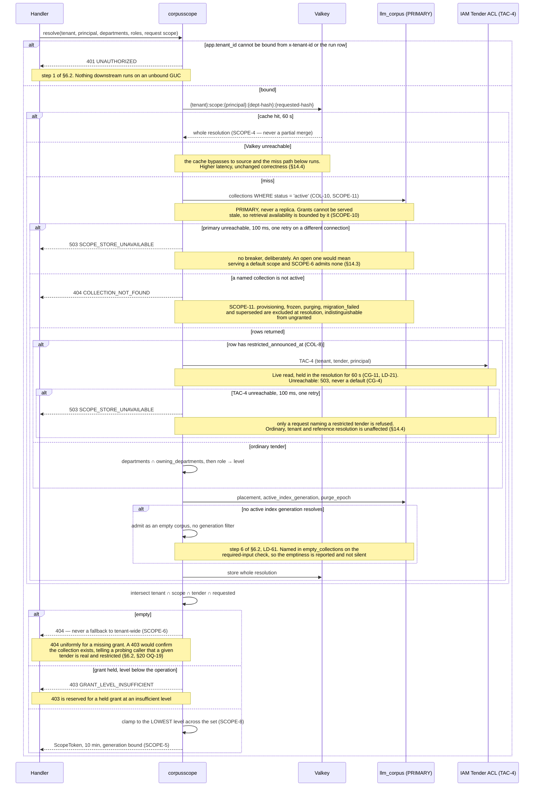

**The cache is an authorization decision, so its TTL is a security bound.** 60 s is the synchronous revocation bound. For grants it is the whole mechanism, because a revocation happens in the identity subsystem and produces no write here (§11.2, `CG-2`).

**Nothing downstream re-derives scope.** The token is the only input to filter construction (`SCOPE-1`). It carries the index generation, so a cutover cannot split a query (`SCOPE-5`). It expires and is never refreshed (`SCOPE-3`).

### 13.3 Long-form generation with the human gate

This is how a document is generated: start, outline, a human review gate, then the phases as steps of the run's workflow. The failure, cancellation, quota and lost-run paths are drawn.

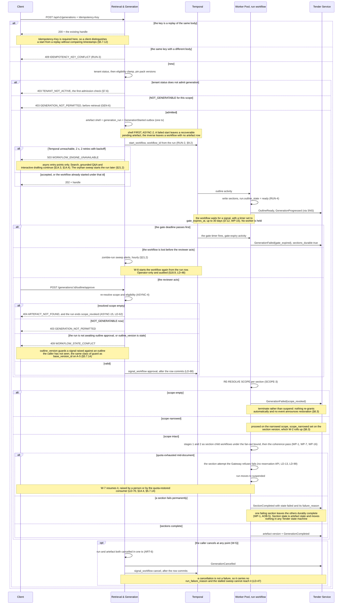

### 13.4 Document purge propagation

This is how a document purge announced by Ingestion invalidates cached results and records which retrieval sets cited the document. Two databases are involved, so two transactions are used.

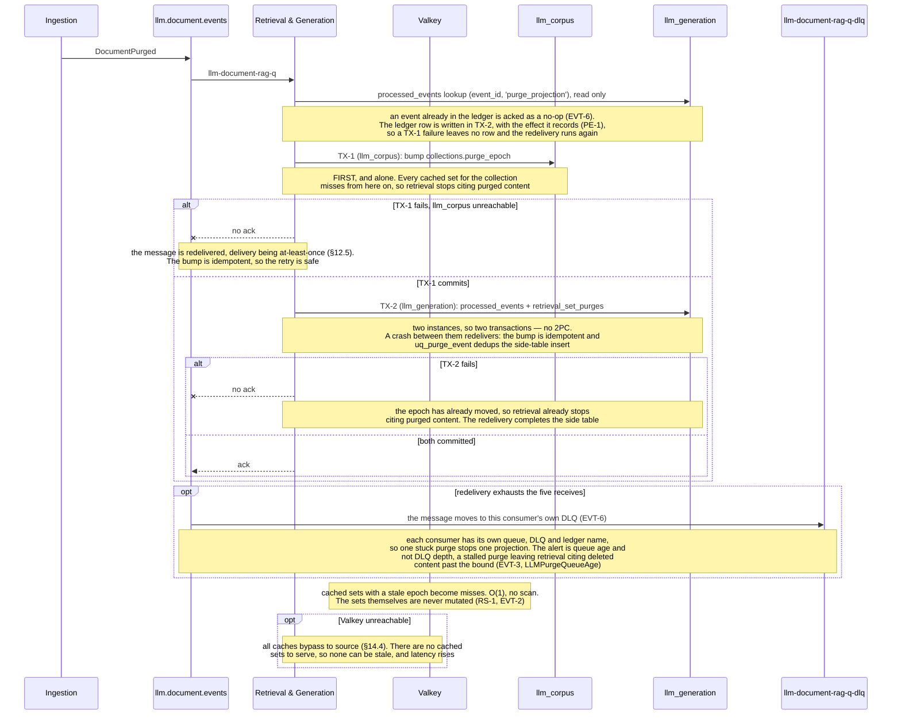

### 13.5 Promotion to a restricted corpus

This is how a tender marked restricted moves into a collection of its own. Access switches first, Ingestion copies the points, and an atomic cutover then swaps the live row.

This is the most intricate state machine here, and the easiest to implement wrongly. A state machine is a fixed set of states with rules for moving between them. Two collection rows exist for one tender throughout. Authorization moves at a different moment from placement (where the data physically sits). Exactly one row is live at every instant.

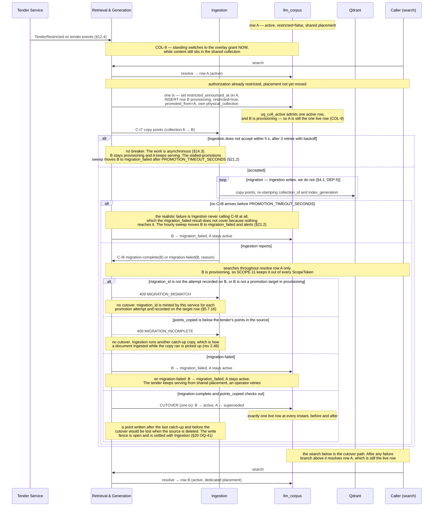

**Why a second row rather than an `UPDATE`.** `restricted` decides `physical_collection` (MD-19), so promotion is a physical move of points. A row whose `restricted` flipped would name a placement its points had not reached yet. `COL-2` makes the column immutable to keep placement stable for the life of a row.

**The two moments are deliberately different.** Authorization switches when Tender announces the restriction. Placement switches at cutover (`COL-8`). Access is never wrong during the window, and only the physical boundary follows at cutover. The reverse order would leave a restricted tender readable on its old terms while the copy ran.

**Nothing locks.** `active_index_generation` and the resolved collection are bound into the `ScopeToken` at resolution (`SCOPE-5`). A cutover that lands mid-request therefore cannot split a query across two collections. The token is the snapshot.

**The copy is Ingestion's** (LD-8). §4.1 grants this service read on Qdrant and no write, and `DEP-5` enforces it. Two calls carry it: C-I7, which Ingestion hosts and defines, and C-I8, which this service hosts (§20 OQ-6, OQ-41):

| # | Method & path | Direction | Purpose |
|---|---|---|---|
| C-I7 | *Ingestion-defined* | us → Ingestion | Copy every point of the source collection into the target, re-stamping `collection_id` and `index_generation`. **Asynchronous.** Carries `migration_id`, tenant, tender, source, target and the target `index_generation`, which is `1` for a new collection. Idempotent on `(source, target)` and on `migration_id` |
| C-I8 | `POST /api/v1/internal/collections/{id}/migration-result` | Ingestion → us | Report completion or failure with `migration_id` and `points_copied`, which this service checks against what it can read. Completion triggers the cutover transaction; failure moves the target to `migration_failed` |

Both add work to Ingestion's backlog that their design does not carry (§20 OQ-41). **Ingestion has them on its Phase 2 list, meaning after v1, with no date** (rev 2.46). **C-I10, the delete,** is a filter on `tender_id` and the source collection id with the shard key. It is safe to repeat. This service mints `migration_id` for each promotion attempt and records it on the target row. The column that holds it is added when Phase 2 is scheduled.

**Documents ingested for the tender while the copy runs are handled by a second catch-up copy** (rev 2.46, the option this service prefers). Until cutover, C-I1 returns the source collection, so such a document is written there. Ingestion runs a second copy before it reports complete. Before the cutover, this service checks `points_copied` against the tender's points in the source, which it can read. A mismatch refuses the cutover. A write pause was rejected because `frozen` also stops reads (`COL-10`). **A write fence at cutover is open.** A point written after the last catch-up and before the cutover would be lost when the source is deleted. It is settled with Ingestion in the Phase 2 design (§20 OQ-41).

**A failed copy must be a visible state.** `collection_status` includes `migration_failed`. The target stops there, the original stays `active` and keeps serving, and the tender continues on shared placement until an operator retries. Without this state, a dead copy would leave the target in `provisioning` forever. `COL-9` would still be satisfied, and the tender would silently never get its dedicated corpus.

### 13.6 Collection resolve-or-create

This is how Ingestion obtains the collection to write each uploaded document into. The call creates the collection if none exists, and refuses for a tenant that is frozen or purged.

C-I1 is the only route that creates a collection row. Ingestion calls it on every document it hands over. It has three refusals and two success codes. If two first documents race, the primary key decides the winner, so no unique index has to catch the conflict afterwards.

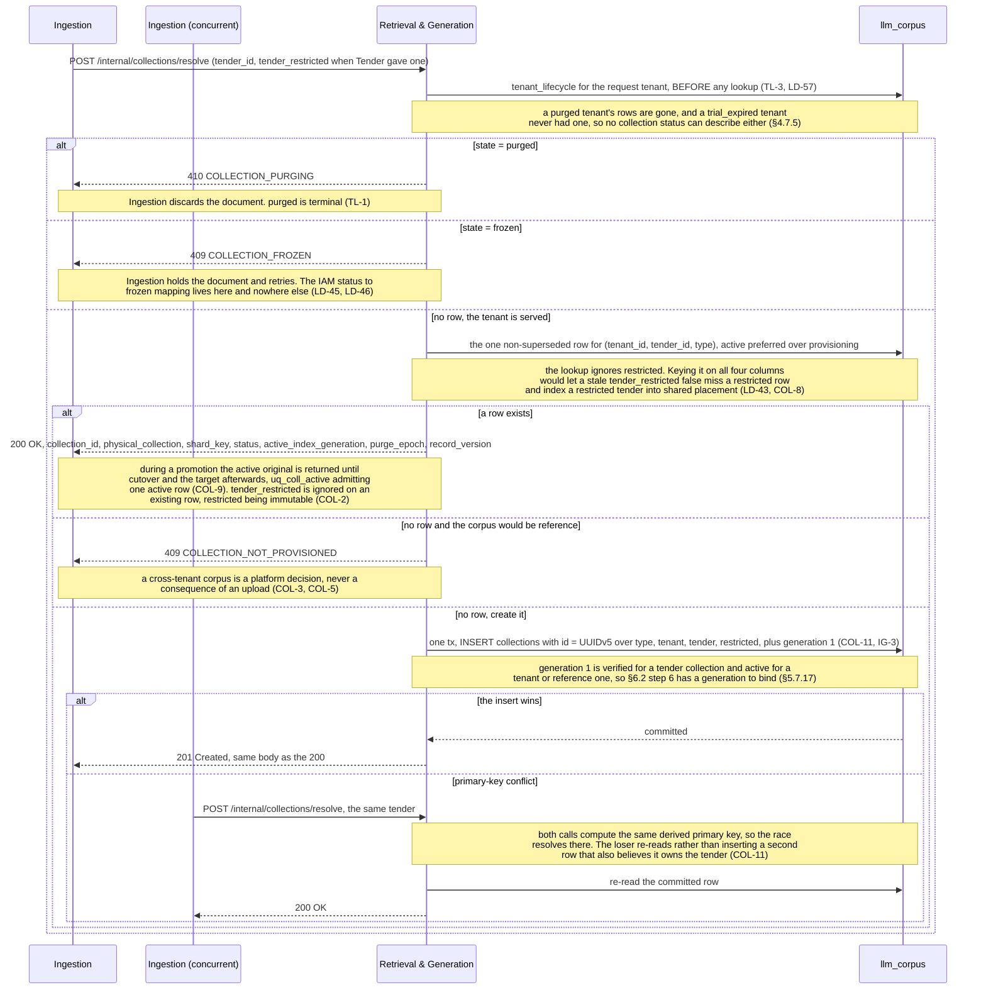

**The two refusals are separate codes because the caller acts differently on each.** `409 COLLECTION_FROZEN` means hold the document and retry. `410 COLLECTION_PURGING` means discard it (§24). With a single code, a suspended tenant's backlog would look the same as a purged tenant's. Ingestion would then drop documents it should keep, or retry forever against a tenant that no longer exists.

**The lifecycle check comes before the lookup.** The second phase of the purge deletes a purged tenant's collection rows. A lookup-first order would find nothing, fall through to creation, and rebuild the corpus from the next late document (LD-57).

**`tender_restricted` is advisory and one-way.** Where it is `true` and no row exists, the row is created `restricted = true` with its own physical collection, and no promotion is needed. Where it is `false` or absent (rev 2.125, LD-97) and the `TenderRestricted` consumer has already created a restricted row, the restricted row is returned and the flag is ignored. The event is authoritative, and an in-flight document's copy of the flag may be older than it (LD-43, COL-8).

**The 200 and the 201 carry the same body.** The code tells Ingestion whether this call created the corpus boundary, and nothing downstream branches on it.

### 13.7 Index generation activation

This is how a verified index version becomes the one every search reads, in a single atomic step that also records the event to publish.

Activation is the one part of an index campaign that belongs to this service. It changes what every search serves, so it accepts a `verified` generation and nothing else. The database also refuses any other transition, whichever route is used.

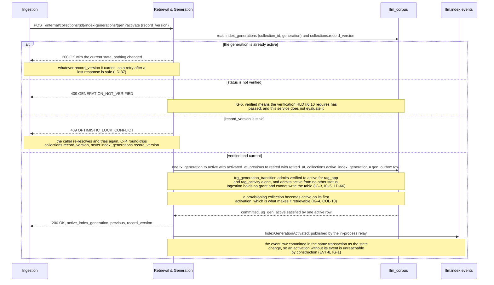

**No locking is needed and none is taken.** The active generation is read during scope resolution and bound into the `ScopeToken`, so a cutover landing mid-request cannot split a query across two generations (`SCOPE-5`). The token is the snapshot.

**The retire is inside the activation transaction.** `uq_gen_active` admits one `active` generation per collection. A two-step activate-then-retire would fail its own unique index between the steps.

**The repeat-activation 200 is what makes a lost response safe.** Ingestion cannot tell a lost response from a refused call. A `409` on a generation that is already live would leave the caller unable to tell success from failure.

### 13.8 Tenant lifecycle

This is how IAM's tenant events freeze, restore or purge this service's data. A purge is two-phase, with a waiting period between the two phases.

Two IAM events arrive on one topic. Each has its own consumer and its own queue. One consumer freezes and restores. The other purges, and it is the only consumer that deletes anything.

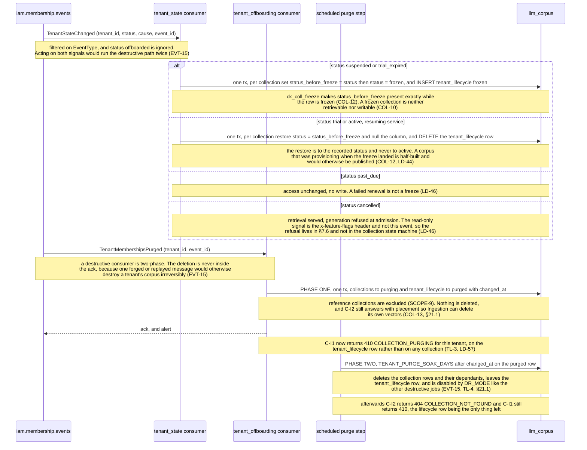

**The soak is counted from `tenant_lifecycle.changed_at`, the moment this service processed the event**, and is 7 days by default. The wait is long enough for a person to notice a forged or replayed offboarding. It also lets Ingestion read placement through C-I2 and finish its own vector delete (§17).

**The freeze and the restore are one consumer.** Suspension and reactivation both arrive as `TenantStateChanged` with a status. Two consumers would risk missing the reinstatement half, which would leave a restored tenant's corpus unretrievable.

**`purged` is terminal and the record is permanent**, enforced by `trg_tl_purged_terminal`. A tenant identifier is never reissued. The row holds an identifier and a date, and no tenant content (`TL-1`).

**Phase one is the only path that moves a collection to `purging` on offboarding, and phase two is the only path that deletes a collection row at all** (`COL-13`).

### 13.9 Regeneration

This is how a reviewer's request for a new version of a section or document is checked, run and recorded without losing the earlier version.

A-5 and A-6 share one contract and differ in shape: A-6 is section scope and streams, A-5 is document scope and returns a handle. The guard, the review-context handling and the version outcome are the same on both.

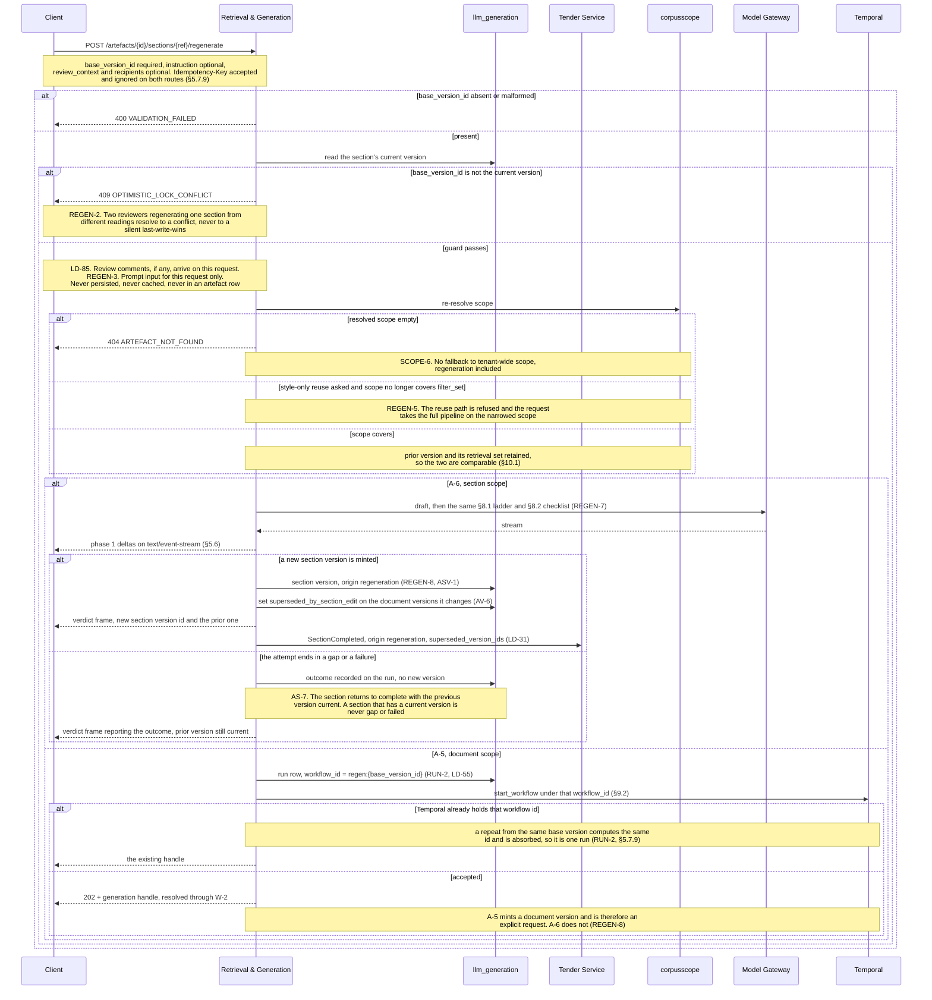

A-5 and A-6 return `404 ARTEFACT_NOT_FOUND`, as every other re-resolution of an artefact-addressed route does (`API-10`, LD-62), because an artefact route never reveals a collection.

`base_version_id` does two jobs. It is the optimistic-lock guard that `REGEN-2` reserves (a check that stops two writers from overwriting each other). It is also the deduplication key, so `Idempotency-Key` is accepted and ignored. A regeneration from the resulting new version is a different run and starts one.

There is no review-context read, so no dependency of this flow can fail the request (LD-85).

The `AS-7` branch is easy to overlook. A regeneration can end with no new version, and the section does not become failed. The run records the latest attempt. The section records the latest good output.

### 13.10 Extraction, R-4 synchronous and W-6 asynchronous

This is how structured fields are extracted from documents, either within the time limit on the request or as a long-running workflow.

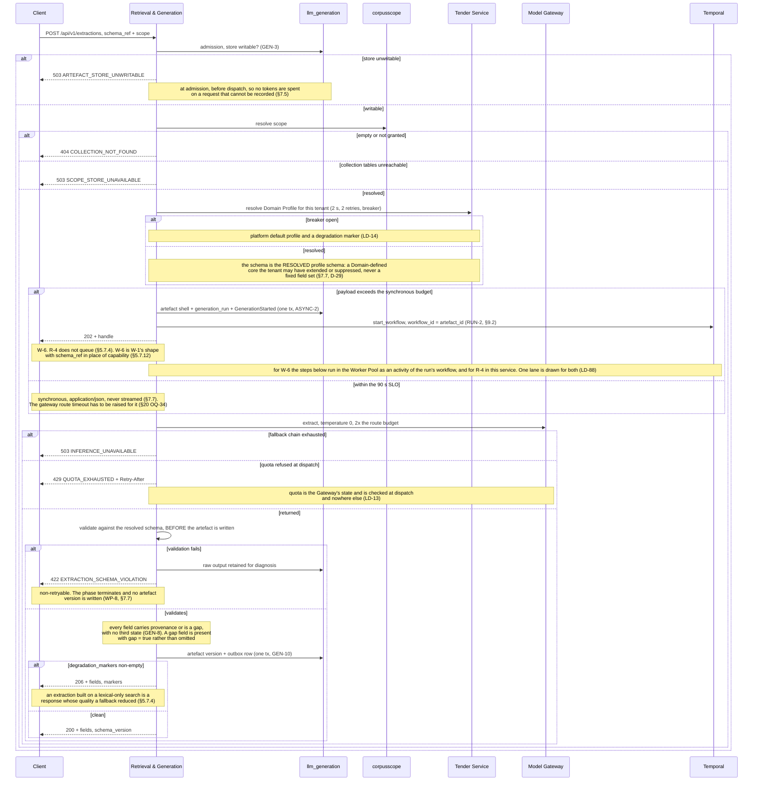

Validation runs before the artefact write. A schema violation therefore leaves no version, and the raw output is kept for diagnosis. The failure is non-retryable. The model returned a shape the resolved schema does not allow, and a retry would return the same shape at the same cost.

The W-6 branch starts a Temporal workflow for the run, with `current_stage` `extract`, and the Worker Pool runs the extraction as one activity. This service calls the Workflow Engine for nothing (LD-88).

### 13.11 Quota suspension and resume (W-7), and operator rematerialisation (W-8)

This is how a generation pauses when the token quota is exhausted, how it resumes, and how an operator restarts a run whose workflow record was lost.

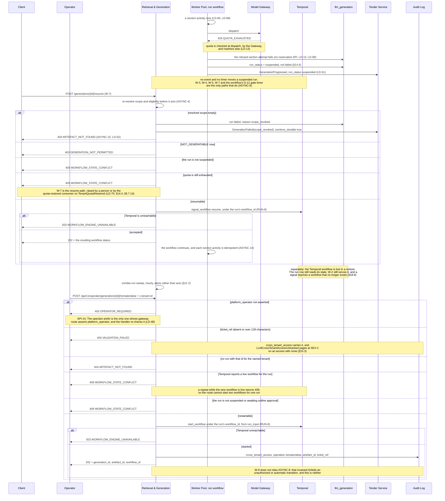

A quota failure suspends the run instead of ending it, because a quota reset can be recovered from and a revoked grant cannot. A revoked scope ends the run on the same branch. Nothing re-grants access automatically, and no event announces that access is back (§6.3).

W-8 exists for the case where a workflow is lost. The run row stays, W-2 still reports it, and nothing cleans it up. The stalled-generation sweep only looks at `artefacts.status = 'generating'`, and a gated run does not have that status. The zombie-run sweep detects the condition and raises an alert. A person decides whether to restart.

### 13.12 Corpus conflict check

> **Deferred past v1 (LD-64, §9.8).** The flow is drawn as specified and is not built in v1.

This is how the service looks for documents in one tender that disagree with each other, and publishes a report without blocking generation.

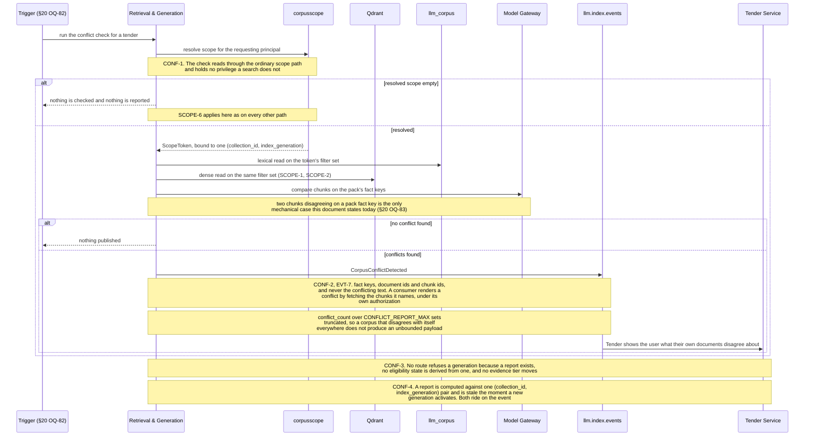

A conflict in content the caller could not retrieve is not reported to them. This follows from reading through the scope path, so no extra rule is applied to the output.

The check blocks nothing because the judgement belongs to the bidder. An addendum is meant to contradict the invitation it amends. A system that refused to generate over one would refuse most real tenders.

No table is specified for the report at this revision. The report is published and not stored. What it would be keyed on depends on what triggers the check (§20 OQ-82).

---

## 14. Concurrency, Consistency, and Failure Handling

### 14.1 Optimistic concurrency

Collection and retention mutations round-trip `record_version`; a mismatch returns `409 OPTIMISTIC_LOCK_CONFLICT`. P-6's first write carries none and creates the policy (§5.7.15, LD-76). Grants are not in that list: this service never writes one (`CG-2`). Artefact versions are append-only. `version_no` is allocated as `MAX(version_no) + 1` **under the same per-artefact advisory lock pattern `AC-3` uses for the audit chain** (a lock that makes writers take turns, so the tamper-evident log's sequence numbers never skip, §4.6.3). The lock is taken in the writing transaction. A database sequence would leave gaps on rollback. Because `uq_artefact_version` is a unique index, two regenerations from the same `base_version_id` could both pass `REGEN-2`'s guard without the lock and then collide on insert. With the lock, the second one waits and takes the next number. This is the correct outcome: a concurrent regeneration is a second version, not a conflict.

### 14.2 Idempotency

| Path | Mechanism |
|---|---|
| Workflow start | Client-supplied `Idempotency-Key`, stored on `generation_runs` with a request hash and unique per `(tenant, principal)` while set (`RUN-3`). A repeat returns the existing handle with `200`; the same key with a different body returns `409 IDEMPOTENCY_KEY_CONFLICT` |
| Event consumption | `processed_events` ledger keyed on the envelope `id`, per consumer name (`EVT-6`). Two consumers today, three once OQ-29's queue exists, each with its own ledger entry and DLQ |
| Regeneration | Deduplicated on `base_version_id`, which is also the optimistic-lock guard (`REGEN-2`). Its run's `workflow_id` is `regen:{base_version_id}` so a repeat from one base version is one run (`RUN-2`, §5.7.9). A regeneration from the resulting new version is a different run and starts one |
| Retrieval | Naturally idempotent within the cache TTL and the index generation |

### 14.3 Timeouts, retries and breakers

Every outbound call carries a timeout, a retry policy and a breaker policy, or states why it has none.

| Dependency | Timeout | Retry | Breaker |
|---|---|---|---|
| Gateway `refine-query` | 150 ms, cancelled | none | none. Degrading is the fallback |
| Gateway `refine-instruction` | 3 s | none | none |
| Gateway `rerank` | 90 ms | **explicitly none** | none. A retry has already lost the budget it protects |
| Gateway `embed` | 300 ms | 1, immediate | **yes**, opens on 5 consecutive failures, half-open after 30 s. Falls to lexical-only with a marker |
| Gateway `draft`, `judge`, `extract` | 2× the route budget | none here. The Gateway owns the provider fallback chain (MD-06) | none. A breaker here would duplicate the Gateway's own and fight it |
| Qdrant search | 200 ms | none | **yes**, same shape as `embed`. Falls to lexical-only |
| Qdrant entity count (rev 2.126, audit fixes, LD-100) | 200 ms, the dense search's class | none | **yes**, the Qdrant search breaker. Nothing to fall to: the required-input check fails with `503 RETRIEVAL_FAILED` and never guesses (§6.9) |
| `llm_corpus` lexical search | 200 ms | none | **yes**. Falls to dense-only |
| `llm_corpus` grant read | 100 ms | 1, on a different connection | **no, deliberately.** An open breaker would mean serving a default scope, and `SCOPE-6` admits none. It fails (`503 SCOPE_STORE_UNAVAILABLE`) |
| IAM TAC-4 | 100 ms | 1 | **no, deliberately.** Same reason as the grant read: an open breaker would mean a default scope. A request naming a restricted tender is refused (`503 SCOPE_STORE_UNAVAILABLE`); ordinary, tenant and reference resolution is unaffected |
| `llm_generation` admission probe | 100 ms | none | none. `GEN-3` wants the failure |
| Tender pack resolve | 2 s, on the request path on a cache miss | 2, backoff | **yes.** Open, or a failure after the retries, means the platform default profile and a marker (LD-14), which is the degradation already designed for an outage |
| IAM `llm-context` | 300 ms | none | **yes.** Open omits prompt layer 3, which is steering and not evidence (`GEN-5`), so the generation proceeds with a marker |
| Platform content check | 200 ms | none | **yes.** Open writes `content_check = 'not_run'` (§15.3) |
| Ingestion C-I7 | 5 s to accept | 3, backoff | none. The work is asynchronous; the §21.2 reaper is the backstop. **A copy request Ingestion never accepts leaves the target in `provisioning` and the tender serving from the source**, which stays `active`; the hourly sweep is the only consequence and an operator is paged after the promotion has been outstanding for 24 hours (rev 2.79, §20 OQ-41) |
| Temporal: `start_workflow`, `signal_workflow` | 2 s | 2, backoff | none. `503 WORKFLOW_ENGINE_UNAVAILABLE` (§9.2) |
| S3 put and presign | 2 s | 2, backoff | none |
| S3 get (A-9) | 2 s | 2, backoff | none |

**Every breaker above fails to a stated degradation, never to a default scope or a default answer.** A breaker (a switch that stops calls to a failing dependency) is allowed only where this document already says what happens without that dependency. Scope resolution has no such fallback, so it is the one hot-path call with no breaker.

**`llm-context` was an undocumented synchronous dependency.** Prompt layer 3 is read from IAM on every generation. It had no timeout, no cache, no budget line and no failure row. That broke `RET-3`, which says no synchronous stage makes an uncached cross-service call. The read is now cached on the §11.1 pattern at 300 s, and the budget treats a cache miss as degradable.

### 14.4 Failure scenarios

This table is the degraded-output policy D-14 asks for: what each dependency's loss produces, and whether the result is served with a marker or refused.

| Failure | Behaviour |
|---|---|
| Collection tables unreachable | `503`. **Not degradable**, no safe default scope existing. This narrows HLD §4.8's "retrieval continues against read replicas": grants read the primary (SCOPE-10), so retrieval availability is bounded by `llm_corpus` primary availability. §20 OQ-5 |
| IAM TAC-4 unreachable | A request naming a restricted tender returns `503 SCOPE_STORE_UNAVAILABLE`. A request naming none is unaffected. Not degradable (`CG-4`) |
| `llm_generation` unwritable | `503` at admission, before dispatch (GEN-3). R-1 has no admission step, so there it is `503 ARTEFACT_STORE_UNWRITABLE` when the write of the retrieval set fails (§5.7.1) |
| Model Gateway down, generation | `503` after the fallback chain. The failover strategy is D-13 and the Gateway's own, not ours (MD-06) |
| Model Gateway down, verification only | **Non-compliance sections:** artefact written, tier `NOT_COMPUTED`, the verdict frame says so. **Compliance sections:** the request fails with `503 INFERENCE_UNAVAILABLE`, as an HTTP response where it comes before the first heartbeat, and as the terminal `error` frame after it, because phase 1 is suppressed on a compliance-typed scope and no frame precedes the verdict (`API-6`, `API-7`). `GR-3` and `GEN-7` say a mandated tier is never dropped, and an unreachable judge drops it exactly as an SLO squeeze would. The split is between *cannot run the tier* and *ran it and it was inconclusive*; only the second is `NOT_COMPUTED` |
| Model Gateway down — embedding | Lexical-only with a marker; cached embeddings still serve repeats. A Gateway refusal of the embed call, for quota or residency, degrades the same way with the marker reason `quota_refused` or `residency_refused`. The lexical half spends no tokens, so the quota hard stop still holds, and a residency refusal never spills to another region (LD-74) |
| Qdrant down | Lexical-only with a marker, on every route, generation included. Every generation is grounded, and a lexical-only retrieval set is a degradation with a marker. `RETRIEVAL_FAILED` is returned only when both search halves are down (MD-14, §6.1). This departs from HLD §4.8, whose Qdrant row says generation that requires grounding returns `503` |
| Reranker down or over budget | Fused RRF order, marker, trace records the skip. A Gateway refusal of the rerank call degrades the same way, with the marker reason `quota_refused` or `residency_refused` |
| Refiner down | Raw query or raw instruction, marker. A Gateway refusal of the refine call degrades the same way, with the marker reason `quota_refused` or `residency_refused`. The query refiner's marker has the stage `refine` and the fallback `raw_query`. The instruction refiner's has the stage `refine_instruction` and the fallback `raw_instruction` (§5.5) |
| Model Gateway down or refusing, classification (rev 2.126, LD-99) | R-6 has no fallback classifier (HLD §6.6). It returns `503 INFERENCE_UNAVAILABLE` when the Gateway is down, `429 QUOTA_EXHAUSTED` with `Retry-After` on a quota refusal and `503 RESIDENCY_CAPACITY` on a residency refusal (§7.8) |
| Both search halves down | `failed`, an incident and never an empty `sufficient` (MD-14) |
| Retrieval `insufficient` twice | Section marked a gap; generation not attempted |
| Required-input entity count cannot run (rev 2.126, audit fixes, LD-100) | `503 RETRIEVAL_FAILED` on R-7 and on plan construction for R-3 and A-6. The check reports neither resolved nor unresolved, because a false gap blocks work that could proceed and a false pass generates without the document. In a long-form run the section activity retries (`WP-13`) and then fails the section as `internal` (§6.9) |
| Tender unavailable | Cached packs serve until TTL; after expiry, pack-dependent requests fall back to the platform default with a marker (§6.6). Review context arrives on the request, so no read fails (LD-85) |
| Temporal unavailable (`WP-12`) | Async entry points return `503 WORKFLOW_ENGINE_UNAVAILABLE`. Search, grounded Q&A, and interactive drafting continue |
| Quota exhausted mid-document | An already dispatched section completes, and its tokens are charged when it ends (HLD §4.8). The Gateway holds nothing back for the sections that follow (LD-13), so the refusal falls on the next call, and a section attempt the Gateway refuses fails. The run moves to `suspended` rather than terminating (LD-70). **W-7 resumes it**, raised by a person or by the quota-restored consumer when `TenantQuotaRestored` arrives (LD-70, §12.4, §5.7.14) |
| Valkey down | All caches bypass to source; higher latency and token cost, unchanged correctness |
| Outbox relay stalled | State changes still commit; events accumulate unpublished. `LLMOutboxLag` alerts. A record exhausting `max_attempts` moves to `outbox_dead_letters`, which is a publisher-side table and not an SQS dead letter (`OBX-5`) |
| GUC injection misconfigured | Every RLS-protected query returns zero rows. Fails closed, but invisibly, which is why §18.1 asserts it at startup rather than leaving it to a test |
| Service fully down | `503` with `Retry-After` at the edge. In-flight runs stop at their current phase, and Temporal retries their activities on another worker (`WP-13`); short-form is client-retried, not server-queued |

### 14.5 Consistency guarantees

| Guarantee | Bound |
|---|---|
| Grant revocation visible | 60 s sync, 60 s + 10 min async (§11.2). A restricted tender adds IAM's own bound (§4.7.2) |
| Index cutover visible | Immediately for requests resolving after it; in-flight requests complete on their bound generation (SCOPE-5) |
| Purge visible in retrieval | Immediately for a request resolving after the bump. An in-flight `ScopeToken` carries the old epoch until the section re-resolves, bounded by `SCOPE_TOKEN_TTL_SECONDS` (§11.3) |
| Artefact readable after write | Immediately; same transaction as its event |
| Event delivered | At-least-once; ordering not guaranteed, so no consumer may depend on it |

---

## 15. Security

### 15.1 Tenant isolation

The platform's three isolation layers apply unchanged. They are the realm boundary, `tenant_id` with RLS (row-level security, a database rule that hides other tenants' rows) and the audited `admin_readonly` role. The canonical source is IAM HLD §7.2 in `IAM/iam-hld-tender-saas-v1.56 1.md`, which v1.56 now states in terms (obtained at rev 2.35, closing §20 OQ-35). This service adds the controls below:

| Asset | Mechanism |
|---|---|
| Qdrant | The mandatory compound filter, constructed only in `corpusscope` (SCOPE-1, SCOPE-2), covering search **and delete** |
| Lexical | `tenant_id` a leading predicate; index partitioned by tenant so no scan crosses a boundary before filtering |
| Postgres | RLS on every table, GUC bound per transaction |
| Valkey | Every key tenant-prefixed; no cross-tenant serve even for identical inputs |
| S3 | Tenant-prefixed keys, IAM policy conditions, KMS encryption context carrying `tenant_id` |
| Provider prompt cache | Checkpoints never cross a tenant boundary. Layer 2 sits inside a **per-tenant** prefix, which HLD §8.2 permits and HLD §4.2 reads as forbidding (§7.2, §20 OQ-52) |
| Logs, traces, metrics | `tenant_id` structured; content never logged; content-derived values never metric labels |

### 15.2 The injection boundary

The prompt is the largest surface for untrusted input in this subsystem. §7.2's layering is the control. Layers 2 to 5 are tenant overrides, user context, retrieved chunks and the user prompt. All of them are treated as content, and each is delimited with a per-request nonce (a random marker that text cannot guess or fake). None of them can change the output convention, the citation requirement, the schema or the eligibility clamp (GEN-4).

An attacker can realistically control retrieved chunk text, because a tender document is written outside the tenant. It gets the same treatment as user-typed text.

### 15.3 Other controls

- **Authentication.** Headers are trusted because the connection uses mTLS (both sides prove who they are). There is no JWT parsing, and no identity is taken from a request body (`API-1`). **`x-departments` is an authorization input and is not one of the three headers the platform library defines.** Nothing in the shared stack guarantees the gateway strips a copy supplied by a client. The gateway's strip-list must name it, alongside `x-plan` and `x-feature-flags`, and §19.5 `ISO-14` asserts it (§20 OQ-49).
- **What is enforced where.** Four isolation layers are described, and only one is enforced outside this process. Postgres RLS is enforced by the database. The Qdrant compound filter, the Valkey key prefix and the S3 key prefix are all **this application's discipline**. `SCOPE-1` is held by a type signature and an import rule, which is a lint (a build-time check) and not a control that holds against a bypass. One call site that builds a filter another way defeats it, and only `ISO-1` to `ISO-3` would catch that. This is a real asymmetry, so those three cases are merge-blocking and are not ordinary tests. Authentication is declared per route, because the platform library installs no global gate and documents that as deliberate; `CI-1` is what stops an omission shipping as an anonymous endpoint (`API-11`, §19.3).
- *Assumption on a platform library, verified against its source at rev 0.9 (§22.6):* **Malformed identity headers are dropped, not rejected**, by the library: over 256 bytes, control characters or line separators resolve to absent. `401 UNAUTHORIZED` therefore covers malformed headers as well as missing ones. This is the safe direction, and it helps to know it when reading a log.
- **Content safety, both directions.** HLD §14.3 screens **prompts before dispatch** and **output before persistence**, both against the Domain Profile's policy configuration, and a failure blocks and records. Output screening is below. **Input screening runs on the assembled prompt before the Gateway call**, against the same pack-declared policy. It screens layers 2 to 5 (tenant overrides, user context, retrieved chunks and the user prompt). This is the same set that `GEN-4` treats as content and not as instruction. **It runs after retrieval and not inside §5.6's admission sequence.** Layer 4 is the retrieval set (§7.2), and a screen at admission would leave unscreened the one layer `GEN-4` calls the injection surface. Its refusal is a pre-stream `422 CONTENT_CHECK_FAILED`. It must be pre-stream because the first frame, or the first heartbeat on the blocking path, fixes the status code (`API-6`, §13.1). A failure records the offending layer and the policy rule, and never the text.

  **Input screening stays and fails closed, and output screening has moved to Tender.** The two sides differ for one reason. An unscreened prompt that reaches a provider is an egress event (data leaving the platform) that cannot be recalled. An unscreened output is already paid for and sits behind a review step. Rev 2.38 applies this fully. The side that cannot be recalled is enforced here, at the egress boundary this service owns. The side behind review is enforced where the review happens (§20 OQ-50 row h, resolved).
- **Output safety is Tender's** (ruling at rev 2.38, §20 OQ-50 row h, OQ-43). Generated text is reviewed before a human acts on it, so the review is where a content check belongs. This service calls no content-safety service on the write path and holds no egress allowance for one. `content_check` stays on the version as a column, and this service writes it as `not_run`. A reviewer and the audit chain both read that field, and removing the column would remove the record with it. **This closes the only control on the write path that had no owning service.** It also narrows behaviour: a positive finding no longer fails a write here, so `422 CONTENT_CHECK_FAILED` is raised only by input screening.
- **No tenant content trains anything.** HLD §14.5 and §3.1: tenant content is never used to train, fine-tune or evaluate a model outside that tenant's boundary. The risk is easiest to miss in §10.5. It names `query_refinements` and `instruction_refinements` as the golden-set source (the reference set used to test quality), and both store raw tenant text. `principal_hash` anonymises the principal, and **nothing anonymises the content**. Those rows therefore stay inside the tenant boundary. A golden set derived from them is tenant-scoped, or it is not derived from them at all.
- **Golden sets are synthetic or consented.** HLD §4.2 and HLD §15.3: evaluation material is synthetic, or explicitly consented and tenant-anonymised, and is stored outside the tenant corpus. A set built from §10.5's tables without consent and anonymisation is not a golden set this design may use. This limits what D-23 can decide (§20 OQ-53).
- **Model-invoked tools, if any, are read-only.** HLD §3.2: a tool may query this subsystem's own corpus within the caller's resolved scope, and it changes state in no service. §7.3 dispatches one Gateway call with no tool surface, so the rule has no effect today. It is written down so that adding a tool later is a decision against a stated rule.
- **Secrets.** No provider credential exists in this service. The Gateway holds all of them (MD-06).
- **Network.** Envoy-routable; the Gateway and Serving Fleet are not. NetworkPolicy restricts internal routes.
- **Audit.** Every generation, clamp, grant change, and cutover emits an event for the Audit Log, which is assumed to add a queue for this service (§20 OQ-108, resolved on that assumption at rev 2.115). Every artefact lifecycle change also writes an entry to `artefact_audit_chain` in the same transaction (§4.6.3). **Every cross-tenant operator query emits `cross_tenant_access`** (HLD §14.7), carrying the operator principal, the tenants read, the rows returned and a ticket reference. The `admin_readonly` path is the only way to read across a tenant boundary. It is audited and not prevented, so the record is the control. `LLMCrossTenantAccessUntracked` pages at SEV-2 on an access with no ticket reference, which is the case the record exists to catch.
- **Backups inherit RLS.** A restored database carries its policies or it carries none, and a restore that silently drops `FORCE ROW LEVEL SECURITY` or a `tenant_isolation` policy is a cross-tenant exposure with no symptom. The quarterly restore drill (§18.9) asserts both, alongside chain continuity, because neither is visible in a row count.

---

## 16. Observability

### 16.1 SLO instrumentation

Every HLD §3.5 target has a metric. Every metric carries the **not-yet-validated** flag until a measured baseline exists. The flag flips only against a measured baseline, and an expectation is not enough.

| SLO | Metric | Target |
|---|---|---|
| Retrieval latency | `llm_retrieval_generation_retrieval_duration_seconds` histogram, labelled by stage | p95 < 400 ms |
| Grounded answer, first token | `llm_retrieval_generation_answer_first_token_seconds` | p95 < 2.5 s |
| Grounded answer, verified | `llm_retrieval_generation_answer_verified_seconds` | p95 < 6 s |
| Interactive section draft | `llm_retrieval_generation_draft_verified_seconds` | p95 < 20 s |
| Long-form section | `llm_retrieval_generation_section_duration_seconds` | p95 < 3 min |
| Structured extraction | `llm_retrieval_generation_extraction_duration_seconds` | p95 < 90 s |
| Retrieval recall@20 | `llm_retrieval_generation_eval_recall_at_20` gauge, per configured language | ≥ 0.90 |
| Citation groundedness | `llm_retrieval_generation_groundedness_score` gauge, monthly tenant-weighted mean | ≥ 0.95 |
| Availability | `llm_retrieval_generation_availability_ratio` | 99.9%, bounded by the `llm_corpus` primary's availability (§20 OQ-5, closed rev 2.56) |

**Each row above names what to measure.** An SLI (service level indicator, the measured number behind a target) also needs three things: what counts as a request, what counts as good, and the time window. Without them an SLO (service level objective, the target) cannot be breached. It can only be discussed.

| SLO | Valid events (denominator) | Good events (numerator) | Window |
|---|---|---|---|
| Retrieval latency | Every R-1, and the retrieval phase of R-2, R-3, R-4 that reached stage 9 | Those completing inside 400 ms. **A `206` counts as good**: degradation is a quality signal and is measured separately | 28 days rolling |
| First token | Every R-2 and R-3 that opened a stream **and was not compliance-typed**. §7.4 suppresses phase 1 for compliance, so those have no first token and must not sit in this denominator (§20 OQ-13) | First `draft` frame inside 2.5 s | 28 days rolling |
| Verified answer | Every R-2 reaching model dispatch, compliance included | `verdict` frame inside 6 s | 28 days rolling |
| Section draft | Every R-3 reaching dispatch | Verified output inside 20 s | 28 days rolling |
| Long-form section | Every section admitted as an activity under the fan-out bound | Complete inside 3 min, measured **section admission to section version written**, which includes the wait for a fan-out slot in the workflow. No queue time is excluded, because the workflow owns the queue. Sections beyond `FANOUT_MAX_PER_DOCUMENT` wait in the workflow's semaphore. Measuring from the start of the section's work excluded our own queueing on every document with more than five sections. | 28 days rolling |
| Extraction | Every R-4 and W-6 reaching dispatch | Inside 90 s | 28 days rolling |
| Availability | Every request reaching a handler | Anything not `5xx`. A `4xx` is the caller's outcome, not ours; `503` from an exhausted fallback chain **is** ours | 28 days rolling |
| Recall@20 | Nightly golden-set run, per language | At or above 0.90. **Inactive until the golden set exists** (D-23) | Nightly, 7-run trend |
| Groundedness | Every verified claim | Supported or corrected-miscited (§8.4). Reported tenant-weighted monthly, so one high-volume tenant cannot mask the rest | Monthly |

**Error budget.** 99.9% availability over 28 days is **40 minutes**. The budget is spent by `5xx` responses. The policy below is a proposal, and engineering leadership owns its adoption (§20 OQ-51, which LD-102 resolves for the on-call owner only):

| Budget remaining | Policy |
|---|---|
| Above 50% | Normal change velocity |
| 25% to 50% | Non-essential deploys pause. Reliability work takes priority in the next planning cycle |
| Below 25% | Feature deploys stop. Only reliability fixes and rollbacks ship |
| Exhausted | Change freeze until the budget recovers, lifted only by the on-call owner. The on-call owner is this team, as a working assumption (§20 OQ-51) |

**Degradation does not spend the budget, and that is deliberate.** A `206` with markers is a served answer. If degradation spent availability, the whole fallback ladder would read as an outage. Teams would then be pushed to remove the ladder instead of fixing the dependency. Degradation has its own signal, `llm_retrieval_generation_degradation_marker_total`, and its own alerts.

**Two SLOs are inactive and say so.** Recall@20 and absolute groundedness both wait on the golden set (D-23, D-26). They are listed because a missing SLO looks the same as one nobody agreed to.

### 16.2 Pipeline metrics

| Metric | Why |
|---|---|
| `llm_retrieval_generation_degradation_marker_total{stage,reason}` | One per `RET-1` marker, and the customer-facing quality signal. A stage that can degrade and never emits is a bug. The `reason` label gains `quota_refused` and `residency_refused` |
| `llm_retrieval_generation_sufficiency_verdict_total{verdict,section_type}` | `Insufficient` rate is the primary retrieval-quality signal before golden sets exist |
| `llm_retrieval_generation_required_input_gap_total{missing_role}` | Distinct from insufficiency: a customer action rather than an engineering one (§6.9) |
| `llm_retrieval_generation_rerank_skipped_total{reason}` | Raw fused order is a materially different quality level; the skip must be visible |
| `llm_retrieval_generation_refiner_edit_rate{refiner}` | D-34's reversal trigger, made measurable |
| `llm_retrieval_generation_refiner_latency_seconds{refiner}` | The 37%-of-budget concern (§6.6) |
| `llm_retrieval_generation_completeness_item_missed_total{section_type,item}` | Per-item miss frequency, so a thin pack checklist cannot silently report Complete (§8.2) |
| `llm_retrieval_generation_scope_resolution_empty_total` | A spike is either a misconfigured grant set or a probing caller |
| `llm_retrieval_generation_scope_revoked_async_total` | Workflows terminated by SCOPE-3 re-resolution |
| `llm_retrieval_generation_retrieval_cache_hit_ratio` | Watches the §11.3 purge-epoch cost |

`OBS-1`: no metric carries `tenant_id`, `user_id`, `request_id`, `trace_id`, `subject` or `actor` as a label, and no label name ends in `_id`, `_email`, `_ip`, `_uuid` or `_token`, as the platform observability standard requires (rev 2.100). Content-derived values never appear as labels. Every metric of this service is named `llm_retrieval_generation_<metric>`, which is the library's `<domain>_<service>_<metric>` rule with domain `llm` and service `retrieval-generation` (LD-92). The `llm` domain is in the standard's vocabulary from `fastapicommon` 0.6.0 (§20 OQ-103, resolved rev 2.136).
`OBS-3`: a counter ends in `_total`, a histogram ends in `_seconds` (or `_bytes`) and a gauge never ends in `_total`, as the library checks at registration. A distribution that is not a duration is kept as a counter per band.
`OBS-2`: document content, retrieved chunk text, prompts, and generated prose are never logged at any level.

**Retrieval**, against HLD §15.1's named set:

| Metric | Why |
|---|---|
| `llm_retrieval_generation_retrieval_stage_duration_seconds{stage}` | The §6.6 budget has eight stages and is exact-fit. Without per-stage attribution a regression is a single number nobody can act on |
| `llm_retrieval_generation_candidate_depth{profile_source}` | Depth before rerank, labelled by whether the profile was section-type, profile-default or platform-default. `RET-4`'s provisional values are only falsifiable against it |
| `llm_retrieval_generation_retrieval_verdict_total{verdict}` | The three-valued mix (MD-14) |
| `llm_retrieval_generation_widened_retry_total` | D-16's single permitted retry. A rising rate is the sufficiency threshold being wrong, not retrieval failing |

**Verification** is the service's quality claim, so it needs its own metrics:

| Metric | Why |
|---|---|
| `llm_retrieval_generation_groundedness_band_total{band}` | A **distribution** as a counter per score band, not a mean. HLD §15.5 alerts on the left tail shifting, which a mean cannot see |
| `llm_retrieval_generation_claim_outcome_total{outcome}` | Supported, unsupported, miscited, gap, never collapsed to a binary (MD-16) |
| `llm_retrieval_generation_verification_tier_total{tier_decided}` | The tier mix across the ladder. Tier 3 is roughly 2× generation cost, so this is a cost signal as much as a quality one |
| `llm_retrieval_generation_tier0_disagreement_ratio` | Tier 0's routing input (§8.1) |
| `llm_retrieval_generation_failure_policy_total{action}` | Block against flag, per §8.1's pack-declared policy |
| `llm_retrieval_generation_evidence_tier_total{tier}` | Including `NOT_COMPUTED`, which `AOB-2` keeps distinct from passing |

**Generation**:

| Metric | Why |
|---|---|
| `llm_retrieval_generation_sections_per_document` | Sizes a document's section rows and, with D-11, a run's child workflows |
| `llm_retrieval_generation_workflow_activity_retries_total{activity}` | Activity attempts beyond the first (`WP-13`, LD-88). A rate above zero outside a deploy means workers are dying mid-activity or a dependency is failing |
| `llm_retrieval_generation_regeneration_total{scope,origin}` | Section against document, and what drove it |
| `llm_retrieval_generation_retry_cap_hit_total` | `ASV-2`'s ceiling of two. Above zero sustained is a SEV-3 |
| `llm_retrieval_generation_coherence_conflict_total{fact_key}` | Which fact keys actually conflict, which is what tells a pack author the key is badly defined |
| `llm_retrieval_generation_gap_marker_total` | Counted, never suppressed (`VER-2`) |

**Events**: `llm_retrieval_generation_event_published_total{type}` and `llm_retrieval_generation_event_consumed_total{type,consumer}`, the rates HLD §15.1 names, plus the DLQ depths §16.4 alerts on.

**Cost.** HLD §17.4 names inference as the dominant cost driver. Without a cost metric, R-10 could happen unseen. `llm_retrieval_generation_tokens_total{task_class,model_profile,capability}` is the metric that shows the tier-0 and tier-3 decisions as spend and not as latency.

**Streaming and delivery:**

| Metric | Why |
|---|---|
| `llm_retrieval_generation_first_frame_latency_seconds` | HLD §3.5's 2.5 s first-token target. Labelled by whether phase 1 was suppressed, since the blocking path has no first token and must not drag the histogram |
| `llm_retrieval_generation_verdict_frame_delivered_ratio` | A response without its verdict frame leaves the client holding an unverified draft (`GEN-1`). This is the rate at which that happens |
| `llm_retrieval_generation_delivery_state_total` | By `delivery`. The `disconnected` share is tokens charged for work nobody saw, which is what OQ-18 (accepted at rev 2.71) would have Product price once metering has an owner |
| `llm_retrieval_generation_idempotent_replay_total` | Replays served from a stored artefact. The saving the §5.7.2 reconnect path exists for |

### 16.3 Tracing

One trace per request, spanning every pipeline stage as a child span, with the Gateway call as a remote child. Span attributes carry chunk **counts and ids**, never chunk text. The trace explains a live request. The retrieval set explains it after the fact.

### 16.4 Alerting

Every alert carries a condition, a window and a severity.

**Severity classes.** The classification is this service's. The response and escalation for each class are proposed here and are Operations' and engineering leadership's to set (§20 OQ-51, which LD-102 resolves for the on-call owner only).

| Severity | Proposed response | Proposed escalation |
|---|---|---|
| SEV-1 | Page immediately, any hour. Tenant isolation or audit integrity | On-call, then the security owner within 15 minutes. `LLMRLSViolation` and `LLMScopeResolutionRaise` additionally freeze deploys |
| SEV-2 | Page in hours, ticket out of hours | On-call. Unresolved at 4 h escalates to the service owner |
| SEV-3 | Ticket, next working day | Owning team's backlog |
| SEV-4 | Trend signal, no response | Reviewed at the monthly quality review alongside §16.6 |

**Two alerts are proposed to freeze deploys when they fire.** Both mean the isolation boundary is not holding, and shipping more changes would make that worse. The freeze lifts with the error-budget policy in §16.1.

**This team is the named on-call owner**, as a working assumption, for retrieval and generation and for the Model Gateway. It owns this document and the Gateway (LD-69). It knows what each alert below means, so it takes the pager for all 21 alerts in the table. HLD D-25 is the HLD's open decision asking for a named on-call owner, and it is answered for this service on that basis. Leadership still owns these items: the rota staffing, the SEV response times, the escalation path above on-call, the service owner and security owner roles in the table above, and ownership of shared infrastructure (§20 OQ-66). Until leadership assigns the service owner and the security owner, an escalation past on-call goes to a role nobody holds. The assumption reverses when leadership names another on-call owner or a shared operations rota. This team writes the runbook for each alert in an operations document, and the runbooks do not belong in this LLD (CLAUDE.md §5).

| Alert | Condition | Severity |
|---|---|---|
| `LLMRetrievalFailedVerdict` | Any `failed` verdict in 5 min | **SEV-2**, pages. Both search halves down (MD-14) |
| `LLMScopeResolutionRaise` | Any occurrence | **SEV-1**, pages. Structurally impossible; firing means `SCOPE-1` has a hole |
| `LLMEvidenceTierNotComputedRate` | > 5% of sections over 15 min | SEV-3. Verification is silently unavailable |
| `LLMRerankSkipRate` | > 10% over 15 min. The numerator excludes the reasons `quota_refused` and `residency_refused` | SEV-3. GPU capacity or latency regression. A refusal is a tenant's quota or residency state and not serving capacity, and `llm_retrieval_generation_degradation_marker_total{stage,reason}` counts those two separately |
| `LLMRefinerEditRate` | Above the D-34 threshold over 24 h | SEV-4, ticket. Feeds the D-34 reversal decision |
| `LLMOutboxLag` | Oldest unpublished row > 5 min | SEV-3. Committed and undelivered |
| `LLMPurgeQueueAge` | Oldest unprocessed purge > 10 min | **SEV-2**, pages. Queue **age**, not DLQ depth: a stalled purge leaves retrieval citing deleted content past the §14.5 bound and never reaches the DLQ to be counted (`EVT-3`) |
| `LLMOutboxDeadLetters` | Any row in `outbox_dead_letters` | **SEV-2**, pages. A committed state change whose event nobody received (`OBX-5`). Distinct from the SQS DLQs below |
| `LLMServiceUnavailable` | Error ratio above 5% over 5 min, or zero successful requests over 2 min | **SEV-1**, pages. The document had SLO metrics and no alert on the service simply being down |
| `LLMSweepStale` | Any sweep's `last_successful_run` older than twice its interval | SEV-3. The audit-chain verifier silently not running is indistinguishable from the chain being intact (§21.2) |
| `LLMConsumerDLQDepth` | Any message, per consumer | SEV-3. Each cascade's failure mode is independent (§12.4). Two consumers today, three once OQ-29's queue exists |
| `LLMRLSViolation` | Any failure of the §19.5 suite, run continuously against **production** under a dedicated probe tenant, and against staging | **SEV-1**, pages. There is no violation log to read: RLS refuses by returning nothing, so the signal has to be a probe, and a staging-only one cannot see the production misconfiguration §4.8 names as the realistic leak path |
| `LLMClaimOutcomeDoubling` | Miscited or unsupported rate doubling week on week | SEV-3. HLD §15.5. Generation quality moving, which a per-request view cannot see |
| `LLMRetryCapHit` | Retry-cap-hit rate above zero, sustained 1 h | SEV-3. `ASV-2`'s ceiling reached means sections are becoming gaps |
| `LLMVerificationCostShare` | Tier 2 and 3 share above its cost budget over 24 h | SEV-3. Tier 3 is roughly 2× generation; this is the runaway-cost signal |
| `LLMGroundednessLeftTail` | Groundedness distribution left tail shifting week on week | **SEV-2**. HLD §15.5. Needs the band counter, not the mean |
| `LLMGroundednessAbsolute` | Groundedness below an absolute threshold, sustained | **SEV-2**. **Inactive pending calibration** (D-23, D-26), declared so it is not forgotten |
| `LLMResidencyDenial` | Any `503 RESIDENCY_CAPACITY` for a `strict` tenant | **SEV-2**. A compliance event, not a capacity one |
| `LLMCrossTenantAccessUntracked` | Any `admin_readonly` access with no ticket reference | **SEV-2**. HLD §15.5 |
| `LLMRecallBelowSLO` | recall@20 below SLO on the nightly golden set | **SEV-2**. **Inactive pending the golden set** (D-23) |
| `LLMMalformedEventRate` | Any occurrence | SEV-3. The library deletes an unparseable event rather than dead-lettering it, so this metric is the only evidence it arrived (§12.2) |

### 16.5 Evaluation

Retrieval evaluation is a CI release gate (MD-13), and the offline harness is adopted from an existing tool (MD-17). Both stay inactive until a golden set exists (D-23, D-26). This is why §17's thresholds carry `CFG-1`.

Offline harness per D-20 (RAGAS, gated on its LLM client being pointable at the Model Gateway; TruLens on the same criterion if not). Run twice, once per leg, on the same golden set (D-21). Monthly reconciliation between offline scores and production verdicts, with the agreement rate itself pushed as a gauge so drift persists as a metric rather than an eyeballed comparison (D-22).

**Six evaluation layers**, each with what it gates and when it runs (HLD §15.3):

| Layer | Measures | Gates |
|---|---|---|
| Retrieval | Recall@k, MRR, nDCG@k, per language and per capability, **and per leg** — dense and lexical scored separately as well as fused | Any pack, Model Profile or retrieval change |
| Fusion | RRF against dense-only and lexical-only baselines. Any adaptive scheme must beat RRF here before adoption (FE-01, HLD §21.4) | Any retrieval change |
| Extraction | Schema validity, field-level accuracy, gap precision and recall | Schema or Model Profile change |
| Generation | Groundedness, citation precision, gap-marker correctness, completeness against the mandatory-clause checklist, structure conformance to the skeleton | Prompt, skeleton or Model Profile change |
| Safety | Prompt-injection resistance against a fixture corpus of adversarial documents. §19.6's `ADV-1` to `ADV-9` are the seed | Every change |
| Calibration | Threshold setting, and the agreement rate between offline scores and production verdicts on the same sections | Monthly, and on any threshold change |

**Per-leg scoring is the one that earns its cost.** Run the harness twice on the same golden set, once per leg (the lexical half and the dense half of hybrid search). This is the only way to tell which half is underperforming when the fused score drops. A fused-only score says the system got worse and does not say where.

**Nothing reaches production without passing its thresholds:** not a Model Profile, a prompt skeleton, a Domain Profile version, a Language Pack version, or an Index Generation.

**Quality acceptance criteria.** The gate thresholds are the acceptance criteria. **recall@20 ≥ 0.90 and groundedness ≥ 0.95 are the HLD's targets, and neither is a validated figure.** Until a golden set exists there is no pass line for "is retrieval good enough". QA cannot derive a functional quality test from this document (D-23, D-26). QA can derive behaviour tests from §19.5 and §19.6, which check behaviour and not quality.

### 16.6 Production feedback

HLD §15.4 requires reviewer outcomes (regeneration requests, edits, rejections) recorded as structured signals against the artefact version and categorised by failure type. `REGEN-1` stores no review state, and the two fit together. The *content* of a review belongs to Tender and stays there. The *fact and category* of a reviewer's rejection is a quality signal about our generation.

| Signal | Source | Recorded as |
|---|---|---|
| Regeneration requested | A-5, A-6 | `llm_retrieval_generation_regeneration_total{scope,origin}`, and `instruction_refinements` already holds the instruction |
| Reviewer edited rather than regenerated | `PriorRefinement` on the next request (§5.5) | `user_action = 'edited'` |
| Reviewer discarded | same | `user_action = 'discarded'` |
| Section rejected at review | Tender, on the artefact version | **No mechanism exists.** This is the half of HLD §15.4 that needs Tender to emit it, and §20 OQ-22 already records that their UI reports nothing |

**Three of the four are metrics and not a table.** This is what fits them with `REGEN-1`. A counter labelled by failure type is a quality signal. A row per unresolved review comment would be review state. The fourth needs Tender.

**This loop is why D-23 is blocked and not merely waiting.** HLD §15.4 is a golden-set source alongside the refinement tables (§10.5). The fourth signal is missing and `user_action` stays permanently `unknown` (OQ-22), so D-23 has one source and not three.

**The CI gate has a gap today.** No golden set exists (D-23, D-26). Until one does, the CI gate runs the existing pytest suite and the thresholded gates stay inactive. A pack shipping without an evaluation golden set for a configured language carries no quality SLO for that language, and that is a release gate.

---

## 17. Configuration

| Variable | Default | Notes |
|---|---|---|
| `SCOPE_TOKEN_TTL_SECONDS` | 600 | Derived in §6.3. Changing it changes the async revocation bound |
| `SCOPE_CACHE_TTL_SECONDS` | 60 | The sync revocation bound. A restricted tender adds IAM's own bound (§4.7.2) |
| `GRANT_READ_TIMEOUT_MS` | 100 | TAC-4 read on a scope-cache miss, one retry (§14.3) |
| `REFINER_QUERY_DEADLINE_MS` | 150 | §6.6 |
| `REFINER_INSTRUCTION_DEADLINE_MS` | 3000 | Generous; precedes a rewrite that may take minutes (HLD §8.7) |
| `RERANK_DEADLINE_MS` | 90 | No retry |
| `RERANK_MAX_IN` | 20 | Candidates per rerank call. Above this the 90 ms deadline is at risk against the serving capacity assumed in §6.7 |
| `RERANK_MAX_SEQ_TOKENS` | 256 | Per-pair sequence length. The other half of the same arithmetic |
| `RRF_K` | 60 | Changing it is an eval-gated change |
| `CONTEXT_OUTPUT_RESERVE_FRACTION` | 0.25 | Floor; never borrowed from |
| `CONTEXT_USER_INPUT_MAX_FRACTION` | 0.10 | Excess rejected with `413` |
| `PROVENANCE_EXCERPT_CHARS` | 240 | §7.7 |
| `COMPLETENESS_PARTIAL_THRESHOLD` | 0.70 | Pack-overridable |
| `FANOUT_MAX_PER_DOCUMENT` | 5 | D-19 |
| `ACTIVITY_START_TO_CLOSE_SECONDS` | 600 | `WP-13`. The longest one section activity may run. Set against the 3-minute section target, and a starting value to tune against the load test |
| `ACTIVITY_HEARTBEAT_SECONDS` | 30 | `WP-13`. How often a running activity reports. A worker that stops reporting is replaced and its activity retried |
| `ACTIVITY_MAX_ATTEMPTS` | 3 | `WP-13`. Attempts per activity before the section fails. Schema, quota and residency failures are not retried (`WP-8`) |
| `FANOUT_MAX_PER_TENANT` | 10 | D-19 |
| `FANOUT_MAX_GLOBAL` | **100** | A starting value and not a measurement (LD-90). A per-tenant bound does not bound a shared GPU, Gateway quota or Qdrant, so the platform needs its own ceiling. 100 lets ten tenants run at the per-tenant bound of 10 at once. It is tuned from the load test, the Gateway's quota and the Temporal cluster's limits (`WP-14`, §20 OQ-47, OQ-48) |
| `REVIEW_GATE_DAYS` | 30 | D-12, tenant-configurable. The run workflow's gate timer enforces it (LD-88) |
| `CONFLICT_REPORT_MAX` | 50 | Conflicts carried on one `CorpusConflictDetected`; beyond it the payload sets `truncated` (§9.8, §12.3). **Unused in v1**, the corpus-wide check being deferred (LD-64) |
| `REFINEMENT_RETENTION_DAYS` | **unset** | Deliberately no value. These tables are excluded from the ordinary sweep until Legal settles the figure against D-28; 180 days was withdrawn at rev 1.1 as too short to carry the golden set (§10.5, §21.1, §20 OQ-20) |
| `REQUEST_TIMEOUT_SECONDS` | 120 | `TimeoutMiddleware` is installed on every route with no override and no disable sentinel. **It bounds time to first byte, not stream duration**: it wraps the call that returns when response headers are sent, so an SSE body running longer is never cut by it. It must still exceed R-4's 90 s synchronous budget. One consequence for `API-7`: on the blocking path a slow pre-header step yields **a `503` problem with `errorCode` `REQUEST_TIMEOUT` (rev 2.104, following rev 2.100)** on a route declared `text/event-stream`, which is the library's behaviour and not ours to change |
| `DR_MODE` | false | Hard-disables all eleven sweeps. Set first in every restore runbook (§18.9) |
| `PROMOTION_TIMEOUT_SECONDS` | 86400 | A promotion copy that has not reported after a day is stalled (§21.2). Configurable: Ingestion has no copy speed or largest-tender size yet and will state a figure after measuring Qdrant (rev 2.46) |
| `TENANT_PURGE_SOAK_DAYS` | 7 | The wait between moving a purged tenant's collections to `purging` and deleting their rows, **counted from `tenant_lifecycle.changed_at` on the `purged` row**, which this service writes when it processes `TenantMembershipsPurged`. Long enough for a person to notice a forged or replayed offboarding event and for Ingestion to read placement through C-I2 and finish its own vector delete. Configurable until Ingestion states how long that takes (`EVT-15`, LD-57) |
| `COLLECTION_NAMESPACE` | `8d9d8e69-7546-4011-bf89-15ef4c822386` | The UUIDv5 namespace `collections.id` derives from (`COL-11`, LD-40). **Fixed for the life of the system**: changing it renames every collection row while every Qdrant point keeps the old id. Not a secret, and nothing authorizes on it |
| `ORPHAN_PENDING_SECONDS` | 300 | A shell whose workflow never started (§21.2) |
| `RETRIEVAL_SET_ORPHAN_MIN_AGE_DAYS` | 30 | Minimum age before the daily sweep reclaims a retrieval set with no artefact, the R-1 case and a set from a generation that never completed (§21.2, LD-101). Tunable. Raising it costs storage (§4.12). A tender or tenant purge deletes such a set whatever its age |
| `STALLED_GENERATING_SECONDS` | 900 | Longer than the longest synchronous budget plus margin, so it never reaps live work (§21.2) |
| `GROUNDEDNESS_PARTIAL_THRESHOLD` | 0.70 | Below this the tier is `INSUFFICIENT` (§8.4) |
| `GROUNDEDNESS_SUPPORTED_THRESHOLD` | 0.95 | At or above this, and with no unsupported claim, the tier is `SUPPORTED` (§8.4) |
| `IDEMPOTENCY_TTL_SECONDS` | 3600 | Window in which a repeated `Idempotency-Key` is served from the stored artefact (§5.7.2, `RUN-3`) |
| `SSE_HEARTBEAT_SECONDS` | 15 | Comment frames while a stage holds the connection silently (§5.6) |
| `PAGE_LIMIT_DEFAULT` | 100 | List routes; matches the sibling IAM services |
| `PAGE_LIMIT_MAX` | 500 | Clamped, never rejected (§5.1) |
| `EXTRACTION_SYNC_TIMEOUT_SECONDS` | 90 | R-4's budget. The gateway route timeout has to exceed it (§20 OQ-34) |
| `REPLICA_LAG_WINDOW_SECONDS` | 30 | Routes to primary inside the window (§4.9) |

`CFG-1`: no threshold in this table is a measured value. Every one is a design default, and each carries the same not-yet-validated flag as the SLOs it serves.

---

## 18. Deployment and Scaling

| Field | Value |
|---|---|
| Namespace | `tender-app` |
| Scaling signal | **Concurrent in-flight generations**, not RPS. A request here occupies a worker for 6 s to 90 s, so request *rate* says nothing about saturation: a replica at its concurrency limit and one serving nothing can report the same RPS |
| Replicas | Minimum 3 across AZs, **ceiling 12** (HLD §17.1); HPA on in-flight concurrency, with p95 latency as a **secondary** signal only. **Latency alone scales the wrong way during a rerank outage**: skipping rerank removes 90 ms from p95, so the service looks faster exactly when it is degraded, and a latency-driven HPA scales the tier down |
| Probes | Liveness on process; **readiness requires `llm_generation` writable, `llm_corpus` primary reachable, and the relay past its first poll** — a replica that cannot record an artefact or resolve a grant must not take traffic (`GEN-3`, `SCOPE-10`). See §18.1: the library's own `/ready` is registered first and answers 200 unconditionally, so ours has to displace it rather than sit behind it |
| Connection pools | PgBouncer transaction mode; separate pools for `llm_corpus` primary, `llm_corpus` replica, and `llm_generation` |
| Network | Envoy-routable. Egress to: the Model Gateway, Qdrant, Tender, IAM User Profile, IAM Tender ACL, Ingestion (C-I7, C-I10), the platform content check, both Postgres instances through PgBouncer, Valkey, S3, the Temporal frontend, the Glue schema registry (LD-82), SNS and SQS. A NetworkPolicy omitting any of these blocks the relay, workflow start or artefact writes |

Graceful shutdown lets in-flight requests finish for up to `REQUEST_TIMEOUT_SECONDS`. It does not use the 6 s answer budget, because R-4 and W-6 run for up to 90 s and a 6 s drain would cut them off. A stream cut mid-phase-1 still writes its artefact (`GEN-2`), so a rolling deploy can lose delivery but never loses work. The outbox relay's `stop()` drains in-flight publishes. It **returns a drain-timeout warning and does not cancel**, so a shutdown that exceeds the grace period is visible and not silent.

### 18.1 Startup

*Assumption on a platform library, verified against its source at rev 0.9 (§22.6):* **Two migration systems run against one database, deliberately.** `pgcommon.migrate` applies this service's schema from numbered `.up.sql`/`.down.sql` pairs under `pgcommon_migrations` (§4.11). `eventcommon.apply_schema(pool)` applies the outbox and dead-letter schema under its own `outbox_migrations` ledger (`OBX-4`). **It takes no advisory lock** (a database lock that makes processes take turns), unlike `pgcommon`'s runner, which uses one to stop two replicas that boot together from racing. So it runs from the same init container as our own migrations and not from every replica's startup. A rolling restart then cannot race itself. The library keeps the two systems separate on purpose, and neither owns the other's table. **Rev 2.100 (`eventcommon` 0.3.0):** the outbox ledger is now a single-row `outbox_migrations (version bigint, dirty boolean)` in golang-migrate's format, and 0.3.0 cannot upgrade a 0.2.0 schema in place. Nothing is deployed, so the schema is applied fresh.

**Our migrations do not run from the service's boot path.** An init container or a pre-deploy job owns them. Running them from every replica at once is the failure the library warns about. The claim-index build in particular takes an `ACCESS EXCLUSIVE` lock (a lock that blocks all other access to the table) on a non-empty `outbox_events`.

*Assumption on a platform library, verified against its source at rev 0.9 (§22.6):* **The readiness probe has to displace the library's, not follow it.** `create_platform_app` registers a health router at import time with **zero** readiness checks. `/ready` therefore returns 200 before any of our checks runs, because FastAPI uses the first matching route. A second router at the same path changes nothing. Our probe is mounted at a distinct path, and the deployment points at it. This is the one option that does not need a patch to library internals.

**Two startup assertions, both for silent failures:**

| Assertion | What it catches |
|---|---|
| `pgbouncer_mode` is exactly `"true"` **and** `guc_provider` is set | **A tenant-isolation control.** With `pgbouncer_mode` false and a provider set, injection still happens but session-scoped, and PgBouncer hands that backend on with `app.tenant_id` still bound: a cross-tenant leak, not a closed failure (§4.8). The match is exact, so `"True"` is false |
| Every registered route other than C-M1 carries one, `require_authenticated_user` on a public route and the tenant-required dependency on an internal one (rev 2.123, LD-95) | `create_platform_app` installs no global auth gate (`API-11`). A router registered without one is anonymous and nothing complains |

### 18.2 Connection pools

PgBouncer transaction mode, three pools: `llm_corpus` primary, `llm_corpus` replica, `llm_generation`.

*Assumption on a platform library, verified against its source at rev 0.9 (§22.6):* **`max_conns` must equal PgBouncer's `pool_size` for the matching db/user pair.** The library states this rule. The two configurations live in different repositories, so they can drift apart.

*Assumption on a platform library, verified against its source at rev 0.9 (§22.6):* **Prepared statements are disabled under PgBouncer.** `statement_cache_size` is forced to zero whenever `pgbouncer_mode` is on, so the server parses every query again. The §6.6 latency budget assumes this. A benchmark run without PgBouncer will look better than production, so do not trust it.

### 18.3 The relay

**One relay, and a `Publisher` of ours that routes on `event_type`** — *LLD decision, LD-11.*

*Assumption on a platform library, verified against its source at rev 0.9 (§22.6):* A `SNSPublisher` holds one validated topic ARN (the address of an SNS topic), and a relay holds one publisher. Two topics therefore suggest two relay pairs over the one table. **That does not work.** The relay's claim query has no `event_type` predicate, and `RunnerConfig` has no filter field. `FOR UPDATE SKIP LOCKED` only stops two relays taking the same *row*. It does not split them by topic. Each pair would claim whatever is pending and publish it to its own ARN. Roughly half of every topic's events would land on the other topic, at random and permanently.

The `Publisher` protocol is two methods. Ours selects the ARN from `env.type`. PascalCase types (LD-49) match neither prefix, so it selects **by name: `IndexGenerationActivated`, `IndexGenerationFailed`, `CorpusConflictDetected`, `CollectionProvisioned`, `CollectionPromoted`, `CollectionStatusChanged` and `ProfileCacheRefreshed` to `llm-index-events`, as the event specification's channels declare,** and everything else to `llm-generation-events`, and delegates to an `SNSPublisher` per ARN. One relay, one claim loop, no partitioning problem.

*Assumption on a platform library, verified against its source at rev 0.9 (§22.6):* **It must never raise on an unrecognised type.** The relay treats any error that is not a declared retryable error as **non-retryable**. It dead-letters the row after five attempts. A `KeyError` from the type map (rev 2.104) would therefore move a new event type to `outbox_dead_letters` and not publish it, and the row is deleted from `outbox_events` when it goes. The safe shape is a default branch to `llm-generation-events` with a warning metric. An event on the wrong topic can be recovered. An event in a dead-letter table that nothing alerts on cannot.

`runner.ready` is the relay's own signal and feeds our readiness check (§18.1). Claim-lease tuning has one limit: `claim_lease_duration` must be at least `batch_size × publish_timeout`, or the runner refuses to start.

### 18.4 Workers

Each long-form run uses a Temporal task queue (the line that workers pull work from). This service picks the queue at `start_workflow` from `plan` and `residency_mode` (`WP-10`). Enterprise-tier and strict-residency tenants get a dedicated queue, and everyone else shares one. The queues live in the `llm-generation` namespace of the shared Temporal cluster.

Temporal availability is a generation dependency and not a retrieval one: W-1 and W-6 return `503 WORKFLOW_ENGINE_UNAVAILABLE` while R-1 to R-4 continue (`WP-12`, §14.3).

### 18.5 Data residency

`residency_mode` (which region a tenant's data must stay in) travels in the run's input and in the workflow start. `503 RESIDENCY_CAPACITY` exists, and `WP-10` has this service choose a strict-tenant queue. Dependency: Platform. Contract required: the posture below for this service's own stores. Current assumption: it is provided. This service requires that no path falls back across regions.

| Store | Assumed residency posture |
|---|---|
| `llm_corpus`, `llm_generation` | Per-region instances. A strict-residency tenant's rows never leave their region, which is a deployment property rather than a query-time one |
| Qdrant | Per-region. Placement follows the Postgres instance, since a `ScopeToken` binds both |
| S3 rendered artefacts and section content | Tenant-prefixed in the region's bucket, KMS context carrying `tenant_id` |
| Valkey | Per-region, every key tenant-prefixed |
| Model Gateway | Not ours. Residency is enforced there, and `RESIDENCY_CAPACITY` is its refusal surfacing through us |

**No cross-region fallback on any path.** A strict tenant with no in-region capacity fails and does not spill to another region. This is why `503 RESIDENCY_CAPACITY` is its own code and not `INFERENCE_UNAVAILABLE`.

### 18.6 Repository and pipeline

This service is `llm-rag-service`: retrieval, generation, verification, the corpus module and the `llm_generation` migrations (HLD §18.2). The activities that write our tables run in the Worker Pool deployable (`llm-workers`, LD-88). `ASYNC-1` holds because they call the same shared code as a request handler. The pipeline belongs to Platform, and the rows below are what this service requires of it.

| Stage | Trigger | Gates |
|---|---|---|
| CI | Pull request | Lint, type check, unit, integration against ephemeral Postgres, Qdrant, Valkey and LocalStack. **Tenant isolation is merge-blocking** (§19.5). `CI-1` to `CI-5` (§19.3, rev 2.123). Container build and vulnerability scan |
| Evaluation | Pull request | Retrieval, extraction, generation and safety suites against fixed fixtures, failing on regression beyond threshold. **Inactive until the golden set exists** (D-23, D-26), and declared here so its absence is visible rather than assumed |
| Dev | Push to `main` | Migrations as a pre-deploy Job, never from the service boot path (§18.1). Smoke tests |
| Staging | `rc-*` tag | Production-mirrored data with tenant content scrubbed, 24-hour soak, full nightly evaluation |
| Production | `v*` tag, manual approval | **Canary at 10% with automatic abort** on latency, error rate or groundedness regression. Groundedness is the one that matters here: a bad pack or model profile degrades quality without touching latency or errors, so the other two abort signals would not see it |

**The canary needs the groundedness band counter to exist** (§16.2). A canary that aborts on the mean would miss a growing share of very low scores, which barely moves the mean and is what a bad release produces.

### 18.7 Environments

| Environment | Shape |
|---|---|
| Local | testcontainers for Postgres, Qdrant and Valkey; the Gateway stubbed. No AWS |
| Dev | Pushed from `main`. Migrations as a pre-deploy Job |
| CI | The same, plus LocalStack for SNS and SQS. `schema-gov validate` runs here (§19.3) |
| Staging | Full topology, the shared Temporal cluster with its own task queue. Real Gateway against non-production model profiles. The `LLMRLSViolation` probe runs here continuously (§16.4) |
| Production | §18's topology. Enterprise-tier and strict-residency tenants on dedicated queues (`WP-10`) |

### 18.8 Scheduled work

**The eleven sweeps in §21.2 run as a leader-elected worker inside the service deployment**. They are not Kubernetes CronJobs and do not run on every replica. §18 specifies a minimum of three replicas. Three of the eleven sweeps take stateful actions. The orphan sweep re-attempts a workflow start. The stalled sweep closes rows as `failed`. The audit-chain verifier pages on the first break. Run unguarded on every replica, each would fire three times.

Leadership is a Postgres advisory lock held for the sweep's duration, on the same instance the sweep targets. It is the only coordination primitive this design depends on (`AC-3`). A replica that cannot take the lock skips the cycle and does not queue.

**Sweeps are not on the request path and must not share its pool.** They use their own small connection pool. A long-running sweep then cannot use up the pool that serves `GEN-3`'s admission probe.

### 18.9 Disaster recovery

`503 RESIDENCY_CAPACITY` is a refusal policy. This section is the recovery policy: how the service comes back after a restore from backup.

| Store | Owner | RPO | RTO | Recovery |
|---|---|---|---|---|
| `llm_corpus` | us | Multi-AZ; 5 min cross-region | **15 min** (HLD §3.6) | Multi-AZ, daily snapshots with 30-day retention (HLD §16.2), cross-region read replica promotable on region loss. A **quarterly restore drill** verifies that RLS policies and the hash chain survive the restore, which is the one property a backup can silently lose |
| `llm_generation` | **platform, not us** | theirs | **theirs** | This service cannot have an RTO better than the shared instance's, and no figure has been asked for or given (§20 OQ-44) |
| Qdrant and the lexical index | Ingestion writes, we read | Rebuildable | **4 h** (HLD §3.6) | **Derived state, not primary.** HLD §3.6 makes it rebuildable from S3 and the document record rather than restorable from a snapshot, which is why no backup exists and why none is needed. What is unbudgeted is the **token cost** of re-embedding a tenant corpus through the Model Gateway, and at the §4.12 volumes that is the figure to put in front of Finance before the first region incident, not during one (§20 OQ-45) |
| S3 | us | **0** (HLD §3.6) | Immediate | Versioning on, cross-region replication. A missing object behind a `NOT NULL` `content_ref` has no fallback, and A-9 returns `503 ARTEFACT_CONTENT_UNAVAILABLE` |
| Valkey | us | N/A, rebuilt on demand | Immediate | Cold, which is itself a breach: §11.4 says scope resolution alone adds 25 ms and every other cache misses at once |
| Temporal | **platform, not us** | theirs | theirs | See the gate exposure below (§20 OQ-44) |
| This service's pods | us | N/A | **5 min** (HLD §3.6) | Stateless. Recovery is a redeploy, bounded by the §18.1 startup assertions rather than by data |

**The binding constraint is restore skew** (the stores are restored to different points in time). Five stores each hold one invariant, and nothing coordinates their restore points.

| Skew | Consequence |
|---|---|
| `llm_corpus` behind `llm_generation` | `purge_epoch` moves **backwards**. §11.3 makes it the sole retrieval-cache invalidation, so retrieval serves purged content silently, past the §14.5 bound, with no marker. §4.11 guards it against migration and said nothing about restore, which is how it actually gets reset |
| Postgres behind Qdrant, or ahead | `active_index_generation` no longer matches any point. The filter returns empty rather than erroring, the sufficiency judge says `insufficient`, and a total corpus outage presents as a quality complaint |
| S3 behind Postgres | Dangling `content_ref`, which A-9 reports as `503 ARTEFACT_CONTENT_UNAVAILABLE` |
| Temporal lost | In-flight workflows are lost with their history. Section results and gate state stay in this service's tables, and W-8 starts the workflow again. See below |

**Four of the eleven sweeps are destructive under skew and are disabled by `DR_MODE`.** Setting it is the first step of every restore runbook.

| Sweep | What it does after a skewed restore |
|---|---|
| Orphan rendered objects | **Permanently deletes** the content of every artefact written between the Postgres and S3 restore points |
| Stalled generations | Mass-fails every in-flight artefact within the hour and publishes `GenerationFailed` for each |
| Orphan artefacts | Re-attempts every start. A restored-empty Temporal has no record to deduplicate against, so each start creates a new workflow for a run this service already holds |
| Unreferenced retrieval sets | Deletes sets whose artefact rows have not been restored yet |

**A post-restore consistency job runs before `DR_MODE` is cleared.** It asserts that every collection's `active_index_generation` resolves to live Qdrant points, that `purge_epoch` is at or ahead of the highest `retrieval_set_purges` watermark, and that every `content_ref` resolves. It reports and does not repair, because a repair under skew is a guess.

**The human gate is the largest unrecoverable exposure.** `REVIEW_GATE_DAYS` is 30. The gate state lives in `generation_runs`, so a run waiting for approval survives a Temporal loss in its tables. What is lost is the sleeping workflow and its timer. After a Temporal loss the run row still reads `awaiting_outline_approval`, and W-2 still serves that state. A signal for the run reaches a workflow that no longer exists. Nothing cleans it up, because §21.2's stalled sweep only looks at `artefacts.status = 'generating'`.

Two changes close it. `generation_runs` already holds everything needed to rebuild a gate: the pinned pack versions, `outline_version` and `gate_expires_at`. So **W-8** `POST /api/v1/operator/generations/{id}/rematerialise` starts the workflow again from the run row and sets the gate timer from `gate_expires_at` again. It is operator-only and audited, so it does not relax `ASYNC-8`. That invariant forbids an *unauthorized* or *automatic* transition, and W-8 is neither.

*LLD decision, LD-48.* **W-8 sits on `/api/v1/operator/`, which is the only prefix that carries an operator identity** (§5.1). The tenant prefix carries only the gateway's tenant headers, and nothing there asserts `platform_operator`. A route on it could not enforce "operator only". `x-tenant-id` is still required and names the tenant whose run is being restarted. The handler re-checks `platform_operator` (`API-14`). The write emits `cross_tenant_access` with `operation = 'rematerialise'` and the `artefact_id`. This is the audit record that "audited" refers to (§15.3). The zombie-run sweep in §21.2 detects the condition.

| Sweep | Target | Trigger | Notes |
|---|---|---|---|
| Zombie runs | `generation_runs` in `suspended` or `awaiting_outline_approval` with no live workflow | Hourly | The gap a Temporal loss leaves. Alerts rather than acting; W-8 is a human decision |

---

## 19. Testing Strategy

Each test below cites the rule it proves. §1.4 says what each family of rules covers, and §26 maps each family to the section that states it.

### 19.1 Unit

Pipeline stages run in isolation against a stubbed Gateway (a fake stand-in for the real one). The stage-contract test checks RET-1 by structure: every stage that declares itself degradable has a path that appends a marker.

### 19.2 Integration (testcontainers: Postgres, Qdrant, Valkey)

Full pipeline against real stores with a stubbed Gateway. Covers cutover-under-load, purge-epoch invalidation, and the widened retry. **Workflow recovery (LD-88, rev 2.112):** a worker killed mid-activity is replaced, Temporal retries the activity on another worker, and the repeated activity skips every section already `complete` (`ASYNC-14`). A workflow restarted from `run_input` continues from `current_stage` and repeats no finished section (`RUN-8`).

### 19.3 Platform-contract checks in CI

Five checks guard things that fail silently (CI-5 added at rev 2.123, LD-95).

| # | Check | Why |
|---|---|---|
| CI-1 | Every registered route other than C-M1 resolves one, `require_authenticated_user` on a public route and the tenant-required dependency on an internal one (rev 2.123, LD-95) | No global gate exists (`API-11`). An omission is an anonymous endpoint, not an error. C-M1 is exempt, being mTLS-only with no identity (§5.7.18) |
| CI-2 | The full suite passes with **both refiner flags off** | `REF-3`. A capability that only works with a refiner on is a dependency this design does not have |
| CI-3 | `schema-gov validate --base-asyncapi <materialised previous spec>`, then `extract --check`, then `enforce-lifecycle` | Three commands, not one. **CI must materialise the base spec itself** with `git show HEAD~1:LLM/retrieval_generation_asyncapi.yaml`, which is what needs `fetch-depth: 0`: the enum-drift pass takes a file path and, with none, it skips silently and still exits zero. `enforce-lifecycle` is a separate command and is what §12.6's deprecation machinery actually rests on. **Not blocked by the library (rev 2.82, LD-65).** With `additionalProperties: true` declared in each payload schema, `extract`, `validate` and `extract --check` agree. `enforce-lifecycle` reads CloudWatch and was not exercised. The gate runs once `LLM/retrieval_generation_asyncapi.yaml` exists. |
| CI-4 | **Every handler that builds a payload object filters to its declared fields**, and every payload field absent from some version carries a default | The Python unknown-field trap. The library's consumer calls `parse_envelope` **without** `payload_type`, so a handler receives `data` as a plain dict and the library's own field filtering never runs; constructing a dataclass from it directly breaks on the first field a producer adds. The mirror case is worse: `parse_envelope` raises on a *missing* key, so a field without a default breaks on the first consumer older than the producer. `schemagov`'s strict-mode pass scans Go sources only and never blocks, so both are ours to enforce or they are enforced nowhere |
| CI-5 | **`tools/error_contract_check.py` fails the build on any difference between §24, the route map `tools/error_contract.json` and both OpenAPI files** (`ERR-1`, LD-95) | The error contract is kept in three places and a code added to one and not the others passes every other check. The script needs PyYAML and runs in the pull-request job |

*Assumption on a platform library, verified against its source at rev 0.9 (§22.6):* `CI-1` exempts the library's own `/health`, `/live`, `/ready` and `/metrics`, which `create_platform_app` registers unauthenticated by design. Without the exemption the check fails on a clean app.

CI-4: the platform has a check for this class and it covers neither half for us.

### 19.4 Contract

D-17 requires contract enforcement, and these tests meet that requirement.

Against Tender (pack resolution), User Profile (`llm-context`), Model Gateway (seven task classes: `embed`, `rerank`, `draft`, `judge`, `extract`, plus `refine-query` and `refine-instruction`), and the run input shape the workflow reads.

### 19.5 Isolation, merge-blocking

| # | Case |
|---|---|
| ISO-1 | A query under tenant A returns zero rows and **zero Qdrant points** of tenant B (HLD §4.2) |
| ISO-2 | The same, for delete filters — the MD-08 widening (§6.2) |
| ISO-3 | A filter constructed without a `ScopeToken` fails to compile |
| ISO-4 | An expired `ScopeToken` raises rather than searching |
| ISO-5 | A resolved scope of zero collections fails the request and never widens |
| ISO-6 | A cached scope entry cannot be merged with a fresh partial resolution |
| ISO-7 | A reference-collection read succeeds cross-tenant; a reference-collection write fails |
| ISO-8 | Tenant purge leaves reference collections intact |
| ISO-9 | A `provisioning`, `frozen`, `purging`, `migration_failed` or `superseded` collection never enters a `ScopeToken` (`SCOPE-11`, `COL-10`) |
| ISO-10 | Through a promotion, every search resolves exactly one collection: the original before cutover, the target after, never both and never neither (`COL-9`, §13.4) |
| ISO-11 | With `pgbouncer_mode` misconfigured, the service refuses to start. Asserted rather than tested, because the failure mode is a leak and a test only proves the assertion fires (§4.8, §18.1) |
| ISO-12 | After a promotion cutover completes, a filter against the **source** physical collection returns zero points for the promoted tender. The isolation boundary promotion exists to create is not created until the source copy is gone (§13.5) |
| ISO-13 | A write issued from inside an SSE response body binds the correct tenant GUC and succeeds. The library resets the request context when headers are sent, so a handler relying on it writes into an empty RLS scope and fails silently (§5.6) |
| ISO-14 | A request carrying a client-supplied `x-departments`, `x-plan` or `x-feature-flags` header resolves as though it were absent. These are authorization and configuration inputs the platform library does not define, so the gateway strip-list is the only thing between a client and its own scope (§15.3) |
| ISO-15 | A request that names no restricted tender resolves a token holding no restricted collection, whatever grants the caller holds (§4.7.2) |
| ISO-16 | With TAC-4 unreachable, a request naming a restricted tender returns `503 SCOPE_STORE_UNAVAILABLE` and a request naming none is unaffected (`CG-4`) |
| ISO-17 | A generation that is not `verified` cannot become `active`, by C-I4 or by a direct write from any role (`IG-5`), and a role other than this service's two is refused for every transition (LD-66) |
| ISO-18 | A caller whose grant was revoked after a section was generated gets `404` from A-9 and not the text (`API-10`) |

### 19.6 Adversarial

| # | Case |
|---|---|
| ADV-1 | A retrieved chunk containing instruction text does not alter the output convention (GEN-4) |
| ADV-2 | A tenant override containing "ignore citations" does not disable citation |
| ADV-3 | A user-context snippet asserting a fact yields a gap marker, not an uncited claim (GEN-5) |
| ADV-4 | A forged closing delimiter in chunk text does not escape its layer |
| ADV-5 | A `tender_id` in a request body for an ungranted tender returns `404`, not content |
| ADV-6 | A style-only regeneration against a retrieval set the caller's current scope no longer covers is refused, not served from the cached set (`REGEN-5`) |
| ADV-7 | An `Idempotency-Key` replayed with a different body returns `409`, never the first response (`RUN-3`) |
| ADV-8 | A forged `DocumentPurged` naming a collection outside the envelope's tenant is rejected and alerted, never acted on (`EVT-14`) |
| ADV-9 | A replayed tenant-lifecycle event outside its ledger window is rejected, not re-executed (`EVT-16`) |

### 19.7 E2E

Upload → index → retrieve → generate → verify → artefact → event, per §11.2 of the HLD, plus the long-form path with a human gate and a mid-gate grant revocation asserting `GenerationFailed` with reason `scope_revoked`.

---

## 20. Open Questions and Sign-off Register

**You do not need this section to implement the service.** It lists what is still unanswered, with an owner and a position for each, so that nothing is lost between teams. Ordered by whether they block sign-off. The first four are disagreements with the HLD or with another team's design and **cannot be closed inside this document**.

| # | Item | Position taken here | Owner | Status |
|---|---|---|---|---|
| **OQ-1** | **MD-08 covers search only; delete paths are uncovered.** Ingestion deletes by filter (HLD §5.1). A mis-scoped delete destroys rather than leaks | `SCOPE-1` widened to search, delete, scroll, count across all three deployables. A **strengthening** of a locked decision, not a deviation **RESOLVED (rev 2.79 — accepted by the architect of record).** The widening stands: `SCOPE-1` covers search, delete, scroll and count. MD-08 is a locked decision, so its own text is corrected by the Architecture Board rather than here; the strengthening needs no permission to be in force, because nothing the HLD allows is withdrawn by it. HLD v0.24 states the widened form. | TL / AI team | Accepted (rev 2.79) — Board sign-off on MD-08 text outstanding |
| **OQ-2** | **HLD §4.2's universal compound filter contradicts HLD §7.3's cross-tenant reference collections.** A reference collection has no tenant and no tender | Sentinel `tenant_id` and `tender_id` rather than a per-type predicate set, so MD-08's text stays literally true and a fourth collection type is unaddable without a sentinel. Chosen over relaxing a locked decision for a path FE-03 defers anyway **RESOLVED (rev 2.79 — accepted by the architect of record).** Sentinels stay. MD-08's text is left literally true, which is why this is a reading of the HLD rather than a departure from it. The cost is recorded: a fourth collection type cannot be added without minting a sentinel for it. HLD v0.24 states the reading. | TL / AI team | Accepted (rev 2.79) — Board sign-off on MD-08 text outstanding |
| **OQ-3** | **Carrying a restricted-Tender grant into retrieval scope resolution.** ~~This is ours to answer, and until it is answered the restricted path does not work at all. `collection_grants` is a projection and no path in this document writes a row to it, so a restricted tender resolves an empty grant set and returns `404` to every legitimate holder. This is a blocker rather than an open question, and §6.2 now says so inline.~~ **POSITION TAKEN (rev 2.8 — LD-21, §4.7.2: authorization reads TAC-4 live and never reads the projection, so the restricted path has a working design that awaits IAM and Tender confirmation)**. Tender HLD Appendix B carries it verbatim, owner **LLM/AI**; their §15.4 calls it "the most serious gap this design carries." Ownership is settled: the grant store belongs to the identity subsystem, Tender "requests a grant and never writes one," and is "a peer consumer of the grant check" (§6.7). We are a third peer on the same terms. **~~Escalate to the TL as a cross-service blocker~~ RESOLVED (rev 0.2 — reassigned, not escalated: the item is already owned by this subsystem in Tender's own register, and the apparent blocker was a mis-citation, see OQ-28)** **RESOLVED (rev 2.84, on stated assumptions).** The mechanism is LD-21. Three assumptions are recorded in §22.8 and none is confirmed by the other team: (1) IAM permits this service to call TAC-4, which its documents neither name nor forbid, TAC-4 being mesh-only with no per-caller check, and a refusal is refused under `CG-4`; (2) the level mapping is this service's and Tender is left to object, as with OQ-59; (3) Tender calls IAM and ensures its call here is authorized (rev 2.57). IAM's gateway checks a restricted tender only where the tender id is in the URL path, and none of this service's routes carries one, so this service must ask TAC-4 itself. | **Position taken at rev 2.8, LD-21.** **(a) Mechanism:** a live TAC-4 read on a scope-cache miss, held in the resolution for 60 s, with no event mirror. A restricted tender enters a token only when the request names it, so one `(tender, principal)` pair per call suffices and TAC-5 is not needed. **(b) Level mapping:** `view` to `answer`, `edit` and `approve` to `generate`; the cut is between reading and asking, and producing new content. **To confirm:** IAM permits this service to call TAC-4 and states its own revocation bound. Tender confirms the mapping, and the tension between A60 (reach, not rank) and §6.7 (the level decides capability) stays with them. **Working assumption (rev 2.57, the architect of record):** Tender calls IAM about the grant and ensures the call it makes to this service is authorized, so the authorization on that call is assumed provided and valid. The design is unchanged and LD-21 stands. **To re-check later:** that Tender's call carries that authorization, and what this service still verifies itself **Closed on assumption (rev 2.84).** Reopens if IAM declines or the mesh refuses this service at the first integration test, or if Tender's mapping differs. | **Us** → confirm with Tender / IAM | **Resolved (rev 2.84), on assumptions** |
| **OQ-3a** | **TAC-4 has no batch variant.** Scope resolution spans several collections per request; TAC-4 answers one `(tender, user)` pair per call. Their own TAC-5 batch endpoint is proposed and not built (their TAC-Q7, AuthZ Enrichment's AE-30) **RESOLVED (rev 2.84).** Not needed: LD-21 resolves one `(tender, principal)` pair per request. | Not on the restricted path under LD-21, which resolves one `(tender, principal)` pair per request. Needed only for a search across every restricted tender a caller holds, which is not offered **Reopens if** a search across every restricted tender a caller holds is ever offered. | IAM / AI | **Resolved (rev 2.84)** |
| **OQ-4** | ~~**HLD §7.2's prose still describes D-27 as open**~~ **RESOLVED (rev 2.41 — HLD v0.9 corrects the paragraph)**, while HLD §21.3 records it closed in this design's favour | HLD erratum, now applied. This LLD implements the closed version: grant-based, department scope is an input only | AI team | **Resolved (rev 2.41)** |
| OQ-5 | ~~**Retrieval availability is bounded by `llm_corpus` primary availability**, because grants cannot be served stale (SCOPE-10). This narrows §4.8~~ **RESOLVED (rev 2.56 — accepted for now).** Closed by the architect of record, for now. The risk applies only while the `llm_corpus` primary is down, which is an infrastructure failure. `SCOPE-10` stands unchanged: grant reads stay on the primary and replica-served grants stay out of the degradation ladder. The 99.9% target is not revised. | ~~Accepted deliberately. The alternative, replica-served grants during failover only, is cheaper and defensible, but failover is exactly when lag is least predictable. The 99.9% availability SLO may need revising~~ Reopen if a primary failure shows the bound is unacceptable, or if the availability target is reviewed | Architecture | **Resolved (rev 2.56)** |
| OQ-6 | ~~**Three routes of this service have no HLD home**: C-I4 and C-I6, Ingestion being unable to flip the active generation on a collection table it holds no grant on, and C-I8, which promotion needs. ~~C-T1 and C-T2~~ **RETIRED (rev 2.32, LD-41)**, which removes the two synchronous inbound dependencies on Tender this item carried and replaces them with two Tender events (§20 OQ-73)~~ **RESOLVED (rev 2.58 — HLD v0.14 §5.2 names the three calls Ingestion makes, and the architect of record accepts them).** | ~~The three are implied by HLD §4.1's dual-write mandate meeting HLD §5.2's write-authority split. Each needs an HLD home or an acknowledgement that the LLD may add it~~ The routes follow from two HLD rules that meet, and the HLD now lists them. No behaviour changed | Architecture Board | **Resolved (rev 2.58)** |
| OQ-7 | ~~**Reference-collection sentinel uuids.**~~ **RESOLVED (rev 2.39 — LD-53, and the old values were a live collision).** The question was which minter reserves each sentinel, `tenant_id` being IAM's and `tender_id` Tender's. **IAM answered that they reserve no range at all**: their only uuid sentinel is `uuid.Nil`, used for the `x-tenant-id` header on cross-tenant internal polls, and their non-uuid sentinels are descriptive strings. **They also found that this document's `PLATFORM` value was already theirs** — `00000000-0000-0000-0000-000000000001` is IAM's `SystemActorID`, written by their CronJobs, event consumers and audit records, so a row carrying it as both `tenant_id` and `actor_id` is ambiguous | Reservation is replaced by construction. The three sentinels carry `4c4c4d`, `LLM` in ASCII, in their trailing bytes (§4.7.1, LD-53), which collides with no service that picks a different prefix and needs no central registry. Confirmed with Ingestion, who raised the collision class first, and with IAM, who confirmed they hold no range. **Proposed to the platform as the convention for every service**, each taking its own ASCII prefix; that part is the TL's and blocks nothing | IAM / Tender | **Resolved — collision-free by construction** |
| OQ-8 | ~~**Query Refiner placement.** HLD §7.3a's ordering is unimplementable as written — it needs pack vocabulary that pack resolution has not yet produced~~ **RESOLVED (rev 2.59 — HLD v0.15 §7.3a and §7.1 place the refiner after pack resolution).** | ~~Placed at stage 2, after pack resolution. HLD §7.1's diagram also omits it entirely~~ The HLD now carries the order and the diagram | AI team | **Resolved (rev 2.59)** |
| OQ-9 | **The Refiner consumes 37% of the retrieval budget** for a capability with no measured benefit | Mitigated by concurrency and a refined-query cache. **D-34's reversal trigger should carry a latency clause, not only a quality one.** **DEFERRED (rev 2.60 — it cannot be measured before the refiner runs, and the refiner is instrumented on every call, so it is measured in code).** Revisit once the refiner is running and its latency share and edit rate can be read | AI team | **Deferred (rev 2.60)** |
| OQ-10 | ~~**Pack cache miss degrades to the platform default profile** rather than blocking on a synchronous Tender call~~ **RESOLVED (rev 2.61 — superseded: a cache miss calls Tender, and the default profile is used only where Tender is unavailable, LD-14 revised)** | ~~A real quality trade, chosen because a cross-service call cannot fit a 10 ms allocation. HLD §7.5's ladder already permits the state; this widens when it is entered~~ The quality trade it accepted is no longer made. The cost moves to the first request after a miss | Tender / AI | **Resolved (rev 2.61)** |
| OQ-11 | Evidence compression deferred to v2 | HLD §7.7 permits it. Blocked behind D-33 — compressed evidence has no defensible provenance story until translated-span alignment exists | AI team | Deferred, deliberate |
| OQ-12 | **HLD §8.2 says only layer 0 carries instruction authority**, but treats the pack skeleton as instruction throughout **RESOLVED (rev 2.62 — acknowledged by the architect of record, and HLD v0.16 §8.2 carries it).** | LLD clarification: layers 0 **and 1** are instruction; 2–5 are content. The boundary is platform-and-pack versus tenant-or-user-authored | AI team | **Resolved (rev 2.62)** |
| OQ-13 | **Compliance short-form has no first-token SLO**, because blocking means suppressing phase 1 **RESOLVED (rev 2.62 — acknowledged by the architect of record, and HLD v0.16 §3.5 carries it).** | HLD §3.5 does not distinguish and should | AI team | **Resolved (rev 2.62)** |
| OQ-14 | **Compliance short-form cannot meet HLD §3.5's 6 s budget**, because tier 0 is mandatory on it (`VER-1`) and doubles generation cost. ~~Tier 0 skipped on the synchronous path~~ **REVERSED (rev 0.4 — a mandated quality gate was being traded to protect an SLO HLD §3.5 itself records as unvalidated; rev 0.8 removes the last prose asserting the old position)** **RESOLVED (rev 2.62 — acknowledged by the architect of record, and HLD v0.16 §3.5 carries it).** | The SLO gives, not the tier. HLD §3.5 needs a separate figure for compliance short-form, as OQ-13 also asks | AI team | **Resolved (rev 2.62)** |
| OQ-15 | **Completeness `Insufficient` flags rather than regenerates on the synchronous path** — deviation from HLD §8.6 **RESOLVED (rev 2.62 — acknowledged by the architect of record, and HLD v0.16 §8.6 carries it).** | A regeneration does not fit a 6 s budget. Async paths follow HLD §8.6 unchanged | AI team | **Resolved (rev 2.62)** |
| ~~OQ-16~~ | ~~**Sixteen expectations placed on the existing Worker Pool** **RE-AIMED AND NARROWED (rev 2.38, LD-50).** The counterparty is the **Workflow Engine**, not a worker pool of this subsystem's, and `WP-1` to `WP-18` are now expectations of it (§9.3). **Four are answered** by documents held here: the workflow type name, the task queue rule, the signal channel names and the gate timer's mechanism (`WP-5`, `WP-10`, `WP-15`, and §9.2's four values). **Three became ours**: `WP-3` and `ASYNC-1`'s library at rev 2.38, and `WP-1` and `WP-7` at rev 2.64 when LD-60 moved the fan-out and its bound inside this service, so neither is asked of the engine any more. The rest stand~~ | ~~**RESOLVED ON WORKING ASSUMPTION (rev 2.107, LD-80).** The expectations that survive are `WP-6`, `WP-8`, `WP-9`, `WP-10`, `WP-12` and `WP-18`, and they are asked of the engine in OQ-107. `WP-14` is set with it (OQ-48).~~ **CHANGED (rev 2.112, LD-88).** `WP-1` to `WP-16` are the Worker Pool's own (§9.3), and `WP-14` is set in OQ-48. ~~What still blocks is `workflow_models_lib.md`, the DSL and `StageDef` schema a diagram compiles to, which this repository does not hold. Tender's position is that we define the stage contract to our needs now and amend when the schema arrives **Rev 2.50:** `workflow_models_lib.md` and the `workflow-models` repository (v2.0.2) are now held in `workflow/`, `StageDef`, `BoundaryTimer` and the connector fields included. The document is obtained. Reading it against `WP-1` to `WP-18` is the remaining step and has not been done.~~ | Workflow Engine (Haroon) | **Resolved on working assumption (rev 2.107, LD-80), superseded (rev 2.112, LD-88)** |
| OQ-17 | **`purge_epoch` granularity is collection-level**, so one purge cools the whole collection's retrieval cache | Measure before optimising. Chunk-level needs a reverse index we would have to maintain. **DEFERRED (rev 2.68 — the cost cannot be measured before the service runs, and the collection-level epoch is always correct: a purged document can never appear in a cached result, where the alternative risks citing deleted content).** Revisit once the cache hit rate and the purge rate can be read under real traffic | AI team | **Deferred (rev 2.68)** |
| OQ-18 | ~~**Client disconnect after dispatch still writes an artefact and still consumes quota**~~ **RESOLVED (rev 2.71 — accepted).** The work finishes, the artefact is written and the quota is charged, as `LD-18` decides. | Correct for durability and accountability, but it means tokens are charged for undelivered work. ~~Worth raising against **D-7**, which records that the metering service does not exist and has no owning team~~ **Reopen when** the metering service has an owning team and can say whether undelivered work should be charged (HLD D-7). The `disconnected` share of `llm_retrieval_generation_delivery_state_total` shows what it costs | **Unowned** / Product | **Resolved (rev 2.71)** |
| OQ-19 | ~~**`404` returned uniformly for an ungranted collection**, including to a caller who legitimately sees the tender in the Tender UI~~ **RESOLVED (rev 2.71 — accepted).** The answer stays `404 COLLECTION_NOT_FOUND`. | Accepted UX cost — tender visibility is Tender's state and we cannot distinguish a missing collection from an ungranted one without confirming that it exists. **Reopen only if** Tender raises it as a product problem. Tender may word its own screen for a caller it already knows may view the tender, for example "you do not have access to search this tender's documents", which leaks nothing. That is a courtesy to Tender, not a requirement, and no message has been sent | Tender / AI | **Resolved (rev 2.71)** |
| OQ-20 | **Refinement-record retention is a quality dependency.** `query_refinements` and `instruction_refinements` (§4.6.1, §4.6.2) are the only planned source for the golden sets D-23 and D-26 are blocked on | Deleting them on an ordinary retention schedule destroys the measurement plan for D-34 and D-35. The requirement is a year or more of representative traffic; the exact figure needs Legal against D-28. **Rev 2.114 narrows this:** a `query_refinements` row whose retrieval set is in scope, and an `instruction_refinements` row whose version, section or fact conflict is in scope, are deleted on `TenderPurged` (`ART-9`, §21.1). A row that reaches none of those stays excluded until Legal sets a figure | AI / Product / Legal | Open |
| OQ-21 | **RESOLVED (rev 2.41 — LD-56).** ~~**The evidence-tier value set is defined by this LLD**~~, because HLD §8.8 requires a tier and MD-30 requires a lowest-wins roll-up while neither enumerates values | Declaration order is ours and is load-bearing: `NOT_COMPUTED` sorts lowest so the roll-up is `MIN()` and is never special-cased. The value set is this subsystem's, MD-24 giving it the computation of the tier: `NOT_COMPUTED`, `INSUFFICIENT`, `PARTIAL`, `SUPPORTED`, in that order. Tender's interface document names no values, so nothing contradicts them. Published to Tender in §22.3 | AI team | **Resolved (rev 2.41)** |
| OQ-22 | **The Tender UI reports nothing about refinement**, so `user_action` is permanently `unknown` and `user_edited_query` has no source at all | Both of D-34's quality reversal triggers become unfirable, which makes the latency clause the only working trigger rather than a supplementary one. D-23 names the refiner log as the intended golden-set source; that intention now has no mechanism and **D-23 needs a different answer** | AI / Product | Open |
| OQ-23 | ~~**Excerpts are retained after the source document is purged** (§4.4.2), so a reviewer can see what a historical claim rested on~~ **RESOLVED (rev 2.73 — confirmed by Ingestion at rev 2.74).** Ingestion marks a deleted document with `deleted_at` and keeps it, and erases it only at the end of retention or on a tenant's erasure request. Excerpts follow the document: kept while it is kept, cleared when it is erased and `DocumentPurged` arrives | ~~Deliberate, and it retains a fragment of purged content. Needs Legal against D-28. If refused, the purge consumer nulls excerpts and provenance reads degrade to chunk id alone. The field set does not change either way~~ An excerpt is no longer kept after the document is erased. A document that is only marked deleted is excluded from every search by `is_current`. **Legal still confirms** the 7-year default and that an excerpt counts as part of the document for an erasure request, with the other erasure questions (D-28, OQ-24). Ingestion has confirmed the behaviour | Legal / AI | **Resolved (rev 2.73)** |
| OQ-24 | ~~**Tenant purge versus audit-chain tamper-evidence** (§4.6.3). Purging the per-tenant hash chain destroys the evidence that the purge was lawful; retaining it keeps tenant-identifiable lifecycle metadata after offboarding~~ **RESOLVED (rev 2.75 — the chain is kept).** A tenant purge keeps the chain for its 7 years, unchanged | ~~Not decided here. HLD §10.4 mandates the chain and §16.3 mandates the erasure; neither addresses the other~~ Keeping it is how the platform's central audit log treats its 7-year tier and how Tender's design keeps its evidence log. The chain holds identifiers, event types and dates, and no names or content. **Legal still confirms** that such a log is not personal data once the link to a company is gone, and that 7 years is right | Legal / Architecture | **Resolved (rev 2.75)** |
| OQ-25 | ~~**HLD §5.1 has Ingestion cutting over index generations**, while HLD §4.1 gives Ingestion no write grant on the collection tables~~ **RESOLVED (rev 2.76 — HLD v0.22 §5.1 says Ingestion requests the cutover and this service performs the flip).** | ~~HLD contradiction, not a design choice. This LLD gives Ingestion the build and verification of a generation and keeps only the flip with us (C-I4), because it changes what every search serves (LD-35)~~ The HLD now agrees with the LLD. No behaviour changed | AI team | **Resolved (rev 2.76)** |
| OQ-26 | ~~**Rendering from the tenant's own template has no owner.** HLD §8.4 requires letterhead, numbering and clause formats; the S3 `rendered/` prefix exists with nothing specified to write it~~ **RESOLVED (rev 2.77 — rendering is Tender's).** Tender's interface document leaves rendering to the Tender Service. HLD v0.23 says so | ~~Surfaced by writing the S3 layout. Not resolved here~~ This service builds no renderer in v1. A-8 is reserved and returns `503 RENDERER_UNAVAILABLE`, and the `rendered/` prefix is reserved. **Reopen only if** Tender asks this service to render | Tender / AI | **Resolved (rev 2.77)** |
| OQ-27 | ~~**`collections.owning_departments` has no stated source.**~~ **RESOLVED (rev 2.44 — Tender's; removed from this register).** The ordinary-tender path resolves standing from the caller's departments against the departments owning the work (`COL-6`, `CG-1`), but which departments own a tender is Tender's domain state. Rev 2.32 retired C-T1, which used to be the candidate carrier, so the column has **no writer at all** | **Ruled at rev 2.38: this is Tender's, and this service proposes no mechanism.** Earlier revisions carried two candidates and an argument about snapshot staleness, which was this service designing another team's interface. The requirement stands and is one line: Tender supplies the departments owning a tender, by whatever interface Tender chooses. **Until one exists the ordinary-tender authorization path — the common case — cannot be built**, and that consequence is Tender's to weigh **Rev 2.44:** the question was who owns the answer, and Tender does. This service takes whatever Tender supplies (`COL-6`) and tracks nothing here | **Tender** | **Resolved (rev 2.44)** |
| **OQ-28** | ~~**Every citation of "Tender HLD §7.2" for the grant model points at the wrong section.**~~ **RESOLVED (rev 2.41 — HLD v0.9 cites §6.7).** Tender HLD §7.2 is *Profile Contents and Ownership Layers* and concerns Domain Profiles. The grant text is **§6.7 Restricted Tenders**, and §10 is the Role and Permission Model. The LLM HLD §21.3 closes D-27 on the §7.2 citation, and this document, the pre-LLD handover and the prior design pass all inherited it | The quoted sentence is genuine and appears verbatim in Tender HLD §6.7: "a restricted Tender's grants drive what may be retrieved from its documents, and the grant level decides what a holder may ask." Only the section number was wrong, so D-27's closure stands on its merits. The LLM HLD citation is corrected to §6.7 at its one grant-model citation, the D-27 row of HLD §21.3 (HLD v0.9). Its other §7.2 citations name a different section and are right | AI team | **Resolved (rev 2.41)** |
| OQ-29 | **Nobody purges this service's tables on tenant offboarding.** *Ingestion raised this independently at rev 2.23, asking whether to call C-I6 per collection. C-I6 bumps a cache epoch and deletes nothing, so it cannot serve offboarding; two teams now need the same queue.* HLD §12.1's topology routes `iam.tenant.events` to Ingestion alone, and HLD §4.1 gives Ingestion no grant on `llm_generation`. Artefacts, retrieval sets, reports, checkpoints, refinement records and collection rows all survive an offboarding | `iam-rag-tenant-q` on `iam.tenant.events`, consumer name `tenant_offboarding`, DLQ at five redrives, declared as a `receive` operation in this service's AsyncAPI. Renamed at rev 2.32, when `iam-rag-membership-q` was added beside it for `TenantStateChanged` (§12.1, §12.4). Fan-out to several queues is the platform's own pattern, so this is a gap in HLD §12.1's topology rather than a design choice. **IAM has confirmed (rev 2.28) that this service may create its own queue on `iam.tenant.events` and that it costs IAM nothing.** Nothing is deployed, so this is a change to the event topology today, though not free later: each consumer carries its own queue (HLD §12.1), so a second consumer is a new queue and a subscription whenever infrastructure exists (rev 2.26). `iam.tenant.events` is IAM's topic, so the second consumer is IAM's to accept, with Ingestion co-signing, they having reached the same gap from their own side (rev 2.23). **HLD v0.7 carries the queue and this service's offboarding, suspension and reinstatement behaviour, marked pending IAM's acceptance** (rev 2.27). **Ingestion offered the alternative of publishing an event after its own purge for this service to consume; declined** (rev 2.25). Each service holds its own erasure obligation, and a relay makes one service's compliance action conditional on another's job succeeding — if Ingestion's purge fails or its event is never published, both corpora survive on one failure. Direct consumption of the authoritative signal fails independently **Rev 2.42:** the signal is `TenantMembershipsPurged` on `iam.membership.events`, on a queue renamed `iam-rag-purge-q` (§12.4, OQ-75). The mechanism is unchanged. **Kept open at rev 2.78 on the architect's ruling.** The consumer is specified and IAM agreed to the queue, but the queue does not exist and nobody owns the infrastructure layer that would create it (OQ-66). The item closes when the queue and its subscription exist. IAM's written confirmation of the signal is OQ-75 **Update (rev 2.80):** IAM's Org & Membership LLD at rev 2.26 lists `iam-rag-purge-q` and `iam-rag-membership-q` in its fan-out table and states that queue creation and DLQ ownership remain with the LLM teams. The queue is therefore this team's to create, once an environment exists to create it in. The item stays open until the queue and its subscription exist. **Update (rev 2.93):** the queue is created by this team and no longer waits on the infrastructure owner (OQ-66), only on an environment existing. The item still closes when the queue and its subscription exist. | IAM / AI | Open |
| OQ-30 | **What event a section regeneration emits, and whether it mints a document version.** §10, §12 and §14 describe regeneration as producing a new *artefact* version; `ASV-1` and `REGEN-8` mint a *section* version, with document versions minted only at completion, coherence, export or explicit request | **Position taken at rev 0.7, half of it settled.** `ArtefactRegenerated` fires only where a document version is minted, and a section regeneration publishes `SectionCompleted` with `origin: "regeneration"` (§12.3). That avoids the roughly 20× version inflation `REGEN-8` exists to prevent. ~~What remains open is that Tender still cannot see an approved document superseded by a section edit: `artefact_versions.superseded_by_section_edit` holds the fact and no event carries it.~~ **POSITION TAKEN (rev 2.8 — LD-31: `SectionCompleted` carries `superseded_version_ids` on a regeneration, §12.3)**. A-5 mints a document version and is therefore an "explicit request"; A-6 does not **RESOLVED (rev 2.79).** The data model wins: a section regeneration mints a section version and publishes `SectionCompleted` with `origin: "regeneration"` and `superseded_version_ids` (LD-31, `REGEN-8`), and `ArtefactRegenerated` stays for a document version. Tender consumes `llm.generation.events` and uses a type as this subsystem ships it (`tender-llm-interface` v0.2 §1.3), which settles the consumption side. Two differences ride on the reply owed to Tender: their catalogue expects `ArtefactRegenerated` to carry `section_id`, and carries no `superseded_version_ids` (OQ-68). Registered in §22.8. | AI team | **Resolved (rev 2.79)** |
| OQ-31 | **The grant projection has no stated invalidation path.** §11.2 invalidates the grant cache on our own write, which held while this service owned grants. Under `CG-2` it does not: a revocation in the identity subsystem produces no local write, so the revocation bound rests on TTL alone | ~~Ties to OQ-3(a). Whichever mechanism carries grants across also decides whether a revocation can be pushed. The projection's TTL is not stated in §4 either, deliberately, until the mechanism is chosen~~ **POSITION TAKEN (rev 2.8 — LD-21: no push; the 60 s scope cache is the mechanism, plus IAM's own bound; authorization does not read the projection, so it has no TTL of its own)** ~~**NARROWED (rev 2.81).** The restricted-tender half is answered by IAM's own LLD (`IAM/iam-lld-tender-acl-service.md` §9.1 and §9.3): a revoke deletes the cached access entry after the database commit, with a 30 s TTL as the fallback, so the 90 s bound in §11.2 stands. The ordinary-tender half, IAM's header-refresh bound, is stated by no held document and stays open under OQ-3.~~ **RESOLVED (rev 2.84).** Restricted tender: a revoke deletes the cached access entry after the commit with a 30 s TTL as the fallback, so 90 s (`IAM/iam-lld-tender-acl-service.md` §9.1, §9.3). Ordinary tender: IAM's own bound alone. The scope-cache key includes the department set, so a department change reaches a new key at once, and IAM's gateway context holds roles and departments for 60 s ± 6 s, deletes them on membership and role events and serves up to 5 further minutes stale while Org & Membership is unreachable (`IAM/iam-authz-enrichment-ARCHITECTURE.md`, cache and invalidation sections). Read from IAM's architecture document and not from its code. | AI / IAM | **Resolved (rev 2.84)** |
| OQ-32 | **`fact_conflicts` choice vocabulary differs between §4 and §10.** §4.2's enum is `keep_established`, `update_fact`, `dismiss`; §10's payload is `update_established_fact`, `keep_section_consistent`, and `dismiss` has no described behaviour anywhere | ~~One vocabulary has to win~~ **PARTLY RESOLVED (rev 0.6 — §4.2's enum wins and §10.3 is corrected to it, the enum being a database CHECK constraint and therefore the harder of the two contracts; A-7 takes those values, §5.7.10)**. ~~`dismiss` still has no described behaviour anywhere. It is API-visible, so it is a client contract and the item stays open until it does~~ **RESOLVED (rev 2.8 — `dismiss` closes the conflict and regenerates nothing, LD-32; §5.7.10, §10.3)** | AI team | **RESOLVED (rev 2.8)** |
| OQ-33 | **The streaming transport is a client contract, decided here.** HLD §4.6 requires a chunked streaming response and names no framing; §7.4 then requires two phases on one connection | Server-Sent Events, one media type on every path including the blocking one, frames `draft`/`verdict`/`error` (§5.6). Tender is the consuming client and has to implement the reconciliation: phase 1 is an unverified draft and citations are not actionable until the verdict frame lands (`GEN-1`) **RESOLVED (rev 2.79).** Server-Sent Events stand. Tender states that the entry points and their schemas belong to this subsystem (`tender-llm-interface` v0.2 §1.2), which is the confirmation this item asked for, and its browser progress path is the Dashboard Stream Gateway fed by events rather than this stream. The obligation that remains on Tender is the two-phase reconciliation, registered in §22.8 with its impact if it is not implemented. | Tender / AI | **Resolved (rev 2.79)** |
| OQ-34 | *Owner unassigned (§20 OQ-66).* **Gateway and proxy timeouts are unstated for two paths that hold a connection open in silence.** R-4 is synchronous for up to 90 s, and a blocking compliance answer emits nothing until its terminal frame, typically inside 6 s, so its 15 s heartbeat fires only on a slow answer | 15 s heartbeat comments on the event stream (§5.6). That covers a blocking answer that runs past 15 s and does not cover R-4, which is `application/json` and has no frame to heartbeat with. The route timeout for R-4 has to be raised explicitly at the gateway, and no figure is recorded anywhere today. The requirement is this service's to state; the edge configuration has no owner, nothing being deployed (§20 OQ-66) | **Unowned** / AI | Open — needs an owner |
| OQ-35 | ~~**The platform's three-layer tenant-isolation model is cited to a document this LLD does not hold.**~~ **RESOLVED (rev 2.35.)** `IAM/iam-hld-tender-saas-v1.41.md` §7.2 is the canonical source and states the three layers this document already described: the Keycloak realm boundary, `tenant_id` with RLS on a role lacking `BYPASSRLS`, and an `admin_readonly` role whose every query writes a `cross_tenant_access` audit event | §15.1 now cites the HLD directly. The model was never wrong, only the citation | IAM | **Resolved rev 2.35** |
| OQ-36 | ~~**Event type naming contradicts a locked decision in two HLDs.**~~ **RESOLVED (rev 2.38 — PascalCase, LD-49, reversing LD-20).** The platform's `EVENT_SCHEMA_GOVERNANCE.md` requires lowercase dotted and lists PascalCase under its "Bad" examples; our MD-27, Tender HLD A72 and Tender's interface document all require PascalCase. Rev 2.30 followed the library on MD-27's own tie-breaker; the ruling goes the other way | Every type this service publishes is renamed in §12.3: `GenerationStarted`, `SectionCompleted`, `GenerationFailed` and the rest. Two consequences are stated at §12.6 — family subscription by prefix no longer reaches `OutlineReady` and `SectionCompleted`, and a breaking change suffixes `V2` rather than inserting a segment. **Correcting `EVENT_SCHEMA_GOVERNANCE.md` is Vijayaragavan's and is not blocked on us** | Us | **Resolved — PascalCase** |
| ~~OQ-37~~ | ~~**The Glue registry path has no implementation.** §12.6 describes schemas registered through `schemagov` and a `dataschema` on the wire. `eventcommon` ships **no** `Codec` and takes no registry dependency deliberately, so payloads are plain JSON and `schema_id` is empty~~ **RESOLVED (rev 2.108, LD-82).** | **Resolved.** The library ships the `Codec` protocol and expects each service to implement and inject its own encoder. This service writes a Glue encoder and frames every event as Tender's interface page requires. It looks up the schema version id for the event type in the Glue registry, caches it, and prepends the 18-byte header (LD-82). ~~Writing that `Codec` is unassigned work in `platform-eventcommon`, maintained by Vijayaragavan. Until it exists the governance chain validates and registers schemas that nothing stamps on the wire **Rev 2.48:** the same gap has a sharper consequence on the consumed side. IAM's AsyncAPI says its bodies carry an 18-byte Glue header that consumers must strip, and the library's consumer strips nothing, so a prefixed `TenantMembershipsPurged` or `TenantStateChanged` is deleted as malformed (§12.2). Needs IAM to confirm what is on the wire and Vijay to add header handling **CORRECTED (rev 2.49):** IAM's publisher wraps the header inside the JSON `data` field, so the envelope parses and the message is retried and dead-lettered, not deleted. **A decode-only codec on our side fixes it** (§12.2). The registry-path codec for publishing remains Vijay's **Rev 2.50:** IAM's Go consumers decode with `platform-events`' `GlueDecodeCodec`, injected with `WithConsumerCodec`, which strips the 18-byte header when `dataschema` is set (`iam-authz-enrichment`, `ARCHITECTURE.md` and the AE-35 changelog entry). The decode-only codec in §12.2 is its Python equivalent. **Rev 2.100 evidence (library read, not run):** `eventcommon` 0.3.0 ships `GlueDecodeCodec`, decode-only, so the consumer side needs no codec of ours. Only publisher-side encode remains, which v1 does not need while payloads are plain JSON.~~ | Vijay | **Resolved (rev 2.108)** |
| OQ-38 | ~~**`schemagov` keys coverage off `components.messages` and does not distinguish send from receive.** Declaring the three event types we consume therefore obliges us to author, commit and register schema files in **our** Glue registry for events three other services own~~ **RESOLVED (rev 2.82, LD-65).** This service's AsyncAPI file declares only the events it sends. The events it consumes belong to their publishers (§12.4), and a copy registered here would either collide with the owner's schema name or drift from it. | ~~An ownership split nobody has made. The alternative is declaring only what we publish, which leaves our consumers unvalidated. The tool behaviour is `platform-schemagov`'s, maintained by Vijayaragavan; who authors a schema for another service's event is the TL's~~ **Decided (LD-65).** Reopens if the TL rules that each service registers schemas for what it consumes, or if a publisher's change breaks a handler here, the response to which is a contract test against that publisher's own specification. | Vijayaragavan (TL; maintains the libraries) | **Resolved (rev 2.82)** |
| OQ-39 | ~~**`schemagov`'s own extract and validate contradict each other, so CI-3 cannot go green.** `extract` writes `additionalProperties: false` into every derived schema unconditionally; validation Pass 5 errors on exactly that, requiring schemas to stay open. Running one after the other fails deterministically, and the library's own example repository passes only because its committed schemas were hand-edited away from extractor output, which §22.6 forbids~~ **RESOLVED (rev 2.82, LD-65).** `extract` writes `additionalProperties: false` only into a schema that leaves the field unset. A spec that declares `additionalProperties: true` survives extraction, and `extract`, `validate` and `extract --check` all exit `0` (run against the library's example repository with the line added). CI-3 is not blocked by the library. It waits on this service's own AsyncAPI file. | ~~A library defect, not a design choice, and not ours to patch. CI-3 is specified and marked blocked until it is fixed in `platform-schemagov`, maintained by Vijayaragavan. Until then the event surface is validated by review rather than by gate, which is a real reduction in assurance and is recorded as such~~ **Decided (LD-65).** Every payload schema declares `additionalProperties: true`. Reopens if the extractor or Pass 5 changes. | Vijay | **Resolved (rev 2.82)** |
| OQ-40 | ~~**A cross-tenant event has no tenant identifier it can carry.** `eventcommon`'s `SYSTEM_TENANT_ID` is the string `'system'`, its consumer binds that value into `pgcommon`'s tenant GUC automatically, and every §4.8.1 policy casts the GUC with `::uuid`. Any consumer receiving such an event fails on its first query~~ **RESOLVED (rev 2.82, nothing to build here).** This service publishes no event under `SYSTEM_TENANT_ID` (LD-19) and consumes none. The two IAM events it receives carry a tenant, and `IAM/OAM_asyncapi.yaml` holds no `system` value. A `'system'` value reaching a `::uuid` policy fails the cast and the message retries to the dead-letter queue, so nothing is corrupted. | ~~This service publishes none, and §21.2's sweeps are tenant-scoped so none needs one (§12.2). The string constant is `platform-eventcommon`'s, maintained by Vijayaragavan. If one is ever required it takes a reserved sentinel uuid, which is the same request OQ-7 makes of IAM~~ **Closed with the item's own condition.** The reserved-UUID request rode with OQ-7, resolved at rev 2.39. Reopens when this service needs a cross-tenant event. | Vijay (library) / IAM (the sentinel) | **Resolved (rev 2.82)** |
| OQ-41 | **The promotion point-copy is work for Ingestion that their design does not carry.** C-I7 and C-I10 (§13.5) are calls this service requires of Ingestion, to copy points between physical collections and to delete the source points after cutover, and C-I8 is Ingestion's report of the result, because §4.1 gives this service no Qdrant write grant. Without them a promotion cannot complete | Same footing as C-I4 and C-I6 (OQ-6). Ingestion also takes registration, build and verification of generations (`IG-3`) and the creation and configuration of Qdrant collections (§4.10), and its design carries neither yet. The alternative, granting this service a Qdrant write for one path, trades a durable isolation boundary for a transient convenience **Rev 2.46, Ingestion's reply:** the copy and delete calls are on Ingestion's Phase 2 list, after v1, with no date. The copy is asynchronous with `migration_id` and the target `index_generation` (expected `1`) in the request. C-I8 gains `migration_id` and `points_copied`. The delete is by filter on `tender_id` and the source collection id with the shard key, safe to repeat. **Still open:** the write fence at cutover (documents ingested while the copy runs are handled by a second catch-up copy, which this service prefers), the Phase 2 date, the copy timeout, and the rule that lets a version's `collection_id` change, which is Ingestion's LLD to write | Ingestion / AI | **Resolved (rev 2.91): the work is Ingestion's and the shapes are agreed. Delivery is their Phase 2, after v1, with no date, and stays visible in §22.8.** Reopens if promotion moves into v1 or Ingestion's Phase 2 design changes a shape |
| OQ-42 | **`WP-2` diverges from HLD §5.4 on what a graph checkpoint is for.** The HLD says it exists so a long graph resumes mid-run after a worker restart; `ASYNC-10` says a graph never spans an activity boundary and a worker death re-runs the whole activity | A resumable checkpoint has to carry prompt text and chunk text to resume into, which `GEN-11` forbids and which would make `graph_checkpoints` an unaccounted content store outside purge and erasure. The cost is accepted: one section's token spend repeats. Recorded here rather than resolved unilaterally, per this document's scope note **RESOLVED (rev 2.79 — accepted by the architect of record).** A worker death re-runs the activity. The alternative was rejected on a stated ground rather than on cost: a resumable checkpoint has to carry prompt and chunk text, which `GEN-11` forbids and which would make `graph_checkpoints` a content store outside purge and erasure. The repeated token spend of one section is accepted. HLD §5.4 is corrected at v0.24. | AI team | Accepted (rev 2.79) |
| OQ-43 | ~~*Owner unassigned.* **The platform content check is an unnamed service on the write path.**~~ **RESOLVED (rev 2.38 — the output check moved to Tender).** §15.3 gave it a budget, a failure mode and an error code and named no service, no endpoint and no §22 row | Generated text is reviewed before a human acts on it, so the check belongs where the review happens. This service makes no output content-safety call and holds no egress allowance for one; `content_check` stays as a column, written `not_run`, because a reviewer and the audit chain read it. **Input screening is unaffected and stays here**, being an egress control at this service's own boundary (§20 OQ-50 row h) | Tender | **Resolved — Tender's** |
| OQ-44 | *Owner unassigned (§20 OQ-66).* **This service's RTO is bounded below by two figures it does not own and has never asked for**: the shared `llm_generation` instance and the Temporal cluster (§18.9) | Both need a written commitment. The service cannot publish an RTO better than theirs, and a run waiting at the gate, up to 30 days, is a sleeping Temporal workflow while the gate's state is held in `generation_runs` (LD-88). Neither the shared database instance nor the Temporal cluster has a design owner (§20 OQ-66) | **Unowned** / AI | Open — needs an owner |
| OQ-45 | **The cost of rebuilding the derived index is unbudgeted.** HLD §3.6 makes vectors and lexical entries rebuildable from S3 with a 4 h RTO rather than restorable, which is a coherent position and needs no snapshot. What no document carries is the **token bill** for re-embedding a tenant corpus through the Model Gateway at §4.12's volumes | The figure belongs in front of Finance before an incident rather than during one. The recovery path itself is settled | Ingestion / Platform / Product | **Resolved (rev 2.91): handed to Ingestion and Product, who carry the figure.** Reopens if the approval needs it |
| OQ-46 | ~~HLD §3.4 states two workload envelopes roughly two orders of magnitude apart, both estimates to be tested. Retrieval reads as 10/s sustained, or 864,000 requests/day. The generation lines read as low thousands of section versions/day, on a sections-per-long-form-document multiplier HLD §3.4 does not supply. Three of the largest tables and the whole GPU rerank fleet size against the first~~ | ~~Nothing in this design can be sized until one is authoritative and tested. §4.12 models the retrieval reading because it is the one the 400 ms budget and the 99.9% SLO are written against, and states both readings as estimates. The Board needs the multiplier as well as the ruling NARROWED (rev 2.79). The ambiguity is closed by ruling: the retrieval reading is authoritative for v1 sizing, because the 400 ms budget and the 99.9% availability target are written against it and §4.12 already models it. Every figure in it stays labelled an estimate. What remains open is narrower and is not ours: the sections-per-long-form-document multiplier, which only the Architecture Board can supply, and validation against a real tenant profile. Reopens on the IAM MVP tenant profile or the Board's multiplier, whichever lands first.~~ **RESOLVED (rev 2.116 — on a working assumption, LD-90).** Nobody can know real traffic before the service has users, so §4.12 keeps the retrieval reading (10 searches a second) as its starting estimate and every figure stays labelled an estimate. The tables stay partitionable and the limits stay in configuration, so a wrong guess is resized after launch. **Reopens on** the first measured tenant traffic, the IAM MVP tenant profile or the Board's sections multiplier, whichever lands first, or if any measure differs from the estimate by more than an order of magnitude | AI team | **Resolved on assumption (rev 2.116)** |
| OQ-47 | **The 400 ms retrieval budget sums to exactly 400 with real work left unbudgeted**, and two of its stage figures are cache-hit numbers presented as p95 | Treat it as a target to tune into rather than a decomposition that holds. §6.6 now says so inline, with estimates of 16 to 50 ms for the unbudgeted work and the order of levers; the load test replaces them | AI team | Open |
| OQ-48 | ~~Three scale ceilings are invariants rather than settings, and no configuration lifts them. `RET-5` forbade cross-request reranker batching at any load level, which caps GPU throughput at one query per slot; D-19 bounds fan-out per document and per tenant and nothing bounds it globally, so an implicit limit of 500 at 50 tenants becomes 50,000 at 5,000; and the audit chain's per-tenant advisory lock serialises exactly the writes D-19 fans out, so the concurrency bound and the durability bound contradict each other on the busiest tenant first~~ | ~~`RET-5` is narrowed to cross-tenant batching, which is what MD-11's isolation argument actually requires. The other two need the Worker Pool's figures (`WP-13`, `WP-14`) and a decision on whether gapless `seq` is worth its ceiling. Rev 2.8: the audit-lock ceiling is arithmetic, not a contradiction, at D-19's bound (§4.12), and the global fan-out bound is configured as `FANOUT_MAX_GLOBAL` with no default (§17)~~ **RESOLVED (rev 2.116 — on a working assumption, LD-90).** `RET-5` is narrowed (rev 2.79) and the audit-lock ceiling is arithmetic (rev 2.8). `FANOUT_MAX_GLOBAL` now has a starting value of 100, tuned from the load test (OQ-47), the Gateway's quota and the Temporal cluster's limits | AI team / Engineering | **Resolved on assumption (rev 2.116)** |
| OQ-49 | **Three isolation gaps that are not this document's to close alone.** (a) `x-departments`, `x-plan` and `x-feature-flags` are authorization and configuration inputs outside the platform library's three defined headers, so the gateway strip-list has to name them explicitly and nothing in the shared stack guarantees it does. (b) The shared reference corpus is cross-tenant readable by design, and who may write it under what review is D-8, still open; a crafted clause there reaches every tenant. (c) Consumed events are unsigned and the library binds the RLS tenant from the message body; `EVT-14` closes the forgery class for our own consumers, and HMAC would close it at the source but needs every producer to sign | (a) is edge configuration with no owner (§20 OQ-66), (b) is D-8's owner, and (c) is a cross-team decision for the TL with Ingestion, Domain Profile and IAM, HMAC needing every producer to sign. **(c) ACCEPTED for v1 (rev 2.95).** The remaining risk is that a producer with publish rights on a topic could send a forged event, notably a forged `TenantMembershipsPurged`, which has no independent check. It is accepted because `EVT-14` covers this service's other consumers and every queue restricts delivery to its own topic's ARN, as LLD §12.4's consumed-events table requires, which this team sets when it creates the queues. Reopens when the platform adds event signing, or if a producer is compromised. | **Unowned** (a) / Product (b) / ~~TL (c)~~ | **Open — isolation, (a) and (b) remain** |
| OQ-50 | **~~Nine~~ ~~Ten~~ ~~Thirteen~~ ~~Fifteen~~ Sixteen deviations from the HLD that this document made without recording them (j added at rev 2.123, k, l and m at rev 2.124, n and o at rev 2.126, p at rev 2.127).** The scope note commits every disagreement to this register, and a traceability pass found nine that were silent. A missing requirement is visible the moment someone looks for it; a quietly reversed one is not | Each is now stated with the position taken. Four carry compliance or audit weight and are marked **RESOLVED (rev 2.79 — the four open rows accepted by the architect of record).** Rows (e), (f), (g) and (i) are accepted as stated, each carrying design weight and none carrying compliance weight. Row (g) is confirmed rather than assumed: Tender's own catalogue lists `GenerationCompleted` with `generation_id` and the artefact version and no approval state (`tender-llm-interface` v0.2 §1.3). Row (f) is confirmed for streaming and leaves a separate difference on the reply owed to Tender, who expect extraction as a handle announced by an event (OQ-68). HLD v0.24 records all four. Rows (k), (l) and (m) were added at rev 2.124. Each proposes HLD wording, and the HLD rows they touch (HLD §4.2, HLD §5.1, HLD §6.7) carry MD-08, which is locked, so the Architecture Board signs them off. Rows (n) and (o) were added at rev 2.126 and wait on the TL's acknowledgement. Row (p) was added at rev 2.127, and HLD v0.29 applies rows (j) to (p) with the locked text pending Board sign-off. | Various, see the OQ-50 table below the register | Accepted (rev 2.79) — Board sign-off outstanding |
| ~~OQ-51~~ | ~~**No on-call owner is assigned.** D-25 is open, and §16.4's escalation model resolves every SEV to a role nobody holds. Twenty-one alerts, four severities, two of which freeze deploys~~ | ~~The escalation model is specified so that assigning the role is the only remaining step. The runbooks each alert needs belong in an operations document rather than here (CLAUDE.md §5)~~ **RESOLVED (rev 2.128, working assumption, LD-102).** This team, the AI team of the LLM subsystem that owns this LLD and the Model Gateway (LD-69), is the named on-call owner for retrieval and generation and for the Gateway. It takes the pager for the 21 alerts and 4 severities in §16.4, two of which freeze deploys, and it writes the runbooks each alert needs in an operations document (CLAUDE.md §5). HLD D-25, the HLD's open decision asking for a named on-call owner, is answered for this service. This does not decide who staffs the rota, the SEV response times, the escalation path above on-call, the service owner and security owner roles in §16.4, or ownership of shared infrastructure (OQ-66, parked, and unowned). Those stay leadership's. The assumption is that leadership confirms or replaces it, and it reverses when leadership names another on-call owner or a shared operations rota. | Engineering / TL (to confirm) | ~~**Open — blocks operational readiness**~~ **Resolved (rev 2.128), working assumption. Leadership confirms or replaces it** |
| OQ-52 | **HLD §4.2 and HLD §8.2 disagree on whether a tenant override may sit inside a provider prompt-cache prefix.** HLD §4.2 says tenant overrides are "always outside the cached prefix"; HLD §8.2 marks layer 2 cacheable "only within that tenant's own cache scope" | This document follows HLD §8.2, because it is the section that models the layers and because a per-tenant prefix crosses no tenant boundary. The HLD needs one of the two corrected, and until it is, §15.1's isolation table carries the longer statement rather than the shorter one **RESOLVED (rev 2.79 — accepted by the architect of record).** HLD §8.2's reading stands. The isolation it depends on is not an assumption: §22.8 already requires of the Model Gateway a prompt-cache placement that never crosses a tenant, so a per-tenant prefix is safe under any Gateway that meets the contract this service already states. HLD §4.2's sentence is corrected at v0.24. | AI team | Accepted (rev 2.79) |
| OQ-53 | **The golden set's provenance is unresolved, and the two tables that would supply it hold raw tenant text.** HLD §14.5 bars tenant content from training or cross-tenant evaluation; HLD §4.2 requires evaluation sets to be synthetic or consented and anonymised. §10.5 names `query_refinements` and `instruction_refinements` as the only planned source, §21.1 excludes them from every sweep, and nothing anonymises their content | A constraint on how D-23 may be answered rather than a gap in this design. Either the set is synthetic, or consent and anonymisation are obtained, or it is built per tenant and never shared | Legal / AI / Product | **Open — constrains D-23** |
| OQ-54 | ~~**Three interfaces**~~ **Two interfaces this service calls on every request have no wire contract in this document (narrowed rev 2.35).** **IAM's `llm-context` is held and registered** — `IAM/iam-lld-user-profile 5.md` §5.3 #13 gives it field by field, and §22.10 carries it. What remains is the Model Gateway and Tender's pack resolution. The Model Gateway (task-class request and response, streaming protocol, error and quota codes), Tender pack resolution (the endpoint, and the Domain Profile and Language Pack schemas the pipeline reads) and IAM `llm-context` (field-level shape). §14.3 gives each a timeout and a breaker and none a payload. Neither the Gateway LLD nor the Worker Pool LLD is held in this repository. **IAM's part is found at rev 2.30:** `IAM/UserProfile_swagger.yaml` defines `/internal/users/{id}/llm-context` and its response, including a `credentials` field that must not reach a prompt unexamined (§22.10) | Obtain the three contracts and fold them into §22. Until then the clients and the contract tests D-17 requires cannot be written, so generation, pack resolution and prompt layer 3 are buildable only against an interface this team would be inventing | Gateway / Tender / IAM | ~~**Open — blocks the generation and pack-driven build**~~ **SUPERSEDED (rev 2.40, see OQ-54a and OQ-54b)** |
| OQ-54a | ~~**Build a Model Gateway service, or use an existing provider.** No Model Gateway service exists. HLD §5.3 specifies one that routes a task class to a model, enforces residency, quota and metering, and holds every provider credential. The choice is (a) a service this project builds to §5.3, (b) an existing LLM gateway product, or (c) a managed AWS service in front of the models. For (a) the wire contract is ours to write and an owner and team are needed. For (b) and (c) the contract is the provider's published API, and §22.1's task-class API, per-tenant residency and `x-plan` quota are checked against what the provider offers, each unmet one becoming work in this service. Streaming or polling, error and quota codes, tokenizer lookup and cache checkpoints all follow from the choice. **Bifrost** (open source, Apache 2.0) is the product under consideration. By its vendor's published matrix, routing, fallback, budgets, rate limits and OpenTelemetry are free, and high-availability clustering, guardrails, SSO, RBAC, audit logs and secret-manager integrations are paid. Routing, quota and observability are required. High-availability clustering is required if free replicas cannot share breaker and quota state against the 99.95% target. Guardrails are not needed (output content safety is Tender's, OQ-43). **RBAC is not used**: the Gateway is cluster-internal behind mutual TLS and IAM authorizes upstream, so operator access to its configuration falls to cluster and deployment permissions. Semantic caching is switched off, since a shared cache breaks the tenant-safe cache rule. Per-tenant residency, tenant-scoped cache checkpoints and a quota keyed on `x-plan` are absent from the vendor matrix and need checking. The vendor matrix is unverified against Bifrost's own documentation. Questions sent in `Platforms/model-gateway-decision-brief.md`~~ **RESOLVED (rev 2.87, LD-68).** The Model Gateway is Envoy AI Gateway, renamed Agent Router in September 2026, owned and run by the LLM subsystem, as IAM HLD v1.55 §10.9 records and as the TL's 13 October input described. The architect of record accepts it. Bifrost is not adopted and no Python gateway is built. What follows is OQ-92 to OQ-96. | ~~Decide build or buy, and name the provider if buy. Whether the gateway streams or is polled is recorded here once confirmed. Until decided, the client sits behind one interface and the stub is labelled invented (§22.8) **TL input, 13 Oct, recorded and not a decision:** Vijayaragavan described a gateway flow on **Envoy AI Gateway** (an OpenAI-compatible endpoint, Keycloak JWT validation, an `ext_authz` call to IAM to authorize model invocation, token-based rate limits and upstream credential injection) and said he will supply an HLD for the AI gateway that this service plugs into. Neither the HLD nor a statement that this is the chosen Model Gateway has been received. IAM HLD v1.55 now states it (rev 2.87). Still open: who owns it, residency, a fallback chain, a token ledger, tenant-safe prompt cache, tokenizer lookup, `rerank` (not an OpenAI-compatible call), and which identity the gateway sees on our calls. IAM would need to build the model-invocation check, which no held IAM document describes.~~ **Decided (LD-68).** Reopens if the first spike (OQ-93) shows the product cannot stream or enforce the quota, or the TL withdraws it. | TL (Vijayaragavan) / Architecture Board | **Resolved (rev 2.87)** |
| ~~OQ-54b~~ | ~~**Tender pack resolution has no wire contract here.** Narrowed from OQ-54 at rev 2.40. The endpoint and the Domain Profile and Language Pack schemas the pipeline reads are Tender's. IAM `llm-context` closed at rev 2.35; its `credentials` field is tracked under §22.10~~ **RESOLVED ON WORKING ASSUMPTION (rev 2.110, LD-87).** | **Resolved.** The Tender team asked us to send a spec and says it builds against it. `LLM/tender_pack_resolution_openapi.yaml` is that spec: the two resolution routes, the version stamp, and every field in §22.9. ~~Obtain Tender's endpoint and schemas and fold them into §22.9. The Language Pack field list is OQ-59~~ | Tender | **Resolved on working assumption (rev 2.110, LD-87)** |
| OQ-55 | **Who publishes `IndexGenerationFailed`, and on which topic.** ~~Ingestion writes the failed state, so it is the service that learns of the failure.~~ **Rev 2.83 (LD-66):** Ingestion learns of the failure and reports it through the reserved build-state route, and this service writes the failed state. `llm.index.events` is declared as this service's topic, and a second publisher on a topic declared as this service's is a convention question with no infrastructure to configure, nothing being deployed **RESOLVED (rev 2.86, LD-67).** This service publishes `IndexGenerationFailed` from the transaction that writes the `failed` row, on `llm.index.events`, which is its own topic. Ingestion reports the failure through the reserved build-state route (LD-66), so this service is the one that writes the row, and an event published from the same transaction as its outbox entry cannot be lost or sent for a row that does not exist (`EVT-8`). It also removes a second publisher on a topic declared as this service's, which needed a ruling from a Platform role nobody holds (OQ-66). The HLD already lists the event on this topic. | ~~Position: Ingestion publishes the event on a topic of its own and this service stops declaring it. The payload in §12.3 is the contract Ops, Audit and Tender consume. Until Ingestion agrees and the TL rules on whether one topic may carry two publishers, the event has no publisher **Rev 2.83:** because this service now writes the failed row, publishing the event from the same transaction on `llm.index.events`, its own topic, is also available and removes the second-publisher question. Not decided.~~ **Decided (LD-67).** This service publishes it. The earlier request to Ingestion to publish it on a topic of its own is superseded. **Reopens if** Ingestion needs to publish the failure itself, or a consumer needs failures this service cannot see. | Ingestion / TL | **Resolved (rev 2.86)** |
| OQ-56 | ~~**Storage boundary with Tender. Answered at rev 2.38 and deliberately not yet applied.** Tender's ruling is that this service does not store generated text and holds it only for the life of the run. The HLD makes the artefact, retrieval-set and report tables this service's (HLD §4.1), because a generation has to be reproducible and auditable without a consumer, and LD-36 took that position~~ | ~~**Applying it is the largest single change this document has taken** and it is not a schema edit. It removes §4.3's artefact and version tables, the S3 layout, A-9, the artefact retention sweep and the per-artefact half of §21, and it leaves the tamper-evident audit chain and D-28's erasure scope with no artefact to reach.~~ **RESOLVED (rev 2.114, LD-89, on a working assumption).** Tender stores the versions a user sees. This service keeps the artefact and everything behind it while the tender is open, archives it read-only when the tender closes and deletes it on `TenderPurged` (`ART-7`, `ART-9`). Erasure reaches this copy through `TenderPurged` and a tenant purge. The audit chain keeps hashes and references only (`AC-6`, `AC-8`). **The assumption is that Tender confirms an erasure request reaches both copies.** If it does not, an erasure leaves one copy behind | Tender / AI | **Resolved on assumption (rev 2.114)** |
| OQ-57 | **Who owns the document-role correction event and its re-index.** D-30 leaves "published by this subsystem" ambiguous. This service stores no role (MD-21) and has nothing to correct | Assumption: Ingestion, because the correction mutates chunk metadata, which is corpus write authority this service does not hold. Not a decision of ours **RESOLVED (rev 2.79).** Ingestion owns the correction event and the re-index, holding the document role and the corpus write authority that this service does not (MD-21). Registered in §22.8 as an assumption on Ingestion with its impact if different, and it is on the Ingestion ask list. Tender asks this subsystem for the event (`tender-llm-interface` v0.2 §2 item 4), and within the subsystem it is Ingestion's to publish. | Ingestion / Tender | **Resolved (rev 2.79)** — assumption on Ingestion, registered |
| OQ-58 | ~~**The response shape of C-M1.**~~ **RESOLVED (rev 2.35.)** `IAM/iam-lld-user-profile 5.md` §16 B3 records the decision: **this service owns the canonical allow-list**, User Profile fetches it from `GET {RAG_SERVICE_URL}/api/internal/models` on startup, refreshes on a 5-minute TTL, validates `PUT /users/:id/llm-preferences` against the cached copy, and **fails open** when we are unreachable because we re-validate at inference | The path matches C-M1 exactly. The consumer's caching and fail-open behaviour are now design inputs rather than guesses | IAM User Profile | **Resolved rev 2.35** |
| OQ-59 | ~~**What the pipeline reads from a Language Pack is not enumerated.**~~ **RESOLVED (rev 2.38).** Tender's ruling is that this service defines the pack to its own needs now and Tender objects if the shape cannot carry it | §22.9 enumerates six fields, each tied to a section that cannot run without it: the language tag, register and tone, terminology, disclaimer wording, mandatory-clause phrasings, and date and number conventions. They are a **requirement on Tender**, not a description of something that exists. Section heading labels and the lexical analyser are deliberately excluded, being Tender's and Ingestion's | Tender | **Resolved — defined to this service's needs, Tender to object** |
| OQ-60 | **Who enforces pack validation.** §6.8 treats a skeleton over 15% of the window as a pack validation error, and `VER-3` treats generation and judge Model Profiles that are identical as one | Assumed to be the Domain Profile Service, at publication. Not confirmed with Tender **RESOLVED (rev 2.79).** **This service validates the pack itself** (LD-63): a skeleton over 15% of the context window, or identical generation and judge Model Profiles, is refused with `422 PACK_INVALID` at pack resolution, before dispatch. The item asked which of two services validates, and the answer that removes the failure is that this one does, whatever the publisher also does. Tender's description of the Domain Profile Service states no validation at publication (`tender-llm-interface` v0.2 §1.4). §22.9 no longer relies on it. | Tender | **Resolved (rev 2.79)** |
| OQ-61 | ~~**How Ingestion records generation build states in Phase 2.** `IG-3` has Ingestion write `registered`, `building`, `verified` and `failed` to `index_generations` through a narrow database grant, which conflicts with Ingestion's stance of holding no grant on another team's tables. In v1 nothing is written, because generation 1 is created `verified` by C-T1 and no failed state is written~~ **RESOLVED (rev 2.83, LD-66).** Ingestion records build states by calling routes on this service. In v1 nothing writes them, because generation 1 is created `verified` by C-I1. | ~~No grant is needed in v1. For Phase 2 Ingestion prefers build-state routes on this service over a grant, which is this document's preference too; the numbers C-I3 and C-I9 are unassigned and the shapes are not specified~~ **Decided (LD-66).** C-I3 and C-I9 are reserved, callable only by Ingestion's service principal, and their shapes are specified when Ingestion's re-index campaigns are scheduled. | Ingestion / AI | **Resolved (rev 2.83)** |
| ~~OQ-62~~ | **~~`document_title` and `clause_ref` have no source.~~** **RESOLVED (rev 2.22 — `clause_ref` is the chunker's where a heading carries one and null otherwise; `document_title` is the file name in v1, Tender's document name once the service split is decided)** ~~Original:~~ Both are returned on every chunk (§5.5) and recorded in `retrieval_set_chunks`, and Ingestion's chunk specification carries neither | Contract required from Ingestion: a title on every point, and a clause reference where the parser found one, HLD §3.1 requiring clause numbering to be preserved. Assumed available at chunk time. Not confirmed | Ingestion | **Resolved (rev 2.22)** |
| OQ-63 | **~~Seven~~ five fields this service reads or joins on have semantics nobody has stated.** §22.10 registers every field another team mints and what this service relies on it to be. ~~Five~~ **four** rows read *not stated*: `tender_id` uniqueness across tenants, `collection_id` re-resolution by Ingestion, `index_generation` monotonicity, and `event_id` uniqueness scope. ~~whether `x-departments` carries ids or names~~ **ANSWERED (rev 2.34 — `<department-uuid>:<role>` pairs, from the source §22.10 already cited and had under-read. The token is split on `:` before comparison.)** **None of the four is IAM's**, which is worth stating because the reconciliation ask was aimed at IAM: one is Tender's, two are Ingestion's and one is the shared library's. ~~`language` format and `chunk_id` uniqueness scope~~ **ANSWERED (rev 2.22 — BCP-47 with `und`, and `{document_version_id}:{chunk_ordinal}`)** | Each is an unchecked assumption of the same class as `document_version`, which `EVT-1` inferred from a name and which would have marked a second tender's sets irreversibly. The fix is to send §22.10 to each owning team and have them diff it, not to re-read it here **RESOLVED (rev 2.79).** The four remaining rows are closed by designing for the weaker answer rather than waiting for the stronger one. `tender_id` uniqueness across tenants is not relied upon, `tenant_id` riding on every filter beside it (`SCOPE-2`). A `collection_id` Ingestion minted itself matches no filter, so the corpus reads empty and is named in `empty_collections` (`SCOPE-12`), a visible failure and never a cross-tender match. A reused `index_generation` is refused by the primary key `(collection_id, generation)`, and monotonicity is not relied upon, scope resolution reading the `active` row. `event_id` is deduplicated per `(event_id, consumer)`, and Tender states the same expectation for its own dedupe. **No row of §22.10 now reads *not stated*.** | Ingestion / IAM / Platform | **Resolved (rev 2.79)** |
| OQ-64 | **v1 emits no sub-span vectors, so MD-31's stated mitigation is absent.** MD-31 locks flat, structure-aware chunking with no parent/child hierarchy, on the reasoning that oversized chunks carry sub-span vectors for search instead, *which bounds the dilution case*. Ingestion's v1 writes `is_sub_span = false` and `parent_chunk_id = null` | The locked decision stands and the mechanism its reasoning rests on ships later, so an oversized chunk dilutes with nothing bounding it until then. Not a design change and not Ingestion's to carry alone: MD-31 is the HLD's. To be decided with Ingestion once their chunker design is drafted (their OI-37) | Ingestion / AI | Open — decide with the chunker design |
| OQ-65 | **How long a revised document has no current version.** Ingestion hides the old version before showing the new one, so between the two flips the document matches no search. Rollback on a failed version restores the old one, which covers the failure case and not the window itself | The ordering is right — absence is reported and duplication is not (§4.10) — so this is a bound to state rather than a design to change. A window of seconds is noise; one of minutes is a retrievability hole during working hours, silent except as a gap marker. The retrieval-set cache masks it for up to 15 minutes for repeated queries and not for new ones (LD-38) **RESOLVED (rev 2.79 — accepted).** The ordering is correct and stays. Absence is surfaced three ways, so a generation landing inside the window produces a gap rather than a wrong answer, which is the correct failure. No bound is required in v1 and the window is Ingestion's to measure. Registered in §22.8. **Reopens if** the gap-marker count (§16.6) shows generations landing in the window often enough to matter. | Ingestion | **Resolved (rev 2.79)** — accepted |
| **OQ-66** | **Eleven items were assigned to "Platform", which names nobody.** Re-assigned at rev 2.24: the four shared libraries are **Vijayaragavan's**, the `iam.tenant.events` topology and both sentinels are **IAM's and Tender's**, the event-naming and schema-ownership rulings are the **TL's**. **Four have no owner at all**: route timeouts (OQ-34), ~~the content-check service (OQ-43)~~ **closed at rev 2.38, now Tender's**, RTO commitments (OQ-44), and the gateway strip-list (OQ-49a) | Nothing about this is a design question. Someone has to own the infrastructure layer. **Parked at rev 2.38 at the TL's direction**, so the three remaining unowned items stay unasked and are not blocking Sprint 0. **Narrowed (rev 2.93).** Per-service infrastructure is created by each service's own team in its own deployment code: this service's queues and subscriptions, its database schemas and migrations, the self-run Gateway's namespace and configuration, and its alerts. Only the shared layer waits on an owner: the cluster, the shared PostgreSQL instances with their version and backups (OQ-86, OQ-44), the edge gateway (OQ-34, OQ-49a), and secrets, alert routing and pipelines (OQ-67). **Assumption:** each team provisions what is its own, as IAM's and Tender's documents already read. Reopens if a team declines to create its own pieces. | **TL** | **Deferred — parked, not resolved** |
| OQ-67 | **Nothing states where this service's credentials come from.** It connects to two Postgres instances through PgBouncer, Qdrant, Valkey, S3, the Model Gateway over mTLS, IAM, Tender and Temporal. Every one needs a credential, a key or a certificate, and no section of this document says what issues them, how they rotate, or what happens when one expires. Raised by Ingestion naming OpenBao, which appears nowhere in this document | The secrets dependency exists whether or not it is written down, and belongs in §22.8 with the issuer named and a rotation expectation stated. Whether that issuer is OpenBao is not this service's to decide, and nobody owns the infrastructure layer that would run it (§20 OQ-66) | **Unowned** / AI | **Open — a dependency this document does not record at all** |
| OQ-68 | ~~Tender's interface document arrived on 8 October and conflicts with this design in four places. `tender-llm-interface` v0.2 is the first substantive reply from Tender. It answers several items and raises four conflicts and four new requirements~~ | ~~Answers: the Domain Profile resolution endpoints and their caching model (§20 OQ-54b in part), rendering owned by Tender (OQ-26), review context carried on the regeneration request rather than fetched, and independent agreement that restricted-tender scope comes from a grant check at query time (LD-21). Conflicts: collection creation and ownership (OQ-69); the event names Tender expects from this service are PascalCase against `LD-20` (OQ-36, resolved at rev 2.38 in Tender's favour); Tender requires a registry decode codec that `eventcommon` does not ship (OQ-37, now blocking rather than theoretical); and dead-letter thresholds differ, four against five. New requirements: a recipient array on every progress event, a stable generation identifier returned with an accepted draft, an extraction-completed event this service does not publish, and two request fields Tender owns and sends on every call. Each needs a position before the reply Position, rev 2.109: the reply is `LLM/tender-reply-to-interface-v0.2.md`. We agree to the collection ownership, PascalCase names and the registry framing (LD-82), adopt the fourth-receive dead-letter rule (LD-86), and accept the four new requirements: recipients, `generation_id`, an extraction-completed event and the two fields Tender owns (LD-83, LD-84), plus review context on the request (LD-85)~~ **RESOLVED (rev 2.117).** The reply went to Tender as `LLM/requiremnets (tender).md`, which replaces `LLM/tender-reply-to-interface-v0.2.md`, and the architect of record reports that Tender accepted it. The four conflicts and four new requirements are settled in LD-82 to LD-87. Tender's acceptance of individual rows is recorded where each depends on it (§20 OQ-54b, OQ-56, OQ-74) | Tender / AI | **Resolved (rev 2.117)** |
| ~~OQ-69~~ | ~~**Who owns the `collections` row, and whether "a collection per tender" means a row or a physical Qdrant collection.**~~ **RESOLVED (rev 2.32 — both halves.** This service writes the row and no other service writes one; Ingestion creates the Qdrant collection and its shard key (LD-41, `COL-3`, LD-35). "A collection per tender" means **a row**: one physical collection per tenant, tenders separated by shard key, a dedicated physical collection only where the tender is restricted (MD-19). Tender's interface document still reads "a collection per Tender" at its item 8 and a reword has been asked for.**) | | Ingestion / Tender | **Resolved** |
| ~~OQ-70~~ | ~~**The platform carries three error shapes.** IAM's Delegation Service returns the `gincommon` flat body `{error, status, trace_id, request_id}`; IAM's User Profile returns that body plus legacy `code`, `message` and `details`; the Workflow Definition Service returns RFC 9457 problem details. This service moves to problem details at rev 2.30 (LD-39), so a client of more than one service handles three shapes~~ **RESOLVED (rev 2.31 — the TL decided on 2026-10-09 that this service follows RFC 9457 and that IAM aligns later. IAM's change is IAM's; nothing is owed here)** | ~~Not this service's to settle. The libraries' default is the flat body and their maintainer is Vijayaragavan; whether the platform standardises, and on what, is the TL's. Raised because a consumer such as Tender integrates with all three~~ | Vijayaragavan (TL) | **RESOLVED (rev 2.31)** |
| OQ-71 | ~~**Which of IAM's seven tenant statuses stop service.**~~ **RESOLVED (rev 2.35.)** `IAM/iam-hld-tender-saas-v1.41.md` §8.10.7 defines all seven. **The rev-2.32 position was wrong on `cancelled`**, which is a read-only grace period and not full service: this service froze on `suspended` alone and would have generated for a tenant IAM had put in read-only | LD-46 records the mapping and puts the refusal in admission, because `read_only` reaches this service on `x-feature-flags` and not on the event | IAM | **Resolved rev 2.35** |
| OQ-72 | ~~**What `credentials` holds in IAM's `llm-context` response.**~~ **RESOLVED (rev 2.35.)** Professional credentials, a key-to-value map, example `{"certifications": "P.Eng"}`. IAM HLD §7.4 types it `jsonb NOT NULL DEFAULT '{}'`, merged by key on PATCH. **Not secrets** | The field stays unread: HLD §13.2 admits only display name and job title to the user-context layer, and the map is open and user-editable | IAM User Profile | **Resolved rev 2.35** |
| OQ-73 | ~~**The two Tender event type names are not published anywhere held here.**~~ **RESOLVED for the restriction (rev 2.38): the type is `TenderRestricted`**, confirmed by Tender. Tender HLD §13.4 already gave the topic `tender.events` and the queue form `tender-<consumer>-q` | The `tender-rag-q` consumer filters `EventType = TenderRestricted` and reads `tenant_id`, `tender_id` and `event_id` (§12.4). **The purge type is a separate item and is still missing**: no Tender family covers a deletion, which is OQ-74, not this | Tender | **Resolved — `TenderRestricted`** |
| OQ-74 | ~~A tender purge has no event, and nothing closes a tender's collection. Tender HLD §13.5's published families cover received, classified, activated, declined, submitted, won, lost, withdrawn, restricted, and access granted and withdrawn. None is a purge or a deletion. Rev 2.32 specified a consumer for one, and it has nothing to subscribe to~~ | ~~Position: a tender is probably never purged on its own, and `withdrawn` is a business outcome rather than a deletion, so it is not used as one. Until this is answered, `purging` is reached only by tenant offboarding, and a tender deleted on its own leaves its collection `active` and its documents retrievable. Ingestion built its cleanup on the same assumed event, so the gap is both services' Rev 2.109: Tender's interface page proposes `TenderDocumentPurged` and `TenderPurged` once this service agrees. We agree and consume `TenderPurged` (LD-86), and the item closes when Tender adds the events to its catalogue  RESOLVED (rev 2.113 — on a working assumption: Tender adds `TenderPurged` and `TenderDocumentPurged` to its event catalogue, as its interface page proposes and we agreed at rev 2.109, LD-86). If Tender does not add them, a tender deleted on its own leaves its collection `active`~~ **RESOLVED (rev 2.113 — on a working assumption: Tender adds `TenderPurged` and `TenderDocumentPurged` to its event catalogue, as its interface page proposes and we agreed at rev 2.109, LD-86).** If Tender does not add them, a tender deleted on its own leaves its collection `active` and its documents retrievable | Tender | **Resolved on assumption (rev 2.113)** |
| OQ-75 | **A second IAM offboarding signal exists and this design consumes neither half knowingly.** `IAM/OAM_asyncapi.yaml` records that `TenantOffboarded` on `iam.tenant.events` is **Realm Provisioner's**, consumed by IAM and never published by them, and that IAM renamed their own outbound relay to **`TenantMembershipsPurged`** and moved it to `iam-membership-events`. Its stated purpose is consumers whose "tables live in separate databases, out of reach of Core's own `ON DELETE CASCADE`", and it names Delegation, Tender-ACL and Group-Mapping. **This service holds a separate database and the same obligation, and is not on that list** | ~~Consume `TenantOffboarded` as specified, and ask whether `TenantMembershipsPurged` is the signal intended for a service in this position.~~ **POSITION TAKEN (rev 2.42):** consume `TenantMembershipsPurged` only. IAM's own specification describes it as the offboarding cascade signal for consumers with separate databases, and Ingestion reports that IAM confirmed it for a tenant-purge trigger. Taking both would run the destructive path twice **RESOLVED (rev 2.80).** IAM's Org & Membership LLD at rev 2.26 registers this service as a subscriber in its own fan-out table (§7.3.2): `iam-rag-purge-q` takes `TenantMembershipsPurged` only and `iam-rag-membership-q` takes `TenantStateChanged` only. Its revision row states that this is the written confirmation that both event types are valid to subscribe to, and names this item and OQ-29. The signal is `TenantMembershipsPurged`, first-hand and in writing. IAM's own producer paths are two: a paid offboarding, and the trial hard-delete after `TRIAL_GRACE_DAYS`. | IAM | **Resolved (rev 2.80)** |
| OQ-76 | **IAM's User Profile LLD assigns this service work its own design declines.** Their §16 B4 closes their locale-duplication item by recording that "the RAG & Generation Service resolves `tenants.default_locale` independently via Org & Membership when building the system prompt". §22.5 says the opposite: this service does not call Org & Membership synchronously, and MD-28 gives it no tenant-level language input, correspondence language coming from the Tender **RESOLVED (rev 2.85), a documentation discrepancy with no effect on this design. The conflict is a sentence in IAM's User Profile LLD (§16 B4 and the `llm-context` example), not behaviour. Nothing on either side depends on it being true. This service reads the user's locale and does not use it, calls Org & Membership for nothing, and takes its output language from the Tender's correspondence language (MD-28, §22.5). IAM's User Profile returns the user's locale only and injects no tenant locale, by its own account. A tenant default language would never be consulted, so nothing is built, delayed or exposed. The correction is IAM's to make in IAM's document, which this team may not edit, and the discrepancy is recorded here for anyone who relies on that sentence. The finding came from reading IAM's LLD against this one, and IAM's code was not read. **Reopens if** the product wants a tenant-level default language to influence output, which would change MD-28, or IAM states that B4 is intended and asks this service to provide it, or IAM's service starts relying on it. | ~~Neither team knows. Raise it rather than absorb it: one of the two documents has to change, and the decision is MD-28's owner's~~ **Closed (rev 2.85).** MD-28 stands and this service resolves no tenant locale. A one-line correction request to IAM is optional and nothing waits on it. | IAM / AI | **Resolved (rev 2.85)** |
| OQ-77 | ~~**Ingestion's database role name.** §4.7.3 grants Ingestion `SELECT`, `INSERT` and column-level `UPDATE` on `index_generations`, and `reject_generation_transition` (§4.8.2) tests membership of that role by name to decide which transitions a caller may make. The name `ingestion_app` is this document's placeholder~~ **RESOLVED (rev 2.83, LD-66).** Ingestion holds no grant on this service's tables, so no role name is needed. | ~~Whatever Ingestion's login role is actually called. A different name is a one-line change in the grant block and one in the trigger function, so nothing waits on it — but the trigger refuses every Ingestion write until it is right~~ **Decided (LD-66).** The grant, `ingestion_app` and the trigger's Ingestion branch are removed. Reopens if Ingestion asks for the direct grant. | Ingestion | **Resolved (rev 2.83)** |
| ~~OQ-78~~ | ~~**Nothing supplies the two values a run cannot start without.** `POST /api/v1/instances` requires a `workflow_version_id` naming a `PUBLISHED` BPMN version with `is_valid = true`, and the engine's connector reaches this subsystem through a **pre-registered endpoint alias** rather than a URL in the diagram (`workflow/definition_service.md` §4.1.3.3). Neither the version nor the alias exists, and neither is this service's to create~~ | ~~**RESOLVED ON WORKING ASSUMPTION (rev 2.107, LD-80).** The engine publishes one system plan and this service starts instances of it, so no BPMN version, endpoint alias or connector header is needed. What remains is confirming the assumed contract (§20 OQ-107).~~ **CHANGED (rev 2.112, LD-88).** This service starts its own workflow, so no BPMN version, endpoint alias or connector header is needed. ~~Two things from the Workflow Engine: who authors and publishes the long-form generation BPMN, and how this subsystem's stage routes are registered with the connector worker's internal-service registry. **Nothing about §9 is testable end to end until both exist**, and a dangling alias fails a workflow at runtime rather than at publish **Rev 2.50, from the `workflow-connectors` repository, now held in `workflow/`:** an endpoint alias is a YAML entry `{alias, method, baseURL, pathTemplate, timeout}` in the connector worker's configuration, so registering our stage routes is a configuration entry for the engine's owner. `restcall.go` sets **only `Content-Type`, `x-internal-token` and `x-departments`** (the acting user's `department:role` pairs) on the call, **with no `x-tenant-id`, `x-user-id` or `x-tenant-roles`**, so as the library stands a stage call cannot carry the identity this service binds its row-level security to (`API-1`, `WP-17`), and the tenant and principal would have to travel in the body, which `API-1` forbids trusting. The worker binary itself is in the engine's own repository and is not held, so it may add headers the library does not. The connector does not retry a `POST` on a 5xx or a timeout, a non-idempotent call possibly having taken effect, and does not follow redirects (`retry-semantics.md`).~~ | **Workflow Engine (Haroon)** | **Resolved on working assumption (rev 2.107, LD-80), superseded (rev 2.112, LD-88)** |
| OQ-79 | ~~**The engine refuses a tenant this document serves, and routes by plan where this document routes by residency.** `409 TENANT_NOT_ACTIVE` instantiates only for `active` or `trial`, while IAM HLD §8.10.7 gives `past_due` full access and LD-46 serves it; a `past_due` tenant passes admission here and is refused there. Separately, `WP-10` asks the engine for a task queue for enterprise-tier **and strict-residency** tenants, chosen at instance start (`workflow/definition_service.md` §4.1.7 reads the plan tier alone for BPMN plans)~~ **RESOLVED (rev 2.112 — LD-88).** This service calls no engine, so no engine refuses a tenant and none routes by plan. Admission here is the only status check, and the task queue is chosen here (`WP-10`) | ~~Both are the engine's to answer. On the first, either the engine admits `past_due` or LD-46 narrows to retrieval and this service refuses long-form generation for it; this document surfaces `403 tenant_not_active` meanwhile (§9.2). On the second, a strict-residency tenant currently shares `wf-queue-default` with everyone else, which is the isolation `WP-10` exists to provide~~ **CHANGED (rev 2.112, LD-88).** Both are this service's now | **Workflow Engine** / IAM | **Resolved (rev 2.112, LD-88)** |
| ~~OQ-80~~ | ~~**The review gate has two deadlines and only one is enforced.** `WP-15`'s expiry is an interrupting `bpmn:boundaryEvent` timer authored in the diagram, so it is **per published workflow version**. D-12 makes the period tenant-configurable as `REVIEW_GATE_DAYS`, which is per tenant. `gate_expires_at` is published on `OutlineReady` for consumers to show~~ | ~~**RESOLVED ON WORKING ASSUMPTION (rev 2.107, LD-80).** The deadline has one source, `gate_expires_at`, enforced by this service's reaper. The plan carries no timer.~~ **CHANGED (rev 2.112, LD-88).** The deadline has one source, `gate_expires_at`, and the run workflow's timer is set from it. ~~Either the engine supports a per-instance timer value, or a version is published per configuration, or D-12's configurability goes. Whichever it is, `gate_expires_at` must be computed from what the engine will actually act on, or this service publishes a deadline nothing enforces **Rev 2.51, evidence:** `BoundaryTimer.Duration` is a static string in the compiled plan (`workflow-models`), so the engine cannot take a per-run value, and a tenant-configurable deadline needs a published version per value or D-12's configurability goes~~ | **Workflow Engine** / AI | **Resolved on working assumption (rev 2.107, LD-80), superseded (rev 2.112, LD-88)** |
| ~~OQ-81~~ | ~~**W-3, W-4 and W-5 address a workflow task and this service holds only an instance id.** `GET /api/v1/tasks` is the obvious route and its list read is scoped to the caller's own assignee and department visibility, so a service principal may legitimately see nothing~~ | ~~**RESOLVED ON WORKING ASSUMPTION (rev 2.107, LD-80).** The gate is held in this service's tables and its engine ticket is addressed by node key, with every response returning the open tasks.~~ **CHANGED (rev 2.112, LD-88).** The gate is held in this service's tables, and the workflow's signal is addressed by `workflow_id`. ~~A way for this service to resolve the gate task of an instance it started. A task id returned on the start response, a filter by instance, or a service-principal exemption. Without one the gate can be published and not acted on~~ | **Workflow Engine** | **Resolved on working assumption (rev 2.107, LD-80), superseded (rev 2.112, LD-88)** |
| OQ-82 | **What triggers the corpus conflict check, and whether its report is stored** (§9.8, LD-52). Candidates: the activation of an index generation, a schedule, or an explicit call. The report is published and not persisted at this revision | The trigger decides the storage key, so the two are one question. Tender is the consumer and should say when they need the report to exist: before the first generation, or continuously as documents land **RESOLVED (rev 2.79 — closed by LD-64).** The corpus-wide conflict check is **deferred past v1**, so the trigger is not needed. Tender's settled consumption list names no corpus-conflict type (`tender-llm-interface` v0.2 §1.3), so the feature has no consumer; it is an inference workload over a whole corpus with no line in HLD §3.4 and no budget holder. Contradiction detection itself is not deferred: the coherence pass compares pack fact keys across the evidence a generation retrieved (`WP-16`, HLD §8.4, D-18). §9.8 stands as the specification for the day it returns. **Reopens if** Tender asks for a corpus-wide report or the Board funds the inference. | Tender / AI | **Resolved (rev 2.79)** — deferred past v1 |
| OQ-83 | **What counts as a corpus conflict.** §9.8 can state one mechanical case — two chunks disagreeing on a pack fact key — and real conflicts are wider: a superseded clause nobody withdrew, two bills of quantities differing on a line, a date expressed two ways | The taxonomy, with a severity per kind. It is pack data if it varies by domain, and Tender owns packs. Until it exists the check finds fact-key disagreements and nothing else, which is a narrow and honest v1 **RESOLVED (rev 2.79 — closed by LD-64).** The corpus-wide conflict check is **deferred past v1**, so the definition is not needed. Tender's settled consumption list names no corpus-conflict type (`tender-llm-interface` v0.2 §1.3), so the feature has no consumer; it is an inference workload over a whole corpus with no line in HLD §3.4 and no budget holder. Contradiction detection itself is not deferred: the coherence pass compares pack fact keys across the evidence a generation retrieved (`WP-16`, HLD §8.4, D-18). §9.8 stands as the specification for the day it returns. **Reopens if** Tender asks for a corpus-wide report or the Board funds the inference. | Tender / AI | **Resolved (rev 2.79)** — deferred past v1 |
| OQ-84 | **The corpus conflict check has no budget.** It is an inference workload over a whole corpus, it runs outside any generation a user asked for, and HLD §3.4's envelope has no line for it. At `CONFLICT_REPORT_MAX` it is also unbounded in output | A figure, and whose budget it comes from. This is the same class as OQ-45's re-embed bill: work the design requires and the sizing does not count **RESOLVED (rev 2.79 — closed by LD-64).** The corpus-wide conflict check is **deferred past v1**, so the budget is not needed. Tender's settled consumption list names no corpus-conflict type (`tender-llm-interface` v0.2 §1.3), so the feature has no consumer; it is an inference workload over a whole corpus with no line in HLD §3.4 and no budget holder. Contradiction detection itself is not deferred: the coherence pass compares pack fact keys across the evidence a generation retrieved (`WP-16`, HLD §8.4, D-18). §9.8 stands as the specification for the day it returns. **Reopens if** Tender asks for a corpus-wide report or the Board funds the inference. | AI team / Architecture Board | **Resolved (rev 2.79)** — deferred past v1 |
| OQ-85 | ~~**A regeneration cannot start, because its key is too long.**~~ **RESOLVED (rev 2.41 — LD-55).** The engine caps `business_key` at 64 characters. `engine_business_key` for a regeneration was `{artefact_id}:regen:{base_version_id}`, which is **79** (`RUN-2`). An original is 36 and fits; every regeneration fails the start call with `400` | This service's to fix and it is not free: the key has to stay deterministic over `(artefact_id, base_version_id)` or `RUN-2`'s idempotence goes. A truncated hash of the pair, prefixed so it is readable, is the obvious shape and the collision bound has to be stated. **Found by reading the engine's specification, not by testing.** **Fixed:** the key is `regen:{base_version_id}`, 42 characters. A base version belongs to exactly one artefact, so the pair is still unique and deterministic and no hash or collision bound is needed | **Us** | **Resolved (rev 2.41)** |
| OQ-86 | **Nothing states the Postgres version, and rev 2.39 made it load-bearing.** `uuidv7()` is native in **PostgreSQL 18** and exists in no earlier release. Every primary key in §4 now defaults to it (LD-54), and both instances are shared infrastructure this service does not provision | The floor is PostgreSQL 18 and it has to be confirmed against what is actually provisioned. The failure is loud and early — `0002` fails on an unknown function and no table is created — which is the right direction, and it is still a failure on somebody else's instance. If the floor cannot be met, the fallback is `gen_random_uuid()` and the loss is index locality on `retrieval_set_chunks`, not correctness. Sanjay reports Ingestion is moving to `uuidv7()` on the same assumption, so the two services share the dependency **Rev 2.50:** the PostgreSQL versions visible in the organization's repositories are 15, 16 and 17: `postgres:16-alpine` in the platform libraries' compose files, and 15, 16 and 17 in IAM's tests and compose files. **None is 18**, so `uuidv7()` (LD-54) is not available on what the platform tests against. Production is not visible. | **Unowned** (the infrastructure layer, §20 OQ-66) / AI | **Open — a version floor nobody has confirmed** |
| OQ-87 | **Two refusals have no error code.** §6.2 step 6 returns `503` where no active index generation resolves, and §14.3 fails a regeneration whose review-context read from Tender is unavailable. §24 names a code for neither | Position: both are drawn as a bare `503` in §13.2 and §13.9 and need a code each in §24 and in the route error lists **RESOLVED (rev 2.79).** **Neither refusal is a `503`.** A collection with no activated index generation is an empty corpus, admitted to the `ScopeToken` and named in `empty_collections` (LD-61, `SCOPE-12`); Tender asks for exactly this (`tender-llm-interface` v0.2 §2 item 14). The second gets a code: `503 review_context_unavailable` (§24), which Tender's proposal to carry the context on the regeneration request would retire (OQ-68). §13.2 and §13.9 are redrawn. | AI | **Resolved (rev 2.79)** |
| OQ-88 | **What W-7 returns when the scope re-resolved before the resume is empty.** `ASYNC-4` re-resolves before the signal is raised and §6.3 terminates the run with `scope_revoked`. Neither says what the caller of W-7 receives | Position: the run fails with `scope_revoked` (§13.11) and the response is unspecified **RESOLVED (rev 2.79).** `404 ARTEFACT_NOT_FOUND`, on all four signal routes and not W-7 alone, with the run terminating on `scope_revoked` as §6.3 already requires (LD-62, `ASYNC-15`). A caller whose scope no longer holds the artefact gets `404` on every read path (`API-10`), and a `202` carrying the failed status would confirm a run's existence to someone no longer entitled to know it. A support line is recorded with the code. | AI | **Resolved (rev 2.79)** |
| OQ-89 | **The corpus conflict check has no failure behaviour and no named caller.** A Gateway outage during the check, whether a partial check publishes, and whose principal a scheduled run uses (`CONF-1` needs one) are unstated, and OQ-82 leaves the trigger open | Position: §13.12 draws the happy path and the empty-scope path only. The trigger and the caller are answered together **RESOLVED (rev 2.79 — closed by LD-64).** The corpus-wide conflict check is **deferred past v1**, so the failure behaviour and the caller is not needed. Tender's settled consumption list names no corpus-conflict type (`tender-llm-interface` v0.2 §1.3), so the feature has no consumer; it is an inference workload over a whole corpus with no line in HLD §3.4 and no budget holder. Contradiction detection itself is not deferred: the coherence pass compares pack fact keys across the evidence a generation retrieved (`WP-16`, HLD §8.4, D-18). §9.8 stands as the specification for the day it returns. **Reopens if** Tender asks for a corpus-wide report or the Board funds the inference. | AI / Tender | **Resolved (rev 2.79)** — deferred past v1 |
| OQ-90 | **Three outbound events the diagrams needed and §12.3 does not settle.** A quota suspension rides on `GenerationProgressed` with `run_status` `suspended` (LD-51) and nothing says a suspension is a stage transition. No event is published on a tenant freeze, restore or purge. Nothing says whether the engine or this service publishes `GenerationFailed` with `gate_expired` | Position: §13.11 and §13.3 draw this service publishing, in line with the outbox rule (`GEN-10`). §13.8 draws no event on a freeze, restore or purge **RESOLVED (rev 2.79 — two settled, one moved).** A quota suspension rides on `GenerationProgressed` with `run_status: "suspended"` and **is** a stage transition for event purposes (LD-51); Tender asks for a quota-suspension signal and does not yet carry the type (`tender-llm-interface` v0.2 §2 item 10, OQ-68). **No event is published on a tenant freeze, restore or purge**: the tenant lifecycle is IAM's to announce and a second publisher would be a second authority. The gate-expiry publisher is not ours to settle, the run workflow's gate timer enforcing the deadline (rev 2.112, LD-88), and it moves to OQ-80. | AI / Workflow Engine / Tender | **Resolved (rev 2.79)** |
| OQ-91 | **Six places where a table, trigger or consequence is unstated.** `artefacts.status` has no database trigger (`ART-5` is held by application code alone). The writer of `outline_state` `revising` to `building` is unstated. The `collections` Leaves-to column omits the freeze edges from `provisioning` and `migration_failed` that `COL-12` reasons about. C-I1's code for a row in `frozen`, `migration_failed` or `superseded` is unstated. `index_generations.failed` has no exit. A C-I7 copy request that Ingestion never accepts has only the hourly sweep as its consequence (§14.3, §21.2) | Position: the diagrams draw each as the tables say. Ours to settle in one revision, except the C-I7 case, which also needs Ingestion **RESOLVED (rev 2.79).** All six are stated. `artefacts.status` is held in application code with no trigger, which is sound while `superseded` has no writer, and a trigger arrives with the first writer. `outline_state` `revising` to `building` is written by the outline activity when it runs again (rev 2.112; rev 2.79 had this service write it when the engine re-entered the phase). The `collections` freeze edges from `provisioning` and `migration_failed` were already in the table and are confirmed against the diagram. C-I1 answers `409 COLLECTION_FROZEN` and `410 COLLECTION_PURGING`, excludes `superseded` in the lookup, and never returns a `migration_failed` row, the `active` source being preferred. `index_generations.failed` and `retired` are terminal and a rebuild takes the next number (`IG-6`). A C-I7 copy Ingestion never accepts leaves the target `provisioning` and the tender serving from the source, with the hourly sweep as the consequence and an operator paged at 24 hours. **Ingestion must hear the C-I1 and C-I7 answers** (OQ-41, OQ-77). | AI / Ingestion | **Resolved (rev 2.79)** |
| ~~OQ-92~~ | **The Model Gateway has no owning team, on-call or LLD.** IAM HLD v1.55 §10.9 and §17.2 give the Gateway to the LLM subsystem and ask for a named team, an on-call and `llm-lld-model-gateway.md` (route configuration, task-class mapping, rate-limit descriptors, operations). IAM marks it as blocking the generation build | ~~Client behind one interface and a stub labelled invented (§22.8) until the LLD exists. The Gateway's on-call joins OQ-51. The TL names the team and the AI team writes the LLD~~ **NARROWED (rev 2.90, LD-69).** No `llm-lld-model-gateway.md` is written. The route configuration files in this repository are the specification and §22.1 carries the contract, ownership, failure behaviour, upgrade rule and field table. The Gateway is self-run, as IAM HLD §10.9 (v1.56) describes. What remains is the TL naming the owning team and its on-call, which joins OQ-51 **RESOLVED (rev 2.94).** The Gateway is owned by this team, the AI team of the LLM subsystem, which also runs it, as IAM HLD §10.9 (v1.56) describes. Its on-call is part of OQ-51. What is still owed is work and not an open question: the route configuration files, the §22.1 contract page and the first spike (OQ-93). **Update (rev 2.128).** LD-102 names this team as the Gateway's on-call, as a working assumption. | AI team | **Resolved (rev 2.94)** |
| OQ-93 | **The first Gateway spike has not run.** Five behaviours are documented and untested for this design: streaming through Bedrock with usage charged at the stream's end, token cost accounting on the exact versions (upstream issue #2248 reports under-charging on one combination), per-tenant limit values that change without a restart, `embed` and `rerank` on the self-hosted models, and quota enforcement that fails closed when Redis or the rate-limit service is down (the default is fail-open) | LD-2 and LD-22 assume the Gateway streams and LD-13 makes the quota dispatch-only. Nothing changes until the spike shows otherwise. If streaming fails, §5.6 and §7.4 are redesigned **Rev 2.96 evidence (2026-10-16), source read at v1.2.0, not run.** (3) Per-tenant limits that change without a restart are documented and present in the source as `limit.fromMetadata`. (5) For `QuotaPolicy` a fail-closed switch exists (`quotaRateLimitFailureModeDeny`). For usage-based rate limiting, which is what tenant allowances use, no fail-closed switch was found in Envoy Gateway's rate-limit API, and Envoy's own rate-limit filter allows a request when the service is unreachable unless `failure_mode_deny` is set (from Envoy's documentation, not read here). Whether fail-closed can be set for it is the main open point. **Rev 2.133 (2026-11-12), run at v1.2.0, standalone.** Routing on `x-residency-mode` works with a rule per model (OQ-95 (c)). The trace-export path fails open (OQ-95 (d)). The rate-limit service itself being down was not tested. The latest release is v1.2.0 (7 Oct 2026) and the repository is now `theagentrouter/agent-router`. | AI team | **Open — the first task of the generation build** |
| ~~OQ-94~~ | **Strict residency needs in-region backends and a forwarded header.** IAM HLD v1.56 stores `residency_mode` in Org & Membership and has AuthZ Enrichment inject it as `x-residency-mode` on every allowed request, on all plans, an unknown value meaning strict. The Gateway routes on it and refuses a strict tenant with `503 RESIDENCY_CAPACITY` when no in-region backend is available. Open here: whether the models exist in-region, whether this service forwards the header (a new cross-boundary field for §22.10), and IAM's all-plans claim against this HLD's statement that strict is not offerable yet | ~~Nothing forwards the header yet and a strict tenant is refused when no in-region backend exists (§14). The field enters §22.10 with its source, purpose, rule and meaning when it is adopted~~ **Rev 2.97 note (CD-37).** IAM HLD v1.56 records the TL's decision of 15 October that `residency_mode` is available on all plans with no catalog grant, so the plan question in Commercial's CD-37 is settled and this item no longer waits on it. **RESOLVED (rev 2.99, LD-74, on two assumptions).** This service sets `x-residency-mode` on every Gateway call and carries `residency_mode` in workflow input, as IAM HLD §10.9 (v1.56) assigns to the LLM services. A strict tenant with no in-region backend is refused with `503 RESIDENCY_CAPACITY` and is never spilled to another region. In v1 strict tenants are refused until in-region models are confirmed. The TL confirms that those models exist, because they sit in the shared infrastructure layer. The field is registered in §22.10. **Assumptions:** (1) the Gateway can route on the header, which the first spike confirms; (2) the TL confirms in-region models. **Reopens if** the spike shows the product cannot route on the header, or in-region models cannot be provided. | AI team / TL | **Resolved (rev 2.99), on assumptions** |
| OQ-95 | **The usage feed and quota synchronisation with Usage & Metering are not settled.** IAM HLD v1.56 §17.2 leaves open how per-call usage reaches Usage & Metering losslessly enough to bill from, whether per-tenant limit overrides reach the Gateway without a restart, and whether the quota window is a calendar month or the billing period. The product's limits use fixed units with no billing-period anchor | This service neither pre-checks nor reports tokens (LD-13) and carries `tenant_id`, `task_class` and a correlation identifier on each call **Rev 2.96 evidence (2026-10-16), read from the product's source and documentation at v1.2.0, not run.** (1) Per-tenant allowances use usage-based rate limiting, an Envoy Gateway `BackendTrafficPolicy` charged from `llmRequestCosts`, which supports month and year windows. `QuotaPolicy` is the platform's upstream budget, takes only 1 s, 1 m, 1 h or 1 d windows and denies only when all its buckets are exhausted, so it is not the tenant allowance. (2) Neither carries a billing-period anchor. The rate-limit service's MONTH is a fixed 30-day window unless `USE_CALENDAR_MONTH_RATE_LIMIT` is set, which gives a UTC calendar month. (3) A tenant's limit can come from request metadata (`limit.fromMetadata`, which needs an Envoy Gateway release that has it) written by an `ext_authz` filter, which a client cannot forge, so one policy serves every tenant. A missing value falls back to the static default and a value of 0 suspends the tenant. (4) There is no built-in usage callback. Token counts and the model are available in the access log and in `gen_ai.client.token.usage` metrics, and the request id can serve as `call_id`. A log pipeline is not lossless, so billing from it needs reconciliation. Still untested: the Envoy Gateway version the platform pins, and whether its rate-limit image has the calendar flag. **Rev 2.133 evidence (2026-11-12).** *Commercial HLD v0.28 (a draft for review, held here from 2026-11-12) and Commercial's reply of the same day.* The HLD closes CD-11: the feed is the Gateway's access log with request headers this service sets, the AI team owns it end to end, and the transport (log shipping or a bus topic) is the AI team's to fix (§10.2). It fixes the quota period as the UTC calendar month (CD-12) and records CD-40 as approved by Product on 2026-10-28. The fields and their sources are in LD-104. It lists five spike items for this team: a limit per tenant without a restart, an external counter reset or anchor, a caller-supplied `x-request-id` kept by the Gateway, routing on `x-residency-mode`, and the rate-limit service being down. *Run here, at v1.2.0, standalone, with a stub model, not on a cluster.* (a) **Month window.** The rate-limit service's month is a 30-day window counted from the Unix epoch by default (run on 12 November, it reset on 3 December) and the UTC calendar month with `USE_CALENDAR_MONTH_RATE_LIMIT=true` (reset on 1 December at 00:00). With the flag on, counters were separate per tenant, the call that took a tenant past its limit was refused and so was every later one, a limit of 0 refused at once, and counts survived a restart of the limiter. A monthly rule stopped the standalone gateway from starting, and the cause was not found, so the path through the Gateway is untested. The flag must be on in production for the HLD's UTC calendar month. (b) **Request id.** By default Envoy replaced both a missing id and a caller-supplied one (`my-call-0001`, and a UUID) with its own, so a caller-supplied id is not kept. With a `ClientTrafficPolicy` that sets `headers.preserveXRequestID: true`, the caller's value reached the backend unchanged, and so did a random version-4 UUID. A UUID that was not version 4 had its version digit changed. The HLD's statement that Envoy keeps a caller-supplied id (§10.2) therefore holds only with that setting. (c) **Residency routing.** With a route rule matching `x-residency-mode: strict`, strict calls went only to the in-region backend, and with that backend down the call returned 503 and nothing went to the other backend. A rule is needed for every model. A strict call for a model with no strict rule went to the default backend. (d) **Trace export.** With its destination down, calls still succeeded (fail open). The export retries for a few seconds and then gives up: spans sent during a 3-second outage all arrived afterwards, during a 12-second outage 1 of 3 arrived, and during a 30-second outage none did. The gateway logged a `traces export` timeout. By default a span also carries the prompt and the answer text, and no tenant or request id. Setting `OPENINFERENCE_HIDE_INPUTS=true` and `OPENINFERENCE_HIDE_OUTPUTS=true` replaced both with `__REDACTED__` (OBS-2). This matters only if spans, not the access log, are chosen as the feed. (e) **Access log.** The access log configured in `deploy/model-gateway/aigw.yaml` printed nothing in standalone mode, even with its filter removed, so the feed the HLD names was not shown working here and point (4) above is not shown. The Gateway's metrics (`gen_ai_client_token_usage`) carry token counts, the task class and the real model, with no tenant. (f) **Not tested:** a limit per tenant without a restart, the rate-limit service being down, and retry on delivery of an access-log pipeline (the trace export's retry window is a few seconds, OQ-95 (d)). **What this service sets today (read in `client.py`, rev 2.133).** `x-tenant-id`, `x-residency-mode`, `x-plan` and `preferred_model` when present. The task class goes in the request body as `model`. No `capability`, `correlation_id`, `payer` or request-id header is set, so the statement above that this service carries a correlation identifier on each call is not yet true. | Usage & Metering / AI team | **Open** |
| ~~OQ-96~~ | **The LLM HLD and LLD still describe a gateway that will not be built.** IAM HLD v1.55 §17.2 and the Commercial HLD (CD-39) list LLM HLD §5.3, §10.1, §17.1 and §18.1 and LLD §22.1, §22.8 and OQ-54a. The LLD is corrected at rev 2.87 and the HLD still describes a built Python gateway with a token ledger and reserve-then-reconcile quota | ~~HLD v0.25 corrects §5.3, §10.1, §17.1, §18.1 and D-7~~ **RESOLVED (rev 2.101).** The HLD is corrected as v0.25: HLD §5.3 now describes Envoy AI Gateway as an adopted product this team runs, and HLD §10.1, HLD §17.1, HLD §17.3 and HLD §18.1, the flow diagrams, the delivery plan, R-10 and D-7 follow, with the old text struck. Later LLD decisions are recorded in the HLD too. | AI team | **Resolved (rev 2.101)** |
| OQ-97 | **IAM's HLD disagrees with IAM's own LLD and AsyncAPI on this service's erasure trigger and queue names.** IAM HLD v1.56 says this service purges on `TenantOffboarded` through `iam-rag-tenant-q`, while IAM's LLD rev 2.26 §7.3.2 and its AsyncAPI list `iam-rag-purge-q` for `TenantMembershipsPurged`. The Commercial HLD proposes a third set of names. The HLD was aligned to this LLD at rev 2.40, before LD-57 | ~~This design follows IAM's LLD rev 2.26 and its AsyncAPI, the newer artefacts, so LD-57 stands. The queues do not exist yet (OQ-29)~~ **RESOLVED (rev 2.92, on two assumptions).** This service keeps LD-57: `TenantMembershipsPurged` on `iam.membership.events` through `iam-rag-purge-q`, and `TenantStateChanged` through `iam-rag-membership-q`. IAM's HLD v1.56 is the latest document by date, and its own header says it was aligned to this LLD at rev 2.40 and that where it differs from this LLD the LLD is followed. LD-57 moved the trigger at rev 2.42, after that alignment, so the HLD's `TenantOffboarded` and `iam-rag-tenant-q` describe a position this LLD has since left. `TenantOffboarded` is also Realm Provisioner's event, which IAM Org and Membership never publishes. IAM's LLD rev 2.26 §7.3.2 and its AsyncAPI carry the newer answer and register our two queue names. Two of IAM's three documents agree on it, and the LLD is the document every team builds from, which is the architect of record's reason for the choice. No question is put to IAM. **Assumptions:** (1) IAM builds to its LLD and AsyncAPI and not to the HLD's older text. (2) The TL's naming convention, which Commercial's `tenant-rag-q` and `membership-rag-q` reflect, does not override the names IAM registered. **Reopens if** IAM builds to the HLD, or the TL rules a different naming convention. | IAM (Sharmila) / TL | **Resolved (rev 2.92), on assumptions** |
| OQ-98 | **What resumes a run suspended on quota.** `ASYNC-8` and W-7 made a person's call the only resume path, because no event announced a quota reset. Commercial HLD v0.10 §8.6.1 adds `TenantQuotaRestored` on `usage.events`, emitted after the new counter or limit is rendered into the Gateway | ~~A person calls W-7, and nothing else resumes a run~~ **RESOLVED (rev 2.90, on five assumptions, LD-70).** The event resumes the run. Assumed: (1) the run's workflow accepts a resume signal raised by a service with no user present (rev 2.112: the workflow is this subsystem's, LD-88); (2) Usage & Metering emits only after the limit is rendered; (3) the run keeps the principal who started it, which `generation_runs.principal_id` already does; (4) `usage-rag-q` exists and delivers `TenantQuotaRestored` only; (5) runs resume in small batches per tenant | Worker Pool (1), Commercial (2, 4) | **Resolved (rev 2.90), on assumptions** |
| OQ-99 | **What counts toward a tenant's token allowance.** Commercial HLD CD-40 proposes that every call made on a tenant's behalf counts, and that two kinds are attributed to the platform. It needs Product's sign-off, and it decides the attribution the Gateway feed carries | ~~Undecided~~ **RESOLVED (rev 2.90, on two assumptions, LD-71).** Every call counts: `draft`, `judge`, `extract`, `embed`, `rerank` and both refiners, including a call whose client disconnects after dispatch. Reference-collection work and re-index campaigns this service starts are attributed to the platform. Assumed: (1) Product signs off on the rule; (2) the Gateway can count per tenant and per platform from a label this service attaches to each call, which the spike tests (§20 OQ-93). The label's name, source, purpose, rule and meaning go in the §22.1 field table | Product / AI | **Resolved (rev 2.90), on assumptions** **Rev 2.133 (2026-11-12).** Commercial HLD v0.28 (§10.9) records CD-40 as approved by Product on 2026-10-28, and §10.2 makes the label `payer`, with the values `tenant` and `platform`, a required request header this service sets. That meets assumption (1). Assumption (2), that the Gateway can count by a label this service attaches, is still untested (OQ-93). The record's fields are in LD-104 |
| ~~OQ-100~~ | **Which models a plan may use.** Commercial HLD CD-41 asks whether the plan to allowed-model table is a catalog grant held by Entitlements, or Gateway route configuration. OQ-58 settled that this service owns the allow-list served on C-M1 and never covered the plan dimension | ~~Proposal: the table is Gateway route configuration keyed by plan, and C-M1 is rendered from it. The Catalog and Commercial would hold nothing about models. Not decided~~ ~~**RESOLVED (rev 2.97, on location).** The plan to allowed-model table is Gateway route configuration keyed by plan, and C-M1 is rendered from it. The plan catalog and Entitlements hold nothing about models (LD-73). Product owes the table's contents, which plan may use which models.~~ **RESOLVED (rev 2.132, LD-73).** The TL decided on 2026-10-15 that the answer is a Catalog grant: `plans.model_tier` is read by Entitlements through CAT-I2 and rendered into the Gateway's allow-list by Usage & Metering on every `TenantEntitlementsChanged`. This service holds no plan-to-model table. What remains is OQ-112. | Product / AI | **Resolved (rev 2.132)** |
| OQ-101 | **Whether the refiner rollout switches belong in the plan catalog.** LD-30 had both refiners enabled by default behind keys in `x-feature-flags`, which IAM defines as presence meaning true and absence false, so a key the catalog never defines would leave both refiners off. Commercial HLD CD-45 raises it | ~~Keys in `x-feature-flags` from AuthZ Enrichment~~ **RESOLVED (rev 2.97, LD-72).** The two refiner switches are this service's own configuration, defaulting on, and not keys in `x-feature-flags`. The plan catalog is not involved (LD-72). | AI team | **Resolved (rev 2.97)** |
| OQ-102 | ~~The platform's error shape differs between the shared library and this service's decision. `fastapicommon` now emits RFC 9457 with `errorCode` in upper snake case, which it enforces, `validationErrors`, a 400 for validation failures and a 503 for a timeout, under the type base `https://errors.company.com`. LD-39 uses `code` in lower snake case, `invalid_params` and the base `https://errors.bcbp.io/retrieval-generation/`. IAM HLD v1.56 freezes IAM's own lower-snake code strings~~ | ~~Position: this service keeps LD-39 and its own handlers, because the library cannot carry lower-snake codes and renaming ours would contradict IAM's frozen codes. Needs a platform ruling on which shape is canonical~~ **RESOLVED (rev 2.118 — on a working assumption, LD-91).** This service follows the library's problem shape. The assumption is that Vijay confirms it as the platform's canonical one. If he does not, the rename is reversed in §24, the OpenAPI files and Tender's requirements | Library maintainer / TL | **Resolved on assumption (rev 2.118)** |
| OQ-103 | ~~The platform observability standard has no `llm` domain. `fastapicommon`'s metrics registry allows the domains `iam`, `workflow`, `billing`, `tender_management`, `notifications` and `documents`. `create_platform_app` raises at startup without a valid domain unless metrics are off, and this service's `llm_` metrics need one. The library also requires a service's own metrics to be named `<domain>_<service>_<metric>`, which this service now follows (rev 2.119, LD-92)~~ | ~~Position: ask for `llm` to be added, and never borrow another domain. Until it exists, local runs use `enable_metrics=False`. Every label in §16 was checked against the standard's prohibited labels and none is one~~ | Library maintainer / TL | **Resolved (rev 2.136).** `fastapicommon` 0.6.0 (13 Nov 2026) lists `llm` in its metrics registry, with `bff` and `portal`. With `OBSERVABILITY_DOMAIN=llm` and `ENABLE_METRICS=true` the app starts and serves `/metrics`; the four test rows that were blocked (C-I2, C-I4, C-I5, C-I8) show `domain="llm"` and the route template, not the raw id, as the request label. The service's pin moves to 0.6.0 in its own change |
| ~~OQ-104~~ | ~~**The run stage vocabulary is not enumerated.**~~ **RESOLVED (rev 2.105, LD-77).** `GenerationProgressed.stage` and `GenerationFailed.failed_at_stage` share the vocabulary of `generation_runs.failed_at_stage` (§12.3), which is a free `text` column. The examples use three values that do not form one set: `stage_2_sections`, `section_generate` and `outline_pending`. Found while writing the event specification at rev 2.103 | **Resolved.** `failed_at_stage` and both events take the `run_stage` enum: `outline`, `stage1`, `stage2`, `coherence`, the plan's phase names. | AI team | **Resolved (rev 2.105)** |
| ~~OQ-105~~ | ~~**Three gaps in the published event catalogue, found while writing the event specification.**~~ **RESOLVED (rev 2.105, LD-78).** (a) `GenerationFailed`, `GenerationCompleted` and `SectionCompleted` carry no `generation_id`, while `GenerationCancelled` does, and one artefact can have several runs (A-5), so a failure cannot be tied to its run. (b) Whether a regeneration that mints a document version publishes `GenerationCompleted` as well as `ArtefactRegenerated` is not stated, and §12.3 says every generation publishes `GenerationCompleted`. If both fire, consumers can count one version twice. (c) §15.3 requires every collection lifecycle change to reach the Audit Log, and moves to `frozen`, `purging`, `superseded` and `migration_failed` publish no event | **Resolved.** (a) `generation_id` is an optional field on the three types. (b) Both `GenerationCompleted` and `ArtefactRegenerated` fire and consumers key on `artefact_version_id`. (c) `CollectionStatusChanged` is added and carries every status change that has no event of its own. | AI team | **Resolved (rev 2.105)** |
| ~~OQ-106~~ | ~~**`grant_subject_type` declares three subject kinds and only one can occur.**~~ **RESOLVED (rev 2.105, LD-79).** `collection_grants.subject_type` takes `user`, `department` or `tenant_role` (§4.7.2). Every row projects the identity subsystem's overlay and this service mints none (`CG-2`), and that overlay grants to an individual user: `tender_acl_entries` carries `user_id` as the grantee (`iam-lld-tender-acl-service.md` §5.1). No path writes a `department` or `tenant_role` row, and `subject_id` is a `uuid`, which a `tenant_role` string could not hold (rev 2.104) | **Resolved.** The enum has the one value `user` in the DDL, the schema file and `GrantSubjectType`. | AI team | **Resolved (rev 2.105)** |
| OQ-107 | ~~**The Workflow team has not confirmed the contract this service assumes.** `LLM/workflow_engine_required_openapi.yaml` lists a system-plan publish route and service-callable start, task, wait, pause, resume and terminate routes. The Workflow team agreed to create one endpoint in the Definition Service that publishes a plan. Everything else is assumed. It also asks for what only the engine can state: the task queue for strict-residency tenants, `past_due` admission, the engine's recovery time and its limits per tenant and in total (OQ-44, OQ-48, OQ-79). Opened at rev 2.107. The files were shared with the Workflow team on 2026-10-19~~ **RESOLVED (rev 2.112 — LD-88).** The Workflow team's note says the engine tracks and does no domain work, and this service calls nothing of it, so there is no contract to confirm. The files shared on 2026-10-19 are withdrawn | Position: build on the assumed contract and change this service where the engine differs. Long-form generation cannot be tested end to end until the endpoint exists | Workflow Engine (Haroon) | **Resolved (rev 2.112, LD-88)** |
| OQ-108 | ~~The Audit Log has no queue or entry types for this service. `audit-log-lld.md` §7.1 consumes the IAM, Tender, Billing, Usage and Workflow topics only, and its taxonomy has no `llm.*` entry type. An unknown type on a consumed topic is stored as `<domain>.unknown`, and a topic with no queue is never read. It takes `cross_tenant_access` by direct write (its AL-5), where §15.3 here emits it as an event~~ | ~~Position: this document assumes a queue for this service's topic and the entry types in §4.6.3. Proposed tiers, which are the Audit Log's to assign: `compliance_7y` for `llm.generation.completed`, `llm.section.regenerated`, `llm.fact_conflict.resolved` and `llm.artefact.purged`, because they are the evidence of what was generated, who resolved a conflict and when it was erased. `security_3y` for `llm.artefact.archived` and `llm.section.flagged`. `access_90d` for `llm.generation.failed` and `llm.generation.cancelled`. Three of the eight types match a published event, which the Audit Log would read from a queue it does not have yet. The other five have no event, so the alternative is direct writes through AL-5 with an idempotency key equal to `source_event_id`. AL-5 returns `422 unknown_entry_type` for every `llm.*` type until the Audit Log adds them. System-initiated entries need an actor: this document uses `service_account` with this service's own id. Until one is agreed, the chain is the only audit record of generation history~~ **RESOLVED (rev 2.115 — on a working assumption: the Audit Log adds a queue for this service's topics and the `llm.*` entry types in §4.6.3, or takes them by direct write through its AL-5).** The integration is the Audit Log's to build. This service sends the events in §12.3 and writes the chain either way. If the Audit Log adds nothing, the chain is the only audit record of generation history | IAM (Audit Log) | **Resolved on assumption (rev 2.115)** |
| OQ-109 | ~~**The Workflow team has not confirmed that this subsystem's workers run the whole long-form run.** The word workflow has two meanings. The Workflow Engine's workflow is the set of tickets for a deliverable, which Tender's templates define as a model and not as code. The Temporal workflow is the durable code inside this subsystem's workers that orders the five phases, fans out sections and waits at the gate. The Workflow team's note of 19 October 2026 (`workflow/workflow-llm-interaction.md`, status "Working position, open to reply") puts the second inside this subsystem's workers: one start call per document, this subsystem's workers run the five phases and the gate wait, Tender completes the Engine steps from this subsystem's events, approve, edit and cancel stay on this subsystem's routes, and Engine queues never carry LLM work. Asked on 2026-10-22 who writes the workflow code for long-form generation, Haroon answered that it is not code and that Tender probably does, then that this subsystem writes workers that can run its tasks and he arranges them in Tender, and that it will be seen when the LLDs are synced. That answer is not a decision. No reply to the three numbered items of the 19 October note has been recorded as sent~~ | ~~Position: LD-88 stands and nothing is built that depends on the answer~~ **RESOLVED (rev 2.120, on a working assumption, LD-88).** LD-88 is kept and the design proceeds on it: this subsystem's workers run the whole long-form run. The assumption holds unless the Workflow team or Tender states that Tender's workflow must call this subsystem's tasks one by one (option B), which reopens LD-88. The sync of the two LLDs is where it is settled. On the same day Haroon confirmed that the Temporal cluster hosts this subsystem's namespaces and task queues (chat 2026-10-22). IAM creates the tenant. The tenant shape is the Workflow and IAM teams' to settle and is not a design input here. Workflow code versioning, meaning how new workflow code ships while runs wait up to 30 days at the gate, is still unwritten and is this service's to write | Workflow Engine (Haroon) | **Resolved on assumption (rev 2.120)** |
| OQ-110 | ~~**Two routes have Gateway refusal and write-failure cases the LLD does not state.** Search (R-1) calls the Model Gateway to embed the query, rerank candidates and refine the query, and writes a retrieval set. §14.4 says each Gateway step degrades with a marker, and says nothing about a Gateway call the Gateway refuses outright (a quota refusal, a residency refusal) or about the write of the retrieval set failing. Classification (R-6) proposes a document role from text the caller sends, and §7.8 does not say whether it calls the Gateway. If it does, it can meet the same refusals. Each is a case a client must handle, and without a stated answer the two routes list no code for it~~ | ~~Position: R-1 and R-6 list only the codes §24 gives them. R-1's embed, rerank and refine failures keep degrading with a marker. Nothing is built that depends on the answer. Required response: for each case, say whether it degrades with a marker or fails the request, and name the code (`INFERENCE_UNAVAILABLE`, `QUOTA_EXHAUSTED`, `RESIDENCY_CAPACITY`, `ARTEFACT_STORE_UNWRITABLE`), then add it to §24's `Returned by` column and to both OpenAPI files in one revision (`ERR-1`)~~ **RESOLVED (rev 2.126, LD-99).** (a) A Gateway refusal of R-1's embed, rerank or refine call degrades like the outage rows of §14.4, with the marker reason `quota_refused` or `residency_refused`. (b) R-1 writes a retrieval set and returns its id, so a failed write is `503 ARTEFACT_STORE_UNWRITABLE`. (c) R-6 calls the Gateway on the `extract` task class and cannot degrade. It returns `503 INFERENCE_UNAVAILABLE`, `429 QUOTA_EXHAUSTED` with `Retry-After` or `503 RESIDENCY_CAPACITY`. §24, the public OpenAPI file and `tools/error_contract.json` follow in the same revision (`ERR-1`). The internal file has no change. The marker reasons are a public-contract change that Tender reads | Us (AI team) | **Resolved (rev 2.126)** |
| OQ-111 | ~~**How the required-input check decides that an entity is resolvable is not written.** HLD §7.9 and §6.9 say the check asks "which entities resolvable". The payload contract (§4.10, eighteen fields) has no entity field and this service reads none. `unresolved_entities` carries keys from the pack's taxonomy. Ingestion stores one entity type per point plus connections, which is its own design, and has asked whether Retrieval needs several types per point or the values themselves. **In plain terms:** the check can name an entity as missing, but nothing says what in the stored chunks would show that an entity is present~~ | ~~Position: not decided. Ingestion was told on 2026-10-23 to keep storing what it plans, that additive fields are fine, and that this team says if more is needed. Required response: decide whether entity resolution reads chunk metadata and, if it does, which fields (§4.10, §6.9). **Blocking impact:** R-7 and the required-input check cannot be built for entities until this is decided. Roles and non-empty collections are unaffected~~ **RESOLVED (rev 2.126, LD-100).** An entity is resolvable when at least one current point in the resolved scope carries its type in `entity_types`, a new payload field holding a keyword array of types and never values, counted through `corpusscope` (§4.10, §6.9). It is a list because Ingestion's design picks one type per chunk by precedence. Contract required of Ingestion, additive. Assumption on Tender: the strings in `RequiredInputRule.resolvable_entities` are keys from `Taxonomy.entity_keys` (§22.9) | Us (AI team) | **Resolved (rev 2.126)** |
| OQ-112 | **Which models belong to each `model_tier`, and what C-M1 returns now that the plan table is not ours.** LD-73 moves the plan decision to Catalog's `plans.model_tier` (`basic`, `standard`, `premium`). Nothing held here says which models each tier allows, who owns that mapping, or whether Usage & Metering renders the allow-list from Catalog data or from a table of its own. C-M1's `plans` field has no source: Agent Router 1.2.0 returns model ids only, so User Profile cannot validate `preferred_model` by plan from C-M1. **In plain terms:** the plan says "premium", but no document held here says which models premium covers or who tells the Gateway | Position: not decided. Required response from Commercial: where the tier-to-model mapping lives and who owns it. Required response from IAM User Profile: whether `preferred_model` validation needs a tier per model from C-M1 or can rely on the Gateway's per-call check. **Blocking impact:** none for this service's routes, which never authorize a model (§7.3). `plans` on C-M1 stays unfilled until this is answered | Commercial / IAM / Us | **Open** |
| OQ-113 | **Where the Gateway gets the real provider model for `backend`, and what `model_profile` and `task_class` hold.** Commercial's reply of 2026-11-12 says `model_profile` is the virtual model name, `backend` is the real provider model that answered, and `task_class` is a separate field, and asks for all three. This team takes the reply over its draft HLD v0.28 (§10.2), which says `backend` is the backend name, because the HLD may not yet reflect the reply. Callers send the task class as the virtual model name (HLD §5.3), so `model_profile` and `task_class` hold the same word. At v1.2.0 the Gateway's metrics carry the model that answered as `gen_ai_response_model`, and a backend name as `gen_ai_backend` (`default/ollama-a` locally). Whether the access log can carry the model that answered is not shown (§20 OQ-95 (e)). The example task classes in the reply (`generate`, `refine`) are not this service's seven (`draft`, `judge`, `extract`, `embed`, `rerank` and the two refiners). **In plain terms:** two fields hold the same word, and the real model has to come from the Gateway | Position: take Commercial's reply. Required response from Commercial: the task-class list it expects, and whether `model_profile` repeating `task_class` is fine. Required of this team: the Gateway log field that carries the model that answered. **Blocking impact:** none for this service's routes | Commercial / AI team | **Open** |
| OQ-114 | **There is no Gateway cluster to test on, so the limit, the feed and the combined limit are unproven through the Gateway.** Commercial's second reply of 2026-11-13 decides fail open (CD-57(a): `failClosed: false`, the default, with a SEV-2 alert and a signal it can alert on) and the configuration rewrite for the limit (CD-58). It leaves these tests with this team: a changed limit through Envoy Gateway in force within 60 seconds by configuration rewrite (AI-1), the rate-limit service down with `failClosed: false` (AI-3), the usage feed through the Gateway (AI-4) and the combined limit through the Gateway (AI-5). **Shown, rev 2.135, without a cluster.** (a) On the rate-limit service alone, a per-tenant limit written to its configuration was in force within 0.3 seconds in three runs (`RUNTIME_WATCH_ROOT=false`). How fast Envoy Gateway applies a changed limit is not tested. (b) On Envoy v1.35.0 with the rate-limit service unreachable, `failure_mode_deny: false` served the call (200) and `true` refused it (500). Envoy Gateway's rate-limit settings have a `failClosed` field, default false, which lets traffic pass when the rate-limit service cannot be reached (Envoy Gateway source, main branch); the field is also in the pinned build. It was not run through the Gateway. (c) With the service unreachable and failing open, Envoy's counters `ratelimit.error` and `ratelimit.failure_mode_allowed` each read 3 after 3 calls, under the upstream cluster's name, on plain Envoy; the Gateway's equivalent is not checked. **Not shown:** all of it through the Gateway at v1.2.0. The standalone build stopped on a monthly rule and the cause was not found. This environment has no cluster: `kind` and `helm` are not installed and there is no Kubernetes context. **In plain terms:** each part was shown to work alone, the whole path was not, and it needs a cluster we do not have | Position: run the tests on a cluster, this team's or SRE's staging, on the pinned v1.2.0. Required of SRE or the platform team: a cluster with the Gateway, its rate-limit service and Valkey. **Blocking impact:** Commercial says AI-1 blocks token add-ons. None for this service's routes | SRE / platform team, AI team | **Open** |
| OQ-115 | ~~**How a tenant's limit reaches each request is not settled, and the `ext_authz` that sets `x-tenant-id` is IAM's.** Commercial accepted per-request limit metadata as the target design, with a configuration rewrite as the fallback (reply of 2026-11-13). The Gateway's documentation says an upstream filter (for example `ext_proc`) writes the limit into per-request dynamic metadata, as a struct with `requests_per_unit` and `unit`, and that it overrides the rule's default for that request (`limit.fromMetadata`). Commercial's HLD v0.28 §10.2 names `ext_authz` for this, and that `ext_authz` never calls a commercial service. Whether `ext_authz` can write that metadata is not checked. The `ext_authz` that sets `x-tenant-id` is IAM's AuthZ Enrichment (§22.10, citing IAM HLD §5.4), not this team's. **In plain terms:** something must attach the limit to each call, the Gateway's documentation names a different filter from Commercial's, and the component Commercial names belongs to IAM~~ **RESOLVED (rev 2.135, CD-58).** Commercial's second reply of 2026-11-13 decides on the configuration rewrite: Usage & Metering writes each tenant's effective limit into the rate-limit configuration (`RUNTIME_WATCH_ROOT=false`), and the per-request route is not used now. No `ext_authz` or `ext_proc` work is needed and IAM's AuthZ Enrichment does not change. Commercial's HLD v0.48 records it and is not held here. How fast Envoy Gateway applies a changed limit is still to be measured (§20 OQ-114) | ~~Position: this team neither builds nor owns that filter. Required from Commercial: settle the route with IAM, or use the rewrite route. **Blocking impact:** token add-ons and plan upgrades; none for this service's routes~~ | Commercial / IAM | **Resolved (rev 2.135)** |
| OQ-116 | **The usage feed's transport is decided by Commercial; the collector's buffer is shown to work and the forwarder, topic and schema are not built.** Commercial's second reply of 2026-11-13 decides an OpenTelemetry Collector with a disk-backed queue, then a small forwarder, then an SNS topic, with an SQS queue and dead-letter queue for Usage & Metering, Glue-framed under the platform event conventions (CD-57(b)). This team builds the forwarder as part of reliable delivery (CD-11) and sends the topic name and schema for review. Commercial says the queue buffer must outlast Usage & Metering's RTO of 30 minutes (its figure, not checked here). **Shown, rev 2.135.** At v1.2.0 one span per call carried `tenant_id`, `call_id`, token counts and the real model when the header-attribute setting was given, with prompt and answer text hidden by `OPENINFERENCE_HIDE_INPUTS` and `OPENINFERENCE_HIDE_OUTPUTS`. Sent straight to its destination the export retries for a few seconds and then drops (3-second outage: 3 of 3 arrived; 12 seconds: 1 of 3; 30 seconds: 0 of 3). Sent through an OpenTelemetry Collector (contrib v0.110.0) with a disk-backed queue and unlimited retry, 3 of 3 records arrived after an outage of about 40 seconds that included a restart of the collector. The collector has exporters for Kinesis, S3 and Kafka and none for SNS or SQS, in v0.110.0 and in the newest release checked, v0.165.0, which is why a forwarder is needed. `call_id` must not be a metric label because it makes one series per call, and the access log printed nothing in standalone mode. **Not built:** the collector deployment, the forwarder, the topic, the schema, and the `payer` header on every Gateway call (LD-104). **In plain terms:** records survive an outage if a collector with a disk buffer sits in front, and a forwarder still has to turn them into topic messages | Position: build as Commercial decided and write the schema from LD-104. Who builds and runs the collector and its infrastructure is not stated in Commercial's reply and is not decided. **Blocking impact:** none for this service's routes; billing records cannot be relied on until the buffer is deployed | AI team / Commercial / SRE | **Open** |
| OQ-117 | ~~**`capability` has no fixed list in this service, and `correlation_id` is not sent to the Gateway yet.** Commercial's reply of 2026-11-13 expects a short fixed list owned by this team (examples `drafting`, `extraction`, `verification`, `search`). In this service `capability` is `answer` for an answer (R-2), `extract` for an extraction (R-4), and for a draft or a long-form run the value the caller sends in the request. The HLD §2.5 lists twelve capabilities and says additions are Domain Profile changes that need no service deployment. So Usage & Metering has to store `capability` as text and accept values it has not seen, unless a list is taken from the Domain Profile. `correlation_id` is the platform's `x-correlation-id`, which the platform library generates when the request has none; this service stores it on a run when the run starts (`run_input.correlation_id`) and it is not the run id. This service sets neither header on a Gateway call today (LD-104). A long-form run's calls are made by the Worker Pool, so passing the value on is the Worker Pool's, and that is not built~~ **RESOLVED (rev 2.135, CD-57(c)).** Commercial's second reply of 2026-11-13 accepts that `capability` is stored as free text with unseen values accepted, and that any fixed list comes from the Domain Profile; and that `correlation_id` is the platform `x-correlation-id`, not the run id, which the Worker Pool must pass on for long-form calls. The two headers stay planned, not built (LD-104) | ~~Position: send both as described and tell Commercial that `capability` is open-ended. Required from Commercial: accept unseen `capability` values, or take a list from the Domain Profile. **Blocking impact:** none for this service's routes~~ | Commercial / AI team | **Resolved (rev 2.135)** |

**OQ-50, the ~~ten~~ ~~thirteen~~ ~~fifteen~~ sixteen deviations (j added at rev 2.123, k, l and m at rev 2.124, n and o at rev 2.126, p at rev 2.127):**

| # | HLD requires | This document does | Weight |
|---|---|---|---|
| a | HLD §15.4: reviewer outcomes recorded as structured signals against the artefact version, categorised by failure type | **Resolved at rev 2.4.** §16.6 carries three of the four signals as labelled counters, which is a quality signal rather than review state and reconciles with `REGEN-1`. The fourth, a section rejected at review, needs Tender to emit it and nothing does; OQ-22 already records that their UI reports nothing. **D-23 therefore has one golden-set source where the HLD intended three** | **Blocks D-23** |
| b | HLD §10.5, §16.2: the event chain is retained **7 years** | Said "retained with the artefacts it describes", which is the per-collection policy. Corrected in §21.1 at rev 2.2 | **Compliance** |
| c | HLD §3.6: RTO 15 min for the database, RPO 0 for S3 | **Corrected at rev 2.4.** §18.9 now states the HLD's own figures. The deviation was not a position, it was an error | Closed |
| d | HLD §14.3: prompt screening **before** dispatch, against the Domain Profile's policy configuration | **Resolved at rev 2.4.** Input screening runs on the assembled prompt inside admission and fails closed (§15.3) | Closed |
| e | HLD §4.7: a three-collection Qdrant model | §4.7.1 carries three collection *types* in one physical model with sentinels (OQ-2 covers the filter consequence, not the model) | Design |
| f | HLD §8.3: extraction may stream | §7.7 makes R-4 synchronous and never streaming | Design |
| g | HLD §12.2: `GenerationCompleted` carries "marked unapproved" | `AOB-1` carries no approval state on any payload. Flagged inline in §12.3 and never registered | Design |
| h | HLD §14.3: a failed content check blocks | **Resolved at rev 2.38.** The output content check is **Tender's**, where the review happens, and this service makes no such call (§15.3, OQ-43). `content_check` stays as a column, written `not_run`. Input screening is unaffected and still fails closed, being an egress control at this service's own boundary | Closed |
| i | HLD §18: scaling on RPS | §18 scales on in-flight concurrency, because a request here occupies a worker for 6 s to 90 s | Design |
| j | HLD §4.8: Qdrant unavailable, "generation that requires grounding returns `503` rather than generating from the keyword half alone" | One search half down is a degradation with a marker on every route, and `RETRIEVAL_FAILED` is returned only when both halves are down (MD-14, §6.1, §14.4, rev 2.123). Every generation is grounded, so the HLD's condition has no case to separate; the sufficiency verdict already refuses an answer the evidence does not support | Behaviour. Proposed: the HLD follows this document at its next version. TL to acknowledge. Applied in HLD v0.29, awaiting TL acknowledgement |
| k | HLD §4.2 lists "knowledge level" in the mandatory compound filter. HLD §6.7's payload list has no count, and lacks `is_current`, `chunk_id`, `document_title`, `is_sub_span` and `parent_chunk_id` | This document filters on `tenant_id`, `tender_id`, `collection_id` and `index_generation` only (`SCOPE-2`), reads `knowledge_level` back without filtering on it, and holds the ~~eighteen-field~~ nineteen-field contract in §4.10 (rev 2.126, LD-100) | Design. Proposed: HLD §6.7 points to the LLD field contract and HLD §4.2 drops knowledge level from the filter. MD-08 is locked, so the Architecture Board signs off. Applied in HLD v0.29, locked text pending Board sign-off |
| l | HLD §4.2 and HLD §5.1: Ingestion "deletes by filter" | Ingestion deletes by a recomputed deterministic point id together with the shard key. That is acceptable where the ids derive only from that tenant's own document versions and the shard key is always set | Design. Proposed HLD wording: "Ingestion deletes by filter or by deterministic point id, always within the tenant's shard key." Architecture Board sign-off (MD-08). Applied in HLD v0.29, locked text pending Board sign-off |
| m | HLD §7.3: a candidate appearing in more than one collection is deduplicated on content hash, retaining the highest weighted score | Fusion drops repeat copies of identical chunk text across the whole candidate set of one search, keyed on a hash this service computes from `text` (§6.7, LD-96) | Design. Proposed: HLD §7.3 states the whole-candidate-set scope. TL to acknowledge. Applied in HLD v0.29, awaiting TL acknowledgement |
| n | HLD §7.4 lists entity type among the structural filters available to the planner. HLD §6.6 stores named entities as chunk metadata and HLD §6.7 lists "extracted entities" in the payload | v1 uses entity type only for the required-input count (§6.9, LD-100). The planner applies no entity filter, though the payload carries `entity_types` and could support one. **CHANGED (rev 2.126, audit fixes).** The payload field holds types only, never values, so a chunk's named entities are not stored there (§4.10) | Behaviour. Proposed: the HLD keeps entity filtering as a later step. TL to acknowledge. Applied in HLD v0.29, awaiting TL acknowledgement |
| o | HLD §6.6: each chunk carries a source priority tier declared by the Domain Profile against the document role, the authority ordering ranks `unknown` last, and an authoritative source outranks a derivative one at retrieval | ~~This document specifies no authority ordering.~~ **CHANGED (rev 2.126, audit fixes).** The pack already carries `source_authority_order` (LD-84), which this service reads to choose one interpretation where extraction sources conflict. No stage ranks retrieval results by it in v1. `preferred_roles` is advisory into the role filter (§6.5) | Design. Proposed: ~~the pack carries the ordering and `unknown` ranks last, recorded in §22.9 as an assumption on Tender, and a later step applies it~~ **CHANGED (rev 2.126, audit fixes).** The assumption on Tender, recorded in §22.9, is that `unknown` ranks last in `source_authority_order`, and a later step applies the field to retrieval ranking. TL to acknowledge. Applied in HLD v0.29, awaiting TL acknowledgement |
| p | HLD §4.8 and HLD §3.3: after the cached pack's TTL expires, "requests requiring a pack fail". MD-22: the service "fails rather than running on an unknown configuration" | A pack cache miss calls Tender. Where Tender is unavailable (breaker open, or the call fails after its retries), pack resolution is stage 1 of every route and degrades to the platform default profile with a marker, on every route that runs it (§6.1, §6.6, LD-14, OQ-10). HLD §7.5 already allows the state "No Domain Profile resolved" | Behaviour. Proposed: HLD §4.8 and HLD §3.3 say retrieval falls back, and MD-22 says the same for retrieval. Whether the fallback also covers a section draft is HLD D-40, for the TL. MD-22 is locked, so the Architecture Board signs off. Applied in HLD v0.29 for retrieval, locked text pending Board sign-off |

### Inherited open items carried unchanged

| # | Item | Effect here |
|---|---|---|
| ~~D-4~~ | Python-vs-Go ADR | **RESOLVED (rev 2.43 — Python).** No longer blocks sign-off (§3.3) |
| D-7 | Usage & Metering handover | No Billing schema here; OQ-18 adds a question to it |
| D-23, D-26 | Golden set authorship, recall threshold | Every threshold in §17 stays provisional; the eval gate stays inactive |
| D-28 | Erasure key scope, and whether artefacts fall inside it | §21 |
| D-32 | Translation ownership and placement | We assume English-indexed content arrives as such |
| D-33 | Translated-to-source span alignment | §7.7 ships `source_span` nullable and marks translated excerpts. The field set does not change when it closes |
| D-1 | Vector and lexical store | Closed by MD-01 and MD-10. Qdrant for dense, Postgres for lexical; this LLD builds on both and reopens neither |
| D-2 | Model residency policy | Not ours. `residency_mode` rides in the run's input and `503 RESIDENCY_CAPACITY` is the Gateway's refusal surfacing through us (§18.5) |
| D-13 | Failover strategy | Not ours. The Gateway owns the provider fallback chain (MD-06); §14.3 states what we do when it is exhausted |
| MD-12 | α predictor deferred | Nothing here depends on it. §6.7's fusion is RRF with a fixed `k`, which is the design that does not need one |
| D-9 | Tender concentration | D-9's premise no longer holds. Tender HLD v0.6 was obtained and §4.7.2, §6.2 and §9.7 are built on its §6.7, §10, A60, A69 and A87, so D-27, D-29 and D-31's citations of it stand. D-9 can be closed |

---

## 21. Data Lifecycle and Compliance

### 21.1 Retention and erasure

| Concern | Handling |
|---|---|
| Artefact lifecycle | **Live while the tender is open, archived when it closes, deleted when Tender purges it** (LD-89). On a terminal outcome the tender's collection row records the closure (`COL-14`) and its artefacts become read-only (`ART-7`). They keep everything behind them: versions, sections, retrieval sets and their chunks, groundedness and claim records, completeness checks, document facts, fact conflicts, the run row and its `run_input`, and the S3 text. `TenderPurged` deletes them all (`ART-9`). Retention is Tender's, so this service sets no clock of its own for an artefact. A retrieval set with no artefact has one clock, `RETRIEVAL_SET_ORPHAN_MIN_AGE_DAYS`, after which the daily sweep reclaims it (§21.2). An artefact with no tender stays until a tenant purge, and its retention waits on the retention sweep, which comes after the first release (rev 2.67, HLD v0.19, `ART-8`). Artefacts outlive the documents they cite, which is why `retrieval_set_purges` exists (§4.4.3) |
| Purge propagation | `DocumentPurged` inserts a `retrieval_set_purges` row per affected set and bumps the purge epoch (§11.3). A document purge does not delete the artefact. The artefact is marked, because the decision it records outlives one document. Only `TenderPurged` and a tenant purge delete it (`ART-9`) |
| Tenant offboarding | **Not covered by Ingestion's sweep.** HLD §12.1's topology routes tenant lifecycle to Ingestion alone, and Ingestion holds no grant on `llm_generation`, so nothing today purges this service's stores. Requires `iam-rag-purge-q` on `iam.membership.events`, consumer `tenant_offboarding`, for `TenantMembershipsPurged` (`EVT-5`, §12.4, §20 OQ-29, OQ-75). Collections move to `purging` and their rows are deleted after the soak `EVT-15` requires. **This is the only path that deletes a collection row** (`COL-13`). Reference collections are excluded (`SCOPE-9`). **The second phase runs `TENANT_PURGE_SOAK_DAYS` after the first, counted from the `purged` row's `changed_at`, the moment this service processed the event.** It deletes the collection rows and their dependants, leaves the `tenant_lifecycle` row, and is disabled by `DR_MODE` like the other destructive jobs. While the rows are `purging`, C-I2 still answers with placement. Afterwards it returns `404`, and C-I1 returns `410 COLLECTION_PURGING` for the tenant (§4.7.5, LD-57) |
| What a tenant purge covers | **Five stores.** Postgres rows in both instances — artefacts, versions, sections, retrieval sets and their chunks (every set of the tenant, including a set with no artefact, whatever its age), groundedness reports, graph checkpoints, refinement records, the outbox and the collection rows. **The audit chain is kept, not purged,** for its 7-year period (rev 2.75, §20 OQ-24). **S3 objects under the tenant prefix**, which hold every rendered document and every section body behind `content_ref` and which no row deletion reaches. **Valkey entries** under the tenant's key prefixes (§11.3), which would otherwise serve a purged tenant's retrieval sets until their TTL. **Evaluation samples** captured from the tenant's traffic (§10.5, §19), which are the one store deliberately exempted from the ordinary sweep and are therefore the one most likely to outlive the tenant. |
| Tender purge | **`TenderPurged` announces one**, on the assumption that Tender adds it to its catalogue (§20 OQ-74, rev 2.113). The collection moves to `purging` and the row **stays** (`COL-13`, LD-42). The tender's artefacts and everything that hangs from them are deleted with the S3 objects under their prefix (`ART-9`). Every retrieval set carrying the tender's `tender_id` is deleted too, including a set with no artefact such as an R-1 set, whatever its age (`retrieval_sets.tender_id`, §4.4.1), and the audit chain keeps its entries (`AC-6`). Ingestion deletes the vectors and files, reading placement through C-I2 |
| Refinement records | **A `query_refinements` row whose retrieval set is in scope, and an `instruction_refinements` row whose version, section or fact conflict is in scope, are deleted on `TenderPurged`** (`ART-9`). The tables carry no `tender_id`, so a row that reaches none of those cannot be tied to a tender. **Those stay excluded from the ordinary sweep until a figure is set.** They are the only planned source for the golden sets D-23 and D-26 are blocked on, and the requirement is a year or more of representative traffic, so a short default destroys the measurement plan (§10.5, §20 OQ-20) |
| Outbox dead letters | `outbox_dead_letters` rows persist until triaged through the library's DLQ API. They are not swept: a discarded dead letter is a published event nobody received (`OBX-5`) |
| Audit chain | **Kept indefinitely.** `AC-1` forbids deleting an entry and no role holds DELETE on the table, so nothing expires it. HLD §10.5 and §16.2 set 7 years as the minimum, matching the platform compliance schedule. A tenant purge and `TenderPurged` delete nothing from the chain and append one `llm.artefact.purged` entry per artefact. It holds identifiers, event types, hashes and dates only (rev 2.75, §20 OQ-24). An expiry job would need an exception to the trigger |
| PII | Display name and job title enter the user-context prompt layer only, and are **never stored on an artefact or a chunk** (HLD §13.2) |
| Erasure | **D-28 open.** Crypto-shredding is a platform capability that does not exist, and whether generated artefacts fall inside the erasure boundary is a legal reading as much as a technical one. This LLD introduces no erasure key scope and records the dependency |
| Audit | Every generation, clamp, grant change, and cutover emits an event for the Audit Log, which is assumed to add a queue for this service (§20 OQ-108, resolved on that assumption at rev 2.115). Artefact lifecycle changes also write the audit chain in the same transaction (§4.6.3) |

### 21.2 Scheduled sweeps

Eleven scheduled jobs, all idempotent, none on a request path. All are tenant-scoped, and none publishes under a system tenant (§12.2).

| Sweep | Target | Trigger | Notes |
|---|---|---|---|
| Orphan artefacts | `artefacts` where `status = 'pending'` past `ORPHAN_PENDING_SECONDS` | Hourly | Served by `idx_artefacts_pending`. A `pending` row is a workflow that failed to start after its shell committed (`ASYNC-2`). **The action is to re-attempt `start_workflow` once** under the run's `workflow_id`, from `run_input`, which Temporal absorbs if the workflow did in fact start (`RUN-8`); a second failure moves the artefact and run to `failed` with reason `internal` and publishes `GenerationFailed`. Rows are never deleted |
| Stalled generations | `artefacts` where `status = 'generating'` past `STALLED_GENERATING_SECONDS` **and** no live run | Hourly | The gap a crash between §7.5's two writes leaves. A synchronous run has no workflow to recover it, so nothing else would ever close the row. Moves both to `failed` with reason `internal`. Served by `idx_artefacts_generating`. **A cancelled artefact is `cancelled` and not `generating`, so this sweep cannot reach one** (`ART-6`) |
| Graph checkpoints | `graph_checkpoints` | Hourly | Swept on section completion in the normal path; this catches checkpoints left by failed activities. HLD §10.5 states retention for retrieval sets and reports and not for this table, so it is stated here (`GC-1`) |
| Unreferenced retrieval sets | `retrieval_sets` with `artefact_id IS NULL`, no referencing section version, and `created_at` older than `RETRIEVAL_SET_ORPHAN_MIN_AGE_DAYS` | Daily | A set written for a generation that never completed, and every set R-1 writes. The age floor keeps an R-1 result explainable for a review window (`API-9`, R-5), and the cost is storage, which this sweep bounds (§4.12). A tender purge or tenant purge deletes such a set at once and does not wait for the floor (`ART-9`, §21.1) |
| Consumer ledger | `processed_events` older than eight days, **except purge and tenant-lifecycle entries, which are kept for the §21.1 retention horizon** | Daily | Batched delete on `processed_at` (`PE-1`, `EVT-16`). Eight days is shorter than the window a replayed destructive event still matters in |
| Published outbox rows | `outbox_events` where `published_at` is set | Daily | `Runner.prune_published(older_than, limit)`, a method on the relay instance, so the job runs inside the relay rather than as a standalone script. Published rows are never removed automatically, and `idx_outbox_events_published_at` exists to make this an index scan (`OBX-6`) |
| Expired idempotency keys | `generation_runs.idempotency_key` past `IDEMPOTENCY_TTL_SECONDS` | Hourly | Sets the key to NULL rather than deleting the run. It is what bounds `uq_run_idempotency`, which would otherwise grow for the life of the tenant (`RUN-3`) |
| Zombie runs | `generation_runs` in `suspended` or `awaiting_outline_approval` with no live workflow | Hourly | A Temporal loss leaves these without a workflow and never reaped. Alerts; W-8 is the human decision (§18.9) |
| Stalled promotions | `collections` in `provisioning` with `promoted_from` set, past `PROMOTION_TIMEOUT_SECONDS` | Hourly | The realistic failure is Ingestion never calling C-I8 at all, which `migration_failed` does not cover because nothing reaches it. Moves the target to `migration_failed` and alerts. Without this a promotion hangs for ever while `COL-9` stays satisfied and the tender silently never gets its corpus |
| Orphan rendered objects | S3 under the tenant prefix, with no referencing `artefact_section_versions.content_ref` | Daily | `content_ref` is `NOT NULL`, so the S3 put necessarily precedes the completion transaction and a failed transaction leaves the object behind. Nothing else would ever collect it |
| Audit chain verifier | `artefact_audit_chain` | Daily | Walks each tenant's chain in `seq` order, recomputes `payload_hash` and `entry_hash`, and alerts on the first break (`AC-2`, `AC-3`, HLD §10.4) |

The D-12 gate timer is part of the run's workflow and is not counted among the eleven. Two of the eleven raise an alert and take no action: the audit-chain verifier and the zombie-run sweep. Four are destructive under restore skew (stores restored to different points in time), so `DR_MODE` disables them (§18.9). Of the other five, the idempotency sweep nulls a column, the stalled-promotion sweep moves a status and alerts, and the graph-checkpoint, consumer-ledger and published-outbox sweeps delete expired rows. A break in the chain is a tamper signal, so it pages and does not self-heal.

---

## 22. Integration Details

### 22.1 Model Gateway

This section lists the calls this service makes on other teams, and what happens when each is unavailable. Each row states the contract this service requires, what it currently assumes and the impact if that is wrong. The other team owns each contract, and this document designs none of them. **The Model Gateway is the exception (rev 2.87, LD-68).** The LLM subsystem owns and runs it as Envoy AI Gateway, so this subsystem writes its route configuration. The configuration files in this repository are its specification. This section carries the contract, the owner, the failure behaviour, the upgrade rule and the field table. No separate Gateway LLD is written (LD-69, §20 OQ-92). The Gateway's on-call is this team, as a working assumption (LD-102, §20 OQ-51).

The Model Gateway is the single route to AI models. This service consumes it and does not design it. It uses seven task classes. The HLD glossary lists six: `embed`, `rerank`, `extract`, `draft`, `judge` and `summarize`. This service has no use for `summarize`. It adds `refine-query` and `refine-instruction`, the classes of the two refiners (HLD §7.3a, MD-33). The HLD's Model Gateway routing description counts seven virtual model names (HLD §5.3).

| Class | Use | Notes |
|---|---|---|
| `embed` | Query embedding | |
| `rerank` | Cross-encoder | MD-11 |
| `draft` | Generation | MD-05 |
| `judge` | Verification tiers 2–3 | Must resolve to a different profile than `draft` (VER-3) |
| `extract` | Structured extraction. Also the classification proposal (R-6, §7.8) | Temperature 0 |
| `refine-query` | Query Refiner | Temperature 0, 150 ms deadline |
| `refine-instruction` | Instruction Refiner | Temperature 0, generous deadline |

We pass `preferred_model` as a hint and do not pre-filter it. The Gateway re-validates on every call (HLD §13.2). A second validation here would create a second authority.

### 22.2 LLM Worker Pool

The Worker Pool is this subsystem's own deployable. §9.1 gives the execution model, §9.2 the run input contract, §9.3 the expectations and §9.4 the human gate. This service owns the `llm_generation` schema, whichever process writes to it (§2.3).

The Worker Pool runs the long-form run's Temporal workflow and its activities in the `llm-generation` namespace (§9.1, LD-88).

### 22.3 Tender Service

| Direction | Interface |
|---|---|
| Tender → us | Domain Profile and Language Pack resolution (cache-fronted; §11.2 of the HLD is authoritative on call direction — we pull, synchronously) |
| Tender → us | Generation and query APIs, assistance or automation |
| Tender → us | Classification capability (response only, stored nowhere) |
| Tender → us | Tender calls no collection-provisioning route (C-T1 and C-T2 are retired, LD-41). Instead: `TenderRestricted` and `TenderPurged` on `tender.events`, a topic and payload set no Tender document held names (§20 OQ-73). The terminal outcomes declined, won, lost and withdrawn archive a tender's artefacts (LD-89, §12.4) |
| us → Tender | Tender sends the review context on the regeneration request |
| us → Tender | `llm.generation.events`, `GenerationProgressed` among them (§12.3, LD-51) |
| us → Tender | The evidence-tier values on responses and events, in order: `NOT_COMPUTED`, `INSUFFICIENT`, `PARTIAL`, `SUPPORTED` (§4.2, LD-56). Tender maps them to display |
| us → Tender | `CorpusConflictDetected` on `llm.index.events`. Deferred past v1 (LD-64) |
| Tender → users | **Content safety on generated text.** This service runs no output content check (§15.3, §20 OQ-50 row h) |

### 22.4 Ingestion Service

Routes of ours that Ingestion calls: C-I1, C-I2, C-I4 to C-I6 and C-I8, with C-I3 and C-I9 reserved for build states (LD-66). Calls we require of Ingestion, whose paths and shapes it defines: C-I7, the promotion point-copy, and C-I10, the source-point purge after cutover. Ingestion has agreed in principle to host both on its Phase 2 list, after v1 and with no date (rev 2.46). Ingestion holds no grant on our tables (LD-66). It vendors `corpusscope` (copies it into its own code) to build filters on its delete path (§3.1).

### 22.5 IAM

| Service | Interface |
|---|---|
| AuthZ Enrichment | `x-*` headers on every synchronous request; trusted on mTLS grounds |
| User Profile | `GET /users/:id/llm-context` — tone, credentials, snippets, `preferred_model`. `locale` is **not** a generation input; correspondence language comes from the Tender (MD-28) |
| User Profile ← us | `GET /api/internal/models` (C-M1) |
| Tender ACL | TAC-4, `GET /internal/tenants/:id/tenders/:tender_id/acl/:user_id`, mesh-only. Read on a scope-cache miss when a request names a restricted tender (§4.7.2, LD-21). This service is a new caller |
| Org & Membership | Not called synchronously. Plan reaches us on `x-plan`. **We do not resolve tenant locale** — under MD-28 there is no tenant-level language input |
| Audit Log | Assumed to consume this service's generation events from a proposed queue (§20 OQ-108) |

### 22.6 Platform libraries

These are consumed as packages and not as services. They are the only dependencies whose **source** this design has been checked against (rev 0.9). Each owns something this document must not redefine. Everything this document says about a library's behaviour is an assumption checked against its source at the version held in `Platforms/`. The library's owner can change it.

| Library | What it owns here | What we must not do |
|---|---|---|
| `fastapicommon` | `create_platform_app`, the middleware chain, `RequestContext`, and an RFC 9457 problem module whose shape this service adopts (§24) | Assume a global auth gate, or extend the frozen `RequestContext`. The three extra headers are ours to carry (`API-12`) |
| `pgcommon` | Pool construction, transaction-scoped GUC injection, SQLSTATE classification, the `.sql` migration runner (§4.8, §4.11) | Assume injection happens without both `pgbouncer_mode` and a `guc_provider` (§18.1) |
| `eventcommon` | `outbox_events`, `outbox_dead_letters`, the envelope, the relay (§4.6.4, §12.2) | Alter either table. The schema is applied by `apply_schema` under its own ledger (`OBX-4`) |
| `schemagov` | AsyncAPI validation, JSON Schema extraction, Glue registration (§12.6, `CI-3`) | Hand-author anything under `internal/eventschema/` |

**One gap was carried against this set and is closed.** `eventcommon` ships a decode-only `GlueDecodeCodec`, and the publishing encoder is this service's to write (LD-82, §20 OQ-37). This service's AsyncAPI file declares only what it sends.

**Versions held at rev 2.118** (rev 2.100 for the rest of this paragraph). `eventcommon` 0.3.0, `pgcommon` 0.4.1, `fastapicommon` 0.3.0 (released 17 October 2026, rev 2.118), `schemagov` unchanged. All three Python libraries need Python 3.12 or later. By their declared pins they install together: `eventcommon` needs `pgcommon>=0.4.0,<0.5.0`. One option is not adopted. `eventcommon.inbox` gives exactly-once Postgres effects through `Store.process` and could replace `processed_events` (§4.6.5). It has not been evaluated.

### 22.7 Workflow Engine

No integration. This service makes no call to the Workflow Engine and the engine makes none to this service. Tender is the only link (LD-88).

| Direction | Interface | Source |
|---|---|---|
| Tender → Workflow Engine | Starts the deliverable's instance and completes its tickets under the tenant's automation principal. The tickets are the steps of the deliverable (generate outline, approve outline, generate content, review and approve) and never sections | The Workflow team's note, 19 October 2026 |
| Tender → us | Starts and signals the run through this service's routes, and reads its events and status (§5.7, §12.3) | This document |
| us → Workflow Engine | None. No call, no workflow template and no credential for the Definition Service | LD-88 |

**Still an event-bus non-integration.** `EVT-10` holds: no LLM topic is consumed by the engine and no engine topic is consumed here. This service has no integration with the engine at all.

The Workflow team's note of 19 October 2026 states the division. The engine tracks runs and does no domain work. The LLM subsystem's runs stay on its own workers and queues. The engine's own documents in `workflow/` are held for reference and put no obligation on this service.

### 22.8 Dependency register

| Dependency | Contract required | Current assumption | Impact if different |
|---|---|---|---|
| Model Gateway | Request, response and streaming or polling protocol per task class; error and quota codes; tokenizer lookup; prompt-cache placement that never crosses a tenant; per-tenant residency; a quota keyed on `x-plan` | **Envoy AI Gateway**, renamed Agent Router in September 2026, owned and run by this subsystem and recorded in IAM HLD v1.55 §10.9 (LD-68). It is not yet configured, no Gateway LLD is written, and this team owns it (LD-69, §20 OQ-92). First backend is AWS Bedrock (MD-05). Chat completions stream, with usage charged when the stream ends, per the product's documentation and to be confirmed on Bedrock in the first spike (§20 OQ-93) | §5.6 and §7.4 (LD-22) need redesign if the first spike shows it does not stream (§20 OQ-93). Each requirement the product lacks becomes work in this service (§20 OQ-92, OQ-93, OQ-95) |
| Commercial, Usage & Metering | Emits `TenantQuotaRestored {resource, limit, period_start, cause}` on `usage.events` only after the new counter or limit is rendered into the Gateway, and delivers it to `usage-rag-q`; counts the calls this service makes under the rule in LD-71 | Commercial HLD §10.9 and §8.6.1 (v0.10) as written. The queue and the event are marked to build there | A resume the Gateway still refuses suspends the run again, so the cost is a delayed resume and not a wrong one (§20 OQ-98, OQ-99) |
| Tender, pack resolution | The two resolution routes and the response in `LLM/tender_pack_resolution_openapi.yaml`, which covers every field in §22.9 (LD-87) | Assumed. Tender says it builds against our spec. Each field is confirmed when Tender's LLD lists it | §6 to §10 behaviour (§20 OQ-60) |
| IAM `llm-context` | **HELD (rev 2.35)** — `IAM/iam-lld-user-profile 5.md` §5.3 #13 | Registered field by field in §22.10 | Prompt layer 3. The residual is not the shape but IAM's §16 B4, which assigns this service a tenant-locale resolution it does not perform (§20 OQ-76, resolved rev 2.85 as a documentation discrepancy with no effect on this design) |
| IAM TAC-4 | Permission for this service to call it | **HELD (rev 2.35):** `iam-lld-tender-acl-service.md` §9.3 deletes the `tac:acl` key after every grant or revoke write, so the bound is eviction-on-write with a 30 s TTL as the fallback. Permission is assumed (rev 2.84, §20 OQ-3 resolved on that assumption) and is re-checked at the first integration test against the real mesh. A refusal by the mesh means grant state cannot be read, which `CG-4` already refuses with `503 SCOPE_STORE_UNAVAILABLE` | The restricted-tender bound is this service's 60 s scope cache plus 30 s worst case (LD-21, §20 OQ-3). If IAM declines, LD-21 reopens and a request naming a restricted tender is refused until it is replaced |
| Tender | Publishes `TenderRestricted`, `TenderPurged` and the terminal outcomes of the Tender family (declined, won, lost, withdrawn) on a topic this service may subscribe to; supplies `owning_departments` by a route still unagreed; stores the versions a user sees and fetches text through A-9; **may add a restriction flag to the event that hands a document to Ingestion** | **The events are required and unconfirmed**; the rest accepted. **The flag is an assumption, not a commitment:** Haroon holds it as such while Tender's own LLD is not started, and v1 runs without it | Restriction, purge, §20 OQ-27, OQ-56, OQ-73 |
| Ingestion | **Marks a deleted document version non-current at once, keeps it, and erases it only at the end of retention (7 years by default) or on a tenant's erasure request, sending `DocumentPurged` only then (rev 2.73).** Defines the C-I7 and C-I10 calls; creates and configures Qdrant collections to §4.10; reports generation states through the reserved routes, which this service writes (LD-66), and sets `verified` only when the verification HLD §6.10 requires has passed; reports a failure through the route and this service publishes the failed event (LD-67) | Accepted in principle | Promotion and the generation lifecycle (§20 OQ-41) |
| Tender, as the streaming client | Implements the two-phase reconciliation on R-2, R-3 and A-6: phase 1 is an unverified draft whose citations are not actionable until the `verdict` frame lands (`GEN-1`, LD-1, LD-2) | It will. Tender states that the entry points and their schemas belong to this subsystem (`tender-llm-interface` v0.2 §1.2), and its own browser progress path is the Dashboard Stream Gateway fed by events, which is a separate path from this one | A client that renders phase 1 as final shows unverified citations as verified. The transport itself is ours to choose (§20 OQ-33, resolved rev 2.79) |
| Tender, as the regeneration consumer | Consumes `SectionCompleted` with `origin: "regeneration"` and reads `superseded_version_ids` (LD-31) | It does, consuming types as shipped (`tender-llm-interface` v0.2 §1.3). Its catalogue expects `ArtefactRegenerated` to carry `section_id` and names no `superseded_version_ids` | An approved document stays shown after a section edit has superseded it. On the reply owed to Tender (§20 OQ-68, OQ-30) |
| Ingestion, document-role correction | Publishes the corrected-role event and re-indexes the affected chunks (D-30) | Ingestion owns it. It holds the role and the corpus write authority, and this service stores no role (MD-21). Not confirmed with Ingestion. Ingestion corrects the payload in place and then calls C-I6, so the retrieval cache drops its stale results (§5.7.16) | Tender asks this subsystem for an event when a corrected role has been applied (`tender-llm-interface` v0.2 §2 item 4) and no service publishes it (§20 OQ-57, resolved rev 2.79) |
| Ingestion, the revision window | Hides the superseded version before the new one is current, in that order | It does, and the window between the two flips is unmeasured | A search landing inside the window matches neither version. The failure is a gap report rather than a wrong answer, which is why no bound is required in v1 (§20 OQ-65, resolved rev 2.79) |
| Workflow Engine, through Tender | None of this service's. Tender starts the deliverable's instance and completes its tickets, and this service makes no call | Stated by the Workflow team in its note of 19 October 2026 | None for this service. The tickets do not move unless Tender completes them |
| Workflow Engine, `WP` expectations | None. `WP-1` to `WP-16` are the Worker Pool's (§9.3) | Not applicable | None |
| Model Serving Fleet | Rerank of 20 candidates at 256 tokens inside 90 ms p95 | Provided | The clamp values (§6.7) |
| Shared libraries, Vijayaragavan (also the TL) | `fastapicommon`, `pgcommon-py`, `eventcommon`, `schemagov` behaving as §22.6 records, and the `schemagov` and `Codec` defects fixed | Provided. The registry `Codec` is this service's to write (LD-82) | Events carry the registry stamp once the encoder exists (§20 OQ-37, resolved rev 2.108). CI-3 no longer waits on the library (rev 2.82, LD-65) |
| **Unowned — the infrastructure layer** | Route timeouts, the content-check service, residency topology, the delivery pipeline, and RTO commitments for the shared database and Temporal | **Nothing is deployed and nobody is designing this layer** (§20 OQ-66) | DR, the edge, and the write-path content check have no contract to be built against (§20 OQ-34, OQ-43, OQ-44, OQ-49a) |
| Leadership, Legal, Product | The on-call owner is this team. Rota staffing, response times, escalation above on-call and the service and security owner roles; retention and erasure; golden-set provenance | Decided | Operations and thresholds (§20 OQ-51, OQ-20, OQ-53) |
| Audit Log | **Assumed to consume this service's generation and collection lifecycle events from a queue it does not yet have.** `audit-log-lld.md` §7.1 lists queues for IAM, Tender, Billing, Usage and Workflow topics only, and its taxonomy has no `llm.*` entry types. It takes `cross_tenant_access` by direct write (its AL-5), where §15.3 here emits it as an event (§12.1, §15.3, §20 OQ-108) | A queue for this service's topic and the entry types in §4.6.3, or direct writes through AL-5 | The audit trail §15.3 requires has a gap |
| Ops | Consumes `llm.index.events` from its own queue (§12.1) | Consumes and alerts on them | A failed index generation goes unseen |
| Temporal | This subsystem's own namespace, `llm-generation`, and its task queues on the shared cluster the Workflow Engine team operates (HLD §13.4), with no document content in history (`WP-9`) | The cluster is available and hosts the namespace and queues (confirmed by Haroon, chat 2026-10-22). IAM creates the tenant, and its shape is the Workflow and IAM teams' to settle (§20 OQ-109). The Workflow team's note says the LLM subsystem's runs stay on the cluster and queues it already uses | W-1 and W-6 return `503`, and lost runs need W-8 (§18.9) |
| S3 | Tenant-prefixed keys, IAM prefix conditions, a KMS encryption context carrying `tenant_id`, versioning, and cross-region replication at RPO 0 (§4.10, §18.9) | Provided | Section text and renders are unreadable (A-9 returns `503`) |
| Valkey | Tenant-prefixed keys; a cache outage degrades latency and not correctness (§11.4) | Provided | Latency and token cost rise (§11.4) |
| SNS | The topics in §12.1, under their registry names, published to by this service's one relay (§18.3) | Provided | Events are not delivered and `LLMOutboxLag` fires |
| SQS | Queues and dead-letter queues named per the platform convention, at five redrives (§12.1) | Provided, with this service's own consumer queues created by Platform | The purge and pack-invalidation consumers stall (`LLMPurgeQueueAge`, `LLMConsumerDLQDepth`) |

### 22.9 Domain Profile and Language Pack contract consumed

Dependency: Tender (Domain Profile Service). Contract required: the fields below, as `LLM/tender_pack_resolution_openapi.yaml` specifies them (LD-87), resolved per tenant at one pinned version for the life of a run (`ASYNC-3`). Current assumption: each field is supplied. Impact if different: the behaviour in the right-hand column changes. Every field this document reads from a pack is listed once here.

| Field | Used for | Where |
|---|---|---|
| `domain_profile_version`, `language_pack_version`, and the profile's taxonomy version | Pinned on the run and every version; echoed on responses | §4.3.6, §5.5, §5.7.12 |
| Eligibility state per scope (`GENERATABLE`, `PARTIALLY_GENERATABLE`, `NOT_GENERATABLE`), its declared reason, and the clamp reason | Admission and the eligibility clamp | §7.6, `GEN-6` |
| Capability identifiers, and which capabilities are compliance-typed | `artefacts.capability`; blocking verification, no first-token path, disclaimer | §4.3.1, §7.4, §7.5 |
| Disclaimer text, referenced as `disclaimer_ref` | Carried onto the version and rendered | §7.5, A-8 |
| Section types, their order, and `is_foundation` | Outline, fan-out stage, `artefact_sections` | §4.3.4, §9.5, `AS-1` |
| System skeleton (prompt layer 1), measured against the context window | Prompt composition; the 15% limit | §7.2, §6.8 |
| Tenant overrides (prompt layer 2) | Prompt composition | §7.2 |
| Mandatory-clause list per section type | Completeness check | §8.2, `CC-1` |
| Required-input rules: document roles, resolvable entities, non-empty collections | R-7 and the required-input check. Each `resolvable_entities` string is an entity key from `Taxonomy.entity_keys` | §6.9 |
| Section-type profiles: candidate depth, rerank in and out, sufficiency threshold, `diversity_bound`, provisional flag | Retrieval plan and context trim | §6.7, §6.8, `RET-4` |
| Vocabulary for a section type | Query Refiner input | §6.5 |
| Failure policy per section type (block or flag) | Verification outcome | §8.1 |
| `COMPLETENESS_PARTIAL_THRESHOLD` override | Completeness verdict | §17 |
| Fact keys | `document_facts`, conflict detection, the Instruction Refiner | §4.5.4, §9.5, §10.3 |
| Extraction schema, resolved per tenant, and `schema_ref` | R-4, W-6 | §7.7 |
| Taxonomy of document roles, and entity keys | R-6, `unresolved_entities`. Also the entity types the required-input check counts (§6.9) | §7.8, §12.3 |
| Content-safety policy configuration | **Input screening only.** Output screening moved to Tender at rev 2.38 (§20 OQ-50 row h) | §15.3 |
| A platform default profile, used when no Domain Profile resolves | Degradation fallback | §6.6, HLD §7.5 |
| Pack validation: a skeleton over 15% of the window, or a profile making generation and judge Model Profiles identical | **Enforced here at pack resolution** (LD-63, `422 PACK_INVALID`). Whether the Domain Profile Service also rejects it at publication is unknown and is not relied upon | §6.8, `VER-3` |

**Assumption on Tender (rev 2.126, LD-100).** The strings in `RequiredInputRule.resolvable_entities` are entity keys from `Taxonomy.entity_keys` (`LLM/tender_pack_resolution_openapi.yaml`), and those keys are the entity types Ingestion tags chunks with (HLD §6.6: the Domain Profile's entity types, which are specification, drawing, standard, equipment and material in the tendering profile). Impact if different: the check cannot match a rule's string to any point's `entity_types`, and every entity reads as unresolved. **Assumption on Tender, second (rev 2.126, LD-98 correction).** The pack's `source_authority_order` ranks `unknown` last (HLD §6.6). The pack file says so in the field's description. Impact if different: fact-conflict choice treats `unknown` as an ordinary role. Retrieval is unaffected in v1, because no ranking by role is applied (§20 OQ-50 row o).

**The Language Pack, enumerated at rev 2.38 (§20 OQ-59, resolved).** Tender's ruling is that this service states what it needs, and Tender objects if the shape cannot carry it. These six are a **requirement on Tender**. Each one is listed because a named section of this document cannot run without it.

| Field | Used for | Where |
|---|---|---|
| The BCP 47 language tag the pack is for | Selecting the pack. The correspondence language itself comes from the Tender and never from a tenant default (MD-28) | §22.5, `ASYNC-3` |
| Register and tone directives | Prompt layer 1, beside the Domain Profile's skeleton. Counted against the 15% window limit with it | §7.2, §6.8 |
| Terminology: a preferred term per concept key, and the synonyms it displaces | The Query Refiner's vocabulary input, and generation. A bid that calls one thing three names reads as three things | §6.5, §7.2 |
| Disclaimer text per `disclaimer_ref` | The Domain Profile names the disclaimer; the Language Pack is where its wording in this language lives. Compliance-typed output carries it | §7.5, A-8 |
| Mandatory-clause phrasings per section type | The Domain Profile gives the clause list; the completeness check needs what each clause must read like in this language, or it matches nothing | §8.2, `CC-1` |
| Date, number and currency conventions | Extraction normalisation, and generated prose. A deadline extracted under the wrong convention is wrong by months | §7.7, §7.2 |

**Two items are left out of this list on purpose.** Section heading labels are Tender's, because Tender renders them (§20 OQ-26), and listing them here would duplicate them. The lexical analyser configuration is Ingestion's, because Ingestion owns the lexical index (§2.3), so the language's stemming and stop words are theirs.

Who enforces pack validation is §20 OQ-60.

---

### 22.10 Foreign field register

Every field this service **reads, filters on, joins on or displays that another team mints
or gives meaning to**. §22.8 registers dependencies on another team's *behaviour*; this
registers dependencies on another team's *data*. The two boundary audits covered the first
and not the second, which is why four consecutive revisions each corrected one field whose
source, purpose, rule or semantics had never been written down (revs 2.16 to 2.19).

The fourth column is the one that matters. `document_version` was read correctly and its
**uniqueness scope** was inferred from its name, and a purge in one tender would have
marked another tender's sets irreversibly (`EVT-1`, rev 2.19). A field whose semantics read
*not stated* is an unchecked assumption, not a documented one.

Four rows are designed for the weaker answer, so none depends on the stronger one. `tender_id` uniqueness across tenants is not relied upon, because `tenant_id` rides on every
filter beside it. A `collection_id` Ingestion minted itself matches nothing and surfaces as an empty corpus.
A reused `index_generation` is refused by a primary key. `event_id` is deduplicated per consumer. No row of
this table now reads *not stated*.

**From Ingestion — the Qdrant payload (§4.10) and the `llm_corpus` lexical rows**

| Field | Source | What this service does with it | Semantics relied upon |
|---|---|---|---|
| `tenant_id` | IAM, carried by Ingestion | Mandatory filter (`SCOPE-2`) | The canonical tenant uuid (MD-18), minted by IAM. Confirmed |
| `tender_id` | Tender, carried by Ingestion | Mandatory filter | 1:1 with a Project (MD-18); a sentinel where there is no natural tender (§4.10). **Uniqueness across tenants is not relied upon** (rev 2.79): `SCOPE-2` carries `tenant_id` on every filter beside it, so a `tender_id` repeated in two tenants cannot match across them |
| `collection_id` | **This service**, echoed back by Ingestion from the C-I1 resolve response | Mandatory filter; separates two tenders sharing a `document_id` (`EVT-1`) | Ingestion stamps the value resolve returned, not one of its own. **Whether it re-resolves rather than caching is not relied upon** (rev 2.79): a stamped value of Ingestion's own matches no filter, so the corpus reads empty and the collection is named in `empty_collections` on the required-input check (`SCOPE-12`, LD-61). The failure is visible on the first search and is never a cross-tender match |
| `index_generation` | Ingestion writes, this service activates | Mandatory filter; bound into the `ScopeToken` | Integer per collection. **Reuse is refused by the schema** (rev 2.79): `(collection_id, generation)` is the primary key of `index_generations`, so a second row with the same number cannot be written. **Monotonicity is not relied upon**: scope resolution reads the row whose status is `active` and never the highest number (`SCOPE-5`) |
| `is_current` | Ingestion, flipped on supersede and, as assumed at rev 2.73, when a version is marked deleted | Applied on every search, both halves (`RET-8`) | Boolean, never null, same meaning in Qdrant and the lexical index. Confirmed rev 2.17 |
| `document_role` | Ingestion, non-empty on every point | Optional filter; `NOT NULL` in `retrieval_set_chunks` | Non-empty always. `unknown` is a role value HLD §6.6 already defines, and indexing a role that has not arrived as `unknown` is a contract between Tender and Ingestion (§4.10). Confirmed rev 2.16. **The value set is Tender's (MD-21) and is not enumerated here** |
| `entity_types` | Ingestion, from the pack's entity keys | Counted by the required-input check (§6.9). Filtered and indexed | A list of entity types on every point, possibly empty, never values (§4.10, LD-100). Ingestion's current design picks one type per chunk by precedence, so this is an additive change it has not yet confirmed. Added rev 2.126 |
| `language` | Ingestion | Optional filter; lexical runs per candidate language | BCP-47 tag, `und` where undetermined. Matched on the **primary subtag**, so `en` reaches `en-GB`; a `und` point is matched by no language filter. Confirmed rev 2.22 |
| `chunk_id` | Ingestion | By-id resolution of a sub-span to its containing chunk; recorded as provenance | `{document_version_id}:{chunk_ordinal}`, a **string, not a uuid**, globally unique because `document_version_id` is. Confirmed rev 2.22. **Unindexed in v1** by agreement: sub-span resolution is its only use and v1 emits none (§20 OQ-64) |
| `document_id` | Tender, carried by Ingestion | Join component for purge impact (`EVT-1`) | **Spans tenders** — the same file in two tenders carries one `document_id`. Confirmed rev 2.19 |
| `document_version` | Ingestion | Join component for purge impact | **An ordinal per `(document_id, tender)`, not unique per document.** Confirmed rev 2.19. This is the one that was wrong |
| `knowledge_level` | Derived from the collection type by Ingestion | Read, never filtered (`SCOPE-2`) | `TENDER`, `TENANT_WIDE`, `REFERENCE` (LD-93), the HLD's L2, L1 and L0 (§6.7). Confirmed |
| `is_sub_span`, `parent_chunk_id` | Ingestion | Sub-span resolution before context assembly (MD-31) | `false` and `null` where no sub-span vectors are emitted. Confirmed rev 2.19. **If sub-span vectors slip past v1, MD-31's dilution bound is what is lost** |
| `document_title` | Ingestion | Returned on every chunk; recorded, `NOT NULL` | **The file name in v1.** Tender holds a document name and can send it, but the event field waits on the Tender-service split. Confirmed rev 2.22 |
| `clause_ref` | Ingestion | Returned on every chunk; recorded, nullable | Filled by the chunker where a heading carries a clause number, `null` otherwise. A null means a citation locates evidence by `heading_path` and not by clause. Confirmed rev 2.21 |
| `heading_path` | Ingestion | Returned on every chunk; recorded | Their `section_path`, a breadcrumb. One name to be agreed |
| `text` | Ingestion | The source of the 240-character excerpt (§7.7). Only the snapped excerpt is stored | Chunk text as indexed. Added rev 2.19 |
| `page_number` | Ingestion | Field-level provenance where the source is paginated (HLD §8.8) | Added rev 2.19, `source_span` staying nullable until D-33 |

**From Ingestion — `DocumentPurged` (§12.4)**

| Field | What this service does with it | Semantics relied upon |
|---|---|---|
| `document_id`, `document_version`, `collection_id` | Three quarters of the purge match key (`EVT-1`) | As above. The match is tenant-scoped by RLS |
| `event_id` | Deduplication in `processed_events` (`PE-1`) | **A uuid, identical on a redelivery and distinct per event** (rev 2.79). Dedupe is keyed `(event_id, consumer)`, so the scope that matters is one consumer's own stream. Tender states the same expectation for its own dedupe (`tender-llm-interface` v0.2 §1.3). A producer reusing a value would silently skip one event; at uuid width that is not guarded further |

**From the Gateway and IAM — identity headers (§5.1)**

| Field | Source | What this service does with it | Semantics relied upon |
|---|---|---|---|
| `x-tenant-id`, `x-user-id`, `x-tenant-roles` | IAM AuthZ Enrichment, returned to Envoy on an `ext_authz` Allow (IAM HLD §5.4) | Bound into the tenant GUC; roles derive the grant level (LD-10) | The platform library's three defined headers, verified against source (§22.6). `fastapicommon` defines `x-user-id` and `x-tenant-roles`, and IAM HLD §5.4 lists the same six headers. |
| `x-departments` | Gateway | **An authorization input** on the ordinary-tender path (`COL-6`, `CG-1`) | Outside the library's three headers, so this service extracts it (`API-12`) and the gateway strip-list must name it (§20 OQ-49a). The header carries department **uuids**, comma-separated `<department_id>:<role_level>` pairs, example `3fa85f64-...:approver,7c9e6679-...:reviewer`. `department_id` is `departments.id`. IAM states that names and codes are a presentation concern and are never carried here. **The value carries a role suffix**, so a token is split on `:` before it is compared with `owning_departments`; comparing the raw token matches nothing. The rev-2.34 residual is closed: IAM's own HLD is the authority and says uuid |
| `x-plan`, `x-feature-flags` | IAM AuthZ Enrichment | Eligibility, (refiner gating moved to this service's configuration at rev 2.97, LD-72), **and the read-only gate (rev 2.35, LD-46)** | `x-plan` is `starter`, `pro` or `enterprise`. `x-feature-flags` is a plain comma-separated list of flag names, presence meaning true and absence false, with no values (IAM HLD §5.4). **It carries `read_only` while a tenant is in the `cancelled` grace period**, which is how IAM signals that writes are denied. Same strip-list requirement |
| `x-residency-mode` | IAM AuthZ Enrichment, from `tenants.residency_mode` in Org & Membership, changed only by the Tenant Owner | Set on every Gateway call and carried in the run's input as `residency_mode`. The Gateway routes on it. A `strict` tenant with no in-region backend is refused with `503 RESIDENCY_CAPACITY`, never spilled to another region (LD-74, §18.5) | `standard` or `strict`, default `standard`, **an unknown value meaning `strict`**. Available on all plans with no catalog grant (IAM HLD §10.9, v1.56). Same strip-list requirement |

**From IAM — TAC-4 (§4.7.2)**

| Field | What this service does with it | Semantics relied upon |
|---|---|---|
| grant level | Mapped to a capability: `view` to `answer`, `edit` and `approve` to `generate` (LD-21) | The three values of Tender HLD §6.7. **The mapping is this service's proposal and is unconfirmed** (§20 OQ-3) |

**From Tender**

| Field | What this service does with it | Semantics relied upon |
|---|---|---|
| `owning_departments` | Resolves standing on the ordinary-tender path | **Tender supplies it**, by an interface Tender defines (`COL-6`) |
| `restricted` | Switches authorization to the overlay grant (`COL-8`) | Announced by `TenderRestricted` on `tender.events`. **That the event exists, and that it is published at the moment of restriction, is an assumption** (§20 OQ-73) |
| `tender_restricted` (on C-I1) | Decides `restricted` on a **created** row only, and is ignored on an existing one (LD-43) | Ingestion's copy of the tender's restriction state at the moment the document was handed over. **It may be older than the event**, which is why it is one-way and never clears a restriction. Optional. Ingestion sends Tender's value when Tender gives one and leaves it out otherwise, and absent behaves as `false` for creation. Tender's event carries no such field today (§5.7.16) |
| `tender_id` on `TenderPurged` | Moves the collection to `purging` (`COL-13`) | The same `tender_id` as the payload filter. **That a purge is announced once per tender and not once per document is not stated** (§20 OQ-73) |
| Domain Profile and Language Pack fields | Drive the pipeline | Enumerated in §22.9, which is complete for the Domain Profile and incomplete for the Language Pack (§20 OQ-59) |

**From the Model Gateway and IAM `llm-context`**

The Model Gateway's product is decided (LD-68) and its configuration is this team's to write (LD-69, §20 OQ-92), so no contract for it is written here. **IAM's exists, in
full, from rev 2.35.** `IAM/iam-lld-user-profile 5.md` §5.3 #13 and §8.8.13 specify
`GET /api/v1/internal/users/:id/llm-context` field by field, with a worked body. The IAM
third of the original OQ-54 is closed.

| Field | Source | What this service does with it | Semantics relied upon |
|---|---|---|---|
| `preferred_model` | IAM User Profile | Passed to the Gateway as a hint, never pre-filtered (§22.1) | Empty-string sentinel where the user set none; this service applies its own fallback at inference. The allow-list is **ours** and User Profile validates against it (§20 OQ-58) |
| `writing_tone` | IAM User Profile | Prompt layer 3 | Empty-string sentinel where unset |
| `templates`, `context_documents` | IAM User Profile | Prompt layer 3 | **Arrays of inline free text, not identifiers.** IAM states there is nothing to resolve or look up, so the strings are injected directly. They are user-authored, which places them in the content layers and never the instruction layers (§7.2, `GEN-5`, OQ-12). `templates` is the sharper half: a field named for a prompt template is content here, and `ADV-2` and `ADV-3` are the tests that hold it |
| `display_name`, `job_title` | IAM User Profile | Prompt layer 3, the only two fields HLD §13.2 admits to that layer | Free text, user-editable, and carried into the prompt as content rather than instruction. IAM HLD §7.4 records `display_name_overridden` and `job_title_overridden`, so an SSO refresh does not overwrite a value the user set; this service reads whichever value is current and relies on no provenance for either |
| `locale`, `timezone` | IAM User Profile | **Read, not used as a generation input** (MD-28) | The **user's** locale only. IAM's §16 B4 assigns this service the separate job of resolving `tenants.default_locale` through Org & Membership, which this design does not do (§20 OQ-76, resolved rev 2.85) |
| `credentials` | IAM User Profile | **Not read** | Professional credentials, a key-to-value map, example `{"certifications": "P.Eng"}`; IAM HLD §7.4 types it `jsonb NOT NULL DEFAULT '{}'`, merged by key on PATCH. Not secrets. It stays unread because HLD §13.2 admits only display name and job title, and the map is open and user-editable (§20 OQ-72) |

This service reads no field from the Workflow Engine.

---

## 23. Index Generation and Pack Compatibility

An *index generation* is a versioned copy of a collection's search index. A *pack* version is a version of a tenant's configuration. This section covers the two kinds of cutover this service must survive. It takes the place of the template's migration section, which does not apply to a service with no earlier version.

**Index generations.** Registered, built and verified by Ingestion, activated by C-I4, atomic per collection (MD-09). Retrieval reads exactly one generation per collection (SCOPE-5); no collection serves a mixed-generation index. A cutover in the middle of a request cannot split a query, because the generation is bound into the `ScopeToken` (the scope the request carries after resolution) at resolution.

**Pack versions.** Resolved at request time and cached by version. Packs are inputs, not code (HLD §4.1). A running workflow's versions are pinned (ASYNC-3); `DomainProfilePublished` invalidates the cache for the next workflow, never the current one.

**Compatibility.** A pack version change that alters section types, mandatory clauses or the extraction schema is incompatible with an in-flight artefact by construction. This is why pinning exists. A pinned version that is later withdrawn surfaces as a section failure with an explicit reason, and nothing is silently substituted.

---

## 24. Appendix — Error Taxonomy

**Errors are RFC 9457 problem details**, served as `application/problem+json` in the shape the Workflow services use. **The TL confirmed on 2026-10-09 that this service follows RFC 9457, and that IAM aligns later**:

```jsonc
{ "type": "https://errors.bcbp.io/retrieval-generation/collection-not-found", "title": "Collection not found",
  "status": 404, "detail": "No granted collection 7c31...", "instance": "/api/v1/collections/7c31...",
  "traceId": "4bf9...", "errorCode": "COLLECTION_NOT_FOUND", "tenantId": "0a3f...", "timestamp": "2026-10-22T09:12:04Z" }
```

This service follows the platform library's problem shape, which is also RFC 9457. The body has `type`, `title`, `status`, `detail`, `instance`, `traceId`, `errorCode` in upper snake case, `tenantId`, `timestamp` and `validationErrors`, an array of `{field, message}`. `type` is `https://errors.bcbp.io/retrieval-generation/` followed by the code with hyphens, set by `PROBLEM_TYPE_BASE=https://errors.bcbp.io` and a problem type in the domain `retrieval-generation`, so the URIs of the domain codes do not change (32 live domain codes). The platform codes are `https://errors.bcbp.io/platform/validation-failed`, `/platform/unauthorized`, `/platform/internal-error`, `/platform/forbidden` and `/platform/service-unavailable` (§24 table). Clients branch on `status` and `errorCode`. Three members the library does not define ride as extensions: `recordVersion` on P-6's `409 OPTIMISTIC_LOCK_CONFLICT`, and `pointsExpected` and `pointsReported` on `409 MIGRATION_INCOMPLETE`. The library has no hook for extension members, so those two codes need a handler of this service's own. It calls the library's `build_problem` and adds the member, and keeps the library's WARN log, trace id and tenant resolution. The library's own parser ignores members it does not know. The media type is `application/problem+json`.

**This service uses the library's problem types and builds its bodies with the library's `build_problem`.** Each code below that is not a platform type is a problem type in the domain `retrieval-generation`, with its slug, title, status and upper-snake code. **Five codes are platform codes: `VALIDATION_FAILED`, `UNAUTHORIZED`, `INTERNAL_ERROR`, `REQUEST_TIMEOUT` and `FORBIDDEN`. This table lists them because routes return them.** `VALIDATION_FAILED` (400, a malformed body, path parameter or pagination window, with `validationErrors`), `UNAUTHORIZED` (401, required identity headers absent or inconsistent) and `INTERNAL_ERROR` (500, an unhandled failure). The library also answers `REQUEST_TIMEOUT` (503) from its timeout middleware, and `FORBIDDEN`, `NOT_FOUND` for an unknown route and `METHOD_NOT_ALLOWED` from its role dependencies and router. This service raises its own `GRANT_LEVEL_INSUFFICIENT` and `OPERATOR_REQUIRED` for its routes, and `FORBIDDEN` is returned by P-3 and P-6 for a missing role, so it is listed on those two routes. A client meets `NOT_FOUND` for an unknown route and `METHOD_NOT_ALLOWED` only outside this service's routes, so neither is listed on any route. **Code case.** `errorCode` is upper snake case because the library enforces it. Event `reason` values and database enums such as `run_failure_reason` stay lower snake case, so `QUOTA_EXHAUSTED` is an error code and `quota_exhausted` is a run's failure reason. IAM aligns later (§20 OQ-70). §20 OQ-102 is resolved by this ruling.

**The stream's terminal `error` frame is a problem detail too** (§5.6), carrying the `status` its code would have had before the first frame. One shape on every path.

Two library-built bodies bypass this service's handlers, and both are RFC 9457 problems of the library's own shape (§20 OQ-102). `TimeoutMiddleware` answers `503` with `errorCode` `REQUEST_TIMEOUT` instead of the flat `504`. `pgcommon`'s `GUCAuthMiddleware` answers a rejected identity with a `401` as a problem before any handler runs. Its source answers only `401` with `errorCode` `UNAUTHORIZED`. The library's `503` problems come from its `healthz` route. It fires on an inconsistent GUC set or a role token containing a comma. Replacing either means replacing library middleware, and is not done here.

A gap report is not an error (below), so it returns on a `200`.

**`Returned by` (rev 2.123, LD-95).** The last column lists the routes that return each code, by route code from §5.4. `all routes` means all 35 operations. `R-2 (frame)` means the code rides the terminal `error` frame of that streaming route (`API-6`) and is not an HTTP status. Only `INTERNAL_ERROR` and `INFERENCE_UNAVAILABLE` carry that notation (rev 2.123, LD-95, audit). A route returns no code its entry omits.

| HTTP | Code | Description | Returned by |
|---|---|---|---|
| 400 | `VALIDATION_FAILED` | Malformed body, path parameter, or pagination window, with `validationErrors`. **A platform type the library emits (rev 2.118, LD-91).** | all routes except C-M1 |
| 401 | `UNAUTHORIZED` | Required `x-*` headers absent, or inconsistent. **A platform type the library emits through `require_authenticated_user`, on every route that carries the auth dependency (`API-11`) (rev 2.118, LD-91).** On an internal route it means `x-tenant-id` is absent, repeated or not a uuid, raised by the tenant-required dependency, because an internal caller sends no `x-user-id` (§5.1) | all routes except C-M1 |
| 403 | `GRANT_LEVEL_INSUFFICIENT` | Grant held, level too low | R-2, R-3, R-4, A-1, A-2, A-3, A-4, A-5, A-6, A-7, A-8, A-9, W-1, W-2, W-3, W-4, W-5, W-6, W-7 |
| 403 | `GENERATION_NOT_PERMITTED` | Domain Profile `NOT_GENERATABLE` for this scope | R-2, R-3, R-4, A-5, A-6, W-1, W-3, W-4, W-6, W-7 |
| 403 | `TENANT_NOT_ACTIVE` | This service's admission refused the tenant, whose status does not admit generation (LD-46, §9.2). Returned by admission of new generation work and by no gate, resume, cancel or read route (§7.6). This service refuses at admission. IAM's edge gate may already deny these POSTs for a read-only tenant, and the caller then never reaches this service (§12.4). The code stays because this service does not depend on that gate | R-2, R-3, R-4, A-5, A-6, W-1, W-6 |
| 403 | `OPERATOR_REQUIRED` | An operator route was reached without `platform_operator` asserted (`API-14`, W-8) | W-8 |
| 403 | `FORBIDDEN` | A caller without `tenant_admin` or `tender_admin` reached P-3, or without `tenant_admin` reached P-6. **A platform type the library emits through its role dependency (rev 2.123, LD-95).** Its `type` is `https://errors.bcbp.io/platform/forbidden` and its title "Forbidden". Distinct from `GRANT_LEVEL_INSUFFICIENT`, which is a grant held at too low a level | P-3, P-6 |
| 404 | `COLLECTION_NOT_FOUND` | Absent **or** ungranted — deliberately indistinguishable (§6.2). **For support:** a caller who can see a tender in the Tender UI but holds no retrieval grant for it also receives this, and it means "no search permission for this tender", not that anything is broken (§20 OQ-19). Also a collection or generation that does not exist, on an internal route. An internal caller is trusted, so no grant is involved there (C-I2, C-I4, C-I5, C-I6, C-I8) | R-1, R-2, R-3, R-4, R-7, W-1, W-6, P-2, P-3, P-6, C-I2, C-I4, C-I5, C-I6, C-I8 |
| 404 | `ARTEFACT_NOT_FOUND` | An artefact, a generation run or a section version that is absent **or** out of scope (`API-10`). The widening covers W-2 to W-5, W-7 and W-8, which address a generation, and A-9, which addresses a section version. Artefact routes never reveal a collection, so an empty re-resolved scope on A-5 and A-6 is this code (§13.9, LD-62, LD-95) | A-1, A-2, A-3, A-4, A-5, A-6, A-7, A-8, A-9, W-2, W-3, W-4, W-5, W-7, W-8 |
| 404 | `RETRIEVAL_SET_NOT_FOUND` | Absent **or** out of current scope (`API-10`) | R-5 |
| 404 | `FACT_CONFLICT_NOT_FOUND` | Including a conflict id on a short-form artefact, which has none (`REGEN-4`) | A-7 |
| 409 | `IDEMPOTENCY_KEY_CONFLICT` | Key reused with a different `request_hash` (`RUN-3`) | R-2, R-3, R-4, W-1, W-6 |
| 409 | `OPTIMISTIC_LOCK_CONFLICT` | A `record_version` mismatch (§14.1). On P-6, the problem carries the policy's current version as the extension `recordVersion` where one exists (§5.7.15). | A-5, A-6, P-6, C-I4 |
| 409 | `COLLECTION_NOT_PROVISIONED` | **Reference corpora only.** C-I1 creates a `tender` or `tenant` collection and refuses to create a `reference` one (`COL-3`, §5.7.16) | C-I1 |
| 409 | `COLLECTION_FROZEN` | The tenant's status stops service. **The caller holds the document and retries** (`COL-12`, §20 OQ-71) | C-I1 |
| 410 | `COLLECTION_PURGING` | The tender or tenant is being purged. **The caller discards the document**; a retry will never succeed, the row being terminal (`COL-13`) | C-I1 |
| 409 | `WORKFLOW_STATE_CONFLICT` | Signal raised against an incompatible state | A-7, W-3, W-4, W-5, W-7, W-8 |
| 409 | `TENDER_CLOSED` | The tender has reached a terminal outcome. New work for it is refused and its artefacts are read-only (`COL-14`, `ART-7`). Reads and A-9 are not | R-2, R-3, R-4, A-5, A-6, A-7, W-1, W-6 |
| 409 | `GENERATION_NOT_VERIFIED` | C-I4 on a generation that is not `verified` (`IG-5`) | C-I4 |
| 409 | `MIGRATION_MISMATCH` | C-I8's `migration_id` is not the attempt recorded on the target, or the target is not a promotion target in `provisioning` (§5.7.16) | C-I8 |
| 409 | `MIGRATION_INCOMPLETE` | C-I8 reports `points_copied` below the tender's points in the source. No cutover; Ingestion runs another catch-up copy (§5.7.16, §13.5) | C-I8 |
| 413 | `USER_INPUT_OVER_BUDGET` | Layer 3/5 exceeds its allocation; rejected, never trimmed | R-2, R-3, A-5, A-6 |
| 422 | `PACK_INVALID` | The resolved Domain Profile fails a rule this service enforces at pack resolution: a skeleton over 15% of the model's context window (§6.8), or generation and judge Model Profiles that are identical (`VER-3`). **A configuration fault, not a caller fault** — the problem detail names the rule and the pack version so a tenant administrator can act. Raised before dispatch, so no tokens are spent (LD-63) | R-2, R-3, R-4, A-5, A-6, W-1, W-6 |
| 422 | `EXTRACTION_SCHEMA_VIOLATION` | Non-retryable; raw output retained | R-4 |
| 422 | `CONTENT_CHECK_FAILED` | The platform content check returned a positive finding (§15.3). Raw output retained for review | R-2, R-3, R-4, A-6 |
| 422 | `REQUIRED_INPUT_MISSING` | **A customer action.** The problem detail carries the code; the caller re-reads the gap report from R-7 (§5.7.7). An HTTP `422` on R-3 and A-6, returned before the first frame, because their plan construction applies the pack's required-input rules for the section type (§6.1 stage 3, §6.9, §5.7.7). W-1 records a blocking gap on the section (§4.3.4). R-2, R-4 and W-6 carry no section type, so no rule applies and an unmet scope is an `Insufficient` verdict | R-3, A-6 |
| 429 | `QUOTA_EXHAUSTED` | This service's mapping of the Gateway's 429. On R-2, R-3, R-4 and A-6 it is an HTTP `429` with `Retry-After` as a response header, before any frame (`API-6`). W-1, W-6 and A-5 return none, because quota is checked at dispatch (LD-13) and a refusal inside a run is its `failure_reason`. R-6 also returns HTTP `429` with `Retry-After`, from its single Gateway call (§7.8). R-1 returns none: a quota refusal of its embed, rerank or refine call is a marker | R-2, R-3, R-4, A-6, R-6 |
| 500 | `INTERNAL_ERROR` | An unhandled failure. **A platform type the library emits (rev 2.118, LD-91).** | all routes, R-2 (frame), R-3 (frame), A-6 (frame) |
| 503 | `ARTEFACT_STORE_UNWRITABLE` | Admission check failed before dispatch (GEN-3). Also the write of R-1's retrieval set failed. R-1 has no admission step and returns chunks with a set id that must resolve (`API-9`), so it fails the request | R-1, R-2, R-3, R-4, A-5, A-6, W-1, W-6 |
| 503 | `ARTEFACT_CONTENT_UNAVAILABLE` | The object behind `content_ref` cannot be read (A-9, §18.9) | A-9 |
| 503 | `RETRIEVAL_FAILED` | Both search halves down. Also where the required-input entity count cannot run, on R-7 and on plan construction for R-3 and A-6 (§6.9). **Incident-level** (MD-14). Returned only when both search halves are down. One half down is a degradation with a marker on every route, generation included (§6.1, §14.4) | R-1, R-2, R-3, R-4, R-7, A-6 |
| 503 | `SCOPE_STORE_UNAVAILABLE` | Collection tables unreachable; not degradable (§14.3) | R-1, R-2, R-3, R-4, R-5, R-7, A-1, A-2, A-3, A-4, A-5, A-6, A-7, A-8, A-9, W-1, W-2, W-3, W-4, W-5, W-6, W-7, P-1, P-2, P-3, P-6, C-I1, C-I2, C-I4, C-I5, C-I6, C-I8 |
| 503 | `INFERENCE_UNAVAILABLE` | Fallback chain exhausted. Also returned for a compliance section whose judge is unreachable (§14.4, rev 2.123) and by C-M1 where the Gateway catalogue cannot be read (§5.7.18). It is an HTTP `503` before the first frame and a terminal `error` frame after it. On a compliance-typed scope it is HTTP before the first heartbeat and a frame after it (`API-6`, `API-7`). Also returned by R-6, whose single `extract` call has no fallback (§7.8). R-1's embed, rerank and refine calls degrade with a marker instead and return no status for it (§14.4) | R-2, R-3, R-4, A-6, R-6, C-M1, R-2 (frame), R-3 (frame), A-6 (frame) |
| 503 | `RESIDENCY_CAPACITY` | `strict` tenant, no in-region capacity. No cross-region fallback attempted. At admission of W-1, W-6 and A-5 the refusal is the run's `failure_reason` `residency_capacity` and not an HTTP status. At dispatch on R-2, R-3, R-4 and A-6 it is an HTTP `503`, before any frame (`API-6`). Also an HTTP `503` on R-6 (§7.8). On R-1's embed, rerank and refine calls a residency refusal is a marker and no status | R-2, R-3, R-4, A-6, R-6 |
| 503 | `RENDERER_UNAVAILABLE` | No renderer produces the requested format. **In v1 this is returned for every format**, rendering being Tender's (A-8, §20 OQ-26) | A-8 |
| 503 | `WORKFLOW_ENGINE_UNAVAILABLE` | Temporal is unreachable or `start_workflow` failed. Async entry points only; synchronous routes continue (§14.3) | A-5, W-1, W-3, W-4, W-5, W-6, W-7, W-8 |
| 503 | `REQUEST_TIMEOUT` | The library's timeout middleware answers it when response headers are not sent within `REQUEST_TIMEOUT_SECONDS`. **A platform type, not raised by this service's code (rev 2.118, LD-91).** Its `type` is `https://errors.bcbp.io/platform/service-unavailable` and its title "Service Unavailable". Only `errorCode` is `REQUEST_TIMEOUT` | all routes |

**ERR-1.** An OpenAPI route lists exactly the codes this table's `Returned by` column gives it. Each OpenAPI file's `ErrorCode` enum is the union of its routes' codes and the codes of its routes' stream frames. Every live code in this table is returned by at least one route, and every code a route lists is a live code here. Rev 2.126 adds `ARTEFACT_STORE_UNWRITABLE` to R-1 and `QUOTA_EXHAUSTED`, `INFERENCE_UNAVAILABLE` and `RESIDENCY_CAPACITY` to R-6, so a `429` is now returned by R-2, R-3, R-4, A-6 and R-6. `tools/error_contract_check.py` checks the three directions against the route map `tools/error_contract.json` and fails on any difference. `CI-5` runs it and fails the build on any difference (§19.3). *LLD decision, LD-95.*

**`Insufficient` is not an error.** It is a verdict on a `200`/`206` response, with its reason and trace. So is a gap report from HLD §7.9 where the caller chose to proceed. Conflating either with an error is how a system starts hiding quality signals inside failure counters.

---

## 25. Appendix — Design Decisions

**You do not need this section to implement the service.** It records why the design is what it is. CLAUDE.md §3 asks a finished LLD for a Design Decisions table. §20 is the open half of that: items this document could not close. This is the closed half, every decision this document **took** where the HLD was silent or wrong, with the reason and what would reverse it. An `LD-` number is this document's own decision, distinct from the HLD's `D-` and `MD-` series.

| # | Decision | Reason | Reverses if |
|---|---|---|---|
| LD-1 | Server-Sent Events for R-2, R-3 and A-6, one media type on every path including the blocking one (§5.6) | Named event types map onto §7.4's two phases without a discriminator; one media type means one client parser, and the blocking case is not known until pack resolution has run inside the request | Tender cannot consume SSE, or a client needs the stream over a transport SSE cannot cross |
| LD-2 | The HTTP status commits when the first byte of the body is written, the first frame or on the blocking path the first heartbeat. Failures before it are HTTP, failures after it are a terminal `error` frame on the `200` (`API-6`) | Streaming forecloses the status. Making it explicit is what forces every admission check, including `GEN-3`'s store probe, ahead of the first byte | Never. It is a property of streaming, not a choice |
| LD-3 | Two writes per generation: shell and run at admission, version at completion (§7.5, `RUN-1`) | A clamp, a pinned pack version and an idempotency key all have to exist before dispatch, and the version that would hold them is not minted until the end | A single write becomes possible, which requires abandoning either the pre-dispatch clamp record or the idempotent replay |
| LD-4 | `generation_runs` as a first-class entity, with the handle keyed on it rather than on the artefact (§4.3.6) | One artefact has many runs over its life. Keying on the artefact cannot address a regeneration separately from the run that produced it | Regeneration stops minting runs, which would mean abandoning `REGEN-2`'s guard |
| LD-5 | Promotion inserts a second collection row and cuts over atomically, rather than flipping `restricted` (§13.4, `COL-7`) | `restricted` decides `physical_collection`, so promotion moves points. A flipped row would name a placement its points had not reached | Placement stops deriving from `restricted`, which is MD-19's to change |
| LD-6 | Authorization switches at the restriction event, placement at cutover (`COL-8`) | Access must never be wrong during a promotion; only the physical boundary may lag | Never. The inverse is a window where a restricted tender reads on its old terms |
| LD-7 | Retrieval admits `active` collections only; `provisioning` stays writable (`COL-10`, `SCOPE-11`) | Lets Ingestion populate a new corpus and a promotion fill its target without either being searchable half-built | Never. It is what makes LD-5 safe |
| LD-8 | The promotion point-copy is Ingestion's, through C-I7 and C-I8 (§13.5) | §4.1 grants this service no Qdrant write. A one-path exception would trade a durable isolation boundary for a transient convenience | Ingestion declines, in which case the grant question reopens (§20 OQ-41) |
| LD-9 | Evidence score is `supported / (claims_total - gaps)`; the tier is that score plus an absolute compliance gate (§8.4) | Gaps are the model correctly declining to assert; counting them against the score penalises the wanted behaviour. The absolute gate is HLD §8.5's interim position expressed as a tier | A labelled set exists and the thresholds are measured rather than assumed (D-23, D-26) |
| LD-10 | Grant level derives from tenant role on the ordinary and tenant paths, and is `search` on reference collections (§6.2) | The level exists to express the restricted-tender gradation. Building a second role model on top of IAM's would author a vocabulary `AUTH-3` says is not ours | IAM issues a finer role set, or OQ-3 settles the overlay mapping in a way that implies one here |
| LD-11 | One relay with a routing `Publisher`, not one relay per topic (§18.3) | The library's claim query has no topic predicate, so two relays would each claim anything pending and publish it to their own ARN | The library gains a filter, at which point one relay per topic is simpler |
| LD-12 | Superseded or withdrawn. The history is in §27. | n/a | n/a |
| LD-13 | Quota is checked at dispatch by the Gateway and nowhere else (§5.6). The refusal comes before any frame, so it is `429` with `Retry-After` as an HTTP status on R-2, R-3, R-4 and A-6. R-6 returns it too | The Gateway owns the number and exposes no reservation API. An admission check here would be a second authority racing itself between check and dispatch | The Gateway exposes a reservation API |
| LD-14 | A pack cache miss fetches the pack from Tender before retrieval proceeds. Retrieval falls back to the platform default profile, with a marker, only where Tender is unavailable (§6.6) | A tenant's answer should be built under the tenant's own configuration, and the fallback is for an outage and not for a cold cache. The miss path exceeds the 10 ms allocation and the cost falls on the first request after a miss | Pack resolution becomes local, or the cold-cache latency proves unacceptable under load (§20 OQ-47) |
| LD-15 | Pack versions pin at workflow start and never move (`ASYNC-3`) | A republication mid-document would split one artefact across two skeletons and two mandatory-clause lists, leaving the coherence pass and the checklist incoherent | Never while a document spans more than one request |
| LD-16 | Purge epochs are collection-level, not chunk-level (§11.3) | O(1) invalidation with no reverse index to maintain. The cost is that one purge cools a collection's whole retrieval cache | Measurement shows the cache is cold more often than it is warm (§20 OQ-17) |
| LD-17 | Provenance excerpts are 240 characters, retained after the source is purged (§7.7, §4.4.2) | Long enough to judge relevance without opening the document, short enough not to reconstitute the source through repeated extraction | Legal refuses retention after purge, in which case excerpts null and provenance degrades to chunk id (§20 OQ-23) |
| LD-18 | A disconnect after dispatch still completes, still writes, still charges (§7.5) | Cancelling a managed inference call does not refund the tokens. A request that consumed quota and produced no record is unaccountable | Product decides undelivered work should not be charged (§20 OQ-18) |
| LD-19 | No event carries `SYSTEM_TENANT_ID` as its envelope tenant (§12.2) | The library's consumer binds that value into the tenant GUC, and `'system'` against a `::uuid` policy fails every query in the handler | A reserved sentinel uuid is allocated (§20 OQ-40) |
| LD-20 | Superseded or withdrawn. The history is in §27. | n/a | n/a |
| LD-21 | Standing on a restricted tender is a live TAC-4 read held in the scope resolution for 60 s. A restricted tender enters a token only when the request names it. `view` maps to `answer`, and `edit` and `approve` to `generate` (§4.7.2) | An event mirror needs a grant-change event the identity subsystem does not publish and still bounds revocation by delivery lag. Naming the tender keeps resolution to the one pair TAC-4 answers. The mapping separates reading and asking from producing content | IAM declines to add this service as a TAC-4 caller, TAC-5 is built and a cross-restricted-tender search is wanted, or Tender's mapping differs (§20 OQ-3) |
| LD-22 | The stream has a draft phase with provisional citations and a terminal verdict frame, and a blocking scope suppresses the draft phase (§7.4) | HLD §3.5, HLD §4.6 and HLD §8.5 cannot all hold otherwise. Text streams before verification can find a miscitation, and a delivered stream cannot be retracted | Verification completes inside the first-token budget, or HLD §8.5's block policy is relaxed for compliance sections |
| LD-23 | The handler captures the `ScopeToken` and tenant into the stream generator's closure, and nothing inside a streaming body reads request-scoped middleware state (§5.6) | `ContextMiddleware` resets the context when headers are sent, so every write in the body would run with no tenant bound and match nothing | `fastapicommon` keeps the context bound until the body ends |
| LD-24 | Collection weights apply as a rank offset, `offset(w) = round(k × (1 - w) / w)`, and not as a score multiplier (§6.7) | RRF is rank-based, and a score multiplier needs the normalisation MD-10 exists to avoid. Scaling with `k` keeps the prior stable if `k` changes | An evaluation shows a score-based prior retrieves better (MD-13) |
| LD-25 | Superseded or withdrawn. The history is in §27. | n/a | n/a |
| LD-26 | A fact-conflict resolution re-enters as a new request (§10.3) | The conflict is detected before any generation, so nothing is suspended, and a resumable half-request would need durable state for an interaction that lasts seconds | Conflict detection moves to after generation begins |
| LD-27 | The envelope subject is `tender_id` where the event is Tender-bound (§12.2) | Adopted from Tender HLD A73, so a consumer can follow one tender across event families | A73 changes |
| LD-28 | Superseded or withdrawn. The history is in §27. | n/a | n/a |
| LD-29 | Superseded or withdrawn. The history is in §27. | n/a | n/a |
| LD-30 | Both refiners ship enabled behind this service's own configuration (LD-72), are skipped without a marker when off, and write a row on every call (§10.5) | The instrumentation is the measurement plan for D-34 and D-35, and "ungated" means enabled, not unguarded | D-34 or D-35's reversal trigger fires |
| LD-31 | A regeneration's `SectionCompleted` carries `superseded_version_ids` (§12.3) | Tender keys approval on document versions and otherwise cannot see one superseded by a section edit | Tender does not consume it, or a document version per section edit is accepted despite `REGEN-8`'s inflation |
| LD-32 | `dismiss` closes a fact conflict with no regeneration, no fact change and no flagged section (§10.3) | The reviewer has withdrawn the instruction, so there is nothing to apply and nothing to flag | Tender's UI needs a dismiss that still regenerates |
| LD-33 | A repeat promotion against a source that already has a target inserts nothing and succeeds (§5.7.17) | A redelivered `TenderRestricted` must not create a second target. The unique index makes the second insert fail and the handler turns that into the replay | Promotion stops being idempotent, which `EVT-6` forbids |
| LD-34 | A generation is collection-wide. Activation applies to the whole collection and never to a document, a new tender collection is not retrievable until its first activation, and points of different generations never overwrite each other (`IG-4`) | Registering per document would hide every other document at the next cutover. Overwriting in place would let a re-index replace the live generation and leave no rollback | HLD §6.8 stops requiring one active generation per collection |
| LD-35 | Ingestion builds and verifies index generations and reports each state to this service, which writes it. Ingestion creates and configures the Qdrant collections. This service keeps the one activation call, which accepts only a `verified` generation and is also enforced by trigger (§4.7.3, §4.10, `IG-3`, `IG-5`) | Ingestion built and verified the generation, so it reports the result, and this service records it (LD-66). Activation changes what every search serves, so the flip stays next to the read path with a hard check, and one publisher keeps the activated event | Ingestion can make activation atomic and enforce verification, and the activation call then moves to it |
| LD-36 | Superseded or withdrawn. The history is in §27. | n/a | n/a |
| LD-37 | A repeat activation of an already `active` generation returns `200` and changes nothing, and a stale `record_version` returns `409 OPTIMISTIC_LOCK_CONFLICT` (§5.7.16) | A retry after a lost response must not fail or double-apply, and the caller already re-resolves before activating | A caller needs a repeat to be refused |
| LD-38 | A document revision fires no cache invalidation, so a cached retrieval set may serve a superseded version for up to its 15-minute TTL (§11.1) | The purge epoch is the only invalidation this service has, and bumping it on every revision cools the whole collection's cache at a rate §4.12 makes far more costly than the staleness removed | A revision has to be visible faster than 15 minutes, which needs its own epoch rather than the purge one |
| LD-39 | Errors follow the platform library's problem shape. RFC 9457 and `application/problem+json` stand (§24, §5.2, §5.6) | The LLD checklist requires RFC 9457, and Workflow emits it on this platform, so one shape serves every path, with per-field detail in `validationErrors` (the library's body is RFC 9457 since v0.3.0) | The TL reverses the platform direction (§20 OQ-70). **Confirmed by the TL, Vijayaragavan, on 2026-10-09** |
| LD-40 | `collections.id` is `UUIDv5(COLLECTION_NAMESPACE, "{type}:{tenant_id}:{tender_id}:{restricted}")`, over exactly `uq_coll_tender`'s key, and never random (`COL-11`, §4.7.1) | Two concurrent first documents compute one primary key, so the race resolves on insert rather than producing two rows that each believe they own the tender; and a row rebuilt after a restore carries the id already stamped on its points in Qdrant. Nothing authorizes on the identifier, so derivability costs nothing | A collection needs an identity the inputs cannot express, or the namespace has to change, which renames every existing row |
| LD-41 | C-I1 resolves **or creates**, and C-T1 and C-T2 are retired. This service writes every collection row; Ingestion creates the Qdrant collection; Tender calls neither (§5.7.16, §5.7.17, `COL-3`) | Resolve-only bought an ordering guarantee it did not deliver. A document arriving first was a `409` and a stalled run either way, and the guarantee cost a provisioning call Tender never offered. Every field of a created row is derived, so the document chooses nothing | Tender takes on provisioning, which puts C-T1 back |
| LD-42 | `TenderPurged` moves the collection to `purging` and never deletes the row. Only tenant offboarding deletes one (`COL-13`, §21.1) | A deleted row lets the next document recreate the collection for a purged tender, and takes `physical_collection` and `shard_key` away from Ingestion's own vector cleanup. Keeping it makes the two cleanups independent and unordered | A purged tender's row has to be removed for a compliance reason tenant offboarding does not already cover |
| LD-43 | `tender_restricted` on C-I1 decides `restricted` on a created row only, is ignored on an existing one, and never clears a restriction. The lookup ignores `restricted` entirely (§5.7.16). The field is optional on C-I1, and absent behaves as `false` for creation | An in-flight document's copy of the flag may be older than `TenderRestricted`. A lookup keyed on `restricted` would miss the restricted row and create a second one, indexing a restricted tender into shared placement | Tender guarantees the flag is never stale, which no at-least-once delivery can |
| LD-44 | A freeze records `status_before_freeze` and a reactivation restores it, never `active` (`COL-12`, §4.7.1) | A corpus that was `provisioning` or `migration_failed` when the freeze landed is half-built, and restoring it to `active` publishes it | A status other than `frozen` needs the column, which `ck_coll_freeze` currently forbids |
| LD-45 | The mapping from tenant status to `frozen` lives in this service alone. Ingestion obeys `409 COLLECTION_FROZEN` and holds no copy (§5.7.16, §20 OQ-71) | Two mappings drift, and the drift shows as a tenant whose documents one service accepts and the other refuses. One mapping also means one place to change when IAM answers OQ-71 | Ingestion needs to refuse before calling, which would make the round trip the thing being avoided |
| LD-46 | **A `cancelled` tenant is served retrieval and refused generation, and the refusal reads `read_only` on `x-feature-flags` rather than the tenant status.** The status-to-behaviour mapping follows IAM HLD §8.10.7 in full: `past_due` serves, `cancelled` is read-only, `suspended` and `trial_expired` freeze, `offboarded` purges (§12.4, §20 OQ-71) | IAM defines `cancelled` as a 30-day read-only grace period in which users still view their work and every write is denied. Freezing the collections would remove the read access IAM deliberately keeps; serving generation would grant a write it deliberately denies. Generation is a write. The flag is the only form in which the grace period reaches a request, AuthZ Enrichment setting it for the period's whole length and clearing it on reactivation, so the check belongs in admission, as the first check and ahead of the eligibility clamp (§5.6, §7.6, rev 2.123) and not in the collection state machine | **Reverses if** IAM moves the read-only signal off `x-feature-flags`, or defines a write that this service performs and the grace period permits. **Rev 2.50:** IAM's gate, `iam-authz-enrichment`, denies POST, PUT, PATCH and DELETE for a read-only tenant (`DENY_TENANT_READ_ONLY`), and R-1, R-2, R-3, R-6 and R-7 are POST, so a `cancelled` tenant cannot reach retrieval through those routes unless IAM exempts them (§12.4). **Rev 2.123 (LD-95):** the refusal is `403 TENANT_NOT_ACTIVE`, stated in §7.6 under "Tenant status at admission" and listed per route in §24 |
| LD-47 | A cancelled run leaves its artefact `cancelled`. The value is added to `artefact_status` and W-5 writes both rows in one transaction (`ART-6`, §4.3.1) | The enum had no such value, so a cancelled artefact stayed `generating` for ever, the stalled-generation sweep then failed it, and `GenerationFailed` was published for a run the caller cancelled on purpose. §12.3 states cancellation is not a failure, and the implementation contradicted it | A cancelled artefact must be indistinguishable from a failed one, which no consumer has asked for |
| LD-48 | W-8 moves to `POST /api/v1/operator/generations/{id}/rematerialise`. The operator prefix is the only one asserting `platform_operator` (`API-14`, §5.1) | "Operator only" on the tenant prefix is a description with no mechanism. The tenant prefix carries tenant identity alone, so the handler had nothing to check and any authenticated tenant user could restart a workflow and spend a full generation's tokens | The gateway gains a way to assert operator identity on the tenant prefix, which would be a platform change rather than ours |
| LD-49 | **Published event types are PascalCase**: `GenerationStarted`, `SectionCompleted`, `GenerationFailed` (§12.6) | Three documents require it — MD-27, Tender HLD A72 and Tender's interface document — against one platform governance file that forbids it, and Tender is the consumer that binds first. A filter policy on the wrong string matches nothing, so this had to be settled before anyone subscribed, not after | The platform corrects `EVENT_SCHEMA_GOVERNANCE.md` the other way and the two HLDs follow it, which is now three documents to change rather than one |
| LD-50 | Superseded by LD-88. The history is in §27. | n/a | n/a |
| LD-51 | **`GenerationProgressed` is published on every stage transition of an asynchronous run**, carrying `progress_seq`, the stage, the run status and the section counts (§12.3) | A run was observable as a start, a burst of section completions and a terminal event, so a document spent its whole outline and stage-1 fan-out silent and a consumer that wanted the state between had to poll W-2. `progress_seq` is what keeps `EVT-13` true for a type whose purpose is sequence: a consumer keeps the highest it has seen and discards the rest | The volume is a problem at scale, in which case the type is throttled to stage boundaries only rather than removed, a consumer having bound to it |
| LD-52 | **This service checks a tender's corpus for conflicts and publishes `CorpusConflictDetected`, and blocks nothing** (§9.8, §12.3). Deferred past v1 (LD-64) | A generation over a self-contradicting corpus produces a confidently wrong document, and the contradiction is invisible in the output because every sentence is grounded in a real chunk. §8 answers "is this supported"; nothing answered "does the corpus agree with itself". It is advisory because an addendum is supposed to contradict the invitation it amends, and the judgement is the bidder's | Tender wants a conflict to block generation, which would make `GEN-6`'s eligibility state depend on corpus content and is a different design |
| LD-53 | **The three sentinel uuids are v7-shaped and carry `4c4c4d`, `LLM` in ASCII, in their trailing bytes** (§4.7.1). `TENANT_WIDE` and `REFERENCE` end `000001` and `000002`, `PLATFORM` ends `000003` | The previous values sat in the all-zero prefix on the argument that no generator produces it. That argument was about generators and the risk is about **constants**: the all-zero prefix is where every service picks them, and IAM had already taken `...0001` as their `SystemActorID`. A per-service ASCII prefix makes the three collision-free by construction, needs no central registry, and is self-documenting in a log | A platform-wide sentinel registry is created and allocates differently, which would be a data migration across Postgres and Qdrant rather than a code change |
| LD-54 | **Primary keys default to `uuidv7()`**, PostgreSQL 18 native. `collections.id` is the one exception and stays `UUIDv5` (LD-40, `COL-11`) | Index locality. `retrieval_set_chunks` takes a row per retrieved chunk per request and §4.12 models it as the largest table in the service; a random key scatters every insert across the B-tree where a time-ordered one appends. The platform is standardising on it and Ingestion has already switched | The provisioned Postgres is below 18, in which case `gen_random_uuid()` returns and the loss is locality rather than correctness (§20 OQ-86) |
| LD-55 | **A regeneration's workflow id is `regen:` plus the base version id** (42 characters). An original's id stays the artefact id (36) (`RUN-2`, §5.7.9). It was the engine's `business_key` from rev 2.41 to rev 2.111 and is the Temporal workflow id again (rev 2.112, LD-88) | The engine caps `business_key` at 64 characters and the previous form, artefact id plus `:regen:` plus base version id, was 79, so every regeneration would have failed its start call. A base version belongs to exactly one artefact, so it already identifies the pair: the key stays unique and deterministic, which is what makes a repeat one run, and needs no hash and no collision bound | The engine changes its limit or its key's uniqueness scope, or a base version can come to belong to more than one artefact |
| LD-56 | **The evidence-tier values and their order belong to this subsystem**: `NOT_COMPUTED`, `INSUFFICIENT`, `PARTIAL`, `SUPPORTED` (§4.2, §22.3) | MD-24 gives this service the computation of the tier and the HLD names only `NOT_COMPUTED`. The order is load-bearing: `NOT_COMPUTED` sorts lowest, so the document roll-up is `MIN()` and is never special-cased (MD-30). Tender's interface document names no values, so nothing contradicts these | Tender requires different values, in which case the set is renegotiated and the enum migrated |
| LD-57 | **A `tenant_lifecycle` record, one row per frozen or purged tenant, is what C-I1 consults when no collection row exists.** A purged tenant returns `410 COLLECTION_PURGING` and a frozen one `409 COLLECTION_FROZEN`. The second phase of a tenant purge runs `TENANT_PURGE_SOAK_DAYS` (7) after the first, and `purged` is terminal (§4.7.5, §5.7.16, §21.1) | Resolve-or-create (LD-41) creates a row wherever none exists, so once a purged tenant's rows were deleted the next late document would have created a fresh collection, and a `trial_expired` tenant with no collection could be indexed into while every tenant with one was refused. A status held on the collection rows cannot describe a tenant that has none. The existing code `410 COLLECTION_PURGING` already means discard, so no new code is added | Ingestion refuses a purged tenant's documents before it calls us and the record is redundant, or Legal rules that a tenant identifier and a date fall inside the erasure boundary (D-28) |
| LD-58 | **A section's state moves only as the transition table in §4.3.4 allows, enforced by trigger.** A `gap` is a content outcome and a `failed` section a processing outcome, and neither is terminal. A section with a current version is never `gap` or `failed`: a regeneration that ends without a new version returns it to `complete` and records the outcome on the run. A run that ends closes its in-flight sections in the same transaction. `failed` carries a `failure_reason` in the run's vocabulary, and a `gap_reason` takes one of `required_input_missing`, `insufficient_twice`, `verification_exhausted` | The enum had five values and no rules, so section handling, the core of long-form generation, could not have been written. The gap and failure split follows §6.9's rule that the two failure modes are never conflated. Keeping good text `complete` through a failed regeneration follows `RUN-5` and `AOB-5`: completed work stays readable, and a reviewer should not see `failed` over text that still exists | Tender needs a failed regeneration visible on the section itself, or the product wants a section to show `failed` over its previous good text |
| LD-59 | **A route takes the grant level of the most sensitive thing it returns or does.** Stored source text is `search`, generated text and anything that describes a generated artefact is `answer`, and creating or changing generated content is `generate`. So A-1 to A-4, A-8, A-9 and W-2 are `answer`, A-5 to A-7 and W-1 and W-3 to W-7 are `generate`, and W-8 is `platform_operator` (§5.3, §5.4) | The artefact reads and the workflow routes had no stated level while A-9 and R-5 did, so an implementer would have chosen. A-3 returns a groundedness report and a retrieval set reference, and W-2 returns established fact values, which are content, so reading them is not a lower act than reading the text. One rule is easier to test than nine decisions | The product wants a read of artefact metadata open to a `search` holder, which lowers A-1, A-2 and A-4 and nothing else |
| LD-60 | **Long-form generation fans out over the sections inside the run, bounded at 5 per document (D-19, `FANOUT_MAX_PER_DOCUMENT`)**, as section child workflows under a semaphore (LD-88). Per-section progress is read from `artefact_sections` (§9.3) | The fan-out keeps D-19's bound enforceable in one place and keeps per-section state in this service's tables (LD-58) | D-19's bound or the section child-workflow design changes |
| LD-61 | An `active` collection with no activated index generation is an **empty corpus**, admitted to the `ScopeToken` and named in `empty_collections`, never a `503` (`SCOPE-12`, §6.2 step 6) | Every tender passes through this state between C-I1 creating the row and the first activation (LD-34), so it is ordinary rather than exceptional. Naming the collection on the gap path keeps the emptiness loud without an error, which is what the earlier `503` was for. Tender asks for exactly this (`tender-llm-interface` v0.2 §2 item 14) | A caller needs an index outage distinguished from an empty corpus, which would need Ingestion to publish index health this service does not hold |
| LD-62 | The four signal routes return `404 ARTEFACT_NOT_FOUND` where the scope re-resolution is empty, and the run terminates with `scope_revoked` (`ASYNC-15`, §5.7.14) | A caller whose scope no longer holds the artefact gets `404` on every read path (`API-10`), and a `202` carrying the failed status would confirm a run's existence to someone no longer entitled to know it | The platform adopts a distinct code for lost authorization, in which case every `404` of this class moves with it |
| LD-63 | **This service validates the resolved pack itself**: a skeleton over 15% of the context window, or identical generation and judge Model Profiles, is refused with `422 PACK_INVALID` before dispatch (§6.8, `VER-3`) | Both rules were assumed to be enforced by the Domain Profile Service at publication and that was never confirmed (§20 OQ-60). Two services each assuming the other validates is how neither does. The check costs two comparisons on a resolution this service already performs | Never. A publisher-side check is a second guard, not a replacement |
| LD-64 | **The corpus-wide conflict check is deferred past v1** (§9.8). No `CorpusConflictDetected` is published and no route runs it. The coherence pass's fact-key comparison over retrieved evidence stays (§8.4) | Tender's settled consumption list names no corpus-conflict type (`tender-llm-interface` v0.2 §1.3), so the feature has no consumer. It is an inference workload over a whole corpus with no line in HLD §3.4 and no budget holder, and its trigger, definition and failure behaviour were all unresolved | Tender asks for a corpus-wide report, or the Architecture Board funds the inference and names the budget |
| LD-65 | **This service's AsyncAPI file declares only the events it sends, and every payload schema declares `additionalProperties: true`** (§12.6, §20 OQ-38, OQ-39). The consumed events (§12.4) are not declared and stay their publishers' | `schemagov` keys coverage off every message in a spec, so declaring a consumed event obliges this service to author and register a copy of a schema another team owns, which collides with theirs or drifts from it. `extract` writes `additionalProperties: false` into any schema that leaves the field unset and Pass 5 rejects it, so the field is declared and the three commands then agree | The TL rules that each service registers schemas for what it consumes, or the extractor and Pass 5 change |
| LD-66 | **Ingestion records the build states of an index generation by calling routes on this service, and holds no database grant on any of its tables** (§4.7.3, §5.4, `IG-3`). C-I3 and C-I9 are reserved for those routes and callable only by Ingestion's service principal. Their shapes are specified when Ingestion's re-index campaigns are scheduled | The HLD (§4.1) gives Ingestion no write grant on collection tables and Ingestion asked for routes at rev 2.16. One writer per table keeps events, audit and the state matrix in this service's transactions and adds no credential while credential ownership is open (§20 OQ-67). Nothing writes the table in v1, so nothing is built for it now | Ingestion needs the direct grant, in which case the grant block, the trigger's Ingestion branch and `ingestion_app` return (LD-35 as written at rev 2.9) |
| LD-67 | **This service publishes `IndexGenerationFailed`, from the transaction that writes the `failed` row, on `llm.index.events`** (§12.3, `EVT-8`) | Ingestion reports the failure to this service (LD-66), so this service writes the row, and an event published from the same transaction as its outbox entry cannot be lost or sent for a row that does not exist. It also removes a second publisher on a topic declared as this service's, which needed a Platform ruling nobody can give (§20 OQ-66). The HLD already lists the event on this topic | Ingestion needs to publish the failure itself, or a consumer needs failures this service cannot see |
| LD-68 | **The Model Gateway is Envoy AI Gateway (renamed Agent Router in September 2026), owned and run by the LLM subsystem** (§22.1, §20 OQ-54a). No Python gateway is built and Bifrost is not adopted | IAM HLD v1.55 §10.9 records it, it matches the TL's 13 October input, and the architect of record accepts it. It shares the Envoy data plane the platform already runs, speaks one OpenAI-compatible API over Bedrock and self-hosted models, and keeps provider credentials inside the gateway. It replaces HLD §5.3's built service and its reserve-then-reconcile quota, which LD-13 had already superseded | The first spike (§20 OQ-93) shows the product cannot stream through Bedrock or enforce a hard stop, or the TL withdraws it |
| LD-69 | **The Model Gateway is self-run, as IAM HLD §10.9 (v1.56) describes, and has no separate LLD.** The route configuration files in this repository are its specification, and §22.1 carries the contract, the owner and on-call, the failure behaviour, the upgrade and version-pin rule and the table of fields this service attaches to each call (§22.1, §20 OQ-92) | IAM's HLD already describes a self-run deployment, which keeps provider credentials and tenant traffic inside the boundary. A second document would repeat the configuration files and drift from them. The Gateway's API is the product's own and is not specified here | The TL chooses a hosted Gateway, or asks for a standalone document, or the §22.1 page outgrows one page |
| LD-70 | **`TenantQuotaRestored` resumes a run suspended on `quota_exhausted`, through a consumer on `usage-rag-q`.** `ASYNC-8` names this and the workflow's D-12 gate timer as its two service paths. The consumer re-resolves scope for the run's stored principal, resumes in small batches per tenant and ignores a repeat (§12.4, §20 OQ-98) | Commercial emits the event after the new limit is rendered, so a resume is not refused again. A paused document finishes without a person present, and a person who lost access in the meantime ends the run with `scope_revoked` | The workflow cannot take the resume signal, or Commercial does not render the limit before it announces |
| LD-71 | **Every model call made on a tenant's behalf counts toward the token allowance:** `draft`, `judge`, `extract`, `embed`, `rerank` and both refiners, including a call whose client disconnects after dispatch. Reference-collection work and re-index campaigns this service starts are attributed to the platform by a label on the call, named `payer` with the values `tenant` and `platform` (LD-104, §20 OQ-99, Commercial HLD CD-40) | The Gateway measures every call and a partial count cannot be reconciled with the provider's bill. `judge` roughly doubles the cost of a draft, so leaving it out would understate the cost of a tenant's work | Product rules a narrower count, or the spike shows the Gateway cannot attribute by label |
| LD-72 | **The two refiner switches are this service's own configuration, defaulting on, and not keys in `x-feature-flags`.** This revises LD-30's flag source (§10.5, §20 OQ-101) | The switches are engineering rollout controls and not things a plan unlocks. `x-feature-flags` means presence is true, so a key the catalog never defines would leave both refiners off, against LD-30's default of on | A refiner needs per-tenant gating by plan, or the platform asks for rollout flags in the catalog |
| LD-73 | **The plan decides which models a tenant may use through Catalog, Entitlements and Usage & Metering, not through Gateway route configuration.** Catalog holds `plans.model_tier` (`basic`, `standard`, `premium`; seed values Starter `basic`, Pro `standard`, Enterprise `premium`). Entitlements reads it through CAT-I2 and serves it in the effective entitlement set. Usage & Metering renders it into the Gateway's allow-list on every `TenantEntitlementsChanged`. This service holds no plan-to-model table, and C-M1 stays a proxy of the Gateway's catalogue (§5.7.18). Which models belong to each tier is open (§20 OQ-112). The names and seed values come from Commercial's message of 2026-11-11, not from a Commercial document held here (§22) | The TL decided this on 2026-10-15 (Commercial HLD CD-41). A per-tenant override is possible through Entitlements, which static Gateway configuration cannot offer. A plan change needs no deployment, because `model_tier` is Catalog data. It follows the path token quota, tender limit and SSO already take. The Gateway re-validates `preferred_model` on every call regardless (§7.3) | The TL or Commercial changes the flow, or Usage & Metering does not render the allow-list |
| LD-74 | **This service forwards `x-residency-mode` to the Gateway on every call and carries `residency_mode` in the run's input.** A strict tenant with no in-region backend is refused with `503 RESIDENCY_CAPACITY`, never spilled. In v1 strict tenants are refused until in-region models are confirmed, and the TL confirms them (§18.5, §22.10, §20 OQ-94) | IAM HLD v1.56 assigns the forwarding to the LLM services, and §18.5 already carries `residency_mode` in workflow input. The Gateway holds no per-tenant settings, so the value has to reach it on each call | The first spike shows the product cannot route on the header, or in-region models cannot be provided |
| LD-75 | **This service's SQS consumers use the library's `GlueDecodeCodec` on the two IAM queues and the `dlq_publisher` option on every consumer** (the envelope and consumed-events sections, §20 OQ-37) | IAM's events can carry a Glue-framed payload, and the library now strips the header with no registry client. A malformed event forwarded to the DLQ is visible to §16.4's alerts, where a deleted one was visible only as a metric | The library drops either option, or IAM stops framing its payloads |
| LD-76 | **P-6's first write creates the retention policy.** A PUT without `record_version` creates it and returns `201`. A PUT with one updates it. Any other mismatch returns `409 OPTIMISTIC_LOCK_CONFLICT`, carrying the current version as `recordVersion` where a policy exists (§5.7.15, renamed at rev 2.118) | No tenant-facing route reads a policy and nothing creates its row earlier, so the first caller has no version to send. Creating on the first PUT adds no route, and the `409` hands a caller the version it lacks | A tenant-facing route that reads the policy is added, or C-I1 starts creating a default policy with each collection |
| LD-77 | **The run stage is an enum of five values: `outline`, `stage1`, `stage2`, `coherence` and `extract`** (§4.2, §12.3). `generation_runs.failed_at_stage` takes the type, and `GenerationProgressed.stage` and `GenerationFailed.failed_at_stage` carry it. Waiting for outline approval is a run status, not a stage | The values are the phase names of the run's workflow, so one vocabulary covers the route, the table and both events. A free string let the three documented examples drift into three sets | The plan gains a phase, in which case the enum gains a value in the same revision |
| LD-78 | **Three catalogue changes** (§12.3). `generation_id` is optional on `SectionCompleted`, `GenerationCompleted` and `GenerationFailed`. A regeneration that mints a document version publishes both `GenerationCompleted` and `ArtefactRegenerated`, and consumers key on `artefact_version_id`. `CollectionStatusChanged` reports the status changes that have no event of their own | A failure could not be tied to its run when one artefact has several. Audit needs every collection lifecycle change (§15.3), and one type with `from_status`, `to_status` and `reason` covers four statuses at the cost of one event | A consumer needs a type per status, or Audit accepts the narrower claim |
| LD-79 | **`grant_subject_type` has one value, `user`** (§4.7.2, §5.7.17). The column stays, so the table's shape and the grant routes' `subject_type` field are unchanged | Every row projects IAM's overlay, which grants to individual users (`CG-2`), and no path writes a `department` or `tenant_role` row. Two values that cannot occur are two branches an implementer writes and cannot test. `tenant_role` could not even be held by the `uuid` `subject_id` | The identity subsystem grants to departments or roles, in which case the value is added with its minter in the same revision |
| LD-80 | Superseded by LD-88. The history is in §27. | n/a | n/a |
| LD-81 | Superseded by LD-88. The history is in §27. | n/a | n/a |
| LD-82 | **This service frames every published event with the Glue registry header, using an encoder it writes and injects as the library's `Codec`** (§12.2, §12.6, §22.6). The encoder looks up the schema version id for the event type in the Glue registry, caches it, prepends the 18-byte header (version `0x03`, no compression, the 16-byte schema version id) and returns the id for `dataschema`. Payloads in §12.3 are unchanged before framing, and on the wire `data` is the base64 wrapper the library produces | Tender's interface page requires registry-framed JSON, the platform names the registry as the wire format, and the library deliberately leaves the encoder to each service. Plain JSON in v1 would have broken Tender's decode codec | The platform ships a shared Glue encoder, or Tender states it accepts unframed JSON |
| LD-83 | **Events carry `recipients`, drafts and extractions carry `generation_id`, and requests may carry `regime` and `structure`** (§5.7.19, §12.3). `recipients` is echoed from the request and never inferred. `regime` and `structure` are recorded on the run and never classified | Tender's interface page needs a recipient on every event so a progress event reaches a browser, a stable `generation_id` to record which generation produced accepted content, and sends Regime and Structure as values it owns | Tender or the stream gateway fixes a recipient shape that cannot be echoed |
| LD-84 | **`ExtractionCompleted` is published for every structured extraction, identifiers only, and the result is read in one call** (§12.3). R-4 and W-6 accept `trigger_document_version_id` and echo it. A field gap is `not_found` or `not_applicable` | Tender cannot store or show Key Tender Information until the arrival path is known, and an event with the result would put content on the bus (`EVT-7`) | The Domain Profile gives no source-authority order, in which case conflicting extracts are listed without an interpretation (§20 OQ-68) |
| LD-85 | **Review context arrives on the regeneration request** (§5.7.9, §13.9). This service reads nothing from Tender for regeneration, so `use_review_context`, the review-context read, its breaker and `review_context_unavailable` are retired | Tender proposes it, it removes a dependency and a failure mode, and it was the only place where an unavailable dependency failed a request instead of degrading it (LD-14) | Tender cannot carry the comments on the request, in which case the mesh read it proposed as a fallback returns |
| LD-86 | **The consumer queues dead-letter at the fourth receive with a redrive policy of five as the backstop, and a `TenderPurged` consumer moves the Tender's collection to `purging`** (§12.4) | Tender's interface page states the fourth-receive rule, and a deleted Tender must close its collection. The event is Tender's to add to its catalogue | Tender does not publish `TenderPurged` (§20 OQ-74) |
| LD-87 | **The pack resolution contract is the spec this service writes, and the Tender Service builds against it** (§22.8, §22.9). `LLM/tender_pack_resolution_openapi.yaml` has the two resolution routes from Tender's interface page, the version stamp with its ingestion and query parts, and every field this service reads from a Domain Profile and a Language Pack | The Tender team asked for a spec to build against, and a contract written here removes the question of what is sent and what comes back | The Tender LLD cannot supply a field, or the Domain Profile Service is not Tender's to build (§20 OQ-60) |
| LD-88 | **Long-form generation and extraction run as Temporal workflows of this subsystem, and the Workflow Engine is reached only through Tender** (§9.1, §22.7). The Worker Pool deployable runs the workflow and its activities in the `llm-generation` namespace. This service starts and signals the workflow, holds no call to the Workflow Engine and no workflow template, and Tender starts the engine's instance and completes its tickets. The gate and its deadline stay in this service's tables, and the workflow waits on a signal and a timer. LD-80 and LD-81 are superseded and MD-02 stands | The Workflow team's note of 19 October 2026: the engine tracks and does no domain work, an LLM run stays on its own workers and queues, and Tender is the only link. A durable runtime that recovers a worker death, holds a 30-day wait and bounds fan-out is already in this subsystem's design, and an in-service executor would rebuild it and add a cross-tenant database read to claim work | The Workflow team or Tender asks this subsystem to call the engine, or the shared Temporal cluster cannot host the namespace and queues (HLD R-25, recorded under OQ-44); or the Workflow team or Tender states that Tender's workflow must call this subsystem's tasks one by one (option B). The reversal trigger was added at rev 2.120 (OQ-109), with LD-88 kept as a working assumption until then |
| LD-89 | **This service keeps the artefact and everything behind it while the tender is open, archives it read-only when the tender reaches a terminal outcome, and deletes it when `TenderPurged` arrives** (§4.3.1, §21.1, `ART-7` to `ART-9`). Tender stores the versions a user sees, and A-9 still serves the text. Each audit entry mirrors the Audit Log's record, and an entry for a version carries the SHA-256 of its text (§4.6.3, `AC-7`, `AC-8`) | Regeneration, replay and the audit trail need the record while the tender is live, and a ruling that this service stores nothing would remove the data regeneration reads. After the tender closes nothing changes the record, so it is kept read-only until Tender's retention ends. A hash in the audit entry proves a text was not altered wherever it is stored | Tender does not confirm that an erasure request reaches this service's copy, or Tender stops publishing a terminal outcome or `TenderPurged` (§20 OQ-56, OQ-74) |
| LD-90 | **Capacity figures are starting assumptions, and each can be changed by configuration.** §4.12 is sized on the retrieval reading of HLD §3.4, 10 searches a second. `FANOUT_MAX_GLOBAL` defaults to 100 (§17). The load test (OQ-47) and the first real tenant traffic replace both | Nobody can know real traffic before launch, and nothing is deployed, so resizing costs the least now. An unset global bound lets the service saturate the Gateway and the database | The first measured traffic, the IAM MVP tenant profile or the Board's sections multiplier differs from the estimate by more than an order of magnitude (§20 OQ-46, OQ-48) |
| LD-91 | **Errors use the platform library's problem shape: `errorCode` in upper snake case, `traceId`, `tenantId`, `timestamp` and `validationErrors`.** Five codes belong to the platform (`VALIDATION_FAILED`, `UNAUTHORIZED`, `INTERNAL_ERROR`, `REQUEST_TIMEOUT`, `FORBIDDEN`) and the rest are problem types in the domain `retrieval-generation`. `PROBLEM_TYPE_BASE` is `https://errors.bcbp.io`, so the type URIs of the 32 domain codes are unchanged (`ADMISSION_SHED` is retired). Extension members are `recordVersion`, `pointsExpected` and `pointsReported`. Event reasons and DB enums stay lower snake case (§24) | Nothing is deployed, so the rename costs the least now. The TL ruled that this service follows RFC 9457 and that IAM aligns later, the library enforces the shape, and the library already answers 401, 503 and validation failures this way, so one service no longer speaks two shapes. Only two codes need a handler of our own, for their extension members | Vijay does not confirm the library's shape as the platform's canonical one (§20 OQ-102), or IAM stays on lower-snake codes permanently |
| LD-92 | **Metrics follow the platform library's naming: `llm_retrieval_generation_<metric>`, with its suffix rules** (§16.2, `OBS-3`) | `fastapicommon` rejects a service metric that does not start with `<domain>_<service>_`, and nothing is deployed, so renaming now costs one edit and breaks no dashboard or alert | ~~The `llm` domain is not registered, or the TL grants an exemption (§20 OQ-103)~~ Not triggered: `llm` is registered from `fastapicommon` 0.6.0 (rev 2.136) |
| LD-93 | **`knowledge_level` on the wire is `TENDER`, `TENANT_WIDE` or `REFERENCE`**, one for each collection type (§4.10, §5.7.16) | Ingestion writes the field on every point and already uses these names, and this service only reads it back, so adopting them removes a mapping at no cost | Ingestion or the HLD changes the names, or retrieval starts filtering on the level (`SCOPE-2`) |
| LD-94 | **`previous` in the C-I4 response is `null` on a first activation, and a C-I1 success carries only `active` or `provisioning`** (§5.7.16) | The field means the generation active before the call, and a tender's generation 1 was never active. A null says that, where `0` could be read as a generation number and a repeated number would mislead. Resolve cannot return the other four statuses, so its file should not offer them | Ingestion needs the field omitted or a number instead, or a C-I1 success must carry a status other than the two |
| LD-95 | **The error contract is exact per route.** §24's `Returned by` column lists the routes that return each code. Each OpenAPI route lists exactly those codes, and each file's `ErrorCode` enum is the union of its routes' codes and stream frame codes (`ERR-1`). The rules behind the column. (1) `403 TENANT_NOT_ACTIVE` comes from admission of new generation work: R-2, R-3, R-4, W-1, W-6, A-5 and A-6 (§7.6). It is the first admission check (§5.6). IAM's edge gate may already deny these POSTs for a read-only tenant, in which case the caller never reaches this service (§12.4). The code stays because this service does not depend on that gate. (2) An empty re-resolved scope on A-5 or A-6 is `404 ARTEFACT_NOT_FOUND`. (3) `403 FORBIDDEN`, a platform code, is returned by P-3 and P-6 for a missing role and by no other route. `NOT_FOUND` for an unknown route and `METHOD_NOT_ALLOWED` are listed nowhere. (4) C-M1 is mTLS-only, returns no `401` and is exempt from `API-11` and `CI-1`. Where the Gateway catalogue cannot be read it returns `503 INFERENCE_UNAVAILABLE`. (5) C-I4, C-I5 and C-I6 return `404 COLLECTION_NOT_FOUND` for an unknown collection, and C-I4 for an unknown generation. (6) A list route with an empty scope returns `200` and an empty list. (7) One streaming rule (`API-6`): the status of a streaming response commits when the first frame is written. Every failure before that is HTTP, and only `INFERENCE_UNAVAILABLE` and `INTERNAL_ERROR` ride the terminal frame, listed in `x-stream-frame-errors` on R-2, R-3 and A-6. `429 QUOTA_EXHAUSTED` carries `Retry-After` and is HTTP on R-2, R-3, R-4 and A-6. R-6 returns it too. `422 REQUIRED_INPUT_MISSING` is HTTP on R-3 and A-6, the routes whose plan construction applies required-input rules, and `503 RESIDENCY_CAPACITY` at dispatch is HTTP. The reason: a refusal decided before any frame can be reported as the status it is, and a client then learns one boundary. (8) `ADMISSION_SHED` is retired. (9) A compliance section whose judge is unreachable returns `503 INFERENCE_UNAVAILABLE`, as an HTTP response (`API-7`). `RETRIEVAL_FAILED` is returned only when both search halves are down (MD-14, §6.1), because every generation is grounded and one half down is a degradation with a marker. (10) `RESIDENCY_CAPACITY` at admission of W-1, W-6 and A-5 is the run's `failure_reason` and not an HTTP status. (11) Internal routes authenticate by mesh mTLS and declare a tenant-required dependency that answers `401 UNAUTHORIZED` where `x-tenant-id` is absent, repeated or not a uuid, because `require_authenticated_user` also needs `x-user-id` (assumption on a platform library, verified against its source at rev 2.123, §5.1). (12) W-5 re-resolves scope only and returns no `GENERATION_NOT_PERMITTED`, so a read-only or ineligible tenant can cancel (§5.7.14). (13) P-3 and P-6 resolve the collection through scope resolution and require a role in place of a grant level (§5.7.15). (14) Required-input rules are evaluated per section type, so R-3 and A-6 apply them and R-2, R-4 and W-6 do not (§5.7.7, §6.1). | A shared response attached to every route listed every code of its status, so a client was told to handle codes a route never returns, and the checks passed because they tested that a code exists and never that the route returns it. One column in §24 gives each route its codes, and a script compares the column with both files in three directions | A route is found to return a code its entry omits (the code is added to the column and both files in one revision), or OQ-110 settles a refusal case that adds a code to R-1 or R-6. **Met at rev 2.126 (LD-99).** |
| LD-96 | **Fusion drops repeat copies of identical chunk text across the whole candidate set of one search, and keeps the highest-ranked copy** (§6.7, §4.10). The key is a hash of the chunk's `text` that this service computes at fusion time. The payload has no hash field and Ingestion need not send one. A result shows one copy, with that copy's citation. Ingestion keeps identical wording that sits in two sections as two points, each with its own citation. HLD §7.3 states the rule only for a candidate in more than one collection, so this departs from it (§20 OQ-50 row m) | Repeated text spends the evidence budget twice. In the supersede window (§4.10) it would also show a document contradicting its own successor. The cost is that the lower-ranked section's citation is not shown | A reviewer needs every section that carries the same wording cited, or Ingestion stops keeping per-section copies |
| LD-97 | **`tender_restricted` on C-I1 is optional.** Ingestion sends Tender's value when Tender gives one and leaves the field out when it has none. It never sends a guess. An absent field behaves exactly as `false` does for creation: the created row is unrestricted in shared placement, and the `TenderRestricted` event stays the authority and starts the promotion (`COL-8`). LD-43's other clauses stand: the flag decides `restricted` on a created row only, the lookup ignores `restricted`, and nothing clears a restriction. `tender_id` stays required, and a body without it is `400 VALIDATION_FAILED` (§5.7.16). A restricted tender whose documents were placed before the event gets its access switched when this service consumes the event, and Ingestion's Phase 2 work copies the points and deletes the source points (C-I7, C-I10, §20 OQ-41). Tender's side is second-hand (Tender, via Ingestion, chat 2026-10-23) | The rule that both fields are required bought nothing once Ingestion sent `false` on every call, because absent and `false` create the same row. A guessed `true` would be wrong: `restricted` is fixed at insert (`COL-2`) and LD-43 never clears it, so an ordinary tender would be restricted for good, with its own physical collection, the overlay check on every search, and a refusal whenever the overlay cannot be read (`CG-4`). Leaving the field out exposes nothing, because access comes from grants and switches at the event (`COL-8`) | Tender's event carries the flag at upload and guarantees it is never stale, or a guessed value is ever needed |
| LD-98 | **`document_role` accepts the value `unknown`, and an action by Ingestion that changes what a search can see without publishing an event is followed by a C-I6 call.** (a) `unknown` is a role value HLD §6.6 already defines (Tender HLD §9.2, A93), which retrieval treats as its own filter value and the pack's authority ordering ranks last. Ingestion never uses it for a real role and corrects the payload in place when the role arrives. A role-filtered search matches exact values, so these chunks drop out of it and remain in unfiltered searches, and a required-input rule for a role is never satisfied by `unknown`, so the gap report shows the role missing until Ingestion corrects it (§4.10). HLD §6.6 quarantines a role absent entirely as a handover violation, so indexing a role that has not arrived as `unknown` departs from that row, and the departure is a contract between Tender and Ingestion. (b) The calls are hide, restore (the document delete and restore flow, agreed with Ingestion) and a role correction (§5.7.16, and §11.3 on purge invalidation). Tender's side is second-hand (Tender, via Ingestion, chat 2026-10-23) | (a) The earlier assumption that Intake supplies a value of its own choosing left the name, and so what a filter can exclude, to chance. (b) Retrieval cache entries are keyed on the collection's purge epoch (LD-16, purge invalidation in §11.3) and a payload update does not bump it, so a cached role-filtered result would keep leaving the document out. The cost is that the collection's retrieval cache goes cold (§20 OQ-17) | A cache design keyed per chunk, or a role correction that publishes an event this service consumes |
| LD-99 | **A Gateway refusal of a search's embed, rerank or refine call degrades with a marker. A failed retrieval-set write on R-1 is `503 ARTEFACT_STORE_UNWRITABLE`. R-6 calls the Gateway and cannot degrade. A section attempt the Gateway refuses fails.** (a) A Gateway refusal of R-1's embed, rerank or refine call, for quota or residency, degrades exactly like the outage rows of §14.4: lexical-only, the fused order and the raw query. Each appends a marker whose reason is `quota_refused` or `residency_refused`. The rule belongs to the stages, so it holds on every route that runs them (§6.1, `RET-1`). It adds two values to the public `DegradationMarker.reason` string and to the `reason` label of `llm_retrieval_generation_degradation_marker_total` (§16). That is a public-contract change, and `DegradationMarker.reason` is a free string in the OpenAPI file, so no enum changes. (b) R-1 writes a retrieval set on every request, with `artefact_id` null, and returns its id as `verdict.retrieval_set_id` (§4.4.1, `API-9`). A failed write is `503 ARTEFACT_STORE_UNWRITABLE`, and §24 widens that code beyond "before dispatch". (c) R-6 makes one Gateway call on the `extract` task class and has no fallback, because HLD §6.6 forbids a fallback classifier. It returns `503 INFERENCE_UNAVAILABLE` when the Gateway is down, `429 QUOTA_EXHAUSTED` with `Retry-After` on a quota refusal and `503 RESIDENCY_CAPACITY` on a residency refusal. It returns no `TENANT_NOT_ACTIVE`, because it writes nothing. A `429` is therefore returned by R-2, R-3, R-4, A-6 and R-6. (d) The Gateway has no reservation API (LD-13), so §14.4 states no reservation. A section attempt the Gateway refuses fails and the run moves to `suspended` (LD-70) | Embed, rerank and refine are optimisations of the search, and the lexical half spends no tokens, so the quota hard stop still holds. A residency refusal never spills to another region (LD-74), and the degraded search stays inside the tenant's region. R-1 is plain JSON, so a failed write can be a status, and a response without a readable set id would break `API-9`. R-6 is one proposal call, and a fallback classifier would be a second authority on a document's role (HLD §6.6). A reservation the Gateway does not offer cannot be relied on | The Gateway gains a reservation API, or a client needs a hard failure instead of a degraded search |
| LD-100 | **An entity in a required-input rule is resolvable when at least one current point in the resolved scope carries that entity type.** The check is a scoped Qdrant count built through `corpusscope` (`SCOPE-1`). If the count cannot run (timeout, Qdrant unreachable), the required-input check fails with `503 RETRIEVAL_FAILED` on R-7 and on plan construction for a generation. It never reports resolved or unresolved by guess. The count has the dense search's per-call timeout class (§14.3), runs in parallel with plan construction and shares the dense search's deadline (§6.6). It is deterministic and makes no model call, and it matches the failure mode HLD §7.9 names, where the corpus never had the right kind of document. The payload contract gains `entity_types`, a keyword array on every point, possibly empty, holding types and never values, filtered and indexed. §4.10 now has nineteen fields and eight carry an index. Contract required of Ingestion, additive: `entity_types` as a list of the pack's entity keys. Assumption on Tender (§22.9): the strings in `RequiredInputRule.resolvable_entities` are keys from `Taxonomy.entity_keys`, and those keys are the entity types Ingestion tags chunks with (HLD §6.7). The `GapReport` example value `contracting_authority` is changed to `standard`. Planner filtering on entity type (HLD §7.4) is not in v1 (§20 OQ-50 row n) | A list, because Ingestion's current design picks one entity type per chunk by precedence, so a lower-precedence type that always appears beside a higher one would never register and the check would report a gap the corpus does not have. A count needs no model call, and a missing type is a customer action (§6.9). Types are schema terms, and values would be tender content | Tender needs named entity values, such as a contracting authority's name, in place of types. That is a different capability, extraction from the brief, and not this check |
| LD-101 | **A retrieval set with no artefact is kept for a minimum age before the daily sweep reclaims it.** The age is `RETRIEVAL_SET_ORPHAN_MIN_AGE_DAYS`, default 30 and tunable (§17). It covers every set R-1 writes and every set from a generation that never completed. R-5 returns `404 RETRIEVAL_SET_NOT_FOUND` after that, and `API-9` is qualified: the id resolves for that period or until the set is purged. `TenderPurged` (`ART-9`) and a tenant purge delete every set carrying the `tender_id` or `tenant_id`, including a set with no artefact, whatever its age (§21.1, §21.2). R-1 persists its set unless the verdict is `failed` (`503 RETRIEVAL_FAILED`, no id, nothing persisted) | An R-1 result must stay explainable for a review window, and a daily sweep is shorter than any reader's workflow. The sweep as first written reclaimed an R-1 set on the day after the response, so the id the response carried stopped resolving before anyone could use it. The cost is storage, about 270 GB at the §4.12 estimates, bounded by the same sweep | Storage cost, or a client that never reads a set after the response |
| LD-102 | **This team, the AI team of the LLM subsystem, is the named on-call owner for retrieval and generation and for the Model Gateway, as a working assumption.** The team owns this LLD and the Gateway (LD-69). It takes the pager for the 21 alerts of §16.4 and writes the runbooks each alert needs in an operations document (CLAUDE.md §5). This does not decide who staffs the rota, the SEV response times, the escalation path above on-call, the service owner and security owner roles in §16.4, or ownership of shared infrastructure (§20 OQ-66). Those stay leadership's. It resolves §20 OQ-51 and HLD D-25 for this service | Nothing is deployed, and §16.4's escalation model resolved every SEV to a role nobody held, which blocked operational readiness. The team that owns the service and knows its alerts is the owner that completes the model | Leadership names another on-call owner or a shared operations rota. The service owner and security owner stay unassigned until leadership names them |
| LD-103 | **Every mutable table carries `record_version`, `created_at` and `updated_at`, maintained by trigger, and an UPDATE that changes no column is skipped.** An append-only table carries no `record_version` and no `updated_at` and is listed in §4.8.2 | One shape for every table lets a reader and a migration check apply the same rule. A skipped no-op keeps `updated_at` and `record_version` meaningful when a retried write repeats a value | A table needs a no-op write to move its timestamp |
| LD-104 | **The per-call usage record is built by the AI team from the Gateway's access log and from request headers this service sets.** From the log: `call_id` (the `x-request-id`), `tokens_in`, `tokens_out`, `timestamp`, `model_profile` (the virtual model name) and `backend` (the real provider model that answered, on Commercial's reply of 2026-11-12, which this team takes over its draft HLD v0.28, where `backend` is the backend name). From headers this service sets: `tenant_id`, `task_class`, `capability`, `correlation_id` and `payer`. `payer` is `platform` for reference-collection work and re-index campaigns this service starts, and `tenant` for every other call (LD-71). `timestamp` is UTC, ISO 8601, the time the call completed (Commercial's reply). The header names are fixed in the AI team's Gateway contract, which is not written. **Planned, not built:** this service sets only `x-tenant-id`, `x-residency-mode`, `x-plan` and the preferred model today. It would add `capability`, `correlation_id`, `payer` and a request id it creates, and the Gateway would need `preserveXRequestID` and the log fields (§20 OQ-95 (b)). What `model_profile` and `backend` hold is open (§20 OQ-113) | Commercial HLD v0.28 (§10.2, a draft for review) names the sources and the AI team's ownership of the feed (CD-11). It names no format for `timestamp`; that comes from Commercial's reply of 2026-11-12. It says `backend` is a backend name, which clashes with the reply, and the reply is taken over the draft for that one point. Usage & Metering drops a repeated record on `call_id`, so every call needs exactly one id, and Envoy keeps a caller-supplied id only with `preserveXRequestID` (§20 OQ-95 (b)) | Commercial changes the field list, the AI team's Gateway contract names the headers differently, or the Gateway cannot carry them |

Every row above is a position this document took. **LD-39 is confirmed by the TL**; no other row is signed off, and §20 carries what it could not decide.

---

## 26. Appendix — Invariant Index

Two kinds of invariant appear in this document. **Cross-cutting families** govern a behaviour across several sections and are indexed here. **Table-local families** are defined in a table immediately under the DDL they govern (§4), following the template's per-table convention, and are cited bare inline.

**Cross-cutting families**

| Family | Range | Concern |
|---|---|---|
| `SCOPE-1..12` | §6.4 | Scope resolution, filter construction, token lifetime |
| `RET-1..8` | §6.1, §6.7, §6.8 | Pipeline staging, degradation markers, budget, replay |
| `GEN-1..11` | §5.6, §7 | Prompt authority, artefact durability, eligibility, verification tiers, checkpoint content |
| `VER-1..5` | §8.1, §8.4 | Verification ladder, score and tier derivation |
| `AOB-1..6` | §8.6 | Artefact ownership boundary and roll-up (renamed from `ART-*` at rev 0.2) |
| `ASYNC-1..15`, with `ASYNC-13` withdrawn | §9 | Execution model, invariant parity across the two paths, instance start, pack pinning, progress, scope seed, payload exclusions, and what may not cross into Temporal history (`ASYNC-12`) |
| `CONF-1..4` | §9.8 | Corpus conflict reporting: scope, payload exclusions, advisory status, and the generation it is computed against |
| `REGEN-1..9`, `REF-1..7` | §10 | Regeneration, review-state exclusion, scope re-coverage on reuse, fact conflicts, versioning, refiner instrumentation |
| `CACHE-1` | §11.2 | Revocation bound |
| `EVT-1..16` | §12.7 | Purge provenance and immutability, outbox, payload content, ordering, idempotency, schema registration, topic isolation, approval-state exclusion |
| `API-1..14`, `AUTH-1..4` | §5 | Request contract, streaming transport, pagination, idempotency, and authorization |
| `ERR-1` | §24 | The error contract is exact per route: OpenAPI routes, `ErrorCode` enums and the `Returned by` column agree (LD-95) |
| `RLS-1..3` | §4.8 | Row-level security |
| `DEP-1..5` | §3.2 | Module dependency rules |
| `OBS-1..3` | §16.2 | Metric cardinality and log content |
| `CFG-1` | §17 | Configuration values are unvalidated defaults |
| `WP-1..16`, with `WP-11` withdrawn | §9.3 | What this design requires of the Worker Pool deployable, which this subsystem owns. At rev 2.112 `WP-11`, `WP-17` and `WP-18` are withdrawn and none stands against the Workflow Engine (LD-88) |

**Test and check identifiers.** Cited inline like invariants and listed here so a citation resolves, although they are assertions rather than rules.

| Family | Range | Where |
|---|---|---|
| `CI-1..5` | Platform-contract checks in CI | §19.3 |
| `ISO-1..18` | Tenant-isolation cases, merge-blocking | §19.5 |
| `ADV-1..9` | Adversarial cases | §19.6 |

**Table-local families (§4)**

| Family | Table | Section |
|---|---|---|
| `ART-1..9` | `artefacts` | §4.3.1 |
| `RUN-1..8` | `generation_runs` | §4.3.6 |
| `AV-1..6` | `artefact_versions` | §4.3.2 |
| `AVS-1..2` | `artefact_version_sections` | §4.3.3 |
| `AS-1..8` | `artefact_sections` | §4.3.4 |
| `ASV-1..4` | `artefact_section_versions` | §4.3.5 |
| `RS-1..7` | `retrieval_sets` | §4.4.1 |
| `RSC-1..3` | `retrieval_set_chunks` | §4.4.2 |
| `RSP-1..3` | `retrieval_set_purges` | §4.4.3 |
| `GR-1..4` | `groundedness_reports` | §4.5.1 |
| `CV-1..3` | `claim_verifications` | §4.5.2 |
| `CC-1..2` | `completeness_checks` | §4.5.3 |
| `DF-1..3` | `document_facts` | §4.5.4 |
| `FC-1..3` | `fact_conflicts` | §4.5.5 |
| `GC-1..3` | `graph_checkpoints` | §4.5.6 |
| `QR-1..4` | `query_refinements` | §4.6.1 |
| `IR-1..3` | `instruction_refinements` | §4.6.2 |
| `AC-1..9` | `artefact_audit_chain` | §4.6.3 |
| `OBX-1..6` | `outbox_events`, `outbox_dead_letters` | §4.6.4 |
| `PE-1..3` | `processed_events` | §4.6.5 |
| `COL-1..14` | `collections` | §4.7.1 |
| `CG-1..11` | `collection_grants` | §4.7.2 |
| `IG-1..6` | `index_generations` | §4.7.3 |
| `RP-1` | `retention_policies` | §4.7.4 |

**No reserved numbers remain.** Every invariant cited anywhere in this document resolves to a definition in its owning section. `ASYNC-4`, `REGEN-2` and `EVT-4` left the reserved list at rev 0.6 when §5 first cited them, `EVT-3` at rev 0.7 with §12, and the last three, `REGEN-5`, `REF-1` and `REF-3`, at rev 1.1 when §10 was brought to §4's rigor.

---

## 27. Revision history

This is the record of every change, oldest first. It is for maintainers and is not needed to implement the service.

| Rev | Date | Change |
|---|---|---|
| 0.1 | 2026-09-28 | First complete draft. Scope confirmed against HLD §5.2. Components assembled in build order: corpus module and scope resolution → query planning and hybrid retrieval → short-form generation → asynchronous workflows → refiners → regeneration. Twelve HLD gaps and four contradictions identified and recorded in §20. |
| 0.2 | 2026-09-30 | **§4 rewritten at DDL level; no other section deepened.** §4 was prose tables with no `CREATE TABLE`, no indexes, no RLS SQL and no triggers, and was missing eight tables. It is now full DDL for both schemas with a per-table invariant family under each, following the template's convention. **Reversals applied to §4:** `restricted` is immutable at provisioning, so the `reindexing` status and the restriction-flip path leave the data model (`COL-2`); versioning moves from document-level to section-level with document versions minted only at completion, coherence, export or explicit request, and the roll-up computed on demand (`ASV-1`, `AV-3`); purge becomes the `retrieval_set_purges` side table rather than a `purge_affected` flag, because a set can be hit by several purges and one flag loses everything after the first (`RSP-1`); `approval_state` is removed entirely, since approval is Tender's state and a column here would be a second copy of another service's decision (`AOB-1`); `refiner_observations` splits into `query_refinements` and `instruction_refinements`, per MD-33's separate inputs, failure modes and flags; `retrieval_sets.chunk_ids` becomes the `retrieval_set_chunks` child table, without which `EVT-1`'s purge-by-recorded-provenance has no index to resolve against. **Additions from an HLD re-read:** `artefact_audit_chain` is new, implementing HLD §10.4's per-tenant SHA-256 hash chain, which §17 already relies on and which no prior revision modelled; MD-24 is recorded as `AOB-6` and `AV-4`, since the evidence tier is advisory and blocks nothing; MD-32 is recorded as `RSC-1`; §8.5's interim absolute compliance gate as `GR-4`; §8.5's different-Model-Profile rule for verification as `GR-2`; MD-31 sub-span resolution as `parent_chunk_id`. **Corrections:** the circular FK between artefacts and versions is made explicit as nullable plus `DEFERRABLE INITIALLY DEFERRED` rather than left for the migration author to discover; `grant_level_applied` is typed as an enum rather than `text`, which had left `SCOPE-8` a column with no constraint; `retrieval_sets` gains a nullable `artefact_id`; `collection_weight` narrows to `numeric(3,2)` against §7.3's 0.70–1.00 range; `document_facts.superseded_by` is dropped as redundant against `superseded_at` plus the partial unique index; `graph_checkpoints` retention is stated, being the one table HLD §10.5 does not cover. **Register:** OQ-3 rewritten against `iam-lld-tender-acl-service.md`, which confirms a real owner exists for per-tender grants and reframes the question as build-vs-consume-vs-mirror rather than "does anything exist"; OQ-3a added for the missing batch variant; OQ-21 to OQ-26 added; OQ-6 and OQ-20 updated. **Invariant index:** the §8.5 `ART-*` family is renamed `AOB-*`, because `ART-*` is now the table-local family for `artefacts`; §25 gains a table-local index. **Known outstanding, not silently left:** §5's endpoint catalogue still lists C-T2, §9.6 still describes the restriction flip and `status = 'reindexing'`, §10 still names `refiner_observations`, and §12, §13 and §21 still reference `retrieval_sets.purge_affected`. All four contradict §4 as of this revision and are the first work of the next stage. §4 also cites `GEN-10`, `GEN-11`, `ASYNC-5`, `ASYNC-6`, `REF-2`, `REF-4` to `REF-7`, `REGEN-6` to `REGEN-8` and `EVT-8`, which are correct for the intended end state but are not yet defined in the body; §25 records this. Style: §4 passes the conventions §4 of `CLAUDE.md` sets, checked mechanically; 162 em-dash asides remain in rev-0.1 prose elsewhere in the document and are a separate pass. |
| 0.3 | 2026-09-30 | **Grant model reversed against the Tender HLD, which was obtained and read for the first time.** Every prior citation of the grant model named Tender HLD §7.2, which is *Profile Contents and Ownership Layers* and concerns Domain Profiles. The governing text is §6.7 *Restricted Tenders*, with §10 as the Role and Permission Model. The quoted sentence closing D-27 is genuine and appears verbatim in §6.7, so the decision stands and only the citation was wrong (OQ-28). **The reversal:** §6.7 states that most Tenders are visible to the departments working on them, and that a Tender marked restricted is instead limited to individually named people through an additive grant. Scope resolution therefore branches on `restricted`: an ordinary tender resolves standing from the caller's departments and role levels, a restricted tender from the overlay grant. Rev 0.1 and the design pass behind it held the opposite, minting a synthetic tenant-wide grant row per ordinary tender so that one table could be the sole authority everywhere. That fabricates an authorization record the owning subsystem would never create. `CG-1` is rewritten and `collection_grants` is restated as a bounded-TTL **projection** of the identity subsystem's overlay rather than an authority, matching Tender's own posture as "a peer consumer of the grant check" that "requests a grant and never writes one." `collections` gains `owning_departments` for the ordinary path (`COL-6`). **Constraints adopted from the Tender HLD:** A69, that where grant state cannot be read the request is refused with no cached answer past its bound and no local default, becomes `CG-4`; A60, that a grant confers reach and not rank, becomes `CG-7`; A87 confirms the three-collection model already in §4.7.1. **OQ-3 reclassified.** It was recorded as a cross-service blocker for TL escalation. Tender HLD Appendix B already carries it, owned by **LLM/AI**, and their §15.4 calls it "the most serious gap this design carries." It is our design work, not an escalation, and it is unblocked. What remains is the mechanism by which overlay grants reach the projection, and the mapping from `view`/`edit`/`approve` to what a holder may ask, which §6.7 requires but never enumerates. OQ-27 and OQ-28 added. **Noted for §12, not yet applied:** Tender HLD §15.4 bars any Tender-identified event, including this subsystem's progress events, from the shared relay's tenant-wide tier until eligibility there honours a grant. |
| 0.4 | 2026-09-30 | **Promotion restored, the document reconciled against §4, and one invariant scheme adopted throughout.** **Promotion.** Rev 0.2 made `restricted` immutable and deleted the migration design, on a cross-team confirmation the Tender HLD contradicts: A87 promotes a Tender to its own corpus when it is marked restricted, and their §13 lists `restricted` as a lifecycle event beside `won` and `withdrawn`. Restriction is a mid-life transition. A row's `restricted` stays immutable (`COL-2`), and promotion now inserts a second row carrying `promoted_from`, its own `physical_collection` and `status = 'provisioning'`, with an atomic cutover retiring the original to `superseded` (`COL-7`, `COL-9`). `uq_coll_tender` is partial so exactly one live row exists throughout. Authorization switches at the restriction event while placement switches at cutover (`COL-8`), which is why C-T2 is restored as a synchronous promotion endpoint rather than an event. **Grant authority.** §5's `AUTH-1` said the collection grant table is the authority; it is a projection (`CG-2`), so the wording is reversed and the grant create and revoke routes are removed, minting being the identity subsystem's alone. The grant read survives as an operator diagnostic. **Tier 0.** §8.1's `VER-1` said tier 0 does not run synchronously; struck and reversed to match `GR-3` and MD-16, and `groundedness_reports.tier_0_substituted` is dropped with it, there being no substitution to record. **Invariant scheme.** §4 and the body used the same names for different rules. §4's scheme wins: 40 body citations and definitions were remapped, thirteen definitions §4 depends on were written into §7, §9, §10 and §12, and §25 now separates cross-cutting from table-local families and names the eight reserved numbers whose rules land when those sections are rewritten. Every invariant cited anywhere in the document now resolves. **Also corrected:** §21 gains a scheduled-sweeps subsection, which the sweeps cited from §4 had no home for; §21's claim that Ingestion's sweep removes this service's tenant rows is false and is replaced with the gap it actually is (OQ-29); the `rag_activity` grant list omitted seven tables it writes; two DDL comments cited OQ-1 for `grant_level` instead of OQ-3; §1's section map, §2's ownership list, §10's and §17's refinement-table names and the §11/§13/§21 references to `purge_affected` are reconciled. OQ-29 to OQ-32 added. |
| 0.5 | 2026-09-30 | **Reconciliation debt cleared.** Five register entries had no body pointer, against the convention that a body section carries a flag and the appendix carries the content; OQ-3a, OQ-4, OQ-18 and OQ-19 now have one. §20 was out of numeric order after the rev-0.4 insertions and is re-sorted. §1's claim of "twelve items in the second category and four in the third" is replaced with the live count of 33. Twenty-five bare section references that meant the HLD are prefixed `HLD §x`: this document's own §4, §5, §7 and §8 were renumbered and now collide with the HLD's, so a reader following §7.7 for the context budget was landing on local prompt composition. One of those references also carried a fabricated figure, describing HLD §4.8's degradation ladder as nine rows where it has fourteen. |
| 0.6 | 2026-09-30 | **§5 written at contract level; the endpoint catalogue was the whole of it before.** §5 gains shared request and response fragments (§5.5), the streaming contract (§5.6), and eighteen endpoint specifications with request and response bodies (§5.7). **Decisions taken:** the generative routes answer in Server-Sent Events, one media type on every path, so the blocking compliance path of §7.4 is the same stream carrying only its terminal frame (`API-7`); the HTTP status is committed before the first frame, which is the mechanical reason `GEN-3` places the artefact-store check at admission, and a failure after the first frame arrives as a terminal `error` frame on a `200` (`API-6`); `Idempotency-Key` is required on workflow start and optional on the short-form generative routes, where a repeat inside the artefact TTL is answered from the stored artefact, which is the reconnect path §7.5 depends on; `base_version_id` is required on A-5 and A-6 rather than optional, which is the guard `REGEN-2` reserves and is also A-5's workflow deduplication key. **Found on the re-read pass:** A-5 is document scope and does not fit a synchronous budget, so it returns `202` and a handle as W-1 does, and its `workflow_id` has to derive from the artefact and its base version. `ASYNC-2` and `ART-3` equate `workflow_id` with `artefact_id`, which for a regeneration collides with the run that produced the artefact. `ART-3` and §14.2 are corrected with it. Two smaller errors from the same pass: §5.1 called every generative route a streaming one, where R-4 is synchronous JSON, and R-2's `tender_id` note claimed the field was optional on that route alone. **Corrections:** §5's grant levels were `retrieval`/`answering`/`generation` against §4.2's `search`/`answer`/`generate` enum, and now use the enum; R-5, R-6 and R-7 carried no level at all and now carry a reasoned one, R-5 sitting at `search` because stored excerpts are verbatim source text and re-resolving scope on every read is what stops a revoked grant reading them (`API-10`); C-M1's path was `/api/internal/models` against §5.1's own prefix convention. §12.3 defined `EVT-7` twice with different rules, and the payload exclusions are merged into one row. Six further bare section references that meant the HLD are prefixed, and §10.1's review-context reference pointed at §13.3 (purge propagation) where it meant §22.3. **Register:** `ASYNC-4`, `REGEN-2` and `EVT-4` leave §25's reserved list, §5 being the first section to cite them, and are defined in §9.3, §10.1 and §12.3. OQ-32 is partly resolved: §4.2's enum wins over §10.3's prose, the enum being a database CHECK constraint, and §10.3 is corrected; `dismiss` still has no behaviour and the item stays open. OQ-33 and OQ-34 added. |
| 0.7 | 2026-09-30 | **§12 written at schema level; it was a topic-and-trigger table with no payloads.** §12 gains topology with both canonical topic names, the envelope, payload schemas for all ten published types, the three consumers with the fields each reads, delivery and ordering, and schema governance. **Decisions taken:** the envelope subject is `tender_id` where the event is Tender-bound and absent otherwise, adopted from Tender HLD A73 so a consumer can subscribe to one tender across event families, which adds a nullable `subject` column to `outbox_events` populated at write time rather than derived at relay time (`OBX-4`); `GenerationFailed.reason` is a closed set and a consumer treats an unrecognised value as `internal`, which keeps an added reason backward-compatible in behaviour as well as in schema; `EVT-11` states that no type carries approval, review or completion-of-work state, against HLD §12.2's description of `llm.generation.completed` as "marked unapproved", which reads as a field this service cannot populate (`AOB-1`). **Found on the re-read pass:** `EVT-3` cited §16.4 for a purge-queue alert that was not there, and §16.4 had no DLQ alert at all despite three consumers each with their own DLQ; both are added, with queue **age** rather than DLQ depth as the purge signal, a stalled purge never reaching the DLQ to be counted. **Corrections:** the tenant-offboarding gap was cited to HLD §12.3 in three places where HLD §12.1's topology is what routes the event; §11.3 and §9.5 carried references that moved or meant the HLD. **Register:** `EVT-3` leaves §25's reserved list. OQ-29 gains the concrete queue, consumer name and AsyncAPI declaration it was asking for. OQ-30 is half settled: `llm.artefact.regenerated` fires only where a document version is minted and a section regeneration publishes `llm.section.completed` with `origin: "regeneration"`, leaving open that no event carries `superseded_by_section_edit` to Tender. |
| 0.8 | 2026-09-30 | **Full audit and repair. Three independent passes found 48 defects; all are fixed here.** The root cause was one mistake made repeatedly: §5 and §12 were written against §9 and §10's rev-0.1 prose rather than against §4's DDL, so the API and event contracts promised fields no column held and used shapes the types contradicted. **The structural fix is `generation_runs` (§4.3.6)**, a new table holding one row per generation attempt. It closes the largest gap: W-2 returned a workflow status, an outline state and a coherence verdict that no table held, while `ASYNC-5` forbids querying Temporal instead, and `GEN-6` required an eligibility clamp recorded at admission when the only columns for one sat on a version not minted until completion. It also gives `Idempotency-Key` storage, which §5 required and §4 had nowhere for, and resolves `workflow_id` holding two run identifiers for one artefact (`ART-3`, `RUN-2`). **Other §4 changes:** `artefact_sections.tender_section_ref` becomes nullable so a free-standing answer, which `ART-1` explicitly permits, can hold the synthetic section its groundedness report is keyed on (`AS-4`) — before this a grounded answer could carry no verification record at all; `artefact_section_versions` gains `origin`, `artefact_versions` gains `generation_run_id` and `output_schema_version`, `retention_policies` gains `record_version`, `collection_grants` gains `projected_at` and `source`, `index_generations` renames `embedding_model` to `embedding_profile` and gains `chunker_version` and a `failed` status, `retrieval_set_purges.event_id` becomes `uuid` to match the two other tables treating it as one key, `idx_a8_read` is renamed `idx_a4_read` for the route it actually serves, `rag_activity` gains the refinement tables its own activities write, and seven tables gain the Writer line §4.3 says every table carries. **Contradictions resolved:** §8.1 still asserted "tier 0 does not run on the synchronous path" two paragraphs above the `VER-1` that reversed it at rev 0.4, and §5 returned a `tier_substituted` field `GR-3` says has no column because there is no substitution; the prose is replaced and OQ-14 restated as the SLO question the reversal leaves open. §7.4 called the blocking path non-streaming where `API-7` makes it the same event stream. §9.1's workflow-input field was named `scope_token`, which `ASYNC-6` forbids **by name**. §13.2's diagram started the workflow before committing the artefact shell, the precise inverse `ASYNC-2` says would break `GEN-3`; §13.1's diagram predated the tier-0 reversal and showed no blocking branch. The purge epoch had two owners with one ack between them. §14.1 and P-1 still described grants as locally mutable against `CG-2`. **Citations:** §12.6 cited Tender HLD §6.4 for schema governance, which is *Key Tender Information*; the text is §3.3. This is the same defect class as the §7.2/§6.7 error OQ-28 records, reintroduced at rev 0.7. C-M1's path was rewritten at rev 0.6 to `/api/v1/internal/models` and recorded as a correction; HLD §13.2 states the path without the version segment and §22.5 still did, so the rewrite created the contradiction rather than fixing one. §2.3's D-3 pointer named HLD §19, the Risk Register, inheriting the HLD's own broken cross-reference. §15.1's "IAM §7.2" resolves to nothing in either IAM LLD held here (OQ-35). OQ-27 generalised a Tender HLD §10.4 statement about Sections into one about Tenders. **Sweeps:** 46 more bare section references that meant the HLD are prefixed, done mechanically this time; two earlier passes claimed this work and left residue, so `.claude/hooks/section-ref-check.sh` now fails any bare `§N.M` matching no local heading. §24 gains the six codes §5 used and did not define, and its envelope example no longer cites a code the table lacks. §17 gains the five values §5 stated inline. §16.2 gains the streaming and delivery metrics the new transport had none of. §21.2 gains the sweep that bounds `uq_run_idempotency`. OQ-35 added. **One audit finding rejected:** `WP-8`'s citation of HLD §5.4 was reported as wrong; HLD §5.4 contains the sentence verbatim and the citation stands. |
| 0.9 | 2026-10-01 | **Reconciled against the platform libraries' source for the first time.** `Platforms/` holds `fastapicommon`, `pgcommon`, `eventcommon` and `schemagov` as real packages; every claim this document made about them came from the HLD's description of them, which CLAUDE.md §5 forbids relying on. All three repositories were fetched and confirmed at `origin/main`, so the findings are against current code. **`outbox_events` is not ours.** `eventcommon` owns it, ships it as eight embedded migrations and hardcodes the insert, and the table §4.6.4 previously specified would have failed on its first write: `id bigserial` against a UUIDv7 string, an `event_id uuid NOT NULL UNIQUE` the library never writes, `tenant_id uuid` against a column that must hold `'system'`, and `NOT NULL` on `topic` and `correlation_id`, neither of which `enqueue()` supplies. The relay could not have claimed a row, `scheduled_at` not existing. `outbox_dead_letters` was absent entirely and is added, with `OBX-5` separating it from the SQS dead-letter queue the document called by the same name. **Event type names are rewritten to `<domain>.<entity>.<past-tense-verb>`**, lowercase, which the platform's governance document requires and whose "Bad" examples are PascalCase. The string is the SNS `EventType` attribute consumers filter on and the stem `schemagov` registers in Glue, so the old names would have been silently unroutable. The `.vN` segment is restored as the mechanism for a breaking change; §12.6 previously forbade the only route the governance document provides. This contradicts MD-27 and Tender HLD A72, both locked, both citing each other's design document rather than the library; MD-27's own "where the registry differs, the registry wins" settles it here and §20 OQ-36 carries the rest. **The envelope field is `id`, not `event_id`**, `source` is mandatory and was absent from this document, and `schema_version` goes on the wire as `specversion`. **`fastapicommon.DefaultMiddlewares` and `fastapicommon.ErrorResponse` do not exist.** The library's whole public surface is `create_platform_app`, which installs three middlewares rather than the eight §5.1 listed, in the opposite order. There is no `RequireAuth` and the library documents its absence as deliberate, so §5.1 asserted a global auth gate for an API that has none; authentication is per route and `API-11` adds the CI check that catches an omission, the failure being silent. The error body is flat `{error, status, trace_id, request_id}` with no `code` and no `details`, described in the source as matching Go `gincommon` field for field, so §24's codes had no transport at all; the code now goes in `error`. Three of the six trusted headers are not in the library and are ours to extract (`API-12`). **`pgcommon` checks out**, with corrections: the mechanism is `set_config(..., is_local => true)` not `SET LOCAL`, three GUCs bind rather than one, two preconditions govern whether injection happens at all, and the `NULLIF` wrapper defends against connections pgcommon did not open rather than against a case it creates. **§4.11** now states the runner is plain `.sql` up and down pairs, four numbered migrations rather than one in four phases, not run from the service boot path. `REQUEST_TIMEOUT_SECONDS` is added, being global with no per-route override, and `prune_published` joins §21.2. OQ-36 to OQ-38 added. |
| 1.0 | 2026-10-01 | **§9 brought to §4's rigor, and the execution model written down for the first time.** §9 described activities and a graph without ever naming LangGraph, which HLD §4.2 and §5.5 carry as finalized stack and which `graph_checkpoints` exists to serve. §9.1 is new: three runtimes, one placement rule each, and the two invariants that follow. `ASYNC-9` states that workflow code performs no I/O, which is the constraint behind `ASYNC-1` and was previously implicit; `ASYNC-10` states that a graph never spans an activity boundary, which is what makes a mid-graph worker death safe and is the reason the section's token spend is repeated in full rather than resumed. **Reconciled with rev 0.8 and 0.9:** `ASYNC-2` and `ASYNC-5` still described `workflow_id` on `artefacts` and progress served from "`llm_generation`" generically, both superseded by `generation_runs` (`RUN-2`, §5.7.13); the gate now serves `gate_expires_at` from a column that exists. `WP-11` and `WP-12` added for the task-queue model and the Temporal availability dependency. **Seven cross-document references corrected.** `WP-2`, `WP-3`, `WP-5`, `WP-8`, `WP-9`, `WP-10` and §9.5's opening cited §5.5, §4.5, §8.4 and §4.2 meaning the HLD's, each of which resolves to a real but unrelated section of this document. The rev-0.9 hook cannot catch this class: it flags a reference matching no local heading, and these match the wrong one. Reasoning throughout is sourced from `architecture decisions/architecture-decisions-v5.md`, the working document that fed the HLD, rather than restated. |
| 1.1 | 2026-10-01 | **§10 brought to §4's rigor, and the last three reserved invariants defined.** `REGEN-5` closes a hole the style-only regeneration path carried in silence: `needs_retrieval = false` reuses the prior retrieval set without running a search, so no filter is re-applied and a caller whose grant has since narrowed would be served content their scope no longer reaches. Scope is now re-resolved and compared against the set's recorded `filter_set` before reuse. `REF-1` states that the refinement tables are a schema-governed dataset rather than logs, D-23 and D-26 being blocked on them. `REF-3` requires that every capability function with both refiners off, verified in CI. **A contradiction resolved:** §10.5 set refinement retention at 180 days while OQ-20 records the requirement as a year or more of representative traffic, these tables being the only planned golden-set source. 180 days is withdrawn; the tables are excluded from the ordinary sweep until Legal settles the figure against D-28. **Reconciled with rev 0.8:** §10.1 did not distinguish A-5 from A-6, which answer differently since A-5 became a workflow; `REGEN-8` now carries the half of OQ-30 rev 0.7 settled. **Four more references corrected** that resolved to real but unrelated local sections: §8.4 for the coherence pass, which is §9.5; §8.5 for the verification ladder, which is §8.1; HLD §8.6 for the completeness checklist, which is local §8.2; and §4.1 for the reproducibility principle, which is the HLD's. |
| 1.2 | 2026-10-01 | **The cross-reference check now catches the class it was missing.** The rev-0.9 hook flagged a bare `§N.M` matching no local heading. It could not flag one matching the **wrong** local heading, which is the more dangerous half: this document's §4, §5, §7, §8 and §9 all collide with the HLD's, so a bare `§8.5` for the verification ladder lands a reader on Document roll-up, and a bare `§7.3` in a DDL comment would carry the wrong figure into code under CLAUDE.md §7. The check now scores the words around each ambiguous reference against both headings and flags where the HLD's scores higher, skipping the revision history and prose that already attributes ("the HLD's §5.1"). **Twenty-two references corrected**, found that way: `§4.2` for tenant isolation, `§5.1` and `§5.3` for the sibling services, `§7.3` for collection weights (in a DDL comment), `§7.5` for section-type profiles, `§7.7` for context assembly, `§8.1` for the generation contract, `§8.5` for citation and verification, `§9.2` for Domain Profile contents, and `§10.5` for retention. Three earlier sweeps each claimed this work and each left residue, because each was looking only for references that resolve to nothing. |
| 1.3 | 2026-10-01 | **§6, §7 and §8 reconciled with the `generation_runs` table, and one edge-case sweep closed a gap the data model had left open since rev 0.2.** `GEN-6` said an eligibility clamp is recorded "on the artefact", which rev 0.8 had already made impossible: at admission no version exists, and the version is where those columns live. It now records on the run and copies to the version, so a clamped request that never completes still leaves the clamp visible, which is the case it most needs to be visible in. §7.5's "the artefact write is one transaction" is now two writes, admission and completion, which is what `ASYNC-2` and `RUN-1` actually describe. §7.8 states that a classification proposal writes no run row, against `RUN-1`'s "one row per generation attempt". **The sweep.** `collection_status` declares six values; `provisioning`, `frozen` and `purging` were read by nothing and scope resolution filtered on none of them. §4.7.1 now carries the lifecycle, and `COL-10` and `SCOPE-11` restrict retrieval to `active` while leaving `provisioning` writable. That last part is load-bearing rather than tidy: it is what lets Ingestion populate a new corpus and a promotion fill its target without either being searchable half-filled, and it is what makes `COL-8`'s authorization-before-placement split work through a promotion. Without it a search during a promotion could return partial results from a half-migrated collection. One further reference corrected, §4.8 for the degradation ladder, which the rev-1.2 scorer could not see because the context shares no words with the heading. |
| 1.4 | 2026-10-01 | **§11 and §13 reconciled, and the promotion flow drawn for the first time.** §11.1 described the scope cache as evicted explicitly "on any grant or collection write, we are sole writer", which stopped being true at rev 0.3 when `collection_grants` became a projection of the identity subsystem's overlay (`CG-2`). A revocation happens there and produces no write here, so nothing fires an eviction and the entry expires on TTL. §11.2 is rewritten accordingly: for grants the 60 s bound is the whole mechanism rather than a floor under an optimisation, which is what §20 OQ-31 has been recording against a section that still claimed otherwise. §11.3's epoch bump is attributed to the consumer transaction that acks the purge rather than to C-I6, matching §5.7.16 and §12.4. **§13.4 is new.** Promotion is the most intricate state machine in this document, spanning two collection rows, a status lifecycle, an authorization switch and a placement switch at different moments, and it had no diagram. The sequence makes `COL-8`'s split visible: standing moves to the overlay grant when Tender announces the restriction, while searches keep resolving the original row because the target is `provisioning` and `SCOPE-11` keeps it out of every token until cutover. §13.3 now shows the purge consumer's idempotency insert and that all three writes commit before the ack, which is what makes §14.5's "visible immediately" true rather than aspirational. §13.1 shows the per-route auth dependency, there being no global gate (`API-11`). Three more references prefixed that meant the HLD. |
| 1.5 | 2026-10-01 | **§14, §15, §18 and §19 brought up, mostly from constraints the platform libraries impose that had nowhere to live.** §18 was sixteen lines and is now four subsections. Startup carries the two assertions that catch silent failures: `pgbouncer_mode` with `guc_provider`, without which GUC injection does nothing and every RLS-protected query returns zero rows invisibly, and the per-route auth check, without which a router registered without a dependency is simply anonymous. Migrations do not run from the boot path, and two migration ledgers coexist on one database because `eventcommon` owns its own. Pools state that `max_conns` must equal PgBouncer's `pool_size` for the matching pair, and that prepared statements are disabled under PgBouncer so a benchmark run without it will flatter the §6.6 budget. The relay is two publisher-and-relay pairs over one table, one topic each. §19 gains four CI checks, of which `CI-4` is the one worth stating plainly: the platform's strict-deserialiser pass scans Go sources only, so the Python unknown-field trap is ours to catch or it is caught nowhere. Four test cases added for the rev-1.3 and rev-1.1 rules, `ISO-9`, `ISO-10`, `ADV-6` and `ADV-7`. §15.3 states that authentication is declared per route, and that the library drops malformed identity headers rather than rejecting them. §14.2 and §14.3 reconciled with `generation_runs` and the outbox the library actually ships. |
| 1.6 | 2026-10-01 | **§21, §22 and §23 completed. Every section of this document is now at §4's rigor.** Three contradictions this document had introduced in its own recent revisions are closed: §21.1 still set refinement retention at 180 days, which §10.5 withdrew at rev 1.1 on the ground that it destroys the only planned golden-set source; §21.2 described seven sweeps as six, having gained two at rev 0.8 and 0.9; and §22.2 pointed at §9.1 to §9.3 for contracts that moved when §9 was restructured at rev 1.0, so a reader following it for the signal names landed on the workflow input shape. **§22.6 is new.** The four platform libraries are the only dependencies whose source this design has been verified against, and §22 listed none of them. Each owns something this document must not redefine, and the table states what: `fastapicommon` owns the middleware chain and the error body, `pgcommon` the GUC injection and the migration runner, `eventcommon` both outbox tables, `schemagov` the AsyncAPI and registration path. The two gaps carried against them, the missing `Codec` and the send-versus-receive ownership question, are named there rather than left in the register alone. §21.1 gains retention for `outbox_dead_letters`, which had none, and names the tenant-lifecycle queue OQ-29 proposes. |
| 1.7 | 2026-10-01 | **Four independent audits, 115 findings, all closed here. The largest revision this document has had.** Three of the four read source rather than prose: the platform libraries, the HLD, and the sibling teams' documents. **What the data model could not express:** `evidence_tier` and `score` were `NOT NULL` on three tables, on three event types, on five endpoints and on an SLO, with **no derivation rule anywhere**; §8.4 now gives both, with the compliance gate expressed as a tier. Three of four collection types reached the grant clamp with no level at all, which is the authorization kernel resolving nothing on the common path; §6.2 now derives one per type. The promotion point-copy had no actor, and §13.5's diagram had this service writing to Qdrant against a grant §4.1 denies it; the copy is Ingestion's through C-I7 and C-I8, and `migration_failed` stops a dead copy sitting in `provisioning` for ever. `artefact_status`, `run_status` and `outline_state` had no transition tables and between them three unreachable or inescapable states; all three now have one, `suspended` and W-7 exist because §14.3 promised a resume nothing could perform, and the stalled-generation sweep closes the window a crash between §7.5's two writes would otherwise leave open permanently. **What the libraries contradicted:** §4.8 said a `pgbouncer_mode` typo fails closed. It does not. Injection still happens, session-scoped, on a connection PgBouncer multiplexes, which is a **cross-tenant leak**; the startup assertion is now a tenant-isolation control and `ISO-11` makes it merge-blocking. §18.3's two-relays-over-one-table design cannot work, the claim query having no topic predicate, and would have mis-delivered roughly half of every topic at random; one relay with a routing `Publisher` replaces it. `schemagov`'s own extract and validate contradict each other, so CI-3 cannot go green at all (OQ-39). The library's consumer binds the tenant GUC from the event, and `SYSTEM_TENANT_ID` is the string `'system'` against `::uuid` policies, so this service publishes no system-tenant event (OQ-40). **What was presented as agreement and is not:** `WP-2` cites HLD §5.4 for a checkpoint the HLD says resumes mid-run and `ASYNC-10` says never does (OQ-42). **Citations:** LangGraph attributed to HLD §4.2 is HLD §3.3; PII to HLD §14.5 is HLD §13.2; `WP-11`'s polyglot-queue claim has no HLD support and is restated as an LLD decision; `tenant_acl_level` was sourced to Tender's document and belongs to IAM's. Tender HLD §3.3 says a registry identifier is unrelated to the wire event type, which the platform tool contradicts, and that goes to OQ-36. **Self-inflicted:** the rev-1.2 reference sweep corrupted twelve `HLD §5.x` citations by remapping them alongside this document's own §5 renumbering; all are restored. **New sections:** §5.2 input validation, §8.4 score and tier, §18.5 residency, §18.6 environments. §16.4's nine alerts gain conditions, windows and severities, having had none. OQ-39 to OQ-42 added. |
| 1.8 | 2026-10-01 | **Architecture Review Board pass. Six reviewers, read-only, on design rather than correctness: principal and distributed systems, security, database, performance and cost, reliability and platform, and a full dependency-graph inventory.** The four earlier audits asked whether the document was right. This one asked whether the design is sound, and the answer in three places was no. **The authorization kernel's restricted branch does not work.** `collection_grants` is a projection and nothing in this document writes to it, so a restricted tender resolves an empty grant set and returns `404` to every legitimate holder. OQ-3 is restated as a blocker and §6.2 says so where a reader implements it. `COL-8`'s restriction announcement had no transport at all, drawn as a message with no endpoint, event or column; it is C-T2's own transaction setting `restricted_announced_at`, so the branch and the promotion cannot disagree. **The sizing is out by 270×.** Three of the largest tables take a row per *retrieval request* while §4 read the envelope as the *generation* rate: 864,000 a day against 3,200, which is 2.7 TB a year on `retrieval_set_chunks` alone. §4.12 is new and models it, every append-heavy table takes `created_at` into its primary key so range partitioning stays available, and OQ-46 carries the HLD's own unreconciled figures. The same arithmetic breaks the rerank deadline: 60 candidates at 512 tokens is 21.5 TFLOP, which no GPU below an H100 serves in 90 ms, and this document's own API example published exactly that against HLD §7.5's eight to twelve. Clamped, with the sizing assumption stated. **Disaster recovery did not exist.** No RTO, no RPO, and no occurrence of *backup* or *restore* in 4,000 lines. §18.8 is new, and its finding is that the binding constraint is restore **skew** rather than any single number: five stores hold one invariant each, `purge_epoch` moving backwards silently serves purged content, and **four of the sweeps are destructive under skew**, one of them deleting the content of every artefact written between two restore points. `DR_MODE` disables them. A Temporal loss leaves every gated run a zombie that nothing reaps and no path advances, so W-8 re-materialises from the run row and an eleventh sweep detects them. **Also:** no circuit breaker, timeout or retry policy existed for any outbound call beyond three deadlines, and §14.3 is new; `llm-context` was an undocumented synchronous dependency against `RET-3`; RLS was asserted over three tables that cannot carry it; the egress allowance omitted most of the dependency graph; the routing `Publisher` would have dead-lettered a backlog on an unknown prefix; the scaling signal was RPS for work measured in minutes, and latency alone scales the tier **down** during a rerank outage. §13.2 draws scope resolution, which every other diagram abbreviated to one arrow. §18.5 to §18.8 and §4.12 added, four alerts added, C-I7 to C-I9 and W-8 added, OQ-43 to OQ-47 added. |
| 1.9 | 2026-10-01 | **Security review, the sixth and last board reviewer. Full STRIDE against the design and against the platform libraries' source.** Its headline is one this document could not have found by reading itself: of the four tenant-isolation layers it describes, **only Postgres RLS is enforced outside this process.** The Qdrant compound filter, the Valkey prefix and the S3 prefix are application discipline, and `SCOPE-1` is held by a type signature and an import rule, which is a lint. §15.3 now says so, because a design that believes it has four controls will not treat the three merge-blocking tests as the controls they actually are. **The worst single defect is on the primary read path.** `ContextMiddleware` resets the request context in a `finally` around `call_next`, and under Starlette's `BaseHTTPMiddleware` that returns when headers are sent, not when the body finishes. Every database write inside an SSE generator — the artefact, the groundedness report, the outbox row — therefore ran with no tenant bound and would have matched nothing, silently, on R-2, R-3 and A-6. The handler now captures the token into the generator's closure and `ISO-13` tests it. **Consumed events are unsigned and the library binds the RLS tenant from the message body**, so a forged `DocumentPurged` would bump a victim's purge epoch and mark their retrieval sets as citing purged evidence, which `RS-1` makes irreversible; once OQ-29's queue exists, a forged offboarding would destroy a tenant's corpus from one message. `EVT-14` validates the envelope tenant against the event's own subject before binding, `EVT-15` makes destructive consumers two-phase, and `EVT-16` keeps the replay ledger longer than eight days, which was shorter than the window a replay still matters in. **`SCOPE-3` did not do what it claimed.** Per-section re-resolution is the whole answer to the 30-day gate, and workflow input carried a frozen role snapshot and no departments at all, so the ordinary-tender path — the majority — had nothing fresh to resolve against. `ASYNC-11` re-reads both from IAM. The sibling ACL design's safety argument does not cover this, resting as it does on a departed user failing a header gate the async path does not have. **Also:** `x-departments` is an authorization input outside the library's three defined headers, so the gateway strip-list has to name it; the shared reference corpus is a cross-tenant injection target whose write governance is D-8 and still open. OQ-49 carries the three that are not ours alone. |
| 2.0 | 2026-10-01 | **Voice pass. No design change.** Thirty-eight passages in the body narrated the document's own history rather than stating the design: "five values and, before rev 1.7, one named trigger between them", "nothing before rev 1.8 said so", "an earlier revision of this section". CLAUDE.md §4 names that habit and the revision history is where it belongs, so each now states what is true and the history carries what changed. A reader implementing §4.3.1 does not need to know the table was once wrong; a reviewer checking whether it was does, and reads above. Also cleared: one contrastive filler. The body now carries no self-reference, no preface sentences and no defining-by-negation. |
| 2.1 | 2026-10-01 | **Decision traceability closed.** Nine of the HLD's locked decisions and six of its positions were implemented here and cited nowhere, so a reviewer tracing MD-09 to its implementation would have found C-I3 and C-I4 and no link between them. Qdrant (MD-01), Temporal (MD-02), the generic-core-plus-pack split (MD-04), SNS and SQS (MD-07), index generations (MD-09), the canonical identifiers (MD-18), the evaluation gate (MD-13, MD-17), the degraded-output policy (D-14) and contract enforcement (D-17) now cite their source where they are implemented. Four that are **not** ours are stated as such rather than left untraceable: the store choice (D-1) is closed by MD-01 and MD-10, residency policy (D-2) and failover (D-13) are the Gateway's, and the α predictor (MD-12) is deferred by a design that does not need one. Every MD and D in the HLD now traces to this document. |
| 2.2 | 2026-10-01 | **Traceability matrix against the HLD, and the nine deviations it found that this document had never recorded.** The scope note commits every disagreement with the HLD to §20, and nine were silent. Four carry weight beyond design: HLD §15.4's production-feedback loop, which `REGEN-1` removes entirely and which **D-23 and R-14 depend on for the golden set**; the audit chain's seven-year retention, stated here as the artefact policy and now corrected; HLD §3.6's recovery objectives, which §18.8 weakens deliberately and never raised; and HLD §14.3's prompt screening before dispatch, which does not exist here at all, only output screening. OQ-50 carries all nine with the position taken on each. The matrix also found that the HLD has **four** deployables rather than three, the Model Gateway being the one usually forgotten, which puts roughly 19 further requirements out of scope rather than missing. Coverage against in-scope requirements: functional 86%, integration 90%, security 71%, NFR 50%, operational 39%. The last two are where the next deepening pass belongs. |
| 2.3 | 2026-10-01 | **§16 to §18 deepened, the matrix's lowest-coverage buckets.** Observability went from seven metrics to thirty-five and thirteen alerts to twenty-one, against HLD §15.1's named set. Three of the additions matter more than the count. The **groundedness histogram** replaces nothing, because nothing measured the service's own quality claim: HLD §15.5 alerts on the distribution's left tail shifting, which a mean cannot see, and the production canary needs it for the same reason. **`llm_tokens_total`** is the first cost metric here at all; HLD §17.4 names inference as the dominant cost driver, so R-10 could previously have happened invisibly, and tier 0's double generation and tier 3's 2× are now visible as spend rather than only as latency. **Two alerts ship inactive and say so** — the absolute groundedness threshold and recall@20 — because both wait on the golden set, and an alert that is absent looks the same as one that was never considered. §18.6 is new: this service is `llm-rag-service`, the workflow definitions that write our tables live in `llm-workers`, and the five pipeline stages carry their gates, including the production canary at 10% with automatic abort on groundedness regression. The backup line gains daily snapshots with 30-day retention and a quarterly restore drill, which verifies the one property a backup loses silently: that RLS policies and the hash chain survive it. |
| 2.4 | 2026-10-01 | **Traceability completion pass, in the matrix's priority order: operational, NFR, security, functional.** §16.1 had SLO targets and no way to breach one, so it gains an **SLI definition per objective** — what counts as a valid event, what counts as good, over what window — and an **error-budget policy**. Two of those definitions carry a decision: a `206` counts as **good**, because degradation is a served answer and charging it to availability would create pressure to remove the fallback ladder rather than fix the dependency; and compliance-typed answers leave the first-token denominator entirely, having no first token by design (§7.4). §18.9's recovery objectives are **corrected to the HLD's own figures**, 15 minutes for the databases and an RPO of 0 for S3, which were silently weaker here. HLD §3.6 also **answers OQ-45**: vectors and lexical entries are rebuildable from S3 with a 4 h RTO rather than restorable, so the absence of a snapshot is the design rather than a gap, and what is actually unbudgeted is the token cost of a rebuild. **Security.** HLD §14.3 screens prompts **before dispatch** as well as output before persistence, and only output screening existed; input screening now runs on the assembled prompt inside admission, and the asymmetry is stated — input fails closed because an unscreened prompt reaching a provider is an egress event that cannot be recalled, output fails open because it is already paid for and sits behind review. `cross_tenant_access` is emitted per HLD §14.7, the restore drill asserts that **backups inherit RLS**, and compliance-typed output carries a pack-declared disclaimer. **§16.5** gains the six evaluation layers with what each gates, and states the quality acceptance criteria honestly: recall@20 ≥ 0.90 and groundedness ≥ 0.95 are the HLD's targets and neither is validated, so there is no pass line for "is retrieval good enough" until the golden set exists. **§16.6 is new** and resolves OQ-50 row (a): three of HLD §15.4's four reviewer signals are labelled counters, which is a quality signal rather than review state and reconciles with `REGEN-1`; the fourth needs Tender, which is why **D-23 has one golden-set source where the HLD intended three**. §16.4 gains the escalation model, two alerts that freeze deploys, and OQ-51 for the on-call owner nobody has assigned. |
| 2.5 | 2026-10-01 | **Independent re-audit, and the two silent contradictions it found.** The first is on the tenant-isolation surface: §7.2 places a prompt-cache checkpoint at the 1/2 and 2/3 boundaries, which puts tenant overrides inside a cached prefix, and HLD §4.2 says they are "always outside" it. **The HLD contradicts itself** — §8.2 marks layer 2 cacheable "only within that tenant's own cache scope" — and this document follows §8.2, because a per-tenant prefix crosses no boundary. What was wrong was leaving the disagreement unrecorded while §15.1's isolation table restated §4.2's rule and pointed at the §7.2 that departs from it. OQ-52. The second: five indexes led on a timestamp against HLD §10.6's rule that every tenant-scoped table leads on `tenant_id`. The sweeps they serve are tenant-scoped, so a tenant-leading composite serves them equally and the rule is kept rather than deviated from. **Two security requirements were absent entirely**, and they bear on the one place this design is least obvious: §10.5 names the two refinement tables as the golden-set source, both hold raw tenant text, `principal_hash` anonymises the principal and nothing anonymises the content. HLD §14.5's training prohibition and HLD §4.2's consent-and-anonymisation rule for evaluation sets are now stated, and OQ-53 makes them a constraint on how D-23 may be answered. §3.2's read-only tool rule is stated against a surface that does not yet exist, so that adding one later is a decision against a rule rather than into a silence. The sweep count read nine, ten and eleven in three places against eleven rows. |
| 2.6 | 2026-10-04 | **Critical and High findings from a documentation-quality review, applied. No design change.** **Rendering.** §20's register was eleven table fragments, so about twenty items lost their columns; it is one table again, with the OQ-50 detail table moved below it. §6.2's collection-type table was split by a paragraph and lost its `tenant` and `reference` rows; the rows are contiguous and the blocker note follows them. Five DDL blocks opened with a duplicated prose line inside the `sql` fence, and `outbox_dead_letters` carried column names with no types; it now reproduces `eventcommon` migrations 0002 and 0005. **Counts and ranges.** Nine endpoints have no HLD home, where OQ-6 said five (C-I7 to C-I10 were added after it was written). §22.4 listed C-I1 to C-I8 and one outbound call; it is C-I1 to C-I10 and two. `receive` operations are three. §5.7.14 covers four routes including W-7, and `ASYNC-8` now names W-7, which §14.4 and §18.9 already treated as a resume path. §18.8 counted eleven sweeps and then nine. **Identifiers.** The α-predictor row carried the key D-12, which is the 30-day review gate everywhere else; it is MD-12. `generation_id` is `generation_runs.id` and three examples gave it the artefact's placeholder. `llm_degradation_marker_total` was defined twice under two spellings. **Traceability.** §25's LD-1 to LD-20 were cited from the body once; the nineteen others now carry their number at the decision. Decisions marked *LLD decision* with no LD row remain unnumbered and are not listed in §25. Two bare references that meant the HLD are prefixed. |
| 2.7 | 2026-10-05 | **Medium and Low findings from the documentation-quality review, applied. No design change.** **Structure.** The disclaimer rule moves from §7.8, where it sat under classification, to §7.5 where `disclaimer_ref` is written. Eight invariant tables that had grown by append are in numeric order. §26 ranges now cover `ART-5`, `RUN-7` and `RS-7`, which were defined and not indexed. §15.3's screening paragraph is part of its list again. **Voice.** Five more passages that narrated this document's own history now state the design; the grant-projection paragraph says why no synthetic grant is minted rather than that rev 0.1 minted one. Three defining-by-negation sentences state what the thing is. **Consistency.** The sweep classes in §21.2 now add to eleven. `FactConflict.choices` lists `dismiss`, the third value of §4.2's enum. `current_run_id` on A-1 is stated as derived. `llm_rg_availability` is `llm_availability_ratio`, and two metrics defined in two tables are defined once. The closing line stops asserting five subsystem-owned items where the Owner column marks two. D-9's premise is stated as no longer holding. |
| 2.8 | 2026-10-05 | **Restricted-tender grant mechanism decided, a unique-index defect fixed, and the Ingestion thread's gaps closed.** **LD-21 (§4.7.2).** Standing on a restricted tender is a live read of TAC-4, held in the scope resolution for 60 s. `collection_grants` keeps the last answer for P-3 and is never read for authorization (`CG-11`). A restricted tender enters a token only when a request names it, so one `(tender, principal)` pair per call suffices and TAC-5 is not needed. `view`, `edit` and `approve` map to `answer`, `generate` and `generate`. TAC-4 holds its own 30 s cache, so the revocation bound for a restricted tender is 90 s unless it evicts on revoke. The sentences saying nothing writes the projection are struck or rewritten (§6.2, §13.2, §20 OQ-3, OQ-31). OQ-3 stays open for IAM to add this service as a TAC-4 caller and for Tender to confirm the mapping, and no longer blocks the build. **Defect.** `uq_coll_tender` was keyed on `(tenant, tender, type)` across every non-superseded row, so the promotion target could never be inserted beside its active original. It now includes `restricted`, and `uq_coll_active` admits one `active` row, which is what `COL-9` had claimed. **Ingestion thread.** `IG-4` states that a generation is collection-wide, that normal ingestion makes no register or activate call, that a new tender collection takes one activation after its first document, and that point ids include the generation. C-I1 returns the `provisioning` row when none is active, and its response carries `type`, `knowledge_level` and `status`. `knowledge_level` joins §4.10's payload, and `document_version` is stated as the integer purge key. **Gaps closed.** C-T2 is idempotent (LD-33). A section regeneration's event carries `superseded_version_ids` (OQ-30, LD-31). `dismiss` closes a fact conflict without regenerating (OQ-32, LD-32). §6.6 carries estimates for the unbudgeted retrieval work (OQ-47). The audit-lock ceiling is arithmetic at D-19's bound, and a global fan-out bound is configured with no default (OQ-48). OQ-54 records that the Gateway, pack-resolution and `llm-context` wire contracts are not in this document. **Register.** Every *LLD decision* marker now carries an LD number with a §25 row (LD-21 to LD-34), and §20 and the closing line count 55 items. |
| 2.9 | 2026-10-05 | **Generation lifecycle moved to Ingestion; only the flip stays here.** Ingestion registers, builds, verifies and fails index generations with its own writes to `index_generations`, and creates and configures the Qdrant collections, specified in §4.10 and applied by Ingestion because it is the sole Qdrant writer. This service keeps one call, C-I4, which accepts only a `verified` generation (`IG-5`). The rule is enforced twice: C-I4 refuses, and `trg_generation_transition` rejects any out-of-order or wrong-role transition at the database, so a bug in either service cannot make a half-built generation live. The status enum gains `verified`, the table gains `verified_at` and `failed_checks`, and `uq_gen_active` admits one active generation. Generation 1 of a new collection is inserted `verified`, there being nothing earlier to verify against. C-I3 and C-I9 are removed and their numbers left unfilled, and the endpoints with no HLD home fall from nine to seven (OQ-6). **Events.** Ingestion writes the failed state, so `llm.index_generation.failed` is its event and this service stops declaring it, twelve send operations instead of thirteen; the topic question is OQ-55. Ingestion no longer needs `llm-index-ingestion-q`, since it learns of its own failures directly. **Wording.** §2.1 no longer says this service is the sole writer, owns collection grants, or decides who may read, none of which was accurate after LD-21. OQ-25 is narrowed to the flip, OQ-41 adds Ingestion's new work, and LD-35 and ISO-17 are new. The register counts 56 items. |
| 2.10 | 2026-10-05 | **Storage boundary with Tender, and the content route it needed.** Tender is the system of record for the versions a user sees and stores each accepted section version as its own (LD-36, §2.3). This service keeps the generation record and the generated text behind it, since reproducibility, the audit chain, a disconnected client and an asynchronous run all need a durable record. **The gap this exposed.** No route returned generated section text: A-3 returns metadata, A-8 returns a rendered document that has no renderer (OQ-26), and events cannot carry content (`EVT-7`). A long-form result could not reach Tender at all. A-9 returns one section version's text with scope re-resolved on every read (`API-13`, ISO-18), and gives the unreadable-object case that §18.9 left without an error code a code of its own, `artefact_content_unavailable`. A reviewer's reason for a regeneration travels in `instruction`. OQ-56 asks Tender to confirm the boundary and that erasure reaches both copies. The register counts 57 items. |
| 2.11 | 2026-10-06 | **Audit of revs 2.8 to 2.10 against the source documents, and four corrections.** **A logic error in rev 2.9.** C-T1 inserted generation 1 as `verified` for every new collection, but a `tenant` or `reference` collection is created directly `active`, so its token would have bound a generation that was not `active`, against `IG-5`. Generation 1 is now `active` for those and `verified` for a tender collection, and `verified_at` is set in both so `ck_gen_verified` holds. **Citations.** The Ingestion campaign's build, verification and cutover are HLD §6.10 as well as §6.8, and OQ-55 no longer attributes a one-publisher-per-topic rule to Tender HLD A74, which says only that Tender owns one topic named for its domain. **Ownership.** §5.4 states that every route is hosted by this service except C-I7 and C-I10, which Ingestion hosts and defines, and that calls to other teams' existing services use their own contracts. **Verified, no change:** IAM's Tender ACL service publishes no events (its §10.3), so LD-21's claim that no grant-change event exists holds, and HLD §5.1 does have Ingestion cutting over. |
| 2.12 | 2026-10-06 | **Two contract gaps found while confirming the Ingestion contract line by line.** The resolve response did not return `record_version`, which C-I4 round-trips, so Ingestion could not have made the activation call. It does now. C-I6 round-tripped `record_version` as well, which would only make concurrent purges fail against each other; it is an atomic increment and takes none. §4.10 states that Ingestion creates the tender's Qdrant shard key before its first upsert, and that the calls are to be confirmed against the deployed Qdrant version. |
| 2.13 | 2026-10-06 | **Boundary and ownership audit applied. No design change, no requirement weakened, no function removed.** Every statement was classified by owner, and what belongs to another team is now a dependency, an assumption, a contract required or an open question. **Priority corrections.** C-I7 and C-I10 are calls on Ingestion's service and are listed as requirements of Ingestion, without invented paths (A1). `llm.index_generation.failed` is Ingestion's event, so its payload is removed and the requirement on what a consumer must learn stays (A3). §4.10 states what retrieval requires of a Qdrant collection and drops Ingestion's creation procedure, shard-key sequence and HNSW policy (B1). LD-36 keeps what this service stores, and Tender's storage of the versions a user sees is a dependency (C2). The Worker Pool's language and task queue are removed, and WP-11 and LD-29 are withdrawn (E3). **The rest.** Ingestion's point-id scheme and generation numbering, LD-28 (now OQ-57), LD-25's assignment to Tender, the Gateway's backends, cache checkpoints and GPU sizing, IAM's cache and caller list, the Worker Pool's workflow structure, Platform's residency topology and pipeline, the outbox DDL, and an argument with Tender HLD §3.3 are reworded, moved or removed. Severity response, escalation and the error-budget policy are marked proposed and leadership's. **New.** §2.4 states the boundary in one table and §22.8 is the dependency register. OQ-57 and OQ-58 are added, and the register counts 59 items. |
| 2.14 | 2026-10-06 | **Remaining ownership-boundary findings R1 to R8 applied. No design change, no new behaviour.** **Worker Pool (R1, R2).** The enforcement mechanism for fan-out, the coherence comparison algorithm, the regeneration step and the reaper are replaced by two contract rows, `WP-15` for gate expiry and `WP-16` for facts and the coherence verdict, each with the contract required, the assumption and the impact if different. The long-form diagram no longer draws the Worker Pool's internal steps. **Ingestion (R3, R8).** `IG-4` and the lifecycle row state the contract this service exposes and the property retrieval needs, and no longer prescribe when Ingestion calls what. `IG-5` states that what `verified` means is Ingestion's. **Platform libraries (R4).** Twenty-nine paragraphs that state library behaviour as fact now carry an in-place assumption marker pointing to §22.6. **Dependencies (R5).** §22.8 registers the Tender review-context read, Audit Log, Ops, Temporal, S3, Valkey, SNS and SQS. **Domain Profile (R6).** §22.9 is the one consolidated contract listing every pack field this document consumes, with pack validation named as an assumption. **Tender (R7).** COL-8 and the promotion diagram mark Tender's call to C-T2 as an assumption. OQ-59 (Language Pack fields) and OQ-60 (pack validation owner) are new, OQ-16 counts sixteen expectations, and the register counts 61 items. |
| 2.15 | 2026-10-06 | **Two answers to Ingestion's questions, one specified and one logged.** A repeat C-I4 for an already `active` generation returns `200` and changes nothing, and a stale `record_version` returns `409 optimistic_lock_conflict` (LD-37). Before this the LLD was silent and a repeat would have returned `409`. OQ-61 records that `IG-3`'s narrow grant on `index_generations` conflicts with Ingestion's stance of holding no grant on other teams' tables, and that v1 needs no grant because generation 1 is created `verified` and no failed state is written. The register counts 62 items. |
| 2.16 | 2026-10-06 | **Three answers to Ingestion, two of which the document had wrong or silent.** **`document_role` leaves the C-I1 request body.** Resolution is by tenant and tender alone, so the field was never read, and an example carrying it would have had Ingestion compute a value this service discards (§5.7.16). **The requirement it does carry is stated where it belongs.** `document_role` must be non-empty on every Qdrant point, because retrieval filters on it and `retrieval_set_chunks.document_role` is `NOT NULL`; a point without one fails the insert the first time it wins a search, long after it was written (§4.10). The requirement appeared nowhere before. **OQ-61 takes Ingestion's answer**: build-state routes on this service rather than a grant on `index_generations`, which is this document's preference too. The shapes wait for Phase 2. No change for v1, where nothing writes that table. The register counts 62 items. |
| 2.17 | 2026-10-06 | **`is_current` was named in this document and specified nowhere, which Ingestion found while deciding whether to delete superseded chunks.** §4.10 listed it among the Qdrant payload predicates and no section said who applied it, when, or whether a caller could relax it. `RET-8` now states that every search applies `is_current = true` on **both** halves as a server-side predicate no request relaxes, which is HLD §3.1's own rule, and §4.10 states the contract required of Ingestion: the flag maintained on supersede on the vector points and the `llm_corpus` lexical rows alike. An asymmetric flag is worse than none, because RRF fuses the two lists and every superseded chunk the dense half excluded would re-enter through the lexical one. **A bound that was never stated.** No invalidation fires on a revision, so a cached retrieval set can serve a superseded version for up to its 15-minute TTL (LD-38). Bumping the purge epoch instead would cool the whole collection's cache on every revision. **`retrieval_set_chunks.excerpt` is `NOT NULL`**, being the record that survives the deletion of the chunk it came from. The register counts 62 items. |
| 2.18 | 2026-10-06 | **The Qdrant payload is split into what retrieval filters on and what it reads back, and two fields that were returned from nowhere are placed.** §4.10 required an index on all fourteen fields when only eight are ever filter terms, which asked Ingestion for eight indexes retrieval never uses. The filtered group is the mandatory four, `is_current`, `document_role`, `language` and `chunk_id`; the rest are carried and read. **`document_title` and `heading_path` are new to the payload.** Both are returned on every chunk and recorded in `retrieval_set_chunks`, and no section said where they came from. They ride the payload rather than a second read on §6.6's oversubscribed budget. **What is required of a superseded version is corrected to the flag, not the vectors.** No route of this service fetches a corpus chunk by id and `RET-8` keeps every search on current versions, so nothing here reads a superseded point; historical evidence comes from the pinned retrieval set. Retaining the document version is HLD §3.1's requirement, retaining its vectors is Ingestion's call. **`document_version`** is stated as the document's ordinal, the same integer `DocumentPurged` carries. The register counts 62 items. |
| 2.19 | 2026-10-07 | **A purge could mark a second tender's retrieval sets, found by Ingestion.** `EVT-1` matched purge impact on `(document_id, document_version)`. Ingestion's `document_version` is an ordinal per `(document_id, tender)`, so within one tenant the same pair exists under two tenders and a purge in one would mark the other's sets as citing purged evidence — which `RS-1` makes **irreversible**, the set being immutable and the purge a side-table row that is never removed. The match is now `(tenant_id, collection_id, document_id, document_version)`, `idx_rsc_doc` carries `collection_id`, and no event change is needed: `DocumentPurged` already carries `collection_id` and the consumer already read it for the epoch bump. A collection row is per tender, so the collection the event names is the tender it names. **The payload gains `text` and `page_number`, reaching eighteen fields.** `text` is the source of the 240-character excerpt, which §7.7 specified without ever saying where the text came from. `page_number` is what field-level provenance requires where the source is paginated, `source_span` staying nullable until D-33. **OQ-62** records that `document_title` and `clause_ref` are returned on every chunk and that Ingestion's specification carries no source for either. The register counts 63 items. |
| 2.20 | 2026-10-07 | **§22.10 is new: the foreign field register.** §22.8 registers dependencies on another team's behaviour. Nothing registered dependencies on another team's **data**, which is why revs 2.16 to 2.19 each corrected one field whose source, purpose, rule or semantics had never been written down, and why two boundary audits, an ARB review and a STRIDE review all missed `EVT-1`'s match key — a join key reads as internal implementation. Every field this service reads, filters on, joins on or displays that another team mints now carries a row stating all four, and a field whose semantics read *not stated* is marked as the unchecked assumption it is. **Seven read *not stated*** and are OQ-63: `tender_id` uniqueness across tenants, `collection_id` re-resolution by Ingestion, `index_generation` monotonicity, `language` format, `chunk_id` uniqueness scope, `event_id` uniqueness scope, and whether `x-departments` carries department ids or names — the last being an authorization input. `field-register-check.sh` fails when a field named in §4.10 has no row. The register counts 64 items. |
| 2.21 | 2026-10-07 | **Ingestion's answers on the superseded-version lifecycle and the two unsourced fields.** Ingestion retains the superseded document version, which is HLD §3.1's requirement, and deletes its chunk rows and vector points once the successor commits. `RET-8` still holds, governing the window between supersede and delete and the write-commit protocol that keeps a half-written version unsearchable. **`document_title` is `NOT NULL`**, Ingestion guaranteeing the document record's title with the file name as fallback; `clause_ref` stays nullable, the parser filling it only where a heading carries one, and a null means a citation locates evidence by `heading_path` rather than by clause. **OQ-64** records that v1 emits no sub-span vectors, so MD-31's reasoning — that oversized chunks carry sub-span vectors *which bounds the dilution case* — ships without its mechanism. The register counts 65 items. |
| 2.22 | 2026-10-07 | **Ingestion's field types, and a column that would have rejected them.** `chunk_id` is `{document_version_id}:{chunk_ordinal}`, a string; `retrieval_set_chunks.chunk_id` and `parent_chunk_id` were `uuid` and would have failed on the first insert. Both are `text`. The scheme is better than a uuid for this service's purposes, being deterministic, derivable and globally unique because `document_version_id` is. **`language` is BCP-47 with `und` for undetermined, and §4.10 now states that this service matches on the primary subtag** — an exact-tag match would make `en-GB` content invisible to an `en` query, and a `und` point is reachable only by a search applying no language filter. `document_version` is the per-tender ordinal and takes no Qdrant index, the purge join being against this service's own tables. The eight index types are confirmed, with one note: `chunk_id`'s only use is sub-span resolution and v1 emits none (OQ-64), so its index has no v1 consumer. **OQ-62 is resolved** and OQ-63 falls from seven unstated semantics to five. The register counts 65 items. |
| 2.23 | 2026-10-07 | **The supersede window, and why its ordering is right.** Ingestion hides the old version before showing the new one, so a revised document briefly matches no search. §4.10 states that this is the safer ordering: absence is surfaced by the required-input check, the retrieval verdict and the evidence tier, while the inverse — both versions current — is not, because fusion deduplicates on content hash, so a revision's unchanged chunks collapse and its **changed** ones both survive into one evidence set, where the fact-conflict pass reads a document contradicting its own successor. **OQ-65** asks Ingestion to bound the window. **`chunk_id` is unindexed in v1** by agreement, sub-span resolution being its only use. **OQ-29 records that Ingestion raised tenant offboarding independently**, asking whether to call C-I6 per collection: C-I6 bumps a cache epoch and deletes nothing, so it cannot serve offboarding, and two teams now need the queue that does not exist. The register counts 66 items. |
| 2.24 | 2026-10-07 | **Eleven items were addressed to "Platform", a word that names nobody, and none had been raised with anyone.** The term is used in this document for three different things — the four shared libraries, the shared infrastructure, and as an adjective — and the HLD glossary defines it only by reference to an IAM HLD this repository does not hold (§20 OQ-35). HLD D-7 already said of one such item that it *"does not exist and has no owning team"*; that is true of the layer. **Re-assigned.** The four libraries and their two defects are **Vijayaragavan's**, sole committer on all four repositories. `iam.tenant.events` is **IAM's** topic, so the second consumer is theirs to accept, not an infrastructure ticket — nothing is deployed. Both sentinels belong to whoever mints the identifier: `tenant_id` to **IAM**, `tender_id` to **Tender**. The event-naming and schema-authorship rulings are the **TL's**, being disagreements between locked decisions in three documents. **Four have no owner at all** and are marked *Unowned*: route timeouts, the content-check service, the RTO commitments, and the gateway strip-list. **OQ-66** puts that to the TL. No requirement changed and no position was withdrawn; only the column saying who to ask. The register counts 67 items. |
| 2.25 | 2026-10-07 | **Ingestion's alternative for tenant offboarding, declined with the reason recorded.** They offered to publish an event after their own purge for this service to consume, rather than this service consuming `iam.tenant.events` directly. Declined: each service holds its own erasure obligation, and a relay makes one service's compliance action conditional on another's job succeeding, so a single failure in Ingestion leaves **both** corpora in place. Consuming the authoritative signal directly fails independently, which is the property erasure needs. OQ-29 records both options and why the second is taken. No register change. |
| 2.26 | 2026-10-07 | **A dependency this document never recorded: where credentials come from.** Ingestion named OpenBao while asking who owns the message queues; the word appears nowhere in this document. This service connects to two Postgres instances through PgBouncer, Qdrant, Valkey, S3, the Model Gateway over mTLS, IAM, Tender and Temporal, and no section says what issues the credentials, how they rotate, or what happens when one expires. **OQ-67** records it; it belongs in §22.8 once an issuer is named, which waits on someone owning the infrastructure layer (OQ-66). **Also corrected:** rev 2.23 called the tenant-lifecycle topology change a matter of paper with nothing to provision. Ingestion is right that it is not — each consumer carries its own queue (HLD §12.1), so a second consumer is a new queue and a subscription. A design change today, because nothing is deployed, and provisioning work whenever it is. The register counts 68 items. |
| 2.27 | 2026-10-07 | **The tenant-lifecycle gap is written into the HLD, as a proposal and not an agreement.** HLD v0.7 adds `llm-tenant-rag-q` as a second consumer on `iam.tenant.events`, states in §5.2 what this service does on offboarding, suspension and reinstatement, and records that a relay from Ingestion was rejected because it makes one service's erasure conditional on another's job succeeding. The topic is IAM's, so the text is marked *pending IAM's acceptance* and says that until then §16.3's erasure requirement is unmet for this service. Ingestion is writing its own side. §20 OQ-29 stays open on IAM's answer, not on the design. No register change. |
| 2.28 | 2026-10-08 | **Tender's first substantive reply, and IAM's answer on the tenant queue.** `tender-llm-interface` v0.2 arrived on 8 October. **OQ-68** records what it answers and what it conflicts with: it supplies the Domain Profile resolution endpoints, gives rendering an owner, simplifies the review-context path, and independently agrees that restricted-tender scope comes from a grant check at query time. Against that it conflicts on collection ownership, on the event names it expects from this service, and on a registry decode codec `eventcommon` does not ship — which moves OQ-37 from unassigned work to an integration blocker. Four new requirements need a position before replying. **OQ-69** is the collection question, including an ambiguity that matters more than ownership: Tender's wording reads as one **physical** collection per tender, where MD-19 locks one per tenant with a tender-level shard key. **IAM has answered OQ-29**: this service may create its own queue on `iam.tenant.events` and it costs IAM nothing. No design change in this revision — nothing is agreed. The register counts 70 items. |
| 2.29 | 2026-10-08 | **§5 gets a machine-readable form: `api/openapi.yaml`, OpenAPI 3.1.** All 37 routes this service hosts, transcribed by hand from §5 on one stated rule: a field annotated `// optional` in a JSONC block is optional and every other field shown is required. **C-I7 and C-I10 are excluded**, being calls this service requires of Ingestion and not routes of its own. Every operation says how much the LLD actually specifies — **21 `specified`**, with a JSONC body in §5.7; **14 `prose-only`**, where the schema models only what the prose states; and **2 `undefined`**, W-8 and C-I8, which have a §5.4 row and nothing else and are given no invented body. The stream's terminal `error` frame is kept as its own schema, distinct from the platform's flat error body, which §24 is explicit about. The file is **interim**: FastAPI generates the authoritative document from code, and this one exists so Tender and Ingestion can build before code does. It lints valid with six warnings, all intentional — the two undefined routes, three stream frames reachable only through `x-sse-events`, and a licence with no URL. **`openapi-route-check.sh`** fails when a §5.4 route has no operation at its method and path, or the spec declares a route §5.4 does not. **Three inconsistencies found while transcribing, corrected.** §24 listed `413 request_field_over_limit` for a §5.2 bound, against §5.2's own `400 invalid_request` and §5.8's `413` row; struck, two sections against one. Path parameters were `:id` in §5.4 and `{id}` in §5.7; normalised to braces on 29 lines. R-4's response block showed only `200` where its own prose and §5.8 state `206`. No design change. The register counts 70 items. |
| 2.30 | 2026-10-09 | **The API specification redone to the platform's own references, and errors moved to RFC 9457.** The IAM and Workflow teams' specs, added to this repository on 9 October, showed rev 2.29's single OpenAPI 3.1 file followed neither. **Rebuilt in the Workflow Definition Service's style:** OpenAPI 3.0.3, public and internal routes in two files, compact YAML, every identity header listed on each operation, in `LLM/` beside `IAM/` and `workflow/` as `retrieval_generation_openapi.yaml` (28 routes) and `retrieval_generation_internal_openapi.yaml` (9). IAM's Swagger 2.0 was not followed, being what Go tooling generates from Go annotations. **The files are the authority for these endpoints**, as Workflow's internal spec states of its own: rev 2.29 called its file interim until code generated one, which is not how this platform treats a spec. **Errors are RFC 9457 problem details (LD-39, superseding LD-12)**, as the checklist requires and Workflow already emits; LD-12's own reversal trigger had fired. The stream's error frame takes the same shape, and a malformed body becomes `400 invalid_request` with `invalid_params`, the library's `422` no longer forced once the handler is this service's. `500 internal_error` is added, the taxonomy having never named what an unhandled failure returns. **Two findings from the references.** IAM's spec contains the `llm-context` contract this document had listed as missing, including a `credentials` field that must not reach a prompt unexamined (§22.10, OQ-54). And the platform carries three error shapes across IAM and Workflow (**OQ-70**). The AsyncAPI path follows the same convention. `openapi-route-check.sh` now reads both files and fails on a route in the wrong one. The register counts 71 items. |
| 2.31 | 2026-10-09 | **The TL confirmed RFC 9457 for this service, and three details follow from it.** Vijayaragavan, who is both the TL and the maintainer of the four shared libraries — two roles this document had treated as two people — decided that this service follows RFC 9457 and that IAM, which returns the libraries' flat body, aligns later. **LD-39 is the first decision in this document with sign-off.** OQ-70 is resolved. Errors are now served as `application/problem+json`, the media type RFC 9457 specifies and the Workflow Execution Service uses, where rev 2.30 had copied the Definition Service's `application/json`; the two library-built bodies stay `application/json` and are told apart by media type. The `type` base moves to Execution's pattern, `https://errors.bcbp.io/retrieval-generation/`, and is marked a placeholder, the URI not being final. Clients branch on `code`, never on `type`. Owners naming "Vijay" and "the TL" separately are merged. The register counts 71 items, 68 active. |
| 2.32 | 2026-10-12 | **Collection ownership settled with Ingestion and Tender, and four races closed.** **Creation (LD-41).** C-I1 becomes resolve-**or-create** and C-T1 and C-T2 are retired, so this service writes every collection row, Ingestion creates the Qdrant collection, and Tender calls this service for neither. Resolve-only bought an ordering guarantee it did not deliver and cost a provisioning call Tender never offered. **Identity (LD-40).** `collections.id` is `UUIDv5` over `{type}:{tenant_id}:{tender_id}:{restricted}`, Ingestion's proposal widened from tenant and tender, which alone would collide on a promotion target. Two concurrent first documents now compute one primary key. **The restriction race (LD-43).** `TenderRestricted` arriving before any document creates the row already restricted, and the C-I1 lookup ignores `restricted`, so a document carrying a stale `tender_restricted: false` can no longer create a second, unrestricted collection for a restricted tender. **Tender purge (LD-42).** The row moves to `purging` and is never deleted, which refuses a late document and keeps `physical_collection` and `shard_key` readable for Ingestion's own cleanup through C-I2. Both services purge independently and neither is ordered against the other. **A reinstatement bug (LD-44).** Unfreezing restored `active` unconditionally and would have published a corpus that was `provisioning` when the freeze landed; `status_before_freeze` is new and `ck_coll_freeze` bounds it. **Events.** `TenantSuspended` and `TenantReinstated` do not exist: suspension and reactivation both arrive as `TenantStateChanged` on `iam.membership.events`, and `TenantOffboarded` on `iam.tenant.events`, confirmed against `IAM/OAM_asyncapi.yaml`. A third queue consumes `TenderRestricted` and `TenderPurged`. One queue per consumer is stated, Ingestion consuming `DomainProfilePublished` as well. **Scope (§21.1).** A tenant purge covers eight stores and not four: S3 objects, Valkey entries and evaluation samples were missing, and a purge built to the old list would have left the content itself in S3. **Errors.** `collection_frozen` (409, hold and retry) and `collection_purging` (410, discard) are new and deliberately distinct; the status mapping lives in this service alone (LD-45). The TL's library fix is recorded against §24. **Register.** OQ-69 resolved. New: OQ-71 (which IAM statuses stop service), OQ-72 (`credentials` in `llm-context`), OQ-73 (the two Tender event type names) and OQ-74 (**a tender purge has no event at all**). **Tender's own HLD was read for this revision rather than their interface document, which exists only as a chat message.** It confirms the topic `tender.events` and fixes the queue name to `tender-rag-q` on their `tender-<consumer>-q` form; it confirms a restriction event exists and that identity already consumes it; and it shows **no purge or deletion type in any published family**, so the `TenderPurged` consumer specified above has nothing to subscribe to and `purging` is reachable only by tenant offboarding. 75 items. |
| 2.33 | 2026-10-12 | **The 270× sizing gap restated as two estimates to be tested.** §4.12 and OQ-46 quoted 864,000 retrieval requests/day against ~3,200 section versions/day as though both were facts the HLD supplies. Only the first is: 10/s sustained × 86,400 is arithmetic on a stated figure. **The second was derived here and never shown.** §3.4's generation lines sum to 2,600 before long-form sections, and the step to 3,200 needs a sections-per-long-form-document multiplier that appears in no document; at 12 sections the ratio is ~270×, at 20 it is ~240×. The precise multiple was therefore a number nobody could check, cited in five documents and derived in none, while driving the instance class and the GPU fleet. Both readings are now stated as **estimates to be tested**, with their derivation and confidence in a table, and the gap is quoted as roughly two orders of magnitude. **This is §3.4's own posture, not a weakening of it:** §3.4 states that every figure in it is a sizing assumption to be validated against the IAM MVP tenant profile and that none of it is a measurement, which §4.12 had dropped in quoting it. OQ-46's Next Action now asks the Board for the multiplier as well as the ruling, a ruling alone leaving the generation reading still uncomputable. Rev 1.8's history row keeps its original wording (CLAUDE.md §2, no silent rewrites); it records what was found then. |
| 2.34 | 2026-10-12 | **Four assumptions about IAM answered by reading IAM's own specifications, which have been in this repository since 9 October.** The trigger was preparing a question list for IAM; four of the questions were already answered in files held here, which is `DECISIONS.md` Lesson 4 repeating. **`x-departments` is `<department-uuid>:<role>` pairs** (§22.10), from `workflow/definition_service.md` §3.1 — a source §22.10 already cited and read as settling only the separator. The value carries a role suffix, so a token is split on `:` before it is compared with `owning_departments`; the raw token matches nothing. OQ-63 drops to four unstated rows, **none of them IAM's**. **`credentials` is a professional-attribute map, not secrets** (§22.10, OQ-72): the specification's own example is `{department, employee_id, org}` and its sibling `delete_credentials` exemplifies `["certifications"]`. The item narrows from a security exposure to a confirmation, the map still being open and user-editable and `employee_id` still being personal data. **`TenantStateChanged` carries `cause`** and this document never read it (§12.4, OQ-71). IAM's specification states its purpose: a consumer switches on it to tell a punitive transition from a routine one, which is the distinction OQ-71 was asking IAM to supply. **`TenantOffboarded` is Realm Provisioner's, not IAM's** — IAM consumes it and never publishes it, on the rule of one producer per event name. **New: OQ-75.** IAM renamed their own outbound relay to `TenantMembershipsPurged` and moved it to `iam-membership-events`, for consumers whose tables "live in separate databases, out of reach of Core's own `ON DELETE CASCADE`", naming Delegation, Tender-ACL and Group-Mapping. This service holds a separate database and the same obligation and is on no such list. The §12.4 queues are **not** wrongly placed, which a first reading of this suggested and a second disproved. No design change. The register counts 76 items. |
| 2.35 | 2026-10-12 | **IAM sent their HLD and their User Profile LLD, and seven register items closed in one pass.** Both documents were requested after rev 2.34 showed that four questions drafted for IAM were already answered in files held here. **Closed: OQ-35** — the three-layer isolation model is `IAM/iam-hld-tender-saas-v1.41.md` §7.2, the canonical source, and §15.1 now cites it instead of Tender-ACL's restatement. **OQ-58** — IAM's §16 B3 records that **this service owns the model allow-list**; User Profile fetches `GET /api/internal/models` on startup, refreshes on a 5-minute TTL and **fails open**, which are design inputs this document did not have. **OQ-63's last IAM row** — `x-departments` carries department **uuids** as `<department_id>:<role_level>` pairs (§6.4), names and codes being a presentation concern. **OQ-72** — `credentials` is professional credentials, a key-to-value map, `{"certifications": "P.Eng"}`, typed `jsonb` in HLD §7.4. Not secrets. It stays unread. **OQ-54 narrows from three interfaces to two**, IAM's `llm-context` now being held field by field (§5.3 #13) and registered in §22.10, including that `templates` and `context_documents` are **inline free text** with nothing to resolve, which places them in the content layers and never the instruction layers. **OQ-71 resolved, and the rev-2.32 position was wrong (LD-46).** IAM HLD §8.10.7 defines all seven statuses. `past_due` keeps **full access**; `cancelled` is a 30-day **read-only grace period**. This document froze on `suspended` alone and would therefore have generated for a `cancelled` tenant, generation being a write. The refusal goes in admission, because the grace period reaches a request as `read_only` on `x-feature-flags` and not on the event. **A defect in the field register itself.** §22.10's identity row named `x-principal-id` and `x-roles`; `fastapicommon` defines `x-user-id` and `x-tenant-roles` and IAM HLD §6.4 lists the same. The rest of this document was already correct. The row written to catch this class of error carried it. **New: OQ-76.** IAM's §16 B4 closes their locale item by recording that this service resolves `tenants.default_locale` through Org & Membership. §22.5 says it does not and MD-28 gives it no tenant-level language input. Neither team knows. The register counts 77 items. |
| 2.36 | 2026-10-12 | **Three defects from an implementation-readiness audit, each of which would have reached production.** **Column types (`RSP-3`, `CV-2`).** `retrieval_set_purges.chunk_ids`, `claim_verifications.cited_chunk_ids` and `corrected_chunk_ids` were `uuid[]`, holding the composite text chunk id Ingestion mints. Rev 2.22 corrected `retrieval_set_chunks` and missed these three, so every purge write and every claim verification would have failed on the first insert. All three are `text[]`. **Cancellation (LD-47, `ART-6`).** `artefact_status` had no `cancelled` value, so a cancelled artefact stayed `generating`, the stalled-generation sweep reached it within the hour, moved it to `failed` and published `llm.generation.failed` — for a run the caller cancelled on purpose, which §12.3 states a cancellation is not. The value is added, W-5 writes both rows in one transaction, and the sweep can no longer reach a cancelled artefact. **Operator authorization (LD-48, `API-14`).** W-8 was described as operator-only while sitting on the tenant prefix, which carries tenant identity and nothing else, so the handler had nothing to check and any authenticated tenant user could restart a workflow and spend a full generation's tokens. It moves to `/api/v1/operator/generations/{id}/rematerialise`, the only prefix asserting `platform_operator`, and emits `cross_tenant_access`. No design changed in any of the three. |
| 2.37 | 2026-10-12 | **The executable layer, which §4 asserted and never supplied.** An implementation-readiness audit found that the schema could be written on Monday and not run. **Trigger functions (§4.8.2).** Four triggers were declared against functions defined nowhere, and the `updated_at` and `record_version` sentence had no mechanism at all. All six functions are now given in full, `reject_generation_transition` included — it is `IG-3`'s matrix as code, and `IG-5`'s claim that the database refuses a half-built generation for **any** caller was until now enforced by nothing. **Roles (§4.1).** The `rag_app` and `rag_activity` split was a prose table with no `CREATE ROLE` and no `GRANT`. Both are written, in a `0000_roles` migration, with table ownership held by a `rag_owner` that nothing logs in as — every table is `FORCE ROW LEVEL SECURITY`, so an owner the service connects as would put one setting between a misconfigured connection and every tenant's rows. **Constants.** `COLLECTION_NAMESPACE` is `8d9d8e69-7546-4011-bf89-15ef4c822386` (§17), fixed for the life of the system; without it LD-40's derived collection id could not be computed and C-I1 could not be written. `TENANT_WIDE` and `REFERENCE` get literals beside `PLATFORM`, all three in the reserved all-zero prefix. The derivation string's exact recipe is stated in `COL-11`, two services computing it differently being the failure it exists to prevent. **Migrations (§4.11).** Two directories, one per instance, two invocations, six numbered migrations, and a `0005` seed — the reference collection is created directly `active` and C-I1 refuses to create one, so nothing would otherwise bring it into being. **New:** OQ-77, Ingestion's database role name, which the transition trigger tests by name. No design changed. |
| 2.38 | 2026-10-12 | **Ten rulings applied, and the largest of them replaces the execution model.** **The Workflow Engine (LD-50, OQ-16).** The workers are the engine's, driven by its BPMN DSL, so this service holds **no Temporal SDK dependency**, registers no workflow type and no activity, and polls no task queue. A run starts with `POST /api/v1/instances`; gate actions go through the engine's task and cancel routes; a generation stage is reached as an authenticated HTTP call from the engine's connector worker. **The four values the Sprint-0 assessment said nobody supplied are supplied** — `DSLWorkflow`, `wf-queue-default` or `wf-queue-<tenant_uuid>`, the four signal channels, and boundary timers authored in BPMN — and **none of them is an argument of the start call**, which is why no document had supplied them. `WP-10`'s queue selection is the Definition Service's and was never ours to implement. §22.7 goes from "None. No queue, no topic, no API call" to a two-way integration. **Three defects found by reading the engine's specification.** `business_key` is capped at 64 characters and a regeneration's key is 79, so **every regeneration would have failed its start call** (OQ-85). The engine instantiates only for `active` or `trial`, which refuses the `past_due` tenant LD-46 serves in full (OQ-79). And the engine's `workflow_id` names a Definition Service record while ours meant the run's deduplication key — one word, two meanings, about to be passed in the same call — so the column is renamed `engine_business_key` and `engine_instance_id` is new (`RUN-2`, `RUN-8`, §22.10). **PascalCase (LD-49, OQ-36 resolved).** `GenerationStarted`, not `llm.generation.started`, reversing LD-20. Three documents required PascalCase against one platform file that forbids it, and Tender is the consumer that binds first. Two consequences are stated rather than discovered later: prefix subscription no longer reaches `OutlineReady` and `SectionCompleted`, and a breaking change suffixes `V2`. **Progress on the bus (LD-51).** `GenerationProgressed` on every stage transition, with `progress_seq` so `EVT-13` survives a type whose purpose is sequence. A document previously spent its whole outline and stage-1 fan-out silent. **Corpus conflicts (LD-52, §9.8).** This service checks a tender's own documents for contradictions and publishes `CorpusConflictDetected` for Tender to show the user before they ask for a document. Advisory, never blocking: an addendum is supposed to contradict the invitation it amends. §8 answered "is this supported by the corpus" and nothing answered "does the corpus agree with itself". **Content safety leaves the write path (OQ-50 row h, OQ-43 resolved).** The output check is Tender's, where the review happens; this service makes no such call and `content_check` stays a column written `not_run`. Input screening is unaffected and still fails closed, being an egress control at our own boundary. **This closes the last control on the write path that had no owning service.** **Resolved as well.** OQ-59 — the Language Pack is enumerated to this service's needs in §22.9, six fields, each a requirement on Tender. OQ-73 — the restriction event is `TenderRestricted`. OQ-27 — the departments owning a tender are **Tender's**, and this document stops proposing mechanisms for another team's interface; the consequence, that the ordinary authorization path has no writer, is stated and is Tender's to weigh. OQ-66 is parked. **OQ-56 is answered and deliberately not applied**: Tender rules that this service stores no generated text, which would remove §4.3's artefact tables, the S3 layout, A-9 and the per-artefact half of §21, and leave the audit chain and D-28 with no artefact to reach. It is recorded for a confirmation pass rather than executed on a one-line ruling. **New:** OQ-78 to OQ-85, of which OQ-78 blocks every long-form generation — nothing publishes the BPMN version or registers this subsystem's endpoint alias. The register counts 86 items. |
| 2.39 | 2026-10-12 | **IAM found that one of this document's three sentinel uuids was already theirs, and the justification under all three was false.** `00000000-0000-0000-0000-000000000001` is IAM's `SystemActorID`, written by their CronJobs, event consumers and audit records; this document used it as the `PLATFORM` tenant sentinel, so a system-originated row carrying it in both `tenant_id` and `actor_id` could not be read as one thing or the other. **The reasoning mattered more than the value.** §4.7.1 argued that the all-zero prefix is safe because no uuid *generator* produces it. The risk was never generators. The all-zero prefix is where every service picks its **constants**, which makes it the most contended region of the space rather than the safest, and IAM had been there first. **LD-53 replaces unlikeliness with construction.** The three sentinels are v7-shaped and carry `4c4c4d`, `LLM` in ASCII, in their trailing bytes: `TENANT_WIDE` `...4c4c4d000001`, `REFERENCE` `...4c4c4d000002`, `PLATFORM` `...4c4c4d000003`. The first two took the low numbers because they cross the boundary into Qdrant payloads and Ingestion's rows and were agreed there first. They pass v7 validation, sort first in a time-ordered index, and collide with no service that picks a different prefix, with no central registry needed. **IAM confirmed they reserve no range**, their only uuid sentinel being `uuid.Nil` on the `x-tenant-id` header; the scheme is proposed to the platform as the convention for every service, which is the TL's and blocks nothing. **A case-sensitivity trap is now stated.** Postgres normalises a `uuid` to lowercase and a Qdrant payload holds the **string**, compared byte for byte, so a service writing `4C4C4D` uppercase into a payload writes points no filter reaches and neither store reports an error. **LD-54: primary keys default to `uuidv7()`**, on the same platform ruling that carried the sentinels and which Ingestion has already adopted. Fifteen defaults change. The reason is index locality, `retrieval_set_chunks` being the largest table in §4.12 and a random key scattering every insert across the B-tree. `collections.id` is the one exception and stays `UUIDv5`, being derived so two services compute the same key (LD-40). **New: OQ-86.** `uuidv7()` is PostgreSQL 18 native and **this document has never stated a Postgres version for either instance**, both being shared infrastructure it does not provision. The failure is loud — `0002` fails on an unknown function — and it is still a failure on somebody else's machine. **OQ-7 resolved.** The register counts 87 items. |
| 2.40 | 2026-10-13 | **OQ-54 asked the wrong question and is split.** It listed IAM as a Gateway owner and asked for three contracts, assuming the Model Gateway is a document a team will send. No Model Gateway service exists, and the IAM gateway only authorizes. The prior question is whether this project builds a Model Gateway to HLD §5.3 or uses an existing provider, an LLM gateway product or an AWS service. **OQ-54a** asks that. **OQ-54b** keeps Tender's pack-resolution contract. IAM leaves the owner list, its `llm-context` contract having closed at rev 2.35. OQ-54 is struck through and superseded. **Decisions recorded with it.** The Model Gateway is not an existing service, so §22.8 and the sibling-LLD row say so. Bifrost is the candidate and its free and paid features are sorted against what the design requires. **RBAC is not used** (internal, mutual TLS, IAM authorizes upstream). Streaming or polling is deliberately not recorded until the choice is confirmed. The questions for the Platform team are in `Platforms/model-gateway-decision-brief.md`. |
| 2.41 | 2026-10-13 | **Closure plan executed for the items this team can close itself, and four register items resolved.** **OQ-4 and OQ-28** are corrected at the source: HLD v0.9 closes the paragraph that still called D-27 open and cites Tender HLD §6.7 in the D-27 row, and SCOPE-7 no longer says the HLD is wrong. **OQ-85 (LD-55).** A regeneration's engine key is `regen:` plus the base version id, 42 characters against the engine's 64-character cap, where the previous 79-character form would have failed every regeneration's start call. **OQ-21 (LD-56).** The four evidence-tier values and their order are this subsystem's, MD-24 giving it the computation, and are published to Tender in §22.3. **OQ-62's** status cell now reads Resolved, as its own text already did. **OQ-50 row d** reads Resolved at rev 2.4, matching §15.3. **§11.2** states the restricted-tender revocation bound as 90 s, IAM's 30 s access-cache fallback stacking on our 60 s cache. **OQ-31 is not closed:** IAM co-owns it, so only our own stated bound is corrected. **OQ-54a** records the TL's input on an Envoy AI Gateway flow and his offer of a gateway HLD, as input only. **Thirteen decisions already taken are relabelled** Decided, awaiting acknowledgement (OQ-1, 2, 5, 6, 8, 12, 13, 14, 15, 25, 42, 50 and 52), not closed, because each needs an acknowledgement this team cannot give. The register counts 87 items. |
| 2.42 | 2026-10-13 | **Three decisions on what happens when a tenant has no collection row, taken after Ingestion asked what `resolve` returns once a purged tenant's rows are gone.** The LLD did not say, and resolve-or-create (LD-41) would have created a fresh row for the next late document. **LD-57.** A `tenant_lifecycle` record, one row per frozen or purged tenant and none for a tenant being served, is consulted by C-I1 before it looks up or creates anything: `purged` returns `410 collection_purging`, `frozen` returns `409 collection_frozen`. The same record closes a second hole the question exposed: a `trial_expired` tenant with no collection could have been indexed into while every tenant with one was refused. `purged` is terminal and the record is permanent, holding an identifier and a date and no content (§4.7.5, TL-1 to TL-4). **The soak is 7 days** (`TENANT_PURGE_SOAK_DAYS`, §17), configurable until Ingestion says how long its own vector delete takes. EVT-15 required a deletion step but gave it no length, and `rag_app` held no `DELETE` grant on the four tables the step deletes from, so it could not have run; the grant is added. **No new error code**: `410 collection_purging` already means discard. §21.2's eleven sweeps are not extended; the second phase is described in §21.1 and disabled by `DR_MODE`. **The tenant-purge trigger moves to `TenantMembershipsPurged`** on `iam.membership.events`, which IAM's specification describes as the offboarding cascade signal for consumers whose tables live in separate databases, and which Ingestion reports IAM confirmed for them. Our queue is renamed `iam-rag-purge-q` and `TenantOffboarded` is no longer consumed. IAM's specification requires every subscriber's queue to restrict delivery to the topic ARN, which is recorded. **OQ-75 has a position taken and stays open** for IAM's written confirmation to this service. HLD v0.10 carries the same change. The register counts 87 items. |
| 2.43 | 2026-10-13 | **D-4 resolved and OQ-27 re-homed.** **D-4: Python.** The language question is ruled by the architect of record, so the Python-against-Go deviation in §3.3 no longer waits on an ADR and no longer blocks sign-off. The four Python platform libraries and the verification made against their source stand. The standalone ADR is not in the repository. HLD v0.11 records the same. **OQ-27: resolved by moving it.** The question was who owns the answer, and it is Tender's. It is now a dependency row in §22.8 naming the interface required of Tender and the consequence if none exists: `collections.owning_departments` has no writer and the ordinary-tender authorization path cannot be built. This is not an answer to the original question and the hole stays visible in the dependency register. The register counts 87 items. |
| 2.44 | 2026-10-13 | **OQ-27 removed from this team's tracking.** Which departments own a tender is Tender's to define and supply, and this service takes whatever Tender gives. The dependency row added to §22.8 at rev 2.43 is deleted, and the pointers that called the field pending OQ-27 (§4.7.1's comment, `COL-6`, §5.7.17 and §22.10) now say that Tender supplies it. The register counts 87 items. |
| 2.45 | 2026-10-13 | **The section state machine, which had five enum values and no rules.** `section_state` was the one stateful entity in §4 with no transition table, so nothing said when a section is a gap rather than a failure, whether a gap is terminal, or whether a failed section can be retried. **LD-58.** §4.3.4 now carries the table, enforced by a new trigger function (§4.8.2) validated with pglast. A `gap` is a content outcome (§6.9, the retry ceiling in §8.1) and a `failed` section a processing outcome, and neither is terminal: both can be regenerated. **Two judgements the table makes.** A section that already has a current version never becomes `gap` or `failed`; a regeneration that ends without a new version returns it to `complete` and records the outcome on the run, which is what `RUN-5` and `AOB-5` already say of a failure. And a run that ends closes its in-flight sections in the same transaction, `failed` or `complete` where a current version exists. **Schema.** `failure_reason` is new, using the run's own `run_failure_reason` vocabulary, with `ck_as_failed` beside `ck_as_gap`, and the three `gap_reason` values are named. The register counts 87 items. |
| 2.46 | 2026-10-13 | **Ingestion's reply on the restricted-tender move recorded, and what the soak counts from.** The copy (C-I7) is asynchronous and carries `migration_id` and the target `index_generation`; C-I8 carries `migration_id` and `points_copied`, which this service checks; the delete (C-I10) is a repeatable filter on `tender_id` and the source collection id with the shard key. All three are agreed in principle and sit on Ingestion's Phase 2 list, after v1, with no date. **Documents ingested while the copy runs:** a second catch-up copy is preferred, with `points_copied` checked against the source before cutover. A pause by `frozen` would also stop reads, which `COL-10` makes inevitable. The write fence at cutover is open. `TENANT_PURGE_SOAK_DAYS` is stated as counted from the `purged` row's `changed_at`, the moment this service processes `TenantMembershipsPurged`, and `PROMOTION_TIMEOUT_SECONDS` is noted as configurable pending Ingestion's Qdrant measurements. OQ-41 stays open. The register counts 87 items. |
| 2.47 | 2026-10-13 | **The two undefined route bodies, and an authorization level for every route.** **W-8** has a request carrying a required `ticket_ref`, because `cross_tenant_access` carries it and its absence pages at SEV-2, a `202` response carrying the new engine instance id, and an error set that reuses `workflow_state_conflict` for a run that is not restartable or already has a live instance, so the route cannot start two. **C-I8** has a request and response and is idempotent on `migration_id`: a reported `points_copied` is checked against the tender's points in the source, which this service can read, and a lower count returns `409 migration_incomplete` with no cutover. It is a Phase 2 route and nothing calls it until Ingestion's copy does. Three codes are new: `operator_required`, `migration_mismatch` and `migration_incomplete`. **LD-59.** Nine artefact and workflow routes had no stated level while A-9 and R-5 did. A route now takes the level of the most sensitive thing it returns or does: stored source text is `search`, generated text and anything describing a generated artefact is `answer`, and creating or changing generated content is `generate`. §5.3 states the rule and §5.4 carries a Level column on both tables. The register counts 87 items. |
| 2.48 | 2026-10-13 | **Two answers to Ingestion's event questions.** **The Glue header (§12.2, OQ-37).** IAM's AsyncAPI says every body is prefixed with an 18-byte Glue wire-format header that consumers must strip before parsing. The library's consumer does not strip it: `SQSConsumer._dispatch` parses the raw body and the only Glue hook, `Codec.decode`, runs on `data` after the JSON has parsed. A prefixed `TenantMembershipsPurged` or `TenantStateChanged` would therefore be deleted as malformed, with only a metric to show for it. What is actually on the wire is IAM's to confirm, and the fix is Vijay's. **`DomainProfilePublished` (§12.4).** The claim that Ingestion consumes it had no source in any held document, and Ingestion's own LLD does not list it. Removed. The register counts 87 items. |
| 2.49 | 2026-10-13 | **A correction to rev 2.48.** Rev 2.48 said a prefixed `TenantMembershipsPurged` or `TenantStateChanged` would be deleted as malformed, reading IAM's AsyncAPI, which describes the Glue header as a prefix on the message body. **IAM's own code shows otherwise.** Their publisher prepends the 18 bytes to `data` and base64-wraps the result into the envelope's JSON `data` string with `dataschema` set, so the body is a valid envelope. The library's consumer parses it, sees a non-empty `schema_id`, and with no codec configured raises and leaves the message visible, so it is retried and dead-lettered at five receives. It is not lost, and it is never processed. **The fix is ours and small:** a decode-only codec that checks byte 0 is `0x03` and returns the bytes after the header, injected into the consumer for the two IAM queues, with no Glue client. Registered under OQ-37. The register counts 87 items. |
| 2.50 | 2026-10-13 | **The organization's repositories became readable, and six facts in them change what this document says.** Access to the `BCBP-SOLUTIONS-FZC-LLC` GitHub organization works, and its workflow, IAM and platform repositories were read. **(1) `workflow_models_lib.md`** is held, which is the document OQ-16 waited on. **(2) The connector library** sends only `x-internal-token` and `x-departments` on a `rest-call`, so a stage call cannot carry tenant and user identity headers as the library stands (OQ-78, `WP-17`), registers an endpoint as a YAML alias with a per-alias timeout, and does not retry a `POST` (`WP-13`). **(3) IAM's gate denies POST for a read-only tenant**, so a `cancelled` tenant cannot reach R-1, R-2, R-3, R-6 or R-7 (LD-46, §12.4). **(4) No PostgreSQL 18 anywhere**: the platform tests on 15, 16 and 17, which leaves `uuidv7()` (LD-54) unavailable (OQ-86). **(5) IAM's Go consumers decode Glue** with a `GlueDecodeCodec` (OQ-37). **(6)** `platform-eventcommon` moved one commit, to a platform-wide metrics standard, and its consumer's behaviour on a malformed message and on a codec failure is unchanged. The register counts 87 items. |
| 2.51 | 2026-10-13 | **The workflow models document read against `WP-1` to `WP-18`, and a finding about fan-out.** The library defines the compiled plan and no runtime behaviour. It meets `WP-5` (a human task), `WP-10` (a task queue on the plan) and the mechanism of `WP-15` (a boundary timer). **It cannot express `WP-1` and `WP-7`:** a `parallel` step has one branch per department with no concurrency limit, `multiInstanceLoopCharacteristics` is accepted on a `userTask` only, and `standardLoopCharacteristics` and `adHocSubProcess` are rejected. A connector stage cannot fan out over a runtime-edited outline, and D-19's bound of 5 per document cannot be enforced by the engine. Two shapes remain, one call per phase with the fan-out inside this service or a sequential loop in the diagram, and **neither is chosen** (§9.3). `BoundaryTimer.Duration` is a static string, which turns OQ-80 from a question into evidence. `WP-6`, `WP-8`, `WP-12`, `WP-14` and `WP-18` are the Execution Service's runtime and need its repository. The register counts 87 items. |
| 2.52 | 2026-10-13 | **State diagrams, seven sequence diagrams and a DBML view added.** Seven `stateDiagram-v2` blocks sit beside the transition tables they draw: `artefacts.status` (§4.3.1), `artefact_sections.state` (§4.3.4), `generation_runs.status` and `outline_state` (§4.3.6), `collections.status` (§4.7.1), `tenant_lifecycle` (§4.7.5) and `index_generations.status` (§4.8.2). Seven sequence diagrams are added at §13.6 to §13.12 with a failure branch for each refusal: collection resolve-or-create, index generation activation, tenant lifecycle, regeneration (A-5 and A-6), extraction (R-4 and W-6), quota suspension with W-7 and W-8, and the corpus conflict check. §4 points at `LLM/retrieval_generation_schema.dbml`, generated from the §4 DDL (24 tables, 24 enums, 34 indexes, 33 foreign keys, none across the two instances). The five earlier diagrams (§13.1 to §13.5) are redrawn with every existing step kept and a failure branch added for each refusal, degradation and loss the document specifies. No design change and no register change. |
| 2.53 | 2026-10-13 | **Four defects the new diagrams exposed, corrected, and five gaps registered.** **Corrected.** (1) The purge consumer's ledger row was drawn before the epoch bump, so a failed bump followed by a redelivery would have been acknowledged as a duplicate and the epoch never moved. The first step is now a read-only lookup and the row is written in the second transaction with the effect it records (§13.4, `PE-1`, `PE-2`). (2) `artefacts.status` `failed` had no outgoing edge, though a failed run's completed sections are kept. It now returns to `generating` through a regeneration as a new run, the same edge `cancelled` already has (§4.3.1). (3) `COL-10` and the §4.7.1 status table disagreed on whether `migration_failed` is writable. Both now admit it. (4) §4.3.1 said five values for a six-value enum. **Registered, none decided.** OQ-87 to OQ-91 record two error codes §24 lacks, W-7's response on an empty scope, the conflict check's failure behaviour and caller, three outbound events, and six unstated table or trigger rules. The register counts 92 items. |
| 2.54 | 2026-10-13 | **The register's active count corrected from 72 to 73.** The register stated 92 items, 18 resolved, 1 parked and 1 answered, giving 72 active. The 92 does not include OQ-27, which was removed from this team's tracking at rev 2.44, so the resolved count among the 92 is 17 and the active count is 73. The figure was traced against the 80 entries of `OPEN_QUESTIONS.md` and the 12 resolved items that no longer carry an entry. No item changed state. |
| 2.55 | 2026-10-14 | **Two answers to Ingestion's questions on C-I1.** Both body fields, `tender_id` and `tender_restricted`, are required, and a body without the flag returns `400 invalid_request` (§5.7.16). C-I1 never returns `404`, and the statuses a caller can see are listed: `200`, `201`, `400`, `401`, `409`, `410`, `503` and `500`. A `503` carries `scope_store_unavailable`, the existing code for unreachable collection tables, so no new code is added. The REST specification already marked the flag required and listed these statuses, and the LLD text now says the same. |
| 2.56 | 2026-10-14 | **OQ-5 closed for now.** Retrieval availability is bounded by the `llm_corpus` primary's availability, because grants cannot be served stale (`SCOPE-10`). The risk applies only during a primary failure, so the architect of record closes it as accepted. `SCOPE-10` and the narrowing of HLD §4.8 stand, and the 99.9% target is not revised. The two places that pointed at it (`CG-10` and the availability row of §17) now say so. The register counts 92 items, of which 18 are resolved and 72 are active. |
| 2.57 | 2026-10-14 | **A working assumption recorded on OQ-3, and the question kept open.** The architect of record states that Tender will call IAM about a restricted tender's grant and will ensure the call it makes to this service is authorized, so the authorization on that call is assumed provided and valid for now. The design is unchanged: LD-21 and its live TAC-4 read stand, and OQ-3 stays open. To be re-checked later: that Tender's call carries that authorization, and what this service still verifies itself. Neither IAM nor Tender has confirmed this in writing. |
| 2.58 | 2026-10-14 | **OQ-6 resolved: the three calls Ingestion makes on this service have an HLD home.** HLD v0.14 §5.2 names them: activating a verified index generation (C-I4), bumping a collection's purge epoch after a purge that publishes no event (C-I6), and reporting a promotion copy's result (C-I8). They followed from HLD §4.1's dual-write mandate meeting §5.2's split of write authority, and the HLD described the HTTP reach without the calls. The architect of record accepts them. No behaviour changes. The register counts 92 items, of which 19 are resolved and 71 are active. |
| 2.59 | 2026-10-14 | **OQ-8 resolved: the HLD now places the Query Refiner after pack resolution.** HLD v0.15 §7.3a says the refiner runs after scope resolution and pack resolution and before query planning, because it needs the Domain Profile's vocabulary that pack resolution supplies, and the §7.1 diagram shows it in that position. The LLD already placed it there (§6.5). No behaviour changes. The register counts 92 items, of which 20 are resolved and 70 are active. |
| 2.60 | 2026-10-14 | **OQ-9 deferred: the refiner's cost is measured in code.** Whether the Query Refiner earns its share of the retrieval budget cannot be measured before it runs. It is instrumented on every call (D-34), so its latency share and the rate at which users edit or discard its output are read once it is built. The question is deferred until then, and the latency clause on D-34's reversal trigger is not added now. The register counts 92 items, of which 70 are active, deferred items being counted as active as before. |
| 2.61 | 2026-10-14 | **LD-14 revised, and OQ-10 resolved: a pack cache miss calls Tender.** LD-14 had a miss fall back to the platform default profile, because a synchronous call cannot fit the 10 ms allocation. The architect of record rules that a miss fetches the pack from Tender, and the platform default is used only where Tender is unavailable. §6.6, the Tender row of §14.3, the degradation table and the grounded-answer diagram say so. The miss path exceeds the 10 ms allocation and the cost falls on the first request after a miss. HLD §7.5 already permits the default for an outage, so the HLD is unchanged. The register counts 92 items, of which 21 are resolved and 69 are active. |
| 2.62 | 2026-10-14 | **OQ-12 to OQ-15 acknowledged and resolved, and the HLD corrected to match (v0.16).** The architect of record acknowledges the four positions this document already carried. HLD §8.2 now says the system instruction and the Domain Profile skeleton carry instruction authority and everything below them is content. HLD §3.5 says compliance short-form has no first-token measure and is held to its own verified-answer objective once it can be measured. HLD §8.6 says the synchronous answer and draft paths flag an Insufficient verdict instead of regenerating. No figure is set and no behaviour changes. The register counts 92 items, of which 25 are resolved and 65 are active. |
| 2.63 | 2026-10-14 | **A working assumption recorded on OQ-16, and the question kept open.** The architect of record expects the Workflow Engine to need an LLM-specific adaptation and rules that, for now, this design assumes the engine is compatible with the expectations that are unknown or unconfirmed, to be checked later. The gaps already found are not covered by the assumption and stand as recorded: `WP-1` and `WP-7` cannot be expressed in the plan, strict residency is not routed (OQ-79), and the gate deadline is fixed per published version (OQ-80). The design is unchanged. Haroon has not confirmed this. |
| 2.64 | 2026-10-14 | **LD-60: long-form generation fans out inside this service, one stage call per phase.** The engine's plan cannot express a data-driven fan-out for a service task, and the alternative, a sequential loop in the diagram, runs one section at a time and costs a twenty-section document four times the wall clock at D-19's bound of 5, while making the bound unenforceable. `WP-1` and `WP-7` move inside this subsystem and are already met by the section state machine (LD-58) and `FANOUT_MAX_PER_DOCUMENT`. The decision carries three obligations, recorded in §9.3: the stage route is idempotent per `(generation_id, phase)` and resumes rather than regenerates, the endpoint alias carries a timeout above the phase's worst case (§20 OQ-78), and per-section progress is read from `artefact_sections` and never from the engine. The decision register counts 60 items. |
| 2.65 | 2026-10-14 | **Review findings applied. No decision reversed.** **Input screening ran before retrieval.** §13.1 screened layers 2 to 5 immediately after prompt assembly, and layer 4 is the retrieval set (§7.2), so the layer `GEN-4` calls the injection surface was empty when it was screened. Screening moves to after the retrieval-set write and before dispatch, where it is still pre-stream, and §15.3 drops the claim that it sits inside §5.6's admission sequence. **The stage route did not exist.** `ASYNC-14` and LD-60 specify a route idempotent per `(generation_id, phase)` and §5.4 had none. C-W1 is added with its phase parameter, its alias timeout requirement and the open question of what identity a stage call carries (§20 OQ-78), and both OpenAPI files are regenerated. **`RET-3` forbade what LD-14 and LD-21 require** and is narrowed to name pack resolution and the grant read as the two reads that may go to source. **Two places still gave the engine the fan-out bound** (§9.5) and one gave it per-section calls (§13.11); LD-60 put both here. **The long-form section objective excluded our own queueing**, which under one call per phase is ours. Also: the §6.6 claim that the refiner and pack resolution run concurrently is withdrawn, §13.1's admission order now follows §5.6, the `collections` Leaves-to column gains the freeze and migration edges its own diagram draws, §22.8 no longer marks eighteen engine expectations met, §4.3.4 no longer calls the artefact terminal, and the `ASYNC` and `GEN` index ranges are corrected. |
| 2.66 | 2026-10-14 | **The source of `tender_restricted` stated, and two HLD corrections.** Tender's event carries no restriction field, so Ingestion sends `false` on every C-I1 call in v1 and Tender holds the field as an unconfirmed assumption (§5.7.16, §22.8, §22.10). The two known consequences are stated: a restricted tender whose first document beats the event starts in shared placement until Ingestion's Phase 2 copy exists, and the stalled-promotions sweep alerts on its target after a day, which is expected in v1. No decision changes and no behaviour changes. HLD v0.17 corrects §12.1, which named the Realm Provisioner's `TRIAL_GRACE_DAYS` where the event this service consumes comes from Org & Membership's own `trial-cleanup` job, and lists in §5.2 all the calls Ingestion makes on this service. |
| 2.67 | 2026-10-14 | **The retention sweep placed after the first release, on Ingestion's question.** Ingestion's design has no retention sweep and does not call C-I5, while HLD §5.1 and §6.11 and §4.7.4 gave it one. HLD v0.18 now says the sweep comes after the first release. C-I5 is marked as having no caller in v1 and its response shape is stated for when it does. The policy and its legal hold are still stored, so the sweep needs no data change. P-6's response gains `applied: false`, so a tenant is not told a retention period deletes anything. **This departs from HLD §5.1 and §6.11 as they stood and waits for the TL and Legal to acknowledge it.** Both OpenAPI files are regenerated. |
| 2.68 | 2026-10-14 | **OQ-17 deferred: the cache granularity is measured in code.** Purging one document invalidates every cached retrieval set for that collection, because the cache cannot be asked which entries mention a document. Finer granularity needs a reverse index this service would maintain, and a missed entry would cite deleted content. Whether the coarse version hurts depends on purge rate and cache reuse, which cannot be read before the service runs. The collection-level epoch stays, being correct in every case. The register counts 92 items, of which 65 are active, deferred items being counted as active as before. |
| 2.69 | 2026-10-14 | **Readability pass. No decision, contract, ownership boundary or technical statement changed.** A comprehension audit found the document hard to enter without the architect: no walk-through, no glossary, references defined hundreds of lines after first use, and openings that said only which HLD section they refine. **Added:** §1.3 (how a request moves through the service), §1.4 (how to read the document, including what each family of rule codes is about and which sections a builder can skip) and §1.5 (a terms table). **Clarified at first use:** the Domain Profile and Language Pack, RRF fusion, the outbox, provenance, DLQ, TAC-4, GUC, RLS, SLO, the scope token and p95. **Section openings:** §7, §8, §10, §20, §22.1, §23, §25 and §27 now say what the section is for, and §20, §25 and §27 say they are not needed to implement the service. **Flow captions:** each of the twelve flows in §13 opens with a two-sentence summary. **Corrections of wording:** §1's first sentence now says what the HLD's four deployables are and that this document specifies one; §2.1 says that "generation activity" and "stage-call handler" name the same code; §9.1 said sixteen expectations where §9.3 lists eighteen and says to read a stage call as served by whichever deployable serves it; §14 says what the audit-chain lock rule is. History inside the body, struck-through text and rule codes are left in place, as the house convention requires. |
| 2.70 | 2026-10-14 | **Retention wording aligned in two more places, on Ingestion's reply.** Ingestion recorded the retention sweep and C-I5 as after the first release, pending the TL and Legal, and pointed out that HLD §10.5 still gave source documents and artefacts a retention per collection retention policy. HLD v0.19 now says the policy is applied by the sweep and that until it exists the content is kept until deleted, in §10.5 and in §16.3. §21's artefact retention row says the same. No decision changes. |
| 2.71 | 2026-10-14 | **OQ-18 closed as accepted.** If a client disconnects after dispatch the work finishes, the artefact is written and the quota is charged (`LD-18`), so a user can be charged for output they never saw. The architect of record accepts this: it is correct for durability and accountability, and the question of whether undelivered work should be charged belongs to a metering service that does not exist and has no owning team (HLD D-7). It reopens when metering has an owner. The `disconnected` share of `llm_delivery_state_total` shows what it costs. The register counts 92 items, of which 26 are resolved and 64 are active. |
| 2.72 | 2026-10-14 | **OQ-19 closed as accepted.** A caller who can see a tender in the Tender UI but holds no retrieval grant for it receives `404 collection_not_found`, because a `403` would confirm that the collection exists and let a caller discover which tenders exist. Tender and this service decide access separately, from the same sources, so a mismatch should be rare, and it has not been measured because nothing is built. The architect of record accepts it. §24 now says for support that this `404` means no search permission and not a fault. Tender may word its own screen for a caller it already knows may view the tender, as a courtesy and not a requirement, and no message has been sent. It reopens only if Tender raises it as a product problem. The register counts 92 items, of which 27 are resolved and 63 are active. |
| 2.73 | 2026-10-14 | **OQ-23 closed on an assumption about Ingestion, and the design aligned to it.** The architect of record states that Ingestion marks a deleted document with a `deleted_at` date and keeps it, erasing it only at the end of retention (7 years by default) or on a tenant's erasure request, so a document that is only marked deleted must not appear in search or retrieval. The excerpt kept for a reviewer therefore follows its document: kept while the document is kept, cleared when it is erased. §4.10 requires Ingestion to set `is_current` false when it marks a version deleted, so the existing rule that every search applies `is_current = true` excludes it, and a cached retrieval set may still cite it for up to 15 minutes as it may a superseded version. `DocumentPurged` is stated to mean erased for good, and not marked deleted. HLD v0.20 aligns §5.1, §6.11 and the event table. **Ingestion has not confirmed this**, and Legal still confirms the 7-year default and that an excerpt is part of the document for erasure, with the other erasure questions. The register counts 92 items, of which 28 are resolved and 62 are active. |
| 2.74 | 2026-10-14 | **Ingestion confirmed the soft-deletion behaviour recorded at rev 2.73.** Ingestion marks a deleted document version with `deleted_at`, keeps it, and erases it only at the end of retention or on a tenant's erasure request, and a version that is only marked deleted appears in no search. §4.10, §12.4, §20 OQ-23 and §22.8 now say the behaviour is confirmed by Ingestion and not only assumed. Legal still confirms the 7-year default and that an excerpt counts as part of the document for an erasure request. No design change. |
| 2.75 | 2026-10-14 | **OQ-24 closed: a tenant purge keeps the audit chain.** §4.6.3 held the per-tenant hash chain the HLD mandates, and a tenant purge that deleted it would have destroyed the evidence that the erasure was lawful. The architect of record chooses to keep it for its 7 years. It holds a tenant identifier, artefact ids, event types, an actor id, references and dates, and no names, prose or chunk text, and the link from a tenant identifier to a company lives in IAM and never in this table. The choice matches the platform's central audit log, whose 7-year tier erasure never touches, and Tender's evidence log, which keeps entries and deletes the identity mapping. §21's list of what a tenant purge covers no longer includes the chain, which was one table among the Postgres rows. HLD v0.21 says the same in §10.5 and §16.3. **Legal still confirms** that such a log is not personal data once the link is gone, and that 7 years is right. The register counts 92 items, of which 29 are resolved and 61 are active. |
| 2.76 | 2026-10-14 | **OQ-25 resolved: the HLD now says who flips an index generation.** HLD §5.1 said Ingestion cuts over per collection while HLD §4.1 gives Ingestion no write grant on the collection tables the cutover updates. The LLD already split it (LD-35): Ingestion builds and verifies a generation and requests the cutover through C-I4, and this service performs the flip because it changes what every search serves. HLD v0.22 §5.1 now says so, as §5.2 has since v0.14. No behaviour changes. The register counts 92 items, of which 30 are resolved and 60 are active. |
| 2.77 | 2026-10-14 | **OQ-26 closed: rendering is Tender's.** The HLD said the assembled document is rendered from the tenant's template, and this document specified a render route (A-8) and an S3 `rendered/` prefix that nothing of ours was specified to produce. Tender's interface document leaves rendering to the Tender Service, which owns the tenant's templates and branding, and the architect of record treats rendering as Tender's. A-8 is marked not built in v1: it stays in the specification, reserved, and returns `503 renderer_unavailable` for every format, and the `rendered/` prefix is reserved and unused. This service returns the structured content and builds no renderer. HLD v0.23 says the same in §8.4 and the data ownership table. The render step in the HLD's flow and sequence diagrams is Tender's and was not redrawn. Tender has not been asked to confirm, and the item reopens only if Tender asks this service to render. The register counts 92 items, of which 31 are resolved and 59 are active. |
| 2.78 | 2026-10-14 | **OQ-29 reviewed and kept open.** The consumer is specified: this service receives `TenantMembershipsPurged` on `iam-rag-purge-q` and erases in two phases with a 7-day soak (§12.4, §13.8, LD-57), and IAM confirmed at rev 2.28 that the queue costs it nothing. The item stays open because the queue and its subscription do not exist and nobody owns the infrastructure layer that creates them (§20 OQ-66). It closes when the queue exists. IAM's written confirmation of the signal stays with OQ-75. No design change. The register counts 92 items, of which 31 are resolved and 59 are active. |
| 2.79 | 2026-10-14 | **Nineteen register items closed in one pass, and OQ-46 narrowed. Four of the nineteen changed the design rather than recording it.** **The four design changes.** (1) A collection with no activated index generation is an **empty corpus** and not a `503`: it enters the `ScopeToken` and is named in `empty_collections`, so the emptiness is reported without an error (LD-61, `SCOPE-12`, §6.2 step 6, OQ-87). Every tender passes through this state before its first activation, and Tender asks for exactly it (`tender-llm-interface` v0.2 §2 item 14). (2) The four signal routes return `404 artefact_not_found` where the scope re-resolution is empty, rather than a `202` that would confirm a run's existence to someone no longer entitled to know it (LD-62, `ASYNC-15`, §5.7.14, OQ-88). (3) **This service validates the resolved pack itself** — a skeleton over 15% of the context window, or identical generation and judge Model Profiles, is refused with `422 pack_invalid` before dispatch (LD-63, §6.8, `VER-3`, OQ-60). Both rules had been assumed to be enforced by the Domain Profile Service and never confirmed, which is how neither service enforces a rule. (4) **The corpus-wide conflict check is deferred past v1** (LD-64, §9.8), closing OQ-82, OQ-83, OQ-84 and OQ-89 together. Tender's settled consumption list names no corpus-conflict type, so the feature has no consumer, and it is an inference workload over a whole corpus with no budget line in HLD §3.4. The coherence pass's fact-key comparison over retrieved evidence stays (`WP-16`, HLD §8.4, D-18). **Closed by designing for the weaker answer.** The four foreign fields whose semantics no team had stated are closed without asking: `tender_id` uniqueness across tenants is not relied upon, a `collection_id` Ingestion minted itself surfaces as an empty corpus, a reused `index_generation` is refused by the primary key, and `event_id` is deduplicated per consumer. No row of §22.10 reads *not stated* (OQ-63). **Closed by confirmation rather than assumption.** Tender's interface document settles the streaming transport, the regeneration event's consumption, and row (g) of the nine deviations (`tender-llm-interface` v0.2 §1.2, §1.3; OQ-33, OQ-30, OQ-50). **Accepted by the architect of record,** with Board sign-off on the MD-08 text outstanding: the delete-path widening (OQ-1), the sentinel reading of the universal filter (OQ-2), the checkpoint position (OQ-42), the prompt-cache reading (OQ-52) and the four remaining deviations (OQ-50). HLD v0.24 records all five. **Stated rather than decided.** The six unstated table rules (OQ-91) and `IG-6`. The document-role correction is Ingestion's and the revision window needs no bound in v1 (OQ-57, OQ-65), both registered in §22.8. Of the three unsettled events, two are settled and the gate-expiry publisher moves to OQ-80, which already holds the engine's deadlines (OQ-90). **OQ-46 is narrowed, not closed:** the retrieval reading is authoritative for v1 sizing, and what remains is the sections-per-document multiplier and validation against a real tenant profile, neither of which is ours. The register counts 92 items, of which 50 are resolved and 40 are active. |
| 2.80 | 2026-10-14 | **IAM's Org & Membership LLD arrived at rev 2.26, and OQ-75 is resolved.** Sharmila's new version registers this service in IAM's own event fan-out table (§7.3.2): `iam-rag-purge-q` for `TenantMembershipsPurged` only, and `iam-rag-membership-q` for `TenantStateChanged` only. Its revision row calls this the LLM subsystem's written confirmation that both types are valid to subscribe to, which is what OQ-75 asked for, so the signal this design consumes is confirmed first-hand and in writing. Both queue names match this document's. The same row leaves **queue creation and DLQ ownership with the LLM teams**, so OQ-29 stays open for a different reason than before: the queue is ours to create, and no environment exists to create it in. It also shows Ingestion's queue name as still to be chosen. The template reference in the header now points to the held rev 2.26, the two older copies having been removed. No design change. The register counts 92 items, of which 51 are resolved and 39 are active. |
| 2.81 | 2026-10-15 | **OQ-31 narrowed to the ordinary-tender half.** IAM's Tender ACL LLD (§9.1, §9.3) deletes the cached access entry after every grant or revoke commit and keeps a 30 s TTL only as the fallback, which answers whether TAC-4 evicts on revoke. The restricted-tender bound of 90 s in §11.2 stands and is now confirmed against IAM's text. The ordinary-tender bound adds IAM's header-refresh figure, which no held document gives, and stays open under OQ-3. The register still counts 92 items, 39 active. |
| 2.82 | 2026-10-15 | **Three `schemagov` and event-library items resolved, one decision added (LD-65).** **OQ-39.** The extract and validate commands do not contradict when the spec declares `additionalProperties: true`, because the extractor keeps an explicit value and overwrites its default only where the field is unset. Run against the library's own example repository, all three CI-3 commands exit `0` with the line added and `validate` fails on Pass 5 without it. CI-3 is no longer blocked by the library. It waits on this service's AsyncAPI file, which does not exist yet. **OQ-38.** The file declares the fourteen events this service sends and none it receives, §12.6 no longer says three `receive` operations (§12.4 lists five consumed events). **OQ-40.** Closed as not this service's: it publishes and consumes no system-tenant event. OQ-37, the registry codec for publishing, stays open and is Vijay's. The register counts 92 items, 36 active and 54 resolved. |
| 2.83 | 2026-10-15 | **Ingestion records index build states through routes on this service and holds no database grant (LD-66). LD-35 is revised, OQ-61 and OQ-77 are resolved.** Rev 2.37 had written a grant to an `ingestion_app` role and a trigger branch for it, which contradicted what Ingestion asked for at rev 2.16 and the HLD's §4.1. The grants, the role and the trigger's Ingestion branch are removed, and the trigger admits this service's two roles for every edge while still refusing a skipped or reversed step. **One safety claim is narrower and is stated as such:** the database no longer separates the build edges from the activation edge by role, so what keeps `verified` honest is that the route recording it is callable only by Ingestion's service principal. C-I3 and C-I9 are reserved, with shapes specified when re-index campaigns are scheduled, and nothing writes the table in v1. **OQ-55 stays open** and its position gains an option: this service writes the failed row, so it can publish `IndexGenerationFailed` from the same transaction. The register counts 92 items, 34 active and 56 resolved. |
| 2.84 | 2026-10-15 | **OQ-3, OQ-3a and OQ-31 closed.** **OQ-31:** the restricted-tender bound is 90 s and the ordinary-tender bound is IAM's own alone, because the scope-cache key includes the department set. IAM's gateway context is held 60 s ± 6 s, deleted on membership events, and served up to 5 minutes stale while Org & Membership is down. **OQ-3 is closed on three recorded assumptions, none confirmed by the other team:** IAM permits this service to call TAC-4, the level mapping is this service's with Tender left to object, and Tender ensures its call here is authorized. The failure direction is a refusal under `CG-4`, never a wider scope. IAM's gateway checks a restricted tender only where the tender id is in the URL path, and none of this service's routes carries one, so this service must ask TAC-4 itself. **OQ-3a:** not needed under LD-21. OQ-76 stays open. The register counts 92 items, 31 active and 59 resolved. |
| 2.85 | 2026-10-15 | **OQ-76 closed as a documentation discrepancy.** IAM's User Profile LLD (§16 B4) says this service resolves `tenants.default_locale` through Org & Membership. It does not, and nothing depends on it doing so: the locale is read and not used, and output language comes from the Tender (MD-28). The correction is IAM's to make and is optional. It reopens if the product wants a tenant-level default language to influence output. The register counts 92 items, 30 active and 60 resolved. |
| 2.86 | 2026-10-15 | **This service publishes `IndexGenerationFailed` (LD-67), and OQ-55 is resolved.** Under LD-66 this service writes the `failed` row when Ingestion reports a failure, so it publishes the event from the same transaction, on its own topic, as it does for activation. This removes the second publisher on `llm.index.events` and the Platform ruling OQ-55 waited for. The HLD already lists the event on this topic. §12.3 gains the payload and the source of each field, and the AsyncAPI file declares fifteen `send` operations. Ingestion is asked to disregard the earlier request to publish it. The register counts 92 items, 29 active and 61 resolved. |
| 2.87 | 2026-10-15 | **The Model Gateway decision is recorded (LD-68), OQ-54a is resolved and five follow-on items open (OQ-92 to OQ-96).** IAM HLD v1.55 §10.9 records the Model Gateway as Envoy AI Gateway, renamed Agent Router in September 2026, owned and run by the LLM subsystem, replacing the v1.50 Agent Router decision that v1.54 withdrew. It matches the TL's 13 October input and the architect of record accepts it. **What it hands to this subsystem:** a named owning team and on-call and a Gateway LLD (OQ-92, which takes OQ-54a's place on the blocking list), a first spike with five tests drawn from the product's documentation and an upstream bug report (OQ-93), strict residency needing a forwarded header and in-region models (OQ-94), the usage feed and quota window with Usage & Metering (OQ-95), and the HLD corrections (OQ-96). **The HLD still disagrees:** §5.3 describes a built Python gateway with a token ledger and reserve-then-reconcile quota until HLD v0.25. §22.1, §22.8, the header and the introduction are corrected here. No completion percentage changes, because the Gateway contract still does not exist. The register counts 97 items, 33 active and 62 resolved. |
| 2.88 | 2026-10-15 | **IAM HLD v1.56 is checked against this LLD, three citations are corrected and one conflict is logged (OQ-97).** The five section references to IAM's HLD were compared between v1.41 and v1.56. §7.4, §7.2 and §8.10.7 hold, with §8.10.7 gaining the 90-day offboarding timeline (suspension at 30 days, offboarding 60 days after) and the rule that an operator suspension is never auto-offboarded, and §7.2 now stating itself as the canonical source. **Two citations were wrong from rev 2.35 and are corrected:** the six headers, `x-departments`, `x-plan` and `x-feature-flags` are in IAM HLD §5.4 and not §6.4, which is the permission matrix, and `display_name_overridden` is in §7.4 and not §8.2. The header now cites IAM HLD v1.56 and the Org & Membership LLD at rev 2.26. **`cause`** is stored as free text and never branched on, so IAM's note that its example strings differ from the bus event names changes nothing. **IAM's `TenantSuspended` and `TenantReinstated` corrections** need no change here. **IAM's third correction does not hold:** its HLD says this service purges on `TenantOffboarded`, while IAM's own LLD rev 2.26 and AsyncAPI list our queue for `TenantMembershipsPurged`, so LD-57 stands and the conflict is logged as OQ-97. Revision rows 2.35 keep the old citations as history. The register counts 98 items, 34 active and 62 resolved. |
| 2.89 | 2026-10-15 | **An independent audit of revisions 2.81 to 2.88 found live text those revisions had not corrected, and it is corrected here.** **Ingestion as a writer:** §3, §3's collection-records bullet, §4.7.3's writer line, §22.8's Ingestion row and ISO-17 still said Ingestion writes `index_generations`, holds a role on it or publishes the failed event. They now say this service writes every row and publishes the event (LD-66, LD-67). **The Gateway:** rev 2.87 said §22.1 was corrected and it was not. §22.1's opening, §5's catalogue note, the tokenizer line and the Gateway's 'token ledger' wording now follow LD-68. **Citations:** §12.4 still cited IAM's header list as §6.4 and now cites §5.4. Rev 2.88's row said three citations were corrected, and this one was missed. **Struck, not deleted:** the superseded positions of OQ-54a, OQ-55 and OQ-76 in §20. **Smaller:** §12.6 says the fifteen send operations count `CorpusConflictDetected`, which is not published in v1, §12.3 says `IndexGenerationFailed` cannot fire in v1, and OQ-94's owner is the TL and not an unnamed Platform. **Not changed:** the Architecture completion and Approval readiness rubrics in `PROGRESS.md` still count LD-1 to LD-60 and the pre-rev-2.79 rulings, and need recomputing. The register still counts 98 items, 34 active and 62 resolved. |
| 2.90 | 2026-10-16 | **The first five Model Gateway questions are recorded.** **LD-69:** the Gateway is self-run as IAM HLD §10.9 describes and has no separate LLD, so the header line, §22.1's introduction and OQ-92 no longer say a Gateway LLD is owed. OQ-92 narrows to the TL naming the owning team and on-call. **LD-70, OQ-98:** `TenantQuotaRestored` resumes a run suspended on quota, which changes `ASYNC-8`, §5.7.14, the suspended edge in §4.3, §12.1, §12.4, §13.11's and §14.4's notes and §14.4's quota row, and adds `usage-rag-q` and a §22.8 row for Commercial. The §13.11 and §14.4 diagrams carry the new note and do not draw the consumer. **LD-71, OQ-99:** every call made on a tenant's behalf counts, with the platform exceptions. **OQ-100** records that the plan to model table has no home. OQ-98 and OQ-99 are resolved on assumptions listed in each row. The register counts 101 items. |
| 2.91 | 2026-10-16 | **OQ-41 and OQ-45 are resolved and leave the active list.** OQ-41 asked whose work the promotion copy is and what its calls look like. It is Ingestion's (LD-8), the three calls have agreed shapes (rev 2.46), and they sit on Ingestion's Phase 2 list, after v1, with no date. The delivery risk stays in §22.8's Ingestion row, so closing the item loses nothing. The write fence at cutover, the copy timeout and the `collection_id` rule are open in Ingestion's Phase 2 design and not in this register. OQ-45 asked who carries the token bill for a rebuild. It belongs to Ingestion and Product and depends on the workload envelope (OQ-46), so it is handed to them. Both reopen on the triggers in their rows. The register counts 101 items, 33 active, 66 resolved. |
| 2.92 | 2026-10-16 | **OQ-97 is resolved on two assumptions.** The three different answers to which event erases a departed tenant's data and what the queues are called are settled by keeping LD-57: `TenantMembershipsPurged` through `iam-rag-purge-q` and `TenantStateChanged` through `iam-rag-membership-q`. IAM's HLD v1.56 is the latest by date, but its header says it follows this LLD and was aligned at rev 2.40, before LD-57 moved the trigger, so it carries a position this LLD has left. IAM's LLD rev 2.26 and its AsyncAPI carry the newer answer, two of IAM's three documents agree on it, and the LLD is the document every team builds from. No question is put to IAM. It reopens if IAM builds to the HLD or the TL rules a different naming convention. The register counts 101 items, 32 active, 67 resolved. |
| 2.93 | 2026-10-16 | **OQ-66 is narrowed to the shared infrastructure layer.** Per-service pieces are created by each service's own team: this service's queues and subscriptions, schemas and migrations, the self-run Gateway's namespace and configuration, and its alerts. Only the shared layer waits on the TL: the cluster, the shared PostgreSQL instances and version, the edge gateway, and secrets, alerting and pipelines. The assumption is that each team provisions what is its own, as IAM's and Tender's documents already read. OQ-29 therefore no longer waits on the infrastructure owner, only on an environment existing, and stays open until the queue exists. The register counts 101 items, 32 active, 67 resolved. |
| 2.94 | 2026-10-16 | **OQ-92 is resolved: this team owns the Model Gateway.** The AI team of the LLM subsystem owns and runs it, as IAM HLD §10.9 describes, and its on-call is part of OQ-51. What remains is work and not an open question: the route configuration files, the §22.1 contract page and the first spike (OQ-93). OQ-92 leaves the blocking list. The register counts 101 items, 31 active, 68 resolved. |
| 2.95 | 2026-10-16 | **OQ-49(c) is accepted for v1.** Events this service consumes are unsigned, and a producer with publish rights on a topic could send a forged event. `EVT-14` covers this service's other consumers and every queue restricts delivery to its own topic's ARN, so the remaining exposure is a compromised internal producer, notably for `TenantMembershipsPurged`. It reopens when the platform adds event signing. OQ-49 stays open for (a) and (b). OQ-51 and OQ-66 are unchanged. The register counts 101 items, 31 active, 68 resolved. |
| 2.96 | 2026-10-16 | **The Model Gateway product's source and documentation at v1.2.0 are read against OQ-95 and OQ-93, and the findings are recorded as evidence. No decision changes.** Tenant allowances use usage-based rate limiting, which supports month and year windows, and `QuotaPolicy` is the platform's upstream budget with day-or-shorter windows. Neither has a billing-period anchor, and MONTH is a 30-day window unless a calendar flag is set. Per-tenant limits can come from `ext_authz` metadata. Usage reaches Usage & Metering through access logs or metrics, which need reconciliation to bill from. No fail-closed switch was found for usage-based rate limiting. The latest release is v1.2.0. The register counts 101 items, 31 active, 68 resolved. |
| 2.97 | 2026-10-16 | **Three Commercial inputs are settled on our side.** **CD-45 (OQ-101, LD-72):** the two refiner switches become this service's own configuration, defaulting on, because `x-feature-flags` means presence is true and a key the catalog never defines would leave both refiners off. LD-30, §10.5 and §22.10 are revised. **CD-41 (OQ-100, LD-73):** the plan to allowed-model table is Gateway route configuration keyed by plan and C-M1 is rendered from it, so C-M1 needs the plan as an input. Product owes the contents. **CD-37:** IAM HLD v1.56 records residency as available on all plans, so OQ-94 notes the plan question is settled. The register counts 102 items, 30 active, 70 resolved. |
| 2.98 | 2026-10-16 | **Two corrections before the Commercial summary goes out.** **C-M1:** rev 2.97 said C-M1 would need the plan as an input. User Profile calls it once at startup with no tenant (IAM User Profile LLD §16 B3), so it returns one map from plan to allowed models and User Profile filters it. LD-73 is corrected to match. **§2.2:** the metering row said the Gateway today and Billing eventually. Usage & Metering in the Commercial domain owns totals, as Commercial HLD §17.6 notes, and the row is corrected. **§24:** `429 quota_exhausted` is this service's mapping of the Gateway's bare 429, and `admission_shed` has no product source at v1.2.0, so it is flagged for retirement unless the first spike finds one. The register is unchanged at 102 items, 30 active, 70 resolved. |
| 2.99 | 2026-10-16 | **OQ-94 is resolved on two assumptions.** This service sets `x-residency-mode` on every Gateway call and carries `residency_mode` in workflow input, as IAM HLD v1.56 assigns to the LLM services (LD-74). The field is registered in §22.10 with its source, purpose, rule and meaning. A strict tenant with no in-region backend is refused with `503 residency_capacity`, and in v1 strict tenants are refused until the TL confirms in-region models. It reopens if the first spike shows the product cannot route on the header, or in-region models cannot be provided. The register counts 102 items, 29 active, 71 resolved. |
| 2.100 | 2026-10-16 | **The updated platform libraries are read against every library assumption, and the LLD follows them.** `eventcommon` 0.3.0, `pgcommon` 0.4.0 and `fastapicommon` main were read, `schemagov` is unchanged. **Corrected, with the old text struck:** `PG_BOUNCER_MODE` now parses as a boolean, a role with no tenant is now rejected by `pgcommon`, `fastapicommon` installs four layers and its context carries four more fields, `parse_envelope` requires `time` and `specversion` is omitted unless set, the outbox ledger changed format, and the metrics rule `OBS-1` follows the platform standard. **Adopted (LD-75):** the library's `GlueDecodeCodec` on the two IAM queues and `dlq_publisher` on every consumer. OQ-37 narrows to publisher-side encode. **Kept:** LD-39's error shape, because the library enforces upper-snake error codes and cannot carry ours (OQ-102). **New:** OQ-103, the metrics standard has no `llm` domain. The inbox helper is recorded as an option and not adopted. The register counts 104 items, 31 active, 71 resolved. |
| 2.101 | 2026-10-16 | **OQ-96 is resolved: the HLD is corrected as v0.25.** HLD §5.3 describes Envoy AI Gateway as an adopted product this team runs, and HLD §10.1, HLD §17.1, HLD §17.3 and HLD §18.1, the flow diagrams, the delivery plan, R-10 and D-7 follow, with the old text struck. The HLD also records later LLD decisions: resume on `TenantQuotaRestored`, every call counting toward the allowance, the plan to allowed-model table in Gateway configuration, and the residency header forwarded to the Gateway. The register counts 104 items, 30 active, 72 resolved. |
| 2.102 | 2026-10-17 | **The OpenAPI files are synced to revisions 2.80 to 2.101.** Both were last synced at rev 2.79, and the schema file still matches the LLD's tables, columns and enums. **Corrected:** the `x-feature-flags` parameter no longer says it gates the refiners (LD-72) and says it carries `read_only` (LD-46). The new `x-residency-mode` header (LD-74) is a parameter on every route that reads `x-feature-flags`, and `API-12` lists it. The model catalogue response lists, on each model, the plans allowed to use it, replacing rev 2.98's plan-keyed map, so User Profile can filter without a tenant (LD-73). The resume route says the quota-restored consumer raises the same signal (LD-70). `admission_shed` stays until the first spike, when it is retired or sourced. The event specification file is still not generated. The register is unchanged at 104 items, 30 active, 72 resolved. |
| 2.103 | 2026-10-17 | **The event specification exists: `LLM/retrieval_generation_asyncapi.yaml`.** It declares fifteen send operations on the two topics and no receive operations, every payload schema declares `additionalProperties: true`, and the SNS bindings list the attributes the publisher sets. It passes the official AsyncAPI 3.0 schema and all eight `schemagov` passes, `extract --check` agrees, and every §12.3 example validates against the extracted schemas, so `CI-3` can run. **Corrected here:** `schemagov` derives schema file stems from the message key in snake case, as IAM's files do, because AsyncAPI 3.0 has no `messageId` (§12.6). `GenerationCompleted`'s example gains `kind`, `GenerationStarted`'s example names A-6 as synchronous, the conflict example's chunk ids follow the `{document_version_id}:{chunk_ordinal}` format, and the subject is `tenders/<tender_id>`. A gap or failed section carries no version fields on `SectionCompleted`, a regeneration that ends in a gap or failure publishes none (`AS-7`), and `CollectionPromoted` always names its source (LD-43). **Also verified:** both OpenAPI files pass the OpenAPI 3.0 validator and their error codes match §24's 36 exactly. The `ArtefactStatus` enum gains `cancelled`. The schema file failed the real DBML parser on three descending index columns, and now parses, with its exported SQL passing the Postgres parser. **New:** OQ-104, the run stage vocabulary, and OQ-105, three gaps in the event catalogue. The register counts 106 items, 32 active, 72 resolved. |
| 2.104 | 2026-10-18 | **The three `LLM/` specification files are synced to this document, and the statements here that disagreed with them or with each other are corrected.** **Library bodies (rev 2.100 not carried over):** both OpenAPI files replace `GucAuthError` and `LibraryTimeoutBody` with `PlatformProblem`, the RFC 9457 shape `pgcommon` and `fastapicommon` emit, read from their source. A timeout is `503 REQUEST_TIMEOUT`, so the six `504` responses go, and §5.8, §17 and §24 strike their `504` text. `GUCAuthMiddleware` answers only `401`, so §24's "or a `503`" is struck. **Resolved items still marked open:** `x-departments` gives the `<department-uuid>:<role>` format (OQ-63, rev 2.34), `GrantLevel` gives the LD-21 mapping (OQ-3, rev 2.84), and `ModelCatalogue` and §5.7.18 drop "proposed" (OQ-58, rev 2.35). **Routes:** C-I4 names `IndexGenerationActivated` (LD-49). C-I5 returns the five fields §5.4 lists. C-I8's problem declares `points_expected` and `points_reported`. C-W1 drops `established_facts`, because a stage call returns identifiers only (`ASYNC-12`). C-M1 takes no `x-tenant-id` and declares no `401`, because its caller holds no tenant (§5.7.18), and §5.1's prefix table gives it a row and drops Tender and User Profile from the internal row. R-2 declares `422`. A-1 to A-4, A-8 and W-2 declare `403`, which a held grant below `answer` returns. W-5 bounds `reason` at 256 characters. W-1, the asynchronous tag, §5.7.12, §5.8 and §14.4 name the Workflow Execution Service as the dependency (LD-50). §5.8's `403`, `409`, `422` and `503` rows list every cause §24 does. **Events:** `SectionCompleted.retrieval_set_id` is absent on a gap or failed section, as §12.3 states. A section with no version cites `AS-7`, and §12.6's "the file wins" no longer cites `EVT-9`. The relay routed index events by prefixes no PascalCase type matches, so §18.3 routes the six by name. §12.3 gains a separate `CollectionPromoted` example. **Decided, where this document said two things:** `instruction` and `use_review_context` on A-5 and A-6 are optional, as §10.1 and §13.9 say, because a regeneration can run on the changed corpus alone. `reason` on W-8 is optional, because `ticket_ref` carries the audit link. §5.1's version rule covers only the mutations §14.1 version-checks, and only `record_version` is common to their responses, so A-7 keeps its empty `200`. P-6 is `tenant_admin` only, as §5.4 and the HLD's role table say. P-6's first write creates the policy (LD-76). P-3's `subject_id` is a UUID, because every grant row projects IAM's per-user overlay (`CG-2`), and §5.7.15 says only `user` rows occur. **Unchanged on purpose:** `admission_shed` and the streaming routes' `429`, per rev 2.102. **New:** OQ-106, two `grant_subject_type` values that no path can produce. The register counts 107 items, 33 active, 72 resolved. |
| 2.105 | 2026-10-19 | **OQ-104 and OQ-105 are resolved (LD-77, LD-78).** The run stage is the `run_stage` enum `outline`, `stage1`, `stage2`, `coherence`, in `generation_runs.failed_at_stage` and in `GenerationProgressed` and `GenerationFailed`, replacing the three unrelated examples. `generation_id` is optional on three more event types, a regeneration that mints a document version publishes both completion types, and `CollectionStatusChanged` is added as the sixteenth send operation so the Audit Log sees every collection status change (§15.3). `LLM/retrieval_generation_asyncapi.yaml` and `LLM/retrieval_generation_schema.dbml` follow. The register counts 107 items, of which seventy-four are resolved. |
| 2.106 | 2026-10-19 | **OQ-106 is resolved (LD-79).** `grant_subject_type` has the one value `user`, in §4.7.2's DDL, `LLM/retrieval_generation_schema.dbml` and `GrantSubjectType` in `LLM/retrieval_generation_openapi.yaml`. The column and the routes' `subject_type` field stay, so a later kind is an additive migration. The register counts 107 items, of which seventy-five are resolved. |
| 2.107 | 2026-10-19 | **LD-80 and LD-81: this service drives long-form generation and the Workflow Engine tracks it. OQ-16, OQ-78, OQ-80 and OQ-81 are resolved on that working assumption, and OQ-107 opens for the Workflow team to confirm it.** The engine cannot start a run without a published version and has no route that creates tasks, so the contract assumes a system-plan publish route and service-callable variants of routes the engine already has (`LLM/workflow_engine_required_openapi.yaml`). The plan is `LLM/llm_generation_plan.json`, which decodes into `workflow-models` with unknown fields disallowed. C-W1 and `WP-17` are retired, `ASYNC-9` is withdrawn, the connector is not used, the outline gate and its deadline are held in this service, and the engine keeps an `outline_gate` ticket. An in-service executor claims runs by lease, with `engine_task_id`, `current_stage`, `lease_owner` and `lease_until` added to `generation_runs`. The register counts 108 items, of which seventy-nine are resolved. **Audit follow-up, same revision.** An independent audit found live old-model text and it is corrected: the glossary, §1 to §4 and the run and section state tables name the executor, §9 invariants `ASYNC-1`, `ASYNC-10`, `ASYNC-13` and `ASYNC-14` and `WP-1` to `WP-18` are restated, `WP-15` and `WP-17` are withdrawn, the §13 diagrams and §22.7 use the assumed routes, §18.4 and §18.9 describe the engine as a tracker, and §22.10 gains `plan_key`, `engine_task_id` and the node key. `generation_runs` also gains `run_input`, the claim predicate includes `pending`, and LD-50 and LD-60 are struck. The executor has `EXECUTOR_LEASE_SECONDS`, `EXECUTOR_POLL_SECONDS` and `EXECUTOR_CLAIM_BATCH`, a lease-reclaim metric and an integration test. Its alerts are not yet specified. `claim_next_run()` is the one cross-tenant read, W-6 runs the one-task plan `llm-extraction` (`run_stage` gains `extract`), and the engine spec now reads `subject_id` and `business_key` as §9.2 does. |
| 2.108 | 2026-10-19 | **OQ-37 is resolved (LD-82).** The library leaves the registry encoder to each service, so this service writes a Glue encoder and frames every published event as Tender's interface page requires, replacing the v1 plain-JSON position. The service needs the Glue client, permission to read schema versions, and Glue as a network destination, all infrastructure requests for later. The reply to Tender's interface page is drafted in `LLM/tender-reply-to-interface-v0.2.md`. The register counts 108 items, of which eighty are resolved. |
| 2.109 | 2026-10-19 | **The reply to Tender's interface page is recorded (LD-83 to LD-86).** Events carry `recipients` and drafts and extractions carry `generation_id`. `ExtractionCompleted` is a new event, the seventeenth send operation, and R-4 and W-6 accept `trigger_document_version_id`. Review context arrives on the regeneration request, so `use_review_context`, the review-context read, its breaker and `review_context_unavailable` are retired and §24 names eight `503` codes. The consumer queues dead-letter at the fourth receive, and a `TenderPurged` consumer is agreed. §5.7.19 lists every added field. `LLM/retrieval_generation_openapi.yaml`, `LLM/retrieval_generation_internal_openapi.yaml` and `LLM/retrieval_generation_asyncapi.yaml` follow. OQ-68 is replied to and awaits Tender, and OQ-74 is agreed on our side. The register counts 108 items, of which eighty are resolved. |
| 2.110 | 2026-10-19 | **OQ-54b is resolved on a working assumption (LD-87).** The Tender team answered that it builds against a spec we send. `LLM/tender_pack_resolution_openapi.yaml` is that spec. Tender also asked why this service cares about membership cascades and what the opaque subject means. The revocation delay is IAM's and not Tender's, and the subject is Tender's own wording, so both questions are withdrawn. `LLM/requiremnets (tender).md` replaces the reply file as the document sent to Tender. The register counts 108 items, of which eighty-one are resolved. |
| 2.111 | 2026-10-19 | **The HLD follows the LLD at v0.26.** The base HLD is v0.26. It no longer says the subsystem has no edge to the Workflow Engine, that long-form generation is a Temporal workflow with a child workflow per section, that the gate is a Temporal signal, or that review context is read from Tender, and it records the departure from MD-02 for long-form generation and extraction (D-36 to D-39). The executor is placed in the Retrieval & Generation deployable, `llm-rag-service`, in §2.3, §9.1 and §18.4, instead of in whichever deployable hosts long-form generation. No LLD decision changes. The register counts 108 items, of which eighty-one are resolved. |
| 2.112 | 2026-10-20 | **LD-88: long-form generation and extraction run as Temporal workflows of this subsystem, and the Workflow Engine is reached only through Tender. LD-80 and LD-81 are superseded, and OQ-79 and OQ-107 are resolved, and OQ-16, OQ-78, OQ-80 and OQ-81 are marked superseded.** **Why.** The Workflow team's note of 19 October 2026 says the engine tracks and does no domain work, that an LLM run stays on its own workers, queues and graphs, that the engine holds a ticket per step of a deliverable and never a section, and that Tender is the only link. LD-80 had this service start, complete, pause and end engine tickets, and LD-81 had an in-service executor claim runs by lease. **What changed.** §9 is rewritten around a Temporal workflow per run in the Worker Pool deployable, in the `llm-generation` namespace: the phases are steps of the workflow and each section is a child workflow with one activity (D-10), the gate is a signal with a timer set from `REVIEW_GATE_DAYS`, the fan-out bound is a semaphore, and `WP-1` to `WP-16` return to their pre-2.38 form with this subsystem owning the answers. `WP-17` and `WP-18` and `ASYNC-13` are withdrawn. **Removed.** The executor, the lease, `claim_next_run()` and the cross-tenant read it needed, `lease_owner`, `lease_until`, `engine_instance_id`, `engine_task_id`, `idx_run_claim`, the engine's start, task, node, pause, resume and terminate calls, the system plans, the `EXECUTOR_*` settings and `llm_executor_lease_reclaims_total`. **Renamed.** `engine_business_key` returns to `workflow_id` (`RUN-2`, `RUN-8`). **Added.** `ACTIVITY_START_TO_CLOSE_SECONDS`, `ACTIVITY_HEARTBEAT_SECONDS`, `ACTIVITY_MAX_ATTEMPTS` and `llm_workflow_activity_retries_total`. **Also.** The diagrams in §13.3, §13.9, §13.10 and §13.11 are redrawn, §22.7 and §22.8 record that there is no integration with the engine, and the field table in §22.10 is withdrawn. The register counts 108 items, eighty-three resolved. The old text is struck through where it was a decision and replaced in place where it was a word for the same thing, for example `executor` for `activity` in writer columns. |
| 2.113 | 2026-10-20 | **OQ-74 is resolved on a working assumption.** Tender's interface page proposes `TenderPurged` (a tender removed by retention or tenant offboarding) and `TenderDocumentPurged`, and this service agreed and consumes `TenderPurged` (LD-86, rev 2.109). The design now assumes Tender adds both to its event catalogue. If it does not, a tender deleted on its own leaves its collection `active` and its documents retrievable. No decision changes. The register counts 108 items, eighty-four resolved. |
| 2.114 | 2026-10-20 | **LD-89: the artefact is archived when its tender closes and deleted on `TenderPurged`, and the audit record follows the Audit Log's shape. OQ-56 is resolved on a working assumption, LD-36 is superseded and OQ-108 opens.** **Lifecycle.** `artefacts` gains `archive_state` and `archived_at`, and `collections` gains `tender_closed_at` (`ART-7` to `ART-9`, `COL-14`). A closed tender's artefacts are read-only and new work for it returns `409 tender_closed`. Reads and A-9 still work, and a run in flight completes. This service sets no retention clock of its own. `tender-rag-q` also consumes the Tender family's terminal outcomes. **Audit.** `artefact_audit_chain` mirrors `audit_events` and the AL-5 body, adds an entry type table, and drops the foreign key to `artefacts`, which blocked deleting an artefact under a chain that is kept for 7 years (`AC-6`). `artefact_section_versions` gains `content_sha256` (`ASV-4`, `AC-8`). **Deletion.** `rag_app` gains the DELETE grants the purge needs, `artefact_versions.generation_run_id` and `generation_runs.base_version_id` become deferrable so the purge can run in one transaction, and `ART-9` names its scope. **Audit Log.** Reading `audit-log-lld.md` showed it has no queue and no `llm.*` entry types for this service (OQ-108). §15.3 and §22.8 no longer say it does. **Refinement records** with a retrieval set are deleted with it, and OQ-20 is narrowed. The register counts 109 items, eighty-five resolved. The §4.12 chain sizing is not recomputed for the wider row or the per-artefact purge entries. |
| 2.115 | 2026-10-21 | **OQ-108 is resolved on a working assumption.** The Audit Log adds a queue for this service's topics and the `llm.*` entry types in §4.6.3, or takes them by direct write through its AL-5. The integration is the Audit Log's to build, and this service sends the events and writes the chain either way. If it adds nothing, the chain is the only audit record of generation history. No design changes. The register counts 109 items, eighty-six resolved. |
| 2.116 | 2026-10-21 | **OQ-46 and OQ-48 are resolved on a working assumption (LD-90).** Real traffic cannot be known before launch, so §4.12 stays on the retrieval reading as an estimate and measurement replaces it. `FANOUT_MAX_GLOBAL` gets the starting value 100, which was unset. Both reopen on measured traffic. No schema or route changes. The register counts 109 items, eighty-eight resolved. |
| 2.117 | 2026-10-21 | **OQ-68 is resolved.** The reply to Tender's interface document is `LLM/requiremnets (tender).md`, which the architect of record sent, and Tender accepted it. No design changes. The register counts 109 items, eighty-nine resolved. |
| 2.118 | 2026-10-22 | **LD-91: errors follow the platform library's problem shape, and OQ-102 is resolved on a working assumption.** The body is `type`, `title`, `status`, `detail`, `instance`, `traceId`, `errorCode`, `tenantId`, `timestamp` and `validationErrors`. `code` becomes `errorCode` in upper snake case, `trace_id` becomes `traceId`, `invalid_params` becomes `validationErrors` with `{field, message}`, and `request_id` leaves the body. Three codes (`VALIDATION_FAILED`, `UNAUTHORIZED`, `INTERNAL_ERROR`) are the library's and replace `invalid_request`, `identity_missing` and `internal_error`. The other 33 are problem types in the domain `retrieval-generation`, with `PROBLEM_TYPE_BASE=https://errors.bcbp.io` so the `type` URIs of those 33 do not change. The three platform codes use `/platform/...` URIs. `recordVersion`, `pointsExpected` and `pointsReported` are extension members. Event reasons and DB enums stay lower snake case. §24, §5 and the SSE error frame follow, as do both OpenAPI files, the pack-resolution spec's one mention and Tender's requirement row 11. The library versions in §22.6 are now `fastapicommon` 0.3.0 and `pgcommon` 0.4.1. Not done: the metric-naming rule of the same release (§20 OQ-103). The register counts 109 items, ninety resolved. |
| 2.119 | 2026-10-22 | **LD-92: every metric is renamed to the platform library's `<domain>_<service>_<metric>` form.** The 42 `llm_*` metric names in §16 become `llm_retrieval_generation_*` (domain `llm`, service `retrieval-generation`), and the library's suffix rules are written down as `OBS-3`. The groundedness histogram, which could not carry the `_seconds` suffix a histogram needs, becomes the counter `llm_retrieval_generation_groundedness_band_total{band}`. Database names such as `llm_corpus` and `llm_generation` are unchanged. OQ-103 keeps its first part, the `llm` domain, and its second part is met on our side. No other register item changes. |
| 2.120 | 2026-10-22 | **OQ-109 opens and is resolved on a working assumption: LD-88 is kept.** The Workflow team has not confirmed that this subsystem's workers run the whole long-form run. The Workflow Engine's workflow is the set of tickets for a deliverable, which Tender's templates define as a model. The Temporal workflow is the durable code in this subsystem's workers that orders the five phases, fans out sections and waits at the gate. The Workflow team's note of 19 October puts the second in this subsystem's workers, and Haroon's answers on 2026-10-22 ("you write workers that can run your tasks, I'll arrange them in Tender", "will see when we sync LLDs") leave it undecided. LD-88 stands unless the Workflow team or Tender states that Tender's workflow must call this subsystem's tasks one by one (option B), and that statement is now LD-88's reversal trigger. No reply to the three numbered items of the 19 October note has been recorded as sent. Haroon also confirmed that the Temporal cluster hosts this subsystem's namespaces and task queues, so the §22.8 Temporal row says so. IAM creates the tenant, and its shape is the Workflow and IAM teams' to settle and is not a design input here. Workflow code versioning, meaning how new workflow code ships while runs wait up to 30 days at the gate, is still unwritten and is this service's to write. No schema or route changes. The register counts 110 items, ninety-one resolved. |
| 2.121 | 2026-10-22 | **LD-93: `knowledge_level` on the wire takes Ingestion's values `TENDER`, `TENANT_WIDE` and `REFERENCE`.** Ingestion's model uses these names, agreed on 5 October, and it writes the field on every point. This service reads the field back and never filters on it, so the names cost nothing here. The `type` values `tender`, `tenant` and `reference` are unchanged. The HLD's L2, L1 and L0 stay as the concept names and the blend weights keyed on them are unchanged (HLD §6.7). §1 glossary, §4.10, C-I1 and `KnowledgeLevel` in `LLM/retrieval_generation_internal_openapi.yaml` follow. No register item changes. |
| 2.122 | 2026-10-22 | **LD-94: `previous` is null on a first activation, and a C-I1 success carries only two status values.** `previous` in the C-I4 response is the generation active before the call. A `tender` collection's generation 1 is created `verified` and never active, so its first activation has none, and the field is `null` and always present. A C-I1 success carries `active` or `provisioning` only, because `frozen` and `purging` are `409` and `410`, `superseded` is excluded by the lookup and `migration_failed` is never the answer. C-I2 still carries all six. Both follow Ingestion's questions on the internal file. `LLM/retrieval_generation_internal_openapi.yaml` follows: `ActivateResponse.previous` is nullable and C-I1 has its own response schema. No register item changes. |
| 2.123 | 2026-10-22 | **LD-95: the error contract is exact per route, in §24 and in both OpenAPI files.** **Root cause.** Both OpenAPI files attached shared response objects (Conflict, NotFound, Forbidden, ServiceUnavailable, TooManyRequests, UnprocessableEntity) to every route, each listing every code of its status, and the internal `ErrorCode` enum was a copy of the whole domain list. The checks tested existence (the file validates, the code is in §24) and never precision (this route returns this code). Rev 2.118 carried the broad lists forward. **What changed.** §24 gains a `Returned by` column and the invariant `ERR-1`. The ten public and seven internal shared error responses are replaced by per-operation responses whose `x-error-codes` are exactly the codes the route returns, and R-2, R-3 and A-6 carry `x-stream-frame-errors`. Route-code pairs listed fall from 704 to 273 in the public file and from 127 to 45 in the internal file. The `ErrorCode` enums are the union of their routes' codes and frame codes: public 37 to 31, internal 36 to 14. `ADMISSION_SHED` is struck from §24 and removed from both files. `FORBIDDEN` is added to §24 and the public enum. `422 PACK_INVALID` is added to A-5, W-1 and W-6. **Rules written where the LLD was silent** (all LLD decisions, LD-95): `TENANT_NOT_ACTIVE` from admission of new generation work (§7.6, which LD-46 had cited without holding the rule); `404 ARTEFACT_NOT_FOUND` for an empty re-resolved scope on A-5 and A-6 (§13.9, was `COLLECTION_NOT_FOUND`); `403 FORBIDDEN` on P-3 and P-6; C-M1 exempt from `API-11` and `CI-1` with `503 INFERENCE_UNAVAILABLE`; `404 COLLECTION_NOT_FOUND` on C-I4, C-I5 and C-I6; `503 INFERENCE_UNAVAILABLE` and `503 RETRIEVAL_FAILED` named in §14.4; A-8 checks scope before it answers `503 RENDERER_UNAVAILABLE`; an empty P-1 list is `200`; HTTP `429` on R-4 only. **Register.** OQ-110 opens for the R-1 and R-6 Gateway refusal cases. The register is 111 items, 91 resolved, 19 active and 1 parked. `tools/error_contract_check.py` compares §24, both files and the route map in three directions and passes. **Audit fixes, same revision.** An audit of the first pass raised eighteen points. Sixteen led to changes and two needed none (the trackers, which are synced separately, and route prose that is not exhaustive by design). **One streaming rule (`API-6`, LLD decision).** The status commits when the first frame is written. Every failure before it, including retrieval, input screening, plan construction, and quota, residency and inference refusals at dispatch, is an HTTP problem with its own status. Only a failure after the first frame is a terminal `error` frame, and only `INFERENCE_UNAVAILABLE` and `INTERNAL_ERROR` can occur there. On a compliance-typed scope phase 1 is suppressed, so every failure is HTTP. `QUOTA_EXHAUSTED` is `429` with `Retry-After` on R-2, R-3, R-4 and A-6, `REQUIRED_INPUT_MISSING` is `422` on R-3 and A-6 only (required-input rules are evaluated per section type, and R-2 and R-4 carry none), and `RESIDENCY_CAPACITY` at dispatch is `503`. Route-code pairs in the public file become 278. The first-pass text (`429` on R-4 only, quota and required-input on the frame) is struck in `API-6`, §5.5, §5.6, §5.7.2 to §5.7.4, §5.7.9, §5.8, §13.1, §14.4, §24, LD-2, LD-13 and LD-95. **`RETRIEVAL_FAILED`** is returned only when both search halves are down. One half down is a degradation with a marker, so the first-pass wording about generation requiring grounding is struck in §14.4 and §24, and it departs from HLD §4.8. **`TENANT_NOT_ACTIVE`** is the first admission check (§5.6, §7.6), and IAM's edge gate may refuse the POST before this service sees it (§12.4). **Internal authentication.** `require_authenticated_user` needs `x-user-id` (verified against `fastapicommon` `fa680aa`), which internal callers do not send, so internal routes authenticate by mesh mTLS and declare a tenant-required dependency that answers `401` where `x-tenant-id` is absent, repeated or not a uuid. `API-11`, `CI-1`, §5.1, §5.3, §18.1, §24 and the internal OpenAPI file say so. **W-5** re-resolves scope only, so a read-only or ineligible tenant can cancel (§5.7.14, `ASYNC-4`). **P-3 and P-6** resolve the collection through scope resolution and require a role in place of a grant level (§5.7.15). **Counts.** There are 32 domain codes and five platform codes (`VALIDATION_FAILED`, `UNAUTHORIZED`, `INTERNAL_ERROR`, `REQUEST_TIMEOUT`, `FORBIDDEN`), and §24 documents the `platform/forbidden` slug. **Diagrams.** §13.1 puts the tenant-status check first and eligibility after scope and pack, and §13.1, §13.3 and §13.11 draw the empty-scope `404 ARTEFACT_NOT_FOUND`, `GENERATION_NOT_PERMITTED` and the HTTP quota, residency and inference refusals. **`CI-5`** runs `tools/error_contract_check.py` and fails the build on any difference (§19.3, `ERR-1`). **Smaller.** The `TENDER_CLOSED` sentence is removed from W-8 in the public OpenAPI file, since `COL-14` lets W-8 work on closed tenders. The `ARTEFACT_NOT_FOUND` entry covers a run and a section version. The internal `ProblemDetails` description names `FORBIDDEN`, and the C-M1 example `instance` is `/api/internal/models`. The HLD moves to v0.28, with the two shedding rows in §15 and §19 reworded to saturation without shedding. |
| 2.124 | 2026-10-23 | **LD-96: fusion drops repeated chunk text across the whole candidate set. OQ-111 opens. OQ-50 gains rows (k), (l) and (m).** **Why.** Ingestion asked three questions on 2026-10-23 and the answers are recorded here. **LD-96 (LLD decision).** Fusion drops repeat copies of identical chunk text across one search's candidates and keeps the highest-ranked copy, keyed on a hash of `text` that this service computes at fusion time. The payload has no hash field and Ingestion need not send one. Ingestion keeps identical wording in two sections as two points, each with its own citation. The reason is that repeated text spends the evidence budget twice and, in the supersede window, would show a document contradicting its own successor. The cost is that the lower-ranked section's citation is not shown. §6.7 states the rule (the earlier "dedup on content hash before fusion" sentence is struck), the §6.1 stage row points to it, and the §4.10 sentence that attributed the rule to HLD §7.3 is struck and corrected. **OQ-111 (new, owner us).** How the required-input check decides that an entity is resolvable is not written. The payload contract has no entity field and this service reads none, and Ingestion's design stores one entity type per point plus connections. Ingestion was told to keep storing what it plans and that this team will say if more is needed. R-7 and the entity part of the required-input check cannot be built until it is decided. **OQ-50 (k), (l), (m).** (k) HLD §4.2 puts knowledge level in the compound filter and HLD §6.7's payload list differs from the eighteen-field contract. (l) HLD §4.2 and HLD §5.1 say Ingestion deletes by filter, and it deletes by recomputed point id with the shard key. (m) HLD §7.3's dedup scope. Each proposes HLD wording and the Architecture Board signs off, MD-08 being locked. The HLD is unchanged. **Counts.** 112 register items, 91 resolved, 20 active and 1 parked. 96 LD decisions, 87 live. The answers went to Ingestion on 2026-10-23. |
| 2.125 | 2026-10-23 | **LD-97: `tender_restricted` on C-I1 is optional. LD-98: `document_role` has a reserved value `unknown`, and Ingestion calls C-I6 after a hide, a restore or a role correction.** **Why.** Ingestion asked two questions on 2026-10-23 and the answers are recorded here. **LD-97 (LLD decision).** Ingestion sends Tender's value when Tender gives one and leaves the field out when it has none, and never sends a guess. An absent field behaves as `false` does for creation, and the `TenderRestricted` event stays the authority and starts the promotion (`COL-8`). LD-43's other clauses stand. The rule that both body fields are required is struck, with the sentence that Ingestion sends `false` on every call and the C-I1 `400` comment. `tender_id` stays required. Reasons: once Ingestion sent `false` on every call the rule bought nothing, since absent and `false` create the same row, and a guessed `true` would restrict an ordinary tender for good (`COL-2`, LD-43) at the cost of its own physical collection, the overlay check on every search and a refusal whenever the overlay cannot be read (`CG-4`). Leaving the field out exposes nothing because access comes from grants and switches at the event. Edited: §5.7.16 (body comment, the two paragraphs, the advisory paragraph), §9.7 (the failure table gains a row), §13.6 (the C-I1 diagram text and its advisory paragraph), §22.10's `tender_restricted` row and LD-43. **LD-98 (LLD decision).** (a) `document_role` accepts `unknown` for a document whose role has not arrived, which closes §4.10's assumption that Intake supplies a value of its own choosing. Ingestion never uses it for a real role and corrects the payload in place. A role-filtered search drops these chunks and an unfiltered search keeps them, and a required-input rule for a role is never satisfied by `unknown`. (b) An action by Ingestion that changes what a search can see without publishing an event is followed by a C-I6 call: hide, restore and a role correction. Cache entries are keyed on the purge epoch (LD-16) and a payload update does not bump it. The cost is a cold retrieval cache for that collection (OQ-17). Edited: §4.10, §5.7.16 and its route-table row, §11.3 (purge invalidation), §22.8's document-role correction row and §22.10's `document_role` row. Tender's facts are second-hand (Tender, via Ingestion, chat 2026-10-23). No register item changed text: OQ-63 and OQ-41 carry no statement about either field that these decisions alter. **Counts.** 112 register items, 91 resolved, 20 active and 1 parked. 98 LD decisions, 89 live. The answers went to Ingestion on 2026-10-23. |
| 2.126 | 2026-10-23 | **LD-99: Gateway refusals on search and classification are stated. LD-100: the required-input check resolves an entity from a new payload field. LD-98 is corrected. OQ-110 and OQ-111 are resolved. OQ-50 gains rows (n) and (o).** **Why.** Two register items had no answer and a wording in LD-98 presented as new a value the HLD already defines. **LD-99 (LLD decision, resolves OQ-110).** (a) A Gateway refusal of R-1's embed, rerank or refine call, for quota or residency, degrades like the outage rows of §14.4: lexical-only, the fused order and the raw query. Each appends a marker with the reason `quota_refused` or `residency_refused`. The reason is that those calls are optimisations of the search, the lexical half spends no tokens so the quota hard stop holds, and a residency refusal never spills to another region (LD-74). The marker reasons are a public-contract change: `DegradationMarker.reason` is a free string, so the public OpenAPI file gains a description of the two values and no enum changes, and the metric label of `llm_retrieval_generation_degradation_marker_total` gains the same two values. (b) R-1 persists a retrieval set on every request (§4.4.1, `artefact_id` null) and returns its id as `verdict.retrieval_set_id` (`API-9`), so a failed write is `503 ARTEFACT_STORE_UNWRITABLE`, and §24 widens that code beyond "before dispatch". (c) R-6 calls the Gateway on the `extract` task class and cannot degrade, because HLD §6.6 forbids a fallback classifier. It returns `503 INFERENCE_UNAVAILABLE`, `429 QUOTA_EXHAUSTED` with `Retry-After` and `503 RESIDENCY_CAPACITY`, and no `TENANT_NOT_ACTIVE`. A `429` is now returned by R-2, R-3, R-4, A-6 and R-6. (d) The Gateway has no reservation API (LD-13), so the §14.4 clause that the in-flight section completes from its reservation is struck, with the same clause in the two sequence diagrams that drew it. A refused section attempt fails and the run moves to `suspended` (LD-70). **LD-100 (LLD decision, resolves OQ-111).** An entity in a required-input rule is resolvable when at least one current point in the resolved scope carries that entity type. The check is a scoped count built through `corpusscope` (`SCOPE-1`), deterministic and with no model call. The payload contract gains `entity_types`, a keyword array on every point, possibly empty, types and never values, filtered and indexed. §4.10 has nineteen fields and eight carry an index, where it had eighteen and seven. It is a list because Ingestion's current design picks one type per chunk by precedence, and a lower-precedence type that always appears beside a higher one would never register. The answers to Ingestion on 2026-10-23, point 7, change from not decided to several types per point as a list, types only. Contract required of Ingestion, additive. Assumption on Tender (§22.9): the strings in `RequiredInputRule.resolvable_entities` are keys from `Taxonomy.entity_keys`, and those keys are the entity types Ingestion tags chunks with. The `GapReport` example value `contracting_authority` is changed to `standard` in both places it appears. **LD-98 correction.** HLD §6.6 already defines `unknown` as a role value (Tender HLD §9.2, A93), treats it as its own filter value and ranks it last in the pack's authority ordering. §4.10, LD-98 and §22.10 now cite HLD §6.6, with the behaviour unchanged. A role absent entirely is a handover violation that HLD §6.6 quarantines, so Ingestion indexing an absent role as `unknown` departs from that row, and the departure is a contract between Tender and Ingestion. This document specifies no authority ordering, so OQ-50 row (o) records it and §22.9 gains the assumption on Tender. **OQ-50 (n), (o).** (n) HLD §7.4 lists entity type as a planner filter and v1 uses it only for the required-input count. (o) HLD §6.6's authority ordering is not specified here. Each proposes HLD wording and the TL acknowledges. Edited: §4.10, §5.5, §5.6, §5.7.1, §5.7.6, §5.7.7, §5.8, RET-1 (§6.1), §6.9, §7.8, §12.3, §14.4 (rows and two diagrams), §16, §20 (OQ-110, OQ-111, OQ-50), §22.1, §22.9, §22.10, §24, §25 (LD-13, LD-95, LD-98, LD-99, LD-100). `LLM/retrieval_generation_openapi.yaml` and `tools/error_contract.json` follow. ~~The internal OpenAPI file, the HLD and Tender's pack file are unchanged.~~ **CHANGED (audit fixes, same revision).** The internal OpenAPI file and the HLD are unchanged, and Tender's pack file gains two description edits (finding 9 below). **Audit fixes, same revision.** An audit of rev 2.126 raised thirteen points. All led to changes. **LD-101 (LLD decision).** A retrieval set with no artefact, which is every set R-1 writes and every set from a generation that never completed, is kept for `RETRIEVAL_SET_ORPHAN_MIN_AGE_DAYS` (default 30, tunable, §17) before the daily sweep reclaims it. The first pass of this revision left the §21.2 sweep with no age floor, so the id R-1 returns as `verdict.retrieval_set_id` stopped resolving on R-5 by the next daily run, against `API-9`. R-5 now returns `404 RETRIEVAL_SET_NOT_FOUND` after the floor, and `API-9`, §5.7.1 and §5.7.5 say the id resolves for that period or until the set is purged. `TenderPurged` and a tenant purge delete such a set whatever its age, by `tender_id` or `tenant_id` (`ART-9`, §21.1, §21.2). The cost is storage, about 270 GB at the §4.12 estimates, where it was one day's worth. Reversal trigger: storage cost, or a client that never reads a set after the response. §4.4.1 names R-1 as a writer of sets with a null `artefact_id` and its `Written before generation begins (§7.7)` cite is corrected to §6.1 and §6.9. R-1 persists the set unless the verdict is `failed` (§5.7.1). **LD-100 failure behaviour.** The entity count runs through `corpusscope` with `is_current`, with the dense search's per-call timeout class (§14.3 row), in parallel with plan construction and under the dense search's deadline (§6.6, no new figure). If it cannot run, the required-input check fails with `503 RETRIEVAL_FAILED` on R-7 and on plan construction for R-3 and A-6, and a long-form section fails as `internal` after its activity retries. It never reports resolved or unresolved by guess, because a false gap blocks work that could proceed and a false pass generates without the document. §24 adds R-7 to `RETRIEVAL_FAILED`, with a §14.4 row, `RET-8` and the route map and public OpenAPI file to match. **Marker names.** The Instruction Refiner on A-6 appends the stage `refine_instruction` with the fallback `raw_instruction`, where the query refiner's stage is `refine` and its fallback `raw_query` (§5.5). A refine-instruction refusal on A-6 degrades, and the draft dispatch can still return `429`. **Alert.** `LLMRerankSkipRate` excludes the reasons `quota_refused` and `residency_refused`, which `llm_retrieval_generation_degradation_marker_total` counts separately. **Diagram.** The refine, embed and rerank branches of the §13.1 diagram now name the quota and residency refusals. Mermaid has no strikethrough, so that diagram text was edited in place. **Cites and wording.** The entity-type list is in HLD §6.6 and not §6.7, in §4.10 and §22.9. OQ-50 row (n) says the payload field holds types only, never values, and the `StructuralFilters` comment says the planner applies no entity filter in v1. The pack file's `source_authority_order` is named in §22.9, read today for fact conflicts and not for retrieval ranking, and OQ-50 row (o) and the §22.9 assumption are corrected to say `unknown` is assumed last in it. The §14.4 quota row keeps "an already dispatched section completes" (HLD §4.8) and says the refusal falls on the next call, consistent with LD-13. W-7's citations of §14.3 for quota suspension are now §14.4. The Model Gateway task-class table states that the HLD glossary lists six task classes and this service uses seven. **Tender-facing.** `LLM/tender_pack_resolution_openapi.yaml` gains description text only on `RequiredInputRule.resolvable_entities` (entries are keys from `Taxonomy.entity_keys`, which are the entity types Ingestion tags chunks with) and on `source_authority_order` (`unknown` is last). **Counts.** 112 register items, 93 resolved, 18 active and 1 parked. 101 LD decisions, 92 live. |
| 2.127 | 2026-10-23 | **HLD v0.29 applies the errata of rev 2.126. No LLD design change. OQ-50 rows annotated.** The HLD follows this document on OQ-50 rows (j) to (o) and on the stale statements the LLD's audit found (the deletion wording, the approval marker, the error body shape and the `tender-rag-q` events). Rows (j) to (o) carry a note that the change is applied in HLD v0.29, with the locked text (MD-08 in HLD §4.2 and HLD §6.7, MD-22 in HLD §4.8 and HLD §3.3) pending Board sign-off. OQ-50 gains row (p), the platform default fallback against MD-22 for retrieval, which the table did not list. HLD D-40 asks the TL whether the fallback covers generation. The Base HLD header row names v0.29. **Counts.** 112 register items, 93 resolved, 18 active and 1 parked. 101 LD decisions, 92 live. |
| 2.128 | 2026-10-23 | **LD-102: this team is the named on-call owner, as a working assumption. OQ-51 is resolved.** **Why.** Nothing is deployed, and §16.4's escalation model resolved every SEV to a role nobody held, which blocked operational readiness. The AI team of the LLM subsystem owns this LLD and the Model Gateway (LD-69) and knows the alerts, so it is the owner that completes the model. **What changes.** §16.4 names the team as on-call for retrieval and generation and for the Gateway, and the 21 alerts, 4 severities and 2 deploy-freezing alerts in OQ-51 match the live table. §16.1's error-budget freeze is lifted by the same owner. §2, §22.1 and the §22 assumptions table carry the change, and the OQ-92 row notes it. The team writes the runbooks in an operations document (CLAUDE.md §5). **What does not change.** Who staffs the rota, the SEV response times, the escalation path above on-call, the service owner and security owner roles and shared infrastructure (OQ-66, parked) stay leadership's. The assumption reverses when leadership names another on-call owner or a shared operations rota. **Counts.** 112 register items, 94 resolved, 17 active and 1 parked. 102 LD decisions, 93 live. |
| 2.129 | 2026-10-26 | **The design-document rules the other teams write to are applied where they fit this document.** **Schema (LD-103).** Every mutable table now carries `record_version`, `created_at` and `updated_at`, and the two database-managed triggers skip an UPDATE that changes nothing. `index_generations`, `collection_grants`, `tenant_lifecycle` and `fact_conflicts` gained the columns they lacked, and `retention_policies` gained `created_at`. The append-only tables are listed in §4.8.2. Two passages that said `index_generations` carries no version are corrected. **Prose.** Status words in body text became settled statements, and em-dash second clauses in live prose became sentences or commas. Struck history, tables, code and register status cells were left as they stand. **Counts.** 103 LD decisions, 94 live, 185 decisions in all. **Not adopted** from the Tender rules: gapless renumbering of register items, because OQ numbers are already cited by Ingestion, Tender, the trackers and the HLD, and deleting settled rows, because CLAUDE.md §2 keeps struck text. |
| 2.130 | 2026-10-26 | **The body holds the current design only.** Every struck passage and every CHANGED, CORRECTED, REVERSED, RESOLVED, WITHDRAWN, RETIRED, SUPERSEDED, STRUCK, REVISED and NARROWED marker is removed from every section except §20 and §27, so a reader meets one version of each statement. History is in this table and in git. Table rows for retired items (the Worker Pool expectations WP-11, WP-17 and WP-18, the retired error codes, the old Workflow Engine fields) are deleted. In §25 the superseded decisions LD-12, 20, 25, 28, 29, 36, 50, 80 and 81 stay as one-line rows so citations resolve, and LD-39 and LD-60 are rewritten as their current decisions. An audit of the cleaned text found and fixed broken sentences, stale counts (seventeen send operations, four custom headers, four fallback cases, three deferred items), a duplicate invariant id (the second CV-2 is CV-3) and citations to removed rows. CLAUDE.md §2 now says the same. |
| 2.131 | 2026-10-26 | **Plain-English pass.** The prose is rewritten in plain English where it was hard to follow. About 400 paragraphs in §1 to §26 now use shorter sentences and easier words, and a term gets a short plain definition where it first appears. Tables, code, headings, invariant rows, §20 and §27 are unchanged, and every identifier is kept. Four read-only audits compared the new text with the old and found 45 places where a rewrite changed a rule, dropped a reason or read wrongly. All are fixed, except one dropped history sentence in LD-61 that belongs to this table. LD-61's earlier behaviour was a 503 on an absent generation, which rev 2.126 replaced with an empty result and a named collection. |
| 2.132 | 2026-11-11 | **LD-73 follows the TL's decision on model access by plan (CD-41). OQ-100 is resolved again and OQ-112 opens.** **Why.** Commercial's gap register (received 2026-11-11) reports that the TL decided on 2026-10-15 that a plan's models come from Catalog `plans.model_tier`, read by Entitlements through CAT-I2 and rendered into the Gateway's allow-list by Usage & Metering on every `TenantEntitlementsChanged`, and that LD-73's route-configuration approach is wrong. **What changes.** LD-73 is rewritten. §5.7.18 no longer says the Gateway's route configuration is keyed by plan, and says C-M1's `plans` field is filled only when the Gateway's catalogue supplies it (empty today). OQ-100's rev 2.97 resolution is struck and replaced. OQ-112 records what is still unknown: which models each tier allows, who owns that mapping, and what C-M1 should return. **Assumptions.** `model_tier`, CAT-I2, CAT-5, Catalog LLD v1.48, `TenantEntitlementsChanged` and the seed values are Commercial's words in its message. No Commercial document is held here to confirm them. **Not changed.** No route, schema or code of this service. C-M1's adapter already accepts a response with no `plans`. **Still to do outside this document:** HLD §10 (the row that puts the plan to allowed-model table in Gateway configuration, v0.25) says the opposite and needs the matching edit. The register counts 113 items, ninety-four resolved. |
| 2.133 | 2026-11-12 | **CD-11 follows Commercial HLD v0.28: the AI team owns the usage feed, five record fields come from headers this service must set, and the Gateway spikes are run. LD-104 and OQ-113 are new.** **Why.** Commercial's reply of 2026-11-12 and its HLD v0.28 (a draft for review) close CD-11 and approve CD-40. **What changes.** LD-104 records the record's fields and where each comes from. OQ-99 notes Product's approval and LD-71 names the label `payer`. OQ-95 gains this team's results at v1.2.0, standalone: the rate-limit service's month is a 30-day window by default and the UTC calendar month with `USE_CALENDAR_MONTH_RATE_LIMIT=true`; Envoy replaces a caller-supplied request id unless `preserveXRequestID` is set; routing on `x-residency-mode` works with a rule per model; the trace export fails open, retries for a few seconds and then drops, and carries the prompt and answer text unless hidden; the access log printed nothing in standalone mode. It also corrects the rev 2.96 statement that this service carries a correlation identifier: it sets none today. OQ-93 notes the routing and fail-open results. OQ-113 asks what `model_profile`, `backend` and `task_class` hold. **Assumptions.** The HLD is a draft and its sources are Commercial's words until the AI team's Gateway contract exists. **Not changed.** No route, schema or code of this service. The `payer`, `capability` and `correlation_id` headers and the request id are planned, not built. The register counts 114 items, ninety-four resolved. |
| 2.134 | 2026-11-13 | **Four open items record what this team cannot do now after Commercial's reply of 2026-11-13: OQ-114 to OQ-117, each with what was shown without a cluster.** **Why.** Commercial's reply (a draft, with two proposals awaiting its own sign-off) closes AI-2 and AI-6, accepts per-request limit metadata as the target design, proposes fail open with a SEV-2 alert and a bus topic as the feed's transport, and leaves four cluster tests, the usage headers and a `limit_raised` test with this team. **What changes.** OQ-114 records that there is no Gateway cluster, with the limiter timing (within 0.3 s) and the Envoy fail-open and fail-closed results. OQ-115 records that the route by which a limit reaches each request is not settled and that the `ext_authz` that sets `x-tenant-id` is IAM's. OQ-116 records the collector's disk buffer (3 of 3 records after an outage of about 40 seconds and a restart) and that no collector exporter feeds a bus topic. OQ-117 records what `capability` and `correlation_id` hold. **Not changed.** No route, schema or code of this service, and OQ-95 is not edited. The register counts 118 items, ninety-four resolved. |
| 2.135 | 2026-11-13 | **Commercial's second reply decides fail open, the configuration rewrite and the feed's transport; OQ-115 and OQ-117 are resolved and OQ-114 and OQ-116 are updated.** **Why.** Commercial's second reply of 2026-11-13 (a copy of its HLD v0.48 was named as attached and is not held here) decides CD-57(a) fail open with a SEV-2 alert, CD-57(b) a collector, forwarder and SNS topic with an SQS queue and dead-letter queue, CD-57(c) free-text `capability` and the platform `x-correlation-id`, and CD-58 the configuration rewrite for the limit. **What changes.** OQ-115 is resolved: the per-request route is not used, so no `ext_authz` or `ext_proc` work and no change to IAM. OQ-117 is resolved: `capability` is free text and `correlation_id` is `x-correlation-id`. OQ-114 now lists the two cluster tests Commercial asks for and adds that, with the service unreachable and failing open, Envoy's `ratelimit.error` and `ratelimit.failure_mode_allowed` counters rose on plain Envoy. OQ-116 records the decided transport and the forwarder this team builds. **Not changed.** No route, schema or code of this service, and OQ-95 is not edited. A test of the consumer with `cause = limit_raised` is added (`tests/events/test_consumers.py`). The register counts 118 items, ninety-six resolved. |
| 2.136 | 2026-11-13 | **OQ-103 is resolved: `fastapicommon` 0.6.0 adds the `llm` metrics domain.** **Why.** The library's registry was the one thing blocking metrics (rev 2.100, rev 2.119). 0.6.0 was released on 13 Nov 2026; its registry lists `llm`, `bff` and `portal`, and its other changes do not touch anything this service uses. Run on 13 Nov 2026 against a real API with `OBSERVABILITY_DOMAIN=llm` and `ENABLE_METRICS=true`: the app starts, `/metrics` answers 200, and the four test rows that were blocked (C-I2, C-I4, C-I5, C-I8) show `domain="llm"` and the route template as the request label, with no raw collection, generation or migration id anywhere in the output. Thirty-four `llm_retrieval_generation_*` metric families appear at startup. **Changed.** OQ-103 is resolved, its text struck. §16's remark that the domain still needs registering, and the revisit condition of LD-92, now say it is registered. The register counts 118 items, ninety-seven resolved. **Not changed.** No route, schema or code of this service. **Not verified:** metric values under load, and whether all of §16's metrics are exposed (34 families appear, §16 lists more); the pin and the Helm values move to 0.6.0 in the service's own change. |

---

*End of document. ~~110~~ ~~111~~ ~~112~~ ~~113~~ ~~114~~ 118 register items, of which ~~ninety-one~~ ~~ninety-three~~ ~~ninety-four~~ ~~ninety-six~~ ninety-seven are resolved — OQ-1, OQ-2, OQ-3, OQ-3a, OQ-4, OQ-5, OQ-6, OQ-7, OQ-8, OQ-10, OQ-12, OQ-13, OQ-14, OQ-15, OQ-18, OQ-19, OQ-21, OQ-23, OQ-24, OQ-25, OQ-26, OQ-28, OQ-30, OQ-31, OQ-32, OQ-33, OQ-35, OQ-36, OQ-38, OQ-39, OQ-40, OQ-41, OQ-42, OQ-43, OQ-45, OQ-50, OQ-52, OQ-54a, OQ-55, OQ-57, OQ-58, OQ-59, OQ-60, OQ-61, OQ-62, OQ-63, OQ-65, OQ-69, OQ-70, OQ-71, OQ-72, OQ-73, OQ-75, OQ-76, OQ-77, OQ-82, OQ-83, OQ-84, OQ-85, OQ-87, OQ-88, OQ-89, OQ-90, OQ-91, OQ-92, OQ-94, OQ-96, OQ-97, OQ-98, OQ-99, OQ-100, OQ-101, OQ-16, OQ-37, OQ-54b, OQ-78, OQ-80, OQ-81, OQ-104, OQ-105, OQ-106, OQ-79, OQ-107, OQ-74, OQ-56, OQ-108, OQ-46, OQ-48, OQ-68, OQ-102, OQ-109, OQ-110, OQ-111, OQ-115, OQ-117, OQ-103 and OQ-51 — one is parked (OQ-66) and ~~nineteen~~ ~~twenty~~ ~~eighteen~~ ~~seventeen~~ ~~eighteen~~ ~~nineteen~~ ~~twenty-three~~ ~~twenty-one~~ twenty are active. OQ-3 and OQ-85 are marked Us in the Owner column; OQ-27 left it at rev 2.38 and is Tender's.*

*Every invariant cited anywhere resolves to a definition in its owning section, with no reserved numbers outstanding. The four platform libraries this service is built on have been verified against their source rather than against descriptions of them.*

*Nothing here is signed off. D-4, the language question, was resolved at rev 2.43: Python.*
